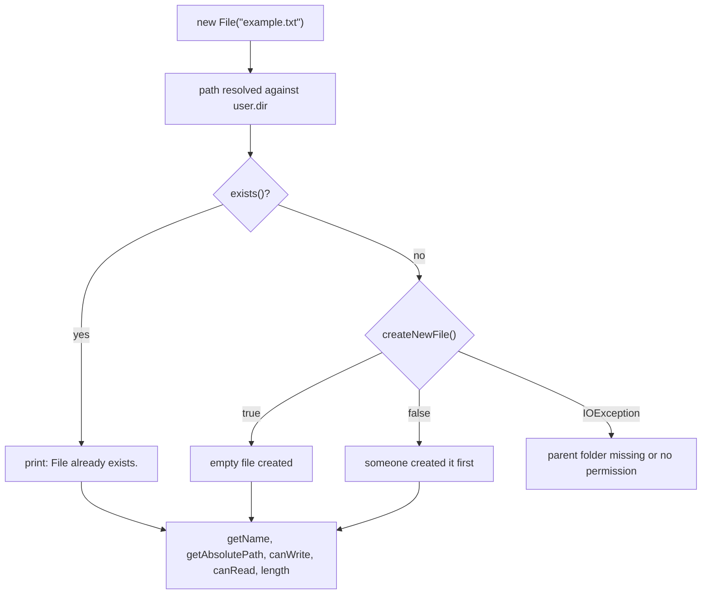
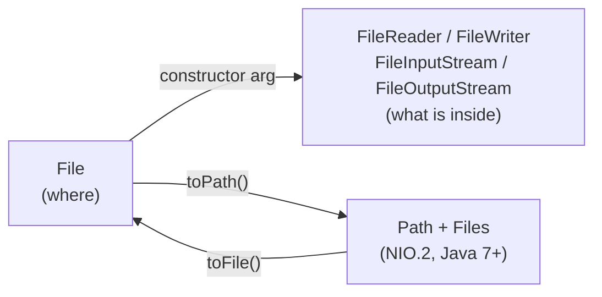

## In One Line
`java.io.File` is an **abstract path name** — a description of *where* a file or folder is — with methods to ask about it (exists? size? readable?) and to create, rename or delete it; it never reads or writes the file's **contents** (that is the job of streams).

## Mental Model
Think of a **library catalogue card**. The card says "shelf 3, row 2, *Java Basics*". Holding the card does not mean the book exists — somebody may have borrowed or lost it. You can use the card to ask the librarian questions ("is it on the shelf?", "how thick is it?"), to reserve a new slot, or to cross the entry out. But to actually **read** the book you must go and open it.

In the code:
- **The card** is the `File` object: `new File("example.txt")`. Creating it touches nothing on disk.
- **Asking the librarian** is `exists()`, `length()`, `canRead()`, `isDirectory()`.
- **Reserving a slot** is `createNewFile()` / `mkdir()`; crossing it out is `delete()`.
- **Opening the book** needs a stream: `new FileReader(file)`, `new FileWriter(file)` — the next lessons.

## Concept
### Where `File` fits in `java.io`
`java.io` has two very different kinds of classes:

| Kind | Classes | Deals with |
|---|---|---|
| **Path / metadata** | `File` | The *name* and *properties* of a file or directory |
| **Byte streams** | `InputStream`, `OutputStream` and subclasses (`FileInputStream`, `ObjectOutputStream`, ...) | Raw bytes (images, zip, serialized objects) |
| **Character streams** | `Reader`, `Writer` and subclasses (`FileReader`, `BufferedWriter`, ...) | Text (chars, decoded with a charset) |

`File` is the only one of these that does not move data. Every stream constructor that opens a file accepts either a `String` path or a `File`.

### A `File` is just a path
`new File("example.txt")` stores the string `"example.txt"` (normalised for the platform) and nothing else. No file is created, no disk check is made, and no exception is thrown even if the path is nonsense. The object is **immutable**: `renameTo` does not change the `File` object, it changes the disk — the old object still points at the old name.

### Relative paths and `user.dir`
A relative path like `"example.txt"` is resolved against the **current working directory** of the JVM, available as `System.getProperty("user.dir")`. That is the folder you launched `java` from — in an IDE it is usually the project root, not the folder of the `.java` file. This is why the course example creates `example.txt` next to `pom.xml` and why `getAbsolutePath()` shows a different folder on every machine.

### Constructors
| Constructor | Meaning |
|---|---|
| `File(String pathname)` | `new File("data/notes.txt")` |
| `File(String parent, String child)` | `new File("data", "notes.txt")` — joins with the right separator |
| `File(File parent, String child)` | `new File(dataDir, "notes.txt")` |
| `File(URI uri)` | `new File(URI.create("file:///tmp/a.txt"))` — only `file:` URIs |

Prefer the two-argument forms over string concatenation: they insert `File.separator` (`/` on Linux/macOS, `\` on Windows) for you. `File.pathSeparator` (`:` or `;`) is something else — it separates entries of a *list* of paths, like the classpath.

### The API by job
| Job | Methods | Returns / notes |
|---|---|---|
| Name parts | `getName()`, `getParent()`, `getParentFile()`, `getPath()` | Pure string work, no disk access |
| Full path | `getAbsolutePath()`, `getAbsoluteFile()` | Prefixes `user.dir` if relative; does **not** resolve `..` |
| Real path | `getCanonicalPath()`, `getCanonicalFile()` | Resolves `.`, `..` and symbolic links; hits the disk; throws `IOException` |
| Existence / type | `exists()`, `isFile()`, `isDirectory()`, `isHidden()`, `isAbsolute()` | `false` when missing |
| Permissions | `canRead()`, `canWrite()`, `canExecute()`, `setReadable/Writable/Executable`, `setReadOnly()` | Ask the OS for the *current user* |
| Size / time | `length()`, `lastModified()`, `setLastModified(long)` | `0L` when the file does not exist |
| Create | `createNewFile()`, `mkdir()`, `mkdirs()`, `File.createTempFile(prefix, suffix)` | `boolean` results |
| Delete / move | `delete()`, `deleteOnExit()`, `renameTo(File)` | `boolean` results |
| List a folder | `list()`, `listFiles()`, `listFiles(FileFilter)`, `listFiles(FilenameFilter)`, `File.listRoots()` | `null` if not a directory or on I/O error |
| Space | `getTotalSpace()`, `getFreeSpace()`, `getUsableSpace()` | Bytes on the partition |
| Bridge to NIO.2 | `toPath()` (and `Path.toFile()`) | Java 7+ |

### `createNewFile()` in detail
- **Atomic**: the check "does it exist?" and the creation happen as one OS operation, so two programs racing to create the same file cannot both get `true`. This makes it usable as a simple lock file.
- Returns `true` if it created an **empty** file, `false` if something with that name already exists (file *or* directory).
- Throws `IOException` if it cannot try at all — most often because the **parent folder does not exist** ("No such file or directory") or permission is denied.
- It never overwrites. (A `FileWriter`, by contrast, silently truncates an existing file.)

### `mkdir()` vs `mkdirs()`
`mkdir()` creates one directory and fails (returns `false`) if the parent is missing. `mkdirs()` creates every missing folder in the chain. Both return `false` if the directory already existed, so `false` does not always mean "error".

### Why the old `File` API is considered weak
`File` is from Java 1.0 and has real design problems that NIO.2 (`java.nio.file.Path` + `Files`, Java 7) fixed:

| Problem with `File` | NIO.2 answer |
|---|---|
| `delete()`, `renameTo()`, `mkdir()` return `false` with **no reason** | `Files.delete`, `Files.move`, `Files.createDirectory` throw `NoSuchFileException`, `DirectoryNotEmptyException`, `AccessDeniedException`, ... |
| `renameTo` behaves differently per OS (may fail across drives) | `Files.move(src, dst, ATOMIC_MOVE / REPLACE_EXISTING)` |
| `list()` returns `null` on error, loads everything in memory | `Files.list`, `Files.walk`, `DirectoryStream` (lazy) |
| No symbolic link support, no owner/POSIX permissions/attributes | `Files.isSymbolicLink`, `Files.readAttributes`, `PosixFilePermissions` |
| `equals` compares strings only | `Path.normalize()`, `Files.isSameFile` |

`File` is **not deprecated** and is still everywhere in older code and APIs (e.g. `new FileReader(File)`), so you must know it — but for new code prefer `Path`/`Files` (see [Path](lesson:a09-nio/01-path) and [Files](lesson:a09-nio/02-files)). Convert freely with `file.toPath()` and `path.toFile()`.

## Diagram

The example's decision path: a `File` is only a path until `createNewFile()` touches the disk, and `createNewFile()` has three outcomes, not two.


`File` names the file; streams move its contents; `Path`/`Files` is the modern replacement for the metadata operations.

## Code
@example IO/FileHandling/FileHandlingExample.java

A tour of the rest of the API, including the three outcomes of `createNewFile()` and the silent `false` of `delete()`:
```java
import java.io.File;
import java.io.IOException;

public class FileTour {
    public static void main(String[] args) throws IOException {
        File f = new File("demo/notes.txt");           // just a path, nothing on disk yet
        System.out.println("exists: " + f.exists());
        System.out.println("name: " + f.getName() + ", parent: " + f.getParent() + ", path: " + f.getPath());
        System.out.println("length of missing file: " + f.length());
        System.out.println("lastModified of missing file: " + f.lastModified());

        try {
            f.createNewFile();                          // parent folder "demo" is missing
        } catch (IOException e) {
            System.out.println("createNewFile failed: " + e.getMessage());
        }

        System.out.println("mkdirs: " + f.getParentFile().mkdirs());
        System.out.println("createNewFile #1: " + f.createNewFile());
        System.out.println("createNewFile #2: " + f.createNewFile());   // already there
        System.out.println("isFile: " + f.isFile() + ", isDirectory: " + f.isDirectory());

        File dir = f.getParentFile();
        System.out.println("list: " + String.join(",", dir.list()));
        System.out.println("delete non-empty dir: " + dir.delete());
        System.out.println("listFiles on a file: " + f.listFiles());

        File renamed = new File(dir, "renamed.txt");
        System.out.println("renameTo: " + f.renameTo(renamed));
        System.out.println("old exists: " + f.exists() + ", new exists: " + renamed.exists());
        System.out.println("delete file: " + renamed.delete() + ", delete dir: " + dir.delete());
    }
}
```
```output
exists: false
name: notes.txt, parent: demo, path: demo/notes.txt
length of missing file: 0
lastModified of missing file: 0
createNewFile failed: No such file or directory
mkdirs: true
createNewFile #1: true
createNewFile #2: false
isFile: true, isDirectory: false
list: notes.txt
delete non-empty dir: false
listFiles on a file: null
renameTo: true
old exists: false, new exists: true
delete file: true, delete dir: true
```

Three ways to print a path (run on Linux; `/tmp/app` does not need to exist):
```java
File f = new File("/tmp/app/../data/./report.txt");
System.out.println("getPath:          " + f.getPath());
System.out.println("getAbsolutePath:  " + f.getAbsolutePath());
System.out.println("getCanonicalPath: " + f.getCanonicalPath());

File a = new File("report.txt");
File b = new File("./report.txt");
System.out.println("equals: " + a.equals(b));
System.out.println("canonical equals: " + a.getCanonicalFile().equals(b.getCanonicalFile()));
System.out.println("separator=" + File.separator + " pathSeparator=" + File.pathSeparator);
System.out.println(new File("logs", "app.log").getPath());
```
```output
getPath:          /tmp/app/../data/./report.txt
getAbsolutePath:  /tmp/app/../data/./report.txt
getCanonicalPath: /tmp/data/report.txt
equals: false
canonical equals: true
separator=/ pathSeparator=:
logs/app.log
```

`File` says only `false`; NIO.2 tells you *why*:
```java
File dir = new File("box");
dir.mkdir();
File inside = new File(dir, "a.txt");
inside.createNewFile();

System.out.println("File.delete on non-empty dir -> " + dir.delete());
try {
    Files.delete(dir.toPath());
} catch (IOException e) {
    System.out.println(e.getClass().getSimpleName() + ": " + e.getMessage());
}
System.out.println("File.createNewFile on existing -> " + inside.createNewFile());
try {
    Files.createFile(inside.toPath());
} catch (IOException e) {
    System.out.println(e.getClass().getSimpleName() + ": " + e.getMessage());
}
```
```output
File.delete on non-empty dir -> false
DirectoryNotEmptyException: box
File.createNewFile on existing -> false
FileAlreadyExistsException: box/a.txt
```

## Walkthrough
- `import java.io.File;` — the only import; `File` lives in `java.io` since Java 1.0.
- `try { ... } catch (Exception e) { e.printStackTrace(); }` — needed because `createNewFile()` declares the checked `IOException`. (Catching the broad `Exception` is a shortcut — see Traps.)
- `File file = new File("example.txt");` — builds a path object. Nothing happens on disk. Because the path is relative, every later operation resolves it against `user.dir`, the folder the program was started from.
- `if (file.exists())` — the first real disk access: asks the OS whether something with that name exists (file or folder).
  - If yes → prints `File already exists.` and skips creation.
  - If no → `file.createNewFile()` atomically creates an empty file. It returns `true` → prints `File created: example.txt` (`getName()` is the last part of the path). If it returns `false`, another process created the file in the split second after `exists()` — the `Failed to create the file.` branch is practically unreachable, but it is the honest third case of a check-then-act race.
- `file.getName()` → `example.txt`: just the last name element, no folders.
- `file.getAbsolutePath()` → `user.dir` + `/` + `example.txt`. The recorded run shows `/home/you/project/example.txt` (the recorder replaced its temporary folder with that placeholder); on Windows you would see something like `C:\Users\...\example.txt`.
- `file.canWrite()` / `file.canRead()` → `true`: the current user may write/read the new file (they are OS permission checks, not "is the file open").
- `file.length()` → `0`: the file was just created empty. `length()` is the size in **bytes**, not characters, and would also be `0` for a file that does not exist.

The recorded output is the **first run in an empty folder**. The course's examples were recorded one after another in the same folder, and this one ran first, so `example.txt` did not exist yet. Run it a second time after the writer examples and you get `File already exists.` and a non-zero size (129 bytes after `BufferedWriterExample` has run).

## Traps
> [!ERRATA] The comment `// Output: Absolute path: C:\Users\hsahu\Desktop\hungrycoder\hungrycoder\example.txt` is the author's own Windows machine. The absolute path depends on the folder the JVM is started from (`user.dir`) — the recorded Linux run prints `/home/you/project/example.txt`. Never expect a fixed absolute path from a relative `File`.

> [!ERRATA] The `// Output:` comments (`File created: ...`, `File size in bytes: 0`) are only true for the **first** run in a folder without `example.txt`. On any later run the program prints `File already exists.` and the current size of the file.

> [!ERRATA] `catch (Exception e)` is broader than needed. The only checked exception here is `IOException` (from `createNewFile()`); catching `Exception` also swallows programming errors such as `NullPointerException` or `SecurityException`. Write `catch (IOException e)`. And `e.printStackTrace()` is fine for a demo but real code should log or rethrow.

- **`new File(...)` creates nothing.** Beginners expect `new File("a.txt")` to create a file. It does not — call `createNewFile()` or open a writer.
- **Silent `false` results.** `delete()`, `mkdir()`, `renameTo()`, `createNewFile()` report failure as `false`. If you ignore the return value, failures vanish. `delete()` on a non-empty directory returns `false` — it never deletes recursively.
- **`list()` / `listFiles()` can return `null`** (path is a file, folder missing, or I/O error). `for (File f : dir.listFiles())` then throws `NullPointerException`.
- **`length()` and `lastModified()` return `0` for a missing file** — you cannot tell "empty" from "missing" without `exists()`. `length()` of a directory is unspecified.
- **`getAbsolutePath()` does not clean up `..`**; only `getCanonicalPath()` does (and it can throw `IOException` because it asks the file system and follows symlinks).
- **`equals` compares path strings**, so `new File("a.txt").equals(new File("./a.txt"))` is `false` even though both name the same file. Compare canonical files, or use `Files.isSameFile`.
- **`canWrite()` asks the OS for the current user.** Running as root/Administrator, `canWrite()` can be `true` even after `setReadOnly()` — verified on Linux as root. Do not use it as a security check; just try the operation and handle the exception.
- **Check-then-act is racy.** `if (!f.exists()) f.createNewFile();` has a gap between the two calls. Since `createNewFile()` is itself atomic, just call it and look at the result.
- **`File.createTempFile(prefix, ...)` needs a prefix of at least 3 characters** — `"ab"` throws `IllegalArgumentException: Prefix string "ab" too short: length must be at least 3`.
- **Hard-coded separators** (`"data\\file.txt"`) break on other OSes. Use the two-argument constructor or `/` (Java on Windows accepts `/` too).

> [!WARNING] `new FileWriter(file)` on an existing file **truncates it to 0 bytes immediately**. `createNewFile()` never overwrites — that difference matters when you "create" a file you already have.

## Tips & Tricks
- **"File is the address, not the house."** Knowing the address does not mean the house exists, and you need a key (stream) to go inside.
- **Absolute vs Canonical: "Absolute adds, Canonical cleans."** Absolute = prefix `user.dir`. Canonical = prefix + resolve `.`/`..` + follow symlinks.
- **`mkdirs` with an `s` = "all the folders".** Use it before creating a file in a new nested folder: `f.getParentFile().mkdirs();`.
- **Always look at the `boolean`.** `if (!f.delete()) log.warn("could not delete " + f);` — or move to `Files.delete(path)` which throws with a reason.
- **Relative-path confusion in IDEs?** Print `System.getProperty("user.dir")` — it tells you where your relative files are really going.
- **Interview default:** "For new code I use `Path` and `Files`; I use `File` when an older API needs it and convert with `toPath()`."

## Interview Q&A
### [Basic] What is the `File` class and does `new File("a.txt")` create a file?
`java.io.File` is an abstract representation of a file or directory **path**. It lets you inspect metadata (`exists`, `length`, `isDirectory`, permissions, `lastModified`) and perform file-system operations (`createNewFile`, `mkdir(s)`, `delete`, `renameTo`, `list`). It does not read or write contents — streams do that. `new File("a.txt")` creates only a Java object holding the path; nothing is created on disk and no check is done. You create the file with `createNewFile()` or by opening a `FileWriter`/`FileOutputStream`.

**Follow-up:** *Is a `File` object mutable?* — No, it is immutable. `renameTo` changes the disk, but the `File` object still holds the old path.

### [Basic] What is the difference between `mkdir()` and `mkdirs()`?
`mkdir()` creates exactly one directory and returns `false` if its parent does not exist. `mkdirs()` creates the directory and all missing parent directories. Both return `false` if the directory already exists, so `false` is not necessarily an error. A typical pattern before writing a file into a new folder is `file.getParentFile().mkdirs();`.

**Follow-up:** *What is the NIO.2 equivalent?* — `Files.createDirectories(path)`, which does not fail if the directory already exists and throws a descriptive exception on real errors.

### [Basic] What does `createNewFile()` return and when does it throw?
It returns `true` if it created a new empty file and `false` if a file or directory with that name already exists; it never overwrites. It throws `IOException` if the operation cannot be attempted — for example the parent directory does not exist or there is no permission. The check and the creation are **atomic**, so two processes cannot both get `true` for the same name.

**Follow-up:** *So is `if (!f.exists()) f.createNewFile();` a good idea?* — The `exists()` check is redundant and racy (check-then-act); call `createNewFile()` directly and use its return value.

### [Intermediate] What is the difference between `getPath()`, `getAbsolutePath()` and `getCanonicalPath()`?
- `getPath()` returns the path exactly as given to the constructor (normalised separators only).
- `getAbsolutePath()` makes it absolute by prefixing the current working directory (`user.dir`) if needed; it does **not** resolve `.` or `..` and does not touch the disk.
- `getCanonicalPath()` returns the unique real path: absolute, with `.` and `..` removed and symbolic links resolved. It may access the file system and therefore throws `IOException`.

For `/tmp/app/../data/./report.txt` the first two print it unchanged and the canonical path is `/tmp/data/report.txt`.

**Follow-up:** *How do you check that two `File`s point to the same file?* — Compare `getCanonicalFile()`s, or better `Files.isSameFile(a.toPath(), b.toPath())`; `File.equals` only compares the path strings.

### [Intermediate] Where does a relative path like `new File("example.txt")` point?
To the **current working directory of the JVM process**, `System.getProperty("user.dir")` — the directory from which `java` was launched. In an IDE this is usually the project root (configurable in the run configuration), not the package folder of the class. That is why the same program writes files to different places depending on how it is started. For resources bundled with the application use the classpath (`getResourceAsStream`) instead of relative file paths.

**Follow-up:** *Can you change `user.dir` at runtime?* — Setting the property does not reliably change how the OS resolves relative paths; it is effectively fixed at startup. Build absolute paths explicitly instead.

### [Intermediate] Why is `File` considered a weak API, and what replaced it?
Its operations report failure with a bare `boolean` (no reason), `renameTo` is platform-dependent, `list()` returns `null` on error and loads all names at once, there is no support for symbolic links or rich attributes (owner, POSIX permissions), and `equals` is purely textual. Java 7's NIO.2 introduced `Path` (the path) and `Files` (the operations): methods throw specific exceptions (`NoSuchFileException`, `DirectoryNotEmptyException`, `FileAlreadyExistsException`, `AccessDeniedException`), support atomic moves, links, attributes, lazy directory streams and file watching.

**Follow-up:** *How do you convert between them?* — `file.toPath()` and `path.toFile()`.

### [Intermediate] How do you delete a directory that contains files?
`File.delete()` only deletes empty directories (returns `false` otherwise). You must delete the children first, deepest first. With NIO.2:
```java
try (Stream<Path> walk = Files.walk(root)) {
    walk.sorted(Comparator.reverseOrder())      // children before parents
        .forEach(p -> { try { Files.delete(p); } catch (IOException e) { throw new UncheckedIOException(e); } });
}
```
**Follow-up:** *Why `reverseOrder()`?* — `Files.walk` lists a directory before its contents; reversing puts every file before the directory that contains it.

### [Advanced] Is `File.exists()` reliable for deciding what to do next?
Only as a snapshot. Between `exists()` and the next action another process can create, delete or replace the file (a TOCTOU — time-of-check-to-time-of-use — race). It can also return `false` when the file exists but you lack permission to see it. Robust code performs the operation directly and handles the outcome: `createNewFile()` (atomic), `Files.createFile` (throws `FileAlreadyExistsException`), `Files.newOutputStream(path, CREATE_NEW)`, or opening a reader and catching `NoSuchFileException`/`FileNotFoundException`.

**Follow-up:** *What does `Files.notExists` add?* — `Files.exists` and `Files.notExists` can both be `false` when the status cannot be determined (e.g. no permission), which makes the uncertainty explicit.

### [Advanced] What does `deleteOnExit()` do, and why is it risky?
It registers the path to be deleted when the JVM shuts down **normally**. The registrations are held in memory until exit and cannot be cancelled, so calling it for many temp files in a long-running server is a memory leak, and it does nothing if the JVM is killed or crashes. Prefer deleting temp files explicitly (e.g. in `finally`) or using `Files.newOutputStream(path, StandardOpenOption.DELETE_ON_CLOSE)`.

**Follow-up:** *How do you create a temp file safely?* — `File.createTempFile(prefix, suffix)` or `Files.createTempFile(...)`; both generate a unique random name. The `File` version requires a prefix of at least three characters.

## Quiz
### What does this print (the file `ghost.txt` does not exist)?
```java
File f = new File("ghost.txt");
System.out.println(f.exists() + " " + f.length() + " " + f.getName());
```
- [ ] Nothing: `new File` throws `FileNotFoundException`
- [x] false 0 ghost.txt
- [ ] true 0 ghost.txt
- [ ] false -1 ghost.txt
> Constructing a `File` never touches the disk and never throws for a missing file. `exists()` is `false`, and `length()` returns `0` (not `-1`) for a missing file. `getName()` is pure string work.

### What does this print in an empty folder?
```java
File g = new File("fresh.txt");
System.out.println(g.createNewFile() + " " + g.createNewFile());
```
- [ ] true true
- [x] true false
- [ ] true, then an IOException
- [ ] false false
> The first call creates the empty file and returns `true`. The second finds it already there and returns `false` — `createNewFile()` never overwrites and does not throw just because the file exists. It throws only when it cannot try (e.g. missing parent folder).

### Which call resolves `..` and symbolic links?
- [ ] `getPath()`
- [ ] `getAbsolutePath()`
- [x] `getCanonicalPath()`
- [ ] `toString()`
> `getAbsolutePath()` only prefixes `user.dir`; `/tmp/app/../data/report.txt` stays as it is. `getCanonicalPath()` asks the file system and returns the real path `/tmp/data/report.txt`, which is why it can throw `IOException`.

### Spot the bug: the folder `logs` is never removed. Why?
```java
File logs = new File("logs");
logs.delete();   // logs contains app.log
System.out.println("cleaned up");
```
- [ ] `delete()` needs an absolute path
- [x] `delete()` refuses to delete a non-empty directory and just returns `false`, which is ignored
- [ ] `delete()` only works on files, never on directories
- [ ] The deletion happens only when the JVM exits
> `File.delete()` removes files and **empty** directories. For a non-empty one it returns `false` without an exception, and the code ignores the result. Delete the children first (e.g. `Files.walk` in reverse order) and check results or use `Files.delete`, which throws `DirectoryNotEmptyException`. It is not `deleteOnExit()`, so nothing is deferred.

### What does `new File("report.txt").equals(new File("./report.txt"))` return?
- [ ] true, both name the same file
- [x] false
- [ ] It throws `IOException`
> `File.equals` compares the abstract path names as strings (case-sensitivity depends on the OS). `"report.txt"` and `"./report.txt"` are different strings, so the answer is `false`. Compare `getCanonicalFile()` values (verified: `true`) or use `Files.isSameFile`.

### Where does `new File("example.txt")` create the file when you call `createNewFile()` from an IDE?
- [ ] Next to the `.java` source file
- [ ] In the `target/classes` folder
- [x] In the JVM's working directory, `System.getProperty("user.dir")` — usually the project root in an IDE
- [ ] In the user's home directory
> Relative paths are resolved against the process's working directory, not the source or class location. IDEs usually start the JVM in the project root, which is why the course's `example.txt` appears next to `pom.xml`.

## Takeaways
- `java.io.File` represents a **path**, not file contents; `new File(...)` never touches the disk.
- Relative paths resolve against `user.dir`, the JVM's working directory — which is why absolute paths differ per machine and per IDE setting.
- `createNewFile()` is atomic, returns `false` if the file exists, and throws `IOException` when the parent folder is missing; it never overwrites.
- Many `File` methods signal failure with a silent `false` or `null` (`delete`, `mkdir`, `renameTo`, `list`) — always check the result.
- `getAbsolutePath()` only prefixes the working directory; `getCanonicalPath()` resolves `.`, `..` and symlinks; `File.equals` compares strings.
- For new code prefer NIO.2 `Path` + `Files` (clear exceptions, atomic moves, links, attributes); convert with `toPath()` / `toFile()`.
