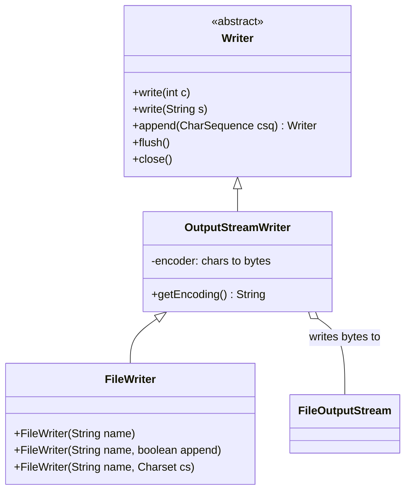
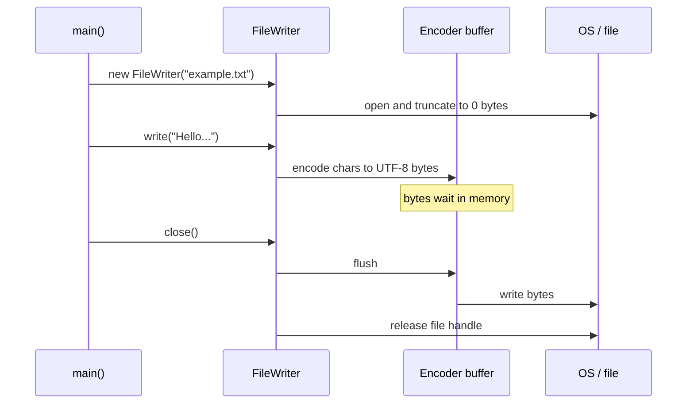

## In One Line
`FileWriter` is the simplest way to write **text** to a file: it takes Java characters, **encodes** them to bytes with a charset (UTF-8 by default since JDK 18), and pushes the bytes into the file — overwriting it unless you ask for **append** mode — and nothing is guaranteed to be on disk until you `flush()` or `close()` it.

## Mental Model
Think of a **translator dictating to a typist**. You speak in your language (Java `char`s). The translator (the *encoder*) converts every word into the typist's alphabet (bytes, using a *charset* such as UTF-8). The typist does not type every letter the moment it is heard — they fill a notepad first (a small internal buffer) and type it out in batches.

In the code:
- **You speaking** = `writer.write("Hello...")`.
- **The translator** = `OutputStreamWriter`, which `FileWriter` extends — it encodes chars to bytes.
- **The typist's notepad** = the encoder's byte buffer; `flush()` means "type out what is on the notepad now", `close()` means "type it out and go home".
- **Choosing the alphabet** = the `Charset` you pass (or the default one).
- **A fresh page vs continuing the last page** = overwrite mode (`new FileWriter(name)`) vs append mode (`new FileWriter(name, true)`).

## Concept
### The four roots of `java.io`
Everything in classic Java I/O descends from four abstract classes:

| | Input (read) | Output (write) | Unit |
|---|---|---|---|
| **Byte streams** | `InputStream` | `OutputStream` | `byte` (8 bits) — any data: images, zip, serialized objects |
| **Character streams** | `Reader` | `Writer` | `char` (16-bit UTF-16 code unit) — text only |

Character streams exist because text is not bytes. The same `é` is one byte in ISO-8859-1 and two bytes in UTF-8. A `Writer` lets you think in characters and hides the encoding step. Under the hood, every file is still bytes, so every file `Writer` eventually sits on top of an `OutputStream`.

### Where `FileWriter` sits
```text
Writer (abstract)                     write(int), write(char[]), write(String), append, flush, close
 └─ OutputStreamWriter                bridge: chars -> bytes using a Charset
     └─ FileWriter                    convenience: opens a FileOutputStream for you
```
So `new FileWriter("a.txt")` is essentially `new OutputStreamWriter(new FileOutputStream("a.txt"))`. `FileWriter` adds **no methods of its own** — only constructors.

Other `Writer`s you will meet:

| Class | Role |
|---|---|
| `BufferedWriter` | Decorator: adds an 8 KB char buffer and `newLine()` ([next-but-one lesson](lesson:a08-io/04-bufferedwriter)) |
| `PrintWriter` | Decorator: `print`, `println`, `printf`; **swallows** `IOException` (check with `checkError()`) |
| `StringWriter` / `CharArrayWriter` | Write into memory (a `StringBuffer` / `char[]`) |
| `OutputStreamWriter` | Bridge over *any* `OutputStream` (socket, `System.out`, zip entry) |
| `PipedWriter`, `FilterWriter` | Thread pipes; base class for your own decorators |

### Constructors
| Constructor | Since | Meaning |
|---|---|---|
| `FileWriter(String name)` / `FileWriter(File file)` | 1.1 | Overwrite, default charset |
| `FileWriter(String name, boolean append)` / `FileWriter(File, boolean)` | 1.1 / 1.4 | `true` = append to the end |
| `FileWriter(String name, Charset cs)` / `FileWriter(File, Charset)` | **11** | Explicit charset |
| `FileWriter(String name, Charset cs, boolean append)` / `FileWriter(File, Charset, boolean)` | **11** | Both |
| `FileWriter(FileDescriptor fd)` | 1.1 | Wrap an already-open descriptor |

All except the `FileDescriptor` one throw `IOException`. Opening a file for writing **creates it** if missing and, in overwrite mode, **truncates it to 0 bytes immediately** — before you write anything. It fails with `FileNotFoundException` (a subclass of `IOException`) if the parent folder does not exist or the path is a directory.

### The write methods (all inherited from `Writer`)
| Method | Writes | Watch out |
|---|---|---|
| `write(int c)` | **one character** whose code is `c` | `write(65)` writes `A`, not `"65"` |
| `write(String s)` | the whole string | `write((String) null)` throws `NullPointerException` |
| `write(String s, int off, int len)` | part of a string | |
| `write(char[] cbuf)` / `write(char[], off, len)` | chars from an array | |
| `append(CharSequence csq)` / `append(char c)` | same as write, but **returns the Writer** so calls chain | `append(null)` writes the four characters `null` |
| `flush()` | pushes buffered data to the OS | does not close |
| `close()` | flushes, then releases the file handle | writing after close throws `IOException: Stream closed` |

### Buffering inside `FileWriter`
`FileWriter` is often called "unbuffered", but that is only half true. Its encoder (`OutputStreamWriter`'s internal `StreamEncoder`) keeps a **byte buffer**, so small writes sit in memory until the buffer fills, you call `flush()`, or you call `close()`. In JDK 21 that buffer starts small (about 512 bytes — in a test, 20 000 one-character writes caused 40 writes to the file) and can grow up to 8 KB. What `FileWriter` lacks is a **character** buffer: every `write` call goes through the encoder with its lock and bookkeeping. That is why you wrap it in a `BufferedWriter` for many small writes.

Consequences:
- If the program ends without `close()`/`flush()`, the last chunk of text is **lost**. The JVM does not flush writers at exit.
- `flush()` hands the bytes to the operating system. It does not force them onto the physical disk (that is `FileChannel.force` / `FileDescriptor.sync`), but other programs can now see them.

### Charsets and JEP 400 (the default changed in JDK 18)
Encoding is where text bugs come from:

| JDK | Default charset used by `FileWriter`/`FileReader` without a `Charset` argument |
|---|---|
| 1.1 – 17 | The **platform** encoding (`file.encoding`): often `windows-1252` on Windows, UTF-8 on most Linux/macOS |
| **18+** (JEP 400) | **UTF-8 everywhere**, regardless of OS locale |

Useful properties (all real in JDK 17+/18+):
- `Charset.defaultCharset()` / `file.encoding` — the default used by `FileWriter`, `FileReader`, `String.getBytes()`.
- `native.encoding` (JDK 17+) — what the OS locale says; what the default used to be.
- `stdout.encoding` (JDK 19+) — the encoding of `System.out`, which can differ from both. This is why `é` sometimes prints as `?` on a console even though the file is correct.
- `-Dfile.encoding=COMPAT` restores the pre-18 behaviour.

A character the charset cannot represent is replaced (with `?` for most single-byte charsets) — silently. Best practice: **always pass the charset explicitly** (`StandardCharsets.UTF_8`), both when writing and reading.

### Line separators
`"\n"` is a Unix line ending. Windows traditionally uses `"\r\n"`. `FileWriter` writes exactly the characters you give it — no translation. For platform line endings use `System.lineSeparator()`, `BufferedWriter.newLine()` or `PrintWriter.println()`. Most modern tools read either, so `"\n"` is usually fine, but be consistent.

### Modern alternatives (Java 7/11)
```java
Files.writeString(Path.of("a.txt"), "Hello\n");                                   // Java 11, UTF-8
Files.writeString(Path.of("a.txt"), "more\n", StandardOpenOption.APPEND);
Files.write(Path.of("a.txt"), List.of("line 1", "line 2"));                       // Java 7, adds line separators
try (BufferedWriter w = Files.newBufferedWriter(Path.of("a.txt"))) { ... }        // Java 8, UTF-8, buffered
```
These default to UTF-8 on every JDK version and take `OpenOption`s (`APPEND`, `CREATE_NEW`, `TRUNCATE_EXISTING`).

## Diagram

`FileWriter` is only a convenience subclass: the encoding happens in `OutputStreamWriter`, and the bytes go to a `FileOutputStream`.


Text reaches the file only when the buffer is flushed — by a full buffer, `flush()`, or `close()`.

## Code
@example IO/FileHandling/FileWriterExample.java

Append vs overwrite, and what is really on disk before `flush()`:
```java
import java.io.*;
import java.nio.charset.Charset;
import java.nio.file.*;

public class WriterDemo {
    public static void main(String[] args) throws IOException {
        Path p = Path.of("log.txt");

        try (FileWriter w = new FileWriter("log.txt")) {          // overwrite mode
            w.write("one\n");
        }
        try (FileWriter w = new FileWriter("log.txt", true)) {    // append mode
            w.write("two\n");
        }
        System.out.print(Files.readString(p));

        FileWriter leaky = new FileWriter("log.txt");               // truncates immediately!
        System.out.println("size right after opening: " + Files.size(p));
        leaky.write("hello");
        System.out.println("size after write, before flush: " + Files.size(p));
        leaky.flush();
        System.out.println("size after flush: " + Files.size(p));
        leaky.close();

        try (FileWriter w = new FileWriter("log.txt")) {
            w.write(65);                         // an int is a CHARACTER code
            w.write("BCD", 1, 2);               // offset 1, length 2
            w.append('E').append("FG").append(null);   // append(null) writes "null"
            w.write(new char[] {'!', '?'});
        }
        System.out.println(Files.readString(p));

        try (FileWriter w = new FileWriter("log.txt")) {
            w.write((String) null);
        } catch (NullPointerException e) {
            System.out.println("write(null) -> NullPointerException");
        }
        System.out.println("default charset: " + Charset.defaultCharset());
    }
}
```
```output
one
two
size right after opening: 0
size after write, before flush: 0
size after flush: 5
ACDEFGnull!?
write(null) -> NullPointerException
default charset: UTF-8
```

The same 7 characters become a different number of bytes depending on the charset — and `₹` cannot be represented in ISO-8859-1 at all:
```java
String text = "café ₹5";            // "café ₹5": 7 chars
try (FileWriter w = new FileWriter("utf8.txt", StandardCharsets.UTF_8)) { w.write(text); }
try (FileWriter w = new FileWriter("latin1.txt", StandardCharsets.ISO_8859_1)) { w.write(text); }

byte[] u = Files.readAllBytes(Path.of("utf8.txt"));
byte[] l = Files.readAllBytes(Path.of("latin1.txt"));
HexFormat hex = HexFormat.ofDelimiter(" ");
System.out.println("chars in text: " + text.length());
System.out.println("UTF-8   " + u.length + " bytes: " + hex.formatHex(u));
System.out.println("Latin-1 " + l.length + " bytes: " + hex.formatHex(l));
```
```output
chars in text: 7
UTF-8   10 bytes: 63 61 66 c3 a9 20 e2 82 b9 35
Latin-1 7 bytes: 63 61 66 e9 20 3f 35
```
`é` is `c3 a9` in UTF-8 but `e9` in Latin-1; `₹` is three bytes in UTF-8 and was silently replaced by `3f` (`?`) in Latin-1.

JEP 400 in action — the same program printing its encoding settings on a Linux machine whose locale is plain POSIX (ASCII), first normally, then with `-Dfile.encoding=COMPAT` (the pre-JDK-18 behaviour):
```java
for (String k : new String[]{"file.encoding", "native.encoding", "stdout.encoding"})
    System.out.println(k + " = " + System.getProperty(k));
System.out.println("Charset.defaultCharset() = " + Charset.defaultCharset());
```
```output
file.encoding = UTF-8
native.encoding = ANSI_X3.4-1968
stdout.encoding = ANSI_X3.4-1968
Charset.defaultCharset() = UTF-8
```
```output
file.encoding = ANSI_X3.4-1968
native.encoding = ANSI_X3.4-1968
stdout.encoding = ANSI_X3.4-1968
Charset.defaultCharset() = US-ASCII
```
On JDK 21 files default to UTF-8 even though the OS says ASCII; with `COMPAT` (or on JDK 17 and older) a `FileWriter` on this machine would turn every non-ASCII character into `?`. The values you see depend on your OS settings.

## Walkthrough
- `import java.io.FileWriter; import java.io.IOException;` — `FileWriter` constructors and `write`/`close` all declare the checked `IOException`, so it must be caught or declared.
- `FileWriter writer = new FileWriter("example.txt");` — opens `example.txt` in the working directory (`user.dir`) in **overwrite** mode with the **default charset** (UTF-8 on JDK 18+). If the file exists — and in the course run it does, created empty by the previous `File` example — it is truncated to 0 bytes right here. If it does not exist, it is created.
- `writer.write("Hello, this is an example of writing to a file.\n");` — the characters are encoded to bytes and placed in the encoder's buffer. The `\n` is a Unix line feed; it is what ends the first line.
- `writer.write("This is the second line.\n");` — the same for the second line. At this point the file may still be empty on disk.
- `writer.close();` — flushes the buffered bytes into the file and releases the OS file handle. Without this line the file would stay empty (verified: a version without `close()` leaves a 0-byte file).
- `System.out.println("Successfully wrote to the file.");` — prints the only console output. It is correctly placed *after* `close()`: only then is the write really complete.
- `catch (IOException e) { e.printStackTrace(); }` — handles failures such as a missing folder (`FileNotFoundException: ... (No such file or directory)`), a path that is a directory (`(Is a directory)`), or a full disk.

The file now contains the two lines (73 bytes), which is exactly what the next lesson's `FileReaderExample` prints.

## Traps
> [!ERRATA] The example closes the writer only on the happy path. If either `write` throws, `writer.close()` is skipped: the file handle leaks and buffered text is lost. Since Java 7 the correct form is try-with-resources: `try (FileWriter writer = new FileWriter("example.txt")) { ... }`, which closes the writer on every path (see [BufferedWriter](lesson:a08-io/04-bufferedwriter) for the full story).

> [!ERRATA] `new FileWriter("example.txt")` relies on the default charset. On JDK 18+ that is UTF-8, but on JDK 8–17 it is the platform encoding, so the same program could write `windows-1252` on one machine and UTF-8 on another. State it: `new FileWriter("example.txt", StandardCharsets.UTF_8)` (Java 11+).

- **Forgetting `close()`/`flush()` loses data.** The JVM does not flush writers on exit. A program that writes and ends without closing produces an empty or truncated file.
- **Overwrite is the default.** `new FileWriter(name)` wipes the file the moment it is opened — even if you then write nothing. Use `new FileWriter(name, true)` to append.
- **`write(int)` writes a character, not a number.** `write(65)` writes `A`. To write the digits, use `write(String.valueOf(65))` or `PrintWriter.print(65)`.
- **`write(null)` throws, `append(null)` writes `"null"`.** They look interchangeable but are not.
- **Missing parent folder = `FileNotFoundException`.** `FileWriter` creates the file, never the folders. Call `file.getParentFile().mkdirs()` or `Files.createDirectories` first.
- **Binary data does not belong in a `Writer`.** Encoding is lossy for arbitrary bytes. Use `FileOutputStream` for images, PDFs, zip files.
- **Unmappable characters vanish silently.** Writing `₹` with ISO-8859-1 produced `?` with no exception. If you need an error instead, build the encoder yourself: `new OutputStreamWriter(out, StandardCharsets.ISO_8859_1.newEncoder())` reports unmappable characters by throwing.
- **Many small writes are slow.** Every call pays for locking and encoding; wrap in `BufferedWriter` when writing in a loop.

## Tips & Tricks
- **"Writer for words, Stream for stuff."** Text → `Reader`/`Writer`; everything else → `InputStream`/`OutputStream`.
- **Remember the append flag as "true = keep the old text".** `new FileWriter(f, true)`.
- **Default template for writing text in modern Java:**
  ```java
  try (BufferedWriter w = Files.newBufferedWriter(path, StandardCharsets.UTF_8)) {
      w.write("line");
      w.newLine();
  }
  ```
  One-liners: `Files.writeString(path, text)` (Java 11).
- **Always name the charset** in production code, even on JDK 18+ — it documents intent and protects code that might run on older JVMs.
- **Print `Charset.defaultCharset()` when debugging "weird characters"**, and remember the console has its own `stdout.encoding`.
- **`flush()` = "send it now", `close()` = "send it now and hang up".** You never need `flush()` right before `close()`.

## Interview Q&A
### [Basic] What is the difference between byte streams and character streams?
Byte streams (`InputStream`/`OutputStream`) move raw 8-bit bytes and are used for any binary data — images, audio, zip files, serialized objects. Character streams (`Reader`/`Writer`) move 16-bit `char`s and are for text; they convert between characters and bytes using a **charset**. A character stream for a file is always built on top of a byte stream: `FileWriter` is an `OutputStreamWriter` over a `FileOutputStream`. The bridge classes are `InputStreamReader` (bytes → chars) and `OutputStreamWriter` (chars → bytes).

**Follow-up:** *Can you write an image with a `FileWriter`?* — You should not: decoding/encoding arbitrary bytes as characters corrupts values that are not valid in the charset. Use `FileOutputStream`.

### [Basic] How do you append to a file instead of overwriting it?
Use the constructor with the `append` flag: `new FileWriter("log.txt", true)` (or `new FileWriter(file, charset, true)` since Java 11). Without it, `FileWriter` truncates the file to zero length as soon as it is opened. With NIO.2: `Files.writeString(path, text, StandardOpenOption.CREATE, StandardOpenOption.APPEND)`.

**Follow-up:** *What happens if the file does not exist in append mode?* — It is created. Only a missing parent directory causes `FileNotFoundException`.

### [Basic] What is the difference between `flush()` and `close()`?
`flush()` pushes any buffered data to the underlying stream/OS but keeps the writer open for more writes. `close()` flushes and then releases the file handle; after it, any write throws `IOException: Stream closed`. `close()` on an already-closed writer does nothing. You call `flush()` when you need the data visible while you keep writing (a log, a network protocol); otherwise `close()` alone is enough.

**Follow-up:** *Does `flush()` guarantee the data is on the physical disk?* — No. It hands the bytes to the OS; the OS may still cache them. Use `FileChannel.force(true)` or `FileOutputStream.getFD().sync()` for durability.

### [Intermediate] Is `FileWriter` buffered?
Partly. Its encoder keeps an internal **byte** buffer, so small writes are batched before reaching the file (in JDK 21 about 512 bytes initially, growing up to 8 KB), and that is why unclosed writers lose data. But it has no **character** buffer: every `write` call goes through the encoder with synchronization and per-call overhead. `BufferedWriter` adds an 8192-char buffer on top, turning thousands of tiny writes into a few large ones, and adds `newLine()`.

**Follow-up:** *So why do people say "always wrap FileWriter in BufferedWriter"?* — Because code that writes in a loop (char by char or line by line) becomes much faster, and `newLine()` is convenient. For one big `write(String)` the difference is small.

### [Intermediate] What charset does `FileWriter` use, and what changed in JDK 18?
Without a `Charset` argument it uses `Charset.defaultCharset()`. Up to JDK 17 that was the platform encoding from the OS locale (e.g. `windows-1252` on many Windows machines), so files were not portable between machines. JEP 400 in JDK 18 made **UTF-8 the default everywhere**; the old OS value is still available as the `native.encoding` property and `-Dfile.encoding=COMPAT` restores the old behaviour. Java 11 added constructors taking a `Charset`, and best practice is to always pass one.

**Follow-up:** *Does JEP 400 change `System.out`?* — No. Console output uses `stdout.encoding` (JDK 19+), derived from the terminal, which is why a correct UTF-8 file can still print `?` on a console.

### [Intermediate] What happens to characters that the chosen charset cannot encode?
`FileWriter`/`OutputStreamWriter` created with a `Charset` use the **replace** policy: unmappable characters become the charset's replacement bytes (for ISO-8859-1, `?`) without any exception, so data is lost silently. To fail loudly, pass a `CharsetEncoder` configured with `CodingErrorAction.REPORT` (the default for a fresh `charset.newEncoder()`): `new OutputStreamWriter(out, StandardCharsets.ISO_8859_1.newEncoder())`, which then throws `UnmappableCharacterException`.

**Follow-up:** *Which charset can encode every Java `String`?* — UTF-8 (and UTF-16/UTF-32): they cover all of Unicode.

### [Intermediate] Why does `writer.write(65)` write `A`?
`Writer.write(int c)` writes a **single character** — the low 16 bits of the int are treated as a UTF-16 code unit — so 65 is `'A'`. It exists so you can pass the result of `Reader.read()` straight through. To write the text `65`, call `write("65")`, `write(String.valueOf(n))`, or use `PrintWriter.print(int)`.

**Follow-up:** *And `OutputStream.write(int)`?* — Writes one **byte**: only the lowest 8 bits are kept, so `write(321)` writes `65`.

### [Advanced] Compare `FileWriter`, `PrintWriter`, `BufferedWriter`, and `Files.writeString`.
| | `FileWriter` | `BufferedWriter` | `PrintWriter` | `Files.writeString` / `newBufferedWriter` |
|---|---|---|---|---|
| Role | Opens file + encodes | Decorator: char buffer + `newLine()` | Decorator: `print/println/printf` formatting | NIO.2 helpers |
| Errors | Throws `IOException` | Throws | **Swallows**; check `checkError()` | Throws |
| Charset | Default (UTF-8 on 18+) or explicit (11+) | Of the wrapped writer | Of the wrapped writer / explicit | UTF-8 by default |
| Line separator | You write it | `newLine()` = platform | `println()` = platform | `Files.write(lines)` adds platform separator |

Typical production choice: `Files.newBufferedWriter(path, UTF_8, options)` for streaming output, `Files.writeString` for small files, `PrintWriter` when formatting and you are fine checking `checkError()`.

**Follow-up:** *Why is swallowing exceptions in `PrintWriter` dangerous?* — A full disk or closed socket goes unnoticed unless you call `checkError()`, so writes silently disappear.

### [Advanced] What goes wrong if two threads (or two `FileWriter`s) write to the same file?
A single `Writer` instance is internally synchronized per call, so each `write` call is atomic with respect to other calls on the same writer — but a logical line made of several calls can interleave with another thread's calls. Two separate `FileWriter`s on the same file in overwrite mode each keep their own file position, so they overwrite each other's bytes; in append mode the OS appends each flushed chunk at the current end, but chunk boundaries are buffer-sized, not line-sized, so lines can still interleave. Use a single writer with one call per record (or external locking with `FileChannel.lock()`), or a logging framework.

**Follow-up:** *Is `FileWriter` thread-safe?* — Each method is synchronized on the writer's lock, so it will not corrupt its internal state, but it gives no ordering guarantees across multiple calls.

## Quiz
### What does this print?
```java
try (FileWriter w = new FileWriter("q.txt")) {
    w.write(65);
    w.write("65");
}
System.out.println(Files.readString(Path.of("q.txt")));
```
- [ ] 6565
- [x] A65
- [ ] 65A
- [ ] AA
> `write(int)` writes one character whose code is the int — 65 is `A`. `write(String)` writes the text `65`. The tempting `6565` assumes `write(65)` writes digits, which only `PrintWriter.print(65)` would do.

### What does this print?
```java
try (FileWriter w = new FileWriter("a.txt")) { w.write("one"); }
try (FileWriter w = new FileWriter("a.txt")) { w.write("two"); }
try (FileWriter w = new FileWriter("a.txt", true)) { w.write("three"); }
System.out.println(Files.readString(Path.of("a.txt")));
```
- [ ] onetwothree
- [x] twothree
- [ ] three
- [ ] onethree
> The second writer opens in overwrite mode and truncates `one` away. The third opens with `append = true` and adds `three` after `two`. `onetwothree` would need append mode on the second writer too.

### Spot the bug: the program prints its message but `lost.txt` is empty (0 bytes). Why?
```java
FileWriter writer = new FileWriter("lost.txt");
writer.write("Hello, this will never reach the disk.\n");
System.out.println("Done (but I forgot close())");
```
- [ ] `FileWriter` needs `append = true` to write anything
- [ ] The text needs `\r\n` to be flushed
- [x] The text sits in the writer's internal buffer and is never flushed because `close()` is never called
- [ ] `FileWriter` only writes when the JVM exits normally
> `FileWriter`'s encoder buffers bytes, and the JVM does not flush open writers at exit. Verified: the file stays at 0 bytes. Use try-with-resources so `close()` always runs. Line endings have nothing to do with flushing.

### Which statement about `new FileWriter("report.txt")` is true?
- [ ] It throws `FileNotFoundException` if `report.txt` does not exist
- [ ] It appends to `report.txt` by default
- [x] It creates `report.txt` if missing and truncates it to 0 bytes if it exists
- [ ] It creates any missing parent folders
> Opening a `FileWriter` creates the file or empties an existing one immediately. It throws `FileNotFoundException` only if it cannot open the file at all — e.g. the parent folder is missing (folders are never created) or the path is a directory.

### On JDK 21, what charset does `new FileWriter("a.txt")` use on a Windows machine whose locale encoding is windows-1252?
- [ ] windows-1252, the platform encoding
- [x] UTF-8
- [ ] UTF-16, because Java chars are UTF-16
- [ ] US-ASCII
> Since JDK 18 (JEP 400) the default charset is UTF-8 on every OS; the OS value is only in the `native.encoding` property. On JDK 17 and older the answer would have been windows-1252. Java's in-memory UTF-16 has nothing to do with the file encoding.

### Which class actually converts characters to bytes when you use a `FileWriter`?
- [ ] `FileWriter` itself
- [x] `OutputStreamWriter` (its encoder), which `FileWriter` extends
- [ ] `FileOutputStream`
- [ ] `BufferedWriter`
> `FileWriter` only adds constructors; the encoding is done by `OutputStreamWriter`'s charset encoder, and the resulting bytes are written by a `FileOutputStream`, which knows nothing about characters.

## Takeaways
- `java.io` has four roots: `InputStream`/`OutputStream` for bytes, `Reader`/`Writer` for characters; character streams encode/decode through a charset on top of byte streams.
- `FileWriter` = `OutputStreamWriter` + `FileOutputStream`; it adds only constructors — `(name)`, `(name, append)`, and since Java 11 `(name, Charset[, append])`.
- Opening a `FileWriter` creates the file or **truncates** it immediately; pass `append = true` to keep existing content; missing parent folders cause `FileNotFoundException`.
- Buffered bytes reach the file only on buffer-full, `flush()` or `close()` — forgetting `close()` loses data; use try-with-resources.
- Since JDK 18 the default charset is UTF-8 everywhere (JEP 400); before that it was the OS encoding — always pass `StandardCharsets.UTF_8` explicitly.
- `write(int)` writes a character (`65` → `A`); `write(null)` throws but `append(null)` writes `"null"`; unmappable characters are silently replaced.
