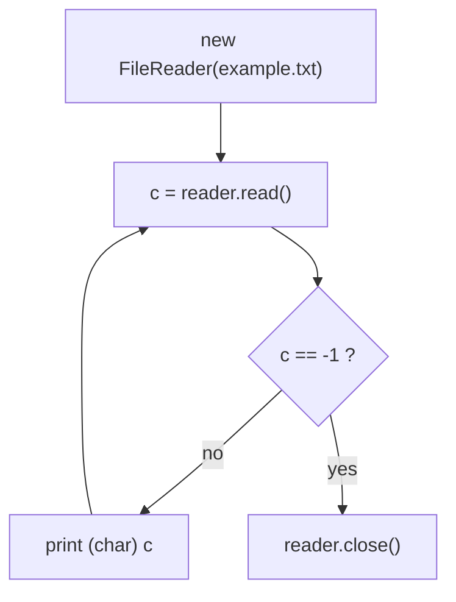
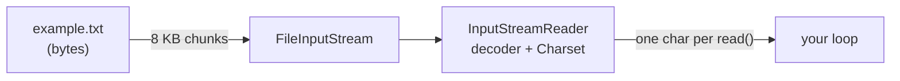

## In One Line
`FileReader` reads a text file as **characters**: it pulls bytes from the file, **decodes** them with a charset (UTF-8 by default since JDK 18), and hands them to you one `char` at a time via `read()`, which returns an `int` so that it can signal end-of-file with **-1**.

## Mental Model
Think of **reading a telegram through an interpreter**. The telegram arrives as a strip of coded pulses (bytes). The interpreter reads a chunk of the strip, translates it using a codebook (the charset), and tells you the message one letter at a time. When the strip runs out, the interpreter says "stop" — a signal that can never be confused with a letter.

In the code:
- **The strip of pulses** = the bytes in `example.txt`, read by a `FileInputStream` inside.
- **The interpreter with the codebook** = `InputStreamReader`, which `FileReader` extends; the codebook is the `Charset`.
- **One letter at a time** = `reader.read()` returning one character code.
- **"Stop"** = the value `-1`, which is not a valid `char` (chars are 0–65535), which is why `read()` returns `int`.
- **Using the wrong codebook** = reading a UTF-8 file as ISO-8859-1: every letter comes out, but some are wrong (`é` instead of `é`).

## Concept
### Where `FileReader` sits
```text
Reader (abstract)                    read(), read(char[]), skip, ready, mark/reset, close
 └─ InputStreamReader                bridge: bytes -> chars using a Charset
     └─ FileReader                   convenience: opens a FileInputStream for you
```
`FileReader` adds only constructors, mirroring `FileWriter`:

| Constructor | Since | Notes |
|---|---|---|
| `FileReader(String fileName)` / `FileReader(File file)` | 1.1 | Default charset; throws `FileNotFoundException` |
| `FileReader(String, Charset)` / `FileReader(File, Charset)` | **11** | Explicit charset; declared `throws IOException` |
| `FileReader(FileDescriptor fd)` | 1.1 | Wrap an open descriptor |

Opening fails with `FileNotFoundException` (message like `nope.txt (No such file or directory)`) if the file is missing, is a directory, or cannot be read.

### The read methods (inherited from `Reader`)
| Method | Returns | Meaning |
|---|---|---|
| `int read()` | 0–65535, or **-1** at end | One UTF-16 code unit |
| `int read(char[] cbuf)` | number of chars read (1..length), or **-1** | Bulk read into an array — may read **fewer** chars than the array holds |
| `int read(char[] cbuf, int off, int len)` | same | Into part of an array |
| `int read(CharBuffer target)` | same | NIO buffer variant |
| `long skip(long n)` | chars actually skipped | |
| `boolean ready()` | `true` if a read will not block | Not an end-of-file test |
| `boolean markSupported()` | `false` for `FileReader` | `mark`/`reset` throw `IOException` |
| `long transferTo(Writer out)` | chars copied | Java 10+: copy everything to a writer |
| `static Reader nullReader()` | an empty reader | Java 11+ |

### Why `read()` returns `int`, not `char`
A `char` can hold every value 0–65535, so there is no spare value to mean "no more data". Returning an `int` allows the special value **-1** outside that range. Hence the classic idiom:
```java
int c;
while ((c = reader.read()) != -1) {   // assign, then test
    System.out.print((char) c);       // cast back to char to print a letter
}
```
Forget the cast and you print numbers: `H` is `72`, `i` is `105`.

A related subtlety: Java `char`s are UTF-16 **code units**, so a character outside the Basic Multilingual Plane (e.g. an emoji) comes back as **two** `read()` results — a surrogate pair — even though it is one visible character and 4 bytes in UTF-8.

### How decoding works (and why FileReader is not byte-by-byte)
`InputStreamReader` owns a decoder with a **byte buffer of 8 KB**. When you call `read()`, it reads a whole chunk of bytes from the file, decodes it into characters and hands them out one by one. In a verified test, reading a 100 000-character file with `read()` made only 14 read calls on the underlying file (13 chunks + the final -1), while a raw `FileInputStream.read()` made 100 001 — one per byte. So `FileReader` is not "one system call per character". What it lacks is a **character** buffer and `readLine()`; each `read()` still costs a synchronized method call. `BufferedReader` (two lessons ahead) adds both.

### Byte streams vs character streams — side by side
| | `FileInputStream` | `FileReader` |
|---|---|---|
| Root | `InputStream` | `Reader` |
| `read()` returns | a byte 0–255, or -1 | a char 0–65535, or -1 |
| Charset | none — raw bytes | decodes with a charset |
| Use for | images, PDFs, zip, serialized objects, any bytes | text |
| Binary file result | exact bytes | **corrupted**: invalid sequences become U+FFFD |

The bridge `InputStreamReader` lets you read text from any byte source: `new InputStreamReader(socket.getInputStream(), UTF_8)`, `new InputStreamReader(System.in)`.

### Malformed input: replace, don't throw
When the bytes are not valid in the charset (e.g. a Latin-1 `é` byte `E9` read as UTF-8), `FileReader`/`InputStreamReader` **replace** the bad sequence with `U+FFFD` (the replacement character `�`) and carry on silently. NIO's `Files.readString`, `Files.readAllLines` and `Files.newBufferedReader` instead **throw** `MalformedInputException`. If you want `InputStreamReader` to throw, pass a `CharsetDecoder`: `new InputStreamReader(in, UTF_8.newDecoder())`.

### Modern alternatives
```java
String all = Files.readString(Path.of("example.txt"));               // Java 11, UTF-8, whole file
List<String> lines = Files.readAllLines(Path.of("example.txt"));     // Java 7
try (BufferedReader r = Files.newBufferedReader(Path.of("example.txt"))) { ... }  // Java 8, buffered
```

## Diagram

The read loop: `read()` hands out one character code at a time until the special value -1 says the file is finished.


Bytes are read in chunks and decoded to characters; the charset decides how bytes become letters.

## Code
@example IO/FileHandling/FileReaderExample.java

The three classic mistakes — no cast, ignoring the count from `read(char[])`, and trusting `ready()` — shown side by side:
```java
import java.io.*;
import java.nio.file.*;

public class ReaderDemo {
    public static void main(String[] args) throws IOException {
        Files.writeString(Path.of("hi.txt"), "Hi");
        try (FileReader r = new FileReader("hi.txt")) {
            int c;
            while ((c = r.read()) != -1) System.out.print(c + " ");   // forgot the (char) cast
        }
        System.out.println();

        Files.writeString(Path.of("chunks.txt"), "HelloWorld!");
        try (FileReader r = new FileReader("chunks.txt")) {
            char[] buf = new char[4];
            int n;
            while ((n = r.read(buf)) != -1) {
                System.out.print("[" + new String(buf, 0, n) + "]");     // correct: use n
            }
        }
        System.out.println();
        try (FileReader r = new FileReader("chunks.txt")) {
            char[] buf = new char[4];
            while (r.read(buf) != -1) {
                System.out.print("[" + new String(buf) + "]");           // bug: ignores n
            }
        }
        System.out.println();

        try (FileReader r = new FileReader("chunks.txt")) {
            System.out.println("markSupported: " + r.markSupported() + ", ready: " + r.ready());
        }
        try (FileReader r = new FileReader("nope.txt")) {
        } catch (FileNotFoundException e) {
            System.out.println("FileNotFoundException: " + e.getMessage());
        }
    }
}
```
```output
72 105 
[Hell][oWor][ld!]
[Hell][oWor][ld!r]
markSupported: false, ready: true
FileNotFoundException: nope.txt (No such file or directory)
```
The buggy loop prints `ld!r`: the last read filled only 3 chars, and the 4th slot still held `r` from the previous chunk.

Reading with the wrong charset, and reading a binary file as text (non-ASCII chars printed as `\uXXXX` so the output does not depend on your console):
```java
static String readAll(String file, Charset cs) throws IOException {
    StringBuilder sb = new StringBuilder();
    try (FileReader r = new FileReader(file, cs)) {
        int c;
        while ((c = r.read()) != -1) sb.append(c > 127 ? String.format("\\u%04X", c) : String.valueOf((char) c));
    }
    return sb.toString();
}
// main:
Files.writeString(Path.of("utf8.txt"), "café", StandardCharsets.UTF_8);          // bytes 63 61 66 C3 A9
Files.writeString(Path.of("latin1.txt"), "café", StandardCharsets.ISO_8859_1);   // bytes 63 61 66 E9
System.out.println("UTF-8 file read as UTF-8:      " + readAll("utf8.txt", StandardCharsets.UTF_8));
System.out.println("UTF-8 file read as ISO-8859-1: " + readAll("utf8.txt", StandardCharsets.ISO_8859_1));
System.out.println("Latin-1 file read as UTF-8:    " + readAll("latin1.txt", StandardCharsets.UTF_8));

Files.write(Path.of("image.bin"), new byte[] {(byte) 0x89, 0x50, 0x4E, 0x47});  // PNG signature start
try (FileReader r = new FileReader("image.bin")) {
    int c;
    while ((c = r.read()) != -1) System.out.print(Integer.toHexString(c) + " ");
}
System.out.println();
try (FileInputStream in = new FileInputStream("image.bin")) {
    int b;
    while ((b = in.read()) != -1) System.out.print(Integer.toHexString(b) + " ");
}
System.out.println();
```
```output
UTF-8 file read as UTF-8:      café
UTF-8 file read as ISO-8859-1: café
Latin-1 file read as UTF-8:    caf�
fffd 50 4e 47 
89 50 4e 47 
```
Wrong charset in one direction gives *mojibake* (`é`); in the other it gives the replacement character `U+FFFD`. The binary byte `0x89` is not valid UTF-8, so the `Reader` destroyed it; the `FileInputStream` returned the exact bytes.

One emoji is one visible character but two `char`s:
```java
Files.writeString(Path.of("smile.txt"), "A😀", StandardCharsets.UTF_8);   // "A" + one emoji
System.out.println("bytes on disk: " + Files.size(Path.of("smile.txt")));
try (FileReader r = new FileReader("smile.txt", StandardCharsets.UTF_8)) {
    int c;
    while ((c = r.read()) != -1) System.out.print(Integer.toHexString(c) + " ");
}
System.out.println();
```
```output
bytes on disk: 5
41 d83d de00 
```

## Walkthrough
- `import java.io.FileReader; import java.io.IOException;` — the constructor throws `FileNotFoundException` and `read`/`close` throw `IOException`; catching `IOException` covers both because `FileNotFoundException` is its subclass.
- `FileReader reader = new FileReader("example.txt");` — opens `example.txt` from the working directory with the default charset (UTF-8 on JDK 18+). If the file were missing you would get `FileNotFoundException: example.txt (No such file or directory)` here.
- `int character;` — declared as `int`, not `char`, because `read()` must be able to return -1.
- `while ((character = reader.read()) != -1)` — the assign-and-test idiom: call `read()`, store the result, compare it with -1. The inner parentheses are required; without them `!=` would bind first and you would assign a `boolean`.
- `System.out.print((char) character);` — casts the code back to a `char` and prints it with `print` (not `println`), so the file's own `\n` characters produce the line breaks.
- `reader.close();` — releases the file handle. For readers nothing is lost if you forget it (unlike writers), but handles leak and on Windows an open file cannot be deleted or renamed.
- `catch (IOException e) { e.printStackTrace(); }` — prints any failure.

The output is the two lines written by `FileWriterExample`, which ran just before this example in the same folder:
`Hello, this is an example of writing to a file.` and `This is the second line.` Run it on its own in an empty folder and you get the `FileNotFoundException` instead.

## Traps
> [!ERRATA] Like the writer example, the reader is closed only on the success path — if `read()` throws, `reader.close()` never runs and the file handle leaks. Use `try (FileReader reader = new FileReader("example.txt")) { ... }`.

> [!ERRATA] `new FileReader("example.txt")` uses the default charset. It matches the default used by `FileWriterExample`, so it works — but on JDK 8–17 the default is OS-dependent and a file written on one machine can be misread on another. Use `new FileReader("example.txt", StandardCharsets.UTF_8)` (Java 11+), and wrap it in a `BufferedReader` for anything beyond a tiny file.

- **Printing the `int`**: `System.out.print(reader.read())` prints `72`, not `H`. Cast to `char`.
- **Storing `read()` in a `char`**: `char c = (char) reader.read();` turns -1 into `'￿'` (65535), so `c != -1` is always true — an infinite loop.
- **Ignoring the count of `read(char[])`**: the array is not cleared between calls; always use `new String(buf, 0, n)` / `writer.write(buf, 0, n)`.
- **`read(char[])` may return fewer chars than requested** even before the end. Only -1 means end of stream; never loop "until it returns less than the buffer size".
- **`ready()` is not an end-of-file check.** It only says whether the next read would block. Loop on -1.
- **`FileReader` for binary files corrupts them** — bytes that are invalid in the charset become `U+FFFD`. Use `FileInputStream`.
- **Wrong charset = silent garbage.** `FileReader` never throws on bad bytes; it substitutes. Use `Files.readString`/`newBufferedReader` (which throw `MalformedInputException`) when you prefer a loud failure.
- **`mark`/`reset` are not supported** by `FileReader` (`markSupported()` is `false`); wrap it in a `BufferedReader` if you need to re-read.

## Tips & Tricks
- **"-1 means done, cast means letter."** The two rules of the `read()` loop.
- **Memorise the idiom once:** `while ((c = r.read()) != -1)` — it appears in every I/O interview.
- **Match the charsets:** whatever charset wrote the file must read it. When in doubt, UTF-8 on both sides.
- **Readers are the mirror of writers:** `FileReader`/`InputStreamReader`/`BufferedReader` ↔ `FileWriter`/`OutputStreamWriter`/`BufferedWriter`. Learn one side and you know the other.
- **Need the whole file as a `String`?** `Files.readString(path)` (Java 11) — one line, UTF-8, throws on bad input.
- **Copying text?** `reader.transferTo(writer)` (Java 10) instead of a hand-written loop.

## Interview Q&A
### [Basic] Why does `Reader.read()` return an `int` instead of a `char`?
Because it needs one extra value to signal end of stream. A `char` uses all values 0–65535, so there is no free value for "no more data". An `int` can return any char value or -1. The same applies to `InputStream.read()`, which returns 0–255 or -1. That is why the loop is `while ((c = reader.read()) != -1)` and you cast to `char` only after the check.

**Follow-up:** *What happens if you store it in a `char` first?* — -1 becomes `'￿'` (65535), the comparison with -1 is never true and the loop never ends.

### [Basic] What is the difference between `FileReader` and `FileInputStream`?
`FileInputStream` is a byte stream: it returns raw bytes (0–255) and is used for any file type. `FileReader` is a character stream built on top of a `FileInputStream`: it decodes the bytes into characters with a charset and is only suitable for text. Reading a binary file with `FileReader` corrupts it, because byte sequences that are invalid in the charset are replaced by `U+FFFD`.

**Follow-up:** *How do you read text from a `FileInputStream` you already have?* — Wrap it: `new InputStreamReader(fis, StandardCharsets.UTF_8)`, ideally inside a `BufferedReader`.

### [Basic] What exceptions can `FileReader` throw?
The `(String)`/`(File)` constructors throw `FileNotFoundException` if the file does not exist, is a directory, or cannot be opened; the Java 11 charset constructors declare `IOException`. `read`, `skip`, `ready` and `close` throw `IOException` for I/O errors or when the reader is already closed. `FileNotFoundException` is a subclass of `IOException`, so a single `catch (IOException e)` covers everything.

**Follow-up:** *Does `FileReader` throw when the bytes are invalid for the charset?* — No, it silently substitutes `U+FFFD`.

### [Intermediate] What does `read(char[] buf)` return and what is the classic bug?
It returns the number of characters actually read (at least 1, at most `buf.length`) or -1 at the end of the stream. The array is reused and not cleared, so the classic bug is to use the whole array instead of the first `n` characters: with `"HelloWorld!"` and a 4-char buffer the last chunk prints `ld!r` instead of `ld!`. Always use `new String(buf, 0, n)` or `out.write(buf, 0, n)`. Also, a short read does not mean end of stream — only -1 does.

**Follow-up:** *What does `read(buf)` return when `buf.length == 0`?* — 0, without reading anything.

### [Intermediate] Is reading a file with `FileReader.read()` one system call per character?
No. `FileReader` is an `InputStreamReader`, whose decoder reads bytes in chunks (8 KB) and decodes them into characters; a 100 000-character file needs only about 13 reads from the file. However, each `read()` call still goes through a synchronized method and the decoder bookkeeping, and there is no `readLine()`. Wrapping it in a `BufferedReader` adds an 8192-char buffer and line reading, which is the standard way to read text. A raw `FileInputStream.read()` really *is* one native call per byte.

**Follow-up:** *So when is `BufferedReader` really essential?* — When reading line by line (it provides `readLine()`/`lines()`), and when wrapping raw byte streams like `FileInputStream` or socket streams, where unbuffered reads are extremely expensive.

### [Intermediate] What happens if you read a file with the wrong charset?
The bytes are decoded with the wrong table. Reading UTF-8 `é` (`C3 A9`) as ISO-8859-1 gives two characters `é` (mojibake). Reading ISO-8859-1 `é` (`E9`) as UTF-8 hits an invalid sequence, which `FileReader` replaces with `U+FFFD` without an exception. The data is not recoverable from the replacement character. The fix is to know and pass the charset used to write the file.

**Follow-up:** *How do you make decoding fail loudly?* — Use `Files.readString`/`readAllLines`/`newBufferedReader` (they throw `MalformedInputException`) or `new InputStreamReader(in, UTF_8.newDecoder())`.

### [Advanced] Why can one emoji need two `read()` calls?
Java `char` is a 16-bit UTF-16 code unit. Characters above U+FFFF (emoji, many historic scripts) are represented by a **surrogate pair** of two chars. `Reader.read()` returns code units, so `"A😀"` reads as `41`, `d83d`, `de00` — three values for two visible characters, stored as 5 bytes in UTF-8. Code that processes text char by char must handle surrogates (`Character.isHighSurrogate`, `String.codePoints()`), or it can split an emoji in half.

**Follow-up:** *How do you count real characters in a `String`?* — `s.codePointCount(0, s.length())` or `s.codePoints().count()`, not `s.length()`.

### [Advanced] Design question: how would you read a 10 GB log file?
Never load it into memory (`readAllLines`/`readString` would throw `OutOfMemoryError`). Stream it: `try (BufferedReader r = Files.newBufferedReader(path, UTF_8)) { String line; while ((line = r.readLine()) != null) process(line); }` or `try (Stream<String> lines = Files.lines(path)) { ... }`. Memory then stays constant (one buffer + one line). Specify the charset, handle `MalformedInputException` or use a lenient decoder for dirty logs, and for random access or parallel processing consider `FileChannel` with memory mapping or splitting by byte ranges.

**Follow-up:** *Why must `Files.lines` be in try-with-resources?* — It keeps the file open until the stream is closed; forgetting it leaks a file handle.

## Quiz
### The file `hi.txt` contains `Hi`. What does this print?
```java
try (FileReader r = new FileReader("hi.txt")) {
    int c;
    while ((c = r.read()) != -1) System.out.print(c + " ");
}
```
- [ ] H i 
- [x] 72 105 
- [ ] 72 105 -1 
- [ ] Hi
> `read()` returns the character code as an `int`; without a `(char)` cast the numbers are printed. The loop stops before printing -1 because the condition is checked first.

### What does the buggy loop print for a file containing `HelloWorld!`?
```java
char[] buf = new char[4];
while (r.read(buf) != -1) {
    System.out.print("[" + new String(buf) + "]");
}
```
- [ ] [Hell][oWor][ld!]
- [x] [Hell][oWor][ld!r]
- [ ] [Hell][oWor][ld!\0]
- [ ] [Hell][oWor][ld!][]
> The last `read` fills only 3 chars and returns 3, but the code ignores the count; the 4th slot still holds `r` from `oWor`. The array is never cleared, so it is not a `\0`. Fix: `new String(buf, 0, n)`.

### Spot the bug: this loop never ends. Why?
```java
char c;
while ((c = (char) reader.read()) != -1) {
    System.out.print(c);
}
```
- [ ] `print` must be `println`
- [x] Casting to `char` turns -1 into 65535, so the comparison with -1 is never true
- [ ] `read()` throws at the end of file, so the loop cannot end normally
- [ ] `FileReader` must be closed inside the loop
> `(char) -1` is `'￿'`, which widens back to 65535 in the comparison, never -1. Keep the result in an `int` and cast only when printing. `read()` does not throw at end of file; it returns -1.

### A file saved as ISO-8859-1 contains `café` (the `é` is the single byte `E9`). What does `FileReader` with UTF-8 give for the last character?
- [ ] `é`
- [ ] It throws `MalformedInputException`
- [x] `U+FFFD`, the replacement character
- [ ] Nothing — the invalid byte is skipped
> `E9` alone is not valid UTF-8. `InputStreamReader`/`FileReader` silently replace malformed input with `U+FFFD`. `MalformedInputException` is what NIO's `Files.readString`/`readAllLines` throw, not `FileReader`.

### Which is the right tool to copy a PNG image?
- [ ] `FileReader` + `FileWriter`
- [ ] `BufferedReader` + `BufferedWriter`
- [x] `FileInputStream` + `FileOutputStream` (or `Files.copy`)
- [ ] `FileReader` with `StandardCharsets.ISO_8859_1`
> Images are binary; character streams decode and re-encode, which corrupts bytes that are invalid in the charset (the PNG's first byte `0x89` became `U+FFFD` in UTF-8). ISO-8859-1 happens to map every byte to a char, but it is a hack that hides intent — use byte streams.

### What does `new FileReader("nope.txt")` do when the file does not exist?
- [ ] Returns a reader whose first `read()` returns -1
- [ ] Creates an empty `nope.txt`
- [x] Throws `FileNotFoundException`
- [ ] Returns `null`
> Readers never create files. The constructor opens the file immediately and throws `FileNotFoundException: nope.txt (No such file or directory)`. Constructors in Java cannot return `null`.

## Takeaways
- `FileReader` = `InputStreamReader` + `FileInputStream`: it reads bytes and decodes them to chars with a charset (UTF-8 default since JDK 18; pass one explicitly since Java 11).
- `read()` returns an `int` — a char code 0–65535, or -1 at end of stream — so loop with `while ((c = r.read()) != -1)` and cast to `char` to print.
- `read(char[])` returns how many chars it read; always use only the first `n` and treat only -1 as the end.
- `FileReader` silently replaces invalid bytes with `U+FFFD`; the NIO `Files` read methods throw `MalformedInputException` instead.
- Never use a `Reader` for binary data — use `FileInputStream`; `char` is a UTF-16 code unit, so an emoji is two `read()` results.
- `FileReader` decodes in 8 KB byte chunks but has no char buffer or `readLine()`; wrap it in `BufferedReader`, and always close it with try-with-resources.
