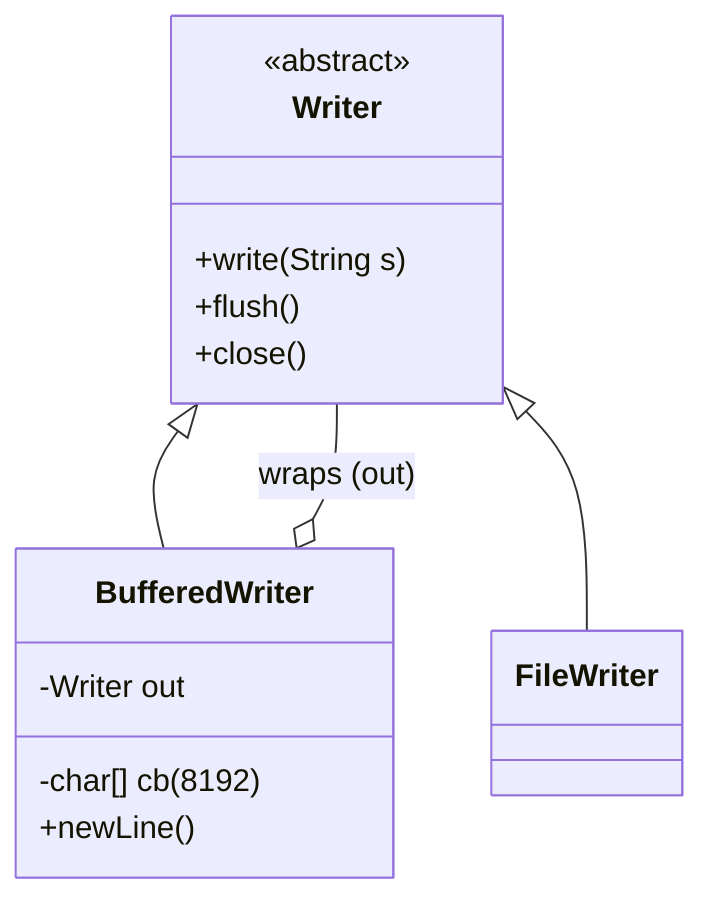
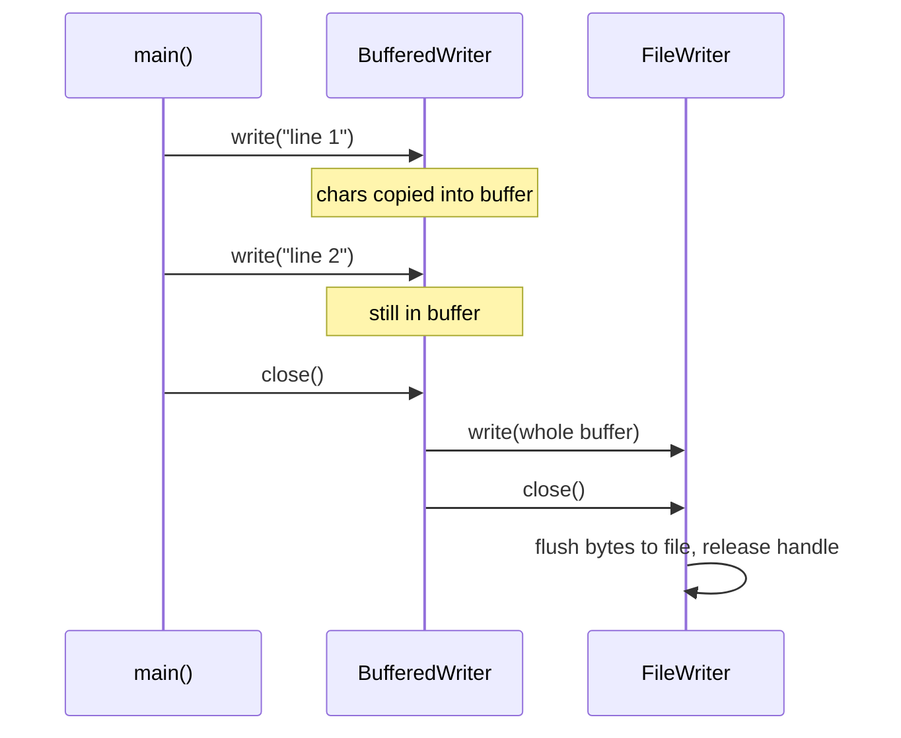
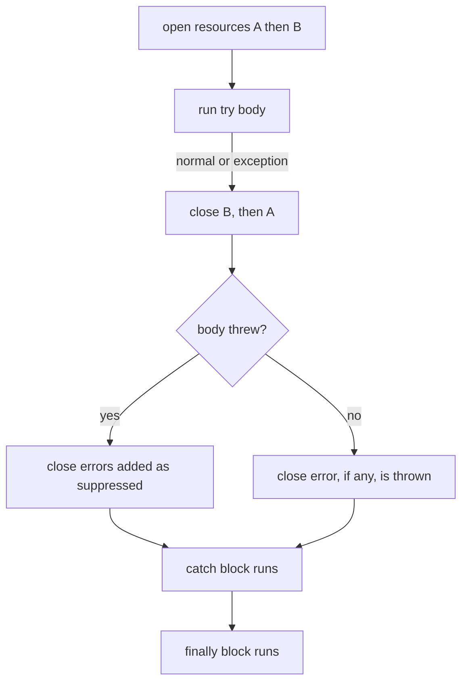

## In One Line
`BufferedWriter` is a **decorator** that wraps any `Writer` and collects characters in an 8 KB memory buffer, sending them to the wrapped writer in a few big chunks instead of thousands of tiny calls; it adds `newLine()`, and it must be flushed/closed — which modern Java does safely with **try-with-resources**.

## Mental Model
Think of a **postman with a mail bag**. Without a bag, the postman would drive to the post office for every single letter you hand over (`FileWriter.write` per character). With a bag (`BufferedWriter`), letters pile up in the bag and the postman drives only when the bag is full — or when you say "go now" (`flush()`) or "end of shift" (`close()`: empty the bag, then lock up the post office too).

In the code:
- **The bag** = the `char[8192]` buffer inside `BufferedWriter`.
- **The post office** = the wrapped `FileWriter` (which in turn talks to the file).
- **"Go now"** = `flush()`. **"End of shift"** = `close()` — flush the bag, then close the wrapped writer.
- **Forgetting to end the shift** = the letters stay in the bag forever: the file stays empty.
- **try-with-resources** = a manager who guarantees the shift is ended, whatever happens during the day.

## Concept
### Why buffering matters
Every `write` on an unbuffered writer pays a fixed cost (a synchronized method call, encoder work, and eventually a system call into the OS). Paying it 20 000 times for 20 000 characters is wasteful. A buffer pays it once per 8192 characters. Verified with counting wrappers (full code below): writing 20 000 single characters

| Setup | Calls reaching the next layer |
|---|---|
| `FileOutputStream.write(int)` directly | 20 000 writes to the file |
| `FileWriter.write(int)` | 20 000 calls into the encoder, 40 writes to the file |
| `BufferedWriter.write(int)` over the same `FileWriter` | **3** calls (8192 + 8192 + 3616 chars) |

### The decorator pattern
`BufferedWriter` **is-a** `Writer` and **has-a** `Writer`. It implements the same interface as the thing it wraps and adds behaviour (buffering, `newLine()`) before delegating. Because the wrapped type is just `Writer`, you can stack decorators in any combination:

```java
Writer w = new PrintWriter(                  // formatting: println, printf
             new BufferedWriter(              // buffering
               new OutputStreamWriter(        // chars -> bytes (charset)
                 new FileOutputStream("a.txt"), StandardCharsets.UTF_8)));
```
The whole of `java.io` is built this way — `BufferedInputStream`, `DataOutputStream`, `ObjectOutputStream`, `GZIPOutputStream`, `PrintStream`, `InputStreamReader` all wrap another stream. It is the textbook JDK example of the [Decorator pattern](lesson:a10-patterns/08-decorator): add responsibilities by wrapping, not by subclassing every combination (`BufferedGzipFileWriter`...).

### `BufferedWriter` API
| Member | Meaning |
|---|---|
| `BufferedWriter(Writer out)` | Default buffer of 8192 chars |
| `BufferedWriter(Writer out, int sz)` | Custom size; `sz <= 0` throws `IllegalArgumentException: Buffer size <= 0` |
| `write(int)`, `write(String, off, len)`, `write(char[], off, len)` (+ inherited `write(String)`, `append`) | Copy into the buffer; when it is full, the buffer is written to `out`. A write larger than the buffer is passed straight through. |
| `newLine()` | Writes `System.lineSeparator()` — `\n` on Linux/macOS, `\r\n` on Windows |
| `flush()` | Writes the buffer to `out` **and** calls `out.flush()` |
| `close()` | Flushes, then closes `out`; later calls do nothing |

Two layers of buffering: when wrapping a `FileWriter`, `BufferedWriter` flushes its **char** buffer into the `FileWriter`, whose encoder has its own **byte** buffer. `bw.flush()` flushes both. Writing 5 chars into a 4-char `BufferedWriter` still left the file at 0 bytes — the chars had moved on into `FileWriter`'s byte buffer.

### Closing a decorator chain
Closing the **outermost** decorator closes the whole chain: `BufferedWriter.close()` flushes and then calls `close()` on the wrapped writer, which closes the file. You do not need to close the inner writers separately; doing so is harmless because `close()` is idempotent (a second call does nothing). Since Java 7, `BufferedWriter.close()` closes the wrapped writer **even if the final flush fails** (verified: the flush threw `disk full`, and the inner `close()` still ran).

### try-with-resources (Java 7+)
```java
try (BufferedWriter bw = new BufferedWriter(new FileWriter("example.txt"))) {
    bw.write("text");
    bw.newLine();
}   // bw.close() is called here automatically — on success, on exception, on return
```
Rules to know by heart:
1. The resource type must implement **`AutoCloseable`** (Java 7). `Closeable` (Java 5, `java.io`) extends it; its `close()` throws only `IOException` and must be idempotent.
2. Several resources are separated by `;` and are **closed in reverse order** of creation.
3. Resources are closed **before** any `catch` or `finally` block of the same statement runs.
4. If the body throws **and** `close()` throws, the body's exception is the one propagated; the close exception is attached as a **suppressed** exception (`e.getSuppressed()`). The old `finally` pattern did the opposite — the close exception *replaced* the real one.
5. A `null` resource is allowed; its `close()` is simply skipped.
6. **Java 9+**: an existing **final or effectively final** variable can be used directly: `try (bw) { ... }`.
7. Resource variables are implicitly `final` — you cannot reassign them in the body.

What the compiler generates (simplified):
```java
BufferedWriter bw = new BufferedWriter(new FileWriter("example.txt"));
Throwable primary = null;
try {
    bw.write("text");
} catch (Throwable t) {
    primary = t;
    throw t;
} finally {
    if (bw != null) {
        if (primary != null) {
            try { bw.close(); } catch (Throwable closeEx) { primary.addSuppressed(closeEx); }
        } else {
            bw.close();
        }
    }
}
```

### One resource per variable (a subtle leak)
In `try (BufferedWriter bw = new BufferedWriter(new FileWriter(f)))` only `bw` is a managed resource. If the `BufferedWriter` constructor threw after `FileWriter` opened the file, the `FileWriter` would leak. For `BufferedWriter` that is practically impossible (it only allocates an array), so the one-liner is accepted everywhere. For decorators whose constructors can throw (e.g. `ObjectOutputStream`, which writes a header), declare each layer separately:
```java
try (FileOutputStream fos = new FileOutputStream("a.ser");
     ObjectOutputStream oos = new ObjectOutputStream(fos)) { ... }
```

### Choosing a text writer
| Need | Use |
|---|---|
| Many writes / line-by-line output | `BufferedWriter` (or `Files.newBufferedWriter(path, UTF_8)`) |
| `println`/`printf` formatting | `PrintWriter` (remember it swallows `IOException` — check `checkError()`) |
| One small string | `Files.writeString(path, text)` |
| Thread-safe logging | A logging framework, not raw writers |

## Diagram

Decorator: `BufferedWriter` is a `Writer` and wraps a `Writer`, so it can wrap a `FileWriter`, a `StringWriter`, or another decorator.


Nothing reaches the `FileWriter` until the buffer fills or you flush/close — and closing the outer writer closes the inner one.


try-with-resources: resources close in reverse order, before `catch` and `finally`, and the body's exception wins.

## Code
@example IO/FileHandling/BufferedWriterExample.java

Measuring the effect of the buffer with counting wrappers:
```java
import java.io.*;

public class CountWrites {
    // A byte stream that counts how many times data is pushed to the file
    static class CountingOutputStream extends FilterOutputStream {
        int calls;
        CountingOutputStream(OutputStream out) { super(out); }
        @Override public void write(int b) throws IOException { calls++; out.write(b); }
        @Override public void write(byte[] b, int off, int len) throws IOException { calls++; out.write(b, off, len); }
    }
    // A Writer that counts how many times it is called
    static class CountingWriter extends FilterWriter {
        int calls;
        CountingWriter(Writer out) { super(out); }
        @Override public void write(int c) throws IOException { calls++; out.write(c); }
        @Override public void write(char[] cb, int off, int len) throws IOException { calls++; out.write(cb, off, len); }
        @Override public void write(String s, int off, int len) throws IOException { calls++; out.write(s, off, len); }
    }

    public static void main(String[] args) throws IOException {
        CountingOutputStream file1 = new CountingOutputStream(new FileOutputStream("a.txt"));
        CountingWriter w1 = new CountingWriter(new OutputStreamWriter(file1));   // = FileWriter
        for (int i = 0; i < 20_000; i++) w1.write('x');
        w1.close();
        System.out.println("FileWriter alone:  " + w1.calls + " write calls on the Writer, " + file1.calls + " writes to the file");

        CountingOutputStream file2 = new CountingOutputStream(new FileOutputStream("b.txt"));
        CountingWriter w2 = new CountingWriter(new OutputStreamWriter(file2));
        BufferedWriter bw = new BufferedWriter(w2);
        for (int i = 0; i < 20_000; i++) bw.write('x');
        bw.close();
        System.out.println("BufferedWriter:    " + w2.calls + " write calls on the Writer, " + file2.calls + " writes to the file");

        CountingOutputStream file3 = new CountingOutputStream(new FileOutputStream("c.txt"));
        for (int i = 0; i < 20_000; i++) file3.write('x');   // raw FileOutputStream, no buffer
        file3.close();
        System.out.println("FileOutputStream:  " + file3.calls + " writes to the file");
    }
}
```
```output
FileWriter alone:  20000 write calls on the Writer, 40 writes to the file
BufferedWriter:    3 write calls on the Writer, 3 writes to the file
FileOutputStream:  20000 writes to the file
```

Buffer behaviour, `newLine()`, closing the chain, and when `close` runs relative to `catch`:
```java
import java.io.*;
import java.nio.file.*;

public class BwDemo {
    public static void main(String[] args) throws IOException {
        Path p = Path.of("out.txt");

        BufferedWriter forgotten = new BufferedWriter(new FileWriter("out.txt"));
        forgotten.write("buffered text");
        System.out.println("size before close: " + Files.size(p));
        forgotten.close();
        System.out.println("size after close:  " + Files.size(p));

        try (BufferedWriter bw = new BufferedWriter(new FileWriter("out.txt"))) {
            bw.write("line 1");
            bw.newLine();
            bw.write("line 2");
            bw.newLine();
        }
        System.out.println(Files.readString(p).replace("\n", "\\n").replace("\r", "\\r"));
        System.out.println("lineSeparator = " + System.lineSeparator().replace("\n", "\\n").replace("\r", "\\r"));

        FileWriter fw = new FileWriter("out.txt");
        BufferedWriter bw = new BufferedWriter(fw);
        bw.write("x");
        bw.close();
        bw.close();                                // second close: no-op, no exception
        try {
            fw.write("y");                         // the inner writer was closed by bw.close()
        } catch (IOException e) {
            System.out.println("inner FileWriter after bw.close(): " + e.getMessage());
        }
        try {
            bw.write("z");
        } catch (IOException e) {
            System.out.println("bw after close: " + e.getMessage());
        }

        try (BufferedWriter small = new BufferedWriter(new FileWriter("out.txt"), 4)) {
            small.write("ab");
            System.out.println("2 chars in a 4-char buffer, file size: " + Files.size(p));
            small.write("cde");
            System.out.println("after 5 chars, file size: " + Files.size(p));
        }
        try {
            new BufferedWriter(new StringWriter(), 0);
        } catch (IllegalArgumentException e) {
            System.out.println("IllegalArgumentException: " + e.getMessage());
        }

        System.out.println("--- close happens before catch");
        try (BufferedWriter w = new BufferedWriter(new FileWriter("out.txt")) {
                 @Override public void close() throws IOException { System.out.println("closing writer"); super.close(); }
             }) {
            w.write("data");
            throw new IOException("disk full (simulated)");
        } catch (IOException e) {
            System.out.println("catch: " + e.getMessage() + ", file size now: " + Files.size(p));
        } finally {
            System.out.println("finally");
        }
    }
}
```
```output
size before close: 0
size after close:  13
line 1\nline 2\n
lineSeparator = \n
inner FileWriter after bw.close(): Stream closed
bw after close: Stream closed
2 chars in a 4-char buffer, file size: 0
after 5 chars, file size: 0
IllegalArgumentException: Buffer size <= 0
--- close happens before catch
closing writer
catch: disk full (simulated), file size now: 4
finally
```
(Run on Linux, so `newLine()` wrote `\n`; on Windows it writes `\r\n`.) `after 5 chars, file size: 0` shows the second buffer: the chars left `BufferedWriter` but are waiting in `FileWriter`'s byte buffer. In the last block the file already holds `data` (4 bytes) inside `catch`, proving `close()` ran first.

try-with-resources semantics, including the difference from the old `finally` style:
```java
public class Twr {
    static class Res implements AutoCloseable {
        private final String name;
        private final boolean failOnClose;
        Res(String name, boolean failOnClose) {
            this.name = name; this.failOnClose = failOnClose;
            System.out.println("open " + name);
        }
        @Override public void close() {
            System.out.println("close " + name);
            if (failOnClose) throw new IllegalStateException("close failed: " + name);
        }
    }

    public static void main(String[] args) {
        System.out.println("--- order");
        try (Res a = new Res("A", false); Res b = new Res("B", false)) {
            System.out.println("body");
        } catch (Exception e) {
            System.out.println("catch");
        } finally {
            System.out.println("finally");
        }

        System.out.println("--- body throws, close throws too");
        try (Res a = new Res("A", true)) {
            throw new RuntimeException("body failed");
        } catch (RuntimeException e) {
            System.out.println("caught: " + e.getMessage());
            for (Throwable s : e.getSuppressed()) System.out.println("suppressed: " + s.getMessage());
        }

        System.out.println("--- old finally style loses the real error");
        try {
            Res a = null;
            try {
                a = new Res("A", true);
                throw new RuntimeException("body failed");
            } finally {
                if (a != null) a.close();
            }
        } catch (RuntimeException e) {
            System.out.println("caught: " + e.getMessage() + ", suppressed=" + e.getSuppressed().length);
        }

        System.out.println("--- null resource");
        try (Res none = null) {
            System.out.println("body with null resource");
        }

        System.out.println("--- Java 9 effectively-final resource");
        Res outer = new Res("C", false);
        try (outer) {
            System.out.println("using C");
        }
    }
}
```
```output
--- order
open A
open B
body
close B
close A
finally
--- body throws, close throws too
open A
close A
caught: body failed
suppressed: close failed: A
--- old finally style loses the real error
open A
close A
caught: close failed: A, suppressed=0
--- null resource
body with null resource
--- Java 9 effectively-final resource
open C
using C
close C
```

## Walkthrough
- `import java.io.BufferedWriter; FileWriter; IOException;` — the decorator, the writer it wraps, and the checked exception.
- `FileWriter fileWriter = null; BufferedWriter bufferedWriter = null;` — declared **outside** the `try` and set to `null` so that the `finally` block can see them. This is the pre-Java-7 pattern; the comment says exactly that.
- `String filename = "example.txt";` — the same file used by the previous examples.
- `fileWriter = new FileWriter(filename, false);` — `append = false` means overwrite mode, identical to `new FileWriter(filename)`. The comment is correct. At this moment `example.txt` (which held the two lines from `FileWriterExample`) is truncated to 0 bytes.
- `bufferedWriter = new BufferedWriter(fileWriter);` — wraps the `FileWriter` in an 8192-char buffer.
- `bufferedWriter.write("This is an example ... using BufferedWriter.\n");` and the second `write(...)` — both strings (129 chars in total) go into the buffer; nothing reaches the file yet. `\n` is written literally.
- `bufferedWriter.flush();` — pushes the buffer through the `FileWriter` to the file. Correct but redundant here, because `close()` in `finally` flushes anyway.
- `System.out.println("Successfully wrote to the file using BufferedWriter.");` — the only console output; matches the `// Output:` comment.
- `catch (IOException e) { e.printStackTrace(); }` — handles failures while opening or writing.
- `finally { try { if (bufferedWriter != null) bufferedWriter.close(); if (fileWriter != null) fileWriter.close(); } catch (IOException e) {...} }` — runs on every path. The `null` checks are needed because the constructors might have failed before assignment. `bufferedWriter.close()` already closes `fileWriter`; the second close is a harmless no-op. The nested `try/catch` is needed because `close()` itself throws `IOException`.

After this program `example.txt` contains these two lines — which is why the next lesson's `BufferedReaderExample` prints them, not the `FileWriter` text.

## Traps
> [!ERRATA] `bufferedWriter.flush()` right before closing is redundant: `close()` always flushes first. And `fileWriter.close()` after `bufferedWriter.close()` is redundant: closing a decorator closes the stream it wraps. Both are harmless, but they suggest (wrongly) that each layer must be flushed and closed by hand.

> [!ERRATA] The whole `finally` block with `null` checks and a nested `try/catch` is the pre-Java-7 idiom. Besides being long, it has a real flaw: if the body threw and `close()` also throws, the close exception can replace the original one (verified above: `caught: close failed: A`). Since Java 7 write `try (BufferedWriter bw = new BufferedWriter(new FileWriter(filename))) { ... }` — shorter, closes in the right order, and keeps the real exception with the close failure as a suppressed exception.

> [!ERRATA] The example writes `"\n"` by hand although `BufferedWriter`'s signature feature is `newLine()`, which writes the platform separator. Either is acceptable, but a `BufferedWriter` example should show `bw.write(...); bw.newLine();`.

- **No close, no data.** A `BufferedWriter` that is never flushed/closed leaves the file empty (`size before close: 0` above). This is the #1 buffered-I/O bug.
- **Writing after close** throws `IOException: Stream closed` — also for the inner writer, which the outer `close()` closed.
- **Too many flushes defeat the buffer.** Calling `flush()` after every line turns buffered I/O back into unbuffered I/O. Flush only when someone else must see the data now.
- **`PrintWriter` hides errors.** Wrapping in `PrintWriter` for `println` is convenient but it never throws; call `checkError()`.
- **Nested constructors in one resource.** Only the outer object is managed; if a decorator constructor can throw (like `ObjectOutputStream`), declare each layer as its own resource.
- **try-with-resources closes before `catch`.** Inside the `catch` block the resource is already closed; you cannot write an error message into it there.
- **`newLine()` is platform-dependent.** Files written on Windows get `\r\n`. If a file format demands `\n`, write `"\n"` explicitly.

## Tips & Tricks
- **"Bag, then bus"**: the buffer (bag) collects; flush/close sends the bus. No bus, no delivery.
- **"Close the outside, the inside follows."** Close only the outermost decorator.
- **"Last opened, first closed"** — try-with-resources closes in reverse order, like a stack (LIFO).
- **"Body wins, close is suppressed."** In try-with-resources the body's exception is primary; read the close problems from `getSuppressed()`.
- **Default template:**
  ```java
  try (BufferedWriter w = Files.newBufferedWriter(Path.of("out.txt"), StandardCharsets.UTF_8)) {
      for (String line : lines) { w.write(line); w.newLine(); }
  }
  ```
- **Decorator order to remember for text files:** `PrintWriter` → `BufferedWriter` → `OutputStreamWriter(charset)` → `FileOutputStream`. Formatting outside, bytes inside.

## Interview Q&A
### [Basic] Why use `BufferedWriter` instead of `FileWriter` alone?
`BufferedWriter` collects characters in an 8 KB buffer and passes them on in large chunks, so many small writes become a few big ones — much less per-call overhead (locking, encoding, system calls). In a measured test, 20 000 single-character writes became 3 calls into the underlying writer. It also adds `newLine()` for platform line separators. It is a decorator, so it works over any `Writer`.

**Follow-up:** *What is the default buffer size?* — 8192 characters; a different size can be passed to the constructor (must be > 0).

### [Basic] What is try-with-resources and what can be used in it?
A Java 7 `try` form that declares resources in parentheses and closes them automatically when the block exits — normally, via exception, or via `return`. Any object implementing `java.lang.AutoCloseable` (including every `java.io.Closeable`) can be a resource. Multiple resources are separated by semicolons and are closed in reverse order. Since Java 9 you can also list an existing effectively final variable: `try (writer) { ... }`.

**Follow-up:** *Difference between `AutoCloseable` and `Closeable`?* — `Closeable` (java.io, Java 5) extends `AutoCloseable` (Java 7); its `close()` throws only `IOException` and must be idempotent, while `AutoCloseable.close()` may throw any `Exception` and need not be idempotent.

### [Basic] Do you need to close both the `BufferedWriter` and the `FileWriter`?
No. Closing the outer decorator flushes its buffer and then closes the wrapped writer, which closes the file. Closing the inner one again is a harmless no-op because `close()` is idempotent, but it is unnecessary. What you must not do is close only the **inner** one: then the `BufferedWriter`'s buffer is never flushed and data is lost.

**Follow-up:** *Does `BufferedWriter.close()` close the inner writer if the final flush fails?* — Yes (since Java 7 it uses try-with-resources internally), and the flush exception is thrown.

### [Intermediate] What is a suppressed exception?
When the body of a try-with-resources throws exception A and closing a resource then throws exception B, Java propagates A and attaches B to it with `A.addSuppressed(B)`; you read it with `A.getSuppressed()`. This keeps the root cause visible. With the old `try/finally` idiom, B thrown from `finally` replaced A entirely, hiding the real problem. Stack traces print suppressed exceptions under a `Suppressed:` heading.

**Follow-up:** *What if only `close()` throws?* — Then that exception propagates normally, because there is no primary exception to attach it to.

### [Intermediate] In what order do resources close, and when relative to `catch` and `finally`?
Resources are closed in the **reverse** order of declaration, and all of them are closed **before** the `catch` and `finally` blocks of the same statement run. Verified order: `open A, open B, body, close B, close A, finally`. So in a `catch` block the resources are already closed, and a `finally` block sees them closed too.

**Follow-up:** *Why reverse order?* — Later resources often depend on earlier ones (a `BufferedWriter` on a `FileWriter`, a `Statement` on a `Connection`), so the dependent one must close first.

### [Intermediate] Explain the Decorator pattern using java.io.
A decorator implements the same type as the object it wraps, holds a reference to it, and adds behaviour before or after delegating. `BufferedWriter extends Writer` and wraps a `Writer`, adding a buffer and `newLine()`; `PrintWriter` adds formatting; `OutputStreamWriter` adds encoding over an `OutputStream`. Decorators can be stacked in any order, so instead of an explosion of subclasses (`BufferedFileWriter`, `BufferedPrintFileWriter`, ...) you compose small pieces: `new PrintWriter(new BufferedWriter(new FileWriter(f)))`.

**Follow-up:** *Where else in java.io?* — `BufferedInputStream`, `DataInputStream`, `ObjectOutputStream`, `GZIPOutputStream`, `CipherOutputStream`, `InputStreamReader` — all wrap another stream.

### [Intermediate] When should you call `flush()` explicitly?
When the data must become visible to someone else **before** you close: interactive protocols over sockets (send a request, then wait for a reply), progress logs another process tails, or before handing the underlying stream to other code. Otherwise do not — `close()` flushes, and frequent flushes remove the benefit of buffering. `flush()` on a decorator flushes the whole chain down to the OS, but not to the physical disk.

**Follow-up:** *How do you force data onto the physical disk?* — `FileOutputStream.getFD().sync()` or `FileChannel.force(true)`.

### [Advanced] What does the compiler generate for try-with-resources?
Roughly: create the resource; run the body inside a `try`; catch any `Throwable` as the primary exception and rethrow it; in the `finally` part, if the resource is non-null, close it — if there was a primary exception, wrap `close()` in its own `try/catch` and call `primary.addSuppressed(closeException)`; otherwise just call `close()`. Multiple resources become nested blocks, which is why closing happens in reverse order. The exact bytecode javac emits has changed between JDK versions, but the semantics are the same.

**Follow-up:** *Can you reassign a resource variable inside the block?* — No, resource variables are implicitly `final`.

### [Advanced] What is the hidden leak in `try (BufferedWriter bw = new BufferedWriter(new FileWriter(f)))`?
Only `bw` is registered as a resource. If `new FileWriter(f)` succeeds and then the `BufferedWriter` constructor throws, nobody closes the `FileWriter`. For `BufferedWriter` this is only theoretical (the constructor just allocates a buffer; it could fail with `OutOfMemoryError` or `IllegalArgumentException` for a bad size), so the idiom is widely accepted. It is a real issue for decorators that do I/O in the constructor — `ObjectOutputStream` writes a header, `ObjectInputStream` reads one, `GZIPInputStream` reads a header — so declare each layer as a separate resource.

**Follow-up:** *Does declaring both layers close the inner one twice?* — Yes, the inner stream gets `close()` twice, which is fine because `Closeable.close()` is required to be idempotent.

### [Advanced] Compare `BufferedWriter`, `PrintWriter` and `PrintStream`.
`BufferedWriter` buffers characters and throws `IOException`. `PrintWriter` is a character-stream formatter (`print`, `println`, `printf`) that never throws — errors set a flag read by `checkError()` — and can auto-flush on `println` if constructed with `autoFlush = true`. `PrintStream` is the byte-stream counterpart (it is the type of `System.out`), also swallowing exceptions, encoding chars with a charset. In practice: `BufferedWriter` for reliable file output, `PrintWriter` when formatting convenience matters and you check errors, `PrintStream` mostly for console output.

**Follow-up:** *Why is `System.out.println` slow in loops?* — `System.out` is a `PrintStream` that typically flushes on every newline and is synchronized; build the text in a `StringBuilder` or wrap `System.out` in a `BufferedWriter`/`PrintWriter` without auto-flush.

## Quiz
### What does this print?
```java
try (Res a = new Res("A", false); Res b = new Res("B", false)) {
    System.out.println("body");
} catch (Exception e) {
    System.out.println("catch");
} finally {
    System.out.println("finally");
}
// Res prints "open X" in its constructor and "close X" in close()
```
- [ ] open A, open B, body, close A, close B, finally
- [x] open A, open B, body, close B, close A, finally
- [ ] open A, open B, body, finally, close B, close A
- [ ] open A, body, close A, open B, close B, finally
> Resources open left to right and close in reverse order (B before A), and closing happens before `finally`. `catch` is skipped because nothing was thrown.

### The body throws `RuntimeException("body failed")` and `close()` throws `IllegalStateException("close failed: A")`. What does `catch (RuntimeException e)` see in a try-with-resources?
- [ ] `e.getMessage()` is `close failed: A`, no suppressed exceptions
- [x] `e.getMessage()` is `body failed`, with `close failed: A` in `getSuppressed()`
- [ ] Two separate catches, one per exception
- [ ] Only `body failed`; the close exception is discarded completely
> try-with-resources keeps the body's exception as primary and attaches the close failure as suppressed. The first option is what the old `try/finally` idiom did — it lost the real error.

### Spot the bug: `out.txt` stays empty.
```java
BufferedWriter bw = new BufferedWriter(new FileWriter("out.txt"));
bw.write("buffered text");
System.out.println("done");
```
- [ ] `write` needs a trailing `newLine()` before anything is saved
- [x] The text is still in the 8 KB buffer; without `flush()`/`close()` it is never written
- [ ] `BufferedWriter` needs an explicit buffer size
- [ ] `FileWriter` must be opened in append mode
> 13 chars do not fill an 8192-char buffer, and nothing flushes it. Verified: size 0 before `close()`, 13 after. `newLine()` does not flush. Use try-with-resources.

### What does `bw.newLine()` write?
- [ ] Always `\n`
- [ ] Always `\r\n`
- [x] `System.lineSeparator()` — `\n` on Linux/macOS, `\r\n` on Windows
- [ ] Nothing until `flush()` is called
> `newLine()` writes the platform line separator, which is its whole point. It is written into the buffer like any other chars; `flush()` only decides when it reaches the file.

### After `bw.close()` on `BufferedWriter bw = new BufferedWriter(fw)`, what does `fw.write("y")` do?
- [ ] Writes `y` to the file
- [ ] Nothing: writes after close are ignored
- [x] Throws `IOException: Stream closed`
- [ ] Reopens the file in append mode
> Closing the decorator closes the wrapped `FileWriter`. Any write to a closed writer throws `IOException` with the message `Stream closed` (verified).

### Which try-with-resources header is valid in Java 9+?
```java
BufferedWriter bw = new BufferedWriter(new FileWriter("a.txt"));
```
- [x] `try (bw) { ... }`
- [ ] `try (bw = new BufferedWriter(new FileWriter("b.txt"))) { ... }`
- [ ] `try (BufferedWriter) { ... }`
> Java 9 allows an existing final or effectively final variable as a resource. Assigning to an existing variable in the header is not allowed, and a type alone is meaningless.

### What exactly does `bw.flush()` do when `bw` wraps a `FileWriter`?
- [ ] Only empties `bw`'s char buffer into the `FileWriter`
- [x] Empties `bw`'s buffer into the `FileWriter` and then flushes the `FileWriter`, so the bytes reach the OS
- [ ] Forces the data onto the physical disk
- [ ] Closes the `FileWriter`
> `BufferedWriter.flush()` writes its buffer and calls `out.flush()`, so the whole chain is flushed to the OS. Physical-disk durability needs `sync()`/`force()`; closing is `close()`'s job.

## Takeaways
- `BufferedWriter` is a decorator (is-a and has-a `Writer`) that batches characters in an 8192-char buffer — 20 000 single-char writes became 3 downstream calls — and adds `newLine()` (platform separator).
- Buffered data reaches the file only on buffer-full, `flush()` or `close()`; `flush()` flushes the whole chain, `close()` flushes then closes it.
- Close only the outermost decorator — it closes the wrapped writer, even if its final flush fails; `close()` is idempotent.
- try-with-resources (Java 7) closes any `AutoCloseable` automatically, in reverse order, before `catch`/`finally`; Java 9 accepts effectively final variables.
- If the body and `close()` both throw, the body's exception wins and the close exception is **suppressed** (`getSuppressed()`); the old `finally` idiom lost the real error.
- Declare each layer as its own resource when a decorator's constructor does I/O (e.g. `ObjectOutputStream`); `PrintWriter` swallows exceptions — check `checkError()`.
