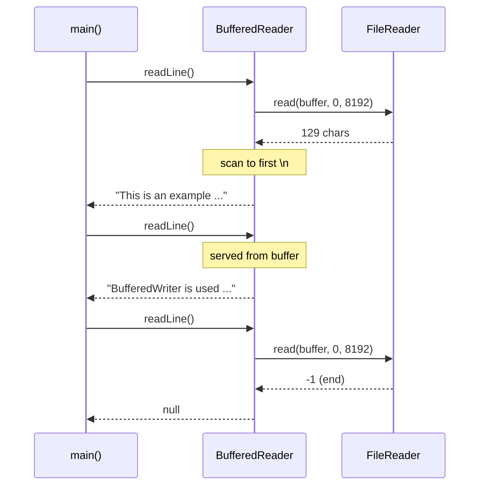
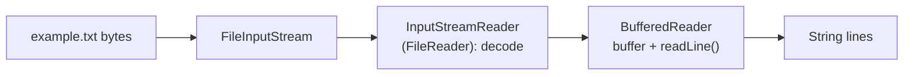

## In One Line
`BufferedReader` is a decorator that wraps any `Reader`, reads ahead into an 8 KB character buffer, and gives you the most-used text-reading method in Java: **`readLine()`**, which returns one line **without** its line terminator, or `null` at the end of the input.

## Mental Model
Think of **reading a book page by page instead of letter by letter**. Rather than walking to the shelf for every letter, you take a whole page (the buffer) to your desk and read from it. When you ask "give me the next sentence" (`readLine()`), you scan the page up to the full stop (the line terminator) and hand over the sentence *without* the full stop. When the page runs out you fetch the next one. When there are no more pages, the answer is "nothing" (`null`).

In the code:
- **The page on your desk** = the `char[8192]` buffer inside `BufferedReader`.
- **Fetching a page** = one bulk `read` on the wrapped `FileReader`.
- **"Next sentence, without the full stop"** = `readLine()` returning the line without `\n`, `\r` or `\r\n`.
- **No more pages** = `readLine()` returning `null` (not an empty string — an empty line *is* `""`).

## Concept
### What `BufferedReader` adds
| Member | Meaning |
|---|---|
| `BufferedReader(Reader in)` / `(Reader in, int sz)` | Default 8192-char buffer; `sz <= 0` throws `IllegalArgumentException` |
| `String readLine()` | The next line without its terminator; `null` at end of stream |
| `Stream<String> lines()` | Java 8: a lazy stream of the remaining lines |
| `int read()` / `read(char[], off, len)` | Served from the buffer; refilled in bulk |
| `boolean markSupported()` | `true` — `mark(readAheadLimit)` and `reset()` work |
| `long skip(long n)`, `boolean ready()`, `close()` | As in `Reader`; `close()` closes the wrapped reader |

### `readLine()` rules (all verified below)
- A line ends at `\n`, `\r`, or `\r\n` — all three are recognised, so Windows, old Mac and Unix files all work.
- The terminator is **not** included in the returned string.
- An empty line returns `""`.
- The last line is returned even if it has no terminator.
- A final terminator does **not** create an extra empty line: `"x\n"` gives `"x"` then `null`.
- At the end of the stream it returns `null`, and keeps returning `null`.

The canonical loop:
```java
String line;
while ((line = br.readLine()) != null) {
    process(line);
}
```

### How the buffer works
When the buffer is empty, `BufferedReader` calls the wrapped reader's bulk `read(char[], 0, 8192)` once and then serves `read()`/`readLine()` calls from memory. `readLine()` scans the buffer for a terminator; if a line crosses the buffer boundary it keeps the partial line in a `StringBuilder` and refills. So memory use is one buffer plus the current line — you can read a 10 GB file line by line with constant memory, as long as no single line is gigantic.

Stacked over `FileReader`, the chain is: file bytes → `FileInputStream` → `InputStreamReader` (decodes in 8 KB byte chunks) → `BufferedReader` (8 KB char buffer + line logic).

### `lines()` — streams meet I/O (Java 8)
```java
try (BufferedReader br = new BufferedReader(new FileReader("todo.txt"))) {
    long tasks = br.lines().filter(l -> !l.isBlank() && !l.startsWith("#")).count();
}
```
The stream is **lazy** — lines are read as the stream pulls them — and it does not own the reader: close the `BufferedReader` (try-with-resources), not just the stream. An `IOException` during streaming is wrapped in `UncheckedIOException`.

### Reading from the keyboard
`System.in` is an `InputStream` (bytes). To read lines of text from it, bridge and buffer:
```java
BufferedReader in = new BufferedReader(new InputStreamReader(System.in));
String name = in.readLine();
```
This was the standard way before `Scanner` (Java 5) and is still the fastest for competitive programming. Do not close it unless you are done with `System.in` for good — closing the reader closes `System.in`.

### `BufferedReader` vs `Scanner` vs NIO helpers
| | `BufferedReader` | `Scanner` | `Files.readAllLines` / `readString` | `Files.lines` / `newBufferedReader` |
|---|---|---|---|---|
| Since | 1.1 | 5 | 7 / 11 | 8 |
| Reads | lines / chars | tokens, parses `nextInt`, regex | whole file into memory | lines lazily |
| Buffer | 8192 chars | 1024 chars | — | 8192 chars |
| Errors | throws `IOException` | **swallows** it (`ioException()`) | throws | throws / `UncheckedIOException` |
| Thread-safe | yes (synchronized) | no | — | — |
| Bad bytes | replaced with `U+FFFD` (when over `FileReader`) | replaced | `MalformedInputException` | `MalformedInputException` |
| Best for | large files, fast input | parsing small interactive input | small files | large files with streams |

`Scanner`'s classic trap: `nextInt()` leaves the newline in the buffer, so a following `nextLine()` returns `""` (verified below). `BufferedReader` does not have this problem because you always read whole lines and parse them yourself (`Integer.parseInt(line.trim())`).

### Charset differences you must know
`new BufferedReader(new FileReader(f))` decodes with the default charset (UTF-8 on JDK 18+) and silently turns invalid bytes into `U+FFFD`. `Files.newBufferedReader(path)` always uses UTF-8 and **throws** `MalformedInputException` on invalid bytes. Pick deliberately: lenient for dirty logs, strict for data that must be correct.

## Diagram

One bulk read fills the buffer; later `readLine()` calls are answered from memory until the end-of-stream answer `null`.


The decorator chain: each layer adds one job — bytes, then characters, then lines.

## Code
@example IO/FileHandling/BufferedReaderExample.java

`readLine()` edge cases, `lines()`, and `mark`/`reset`:
```java
import java.io.*;
import java.nio.file.*;

public class BrDemo {
    public static void main(String[] args) throws IOException {
        String text = "a\r\nb\rc\n\nd";          // Windows, old-Mac and Unix endings, an empty line, no final newline
        try (BufferedReader br = new BufferedReader(new StringReader(text))) {
            String line;
            int n = 0;
            while ((line = br.readLine()) != null) System.out.println(++n + ": [" + line + "]");
        }
        try (BufferedReader br = new BufferedReader(new StringReader("x\n"))) {
            System.out.println(br.readLine() + " then " + br.readLine());
        }
        try (BufferedReader br = new BufferedReader(new StringReader(""))) {
            System.out.println("empty input: " + br.readLine());
        }

        Files.writeString(Path.of("todo.txt"), "buy milk\n# comment\ncall mom\n\npay rent\n");
        try (BufferedReader br = new BufferedReader(new FileReader("todo.txt"))) {
            long tasks = br.lines().filter(l -> !l.isBlank() && !l.startsWith("#")).count();
            System.out.println("tasks: " + tasks);
        }

        try (BufferedReader br = new BufferedReader(new StringReader("ABCDEF"))) {
            System.out.println("markSupported: " + br.markSupported());
            br.mark(10);
            System.out.print((char) br.read());
            System.out.print((char) br.read());
            br.reset();
            System.out.println((char) br.read() + " (after reset)");
            System.out.println("skip(2) = " + br.skip(2) + ", next = " + (char) br.read());
        }
    }
}
```
```output
1: [a]
2: [b]
3: [c]
4: []
5: [d]
x then null
empty input: null
tasks: 3
markSupported: true
ABA (after reset)
skip(2) = 2, next = D
```

The NIO helpers, and the difference in how bad bytes are handled:
```java
Path p = Path.of("notes.txt");
Files.writeString(p, "alpha\nbeta\ngamma\n");

List<String> all = Files.readAllLines(p);                 // UTF-8, whole file in memory
System.out.println("readAllLines: " + all);
try (Stream<String> lines = Files.lines(p)) {              // lazy, must be closed
    System.out.println("lines starting with g: " + lines.filter(s -> s.startsWith("g")).toList());
}
System.out.println("readString length: " + Files.readString(p).length());
try (BufferedReader br = Files.newBufferedReader(p)) {
    System.out.println("newBufferedReader first line: " + br.readLine());
}

Path bad = Path.of("latin1.txt");
Files.write(bad, new byte[] {0x63, 0x61, 0x66, (byte) 0xE9});   // "cafe" with e-acute in ISO-8859-1
try (BufferedReader br = new BufferedReader(new FileReader("latin1.txt"))) {
    String s = br.readLine();
    System.out.println("FileReader (UTF-8) replaces bad bytes: last char = U+" + Integer.toHexString(s.charAt(3)).toUpperCase());
}
try (BufferedReader br = Files.newBufferedReader(bad)) {
    br.readLine();
} catch (MalformedInputException e) {
    System.out.println("Files.newBufferedReader throws " + e);
}
try {
    Files.readAllLines(bad);
} catch (MalformedInputException e) {
    System.out.println("Files.readAllLines throws " + e);
}
System.out.println("with the right charset: " + (Files.readAllLines(bad, StandardCharsets.ISO_8859_1).get(0).charAt(3) == 'é'));
```
```output
readAllLines: [alpha, beta, gamma]
lines starting with g: [gamma]
readString length: 17
newBufferedReader first line: alpha
FileReader (UTF-8) replaces bad bytes: last char = U+FFFD
Files.newBufferedReader throws java.nio.charset.MalformedInputException: Input length = 1
Files.readAllLines throws java.nio.charset.MalformedInputException: Input length = 1
with the right charset: true
```

Reading lines from the keyboard (run with the input `Asha` and `29` piped in):
```java
BufferedReader in = new BufferedReader(new InputStreamReader(System.in));
String name = in.readLine();
int age = Integer.parseInt(in.readLine().trim());
System.out.println("Hello " + name + ", next year you will be " + (age + 1));
```
```output
Hello Asha, next year you will be 30
```

The `Scanner` trap that `BufferedReader` avoids:
```java
Scanner sc = new Scanner("29\nAsha\n");
int age = sc.nextInt();          // reads "29", leaves "\n" in the buffer
String name = sc.nextLine();     // reads the rest of line 1: ""
System.out.println("age=" + age + ", name=[" + name + "]");
```
```output
age=29, name=[]
```

## Walkthrough
- `import java.io.BufferedReader; FileReader; IOException;` — the decorator, the reader it wraps, and the checked exception.
- `FileReader fileReader = new FileReader("example.txt");` — opens the file and sets up UTF-8 decoding (default charset on JDK 18+). Throws `FileNotFoundException` if the file is missing.
- `BufferedReader bufferedReader = new BufferedReader(fileReader);` — wraps it with an 8192-char buffer; nothing is read yet.
- `String line;` — declared outside the loop so the loop condition can assign it.
- `while ((line = bufferedReader.readLine()) != null)` — the canonical loop. The first call fills the buffer with the whole (small) file and returns the first line without its `\n`; the next call returns the second line from memory; the third returns `null`, ending the loop.
- `System.out.println(line);` — `println` adds a line separator back, because `readLine()` removed the original one.
- `bufferedReader.close(); fileReader.close();` — the first call already closes the `FileReader` (closing a decorator closes what it wraps); the second is a harmless no-op.
- `catch (IOException e) { e.printStackTrace(); }` — handles a missing file or read errors.

**Why the output is not what the comment says.** The recorded output is:
`This is an example of writing to a file using BufferedWriter.` / `BufferedWriter is used to provide efficient writing of characters.`
The examples were run in order in one folder, and `BufferedWriterExample` ran immediately before this one, **overwriting** `example.txt`. The `// Output:` comment shows the text from `FileWriterExample`, which would only be true if `BufferedWriterExample` had not run in between.

## Traps
> [!ERRATA] The `// Output:` comment (`Hello, this is an example of writing to a file.` / `This is the second line.`) is the content written by `FileWriterExample`. But `BufferedWriterExample` runs before this example and overwrites `example.txt`, so the real output is the two `BufferedWriter` lines shown in the recorded output. The output of a file-reading program depends on what is in the file — not on the program.

> [!ERRATA] `fileReader.close()` after `bufferedReader.close()` is redundant: closing the `BufferedReader` already closes the `FileReader`. And both closes are skipped if `readLine()` throws, leaking the file handle. Use `try (BufferedReader br = new BufferedReader(new FileReader("example.txt", StandardCharsets.UTF_8))) { ... }` or simply `Files.newBufferedReader(Path.of("example.txt"))`.

- **Calling `readLine()` twice per iteration** — `while (br.readLine() != null) System.out.println(br.readLine());` skips every other line and can print `null` (see Quiz).
- **Comparing with `""` instead of `null`.** An empty line is `""`; the end of input is `null`. `while (!(line = br.readLine()).isEmpty())` stops at the first blank line or throws `NullPointerException` at the end.
- **Expecting the terminator in the string.** `readLine()` strips it; add it back with `newLine()`/`println` when copying.
- **`Files.lines` / `br.lines()` without try-with-resources** leaks the open file.
- **`readAllLines`/`readString` on huge files** → `OutOfMemoryError`. Stream instead.
- **`mark(readAheadLimit)` too small** — after reading more than the limit, `reset()` may fail with `IOException: Mark invalid`.
- **Closing a `BufferedReader` over `System.in`** closes `System.in` for the rest of the program.
- **`ready()` is not end-of-file detection** — it only says whether a read would block.

## Tips & Tricks
- **"`null` is the end, `""` is a blank line."**
- **Memorise the loop:** `while ((line = br.readLine()) != null)` — one `readLine()` per iteration, assigned and tested in the condition.
- **Modern one-liners:** `Files.readAllLines(path)` for small files; `try (Stream<String> s = Files.lines(path)) { ... }` for big ones; `Files.newBufferedReader(path)` when you need the loop.
- **Fast input for coding rounds:** `BufferedReader` + `Integer.parseInt` + `String.split` (or `StringTokenizer`) is much faster than `Scanner` for large inputs.
- **Want strict decoding?** Use the NIO methods (they throw `MalformedInputException`); want lenient? `FileReader`/`InputStreamReader`.
- **Mirror pairs:** `BufferedReader.readLine()` ↔ `BufferedWriter.write(line) + newLine()`.

## Interview Q&A
### [Basic] What does `readLine()` return, and how do you detect the end of the file?
It returns the next line of text **without** its terminator (`\n`, `\r` or `\r\n`), `""` for an empty line, and `null` when the end of the stream is reached. You detect the end by checking for `null`:
```java
String line;
while ((line = br.readLine()) != null) { ... }
```
**Follow-up:** *Does a trailing newline at the end of the file produce an extra empty line?* — No: `"x\n"` returns `"x"` and then `null`.

### [Basic] Why wrap a `FileReader` in a `BufferedReader`?
For two reasons. First, **efficiency**: `BufferedReader` reads 8192 characters at a time and serves later reads from memory, reducing per-call overhead. Second, **convenience**: `FileReader` has no way to read a line; `BufferedReader` adds `readLine()` and `lines()`. It also supports `mark()`/`reset()`, which `FileReader` does not.

**Follow-up:** *What is the modern shortcut?* — `Files.newBufferedReader(path)` (UTF-8, buffered) or `Files.lines(path)`.

### [Basic] How do you read input from the console with `BufferedReader`?
Bridge `System.in` (a byte stream) to characters and buffer it: `BufferedReader in = new BufferedReader(new InputStreamReader(System.in));`, then `in.readLine()` for each line and parse numbers with `Integer.parseInt(line.trim())`. It throws the checked `IOException`, so declare or catch it.

**Follow-up:** *Why not close it in a try-with-resources?* — Closing it closes `System.in`, and no later code can read the console.

### [Intermediate] `BufferedReader` or `Scanner` — which and why?
`BufferedReader` is faster (8 KB buffer, no regex parsing), synchronized, and throws `IOException`, so I/O errors are visible; you parse text yourself. `Scanner` is convenient for tokenised input (`nextInt`, `nextDouble`, custom delimiters, regex) but slower, not thread-safe, has a 1 KB buffer, and **swallows** `IOException` (check `ioException()`). `Scanner` also has the `nextInt()`/`nextLine()` trap where the leftover newline makes `nextLine()` return `""`. For large files and competitive programming use `BufferedReader`; for small interactive programs `Scanner` is fine.

**Follow-up:** *How do you fix the Scanner trap?* — Call an extra `nextLine()` after `nextInt()`, or read every line with `nextLine()` and parse it with `Integer.parseInt`.

### [Intermediate] Which line terminators does `readLine()` recognise?
Line feed `\n` (Unix/macOS), carriage return `\r` (classic Mac), and carriage return + line feed `\r\n` (Windows) — the pair counts as one terminator. So `"a\r\nb\rc\n\nd"` gives five lines `a`, `b`, `c`, `""`, `d`. Other Unicode separators such as `U+2028` are not treated as terminators.

**Follow-up:** *And `String.lines()`?* — Java 11's `String.lines()` uses the same three terminators.

### [Intermediate] How does `br.lines()` behave, and what are its pitfalls?
It returns a lazy `Stream<String>` over the remaining lines; each terminal operation pulls lines from the reader on demand, so memory stays constant. Pitfalls: the stream does not close the reader — manage the reader with try-with-resources; an `IOException` while reading surfaces as `UncheckedIOException`; the stream can be consumed only once; and reading from the reader after using the stream gives undefined results.

**Follow-up:** *Difference from `Files.lines(path)`?* — `Files.lines` opens the file itself and closing the stream closes the file; it uses UTF-8 and throws on malformed input.

### [Intermediate] What do `mark()` and `reset()` do?
`mark(readAheadLimit)` remembers the current position; `reset()` returns to it so the same characters can be read again, as long as you have not read more than `readAheadLimit` characters since the mark (the buffer may grow to hold them). Useful for peeking — e.g. detecting a byte-order mark or a header line and then re-reading. `markSupported()` is `true` for `BufferedReader` and `false` for `FileReader`.

**Follow-up:** *What happens if you read past the limit?* — `reset()` can fail with `IOException` ("Mark invalid").

### [Advanced] How much memory does reading a 10 GB file with `readLine()` use?
Roughly the 8192-char buffer plus the current line (and the decoder's byte buffer) — constant, independent of file size — because lines are produced and discarded one at a time. The exception is a file with an extremely long line (or no line breaks at all): `readLine()` accumulates the whole line in a `StringBuilder`, which can exhaust memory. For such input read fixed-size chunks with `read(char[])` or process bytes with a `FileChannel`.

**Follow-up:** *And with `Files.readAllLines`?* — It loads every line into a `List`; with UTF-16 strings plus object overhead that is well over 10 GB of heap, so it fails with `OutOfMemoryError`.

### [Advanced] Why do `FileReader` and `Files.newBufferedReader` behave differently on invalid bytes?
They configure their charset decoders differently. `InputStreamReader` (and thus `FileReader`) created from a `Charset` uses `CodingErrorAction.REPLACE` — malformed bytes become `U+FFFD` silently. `Files.newBufferedReader`, `readAllLines` and `readString` build a decoder with `REPORT`, so malformed input throws `MalformedInputException`. You can get strict behaviour from classic I/O by passing a decoder: `new InputStreamReader(in, StandardCharsets.UTF_8.newDecoder())`.

**Follow-up:** *Which is better?* — Strict for data correctness (you learn about the wrong charset immediately); lenient for best-effort reading of logs or user files.

## Quiz
### What does this print?
```java
try (BufferedReader br = new BufferedReader(new StringReader("one\ntwo\nthree\n"))) {
    while (br.readLine() != null) {
        System.out.println(br.readLine());
    }
}
```
- [ ] one, two, three
- [x] two, null
- [ ] one, three
- [ ] two, then an exception
> Each iteration calls `readLine()` twice: the condition consumes `one`, the body prints `two`; the condition consumes `three`, the body reads past the end and prints `null`. Assign the line in the condition and use that variable.

### How many lines does `readLine()` return for `"a\r\nb\rc\n\nd"` before `null`?
- [ ] 3
- [ ] 4
- [x] 5
- [ ] 6
> `\r\n`, `\r` and `\n` are all terminators, and `\n\n` contains an empty line: `a`, `b`, `c`, `""`, `d`. The last line has no terminator but is still returned.

### What does this print?
```java
try (BufferedReader br = new BufferedReader(new StringReader("x\n"))) {
    System.out.println(br.readLine() + " then " + br.readLine());
}
```
- [ ] x then 
- [x] x then null
- [ ] x\n then null
- [ ] x then x
> The terminator is stripped, and a final `\n` does not create an extra empty line, so the second call returns `null` (printed as the text `null`). The first option assumes an empty last line.

### The file `example.txt` last written by `BufferedWriterExample` is read by `BufferedReaderExample`. Why doesn't the output match the `// Output:` comment?
- [ ] `BufferedReader` skips the first line of a file
- [x] `BufferedWriterExample` overwrote the file after `FileWriterExample`, so the file contains different text than the comment assumes
- [ ] `readLine()` returns lines in reverse order
- [ ] The comment is right; the recorded output is from an older JDK
> A reading program prints whatever the file contains. The examples ran in sequence in one folder, and the last writer before this reader was `BufferedWriterExample`.

### What does this print?
```java
Scanner sc = new Scanner("29\nAsha\n");
int age = sc.nextInt();
String name = sc.nextLine();
System.out.println("age=" + age + ", name=[" + name + "]");
```
- [ ] age=29, name=[Asha]
- [x] age=29, name=[]
- [ ] It throws `InputMismatchException`
> `nextInt()` consumes only `29` and leaves the `\n`; `nextLine()` returns the rest of that line, which is empty. `BufferedReader.readLine()` plus `Integer.parseInt` avoids this.

### Which call throws `MalformedInputException` when a file contains bytes that are invalid UTF-8?
- [ ] `new BufferedReader(new FileReader(file)).readLine()`
- [x] `Files.newBufferedReader(path).readLine()`
- [ ] Both
- [ ] Neither; Java always replaces invalid bytes
> `FileReader` replaces invalid input with `U+FFFD` silently (verified); the NIO helpers use a strict decoder and throw `MalformedInputException: Input length = 1`.

## Takeaways
- `BufferedReader` wraps any `Reader`, fills an 8192-char buffer in bulk, and adds `readLine()`, `lines()` and `mark()`/`reset()`.
- `readLine()` strips `\n`, `\r` or `\r\n`, returns `""` for blank lines and `null` at the end; loop with `while ((line = br.readLine()) != null)` and call it once per iteration.
- Closing the `BufferedReader` closes the wrapped reader; use try-with-resources (and for `Files.lines` too).
- A reading program's output depends on the file's current contents — in the course run, `BufferedWriterExample` had overwritten `example.txt`, so the `// Output:` comment is wrong.
- `BufferedReader` beats `Scanner` for speed and error visibility (Scanner swallows `IOException`, and `nextInt()` + `nextLine()` returns `""`).
- `FileReader` silently replaces invalid bytes; `Files.newBufferedReader`/`readAllLines`/`readString` throw `MalformedInputException`; stream big files, never `readAllLines` them.
