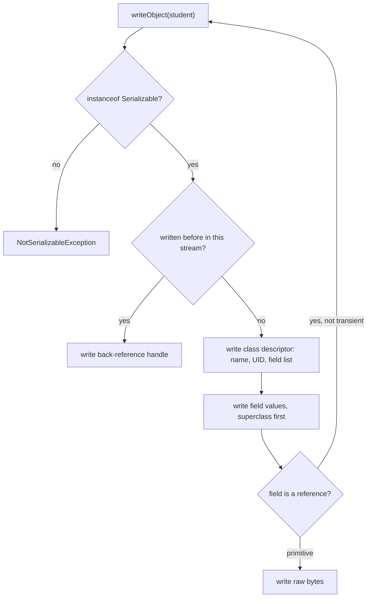
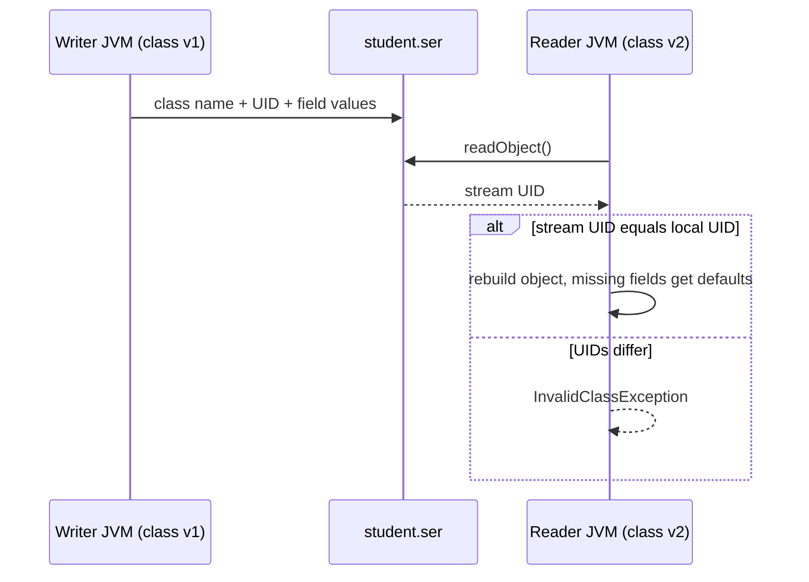

## In One Line
**Serialization** turns a live object — and every object it references — into a stream of bytes that can be saved to a file or sent over a network; in Java you opt in by implementing the **marker interface `Serializable`** and write the object with `ObjectOutputStream.writeObject()`, while `transient` and `static` fields are left out and `serialVersionUID` labels the class version.

## Mental Model
Think of **moving house with a professional packing crew**. The crew does not ship the house's blueprint or the carpenter who built the furniture (the class's code). They take each piece of furniture apart, put the parts in boxes, and attach a label: *"IKEA wardrobe, model 1"* (class name + `serialVersionUID`) plus an inventory of parts (field names, types and values). If two rooms share the same lamp, it is packed once and the second room's list just says "see box 7" (a back-reference). Things marked "do not pack" (`transient`) stay behind, and the street address of the house (`static` — it belongs to the house, not to any piece of furniture) is not in any box.

At the new house (deserialization), someone who has the **same model's assembly instructions** (the same class on the classpath) rebuilds the furniture from the boxes. If the model number on the label does not match their instructions, they refuse (`InvalidClassException`).

In the code:
- **The furniture** = the `Student` object; **the boxes** = the bytes in `student.ser`.
- **The label** = the class descriptor (`IO.SerializationAndDeserialization.Student`, UID `1`).
- **"Do not pack"** = `transient`; **the house address** = `static` fields.
- **The packing crew** = `ObjectOutputStream`.

## Concept
### Why serialization exists
Objects live in the heap of one JVM. To persist them (files, caches, HTTP sessions) or ship them to another JVM (RMI, JMS, distributed caches), you need a **byte representation**. Java's built-in serialization (since JDK 1.1) does this automatically by reflection: you add `implements Serializable` and the JVM figures out the rest.

### `Serializable` is a marker interface
```java
public interface Serializable { }   // no methods at all
```
It only *marks* the class as "the author allows instances to be serialized". `ObjectOutputStream.writeObject` checks `obj instanceof Serializable` and throws `NotSerializableException` otherwise. There is nothing to implement; the optional hooks (`writeObject`, `readObject`, `writeReplace`, `readResolve`, `serialVersionUID`) are found **by reflection**, by exact name and signature — not through the interface. Java 14 added the `@java.io.Serial` annotation so the compiler can check those magic members.

Serializability is **inherited**: if a superclass is `Serializable`, every subclass is too.

### What gets written
For `objectOut.writeObject(student)`:
1. A **stream header** (once per stream): magic number `AC ED` and version `00 05`.
2. A **class descriptor**: fully qualified class name, `serialVersionUID`, flags, and the **name and type of every serializable field**. It is written once per class per stream.
3. The **field values** of every `Serializable` class in the hierarchy, superclass first: primitives as raw bytes, references recursively (another object, a `String`, an array, or `null`).
4. For objects already written in this stream: only a **back-reference handle** — so shared objects stay shared and cycles do not loop forever.

**Not written:** `static` fields (they belong to the class, not the instance), `transient` fields, methods and code, and fields of non-serializable superclasses.

### The object graph
Serialization is **deep**: it follows every non-transient reference. Each referenced object must itself be `Serializable` (or `null`), or the whole write fails with `NotSerializableException` naming the culprit class. Shared references and cycles are preserved exactly: two people pointing at the same `Address` still point at one `Address` after deserialization (a new copy, but one copy).

### `transient`
`transient` marks a field as "not part of the persistent state". Use it for:
- **Secrets** (passwords, tokens) that must not end up in a file.
- **Derived / cached data** that can be recomputed (a cached hash, a lazily built index).
- **Non-serializable resources** (threads, sockets, streams, DB connections, loggers).

After deserialization a transient field has its type's **default value** (`null`, `0`, `false`) — even if the field has an initializer like `transient int loginCount = 5;`, because constructors and initializers of a `Serializable` class do not run on deserialization (next lesson). `transient` on a `static` field is legal but meaningless (statics are never serialized). `transient final` fields stay at their default and cannot be reassigned normally — avoid the combination.

### `static` fields
Static fields are not part of any object, so they are not written. After reading an object, `Student.someStatic` shows whatever value the **current JVM's class** has at that moment — not the value at save time.

### `serialVersionUID`
Every serializable class has a version number, a `long`:
```java
@Serial
private static final long serialVersionUID = 1L;
```
It is written into the stream with the class descriptor. On reading, the JVM compares it with the **local** class's UID; if they differ it throws `InvalidClassException: local class incompatible`.

If you **do not declare it**, the JVM computes one from a SHA-1 hash of the class structure: class name, modifiers, interfaces, fields, constructors, methods, even whether a static initializer exists. Consequences:
- Almost **any** change (adding a field, a method, changing a modifier) produces a new UID, so all previously saved data becomes unreadable — verified below.
- Different compilers can generate different synthetic members (e.g. for inner classes or lambdas), so even the *same source* compiled differently may disagree.
- Computing it at runtime costs a little time the first time the class is used.

Rules: it must be `static final long` (a wrong type is ignored — `javac -Xlint:serial` warns); `private` is recommended because the value is not inherited in any useful way. The value itself is arbitrary — `1L` is common; the `serialver` JDK tool prints the computed default if you need to stay compatible with data written before you declared one.

### Which class changes are compatible (with the same UID)?
| Change | Effect when old bytes are read by the new class |
|---|---|
| Add a field | OK — the new field gets its default value (`0`/`null`); initializers do **not** run |
| Remove a field | OK — the stored value is read and ignored |
| Make a field `transient` or `static` | Like removing it |
| Add/remove methods, change method bodies | OK (with an explicit UID) |
| Add `writeObject`/`readObject` | OK if they stay compatible with the default format |
| Change a field's **type** (e.g. `int` → `String`) | **Fails**: `InvalidClassException: incompatible types for field age` |
| Move the class to another package / rename it | Fails: the class name is stored; `ClassNotFoundException` |
| Change the superclass hierarchy, `Serializable` → `Externalizable`, enum ↔ class | Fails |
| Remove `implements Serializable` | Fails when reading or writing |

The explicit UID is your promise: *"I have checked that this change is compatible."* Change it only when you deliberately want old data to be rejected.

### The stream format, byte by byte
The original example's `student.ser` is 112 bytes (from the real run; dump made with `od -A d -t x1z`):
```text
0000000 ac ed 00 05 73 72 00 2a 49 4f 2e 53 65 72 69 61  >....sr.*IO.Seria<
0000016 6c 69 7a 61 74 69 6f 6e 41 6e 64 44 65 73 65 72  >lizationAndDeser<
0000032 69 61 6c 69 7a 61 74 69 6f 6e 2e 53 74 75 64 65  >ialization.Stude<
0000048 6e 74 00 00 00 00 00 00 00 01 02 00 02 49 00 03  >nt...........I..<
0000064 61 67 65 4c 00 04 6e 61 6d 65 74 00 12 4c 6a 61  >ageL..namet..Lja<
0000080 76 61 2f 6c 61 6e 67 2f 53 74 72 69 6e 67 3b 78  >va/lang/String;x<
0000096 70 00 00 00 14 74 00 08 4a 6f 68 6e 20 44 6f 65  >p....t..John Doe<
```
| Bytes | Meaning |
|---|---|
| `ac ed` `00 05` | Magic number and protocol version |
| `73` `72` | `TC_OBJECT`, then `TC_CLASSDESC` (a new class description follows) |
| `00 2a` + 42 bytes | Length and class name `IO.SerializationAndDeserialization.Student` |
| `00 00 00 00 00 00 00 01` | `serialVersionUID = 1` |
| `02` | Flags: `SC_SERIALIZABLE` |
| `00 02` | Two fields: `I age` (int) and `L name` of type `Ljava/lang/String;` — primitives first, then references, each group sorted by name |
| `78` `70` | End of class annotations; `TC_NULL` = no serializable superclass |
| `00 00 00 14` | `age = 20` |
| `74 00 08 John Doe` | `TC_STRING`, length 8, `name` |

Notice what is in there: the full class name, field names, and the values — readable by anyone with a hex editor. Serialization is **not encryption**.

### Where Java serialization stands today
It is still asked in every interview and used by legacy systems (RMI, old session replication, some caches), but modern guidance is to avoid it for new designs: it couples the byte format to private implementation details, bypasses constructors, is slow and verbose compared with alternatives, and — most importantly — **deserializing untrusted data is a major security risk** (covered in the next lessons). *Effective Java* (Item 85): "the best way to avoid serialization exploits is never to deserialize anything". Prefer JSON (Jackson, Gson), Protocol Buffers, Avro or Kryo for data exchange; use records for data carriers.

## Diagram

`writeObject` walks the object graph recursively; `static` and `transient` fields are skipped, and repeated objects become handles.


The UID written with the data is compared with the reader's class; only a match lets the object be rebuilt.

## Code
@example IO/SerializationAndDeserialization/SerializationExample.java

`transient`, `static`, and a field initializer that does not come back:
```java
import java.io.*;

public class TransientStatic {
    static class User implements Serializable {
        private static final long serialVersionUID = 1L;
        static String appVersion = "1.0";          // belongs to the class, not the object
        String username;
        transient String password;                 // skipped on purpose
        transient int loginCount = 5;              // initializer will NOT run on read

        User(String username, String password) { this.username = username; this.password = password; }
    }

    public static void main(String[] args) throws Exception {
        User u = new User("asha", "s3cret");
        ByteArrayOutputStream bytes = new ByteArrayOutputStream();
        try (ObjectOutputStream out = new ObjectOutputStream(bytes)) {
            out.writeObject(u);
        }

        User.appVersion = "2.0";                   // change the static AFTER writing

        try (ObjectInputStream in = new ObjectInputStream(new ByteArrayInputStream(bytes.toByteArray()))) {
            User copy = (User) in.readObject();
            System.out.println("username   = " + copy.username);
            System.out.println("password   = " + copy.password);
            System.out.println("loginCount = " + copy.loginCount);
            System.out.println("appVersion = " + User.appVersion);
            System.out.println("same object? " + (copy == u));
        }
    }
}
```
```output
username   = asha
password   = null
loginCount = 0
appVersion = 2.0
same object? false
```

A non-serializable field breaks the whole write — unless it is `null`:
```java
import java.io.*;

public class NotSer {
    static class Address { String city = "Pune"; }             // NOT Serializable
    static class Student implements Serializable {
        String name = "Asha";
        Address address = new Address();
    }
    public static void main(String[] args) {
        try (ObjectOutputStream out = new ObjectOutputStream(new ByteArrayOutputStream())) {
            out.writeObject(new Student());
        } catch (IOException e) {
            System.out.println(e);
        }
        Student s = new Student();
        s.address = null;                                         // null is fine
        try (ObjectOutputStream out = new ObjectOutputStream(new ByteArrayOutputStream())) {
            out.writeObject(s);
            System.out.println("with address = null: OK");
        } catch (IOException e) {
            System.out.println(e);
        }
    }
}
```
```output
java.io.NotSerializableException: NotSer$Address
with address = null: OK
```

The whole graph travels, with sharing and cycles intact:
```java
import java.io.*;

public class Graph {
    static class Address implements Serializable { String city; Address(String c) { city = c; } }
    static class Person implements Serializable {
        String name; Address home; Person friend;
        Person(String n, Address a) { name = n; home = a; }
    }

    public static void main(String[] args) throws Exception {
        Address shared = new Address("Pune");
        Person asha = new Person("Asha", shared);
        Person ravi = new Person("Ravi", shared);   // same Address object
        asha.friend = ravi;
        ravi.friend = asha;                          // a cycle

        ByteArrayOutputStream bytes = new ByteArrayOutputStream();
        try (ObjectOutputStream out = new ObjectOutputStream(bytes)) {
            out.writeObject(asha);                   // ravi and the address come along automatically
        }
        try (ObjectInputStream in = new ObjectInputStream(new ByteArrayInputStream(bytes.toByteArray()))) {
            Person a = (Person) in.readObject();
            Person r = a.friend;
            System.out.println(a.name + " -> " + r.name + " -> " + r.friend.name);
            System.out.println("cycle kept:          " + (r.friend == a));
            System.out.println("address still shared: " + (a.home == r.home));
            System.out.println("but a new copy:       " + (a.home != shared));
        }
    }
}
```
```output
Asha -> Ravi -> Asha
cycle kept:          true
address still shared: true
but a new copy:       true
```

**Class evolution, for real.** Two programs, `Write` (saves `new Student("Asha")` to `student.ser` and prints the UID it used) and `Read` (loads it and prints `info()`), were compiled against *different versions* of `Student`:
```java
// Version 1 (used by Write)
public class Student implements Serializable {
    private static final long serialVersionUID = 1L;
    String name;
    Student(String name) { this.name = name; }
}

// Version 2 (used by Read): same UID, two new fields
public class Student implements Serializable {
    private static final long serialVersionUID = 1L;   // unchanged
    String name;
    int age;                        // new field
    String email = "none";          // new field with an initializer
    Student(String name) { this.name = name; }
    String info() { return name + ", age=" + age + ", email=" + email; }
}
```
```output
written with UID 1
read: Asha, age=0, email=null
```
The same experiment with **no** `serialVersionUID` in either version (the only change is the two new fields and the `info()` method):
```output
written with UID -4026491325885552543
java.io.InvalidClassException: Student; local class incompatible: stream classdesc serialVersionUID = -4026491325885552543, local class serialVersionUID = -2123047262161773476
```
And with UID `1L` kept but `age` changed from `int` to `String`:
```output
written with UID 1
java.io.InvalidClassException: Student; incompatible types for field age
```
The JDK's `serialver` tool prints the computed UID of a compiled class, ready to paste:
```output
Student:    private static final long serialVersionUID = -2123047262161773476L;
```

## Walkthrough
- `import java.io.FileOutputStream; IOException; ObjectOutputStream; Serializable;` — a byte stream to the file, the serializing decorator, the checked exception and the marker interface.
- `class Student implements Serializable` — a package-private top-level class in the same file as `SerializationExample`. Implementing `Serializable` is the opt-in; without it `writeObject` throws `NotSerializableException`.
- `private static final long serialVersionUID = 1L;` — the class's version label, written into the stream (the `00 00 00 00 00 00 00 01` in the dump). Declaring it keeps `student.ser` readable after compatible edits to `Student`.
- `private String name; private int age;` — the instance state that gets saved. `private` does not matter: serialization reads fields reflectively. `String` is `Serializable`; `int` is written as 4 raw bytes.
- `public Student(String name, int age)` — an ordinary constructor. It runs when the program creates the object, **not** when it is later deserialized.
- `getName()`, `getAge()` — used by `DeserializationExample` to print the restored state. Methods are never serialized.
- `Student student = new Student("John Doe", 20);` — the object to save.
- `FileOutputStream fileOut = new FileOutputStream("student.ser");` — opens (creates or truncates) the file for raw bytes. `.ser` is only a convention.
- `ObjectOutputStream objectOut = new ObjectOutputStream(fileOut);` — the decorator that knows how to turn objects into bytes. Its constructor immediately writes the 4-byte stream header.
- `objectOut.writeObject(student);` — writes the class descriptor and the two field values: the 108 bytes after the header.
- `objectOut.close();` — flushes and closes the `ObjectOutputStream`, which also closes `fileOut`.
- `System.out.println("Student object serialized successfully.");` — the only console output, matching the `// Output:` comment.
- `catch (IOException e)` — `NotSerializableException` and `InvalidClassException` are both subclasses of `IOException`, so they would land here too.

## Traps
> [!ERRATA] `Student` is declared as a second, package-private top-level class inside `SerializationExample.java`, yet `DeserializationExample.java` uses it. It only compiles when both files are compiled together (as an IDE or Maven does); `javac -Xlint:all` warns *"auxiliary class Student in SerializationExample.java should not be accessed from outside its own source file"*, and running `java DeserializationExample.java` on its own fails because `Student` cannot be found. Put `Student` in its own `Student.java` (and make it `public` if other packages need it).

> [!ERRATA] The streams are closed only on the success path. If `writeObject` throws (e.g. `NotSerializableException`), `objectOut.close()` never runs and the file handle leaks, leaving a half-written file. Use `try (ObjectOutputStream out = new ObjectOutputStream(new FileOutputStream("student.ser"))) { out.writeObject(student); }` — or declare the two streams as separate resources, since the `ObjectOutputStream` constructor itself does I/O.

- **One non-serializable field fails everything.** `NotSerializableException: NotSer$Address` — make the field's class `Serializable`, mark the field `transient`, or write it manually in a custom `writeObject`.
- **`transient` fields come back as defaults**, ignoring initializers (`loginCount = 5` came back as `0`). Re-create them in `readObject` or lazily.
- **Statics are not restored.** Never store per-object state in a static and expect it to travel.
- **Forgetting `serialVersionUID`** makes every class change break old files (verified above). `javac -Xlint:serial` warns about it.
- **Wrong UID type is silently ignored.** `private static final int serialVersionUID = 1;` is not a UID; `-Xlint:serial` warns *"serialVersionUID must be of type long"*.
- **Non-static inner classes** serialize a hidden reference to their outer instance (which must be serializable too) and their synthetic names make UIDs fragile. Use static nested classes.
- **Serialized data is readable.** Class names, field names and values are in plain sight in the bytes; `transient` or encrypt secrets.
- **Collections serialize their elements** — a `List<Student>` is serializable only if every element is.

## Tips & Tricks
- **"Static stays, transient trashed."** Neither is written; static shows the current class value, transient comes back as the default.
- **Three lines to make a class serializable:** `implements Serializable`, `@Serial private static final long serialVersionUID = 1L;`, and `transient` on anything secret or non-serializable.
- **Turn on `-Xlint:serial`** — JDK 21 flags missing UIDs, wrongly typed UIDs, and non-transient fields of non-serializable types.
- **UID policy:** start at `1L`; bump it only for an *incompatible* change you want to reject; never change it for compatible edits.
- **Remember the magic:** `AC ED 00 05` at the start of a file means "Java serialized data" — a red flag in security reviews when it arrives from outside.
- **Interview line:** "Serialization writes the object graph's state, not its code; the class must exist on the other side."

## Interview Q&A
### [Basic] What is serialization and how do you make a class serializable?
Serialization converts an object's state — and the state of every object it references — into a byte stream so it can be stored or transmitted; deserialization rebuilds an equivalent object from those bytes. In Java a class opts in by implementing the marker interface `java.io.Serializable`, and you write objects with `ObjectOutputStream.writeObject(obj)`. All fields reachable from the object must be serializable, `transient` or `null`.

**Follow-up:** *What is a marker interface?* — An interface with no methods that tags a class with a capability (`Serializable`, `Cloneable`, `RandomAccess`); today annotations often serve the same purpose.

### [Basic] What is the `transient` keyword?
It marks an instance field to be skipped by default serialization. On deserialization the field gets its type's default value (`null`, `0`, `false`), not the value from its initializer. It is used for sensitive data (passwords), derived or cached data, and non-serializable resources (threads, streams, connections).

**Follow-up:** *Can a transient field still be saved?* — Yes, manually: write it in a private `writeObject` (e.g. encrypted) and restore it in `readObject`.

### [Basic] Are static fields serialized?
No. Static fields belong to the class, not to any instance, so they are not part of an object's state. After deserialization, reading a static field gives whatever value the class currently has in the reading JVM — in the demo the static was changed to `2.0` after writing, and `2.0` is what the "restored" object saw.

**Follow-up:** *What about `transient static`?* — Legal but pointless; statics are never serialized anyway.

### [Intermediate] What is `serialVersionUID` and what happens if you don't declare it?
It is a `private static final long` version identifier written with the serialized data and compared with the local class's UID during deserialization; a mismatch throws `InvalidClassException: local class incompatible`. If you do not declare one, the JVM computes it from a hash of the class structure (name, modifiers, interfaces, fields, methods, constructors), so nearly any change — even adding a method — changes it and makes previously serialized data unreadable. It can also differ between compilers. So always declare it explicitly and change it only for deliberately incompatible changes.

**Follow-up:** *How do you find the UID of existing data written without one?* — Run `serialver` on the old compiled class (or read it from the exception message) and declare that exact value in the new class.

### [Intermediate] What happens if a serializable class has a field whose type is not serializable?
`writeObject` throws `java.io.NotSerializableException` with the name of the offending class (e.g. `NotSer$Address`) — unless that field is `null` at the time of writing. Fixes: make the field's class `Serializable`, mark the field `transient` (and rebuild it after reading), or use custom `writeObject`/`readObject` to save the information you need. JDK 21's `javac -Xlint:serial` warns about such fields at compile time.

**Follow-up:** *Is `NotSerializableException` checked?* — Yes; it extends `ObjectStreamException`, which extends `IOException`.

### [Intermediate] How does serialization handle shared references and cycles?
`ObjectOutputStream` keeps a handle table of every object written in the stream. The first time an object is written, its full state goes out and it gets a handle; later references to the same object write just the handle. On reading, handles are resolved to the already-rebuilt object. So a graph where two people share one `Address` and point at each other is restored with one shared `Address` and the same cycle — as fresh objects, not the originals.

**Follow-up:** *What goes wrong when you write the same object twice after changing it?* — The second write is just a handle, so the reader sees the old state twice; call `reset()` or use `writeUnshared` (covered in the ObjectOutputStream lesson).

### [Intermediate] Which class changes are compatible with existing serialized data?
With the same explicit `serialVersionUID`: adding fields (they get defaults), removing fields (stored values are ignored), adding or changing methods, and making fields transient/static are compatible. Changing a field's type (`incompatible types for field age`), renaming or moving the class, changing the class hierarchy, switching between `Serializable` and `Externalizable` or between enum and class, and removing `Serializable` are incompatible.

**Follow-up:** *Why do added fields not get their initializer value?* — Because deserialization does not run the constructor or field initializers of a `Serializable` class; initialize them in `readObject` if needed.

### [Advanced] What does the serialized form of an object contain, and what does it not?
It starts with the stream header `AC ED 00 05`, then for each new class a descriptor with the fully qualified class name, `serialVersionUID`, flags, and the names and type codes of all serializable fields; then the field values, superclass data first, primitives before references. Strings, arrays, enums and back-references have their own type codes. It does **not** contain methods or bytecode, static fields, transient fields, or the state of non-serializable superclasses. The receiving JVM therefore needs the same classes on its classpath.

**Follow-up:** *Is serialized data secure?* — No: class and field names and values are readable in a hex editor, and the bytes can be modified — which is why untrusted data must never be deserialized without filters.

### [Advanced] Why is Java serialization discouraged for new designs, and what would you use instead?
It exposes private implementation details as a permanent wire format (you cannot freely refactor), bypasses constructors and their invariants, is slow and bulky, works only between JVMs with the same classes, and — most seriously — `readObject` on untrusted bytes can execute "gadget chains" in classes on the classpath, leading to remote code execution (the 2015 Apache Commons Collections exploits hit WebLogic, JBoss, Jenkins and others). Better choices: JSON (Jackson/Gson) for human-readable interop, Protocol Buffers/Avro for compact schema-evolved binary, or records with an explicit mapper. If you must use Java serialization, use `ObjectInputFilter` allow-lists (JDK 9+) and validate in `readObject`.

**Follow-up:** *Is Java serialization deprecated?* — No, but the platform treats it as legacy; OpenJDK has discussed replacing it, and features like records and filters exist partly to make it safer.

### [Advanced] How can you make a subclass of a `Serializable` class non-serializable?
You cannot remove the inherited marker interface, but you can refuse at runtime by defining private `writeObject` and `readObject` methods (and `readObjectNoData`) that throw `NotSerializableException`:
```java
@Serial
private void writeObject(ObjectOutputStream out) throws IOException {
    throw new NotSerializableException(getClass().getName());
}
```
**Follow-up:** *Where is this done in the JDK?* — Many classes that happen to inherit `Serializable` but should never be serialized use this pattern or declare themselves not serializable in their docs.

## Quiz
### What does the `TransientStatic` demo print for `password`, `loginCount` and `appVersion`?
```java
static String appVersion = "1.0";
transient String password;          // was "s3cret"
transient int loginCount = 5;
// write the object, then: User.appVersion = "2.0"; then read it back
```
- [ ] s3cret, 5, 1.0
- [ ] null, 5, 1.0
- [x] null, 0, 2.0
- [ ] null, 0, 1.0
> Transient fields come back with default values, and the `= 5` initializer does not run during deserialization. Statics are not stored at all, so the class's current value `2.0` is seen. `null, 5, ...` is the tempting wrong answer: it assumes initializers run.

### A class implements `Serializable` and has a field `Address address` where `Address` is not serializable. What happens on `writeObject`?
- [ ] The `address` field is skipped silently
- [ ] It compiles with an error
- [x] `NotSerializableException` is thrown — unless `address` is `null`
- [ ] The address is written with `toString()`
> Serialization walks every non-transient reference; a non-serializable object in the graph aborts the write. A `null` reference is written as `TC_NULL` and is fine. It compiles (JDK 21 only warns with `-Xlint:serial`).

### Data was saved by `Student` without a `serialVersionUID`. You then add one new field and read the old file. What happens?
- [ ] The new field gets its default value
- [x] `InvalidClassException: ... local class incompatible`
- [ ] `ClassNotFoundException`
- [ ] The new field gets its initializer value
> Without an explicit UID the JVM computes one from the class structure; adding a field changes it, so the stream UID and the local UID differ (verified). With an explicit, unchanged UID the first option would be right.

### What does this print?
```java
Person asha = new Person("Asha", shared);
Person ravi = new Person("Ravi", shared);   // same Address
asha.friend = ravi; ravi.friend = asha;
// write asha, read it back as a
System.out.println((a.friend.friend == a) + " " + (a.home == a.friend.home));
```
- [ ] false false
- [ ] Nothing: infinite recursion, StackOverflowError
- [x] true true
- [ ] true false
> The handle table writes each object once and uses back-references afterwards, so cycles and shared objects are rebuilt faithfully (verified: `cycle kept: true`, `address still shared: true`).

### Which change is **incompatible** even with the same explicit `serialVersionUID`?
- [ ] Adding a new field
- [ ] Removing a field
- [x] Changing a field from `int` to `String`
- [ ] Adding a new method
> A type change makes the stored value unusable: `InvalidClassException: Student; incompatible types for field age` (verified). Added fields get defaults, removed fields are ignored, methods are not part of the data.

### Spot the bug: the file `student.ser` is sometimes left half-written and locked.
```java
FileOutputStream fileOut = new FileOutputStream("student.ser");
ObjectOutputStream objectOut = new ObjectOutputStream(fileOut);
objectOut.writeObject(student);
objectOut.close();
```
- [ ] `writeObject` must be followed by `flush()`
- [x] If `writeObject` throws, `close()` is never called, so the stream leaks
- [ ] The file must have the `.ser` extension created first
- [ ] `ObjectOutputStream` must wrap a `BufferedOutputStream`
> Without try-with-resources an exception such as `NotSerializableException` skips `close()`. `close()` already flushes, the extension is only a convention, and buffering is optional.

### Which is true about the `Serializable` interface?
- [ ] It declares `writeObject` and `readObject`, which you must implement
- [x] It has no methods; it only marks the class, and optional hooks are found by reflection
- [ ] It is required only for the top-level object, not for objects it references
- [ ] Implementing it makes all fields `transient` by default
> `Serializable` is a marker interface. Hooks like `private void writeObject(ObjectOutputStream)` are optional and discovered by name/signature. Every referenced object must be serializable too.

## Takeaways
- Serialization writes an object's **state** and its whole reachable graph (not its code) as bytes; a class opts in with the marker interface `Serializable`, and the other side needs the same class.
- `transient` and `static` fields are not written; transient fields come back as defaults (initializers do not run), statics show the reading JVM's current value.
- Every object in the graph must be `Serializable` or `null`, otherwise `NotSerializableException`; shared references and cycles are preserved via back-reference handles.
- Always declare `private static final long serialVersionUID`; without it the JVM computes one from the class structure and almost any change breaks old data with `InvalidClassException`.
- Adding/removing fields is compatible with the same UID; changing a field's type, the class name or the hierarchy is not.
- The byte format (`AC ED 00 05`, class name, field names, values) is readable and modifiable — it is not encryption, and untrusted serialized data is a security risk.
