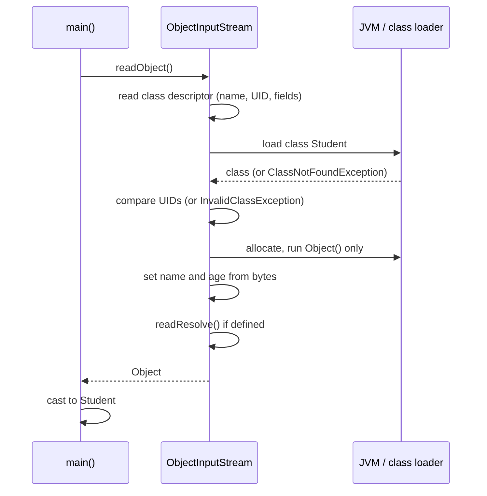
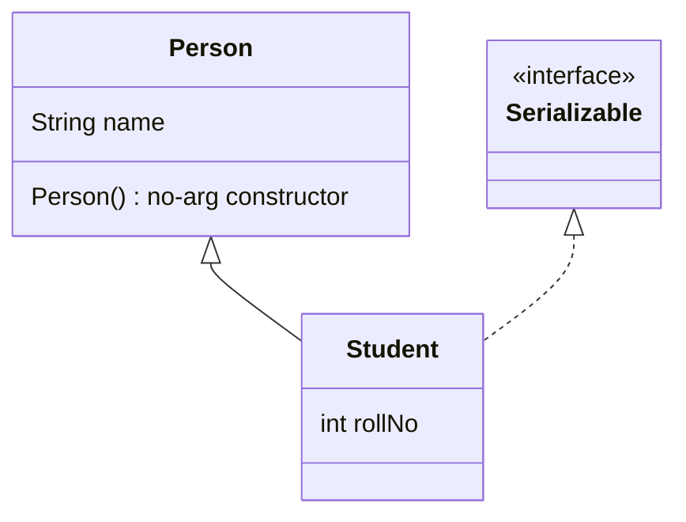

## In One Line
**Deserialization** rebuilds an object from bytes with `ObjectInputStream.readObject()`: the JVM reads the class name and `serialVersionUID`, loads the local class, creates an instance **without running its constructor** (only the no-arg constructor of the first non-serializable superclass runs), fills the fields straight from the stream, and hands you an `Object` that you cast — which is exactly why deserializing untrusted bytes is dangerous.

## Mental Model
Think of a **Star Trek transporter**. At the destination, the machine does not give birth to the person and raise them (no constructor); it reads the pattern from the signal and **assembles** the body atom by atom exactly as recorded. It needs the right blueprint library on the receiving pad (the class on the classpath) and a matching model number (`serialVersionUID`), or it refuses. And if a stranger sends a forged pattern, the machine will faithfully assemble whatever the pattern says — even a monster — because nothing checks the pattern the way a birth certificate (the constructor's validation) would.

In the code:
- **The signal** = the bytes in `student.ser`.
- **The blueprint library** = the classes available to the reading JVM (`Student` must be there, else `ClassNotFoundException`).
- **Assembling without birth** = allocating the object and setting `name` and `age` directly — the `Student(String, int)` constructor is never called.
- **The forged pattern** = attacker-controlled bytes; the constructor's checks never run.

## Concept
### What `readObject()` does, step by step
1. **Reads the next type code.** For an object (`TC_OBJECT`) it reads the class descriptor: class name, `serialVersionUID`, flags, field list.
2. **Resolves the class** by name using the application's class loader (`ObjectInputStream.resolveClass`). Missing → `ClassNotFoundException`.
3. **Checks compatibility**: stream UID vs local UID (`InvalidClassException: local class incompatible`), field types (`incompatible types for field ...`), and the object filter if one is set (`filter status: REJECTED`).
4. **Allocates the object without calling its constructor.** Precisely: it runs the **no-arg constructor of the closest non-serializable superclass** (for a class that directly implements `Serializable`, that is `Object()`), and skips every constructor, instance initializer and field initializer of the serializable classes.
5. **Restores field values** for each serializable class from the top of the hierarchy down — either by default (reflection) or by calling the class's private `readObject(ObjectInputStream)` hook. Referenced objects are read recursively; back-references are resolved to already-created objects.
6. **Calls `readResolve()`** if the class defines it, and returns its result instead.
7. Runs any validations registered with `registerValidation`, then returns the object as `Object`.

The method signature tells you what can go wrong:
```java
public final Object readObject() throws IOException, ClassNotFoundException
```
`ClassNotFoundException` is checked because the stream can name a class the reader does not have.

### Why constructors are skipped
The object's state comes entirely from the stream; running a constructor would overwrite it or require arguments the JVM does not know. So deserialization is an **extra-linguistic constructor**: a way to create objects that bypasses everything your constructors enforce — validation, defensive copies, registration, counters. Consequences:
- Invariants checked in constructors are **not** checked (see the tampering demo in [ObjectInputStream](lesson:a08-io/09-objectinputstream)).
- `transient` fields and fields added in a newer class version get **default values**, not their initializer values.
- `final` fields are set anyway (by reflection-like internal access).

### Inheritance rules
| Situation | Result |
|---|---|
| Parent is `Serializable` | Child is automatically serializable; parent fields are saved and restored; **no** constructor in the chain runs (except `Object()`) |
| Parent is **not** `Serializable`, child is | Parent fields are **not** saved. On reading, the parent's **no-arg constructor runs** and sets parent fields to whatever it sets — data loss |
| Non-serializable parent has **no accessible no-arg constructor** | `writeObject` still succeeds, but `readObject` fails: `InvalidClassException: ...; no valid constructor` |
| Child wants to opt out of an inherited `Serializable` | Throw `NotSerializableException` from private `writeObject`/`readObject` |

The rule to remember: *"The first non-serializable ancestor's no-arg constructor is called; everything below it is filled from the stream."* To keep parent state when you cannot change the parent, save it yourself in the child's `writeObject`/`readObject`.

### `readResolve()` — replacing the rebuilt object
`readObject` always creates a **new** instance, which breaks singletons: after a round trip there are two "only" instances. A class can define
```java
@Serial
private Object readResolve() { return INSTANCE; }
```
The freshly deserialized object is then discarded and `INSTANCE` is returned. Any access modifier works; `private` is not inherited by subclasses, `protected`/`public` is. (Caution: if the singleton has non-transient object fields, a crafted stream can still capture a reference to the temporary instance — *Effective Java* Item 89 recommends an **enum singleton** instead.) Its partner `writeReplace()` substitutes a different object at **write** time — the basis of the serialization proxy pattern ([ObjectOutputStream](lesson:a08-io/08-objectoutputstream)).

### Enums and records are special
| Kind | How it is written | How it is rebuilt |
|---|---|---|
| **enum** | Only the constant's **name** | `Enum.valueOf(type, name)` — identity preserved, no new instance; custom `writeObject`/`readObject`/`serialVersionUID` are ignored |
| **record** (Java 16+) | Its components | Through the **canonical constructor**, so compact-constructor validation runs; custom `writeObject`/`readObject` are ignored |
| Ordinary class | All serializable fields | Allocation without constructor + field injection |
| `Externalizable` | Whatever `writeExternal` writes | **Public no-arg constructor**, then `readExternal` |

Records are the safest built-in serializable type precisely because deserialization goes through the constructor: bad data is rejected with an `InvalidObjectException` (whose cause is your constructor's exception).

### Security: why untrusted bytes are dangerous
`readObject` runs code **before you ever see the result or cast it**: every class's `readObject` hook, `readResolve`, and methods such as `hashCode()`/`equals()`/`compareTo()` when a `HashMap`/`HashSet`/`TreeMap` in the stream rebuilds itself. An attacker who controls the bytes chooses which classes on your classpath are instantiated and how they are wired together. Chains of harmless-looking library classes ("gadget chains") can end in `Runtime.exec` — remote code execution. This hit WebLogic, JBoss, Jenkins and many others via Apache Commons Collections (2015). Other attacks: "deserialization bombs" (deeply nested `HashSet`s that take forever to hash) and huge arrays that exhaust memory.

Defences, strongest first: never deserialize untrusted data (use JSON/Protobuf); use an `ObjectInputFilter` allow-list and limits (JDK 9+, JEP 290; context-specific filter factories in JDK 17, JEP 415); validate every field in `readObject` or use records; keep gadget libraries off the classpath. The filter API is covered in [ObjectInputStream](lesson:a08-io/09-objectinputstream).

### Deep copy via serialization
Serializing an object graph and deserializing it immediately yields an independent deep copy with shared references and cycles preserved. It is simple but slow and requires everything to be `Serializable`; copy constructors or dedicated mappers are usually better.

## Diagram

The object is assembled from the stream; the `Student` constructor never appears in this sequence.


`Person` is not serializable: its `name` is not saved, and on reading `Person()` runs and resets it; `Student`'s `rollNo` comes from the stream.

## Code
@example IO/SerializationAndDeserialization/DeserializationExample.java

No constructor, no initializer block, no field initializer runs on the way back:
```java
import java.io.*;

public class NoCtor {
    static class Student implements Serializable {
        private static final long serialVersionUID = 1L;
        String name;
        int age;
        transient String cache = "warm";          // field initializer
        { System.out.println("  instance initializer block runs"); }

        Student(String name, int age) {
            System.out.println("  Student constructor runs");
            this.name = name; this.age = age;
        }
    }

    public static void main(String[] args) throws Exception {
        System.out.println("serializing:");
        byte[] bytes = serialize(new Student("John Doe", 20));
        System.out.println("deserializing:");
        Student s = (Student) deserialize(bytes);
        System.out.println("  name=" + s.name + ", age=" + s.age + ", cache=" + s.cache);
    }

    static byte[] serialize(Object o) throws IOException {
        ByteArrayOutputStream b = new ByteArrayOutputStream();
        try (ObjectOutputStream out = new ObjectOutputStream(b)) { out.writeObject(o); }
        return b.toByteArray();
    }
    static Object deserialize(byte[] bytes) throws IOException, ClassNotFoundException {
        try (ObjectInputStream in = new ObjectInputStream(new ByteArrayInputStream(bytes))) { return in.readObject(); }
    }
}
```
```output
serializing:
  instance initializer block runs
  Student constructor runs
deserializing:
  name=John Doe, age=20, cache=null
```
(The two lines under `serializing:` come from `new Student(...)`, not from serialization.)

A non-serializable parent: its no-arg constructor runs and its state is lost:
```java
import java.io.*;

public class Inherit {
    static class Person {                                   // NOT Serializable
        String name = "unknown";
        Person() { System.out.println("  Person() no-arg constructor runs"); }
        Person(String name) { this.name = name; }
    }
    static class Student extends Person implements Serializable {
        private static final long serialVersionUID = 1L;
        int rollNo;
        Student(String name, int rollNo) {
            super(name);
            System.out.println("  Student constructor runs");
            this.rollNo = rollNo;
        }
    }

    public static void main(String[] args) throws Exception {
        System.out.println("create:");
        Student s = new Student("Asha", 7);
        byte[] bytes = serialize(s);
        System.out.println("deserialize:");
        Student copy = (Student) deserialize(bytes);
        System.out.println("  name=" + copy.name + ", rollNo=" + copy.rollNo);
    }
    // serialize/deserialize helpers as in NoCtor
}
```
```output
create:
  Student constructor runs
deserialize:
  Person() no-arg constructor runs
  name=unknown, rollNo=7
```

Without a no-arg constructor in the non-serializable parent, writing works but reading fails:
```java
import java.io.*;

public class NoValidCtor {
    static class Person {                                   // NOT Serializable, no no-arg constructor
        String name;
        Person(String name) { this.name = name; }
    }
    static class Student extends Person implements Serializable {
        int rollNo;
        Student(String name, int rollNo) { super(name); this.rollNo = rollNo; }
    }

    public static void main(String[] args) throws Exception {
        ByteArrayOutputStream b = new ByteArrayOutputStream();
        try (ObjectOutputStream out = new ObjectOutputStream(b)) {
            out.writeObject(new Student("Asha", 7));
            System.out.println("writeObject: OK");
        }
        try (ObjectInputStream in = new ObjectInputStream(new ByteArrayInputStream(b.toByteArray()))) {
            in.readObject();
        } catch (InvalidClassException e) {
            System.out.println("readObject: " + e);
        }
    }
}
```
```output
writeObject: OK
readObject: java.io.InvalidClassException: NoValidCtor$Student; no valid constructor
```

Singletons, `readResolve`, and enums:
```java
import java.io.*;

public class Singleton {
    static class Config implements Serializable {
        static final Config INSTANCE = new Config();
        private Config() { }
    }
    static class SafeConfig implements Serializable {
        static final SafeConfig INSTANCE = new SafeConfig();
        private SafeConfig() { }
        private Object readResolve() { return INSTANCE; }   // swap the copy for the real one
    }
    enum Level { LOW, HIGH }

    public static void main(String[] args) throws Exception {
        System.out.println("plain singleton survives?  " + (roundTrip(Config.INSTANCE) == Config.INSTANCE));
        System.out.println("with readResolve?          " + (roundTrip(SafeConfig.INSTANCE) == SafeConfig.INSTANCE));
        System.out.println("enum constant?             " + (roundTrip(Level.HIGH) == Level.HIGH));
    }

    static Object roundTrip(Object o) throws Exception {
        ByteArrayOutputStream b = new ByteArrayOutputStream();
        try (ObjectOutputStream out = new ObjectOutputStream(b)) { out.writeObject(o); }
        try (ObjectInputStream in = new ObjectInputStream(new ByteArrayInputStream(b.toByteArray()))) { return in.readObject(); }
    }
}
```
```output
plain singleton survives?  false
with readResolve?          true
enum constant?             true
```

Records are rebuilt through their canonical constructor:
```java
import java.io.*;

public class RecordDemo {
    record Point(int x, int y) implements Serializable {
        Point {
            System.out.println("  canonical constructor: x=" + x + ", y=" + y);
            if (x < 0) throw new IllegalArgumentException("x must be >= 0");
        }
    }

    public static void main(String[] args) throws Exception {
        System.out.println("new:");
        Point p = new Point(3, 4);
        ByteArrayOutputStream b = new ByteArrayOutputStream();
        try (ObjectOutputStream out = new ObjectOutputStream(b)) { out.writeObject(p); }
        System.out.println("deserialize:");
        try (ObjectInputStream in = new ObjectInputStream(new ByteArrayInputStream(b.toByteArray()))) {
            System.out.println("  " + in.readObject());
        }
    }
}
```
```output
new:
  canonical constructor: x=3, y=4
deserialize:
  canonical constructor: x=3, y=4
  Point[x=3, y=4]
```

## Walkthrough
- `import java.io.FileInputStream; IOException; ObjectInputStream;` — a byte stream from the file and the deserializing decorator.
- `FileInputStream fileIn = new FileInputStream("student.ser");` — opens the file written by `SerializationExample` (which ran just before in the same folder). Missing file → `FileNotFoundException`.
- `ObjectInputStream objectIn = new ObjectInputStream(fileIn);` — the constructor immediately **reads and checks the 4-byte header** `AC ED 00 05`; a file that is not serialized data fails here with `StreamCorruptedException: invalid stream header`.
- `Student student = (Student) objectIn.readObject();` — reads the class descriptor for `IO.SerializationAndDeserialization.Student`, finds the local class, compares UIDs (both `1`), allocates a `Student` **without calling `Student(String, int)`**, and sets `age = 20` and `name = "John Doe"` from the bytes. `readObject()` returns `Object`, so the cast is required; a wrong cast would throw `ClassCastException`.
- `objectIn.close();` — closes the `ObjectInputStream` and the `FileInputStream` under it.
- `System.out.println("Deserialized Student:");` and the two getters — print `Name: John Doe` and `Age: 20`, exactly the values written. The object is a brand-new instance equal in content to the one saved, not the same object.
- `catch (IOException | ClassNotFoundException e)` — a Java 7 multi-catch for the two checked exceptions of `readObject()`: `IOException` (missing file, corrupt stream, `InvalidClassException`) and `ClassNotFoundException` (the stream names a class this JVM cannot load).

The output matches the `// Output:` comments. It depends on `student.ser` existing — run this before `SerializationExample` in a clean folder and you get `FileNotFoundException`.

## Traps
> [!ERRATA] This file uses `Student`, which is an auxiliary (second, non-public) class inside `SerializationExample.java`. It compiles only when both files are compiled together; `javac -Xlint:all` warns *"auxiliary class Student in SerializationExample.java should not be accessed from outside its own source file"*, and `java DeserializationExample.java` fails with `error: cannot find symbol ... Student` (verified). `Student` belongs in its own `Student.java`.

> [!ERRATA] `objectIn.close()` runs only on success; if `readObject()` throws (corrupt file, wrong UID, missing class), the stream leaks. Use `try (ObjectInputStream objectIn = new ObjectInputStream(new FileInputStream("student.ser"))) { ... }`. In a real application you would also set an `ObjectInputFilter` before calling `readObject()` — never deserialize a file that someone else could have written without one.

- **Validation in constructors does not protect you.** Deserialization bypasses them; validate in `readObject`, use records, or use a serialization proxy.
- **New fields come back as defaults** (`0`, `null`) when reading older data; initializers and constructors do not run.
- **Non-serializable superclass state is lost** and its no-arg constructor runs; if it has none, reading fails with `no valid constructor` even though writing worked.
- **Deserialization breaks singletons** — add `readResolve()` or use an enum singleton.
- **The cast happens after the damage.** Gadget code runs inside `readObject()` before your `(Student)` cast; checking the type afterwards is no defence.
- **`ClassNotFoundException` is about the reader's classpath**, not the file: the class must exist (same name and package) on the reading side.
- **Deserialized objects are new objects.** `==` with the original is `false`; implement `equals`/`hashCode` if you need content equality.

## Tips & Tricks
- **"Transporter, not birth":** deserialization assembles; constructors are skipped (except the first non-serializable parent's no-arg one).
- **Inheritance rule in one line:** *"Serializable ancestors are restored from bytes; the first non-serializable ancestor is rebuilt by its no-arg constructor."*
- **Singleton safety ladder:** enum singleton (best) > `readResolve` with all fields `transient` > plain class (broken).
- **Records for data you must deserialize** — their canonical constructor validates every time.
- **Multi-catch `IOException | ClassNotFoundException`** is the standard catch for `readObject()`.
- **Security answer in interviews:** "Never deserialize untrusted data; if unavoidable, use an `ObjectInputFilter` allow-list plus limits, and validate in `readObject`."

## Interview Q&A
### [Basic] What is deserialization and which method performs it?
Deserialization is the reverse of serialization: rebuilding an object (and its object graph) from a byte stream. `ObjectInputStream.readObject()` does it. It returns `Object`, so you cast to the expected type, and it throws `IOException` (I/O problems, corrupt data, `InvalidClassException`) and the checked `ClassNotFoundException` (the class named in the stream is not available).

**Follow-up:** *Is the result the same object that was serialized?* — No, a new object with the same state; `==` is false. Enums (and `readResolve` classes) are the exceptions that return canonical instances.

### [Basic] Is the constructor called during deserialization?
Not for serializable classes. The JVM allocates the object and runs only the no-arg constructor of the first **non-serializable** superclass (for a direct `Serializable` implementor that is `Object()`); constructors, instance initializer blocks and field initializers of the serializable classes do not run. Fields are set directly from the stream. Exceptions: `Externalizable` classes (public no-arg constructor runs, then `readExternal`) and records (the canonical constructor runs).

**Follow-up:** *Why does that matter?* — Constructor validation and initialization are bypassed: transient fields get defaults and a crafted stream can create objects that violate your invariants.

### [Intermediate] What happens during deserialization if the parent class is not serializable?
The parent's fields were never written. When reading, the JVM calls the parent's **no-arg constructor** to initialize the parent part, then fills the child's fields from the stream. So the parent's state is whatever that constructor sets (in the demo, `name` became `"unknown"` instead of `"Asha"`). If the non-serializable parent has no accessible no-arg constructor, serialization still succeeds but deserialization throws `InvalidClassException: ...; no valid constructor`.

**Follow-up:** *How do you preserve the parent's fields?* — Write them manually in the child's private `writeObject` and restore them in `readObject` via setters or protected fields.

### [Intermediate] What exceptions can deserialization throw and what do they mean?
- `FileNotFoundException` / `IOException` — the source cannot be read.
- `StreamCorruptedException` — not a valid serialization stream (e.g. `invalid stream header`, `invalid type code`).
- `EOFException` — the stream ended; also how you detect "no more objects".
- `InvalidClassException` — UID mismatch, incompatible field types, no valid constructor, or rejected by a filter.
- `ClassNotFoundException` — the class in the stream is not on the reader's classpath.
- `OptionalDataException` — you called `readObject` where primitive data was written.
- `InvalidObjectException` — a class's validation (in `readObject`, a record constructor, or a validator) rejected the data.
- `ClassCastException` — your cast after `readObject()` is wrong.

**Follow-up:** *Which are checked?* — All of them except `ClassCastException` are checked (`IOException` subclasses and `ClassNotFoundException`).

### [Intermediate] How does serialization break the Singleton pattern, and how do you fix it?
`readObject` always creates a new instance, so after a round trip there are two instances of a supposed singleton (`plain singleton survives? false`). Fix 1: define `private Object readResolve() { return INSTANCE; }` — the deserialized copy is replaced by the real instance (and make instance fields `transient` to avoid reference-stealing attacks). Fix 2 (recommended): implement the singleton as a single-element **enum** — enums are serialized by name and deserialized with `valueOf`, so identity is guaranteed by the JVM.

**Follow-up:** *What other ways break a singleton?* — Reflection (`setAccessible(true)` on the private constructor) and cloning; the enum singleton defends against all three.

### [Intermediate] How are enums and records deserialized?
An enum constant is written as its class and **name** only; on reading, `Enum.valueOf` returns the existing constant, so `==` works and enum fields are not serialized (custom serialization methods and `serialVersionUID` are ignored). A record is written as its component values and rebuilt by calling its **canonical constructor**, so validation in the compact constructor runs on every deserialization; `writeObject`/`readObject` hooks are ignored for records, while `writeReplace`/`readResolve` still work.

**Follow-up:** *What happens if a record's constructor rejects the stream data?* — `readObject` throws `InvalidObjectException` with the constructor's exception as its cause.

### [Advanced] Why is deserializing untrusted data a security vulnerability?
Because `readObject` executes code chosen by the data: it instantiates any serializable class on the classpath named in the stream, runs their `readObject`/`readResolve` hooks, and triggers methods like `hashCode`/`equals`/`compareTo` while collections rebuild themselves — all **before** your cast. Attackers chain such calls through common libraries ("gadget chains", e.g. Apache Commons Collections `InvokerTransformer`) to reach `Runtime.exec`, achieving remote code execution. Other attacks cause denial of service with deeply nested sets or huge arrays. Defences: do not deserialize untrusted input; if you must, use JEP 290 `ObjectInputFilter` allow-lists and limits (`jdk.serialFilter` or per-stream filters, JDK 17 filter factories), validate state in `readObject`, and prefer data formats like JSON with explicit binding.

**Follow-up:** *Does checking `instanceof` after `readObject` help?* — No; the malicious code already ran during `readObject`.

### [Advanced] What is `readResolve` and how is it different from `readObject`?
`readObject(ObjectInputStream)` is a private hook that customises **how the fields are read** into the newly created instance. `readResolve()` runs **after** the object is fully read and lets the class **replace** it with a different object, which is what the caller receives. Use `readObject` for validation and restoring transient state; use `readResolve` for canonical instances (singletons, interned values) and for the serialization-proxy pattern, where the proxy's `readResolve` builds the real object through its public constructor.

**Follow-up:** *Is `readResolve` inherited?* — Yes if it is protected or public (then subclasses get the parent's replacement, often a bug); a private one applies only to its own class.

### [Advanced] How would you deep-copy an object graph using serialization, and what are the downsides?
Write the object to a `ByteArrayOutputStream` with an `ObjectOutputStream`, then read it back from a `ByteArrayInputStream` with an `ObjectInputStream`. The result is a fully independent graph with shared references and cycles preserved. Downsides: every class must be `Serializable`; it is slow (reflection, descriptors, string encoding); transient fields are lost; singletons need `readResolve`; and it bypasses constructors. Copy constructors, static factory copies, or mapping libraries are usually faster and clearer.

**Follow-up:** *Why not `clone()`?* — `Object.clone()` is shallow by default, needs `Cloneable`, and is widely considered broken design; serialization copies deeply.

## Quiz
### What does the deserialization part of `NoCtor` print?
```java
transient String cache = "warm";
{ System.out.println("  instance initializer block runs"); }
Student(String name, int age) { System.out.println("  Student constructor runs"); ... }
// deserialize, then print name, age, cache
```
- [ ] The initializer line, the constructor line, then `name=John Doe, age=20, cache=warm`
- [ ] The constructor line, then `name=John Doe, age=20, cache=null`
- [x] Only `name=John Doe, age=20, cache=null`
- [ ] Only `name=null, age=0, cache=warm`
> Neither the constructor nor the initializer block nor the field initializer of a serializable class runs on deserialization. `name` and `age` come from the stream; the transient `cache` gets its default `null`.

### `Person` (not serializable, has `Person()`) is the parent of `Student implements Serializable`. After a round trip of `new Student("Asha", 7)`, what is printed for `name` and `rollNo`?
- [ ] Asha, 7
- [x] unknown, 7 — and `Person()` runs during deserialization
- [ ] null, 7
- [ ] `InvalidClassException: no valid constructor`
> The non-serializable parent's fields are not saved; its no-arg constructor runs on reading and the field initializer gives `unknown`. `no valid constructor` happens only when the parent lacks an accessible no-arg constructor.

### A non-serializable parent has only `Person(String name)`. What happens?
- [ ] Compile error in the child
- [ ] `writeObject` throws `NotSerializableException`
- [x] `writeObject` succeeds; `readObject` throws `InvalidClassException: ...; no valid constructor`
- [ ] Both succeed; the parent's field is `null`
> Writing needs only the serializable fields. Reading must initialise the non-serializable parent with a no-arg constructor, and there is none (verified).

### What does this print?
```java
System.out.println((roundTrip(Config.INSTANCE) == Config.INSTANCE) + " "
                 + (roundTrip(SafeConfig.INSTANCE) == SafeConfig.INSTANCE) + " "
                 + (roundTrip(Level.HIGH) == Level.HIGH));
// Config: plain singleton, SafeConfig: has readResolve(), Level: enum
```
- [ ] true true true
- [x] false true true
- [ ] false false true
- [ ] false true false
> A plain singleton is duplicated by deserialization. `readResolve` swaps the copy for `INSTANCE`, and enums are resolved by name to the existing constant.

### Which kind of class runs a constructor during deserialization?
- [ ] An ordinary class implementing `Serializable`
- [x] A record implementing `Serializable`
- [ ] Any class with `serialVersionUID = 1L`
- [ ] An enum
> Records are always rebuilt through their canonical constructor (verified: `canonical constructor: x=3, y=4` printed on deserialization). Ordinary serializable classes skip constructors; enums are looked up by name.

### When is `ClassNotFoundException` thrown by `readObject()`?
- [ ] When the file does not exist
- [ ] When the `serialVersionUID` differs
- [x] When the class named in the stream cannot be loaded by the reading JVM
- [ ] When the cast after `readObject()` is wrong
> The stream stores the class name; the reader must have that class. A missing file is `FileNotFoundException`, a UID mismatch is `InvalidClassException`, a wrong cast is `ClassCastException`.

## Takeaways
- `readObject()` reads the class descriptor, loads the class (`ClassNotFoundException` if missing), checks the UID, allocates the object **without its constructor**, sets fields from the bytes, applies `readResolve`, and returns `Object` to cast.
- Only the no-arg constructor of the first non-serializable superclass runs; its fields are not restored, and if it has no no-arg constructor reading fails with `no valid constructor`.
- Transient fields and newly added fields get default values — constructors, initializer blocks and field initializers of serializable classes do not run.
- Deserialization creates new instances and breaks singletons — fix with `readResolve()` or, better, an enum singleton; enums deserialize by name, records through their canonical constructor.
- `readObject` runs attacker-chosen code before your cast (gadget chains, DoS bombs): never deserialize untrusted data; otherwise use `ObjectInputFilter` allow-lists and validate in `readObject`.
- Catch `IOException | ClassNotFoundException` and close the stream with try-with-resources.
