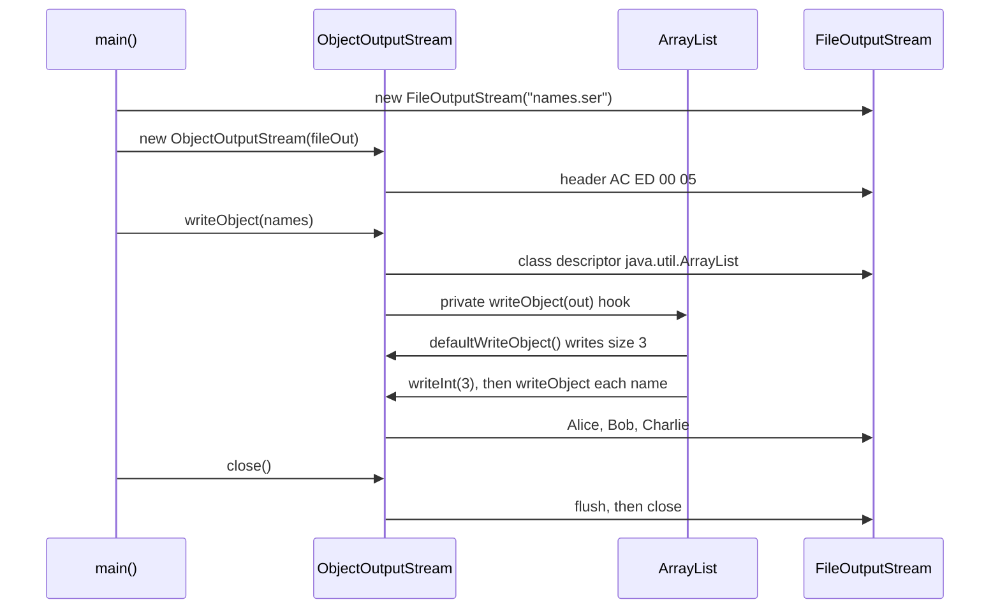
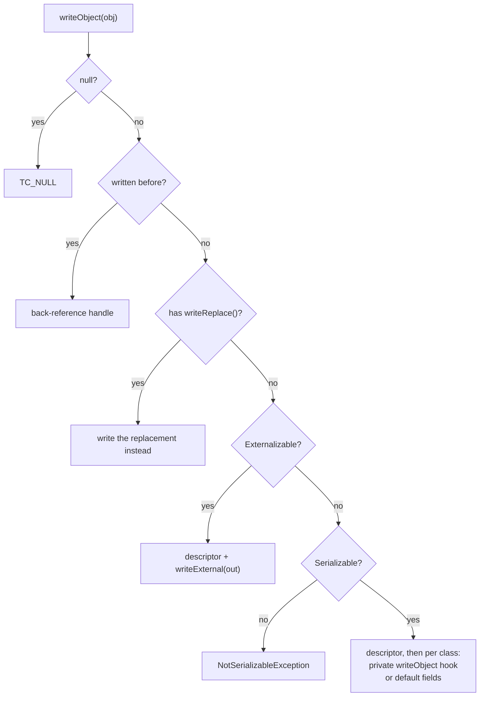
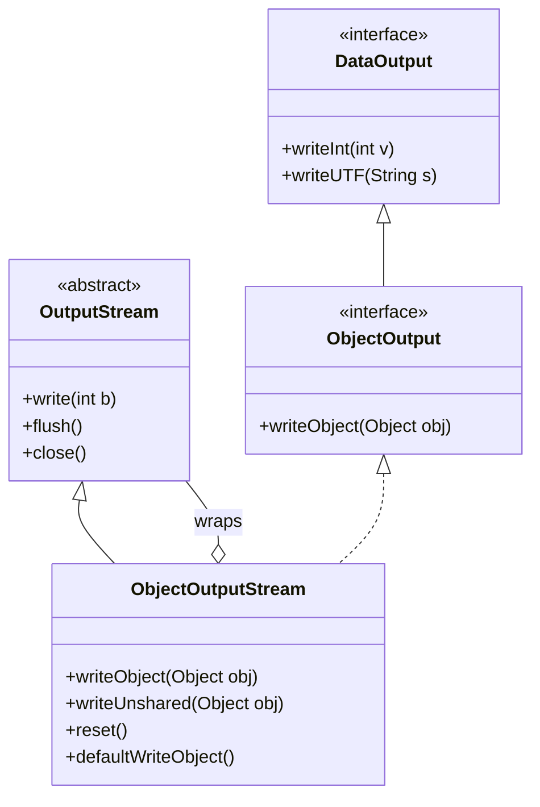

## In One Line
`ObjectOutputStream` is the **decorator that turns objects into bytes**: wrap it around any `OutputStream`, and `writeObject(obj)` writes the whole object graph (plus primitives via `writeInt`, `writeUTF`, ...). Its constructor immediately writes the 4-byte stream header, it remembers every object it has written (so a repeat is only a back-reference until you call `reset()`), and classes can take control with `writeObject`/`readObject` hooks, `Externalizable` or `writeReplace`.

## Mental Model
Think of a **shipping clerk loading one container**:
- The moment you hire the clerk (the **constructor**), he stamps the company seal on the container door — before you hand him a single parcel. That seal is the header `AC ED 00 05`.
- He numbers every parcel on a **packing list** as he loads it. If you hand him a parcel he has already loaded, he does not load it again; he writes *"same as parcel #1"*. If you repainted the parcel in between, the receiver still gets the old colour.
- `reset()` = tearing off the packing list and starting a fresh one; the next parcel is loaded in full again.
- Hiring a **second clerk for the same half-full container** (appending with a new `ObjectOutputStream`) means a second seal stamped inside the container. The customs officer unpacking parcel by parcel finds a seal where a parcel should be and stops (`invalid type code: AC`).
- Some parcels carry **their own packing instructions** (a private `writeObject` method), some insist on packing themselves completely (`Externalizable`), and some say *"ship this form instead of me"* (`writeReplace`).

In the code: the container is `names.ser`, the loading dock is the `FileOutputStream`, the clerk is the `ObjectOutputStream`, and the parcel is the `ArrayList` of three names.

## Concept
### Where it sits in `java.io`
```java
public class ObjectOutputStream extends OutputStream
        implements ObjectOutput, ObjectStreamConstants
public interface ObjectOutput extends DataOutput, AutoCloseable
```
- It **is an** `OutputStream` and **wraps** another `OutputStream` — the same decorator idea as `BufferedWriter` ([BufferedWriter & try-with-resources](lesson:a08-io/04-bufferedwriter), [Decorator](lesson:a10-patterns/08-decorator)). It does not know or care whether the bytes go to a file, a socket, or a `ByteArrayOutputStream` in memory.
- Through `DataOutput` it also writes **primitives**: `writeInt`, `writeLong`, `writeDouble`, `writeBoolean`, `writeUTF`, `writeBytes`, ... — handy for headers such as a record count.
- `writeObject(Object)` takes `Object`, not `Serializable`. The check "is this serializable?" happens **at runtime**, on the actual object — `List<String> names` compiles either way; what matters is that the object is an `ArrayList`.

### The constructor writes the header
`new ObjectOutputStream(out)` calls `writeStreamHeader()`, which writes `AC ED 00 05` (magic + version) to `out` **before you write anything**. That is why the constructor declares `throws IOException`, and it has three consequences:
1. **One stream = one header.** A reader expects exactly one header at the start. Opening a second `ObjectOutputStream` on the same file in append mode writes a second header in the middle, and the reader fails with `StreamCorruptedException: invalid type code: AC`.
2. **An empty stream is 4 bytes**, not 0.
3. **Over a network**, the peer's `ObjectInputStream` constructor *blocks* until it has read that header. If the header is sitting in a `BufferedOutputStream`, call `flush()` right after creating the `ObjectOutputStream` (see [ObjectInputStream](lesson:a08-io/09-objectinputstream) for the classic socket deadlock).

### What `writeObject` does, in order
For each object (the top one and everything it references), the stream decides:
1. `null` → write `TC_NULL`.
2. **Already written in this stream** → write only a back-reference handle (`TC_REFERENCE` + a number).
3. The class has a **`writeReplace()`** method → call it and write the returned object instead (repeat the checks for the replacement).
4. Strings, arrays, enums and `Class` objects have their own compact encodings.
5. `Externalizable` → write a class descriptor, then call the object's `writeExternal(out)`.
6. `Serializable` → write the class descriptor (once per class per stream), then for each serializable class in the hierarchy, superclass first: call its private **`writeObject` hook** if it has one, otherwise write its non-`static`, non-`transient` fields (**default serialization**).
7. Anything else → `NotSerializableException`.

The byte-level format and the rules for `transient`, `static` and `serialVersionUID` are in [Serialization](lesson:a08-io/06-serialization); this lesson is about the stream itself and the ways a class can control what it writes.

### How the example's `ArrayList` is written
The recorded run produced an 82-byte `names.ser` (dump made with `od -A d -t x1z`):
```text
0000000 ac ed 00 05 73 72 00 13 6a 61 76 61 2e 75 74 69  >....sr..java.uti<
0000016 6c 2e 41 72 72 61 79 4c 69 73 74 78 81 d2 1d 99  >l.ArrayListx....<
0000032 c7 61 9d 03 00 01 49 00 04 73 69 7a 65 78 70 00  >.a....I..sizexp.<
0000048 00 00 03 77 04 00 00 00 03 74 00 05 41 6c 69 63  >...w.....t..Alic<
0000064 65 74 00 03 42 6f 62 74 00 07 43 68 61 72 6c 69  >et..Bobt..Charli<
0000080 65 78                                            >ex<
```
| Bytes | Meaning |
|---|---|
| `ac ed 00 05` | Stream header, written by the constructor |
| `73 72 00 13 java.util.ArrayList` | New object, new class descriptor, 19-character class name |
| `78 81 d2 1d 99 c7 61 9d` | `serialVersionUID = 8683452581122892189L` — the JDK declares it, so lists saved by old JDKs are still readable |
| `03` | Flags: `SC_SERIALIZABLE` **plus `SC_WRITE_METHOD`** — `ArrayList` has its own `writeObject` hook |
| `00 01 49 00 04 size` | One serializable field: `int size` |
| `78 70` | End of class annotations; no serializable superclass (`AbstractList` is not `Serializable`) |
| `00 00 00 03` | `size = 3`, written by `defaultWriteObject()` inside the hook |
| `77 04 00 00 00 03` | A 4-byte **block of custom data**: the hook writes the size again (read back as a capacity hint) |
| `74 00 05 Alice` ... `74 00 07 Charlie` | The three elements as `TC_STRING` + length + bytes |
| `78` | End of the hook's custom data |

Why the hook? `ArrayList` stores its elements in `transient Object[] elementData`, an array that is usually **larger** than the list (spare capacity). Writing it by default would waste space on `null` slots. So `ArrayList.writeObject` calls `defaultWriteObject()` for `size`, then writes exactly `size` elements. `HashMap`, `HashSet`, `LinkedList` and most JDK collections do the same.

### Back-references, `reset()` and `writeUnshared()`
The stream keeps a **handle table**: an identity map from every object written so far to a number. This is what preserves shared references and cycles, but it has two side effects:
- **Mutating and re-writing an object does not send the new state.** The second `writeObject(c)` writes only "handle #1"; the reader gets the first state twice (demo below).
- **The table holds a strong reference to everything written**, so a long-lived stream (a socket that sends messages for hours) slowly leaks memory until `OutOfMemoryError`.

Two tools:
| Method | Effect |
|---|---|
| `reset()` | Forgets **all** objects *and class descriptors* written so far and writes a `TC_RESET` marker so the reader forgets them too. The next write is complete again — at the cost of re-sending class descriptors. Writing one object 1,000 times took 5,046 bytes without resets and 48,004 bytes with a `reset()` after each write (measured). |
| `writeUnshared(obj)` | Writes this one object in full as a **new** object that later writes will never refer back to. The objects it references are still shared normally. |

`reset()` cannot be called in the middle of writing an object (for example from inside a `writeObject` hook) — it throws `IOException: stream active`.

### Customising the output: three levels of control
| Level | How | You write | Typical use |
|---|---|---|---|
| **Default** | `implements Serializable` | Nothing — all non-transient fields by reflection | Plain data classes |
| **Hooks** | `private void writeObject(ObjectOutputStream)` + `private void readObject(ObjectInputStream)` | `defaultWriteObject()` first, then extra data | Encrypt/transform a field, rebuild transient state, write a compact form (`ArrayList`) |
| **Full control** | `implements Externalizable` with `writeExternal`/`readExternal` | **Everything**, including superclass state | Hand-tuned formats, legacy protocols |
| **Substitute** | `writeReplace()` (+ `readResolve()` on the other side) | A different object | Serialization proxy, immutable classes, `List.of`, `java.time` |

**Hook rules** (they are found by reflection, by exact signature — not through any interface):
- `private void writeObject(ObjectOutputStream out) throws IOException` and `private void readObject(ObjectInputStream in) throws IOException, ClassNotFoundException`. **Must be `private` and non-static**; a `public writeObject` is silently ignored (demo below). Annotate with `@Serial` (Java 14+) so the compiler checks the signature.
- Call `out.defaultWriteObject()` (or `writeFields()`) **once, first**, even if all fields are transient — it keeps the format evolvable. Then write extras with `writeInt`, `writeUTF`, `writeObject`, ...
- The matching `readObject` must read **in exactly the same order**.
- Each class in a hierarchy has its own hooks for its own fields; a subclass never calls `super.writeObject`.
- For a stable format independent of the real fields, declare `private static final ObjectStreamField[] serialPersistentFields` and use `putFields()`/`writeFields()` — advanced and rare.

### `Externalizable`
```java
public interface Externalizable extends Serializable {
    void writeExternal(ObjectOutput out) throws IOException;
    void readExternal(ObjectInput in) throws IOException, ClassNotFoundException;
}
```
| | `Serializable` | `Externalizable` |
|---|---|---|
| What is written | Field names + values, automatically | Only what `writeExternal` writes |
| Superclass state | Handled automatically | You must write it yourself |
| On reading | No constructor of the class runs | The **public no-arg constructor runs**, then `readExternal` |
| Constructor rule | First non-serializable parent needs a no-arg constructor | The class itself needs a **public** no-arg constructor, or `InvalidClassException: no valid constructor` |
| Methods | Optional private hooks | Two **public** methods (anyone can call `readExternal` on a live object — a security smell) |
| Size | Descriptor lists the fields | Descriptor lists no fields, but each object's data is wrapped in block markers |
| Speed | Reflection | Direct calls, usually faster |

Externalizable is **not automatically smaller**: one `ExtPoint(3, 4)` took 53 bytes vs 58 for an equivalent `Serializable` class, but a list of 1,000 of them took **17,085 vs 14,093 bytes** (measured) because each externalized object carries block-data framing. Its real advantages are speed and total control; its costs are boilerplate, a public constructor that makes the class mutable, and public read/write methods. Today, if you need that much control, a format like Protocol Buffers is usually the better answer.

### `writeReplace()` and the serialization proxy pattern
`ANY-ACCESS-MODIFIER Object writeReplace() throws ObjectStreamException` lets an object say *"serialize this other object instead of me"*. It runs **before** anything about the original is written. Its partner on the reading side is `readResolve()` ([Deserialization](lesson:a08-io/07-deserialization)).

The **serialization proxy pattern** (*Effective Java*, Item 90) combines them to make deserialization safe for classes with invariants:
1. A private static nested `Proxy` class holds just the logical state and is `Serializable`.
2. The real class's `writeReplace()` returns `new Proxy(this)` — the real class never appears in the stream.
3. `Proxy.readResolve()` rebuilds the real object **through its public constructor or factory**, so every validation runs.
4. The real class's `readObject` throws `InvalidObjectException("Proxy required")`, so forged bytes that name the real class directly are refused.

The JDK uses this everywhere: `List.of(...)`, `Set.of(...)` and `stream().toList()` are written as a `java.util.CollSer` proxy; `LocalDate`, `Duration` and the other `java.time` classes as `java.time.Ser`; `EnumSet` as `EnumSet$SerializationProxy` (all verified or from the JDK source). Limitation: it does not work when the class must be extensible, or when the object graph has cycles through the proxied object.

### Writing to a real file, a socket, or memory
| Target | Wrap | Notes |
|---|---|---|
| File | `new ObjectOutputStream(new BufferedOutputStream(new FileOutputStream(f)))` | `ObjectOutputStream` passes many small writes through. 1,000 small records caused **3,008 `write` calls** on the underlying stream directly vs **3** with a `BufferedOutputStream` in between (measured). |
| Socket | `new ObjectOutputStream(new BufferedOutputStream(socket.getOutputStream()))` then **`flush()` immediately** | Flush the header so the peer's `ObjectInputStream` constructor can return; `flush()` after each message; `reset()` periodically. |
| Memory | `new ObjectOutputStream(byteArrayOutputStream)` | For deep copies, size measurements, caching, tests. |

`ObjectOutputStream` is **not thread-safe**: interleaved `writeObject` calls from two threads corrupt the stream. Give each thread its own stream or synchronize around each message.

### What happens when a write fails half-way
If `writeObject` throws (say, `NotSerializableException` on a field deep in the graph), the stream writes a `TC_EXCEPTION` marker plus the exception itself before rethrowing. A reader then gets everything written before, and at the broken object a **`WriteAbortedException: writing aborted; java.io.NotSerializableException: ...`** (demo below). The stream itself stays usable — in a test, a `writeObject("after")` following the failure arrived normally, and the reader could continue after catching `WriteAbortedException` — but the broken object is simply missing, so a file written this way is incomplete.

### Version notes
| Version | Change |
|---|---|
| JDK 1.1 | `ObjectOutputStream`, `Serializable`, `Externalizable` |
| JDK 1.4 | `writeUnshared` / `readUnshared` |
| Java 7 | `ObjectOutput` extends `AutoCloseable` — usable in try-with-resources |
| Java 9 | `List.of`/`Set.of`/`Map.of` serialize via the `CollSer` proxy; `ObjectInputFilter` on the reading side |
| Java 14 | `@java.io.Serial` annotation for `writeObject`, `writeReplace`, `serialVersionUID`, ... |
| Java 16 | Records: written as their components, rebuilt through the canonical constructor; custom `writeObject` hooks on records are ignored |

## Diagram

The header goes out in the constructor; the list decides for itself which data to write through its private hook.


The order matters: a back-reference beats everything, and `writeReplace` runs before the stream even looks at how the class is serialized.


`ObjectOutputStream` is an `OutputStream` that wraps another `OutputStream` — a decorator that adds object and primitive writing.

## Code
@example IO/SerializationAndDeserialization/ObjectOutputStreamExample.java

**The header is written by the constructor** — and can get stuck in a buffer:
```java
import java.io.*;
import java.util.HexFormat;

public class HeaderDemo {
    public static void main(String[] args) throws IOException {
        HexFormat hex = HexFormat.ofDelimiter(" ");
        ByteArrayOutputStream bytes = new ByteArrayOutputStream();
        ObjectOutputStream out = new ObjectOutputStream(bytes);        // nothing written by us yet...
        System.out.println("after constructor: " + bytes.size() + " bytes  " + hex.formatHex(bytes.toByteArray()));
        out.writeInt(42);
        System.out.println("after writeInt:    " + bytes.size() + " bytes  (42 is in the internal block buffer)");
        out.flush();
        System.out.println("after flush:       " + bytes.size() + " bytes " + hex.formatHex(bytes.toByteArray()));
        out.close();

        ByteArrayOutputStream b2 = new ByteArrayOutputStream();
        ObjectOutputStream viaBuffer = new ObjectOutputStream(new BufferedOutputStream(b2));
        System.out.println("with BufferedOutputStream, after constructor: " + b2.size() + " bytes");
        viaBuffer.flush();
        System.out.println("with BufferedOutputStream, after flush:       " + b2.size() + " bytes");
    }
}
```
```output
after constructor: 4 bytes  ac ed 00 05
after writeInt:    4 bytes  (42 is in the internal block buffer)
after flush:       10 bytes ac ed 00 05 77 04 00 00 00 2a
with BufferedOutputStream, after constructor: 0 bytes
with BufferedOutputStream, after flush:       4 bytes
```
Primitives go into a block (`77` = `TC_BLOCKDATA`, `04` = length, then `00 00 00 2a` = 42). `HexFormat` is Java 17+.

**Same object twice, `reset()` and `writeUnshared()`:**
```java
import java.io.*;

public class SharedTwice {
    static class Counter implements Serializable { int value; }

    public static void main(String[] args) throws Exception {
        Counter c = new Counter();
        ByteArrayOutputStream bytes = new ByteArrayOutputStream();
        try (ObjectOutputStream out = new ObjectOutputStream(bytes)) {
            c.value = 1; out.writeObject(c);      // written in full, gets handle #1
            c.value = 2; out.writeObject(c);      // same object: only "see handle #1" is written
            out.reset();                          // forget every object written so far
            c.value = 3; out.writeObject(c);      // written in full again
            c.value = 4; out.writeUnshared(c);    // written in full, never used as a back-reference
        }
        try (ObjectInputStream in = new ObjectInputStream(new ByteArrayInputStream(bytes.toByteArray()))) {
            Counter a = (Counter) in.readObject();
            Counter b = (Counter) in.readObject();
            Counter d = (Counter) in.readObject();
            Counter e = (Counter) in.readObject();
            System.out.println("values read: " + a.value + " " + b.value + " " + d.value + " " + e.value);
            System.out.println("a == b ? " + (a == b));
            System.out.println("b == d ? " + (b == d));
        }
    }
}
```
```output
values read: 1 1 3 4
a == b ? true
b == d ? false
```
The value `2` never reached the stream. The reader even gets **the same object** back for the first two reads.

**Appending to an existing file** — the naive way, and the correct fix:
```java
import java.io.*;
import java.nio.file.*;

public class AppendDemo {
    public static void main(String[] args) throws Exception {
        Path file = Path.of("log.ser");

        Files.deleteIfExists(file);
        for (String s : new String[] {"first", "second"}) {       // two separate "runs" appending
            try (ObjectOutputStream out = new ObjectOutputStream(new FileOutputStream(file.toFile(), true))) {
                out.writeObject(s);
            }
        }
        System.out.println("naive append:");
        readAll(file);

        Files.deleteIfExists(file);
        for (String s : new String[] {"first", "second"}) {
            boolean hasHeader = Files.exists(file) && Files.size(file) > 0;
            OutputStream fos = new FileOutputStream(file.toFile(), true);
            try (ObjectOutputStream out = hasHeader ? new AppendingObjectOutputStream(fos)
                                                    : new ObjectOutputStream(fos)) {
                out.writeObject(s);
            }
        }
        System.out.println("appending subclass:");
        readAll(file);
    }

    static class AppendingObjectOutputStream extends ObjectOutputStream {
        AppendingObjectOutputStream(OutputStream out) throws IOException { super(out); }
        @Override
        protected void writeStreamHeader() throws IOException {
            reset();                          // write TC_RESET instead of a second AC ED 00 05
        }
    }

    static void readAll(Path file) throws Exception {
        try (ObjectInputStream in = new ObjectInputStream(Files.newInputStream(file))) {
            while (true) System.out.println("  read: " + in.readObject());
        } catch (EOFException end) {
            System.out.println("  (end of file)");
        } catch (StreamCorruptedException e) {
            System.out.println("  " + e);
        }
    }
}
```
```output
naive append:
  read: first
  java.io.StreamCorruptedException: invalid type code: AC
appending subclass:
  read: first
  read: second
  (end of file)
```
Why `reset()` and not an empty `writeStreamHeader()`? An empty override also avoids the second header, but the new writer numbers its handles from zero again while the reader keeps counting — back-references then point at the **wrong objects**, silently:
```java
import java.io.*;

public class EmptyHeader {
    record Point(int x) implements Serializable { }

    static class NoHeaderObjectOutputStream extends ObjectOutputStream {
        NoHeaderObjectOutputStream(OutputStream out) throws IOException { super(out); }
        @Override protected void writeStreamHeader() { }        // tempting, but wrong
    }

    public static void main(String[] args) throws Exception {
        ByteArrayOutputStream file = new ByteArrayOutputStream();
        try (ObjectOutputStream out = new ObjectOutputStream(file)) {
            out.writeObject(new Point(1));
        }
        try (ObjectOutputStream out = new NoHeaderObjectOutputStream(file)) {   // "append" segment 2
            Point p2 = new Point(2);
            out.writeObject(p2);
            out.writeObject(p2);                                     // back-reference to p2
        }
        try (ObjectInputStream in = new ObjectInputStream(new ByteArrayInputStream(file.toByteArray()))) {
            System.out.println(in.readObject());
            System.out.println(in.readObject());
            System.out.println(in.readObject());                     // should be Point[x=2]...
        }
    }
}
```
```output
Point[x=1]
Point[x=2]
Point[x=1]
```

**Custom hooks: `defaultWriteObject()` + extra data** — and a hook that is silently ignored:
```java
import java.io.*;

public class CustomHooks {
    static class Account implements Serializable {
        @Serial private static final long serialVersionUID = 1L;
        private final String user;
        private transient String pin;             // skipped by defaultWriteObject()
        private transient int failedLogins;       // runtime-only state

        Account(String user, String pin) { this.user = user; this.pin = pin; this.failedLogins = 2; }

        @Serial
        private void writeObject(ObjectOutputStream out) throws IOException {
            System.out.println("  writeObject hook");
            out.defaultWriteObject();                          // 1. the normal fields (user)
            out.writeUTF(new StringBuilder(pin).reverse().toString());   // 2. extra data (toy "encryption")
        }

        @Serial
        private void readObject(ObjectInputStream in) throws IOException, ClassNotFoundException {
            System.out.println("  readObject hook");
            in.defaultReadObject();                            // 1. same order as written
            pin = new StringBuilder(in.readUTF()).reverse().toString();  // 2.
            failedLogins = 0;                                  // re-initialise transient state on purpose
        }

        @Override public String toString() { return user + "/" + pin + "/failedLogins=" + failedLogins; }
    }

    static class WrongHook implements Serializable {
        transient String secret = "kept?";
        public void writeObject(ObjectOutputStream out) throws IOException {   // public: NOT a hook
            System.out.println("  never printed");
            out.defaultWriteObject();
            out.writeUTF(secret);
        }
    }

    public static void main(String[] args) throws Exception {
        System.out.println("round trip: " + roundTrip(new Account("asha", "1234")));
        System.out.println("pin visible in bytes? " + new String(serialize(new Account("asha", "1234")), "ISO-8859-1").contains("1234"));
        System.out.println("public writeObject: secret = " + ((WrongHook) roundTrip(new WrongHook())).secret);
    }

    static byte[] serialize(Object o) throws IOException {
        ByteArrayOutputStream b = new ByteArrayOutputStream();
        try (ObjectOutputStream out = new ObjectOutputStream(b)) { out.writeObject(o); }
        return b.toByteArray();
    }
    static Object roundTrip(Object o) throws Exception {
        try (ObjectInputStream in = new ObjectInputStream(new ByteArrayInputStream(serialize(o)))) { return in.readObject(); }
    }
}
```
```output
  writeObject hook
  readObject hook
round trip: asha/1234/failedLogins=0
  writeObject hook
pin visible in bytes? false
public writeObject: secret = null
```
Reversing a string is of course not encryption — the point is *where* the transformation goes. The `public` method is never called, so the transient `secret` comes back `null`.

**`Externalizable`: you write everything, and a public no-arg constructor runs on reading:**
```java
import java.io.*;

public class ExternalDemo {
    static class ExtPoint implements Externalizable {
        private int x, y;
        public ExtPoint() { System.out.println("  public no-arg constructor runs"); }  // required
        ExtPoint(int x, int y) { this.x = x; this.y = y; }

        @Override public void writeExternal(ObjectOutput out) throws IOException {
            out.writeInt(x);                         // you write EVERYTHING yourself
            out.writeInt(y);
        }
        @Override public void readExternal(ObjectInput in) throws IOException {
            x = in.readInt();                        // same order
            y = in.readInt();
        }
        @Override public String toString() { return "ExtPoint(" + x + ", " + y + ")"; }
    }

    static class SerPoint implements Serializable { int x, y; SerPoint(int x, int y) { this.x = x; this.y = y; } }

    static class NoPublicCtor implements Externalizable {
        NoPublicCtor() { }                                           // package-private: not enough
        public void writeExternal(ObjectOutput out) { }
        public void readExternal(ObjectInput in) { }
    }

    public static void main(String[] args) throws Exception {
        System.out.println("create:");
        ExtPoint p = new ExtPoint(3, 4);
        System.out.println("deserialize:");
        System.out.println("  " + roundTrip(p));
        System.out.println("Externalizable size: " + serialize(p).length + " bytes");
        System.out.println("Serializable size:   " + serialize(new SerPoint(3, 4)).length + " bytes");
        try {
            roundTrip(new NoPublicCtor());
        } catch (InvalidClassException e) {
            System.out.println(e);
        }
    }

    // serialize/roundTrip helpers as in CustomHooks
}
```
```output
create:
deserialize:
  public no-arg constructor runs
  ExtPoint(3, 4)
Externalizable size: 53 bytes
Serializable size:   58 bytes
java.io.InvalidClassException: ExternalDemo$NoPublicCtor; no valid constructor
```
Only the **constructor** must be public — `ExtPoint` itself is a package-private nested class and works. Note the failure appears on **reading**; writing a `NoPublicCtor` succeeds.

**`writeReplace` + `readResolve`: the serialization proxy pattern:**
```java
import java.io.*;
import java.time.LocalDate;

public class ProxyDemo {
    static final class Period implements Serializable {
        private final LocalDate start, end;

        Period(LocalDate start, LocalDate end) {
            if (start.isAfter(end)) throw new IllegalArgumentException(start + " is after " + end);
            this.start = start;
            this.end = end;
        }

        @Serial
        private Object writeReplace() {                       // called by writeObject BEFORE writing
            System.out.println("  writeReplace: Period -> Proxy");
            return new Proxy(this);
        }

        @Serial
        private void readObject(ObjectInputStream in) throws InvalidObjectException {
            throw new InvalidObjectException("Proxy required"); // forged Period bytes are refused
        }

        private static final class Proxy implements Serializable {
            @Serial private static final long serialVersionUID = 1L;
            private final LocalDate start, end;
            Proxy(Period p) { start = p.start; end = p.end; }

            @Serial
            private Object readResolve() {                    // rebuild through the real constructor
                System.out.println("  readResolve: Proxy -> new Period(...)");
                return new Period(start, end);
            }
        }

        @Override public String toString() { return start + ".." + end; }
    }

    public static void main(String[] args) throws Exception {
        ByteArrayOutputStream b = new ByteArrayOutputStream();
        try (ObjectOutputStream out = new ObjectOutputStream(b)) {
            out.writeObject(new Period(LocalDate.of(2024, 1, 1), LocalDate.of(2024, 12, 31)));
        }
        String raw = new String(b.toByteArray(), "ISO-8859-1");
        System.out.println("class names in the stream: Period$Proxy=" + raw.contains("Period$Proxy")
                + ", java.time.Ser=" + raw.contains("java.time.Ser"));
        try (ObjectInputStream in = new ObjectInputStream(new ByteArrayInputStream(b.toByteArray()))) {
            Object o = in.readObject();
            System.out.println("  got " + o.getClass().getSimpleName() + " " + o);
        }
    }
}
```
```output
  writeReplace: Period -> Proxy
class names in the stream: Period$Proxy=true, java.time.Ser=true
  readResolve: Proxy -> new Period(...)
  got Period 2024-01-01..2024-12-31
```
`java.time.Ser` shows up because `LocalDate` itself uses the same trick.

**Which lists can you actually write?** The declared type `List<String>` says nothing — the runtime class decides:
```java
import java.io.*;
import java.util.*;

public class WhichLists {
    public static void main(String[] args) {
        List<String> names = new ArrayList<>(List.of("Alice", "Bob", "Charlie"));
        Map<String, Integer> ages = new HashMap<>(Map.of("Alice", 30));
        test("new ArrayList<>(...)", names);
        test("List.of(...)", List.of("Alice", "Bob"));
        test("Arrays.asList(...)", Arrays.asList("Alice", "Bob"));
        test("Collections.unmodifiableList", Collections.unmodifiableList(names));
        test("stream().toList()", names.stream().toList());
        test("names.subList(0, 2)", names.subList(0, 2));
        test("ages.keySet()", ages.keySet());
        test("new ArrayList<>(subList)", new ArrayList<>(names.subList(0, 2)));
    }

    static void test(String label, Object o) {
        ByteArrayOutputStream bytes = new ByteArrayOutputStream();
        try (ObjectOutputStream out = new ObjectOutputStream(bytes)) {
            out.writeObject(o);
        } catch (IOException e) {
            System.out.printf("%-30s FAILS: %s%n", label, e);
            return;
        }
        String raw = new String(bytes.toByteArray(), java.nio.charset.StandardCharsets.ISO_8859_1);
        System.out.printf("%-30s OK%s%n", label, raw.contains("java.util.CollSer") ? "  (written as java.util.CollSer)" : "");
    }
}
```
```output
new ArrayList<>(...)           OK
List.of(...)                   OK  (written as java.util.CollSer)
Arrays.asList(...)             OK
Collections.unmodifiableList   OK
stream().toList()              OK  (written as java.util.CollSer)
names.subList(0, 2)            FAILS: java.io.NotSerializableException: java.util.ArrayList$SubList
ages.keySet()                  FAILS: java.io.NotSerializableException: java.util.HashMap$KeySet
new ArrayList<>(subList)       OK
```

**A failed write leaves a marker in the stream:**
```java
import java.io.*;

public class Aborted {
    static class Address { String city = "Pune"; }                 // NOT Serializable
    static class Student implements Serializable { String name = "Asha"; Address address = new Address(); }

    public static void main(String[] args) throws Exception {
        ByteArrayOutputStream bytes = new ByteArrayOutputStream();
        try (ObjectOutputStream out = new ObjectOutputStream(bytes)) {
            out.writeObject("before");
            out.writeObject(new Student());                         // fails half-way
        } catch (NotSerializableException e) {
            System.out.println("write failed: " + e);
        }
        try (ObjectInputStream in = new ObjectInputStream(new ByteArrayInputStream(bytes.toByteArray()))) {
            System.out.println("read: " + in.readObject());
            in.readObject();
        } catch (WriteAbortedException e) {
            System.out.println("read failed: " + e);
        }
    }
}
```
```output
write failed: java.io.NotSerializableException: Aborted$Address
read: before
read failed: java.io.WriteAbortedException: writing aborted; java.io.NotSerializableException: Aborted$Address
```

## Walkthrough
- `package IO.SerializationAndDeserialization;` — the class lives in the same package as the other serialization examples. Nothing in this file depends on them.
- `import java.io.FileOutputStream; IOException; ObjectOutputStream; java.util.ArrayList; List;` — a byte stream to a file, the serializing decorator, the checked exception, and the collection to save.
- `List<String> names = new ArrayList<>(); names.add("Alice"); ... ("Charlie");` — the comment calls this a "list of objects to be serialized". Precisely: **one** object is serialized — the `ArrayList` — and its three `String` elements travel along as part of its object graph. The declared type `List` is not `Serializable`; the call works because the runtime class `ArrayList` is, and so is every element (`String`).
- `FileOutputStream fileOut = new FileOutputStream("names.ser");` — creates the file, or **truncates** an existing one, in the current working directory (`user.dir`). `.ser` is only a convention. A missing directory or no write permission would throw `FileNotFoundException` (a subclass of `IOException`).
- `ObjectOutputStream objectOut = new ObjectOutputStream(fileOut);` — wraps the file stream. The constructor **already writes** `AC ED 00 05` — the first four bytes of the dump.
- `objectOut.writeObject(names);` — writes the `ArrayList` class descriptor (with flag `SC_WRITE_METHOD`), then calls `ArrayList`'s private `writeObject` hook, which writes `size = 3` via `defaultWriteObject()`, a 4-byte block with the size again, and the three strings. Total: 82 bytes.
- `objectOut.close();` — flushes the internal buffer and closes the `ObjectOutputStream`, which **also closes `fileOut`**. That is why the example never calls `fileOut.close()`.
- `System.out.println("List of names serialized successfully.");` — the only console output, and it matches the `// Output:` comment. It proves only that no exception was thrown.
- `catch (IOException e) { e.printStackTrace(); }` — covers `FileNotFoundException`, `NotSerializableException` (if an element were not serializable) and any disk error. After printing the stack trace the program simply ends, still with exit code 0.

The file is read back by the next example, [ObjectInputStream](lesson:a08-io/09-objectinputstream); the recorded outputs were produced by running both in the same folder, in this order.

## Traps
> [!ERRATA] The streams are closed only on the success path. If `writeObject` throws (for example a `NotSerializableException` if someone later adds a non-serializable element type), `objectOut.close()` is skipped, the file handle leaks, and `names.ser` is left half-written. Worse, if the `ObjectOutputStream` constructor itself throws while writing the header, `fileOut` is never closed at all, because nothing refers to it any more. Use try-with-resources with **two** resources so each one is closed on its own, and buffer the file:
> ```java
> try (FileOutputStream fileOut = new FileOutputStream("names.ser");
>      ObjectOutputStream objectOut = new ObjectOutputStream(new BufferedOutputStream(fileOut))) {
>     objectOut.writeObject(names);
> }
> ```

> [!ERRATA] `catch (IOException e) { e.printStackTrace(); }` swallows the failure: the program prints a stack trace and ends "successfully" (exit code 0), so a script or caller cannot tell that nothing was saved. Let `main` declare `throws IOException`, or rethrow as an `UncheckedIOException` in real code.

- **Appending with a new `ObjectOutputStream`** writes a second header: `StreamCorruptedException: invalid type code: AC` on reading. Keep one stream open, write one collection, or use a subclass whose `writeStreamHeader()` calls `reset()` — **not** an empty override, which silently mixes up back-references (both verified above).
- **Mutate-and-rewrite sends the old state.** Call `reset()` between writes or use `writeUnshared`.
- **Long-lived streams leak memory** through the handle table. Call `reset()` every N messages.
- **`reset()` re-sends class descriptors**, so resetting after every tiny message can multiply the size by ten (5,046 → 48,004 bytes in the measurement).
- **A `public` or `static` `writeObject` is not a hook.** It is ignored without any warning; use `private` and `@Serial`.
- **`defaultWriteObject()` missing or out of order** in a hook breaks reading: a hook that wrote only `writeUTF(t)` while `readObject` called `defaultReadObject()` first failed with `StreamCorruptedException: unexpected block data` (verified). Other mismatches give `OptionalDataException`, `EOFException` or silently wrong values.
- **The declared type proves nothing.** `subList`, `keySet()`, `values()`, lambdas and many views are not serializable; copy into an `ArrayList`/`HashSet` first.
- **`writeUTF` is limited to 65,535 bytes** (2-byte length prefix): `writeUTF` of a 70,000-character string throws `UTFDataFormatException` (verified), whereas `writeObject(String)` handles it as a long string.
- **Header stuck in a buffer over sockets** → the peer blocks forever in `new ObjectInputStream(...)`. `flush()` right after the constructor.
- **Not thread-safe.** Two threads writing to one `ObjectOutputStream` corrupt it.

## Tips & Tricks
- **"Hire the clerk, get the seal."** The constructor writes `AC ED 00 05`; one stream, one header, one reader.
- **"Written once, referenced forever"** — until `reset()`. If you mutate and resend, reset or `writeUnshared`.
- **Hook recipe — "private, default first, same order":** `private void writeObject(ObjectOutputStream out)` → `out.defaultWriteObject()` → extras; `readObject` mirrors it exactly. Add `@Serial`.
- **Control ladder:** default → private hooks → `writeReplace` proxy → `Externalizable`. Climb only as far as you must; the proxy is the safest for classes with invariants.
- **File recipe:** `new ObjectOutputStream(new BufferedOutputStream(new FileOutputStream(f)))` in try-with-resources.
- **Socket recipe:** create the output stream first, `flush()` it, then create the input stream; `flush()` after every message; `reset()` periodically.
- **Several objects? Write one container** (`List`, array) or a count first (`writeInt(n)`), so the reader knows when to stop.

## Interview Q&A
### [Basic] What is `ObjectOutputStream` and how do you use it?
It is a decorator `OutputStream` that serializes Java objects and primitives into another byte stream. You wrap a target stream — `new ObjectOutputStream(new FileOutputStream("names.ser"))` — and call `writeObject(obj)` for objects (the whole reachable graph is written; every object must be `Serializable`) and `writeInt`, `writeUTF` and the other `DataOutput` methods for primitives. Close it (ideally with try-with-resources); closing flushes and closes the wrapped stream. Reading back uses `ObjectInputStream.readObject()` in the same order.
```java
try (ObjectOutputStream out = new ObjectOutputStream(new BufferedOutputStream(new FileOutputStream("names.ser")))) {
    out.writeObject(names);
}
```
**Follow-up:** *Why does `writeObject` take `Object` rather than `Serializable`?* — Because serializability is checked on the runtime object and its whole graph; many declared types (`List`, `Map`) are not `Serializable` although most implementations are.

### [Basic] Why does the `ObjectOutputStream` constructor throw `IOException`?
Because it writes the stream header — magic number `AC ED` and version `00 05` — to the wrapped stream immediately. Wrapping a `ByteArrayOutputStream` shows 4 bytes before any `writeObject`. Practical consequences: a file must contain exactly one header (appending with a new stream corrupts it), and over sockets the header must be flushed so the other side's `ObjectInputStream` constructor, which reads the header, can proceed.

**Follow-up:** *What does a reader do with a second header in the middle?* — It treats `AC` as a type code and fails with `StreamCorruptedException: invalid type code: AC`.

### [Intermediate] What happens if you write the same object twice, and how do `reset()` and `writeUnshared()` differ?
The stream keeps an identity-based handle table; the second write of the same object writes only a back-reference, so any changes made in between are lost and the reader gets the same instance twice. `reset()` clears the whole table (objects and class descriptors) and tells the reader to do the same, so subsequent writes are complete. `writeUnshared(obj)` writes just that object as a new, unshared instance without affecting the table for others. The table also pins every written object in memory, so long-lived streams must be reset periodically to avoid a memory leak.

**Follow-up:** *Why not reset after every message?* — Each reset forces the class descriptors to be re-sent; writing one small object 1,000 times grew from about 5 KB to 48 KB.

### [Intermediate] How do you customise what gets serialized for a class?
Define `private void writeObject(ObjectOutputStream out) throws IOException` and `private void readObject(ObjectInputStream in) throws IOException, ClassNotFoundException`. In `writeObject` call `out.defaultWriteObject()` first to write the normal non-transient fields, then write extra data (an encrypted form of a transient field, a compact representation). `readObject` calls `in.defaultReadObject()` and reads the extras in the same order, and is the place to validate and to rebuild transient state. The methods are found by reflection by exact signature, so they must be `private` and non-static; mark them `@Serial`. `ArrayList` uses exactly this to write only `size` elements instead of its whole backing array.

**Follow-up:** *Can a subclass's hook call `super.writeObject`?* — No; each class in the hierarchy has its own private hooks for its own fields, and the stream calls them class by class, superclass first.

### [Intermediate] What is the difference between `Serializable` and `Externalizable`?
`Serializable` is a marker; the JVM writes field names and values by reflection, handles the superclass chain, and does not run the class's constructor when reading. `Externalizable` extends it with two public methods, `writeExternal`/`readExternal`, in which you write and read **everything** yourself — including superclass state; on reading, the **public no-arg constructor** runs first (without one, `InvalidClassException: no valid constructor`). Externalizable gives full control and avoids reflection, but costs boilerplate, forces a public constructor and mutable fields, and exposes public methods anyone can call. It is not automatically smaller — 1,000 small objects took 17,085 bytes vs 14,093 with plain `Serializable`.

**Follow-up:** *Which takes precedence if a class implements both?* — `Externalizable`, since it extends `Serializable`; `writeExternal` is used and private `writeObject` hooks are ignored.

### [Intermediate] Can you append objects to an existing serialized file?
Not with a plain new `ObjectOutputStream` in append mode: its constructor writes a second header, and reading fails at that point with `StreamCorruptedException: invalid type code: AC`. Options: keep one stream open for the whole session; read the existing objects and rewrite the file with all of them; write a single collection; or use a subclass whose `writeStreamHeader()` calls `reset()` when the file is non-empty, so a `TC_RESET` marker replaces the header and both sides restart their handle tables. An empty `writeStreamHeader()` looks like it works but lets back-references point to the wrong objects.

**Follow-up:** *How would you store an append-only log of objects in practice?* — Length-prefixed records (each one a separately serialized byte array), or a format designed for it such as JSON lines or Avro files.

### [Advanced] What is `writeReplace()` and what is the serialization proxy pattern?
`writeReplace()` is a hook (any access modifier) that returns a different object to serialize in place of `this`; `readResolve()` does the reverse on reading. The serialization proxy pattern (*Effective Java* Item 90) uses both: the class writes a small private nested `Proxy` holding its logical state; the proxy's `readResolve()` recreates the real object through its public constructor, so all invariants are checked; and the real class's `readObject` throws `InvalidObjectException` so forged streams that name it directly are rejected. The JDK uses it for `List.of`/`Set.of`/`Map.of` (`java.util.CollSer`), `java.time` (`java.time.Ser`) and `EnumSet`.

**Follow-up:** *When can't you use it?* — For classes meant to be extended by clients, and for graphs with cycles through the object (the proxy is resolved only after its fields are read, so a back-reference would see the proxy).

### [Advanced] Why is `ArrayList`'s `elementData` transient, and how is the list still serialized?
The backing array usually has spare capacity; serializing it by default would write all the `null` slots and tie the format to an implementation detail. So `elementData` is `transient` and `ArrayList` defines a private `writeObject` that calls `defaultWriteObject()` (writing `size`), writes the size again as a capacity hint, and then writes each of the `size` elements. The stream shows this: the class descriptor flags are `03` (serializable + has write method), the only listed field is `int size`, and the elements follow in a custom data block. `readObject` reverses it and allocates an array of exactly the right size. `HashMap` does the same — it writes key/value pairs, not its bucket table, since hash codes may differ in the reading JVM.

**Follow-up:** *Why must `HashMap` not serialize its table?* — `hashCode()` of keys (e.g. identity-based ones or enums) can differ between JVM runs, so buckets must be recomputed on reading.

### [Advanced] What happens if serialization fails half-way through writing an object?
`writeObject` throws (typically `NotSerializableException`), but before rethrowing the stream writes a `TC_EXCEPTION` marker followed by the serialized exception. A reader therefore receives the objects written earlier normally and, at the broken object, a `WriteAbortedException: writing aborted; java.io.NotSerializableException: ...`. Both streams stay in sync — later objects can still be written and read — but the failed object is gone. For files this means you should write to a temporary file and rename it only on success, so a failed save never replaces good data.

**Follow-up:** *Is `WriteAbortedException` checked?* — Yes, it extends `ObjectStreamException` → `IOException`; `getCause()` returns the original exception.

### [Advanced] What must you watch out for when using object streams over a socket?
Create the `ObjectOutputStream` first and `flush()` it, so the header reaches the peer; otherwise both sides can block forever in the `ObjectInputStream` constructor waiting for each other's header. Wrap the socket stream in a `BufferedOutputStream` and `flush()` after each message. Call `reset()` periodically, or the handle table keeps every message alive and resending a mutated object sends stale data. Never share one stream between threads without synchronization. And on the receiving side, never deserialize data from an untrusted peer without an `ObjectInputFilter` — or better, use a data format such as JSON or Protobuf.

**Follow-up:** *Where did Java use this heavily?* — RMI, which also subclasses `ObjectOutputStream` (`replaceObject`, `annotateClass`) to replace remote objects with stubs and record codebase URLs.

## Quiz
### What does this print?
```java
ByteArrayOutputStream bytes = new ByteArrayOutputStream();
ObjectOutputStream out = new ObjectOutputStream(bytes);
System.out.println(bytes.size());
```
- [ ] 0
- [x] 4
- [ ] 8
- [ ] It does not compile: the constructor needs a `File`
> The constructor writes the stream header `AC ED 00 05` straight away (verified: `after constructor: 4 bytes`). `0` is the tempting answer if you assume nothing happens until `writeObject`; it *would* be 0 only if a `BufferedOutputStream` sat in between and had not been flushed.

### What does this print?
```java
c.value = 1; out.writeObject(c);
c.value = 2; out.writeObject(c);
// ... read both objects back as a and b
System.out.println(a.value + " " + b.value + " " + (a == b));
```
- [ ] 1 2 false
- [x] 1 1 true
- [ ] 2 2 true
- [ ] 1 2 true
> The second `writeObject(c)` writes only a back-reference to the object already in the stream, so the value `2` is never sent and the reader resolves both reads to the same instance (verified). `reset()` or `writeUnshared` would send the new state.

### A program runs twice, each time doing `new ObjectOutputStream(new FileOutputStream("log.ser", true)).writeObject(msg)`. Reading the file gives:
- [ ] Both messages
- [ ] Only the second message, because the file is overwritten
- [x] The first message, then `StreamCorruptedException: invalid type code: AC`
- [ ] `EOFException` immediately
> Append mode keeps the first run's bytes, but the second stream writes its own header in the middle. The reader expects a type code there and finds `0xAC` (verified). The file is not overwritten because of `append = true`.

### Spot the bug: the transient `token` always comes back `null`.
```java
class Session implements Serializable {
    transient String token;
    public void writeObject(ObjectOutputStream out) throws IOException {
        out.defaultWriteObject();
        out.writeUTF(token);
    }
    public void readObject(ObjectInputStream in) throws IOException, ClassNotFoundException {
        in.defaultReadObject();
        token = in.readUTF();
    }
}
```
- [ ] `defaultWriteObject()` must come after `writeUTF`
- [x] The hooks are `public`; serialization only calls `private` ones, so they are ignored
- [ ] `writeUTF` cannot write a transient field
- [ ] The class needs a public no-arg constructor
> The hooks are looked up by reflection with an exact signature that includes `private`. Public versions are just ordinary methods, so default serialization runs and the transient field is skipped (verified with `WrongHook`: `secret = null`). `@Serial` would not fix the modifier, but it would make the compiler warn about it.

### Which list fails with `NotSerializableException`?
- [ ] `List.of("a", "b")`
- [ ] `Arrays.asList("a", "b")`
- [x] `new ArrayList<>(List.of("a", "b", "c")).subList(0, 2)`
- [ ] `Collections.unmodifiableList(new ArrayList<>())`
> `ArrayList$SubList` is a view and does not implement `Serializable` (verified). `List.of` is written via the `CollSer` proxy, and `Arrays.asList` and `unmodifiableList` are serializable. Copy a sub-list into a new `ArrayList` before writing it.

### What is required for a class that implements `Externalizable`?
- [ ] A private `writeObject` method
- [x] A public no-arg constructor, which runs before `readExternal` on reading
- [ ] All fields must be `transient`
- [ ] A `serialVersionUID` of `1L`
> Deserialization creates the object with the public no-arg constructor and then calls `readExternal`. Without it, reading fails with `InvalidClassException: ...; no valid constructor` (verified) — even though writing succeeded.

### Which hook lets an object put a different object into the stream in its place?
- [ ] `readResolve()`
- [x] `writeReplace()`
- [ ] `writeExternal()`
- [ ] `defaultWriteObject()`
> `writeReplace()` runs before anything about the object is written and returns the substitute (the basis of the serialization proxy pattern). `readResolve()` is its mirror on the reading side.

## Takeaways
- `ObjectOutputStream` is a decorator: it wraps any `OutputStream` and writes objects (`writeObject`, whole graph) and primitives (`writeInt`, `writeUTF`); try-with-resources closes the wrapped stream too.
- Its constructor writes the header `AC ED 00 05` immediately: one header per stream, so appending with a new stream gives `invalid type code: AC` — fix with a `writeStreamHeader()` that calls `reset()`, not an empty one.
- Objects already written become back-references: a mutated object written again arrives in its old state; use `reset()` (clears everything, costs descriptor re-sends) or `writeUnshared()`, and reset long-lived streams to avoid memory leaks.
- Control ladder: default fields → private `writeObject`/`readObject` hooks (`defaultWriteObject()` first, read in the same order, must be `private`) → `writeReplace`/`readResolve` serialization proxy → `Externalizable` (write everything, public no-arg constructor).
- The runtime class decides serializability: `ArrayList`, `List.of`, `Arrays.asList` work; `subList`, `keySet()` and other views throw `NotSerializableException`.
- Wrap files in `BufferedOutputStream` (3,008 vs 3 underlying writes measured), flush the header over sockets, never share a stream across threads, and remember a failed write leaves a `WriteAbortedException` for the reader.
