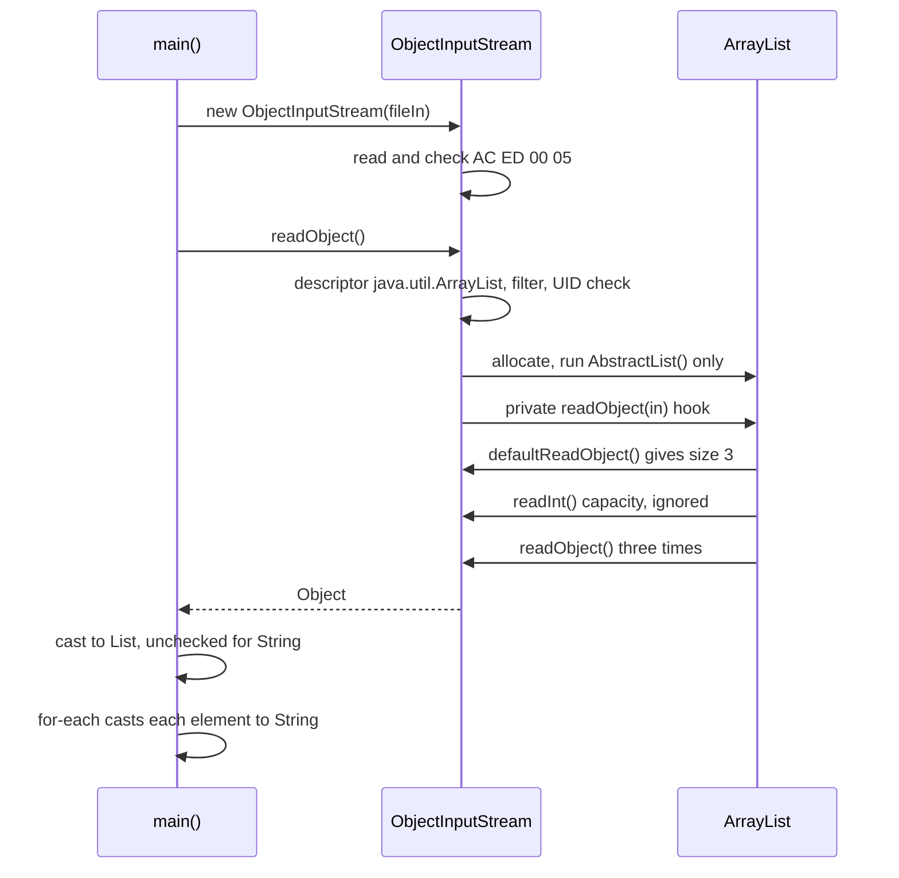
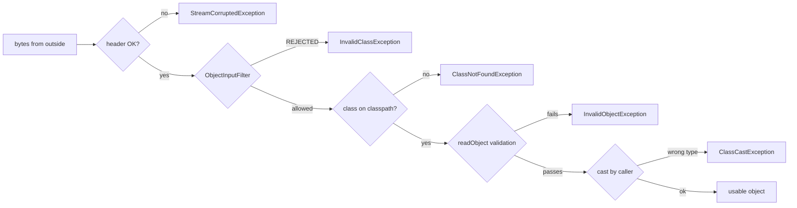

## In One Line
`ObjectInputStream` is the decorator that **reads back what an `ObjectOutputStream` wrote**: its constructor checks the header, `readObject()` rebuilds the next object graph and returns a plain `Object` you must cast (for generics, an *unchecked* cast), everything must be read **in the same order it was written**, `EOFException` marks the end, and — because the bytes decide which classes get created — every stream from outside needs an **`ObjectInputFilter`** and classes need validation in `readObject`.

## Mental Model
Think of the **customs officer unpacking the shipping container** from the [ObjectOutputStream](lesson:a08-io/08-objectoutputstream) lesson:
- First he checks the **seal on the door** (the constructor reads `AC ED 00 05`). A container with no seal, or a letter where the seal should be, is refused on the spot (`StreamCorruptedException`). If the container has not arrived yet, he waits at the door (the constructor blocks).
- He unloads parcels **strictly in the order they were loaded**, reading the packing list as he goes. Ask him for a parcel when the next item is a loose envelope of numbers, and he says so (`OptionalDataException`). When the container is empty he says "nothing left" (`EOFException`).
- Each parcel is labelled only *"a box"* (`Object`). You decide what you think is inside (the cast). If the label says "a box of fruit" (`List<String>`), he only checks that it is a box of *something* (`List`) — you discover it is full of rocks (`Integer`s) when you bite into the first one.
- A careful officer works from an **allow-list of goods** (`ObjectInputFilter`) and opens every parcel to check it matches its declaration (validation in `readObject`), because smugglers can forge packing lists.

In the code: the container is `names.ser`, the officer is the `ObjectInputStream`, the parcel is the `ArrayList`, and the "box of fruit" label is the cast `(List<String>)`.

## Concept
### Where it sits in `java.io`
```java
public class ObjectInputStream extends InputStream
        implements ObjectInput, ObjectStreamConstants
public interface ObjectInput extends DataInput, AutoCloseable
```
It mirrors `ObjectOutputStream` method for method: `readObject()` ↔ `writeObject()`, `readInt()` ↔ `writeInt()`, `readUTF()` ↔ `writeUTF()`, `readUnshared()` ↔ `writeUnshared()`, `defaultReadObject()` ↔ `defaultWriteObject()`. It wraps any `InputStream` — a file, a socket, a `ByteArrayInputStream`.

What `readObject()` does internally (class lookup, the missing constructor call, `readResolve`, inheritance rules) is explained in [Deserialization](lesson:a08-io/07-deserialization). This lesson is about using the stream correctly and safely.

### The constructor reads the header
`new ObjectInputStream(in)` immediately reads 4 bytes and checks them:
| Input | Result |
|---|---|
| Starts with `AC ED 00 05` | OK |
| Anything else (a text file, a JSON file) | `StreamCorruptedException: invalid stream header: 48656C6C` — the first 4 bytes in hex (`Hell` here) |
| Empty | `EOFException` |
| Nothing available *yet* (socket, pipe) | The constructor **blocks** until 4 bytes arrive |

That last row causes the classic networking deadlock: if both client and server create their `ObjectInputStream` first, each waits for the other's header forever. Rule: **create the `ObjectOutputStream` first and `flush()` it**, then create the `ObjectInputStream` (verified with pipes below).

### Read in exactly the order you wrote
The stream has no index and no field names at the top level — it is a sequence of items. Reading must mirror writing:
| Next item in the stream | You call | Result |
|---|---|---|
| An object | `readObject()` | The object |
| Primitive data (`writeInt`, ...) | `readInt()` etc. | The value |
| Primitive data | `readObject()` | `OptionalDataException` (`length` = number of primitive bytes waiting, `eof = false`) |
| An object | `readInt()` | Garbage or `EOFException`/`StreamCorruptedException` |
| Nothing (end of stream) | `readObject()` | `EOFException` |

### Knowing when to stop
`readObject()` never returns a "no more objects" value — `null` is a legitimate object (someone may have written `null`). Three strategies:
1. **Write one container** — a `List`, a `Map`, an array — and read it with one `readObject()`. Simplest and the approach the course example uses.
2. **Write a count first** (`writeInt(n)`), then `n` objects; the reader loops `n` times.
3. **Read until `EOFException`** — works, but uses an exception for normal control flow, and cannot tell a clean end from a truncated file.

`available()` does **not** help: it counts only buffered *primitive* bytes. With three objects still unread it returned `0` (demo below).

### `readObject()` returns `Object` — and generic casts are unchecked
```java
List<String> names = (List<String>) objectIn.readObject();
```
Because of type erasure ([Type Erasure](lesson:a04-generics/07-type-erasure)), the JVM can only check the raw type: the cast verifies "is it a `List`?", never "are the elements `String`s?". `javac` therefore warns *"unchecked cast"* (a *Note: ... uses unchecked or unsafe operations* by default; the full warning with `-Xlint:unchecked` or when launched with `java File.java`). If the file actually contains a `List<Integer>`, the cast **succeeds** and the `ClassCastException` surfaces later, at the first element access — possibly far away from the read. This is **heap pollution**.

Safer options:
- Check the raw type with pattern matching, then check each element (a small `readList(in, String.class)` helper, below), and throw `InvalidObjectException` on a mismatch.
- Serialize a dedicated `Serializable` class or record (`record Names(List<String> values)`), and validate in its constructor/`readObject`.
- If you merely trust the file, keep the cast but confine it to one method annotated `@SuppressWarnings("unchecked")` with a comment saying why.

### Validation: the constructor is not your guard
Deserialization does not call your class's constructor, so a checked invariant such as `age >= 0` is **not** re-checked for bytes someone edited (tampering demo below). Defences inside the class:
- **`readObject` hook:** `in.defaultReadObject()` then check every invariant and throw `InvalidObjectException`. `ArrayList` itself does this — its `readObject` throws `InvalidObjectException("Invalid size: ...")` for a negative size and asks the filter before allocating its array.
- **Defensive copies** in `readObject` for mutable fields (`Date`, arrays, collections): a forged stream can append extra back-references that point to your object's private mutable fields, handing an attacker a way to change them later (*Effective Java*, Item 88). Copy first, then validate. (This requires non-`final` fields.)
- **`in.registerValidation(obj, priority)`** — an `ObjectInputValidation` callback that runs after the **whole graph** has been read, for checks that span several objects.
- **Records** — rebuilt through the canonical constructor, so compact-constructor validation always runs.
- **Serialization proxy** — the real object is created by its constructor in `readResolve` ([ObjectOutputStream](lesson:a08-io/08-objectoutputstream)).

### `ObjectInputFilter` (JEP 290, Java 9; backported to 8u121)
Validation inside a class only runs **after** that class was chosen by the stream. The real danger is the stream choosing *other* classes — gadget chains ([Deserialization](lesson:a08-io/07-deserialization)) and memory bombs. A filter is consulted as soon as each class descriptor has been read and its class looked up (loaded but **not initialized**, so no static code has run) — before any instance is created or any field data is read — and before each array is allocated. It receives an `ObjectInputFilter.FilterInfo` describing:
| `FilterInfo` method | Meaning |
|---|---|
| `serialClass()` | The class about to be deserialized; for an array, the array class (pattern filters then match its element type); `null` for a back-reference check |
| `arrayLength()` | Requested array length, or `-1` |
| `depth()` | Current nesting depth of the graph |
| `references()` | Number of object references read so far |
| `streamBytes()` | Bytes consumed so far |

It returns `ALLOWED`, `REJECTED` or `UNDECIDED`. `REJECTED` aborts the read with **`InvalidClassException: filter status: REJECTED`**.

**Pattern syntax** (`ObjectInputFilter.Config.createFilter(String)`), evaluated left to right, first match wins:
| Pattern | Meaning |
|---|---|
| `java.util.ArrayList` | Allow this class |
| `!com.evil.Gadget` | Reject this class |
| `com.myapp.dto.*` | Allow every class in this package |
| `com.myapp.**` | Allow this package and all sub-packages |
| `java.base/*` | Allow every class in the `java.base` module |
| `!*` | Reject everything not matched earlier — end every allow-list with it |
| `maxdepth=20;maxrefs=1000;maxbytes=100000;maxarray=10000` | Resource limits |

**Where to set it:**
| Scope | How | Version |
|---|---|---|
| One stream | `in.setObjectInputFilter(filter)` — **before the first read, and only once**, otherwise `IllegalStateException` | 9 |
| Whole JVM | `-Djdk.serialFilter=pattern` or the `jdk.serialFilter` security property, or `ObjectInputFilter.Config.setSerialFilter(filter)` | 9 |
| Context-specific | A **filter factory** (`-Djdk.serialFilterFactory=Class` or `Config.setSerialFilterFactory`) that decides the filter for every new stream | 17 (JEP 415) |
| Building blocks | `ObjectInputFilter.allowFilter(predicate, otherStatus)`, `rejectFilter(...)`, `merge(a, b)`, `rejectUndecidedClass(f)` | 17 |

> [!WARNING] With the default filter factory, `setObjectInputFilter` **replaces** the JVM-wide filter for that stream (verified: with `-Djdk.serialFilter=java.base/*;!*`, a stream given the filter `maxdepth=5` happily read a custom class). To keep the global rules, merge them: `in.setObjectInputFilter(ObjectInputFilter.merge(myFilter, in.getObjectInputFilter()))`.

Before Java 9 the same idea was implemented by subclassing `ObjectInputStream` and overriding **`resolveClass(ObjectStreamClass)`** to reject class names not on an allow-list ("look-ahead deserialization", as in Apache Commons IO's `ValidatingObjectInputStream`). It still works, but filters also cover array sizes, depth and byte counts.

### Other methods worth knowing
| Method | Use |
|---|---|
| `readUnshared()` | Reads an object that must not be referenced again by later back-references — for a class that wants to guarantee it owns a private copy |
| `readFields()` → `GetField` | In a `readObject` hook, read fields by name with defaults — useful when fields were renamed between versions |
| `resolveObject(Object)` + `enableResolveObject(true)` | Subclass hook to substitute objects as they are read (RMI uses it) |
| `readUTF()`, `readInt()`, `skipBytes(n)` | `DataInput` primitives |

### Version notes
| Version | Change |
|---|---|
| JDK 1.1 | `ObjectInputStream` |
| Java 7 | Try-with-resources (`AutoCloseable`); multi-catch `IOException \| ClassNotFoundException` |
| Java 9 | `ObjectInputFilter`, `jdk.serialFilter` (JEP 290) |
| Java 16 | Pattern matching `instanceof List<?> raw` for safe type checks; records deserialize through their constructor |
| Java 17 | Filter factories and filter combinators (JEP 415) |

## Diagram

The list rebuilds itself through its own hook; the `<String>` part of the cast is only checked element by element in the loop.


Each layer catches a different problem; only the filter runs before an unexpected class gets instantiated.

## Code
@example IO/SerializationAndDeserialization/ObjectInputStreamExample.java

**Reading order, the end of the stream, and why `available()` is no help:**
```java
import java.io.*;
import java.util.*;

public class ReadAll {
    public static void main(String[] args) throws Exception {
        ByteArrayOutputStream bytes = new ByteArrayOutputStream();
        try (ObjectOutputStream out = new ObjectOutputStream(bytes)) {
            out.writeInt(3);                      // strategy 1: a count first
            out.writeObject("Alice");
            out.writeObject("Bob");
            out.writeObject("Charlie");
        }

        try (ObjectInputStream in = new ObjectInputStream(new ByteArrayInputStream(bytes.toByteArray()))) {
            System.out.println("available() before readInt: " + in.available());
            int n = in.readInt();                 // read in exactly the order written
            System.out.println("available() after readInt:  " + in.available() + "  (3 objects still to come!)");
            for (int i = 0; i < n; i++) System.out.println("count loop: " + in.readObject());
        }

        try (ObjectInputStream in = new ObjectInputStream(new ByteArrayInputStream(bytes.toByteArray()))) {
            in.readInt();
            while (true) {                        // strategy 2: read until EOFException
                System.out.println("EOF loop:   " + in.readObject());
            }
        } catch (EOFException end) {
            System.out.println("EOFException = no more objects");
        }

        try (ObjectInputStream in = new ObjectInputStream(new ByteArrayInputStream(bytes.toByteArray()))) {
            in.readObject();                      // wrong order: an int was written first
        } catch (OptionalDataException e) {
            System.out.println(e + " (length=" + e.length + ", eof=" + e.eof + ")");
        }
    }
}
```
```output
available() before readInt: 4
available() after readInt:  0  (3 objects still to come!)
count loop: Alice
count loop: Bob
count loop: Charlie
EOF loop:   Alice
EOF loop:   Bob
EOF loop:   Charlie
EOFException = no more objects
java.io.OptionalDataException (length=4, eof=false)
```

**The unchecked cast in action — heap pollution, and a checked alternative:**
```java
import java.io.*;
import java.util.*;

public class HeapPollution {
    public static void main(String[] args) throws Exception {
        ByteArrayOutputStream bytes = new ByteArrayOutputStream();
        try (ObjectOutputStream out = new ObjectOutputStream(bytes)) {
            out.writeObject(new ArrayList<>(List.of(1, 2, 3)));      // a List<Integer> was saved
        }

        try (ObjectInputStream in = new ObjectInputStream(new ByteArrayInputStream(bytes.toByteArray()))) {
            @SuppressWarnings("unchecked")
            List<String> names = (List<String>) in.readObject();   // succeeds: only "is it a List?" is checked
            System.out.println("cast OK, size = " + names.size());
            for (String name : names) {                             // the hidden (String) cast is here
                System.out.println(name);
            }
        } catch (ClassCastException e) {
            System.out.println("later: " + e.getMessage());
        }

        try (ObjectInputStream in = new ObjectInputStream(new ByteArrayInputStream(bytes.toByteArray()))) {
            List<String> names = readList(in, String.class);        // checked version
            System.out.println(names);
        } catch (InvalidObjectException e) {
            System.out.println("checked read: " + e.getMessage());
        }
    }

    static <T> List<T> readList(ObjectInputStream in, Class<T> type) throws IOException, ClassNotFoundException {
        Object o = in.readObject();
        if (!(o instanceof List<?> raw)) throw new InvalidObjectException("expected a List, got " + o.getClass().getName());
        List<T> result = new ArrayList<>(raw.size());
        for (Object e : raw) {
            if (!type.isInstance(e)) throw new InvalidObjectException("element " + e + " is not a " + type.getSimpleName());
            result.add(type.cast(e));
        }
        return result;
    }
}
```
```output
cast OK, size = 3
later: class java.lang.Integer cannot be cast to class java.lang.String (java.lang.Integer and java.lang.String are in module java.base of loader 'bootstrap')
checked read: element 1 is not a String
```
(If `o` were `null`, `readList` would throw a `NullPointerException` on `o.getClass()` — add a null check if the stream may contain `null`.)

**Tampering: the constructor's check is bypassed; a `readObject` check is not.** This is the promised demo from [Deserialization](lesson:a08-io/07-deserialization). The bytes are edited by hand to set `age` to -100:
```java
import java.io.*;

public class Tamper {
    static class Person implements Serializable {
        @Serial private static final long serialVersionUID = 1L;
        final String name;
        final int age;
        Person(String name, int age) {
            if (age < 0) throw new IllegalArgumentException("age must be >= 0");   // the only guard
            this.name = name;
            this.age = age;
        }
    }

    static class SafePerson implements Serializable {
        @Serial private static final long serialVersionUID = 1L;
        final String name;
        final int age;
        SafePerson(String name, int age) {
            if (age < 0) throw new IllegalArgumentException("age must be >= 0");
            this.name = name;
            this.age = age;
        }
        @Serial
        private void readObject(ObjectInputStream in) throws IOException, ClassNotFoundException {
            in.defaultReadObject();                                  // fields are set first...
            if (age < 0 || name == null)                             // ...then checked like the constructor
                throw new InvalidObjectException("invalid SafePerson: age=" + age);
        }
    }

    public static void main(String[] args) throws Exception {
        Person p = (Person) read(forge(new Person("Asha", 30)));
        System.out.println("Person accepted: " + p.name + ", age " + p.age);
        try {
            read(forge(new SafePerson("Asha", 30)));
        } catch (InvalidObjectException e) {
            System.out.println("SafePerson rejected: " + e.getMessage());
        }
    }

    // Serialize, then overwrite the 4 bytes of age = 30 (00 00 00 1e) with -100 (ff ff ff 9c)
    static byte[] forge(Object o) throws IOException {
        ByteArrayOutputStream b = new ByteArrayOutputStream();
        try (ObjectOutputStream out = new ObjectOutputStream(b)) { out.writeObject(o); }
        byte[] bytes = b.toByteArray();
        for (int i = 0; i + 5 < bytes.length; i++) {
            if (bytes[i] == 0x78 && bytes[i + 1] == 0x70 && bytes[i + 5] == 30) {   // end of descriptor, then age
                bytes[i + 2] = bytes[i + 3] = bytes[i + 4] = (byte) 0xff;
                bytes[i + 5] = (byte) 0x9c;
                break;
            }
        }
        return bytes;
    }

    static Object read(byte[] bytes) throws IOException, ClassNotFoundException {
        try (ObjectInputStream in = new ObjectInputStream(new ByteArrayInputStream(bytes))) { return in.readObject(); }
    }
}
```
```output
Person accepted: Asha, age -100
SafePerson rejected: invalid SafePerson: age=-100
```
Note that even the `final` field `age` was set from the forged bytes.

**`ObjectInputFilter`: what it is asked, an allow-list, limits, and when it can be set:**
```java
import java.io.*;
import java.util.*;

public class FilterDemo {
    static class Gadget implements Serializable { }                 // stands in for "a class you never expected"

    public static void main(String[] args) throws Exception {
        byte[] names  = serialize(new ArrayList<>(List.of("Alice", "Bob")));
        byte[] gadget = serialize(new ArrayList<>(List.of(new Gadget())));
        byte[] bigArr = serialize(new int[1_000_000]);

        // 1. What does a filter get asked about?
        try (ObjectInputStream in = new ObjectInputStream(new ByteArrayInputStream(names))) {
            in.setObjectInputFilter(info -> {
                System.out.println("  asked: class=" + (info.serialClass() == null ? "-" : info.serialClass().getName())
                        + " depth=" + info.depth() + " refs=" + info.references() + " bytes=" + info.streamBytes());
                return ObjectInputFilter.Status.UNDECIDED;
            });
            System.out.println("read " + in.readObject());
        }

        // 2. An allow-list: only JDK classes from java.base, reject everything else
        ObjectInputFilter allowList = ObjectInputFilter.Config.createFilter("java.base/*;!*");
        System.out.println("names:  " + read(names, allowList));
        System.out.println("gadget: " + read(gadget, allowList));

        // 3. Resource limits
        ObjectInputFilter limits = ObjectInputFilter.Config.createFilter("maxarray=10000;maxdepth=20;maxbytes=100000");
        System.out.println("big array: " + read(bigArr, limits));

        // 4. The filter must be set before the first read, and only once
        try (ObjectInputStream in = new ObjectInputStream(new ByteArrayInputStream(names))) {
            in.readObject();
            in.setObjectInputFilter(allowList);
        } catch (IllegalStateException e) {
            System.out.println("late filter: " + e.getMessage());
        }
    }

    static String read(byte[] bytes, ObjectInputFilter filter) throws IOException {
        try (ObjectInputStream in = new ObjectInputStream(new ByteArrayInputStream(bytes))) {
            in.setObjectInputFilter(filter);
            Object o = in.readObject();
            return "OK " + o.getClass().getSimpleName();
        } catch (InvalidClassException e) {
            return e.toString();
        } catch (ClassNotFoundException e) {
            return e.toString();
        }
    }

    static byte[] serialize(Object o) throws IOException {
        ByteArrayOutputStream b = new ByteArrayOutputStream();
        try (ObjectOutputStream out = new ObjectOutputStream(b)) { out.writeObject(o); }
        return b.toByteArray();
    }
}
```
```output
  asked: class=java.util.ArrayList depth=1 refs=1 bytes=45
  asked: class=[Ljava.lang.Object; depth=1 refs=2 bytes=57
read [Alice, Bob]
names:  OK ArrayList
gadget: java.io.InvalidClassException: filter status: REJECTED
big array: java.io.InvalidClassException: filter status: REJECTED
late filter: filter can not be set after an object has been read
```
The second question, about `Object[]`, comes from inside `ArrayList.readObject`: before allocating its backing array it asks the filter, so `maxarray` protects collections too. `String`s are not asked about. Setting a second filter on the same stream fails with *"filter can not be set more than once"* (verified separately).

The same allow-list for the whole JVM, without touching code:
```text
java -Djdk.serialFilter='java.base/*;!*' MyApp.java
```
In a verified run, an `ArrayList` of strings was read and a custom class gave `java.io.InvalidClassException: filter status: REJECTED`.

**Before Java 9: allow-listing in `resolveClass`:**
```java
import java.io.*;
import java.util.*;

public class Headers {
    static class Gadget implements Serializable { }

    static class AllowListObjectInputStream extends ObjectInputStream {
        private static final Set<String> ALLOWED = Set.of("java.util.ArrayList", "java.lang.String");
        AllowListObjectInputStream(InputStream in) throws IOException { super(in); }
        @Override
        protected Class<?> resolveClass(ObjectStreamClass desc) throws IOException, ClassNotFoundException {
            if (!ALLOWED.contains(desc.getName()))
                throw new InvalidClassException(desc.getName(), "not on the allow-list");
            return super.resolveClass(desc);
        }
    }

    public static void main(String[] args) throws Exception {
        try { new ObjectInputStream(new ByteArrayInputStream("Hello, world".getBytes())); }
        catch (IOException e) { System.out.println("text file:  " + e); }
        try { new ObjectInputStream(new ByteArrayInputStream(new byte[0])); }
        catch (IOException e) { System.out.println("empty file: " + e); }

        for (Object o : new Object[] { new ArrayList<>(List.of("Alice")), new Gadget() }) {
            ByteArrayOutputStream b = new ByteArrayOutputStream();
            try (ObjectOutputStream out = new ObjectOutputStream(b)) { out.writeObject(o); }
            try (ObjectInputStream in = new AllowListObjectInputStream(new ByteArrayInputStream(b.toByteArray()))) {
                System.out.println("allow-list: read " + in.readObject());
            } catch (InvalidClassException e) {
                System.out.println("allow-list: " + e.getMessage());
            }
        }
    }
}
```
```output
text file:  java.io.StreamCorruptedException: invalid stream header: 48656C6C
empty file: java.io.EOFException
allow-list: read [Alice]
allow-list: Headers$Gadget; not on the allow-list
```
The first two lines show the constructor's header check: `48656C6C` is `Hell` in hex.

**The constructor blocks until the header arrives** (a pipe stands in for a socket):
```java
import java.io.*;

public class HeaderWait {
    public static void main(String[] args) throws Exception {
        PipedOutputStream wire = new PipedOutputStream();
        PipedInputStream end = new PipedInputStream(wire);        // stands in for a socket

        Thread reader = new Thread(() -> {
            try {
                ObjectInputStream in = new ObjectInputStream(end);   // blocks: needs 4 header bytes
                System.out.println("reader: stream created, got " + in.readObject());
            } catch (Exception e) {
                System.out.println("reader: " + e);
            }
        });
        reader.start();
        reader.join(500);
        System.out.println("reader still stuck in the constructor? " + reader.isAlive());

        ObjectOutputStream out = new ObjectOutputStream(new BufferedOutputStream(wire));
        reader.join(500);
        System.out.println("header still in the buffer, stuck? " + reader.isAlive());

        out.flush();                                             // header reaches the "socket"
        out.writeObject("hello");
        out.flush();
        reader.join();
        out.close();
    }
}
```
```output
reader still stuck in the constructor? true
header still in the buffer, stuck? true
reader: stream created, got hello
```
Creating the `ObjectOutputStream` is not enough when it sits on a `BufferedOutputStream`: the header only travels on `flush()`.

## Walkthrough
- `import java.io.FileInputStream; IOException; ObjectInputStream; java.util.List;` — a byte stream from the file, the deserializing decorator, the checked exception, and the target type of the cast. `ClassNotFoundException` is in `java.lang`, so it needs no import.
- `FileInputStream fileIn = new FileInputStream("names.ser");` — opens the file written by [ObjectOutputStream](lesson:a08-io/08-objectoutputstream) in the same working directory. Run this example first in a clean folder and you get `java.io.FileNotFoundException: names.ser (No such file or directory)` (verified).
- `ObjectInputStream objectIn = new ObjectInputStream(fileIn);` — reads and checks the header `AC ED 00 05` right here, before any `readObject`.
- `List<String> names = (List<String>) objectIn.readObject();` — reads the next object: the `ArrayList` class descriptor, its UID (`8683452581122892189`) is compared with the local `ArrayList`, the object is allocated with only `AbstractList()` running (the first non-serializable superclass), then `ArrayList`'s own `readObject` hook reads `size = 3`, skips the capacity hint, and reads three `String`s. `readObject()` returns `Object`; the cast checks only that it is a `List` — the `<String>` part is erased, which is why the compiler reports an unchecked cast.
- `objectIn.close();` — closes the object stream and the `FileInputStream` under it.
- `System.out.println("Deserialized List of Names:");` then `for (String name : names) System.out.println(name);` — prints the three names in list order. The enhanced `for` uses the list's iterator and a hidden `(String)` cast on each element; this is where a wrong element type would finally fail.
- `catch (IOException e)` — missing file, corrupt header, `InvalidClassException`, filter rejection. `catch (ClassNotFoundException e)` — the stream names a class the reader does not have (impossible here, since `ArrayList` and `String` are always present).

Output: `Deserialized List of Names:`, `Alice`, `Bob`, `Charlie` — matching the `// Output:` comments. The recorded output depends on `ObjectOutputStreamExample` having run first in the same folder.

## Traps
> [!ERRATA] The comment says *"Read the object ... and cast it to `List<String>`"*, but the cast cannot check `<String>`: generics are erased, so only `List` is verified. `javac` reports *"uses unchecked or unsafe operations"* (and, with `-Xlint:unchecked` or `java ObjectInputStreamExample.java`, *"warning: [unchecked] unchecked cast"* — verified). A file containing a `List<Integer>` passes the cast and fails later inside the loop. Validate the elements, or at least isolate the cast in a helper with `@SuppressWarnings("unchecked")` and a comment.

> [!ERRATA] As in the writing example, the stream is closed only on success: if `readObject()` throws, `objectIn.close()` is skipped and the file stays open. And if the `ObjectInputStream` constructor throws (a corrupt or empty file), `fileIn` is never closed. Use try-with-resources — and the two identical `catch` blocks can be one multi-catch:
> ```java
> try (FileInputStream fileIn = new FileInputStream("names.ser");
>      ObjectInputStream objectIn = new ObjectInputStream(fileIn)) {
>     objectIn.setObjectInputFilter(ObjectInputFilter.Config.createFilter(
            "java.util.ArrayList;java.lang.String;java.lang.Object;maxarray=100000;!*"));
>     List<String> names = readList(objectIn, String.class);
>     names.forEach(System.out::println);
> } catch (IOException | ClassNotFoundException e) {
>     throw new IllegalStateException("cannot load names.ser", e);
> }
> ```
> `readList` is the checked helper from *Code*. `java.lang.Object` must be on the list because `ArrayList` asks the filter about its `Object[]` backing array (see Traps).

> [!ERRATA] There is no `ObjectInputFilter`. For a file your own program just wrote this is acceptable, but the example teaches the pattern "open a file, call `readObject()`" — used on a file that anyone else could have replaced, it lets that file choose which classes are instantiated. Always set an allow-list filter for data you did not produce in the same process.

- **Wrong read order** → `OptionalDataException` (primitive data where an object was expected) or nonsense values.
- **`null` is not "end of stream"** — someone may have written `null`. End = `EOFException`, a count, or a single container.
- **`available()` counts primitive bytes only** — `0` with three objects remaining (verified).
- **`readObject()` on a text/JSON file** → `StreamCorruptedException: invalid stream header: ...` from the constructor.
- **Socket deadlock** — both sides creating the `ObjectInputStream` first wait forever for each other's header; create and `flush()` the output stream first.
- **Filter set too late or twice** → `IllegalStateException`; set it right after the constructor.
- **A too-narrow allow-list rejects plain collections.** For arrays, pattern filters match the **element type**, and `ArrayList` checks an `Object[]` before allocating its backing array. So `"java.util.ArrayList;java.lang.String;!*"` rejected a simple list of strings with `filter status: REJECTED`; adding `java.lang.Object` made it pass (both verified). Test your filter against real data.
- **A per-stream filter replaces the JVM-wide one** (with the default factory); merge them if you need both.
- **Constructor checks are bypassed** (tampering demo); validate in `readObject`, and make defensive copies of mutable fields before validating.
- **The cast after `readObject()` is not a security check** — gadget code runs inside `readObject()`, before the cast.

## Tips & Tricks
- **"Seal, order, end, cast, filter"** — the five things to get right: the constructor checks the seal (header); read in the written order; detect the end deliberately; the cast is unchecked for generics; set a filter first.
- **Mirror rule:** every `writeX` has exactly one `readX`, in the same position. Write the reader by copying the writer and replacing `write` with `read`.
- **One container beats a loop**: `writeObject(list)` / `readObject()` avoids all end-of-stream questions.
- **Allow-list, never block-list**: `"com.myapp.dto.*;java.base/*;!*"` — end with `!*`, and add `maxdepth`/`maxarray`/`maxbytes` limits.
- **Validation recipe:** `defaultReadObject()` → defensive copies → check invariants → `throw new InvalidObjectException(...)`.
- **Standard catch:** `catch (IOException | ClassNotFoundException e)` — and remember `InvalidClassException`, `StreamCorruptedException`, `OptionalDataException`, `EOFException` are all `IOException`s.
- **Interview line:** "The cast after `readObject` checks only the raw type, and it comes too late for security — filters come before, validation comes inside."

## Interview Q&A
### [Basic] How do you read objects back from a file with `ObjectInputStream`?
Wrap an input stream — `new ObjectInputStream(new FileInputStream("names.ser"))` — and call `readObject()` once per object that was written, in the same order, casting each result to the expected type. Primitives written with `writeInt` etc. are read with the matching `readInt`. `readObject()` throws `IOException` (I/O errors, corrupt data, incompatible classes, filter rejections) and the checked `ClassNotFoundException`, so use try-with-resources and `catch (IOException | ClassNotFoundException e)`. For anything not produced by your own process, set an `ObjectInputFilter` before the first read.

**Follow-up:** *What happens in the constructor?* — It reads and checks the 4-byte header `AC ED 00 05`; a non-serialized file fails right there with `StreamCorruptedException: invalid stream header`, an empty one with `EOFException`, and on a socket it blocks until the header arrives.

### [Basic] Why do you need a cast, and why does `(List<String>) in.readObject()` produce a warning?
`readObject()` is declared to return `Object` because the stream can contain anything. The cast to `List<String>` can only be checked at runtime for the raw type `List`; the type argument `String` is erased, so the compiler flags it as an unchecked cast. If the data actually holds a `List<Integer>`, the cast succeeds and the `ClassCastException` appears later at the first element access — heap pollution. Validate the elements (e.g. a `readList(in, String.class)` helper that checks each element with `type.isInstance`), or wrap the data in a dedicated serializable class or record that validates itself.

**Follow-up:** *Where exactly does the `ClassCastException` occur in the course example if the file held integers?* — In the enhanced `for` loop, at the compiler-inserted `(String)` cast on the first element; the `readObject` line itself succeeds.

### [Intermediate] How do you read several objects and know when to stop?
There is no "has more objects" method: `readObject()` never returns a special end value (`null` is a valid object) and `available()` counts only primitive bytes (it returned `0` with three objects still unread). Options: write one container (a `List`) and read it with a single call; write a count with `writeInt(n)` first and loop `n` times; or loop until `EOFException`. The first two are clean and detect truncated files; the EOF approach uses an exception for normal flow and cannot distinguish a clean end from a cut-off file.

**Follow-up:** *What exception do you get if you call `readObject()` where an `int` was written?* — `OptionalDataException`, with `length` set to the number of primitive bytes waiting (4 for an `int`) and `eof == false`.

### [Intermediate] Why can creating an `ObjectInputStream` on a socket hang, and how do you avoid it?
The constructor reads the peer's stream header and blocks until those 4 bytes arrive. If both client and server create their `ObjectInputStream` first, each waits for the other's header, which is never sent — a deadlock. Even creating the `ObjectOutputStream` is not enough if it wraps a `BufferedOutputStream`, because the header sits in the buffer (verified with pipes). Fix: on both sides create the `ObjectOutputStream` first, call `flush()`, and only then create the `ObjectInputStream`.

**Follow-up:** *Any other socket advice?* — Flush after each message, call `reset()` on the writer periodically so its handle table does not grow forever, and set a filter on the reader.

### [Intermediate] How do you validate an object during deserialization?
Constructors do not run, so their checks do not protect you — editing four bytes produced a `Person` with `age = -100` (verified). Add a private `readObject(ObjectInputStream in)` hook: call `in.defaultReadObject()`, make defensive copies of mutable fields, check every invariant, and throw `InvalidObjectException` on failure. For checks across the whole graph, register an `ObjectInputValidation` with `in.registerValidation(this, 0)`; it runs after the complete graph is read. Alternatives: use a record (its canonical constructor always runs) or the serialization proxy pattern (the real object is built by its constructor in `readResolve`).

**Follow-up:** *Why defensive copies and not just validation?* — A forged stream can append extra references to your object's private mutable fields (say a `Date`); the attacker keeps those references and changes the fields after your validation passed. Copying breaks the link.

### [Intermediate] What exceptions can you get while reading, and which layer throws each?
From the constructor: `StreamCorruptedException` (bad header), `EOFException` (empty input). From `readObject()`: `ClassNotFoundException` (class missing on this side), `InvalidClassException` (UID mismatch, incompatible field types, no valid constructor, or **filter status: REJECTED**), `StreamCorruptedException` (garbage type codes), `OptionalDataException` (primitive data where an object was expected), `EOFException` (end of stream), `WriteAbortedException` (the writer failed at this point), `InvalidObjectException` (a class's own validation). After it: `ClassCastException` from your cast or later from heap pollution. All except the last and `ClassNotFoundException` are `IOException` subclasses; `ClassCastException` is unchecked.

**Follow-up:** *Which one tells you a filter blocked something?* — `InvalidClassException` with the message `filter status: REJECTED`.

### [Advanced] What is `ObjectInputFilter` and how do you configure it?
Introduced by JEP 290 (Java 9, backported to 8u121), a filter is called before each class is resolved, each array is allocated and as references and bytes accumulate, with a `FilterInfo` giving `serialClass()`, `arrayLength()`, `depth()`, `references()` and `streamBytes()`; it returns `ALLOWED`, `REJECTED` or `UNDECIDED`, and a rejection aborts with `InvalidClassException: filter status: REJECTED`. You can write one as a lambda or build one from a pattern with `Config.createFilter("com.myapp.dto.*;java.base/*;maxdepth=20;maxarray=10000;!*")`. Set it per stream with `setObjectInputFilter` (before the first read, only once) or JVM-wide with `-Djdk.serialFilter=...`. Java 17 (JEP 415) added filter factories (`jdk.serialFilterFactory`) that choose a filter per stream based on context, and combinators `allowFilter`, `rejectFilter`, `merge` and `rejectUndecidedClass`.

**Follow-up:** *If a JVM-wide filter is set and you call `setObjectInputFilter`, are both applied?* — Not with the default factory: the stream's filter replaces the global one (verified). Merge them explicitly with `ObjectInputFilter.merge(mine, in.getObjectInputFilter())`, or install a factory that always merges.

### [Advanced] How did people restrict deserialization before Java 9?
By subclassing `ObjectInputStream` and overriding `resolveClass(ObjectStreamClass desc)`, which is called with the class name from the stream before the class is loaded: if the name is not on an allow-list, throw `InvalidClassException`. This "look-ahead deserialization" is what Apache Commons IO's `ValidatingObjectInputStream` provides. It works for class names but not for resource limits — deeply nested collections or a huge array length can still exhaust CPU or memory, which filters handle with `maxdepth`, `maxarray`, `maxrefs` and `maxbytes`.

**Follow-up:** *Why allow-lists instead of block-lists?* — New gadget chains keep being discovered in common libraries; a block-list is always one gadget behind, while an allow-list of your own DTO classes stays safe.

### [Advanced] How does `ArrayList` protect itself during deserialization?
Its private `readObject` calls `defaultReadObject()` to get `size`, reads and ignores the capacity hint, and throws `InvalidObjectException("Invalid size: ...")` if `size` is negative. Before allocating `new Object[size]`, it asks the stream's filter about an `Object[]` of that length (visible as the second filter call in the demo), so a forged stream that claims two billion elements is rejected by `maxarray` instead of causing an `OutOfMemoryError`. It then reads exactly `size` elements. `HashMap` does the same for its capacity, and rehashes every key because hash codes may differ in the new JVM.

**Follow-up:** *Why is the backing array not simply read from the stream?* — It is `transient`; writing the exact elements keeps the format independent of the spare capacity and lets the reader size the array exactly.

## Quiz
### A file contains a serialized `ArrayList<Integer>` of `[1, 2, 3]`. What does this print?
```java
List<String> names = (List<String>) in.readObject();
System.out.println("size " + names.size());
for (String n : names) System.out.println(n);
```
- [ ] `ClassCastException` at the `readObject` line, nothing printed
- [x] `size 3`, then a `ClassCastException` in the loop
- [ ] `size 3`, then `1`, `2`, `3`
- [ ] Compile error: incompatible types
> The cast checks only the raw type `List` (generics are erased), so it succeeds and `size()` works. The hidden `(String)` cast on the first element in the enhanced `for` throws (verified: `Integer cannot be cast to class java.lang.String`). It compiles, with an unchecked warning.

### After `writeInt(3)` and three `writeObject(...)` calls, a reader calls `readInt()`. What does `available()` return now?
- [ ] 3
- [x] 0
- [ ] The number of bytes left in the file
- [ ] -1
> `available()` counts only buffered primitive (block) data; the remaining items are objects, so it reports `0` (verified). Never use it to decide whether more objects follow.

### What happens here if the writer did `writeInt(3)` followed by `writeObject("Alice")`?
```java
Object first = in.readObject();
```
- [ ] It returns `3` as an `Integer`
- [ ] It skips the int and returns `"Alice"`
- [x] It throws `OptionalDataException`
- [ ] It throws `EOFException`
> The next item is primitive block data, not an object. `readObject()` refuses with `OptionalDataException` (verified: `length=4, eof=false`). Primitives are never auto-boxed into objects by the stream.

### `new ObjectInputStream(new FileInputStream("notes.txt"))` where the file contains `Hello, world`. What happens?
- [ ] Nothing until `readObject()` is called
- [x] `StreamCorruptedException: invalid stream header: 48656C6C` from the constructor
- [ ] `ClassNotFoundException`
- [ ] `readObject()` returns the text as a `String`
> The constructor reads the first 4 bytes and expects `AC ED 00 05`; it finds `Hell` (`48 65 6C 6C`) and fails immediately (verified). `ClassNotFoundException` is about a class named inside a valid stream.

### Spot the bug: the filter never takes effect.
```java
try (ObjectInputStream in = new ObjectInputStream(new FileInputStream(f))) {
    Object header = in.readObject();
    in.setObjectInputFilter(ObjectInputFilter.Config.createFilter("com.myapp.dto.*;!*"));
    Object body = in.readObject();
}
```
- [ ] The pattern must not end with `!*`
- [x] The filter is set after an object was read, so `setObjectInputFilter` throws `IllegalStateException`
- [ ] Filters only work when set JVM-wide
- [ ] `createFilter` needs `maxdepth` to be valid
> A stream filter must be set before the first read, and only once (verified: *filter can not be set after an object has been read*). By then the first object — possibly malicious — has already been deserialized unfiltered.

### `Person`'s constructor rejects negative ages. Someone edits `person.ser` so `age` is -100. What does `readObject()` return?
- [ ] It throws `IllegalArgumentException` from the constructor
- [x] A `Person` with `age = -100`
- [ ] It throws `InvalidClassException`
- [ ] A `Person` with `age = 0`
> Deserialization does not run the constructor of a serializable class, so its check never happens (verified: `Person accepted: Asha, age -100`). Only a `readObject` hook that validates after `defaultReadObject()` rejects it.

### The JVM runs with `-Djdk.serialFilter='java.base/*;!*'`. A stream then calls `in.setObjectInputFilter(Config.createFilter("maxdepth=5"))` and reads a custom class `com.app.Gadget`. Result?
- [ ] Rejected by the JVM-wide filter
- [x] Read successfully — the stream filter replaced the JVM-wide filter
- [ ] `IllegalStateException`: a JVM-wide filter cannot be overridden
- [ ] Rejected because `maxdepth` is too small
> With the default filter factory (Java 17+), the per-stream filter replaces the global one, and `maxdepth=5` alone allows the class (verified). To keep both, pass `ObjectInputFilter.merge(myFilter, in.getObjectInputFilter())`.

## Takeaways
- `ObjectInputStream` mirrors `ObjectOutputStream`: its constructor reads and checks the header (`StreamCorruptedException` for non-serialized data, blocking on sockets until it arrives), and every item must be read in the order it was written.
- `readObject()` returns `Object`; a cast like `(List<String>)` is unchecked — only `List` is verified, and a wrong element type fails later (heap pollution). Check elements or wrap data in a validating class.
- There is no "more objects?" call: write one container or a count, or read until `EOFException`; `null` is a valid object and `available()` counts only primitive bytes.
- Constructors do not run, so invariants must be re-checked in a private `readObject` (after `defaultReadObject()`, with defensive copies) or enforced by records or a serialization proxy.
- Set an `ObjectInputFilter` allow-list plus limits (`"com.myapp.dto.*;java.base/*;maxdepth=20;maxarray=10000;!*"`) before the first read; `REJECTED` gives `InvalidClassException: filter status: REJECTED`; a per-stream filter replaces the JVM-wide one unless merged.
- Close with try-with-resources and catch `IOException | ClassNotFoundException`; on sockets create and flush the output stream before creating the input stream.
