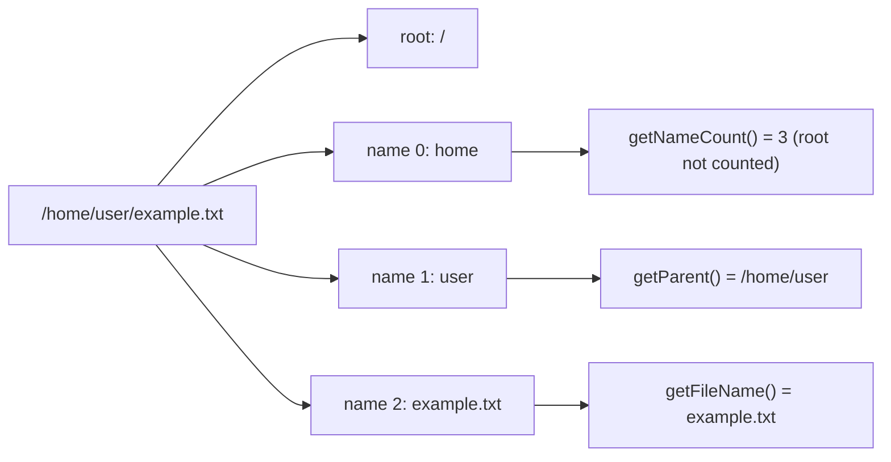
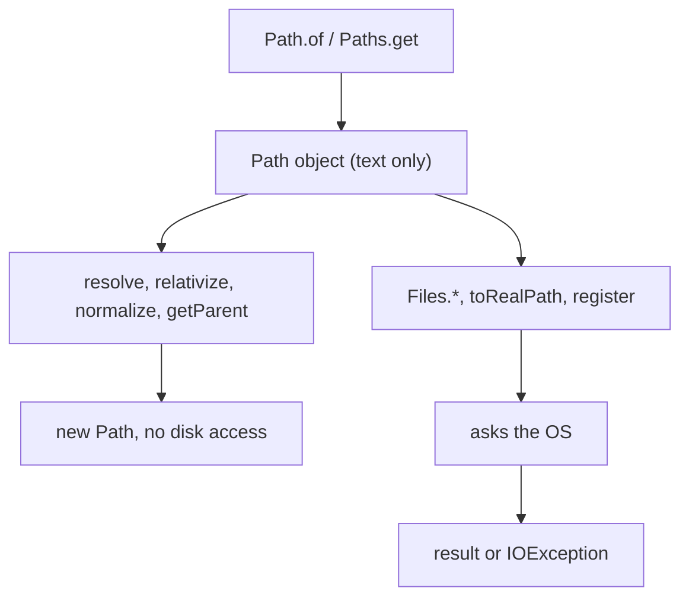

## In One Line
A `java.nio.file.Path` is an immutable, OS-aware description of a location in a file system (root + name elements); you build one with `Path.of(...)` / `Paths.get(...)`, take it apart with `getFileName()`, `getParent()`, `getRoot()`, and combine paths with `resolve`, `relativize` and `normalize` — all without touching the disk.

## Mental Model
Think of a **postal address written on an envelope**.

- Writing `"42 Park Street, Bengaluru"` on an envelope does **not** build a house and does **not** check that the house exists. It is just structured text: country, city, street, house number.
- You can **read parts** of the address ("which city?") and **edit** it ("same street, house 44") on paper, without walking anywhere.
- Only when the **postman** (the `Files` class) actually goes there do you learn whether the house exists, who lives there, or how big it is.

In the code:
- The envelope is the `Path` object: `Paths.get("/home/user/example.txt")`.
- Reading parts of it is `getFileName()`, `getParent()`, `getRoot()`, `getNameCount()`.
- Editing on paper is `resolve`, `resolveSibling`, `relativize`, `normalize` — pure string logic.
- The postman is `Files.exists(path)`, `Files.readString(path)`, `path.toRealPath()` — these hit the disk and can throw `IOException`.

This is why the example prints details of `/home/user/example.txt` even though no such file exists on the machine that recorded the output.

## Concept
### Where Path fits: NIO vs NIO.2
Java has three generations of file/IO APIs. Knowing which is which is a common interview warm-up.

| Generation | Java version | Package | Main types | Idea |
|---|---|---|---|---|
| Classic IO | 1.0 | `java.io` | `File`, `InputStream`/`OutputStream`, `Reader`/`Writer` | Byte/char **streams**, blocking |
| NIO ("New IO", JSR 51) | 1.4 | `java.nio`, `java.nio.channels`, `java.nio.charset` | `Buffer`, `Channel`, `Selector`, `Charset` | **Buffers + channels**, non-blocking sockets with selectors |
| NIO.2 (JSR 203) | 7 | `java.nio.file`, `java.nio.file.attribute`, async channels | `Path`, `Paths`, `Files`, `FileSystem`, `WatchService`, `AsynchronousFileChannel` | A real **file-system API**: paths, metadata, symlinks, directory walking, change notification, async IO |

`Path` is the heart of NIO.2. The rest of this module builds on it: `Files` (next lesson) does the work, buffers and channels move the bytes, and `WatchService` watches a `Path` for changes.

### Why `Path` replaced `java.io.File`
`File` (see [the File class](lesson:a08-io/01-file-class)) still works, but it has design problems that NIO.2 fixed:

| Problem with `File` | How NIO.2 fixes it |
|---|---|
| `delete()`, `mkdir()`, `renameTo()` return `false` with **no reason** | `Files.delete(path)` throws `NoSuchFileException`, `DirectoryNotEmptyException`, `AccessDeniedException`... |
| No real symbolic-link support | `Files.isSymbolicLink`, `createSymbolicLink`, `toRealPath`, `LinkOption.NOFOLLOW_LINKS` |
| Little metadata (size, last-modified, a few flags) | `Files.readAttributes(...)`: creation time, owner, POSIX permissions, DOS attributes, file key |
| `renameTo` behaves differently per OS, not atomic | `Files.move(src, dst, ATOMIC_MOVE, REPLACE_EXISTING)` |
| `listFiles()` loads a whole huge directory into an array | `Files.newDirectoryStream`, `Files.list`, `Files.walk` stream lazily |
| Only the default (disk) file system | `FileSystem` abstraction: the same `Path`/`Files` code works inside a ZIP file, an in-memory FS, a remote FS |
| One class mixes "a path" and "operations on it" | `Path` = location (pure data), `Files` = operations (static utilities) |

The two interoperate: `file.toPath()` and `path.toFile()`.

### Creating a Path
```java
Path a = Path.of("/home/user/example.txt");        // Java 11+ (preferred)
Path b = Paths.get("/home/user/example.txt");       // Java 7+, same result
Path c = Path.of("home", "user", "example.txt");    // varargs: joined with the OS separator -> home/user/example.txt
Path d = FileSystems.getDefault().getPath("x.txt"); // what both of the above do internally
Path e = new File("x.txt").toPath();                // from legacy File
Path f = Path.of(URI.create("file:///tmp/a.txt"));  // from a file: URI
```
- `Paths.get(...)` simply delegates to `Path.of(...)` since Java 11. The `Paths` javadoc itself recommends `Path.of` and warns `Paths` "may be deprecated in a future release". Both are fine in interviews; say you prefer `Path.of` on Java 11+.
- `Path` is an **interface**; on Linux/macOS the object is a `sun.nio.fs.UnixPath`, on Windows a `WindowsPath`. You never create them with `new`.
- Construction only **parses** the string. Redundant separators are cleaned (`"/home//user/"` becomes `/home/user`), but `.` and `..` are kept.
- Illegal syntax throws the unchecked `InvalidPathException` — for example a NUL character on Linux (`"Nul character not allowed"`), or `<>:"|?*` inside a name on Windows.

### Anatomy of a path
A path = an optional **root** + a sequence of **name elements**. The root is **not** a name element.

| Call | `/home/user/docs/report.txt` | `notes.txt` (relative) | `/` |
|---|---|---|---|
| `getRoot()` | `/` | `null` | `/` |
| `getFileName()` (last element) | `report.txt` | `notes.txt` | `null` |
| `getParent()` | `/home/user/docs` | `null` | `null` |
| `getNameCount()` | 4 | 1 | 0 |
| `getName(0)` | `home` | `notes.txt` | throws |
| `subpath(1, 3)` | `user/docs` (relative, no root) | — | — |
| `isAbsolute()` | `true` | `false` | `true` |

All of these return `Path` objects (except the count and the boolean), which print nicely through `toString()`. `Path` is also `Iterable<Path>`, so `for (Path part : p)` walks the name elements.

> [!NOTE] What counts as "absolute" is OS-specific. On Windows, `\home\user` has a root (`\`) but **no drive**, so `isAbsolute()` is `false`; `C:\home\user` is absolute. On Linux anything starting with `/` is absolute.

### Combining paths (pure string logic, no disk access)
| Method | What it does | Example | Result |
|---|---|---|---|
| `resolve(other)` | Append `other` to this path. If `other` is absolute, **return `other`** | `/home/user` resolve `docs/a.txt` | `/home/user/docs/a.txt` |
| `resolveSibling(other)` | Resolve against the **parent** (replace the file name) | `/home/user/docs/report.txt` resolveSibling `summary.txt` | `/home/user/docs/summary.txt` |
| `relativize(other)` | The relative path that leads **from this to other** | `/home/user/docs` relativize `/home/user/pics/cat.png` | `../pics/cat.png` |
| `normalize()` | Remove `.` and `name/..` pairs, lexically | `a/./b/../c` | `a/c` |
| `toAbsolutePath()` | Prefix a relative path with the working directory (`user.dir`); an absolute path is returned as-is | `notes.txt` | `/current/dir/notes.txt` |

Rule of thumb: `p.relativize(p.resolve(q))` equals `q` when `q` is relative and normalized — the two operations are inverses. `relativize` needs both paths to be of the same kind (both absolute or both relative); otherwise it throws `IllegalArgumentException`.

### Methods that DO touch the disk
| Method | Why it needs the file system | Throws |
|---|---|---|
| `toRealPath(LinkOption...)` | Resolves symbolic links and `..` against the real directory tree (on case-insensitive systems such as Windows it also returns the name's real case) | `NoSuchFileException` if any part does not exist |
| `Files.isSameFile(a, b)` | Compares the actual files (same inode/file key) | `IOException` |
| `register(watchService, kinds...)` | Starts watching a real directory (see [WatchService](lesson:a09-nio/06-watchservice)) | `NoSuchFileException`, `NotDirectoryException` |
| `toFile()` / `toUri()` | Do **not** touch disk (listed here because people assume they do) | — |

`normalize()` versus `toRealPath()`: `normalize` is textual, so with symbolic links it can be wrong — if `link` points to `/data/x`, then `link/..` really means `/data`, but `normalize()` turns it into the current directory. `toRealPath()` asks the OS and is always right, but the file must exist.

### Comparing paths
| Check | Compares | Notes |
|---|---|---|
| `p.equals(q)` | The **text** of the paths | `a/b` is not equal to `a/./b`; case-sensitive on Linux, case-insensitive on Windows |
| `p.compareTo(q)` | Lexicographic order | `Path` is `Comparable<Path>`; handy for sorting |
| `p.startsWith(q)` / `p.endsWith(q)` | **Whole name elements**, not characters | `docs/report.txt`.endsWith(`"t.txt"`) is `false`; use `p.toString().endsWith(".txt")` for extensions |
| `Files.isSameFile(p, q)` | The actual file on disk | `true` for a symlink and its target |

### Other file systems
`Path` belongs to a `FileSystem` (`path.getFileSystem()`). The default one is the OS disk, but a provider can plug in others. The JDK ships a **ZIP file system**, so the same `Files` calls read and write inside an archive:
```java
try (FileSystem zipFs = FileSystems.newFileSystem(Path.of("notes.zip"), Map.of("create", "true"))) {
    Path inside = zipFs.getPath("/docs/hello.txt");
    Files.createDirectories(inside.getParent());
    Files.writeString(inside, "stored inside a zip");
    System.out.println(inside + " -> " + Files.readString(inside));
    System.out.println(inside.getFileSystem().provider().getScheme());
}
```
```output
/docs/hello.txt -> stored inside a zip
jar
```
(`newFileSystem(Path, Map)` is the Java 13+ overload; older code uses the `URI` form `jar:file:/...`.) You cannot mix paths from different file systems: `diskPath.resolve(zipPath)` throws `ProviderMismatchException`.

### Writing portable paths
- Never hard-code `\` or `C:\...`. Build paths from parts: `Path.of(base, "reports", "2024.csv")`, or `dir.resolve("reports").resolve("2024.csv")`.
- Get the machine's locations from system properties: `System.getProperty("user.home")`, `System.getProperty("user.dir")`, `System.getProperty("java.io.tmpdir")`, or `Files.createTempDirectory(...)`.
- If you need the separator, use `FileSystems.getDefault().getSeparator()` (or `File.separator`), but with `Path` you rarely need it.
- Forward slashes in a string are accepted on Windows (`Path.of("C:/data/in.txt")` works there); backslashes are **not** separators on Linux — they are ordinary filename characters.

### Other handy bits
- `PathMatcher`: `FileSystems.getDefault().getPathMatcher("glob:*.{txt,md}")` matches `report.txt` but not `docs/report.txt` (a single `*` does not cross directories; use `**` for that). `"regex:..."` is also supported.
- `Path` implements `Watchable`, which is where `register(WatchService, ...)` comes from.
- `Path` objects are **immutable and thread-safe**; every "modifying" method returns a new `Path`.

## Diagram

A path is a root plus name elements; the root is not counted, the last element is the file name, and everything before it is the parent.


Everything on the left branch is string logic and cannot fail because a file is missing; only the right branch touches the disk.

## Code
@example NIO/PathExample.java

The anatomy calls on a longer path, plus a relative one:
```java
import java.nio.file.Path;

public class PathAnatomy {
    public static void main(String[] args) {
        Path p = Path.of("/home/user/docs/report.txt");
        System.out.println("fileName   = " + p.getFileName());
        System.out.println("parent     = " + p.getParent());
        System.out.println("root       = " + p.getRoot());
        System.out.println("nameCount  = " + p.getNameCount());
        System.out.println("getName(0) = " + p.getName(0));
        System.out.println("subpath    = " + p.subpath(1, 3));
        for (Path part : p) System.out.print("[" + part + "]");
        System.out.println();

        Path rel = Path.of("notes.txt");
        System.out.println("rel parent = " + rel.getParent() + ", rel root = " + rel.getRoot());
        System.out.println("absolute?  = " + p.isAbsolute() + " / " + rel.isAbsolute());
    }
}
```
```output
fileName   = report.txt
parent     = /home/user/docs
root       = /
nameCount  = 4
getName(0) = home
subpath    = user/docs
[home][user][docs][report.txt]
rel parent = null, rel root = null
absolute?  = true / false
```

Combining and comparing paths:
```java
Path home = Path.of("/home/user");
System.out.println(home.resolve("docs/a.txt"));
System.out.println(home.resolve("/etc/hosts"));
System.out.println(Path.of("/home/user/docs/report.txt").resolveSibling("summary.txt"));
System.out.println(Path.of("/home/user/docs").relativize(Path.of("/home/user/pics/cat.png")));
System.out.println(Path.of("a/./b/../c").normalize());
System.out.println(Path.of("a/b").equals(Path.of("a/./b")));
Path doc = Path.of("docs/report.txt");
System.out.println(doc.endsWith("report.txt") + " " + doc.endsWith("t.txt"));
```
```output
/home/user/docs/a.txt
/etc/hosts
/home/user/docs/summary.txt
../pics/cat.png
a/c
false
true false
```

Text comparison versus asking the file system (Linux; creating symlinks on Windows needs extra privileges):
```java
Path dir = Files.createTempDirectory("demo");
Path real = Files.createFile(dir.resolve("real.txt"));
Path link = Files.createSymbolicLink(dir.resolve("link.txt"), real);

System.out.println(link.equals(real));                       // compares text
System.out.println(Files.isSameFile(link, real));            // asks the file system
System.out.println(link.toRealPath().getFileName());         // follows the link
try {
    dir.resolve("missing/../real.txt").toRealPath();
} catch (NoSuchFileException e) {
    System.out.println("toRealPath needs every part to exist");
}
System.out.println(dir.resolve("missing/../real.txt").normalize().getFileName());
```
```output
false
true
real.txt
toRealPath needs every part to exist
real.txt
```

A Windows path string on Linux is **one** odd file name, not a path with a drive:
```java
Path win = Path.of("C:\\Users\\me\\notes.txt");
System.out.println(win.getNameCount() + " | " + win.getFileName() + " | " + win.isAbsolute());
System.out.println(Path.of("C:", "Users", "me", "notes.txt"));
```
```output
1 | C:\Users\me\notes.txt | false
C:/Users/me/notes.txt
```

## Walkthrough
- `import java.nio.file.Path; import java.nio.file.Paths;` — `Path` is the interface that represents a location; `Paths` is a small utility class with the static factory `get(...)`. Both live in `java.nio.file`, the NIO.2 package added in Java 7.
- `Path path = Paths.get("/home/user/example.txt");` — parses the string with the **default file system's** rules. On Linux/macOS the leading `/` makes it absolute. Nothing is read from disk, so it does not matter that `/home/user/example.txt` does not exist on the recording machine. On Java 11+ you would write `Path.of(...)`, which is exactly what `Paths.get` calls.
- `path.getFileName()` — the last name element, `example.txt`. It returns a `Path`, not a `String`; string concatenation calls its `toString()`. Output: `Filename: example.txt`.
- `path.getParent()` — the path without its last element: `/home/user`. It keeps the root. Output: `Parent directory: /home/user`.
- `path.getRoot()` — the root component, `/` on Linux. It would be `null` for a relative path such as `example.txt`. Output: `Root component: /`.
- `path.getNameCount()` — the name elements are `home`, `user`, `example.txt`; the root is not a name element, so the count is `3`.
- `path.toAbsolutePath()` — if the path is already absolute (it is, on Linux), it is returned unchanged: `/home/user/example.txt`. For a relative path it would be resolved against the current working directory (`System.getProperty("user.dir")`), again without checking that the file exists.

**Why the source comments disagree with the recorded output.** The comments were written on Windows. There the same string parses differently: `/` is accepted as a separator, the path has root `\` but no drive letter, so it is *not* absolute, and `toAbsolutePath()` adds the current drive. On Windows (working directory on drive C:) the program prints `Parent directory: \home\user`, `Root component: \` and `Absolute path: C:\home\user\example.txt`. On Linux it prints the forward-slash results recorded above. Same code, different OS rules — which is exactly why paths must be built portably.

## Traps
> [!ERRATA] The output comments `\\home\\user` and `C:\\home\\user\\example.txt` show **doubled** backslashes. That is how you would type them inside a Java string literal, not what the console shows; Windows prints single backslashes (`\home\user`). On Linux/macOS the real output is `/home/user` and `/home/user/example.txt` (see the recorded output).

> [!ERRATA] `// Output: Root component:` (blank) is wrong on every OS. For a path that starts with a slash, `getRoot()` returns `/` on Linux/macOS and `\` on Windows. `getRoot()` only returns `null` (printed as `null`, never blank) for a relative path like `example.txt`.

> [!ERRATA] `// Output: Absolute path: C:\\home\\user\\example.txt` is Windows-only. On Windows, `\home\user\example.txt` is rooted but has no drive, so `toAbsolutePath()` adds the current drive. On Linux the path is already absolute and comes back unchanged.

- **"Creating a Path creates the file."** It does not. Use `Files.createFile` / `Files.createDirectories`.
- **`getParent()` and `getRoot()` return `null`** for a single relative name (`Path.of("a.txt").getParent()`). Calling a method on the result is a classic `NullPointerException`. For "the directory containing this file" use `path.toAbsolutePath().getParent()`.
- **`endsWith(String)` works on whole name elements.** `Path.of("report.txt").endsWith(".txt")` is `false`. To test an extension, use `path.getFileName().toString().endsWith(".txt")`.
- **`resolve` with an absolute argument discards the base.** `base.resolve("/etc/passwd")` is `/etc/passwd`. This is the root of many path-traversal bugs (see the Interview Q&A).
- **`equals` is textual.** `a/b` and `a/./b` are different; normalize first, or use `Files.isSameFile` for "same file on disk".
- **`normalize()` is lexical** and can be wrong across symbolic links; `toRealPath()` is correct but requires the file to exist.
- **Hard-coded Windows paths on Linux** do not fail at `Path.of` — the whole string becomes one file name containing backslashes, and you get `NoSuchFileException` later. This is exactly what happens in the [WatchService](lesson:a09-nio/06-watchservice) example.
- **Mixing file systems** (`diskPath.resolve(zipPath)`) throws `ProviderMismatchException`.

## Tips & Tricks
- **"Path is the envelope, Files is the postman."** Path methods only read or rewrite the address; anything that needs the real house goes through `Files` (or `toRealPath`).
- **Root is not a name.** `/home/user/example.txt` has 3 names; indexes `0..2` = `home, user, example.txt`.
- **Resolve = join, Relativize = the way back, Normalize = tidy the dots.** `base.relativize(base.resolve(x))` gives `x` again.
- **Getting to the directory of a file:** `path.toAbsolutePath().getParent()` never returns `null` for a normal file path.
- **Prefer `Path.of` on Java 11+**, `Paths.get` on 7–10. Say this in interviews.
- **Portable paths:** start from `user.home`, `user.dir`, `java.io.tmpdir` or a config value; join with `resolve` or varargs `Path.of(a, b, c)`; never concatenate `"\\"`.
- **Legacy bridge:** `file.toPath()` to move old code onto NIO.2, `path.toFile()` when an old API demands a `File`.

## Interview Q&A
### [Basic] What is `Path`, and how is it different from `java.io.File`?
`Path` (Java 7, NIO.2) is an interface that represents a location in a file system as a root plus a sequence of name elements. It is immutable and purely syntactic; operations on the real file live in the `Files` utility class. `File` (Java 1.0) mixes the path and the operations, and its operations report failure by returning `false` without a reason. NIO.2 adds proper exceptions (`NoSuchFileException`, `DirectoryNotEmptyException`, `AccessDeniedException`), symbolic-link support, rich attributes (POSIX permissions, owner, creation time), atomic moves, lazy directory streams, file watching, and pluggable file systems such as ZIP. They convert with `file.toPath()` and `path.toFile()`.

**Follow-up:** *Is `File` deprecated?* — No. It still works and many APIs accept it, but new code should use `Path` + `Files`.

### [Basic] What is the difference between `Paths.get()` and `Path.of()`?
Functionally none. `Path.of` was added in Java 11 as static factories on the interface itself; since then `Paths.get` just delegates to `Path.of`. The `Paths` javadoc recommends `Path.of` and says `Paths` may be deprecated in future. Both accept either one full string or several parts that are joined with the platform separator, and both use the default file system.

**Follow-up:** *How do you create a path in another file system?* — Call `getPath(...)` on that `FileSystem`, for example a ZIP file system from `FileSystems.newFileSystem(zipPath)`.

### [Basic] Does `Path.of("/data/report.txt")` fail if the file does not exist?
No. Creating a `Path` only parses the string; it never touches the disk. The only exception it can throw is the unchecked `InvalidPathException`, for syntax the OS forbids (a NUL character, or characters like `<>:"|?*` on Windows). You find out whether the file exists only when you use it: `Files.exists(path)`, `Files.readString(path)` (throws `NoSuchFileException`), `path.toRealPath()`.

**Follow-up:** *Which `Path` methods do access the file system?* — `toRealPath()` and `register(...)`; `toAbsolutePath()` only prefixes the JVM's working directory and never checks the disk.

### [Intermediate] Explain `resolve`, `resolveSibling`, `relativize` and `normalize`.
- `resolve(other)` joins paths: `/home/user` + `docs/a.txt` = `/home/user/docs/a.txt`. If `other` is absolute it simply returns `other`.
- `resolveSibling(other)` resolves against the parent: it replaces the file name — `report.txt` becomes `summary.txt` in the same folder.
- `relativize(other)` computes the relative route from this path to `other`: `/home/user/docs` to `/home/user/pics/cat.png` is `../pics/cat.png`. Both paths must be absolute, or both relative.
- `normalize()` removes redundant `.` and `name/..` pairs: `a/./b/../c` becomes `a/c`.

All four are pure text operations and return new `Path` objects.

**Follow-up:** *What is the relationship between `resolve` and `relativize`?* — They are inverses: `p.relativize(p.resolve(q))` equals `q` for a relative, normalized `q`.

### [Intermediate] What is the difference between `normalize()`, `toAbsolutePath()` and `toRealPath()`?
`normalize()` is lexical: it tidies `.` and `..` but keeps a relative path relative and ignores symbolic links. `toAbsolutePath()` makes a relative path absolute by prefixing the working directory; it does not remove `..` and does not check existence. `toRealPath()` asks the OS for the canonical path: absolute, with `.`/`..` resolved against the real tree and symbolic links followed (unless `LinkOption.NOFOLLOW_LINKS` is passed); it throws `NoSuchFileException` if the file does not exist. It is the NIO.2 equivalent of `File.getCanonicalPath()`.

**Follow-up:** *When can `normalize()` give the wrong answer?* — When a path goes through a symbolic link and then `..`: the OS goes to the link target's parent, but `normalize()` just deletes the pair of names.

### [Intermediate] How do you check whether two paths refer to the same file?
`equals` compares the path text (case-insensitively on Windows), so `a/b` and `a/./b`, or a symlink and its target, are "different". Normalizing and making both absolute handles the `.`/`..` cases. The reliable way is `Files.isSameFile(p1, p2)`, which returns `true` immediately if the paths are equal and otherwise compares the actual files (for example the inode). It throws `IOException` if a file does not exist.

**Follow-up:** *And for sorting paths?* — `Path` implements `Comparable<Path>`, so `Collections.sort` or `stream().sorted()` works directly (lexicographic, OS-specific).

### [Intermediate] How do you write file paths that work on Windows, Linux and macOS?
Never hard-code separators or drive letters. Start from a location the platform gives you — `System.getProperty("user.home")`, `"user.dir"`, `"java.io.tmpdir"`, `Files.createTempDirectory`, or a configurable setting — and add parts with `resolve` or `Path.of(first, more...)`. The default file system inserts the right separator. Remember that on Linux a backslash is an ordinary character, so `"C:\\data\\x.txt"` is a single, strange file name, not an error at creation time.

**Follow-up:** *Where would this bite you in this course?* — The WatchService example hard-codes `C:\Users\...` and fails on Linux with `NoSuchFileException`.

### [Advanced] How would you prevent a path-traversal attack when a user supplies a file name?
Resolve the user input against a fixed base directory, normalize, and check that the result is still inside the base:
```java
static final Path BASE = Path.of("/srv/uploads").toAbsolutePath().normalize();

static Path safe(String userInput) {
    Path target = BASE.resolve(userInput).normalize();
    if (!target.startsWith(BASE)) {
        throw new SecurityException("escapes base dir: " + userInput);
    }
    return target;
}
```
```output
/srv/uploads/cat.png
/srv/uploads/dog.png
escapes base dir: ../../etc/passwd
escapes base dir: /etc/passwd
```
(for inputs `cat.png`, `2024/../dog.png`, `../../etc/passwd`, `/etc/passwd`). `startsWith(Path)` compares whole name elements, so `/srv/uploads-evil` does not pass as a child of `/srv/uploads`. The absolute-path case matters because `resolve` returns an absolute argument unchanged.

**Follow-up:** *Is normalize enough if the upload folder can contain symbolic links?* — No. Use `toRealPath()` on the existing parent (or the file) and compare against `BASE.toRealPath()`, because a symlink inside the folder can point anywhere.

### [Advanced] What are `FileSystem` and `FileSystemProvider`?
`FileSystem` is the factory and context for paths: it knows the separator, the roots, how to parse strings (`getPath`), how to match globs, and how to create a `WatchService`. `FileSystems.getDefault()` returns the OS file system. Each `FileSystem` is backed by a `FileSystemProvider` identified by a URI scheme (`file`, `jar`); `Files` methods delegate every operation to `path.getFileSystem().provider()`. This is why the same `Files.readString`/`Files.copy` code works on a ZIP archive (`FileSystems.newFileSystem(zipPath)`), and why libraries like Google's Jimfs can offer in-memory file systems for tests.

**Follow-up:** *Can you use a path from one file system with another?* — Not directly: mixing them throws `ProviderMismatchException`. Convert through strings, or copy with `Files.copy(zipPath, diskPath)`, which works across providers.

### [Advanced] What was added in NIO (Java 1.4) versus NIO.2 (Java 7)?
NIO (JSR 51) brought buffers (`ByteBuffer` and friends), channels (`FileChannel`, `SocketChannel`), selectors for non-blocking multiplexed socket IO, charsets, and memory-mapped files. NIO.2 (JSR 203) added the `java.nio.file` file-system API — `Path`, `Files`, `FileSystem`, file attributes, symbolic links, directory walking, `WatchService` — plus asynchronous channels (`AsynchronousFileChannel`, `AsynchronousSocketChannel`) and completed socket-channel support (binding, socket options, multicast).

**Follow-up:** *Is NIO always faster than classic IO?* — No. For simple sequential file reading, buffered streams are about as fast; NIO's big win is scaling many network connections on few threads, plus features like memory mapping and zero-copy transfer.

## Quiz
### What does the original `PathExample` print for `getNameCount()` on Linux?
- [ ] 2
- [x] 3
- [ ] 4
- [ ] 0, because the file does not exist
> The name elements are `home`, `user`, `example.txt`. The root `/` is not a name element, so the count is 3, not 4. Existence does not matter: a `Path` is only text.

### What does this print?
```java
Path doc = Path.of("docs/report.txt");
System.out.println(doc.endsWith("report.txt") + " " + doc.endsWith("t.txt"));
```
- [ ] true true
- [x] true false
- [ ] false false
- [ ] false true
> `Path.endsWith(String)` converts the argument to a path and compares **whole name elements**. `report.txt` is the last element, so `true`; `t.txt` is not an element, so `false`. `String.endsWith` would have said `true` for both.

### What does this print?
```java
Path home = Path.of("/home/user");
System.out.println(home.resolve("/etc/hosts"));
```
- [ ] /home/user/etc/hosts
- [x] /etc/hosts
- [ ] /home/user//etc/hosts
- [ ] It throws IllegalArgumentException
> When the argument of `resolve` is absolute, the base is ignored and the argument is returned. That is why user input must be checked after resolving.

### What does `Paths.get("example.txt").getParent()` return?
- [ ] The current working directory
- [ ] An empty path
- [x] null
- [ ] It throws NoSuchFileException
> A single relative name has no parent in the path text. `getParent()` does not look at the working directory; use `toAbsolutePath().getParent()` for that. It never throws, since nothing on disk is consulted.

### What does this print?
```java
System.out.println(Path.of("/home/user/docs").relativize(Path.of("/home/user/pics/cat.png")));
```
- [ ] pics/cat.png
- [x] ../pics/cat.png
- [ ] /home/user/pics/cat.png
- [ ] ../../pics/cat.png
> From `/home/user/docs` you go up one level to `/home/user` (`..`), then down into `pics/cat.png`. Only one `..` is needed because the paths share `/home/user`.

### Spot the bug: this works on the author's laptop but fails on the Linux build server.
```java
Path config = Path.of("C:\\app\\config\\settings.properties");
String text = Files.readString(config);
```
- [ ] `Path.of` throws `InvalidPathException` on Linux
- [x] The hard-coded Windows path is a single odd file name on Linux, so `readString` throws `NoSuchFileException`
- [ ] `Files.readString` only works on Windows
- [ ] Backslashes must be written as `\\\\`
> On Linux the backslash is a normal filename character and `C:` is not a drive, so the whole string is one relative name. Creation succeeds; reading fails. Build the path from `user.home`, a config value, or the classpath instead.

### Which statement about `normalize()` is true?
- [ ] It resolves symbolic links
- [ ] It fails if the file does not exist
- [x] It removes `.` and `name/..` pairs purely from the text
- [ ] It turns a relative path into an absolute one
> `normalize()` is lexical and never touches the disk. `toRealPath()` resolves links and needs the file; `toAbsolutePath()` adds the working directory.

## Takeaways
- `Path` (NIO.2, Java 7) is an immutable description of a location — root + name elements; creating one never touches the disk and never checks existence.
- Create paths with `Path.of(...)` (Java 11+) or `Paths.get(...)`; they are equivalent, and multiple arguments are joined with the OS separator.
- `getFileName()` = last element, `getParent()` = everything before it, `getRoot()` = `/` or `C:\` (or `null` for relative paths), `getNameCount()` does not count the root.
- `resolve` joins (an absolute argument wins), `relativize` finds the route between two paths, `normalize` removes `.`/`..` lexically, `toAbsolutePath` adds the working directory, `toRealPath` asks the OS and follows links.
- `equals`/`startsWith`/`endsWith` compare path text by whole name elements; use `Files.isSameFile` to ask whether two paths are the same file.
- Path parsing is OS-specific: the example's comments come from Windows (`\home\user`, `C:\...`), while Linux prints `/home/user`; build portable paths from system properties and `resolve`, never from hard-coded separators.
- `Path` replaced `File` because of real exceptions, symlinks, attributes, atomic moves, lazy directory streams and pluggable file systems (ZIP); bridge with `toPath()`/`toFile()`.
