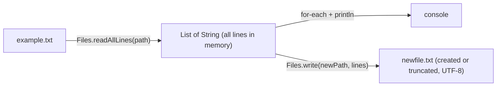
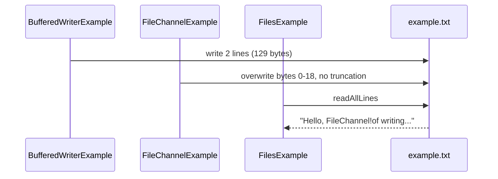
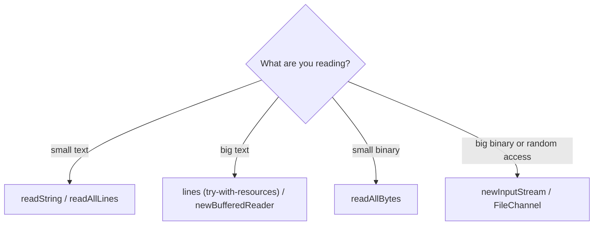

## In One Line
`java.nio.file.Files` is a toolbox of static methods that do the real work on a `Path` — read and write whole files in one call (`readAllLines`, `readString`, `write`, `writeString`), stream big ones (`lines`, `newBufferedReader`), create/copy/move/delete files and directories, walk trees and read attributes — and it reports every failure with a specific `IOException`.

## Mental Model
If `Path` is the **address on an envelope**, `Files` is the **postal service counter**. You hand over an address and ask for a service:

- "Read me everything at this address" → `Files.readAllLines(path)`.
- "Deliver this parcel, replacing whatever is there" → `Files.write(path, lines)`.
- "Move this box from A to B" → `Files.move(a, b)`.

The counter clerk never shrugs silently. If the house does not exist you get a slip that says exactly why: `NoSuchFileException`, `FileAlreadyExistsException`, `DirectoryNotEmptyException`, `AccessDeniedException`. That is the big improvement over the old `java.io.File`, whose methods just returned `false`.

## Concept
### What `Files` is
- A `final` utility class (private constructor, only `static` methods), added in Java 7 with NIO.2.
- Every method takes `Path` arguments and delegates to the path's `FileSystemProvider`, so the same calls work on the disk, inside a ZIP file system, or in an in-memory test file system.
- Nearly every method throws a checked `IOException` (or a more specific subclass from `java.nio.file`).

### Reading: pick the method by file size and shape
| Method | Returns | Charset | Loads whole file? | Use for |
|---|---|---|---|---|
| `readAllLines(path)` | `List<String>` | UTF-8 (Java 8+ overload) | Yes | Small text files, line by line |
| `readString(path)` (Java 11) | `String` | UTF-8 | Yes | Small text files as one string |
| `readAllBytes(path)` | `byte[]` | — | Yes (max ~2 GB, array limit) | Small binary files |
| `lines(path)` (Java 8) | `Stream<String>` (lazy) | UTF-8 | No | Big text files, stream pipelines — **close it** |
| `newBufferedReader(path)` | `BufferedReader` | UTF-8 | No | Big text files, classic loop |
| `newInputStream(path)` | `InputStream` | — | No | Big binary files, legacy APIs |
| `newByteChannel` / `FileChannel.open` | channel | — | No | Random access, see [FileChannel](lesson:a09-nio/04-filechannel) |

Line terminators recognised by the line-based readers: `\n`, `\r\n` and `\r`. The terminators are **not** included in the returned strings. A missing final newline is fine: the last line is still returned.

### Writing: defaults you must know
| Method | Default options when you pass none |
|---|---|
| `write(path, byte[])`, `write(path, Iterable<CharSequence>)` | `CREATE`, `TRUNCATE_EXISTING`, `WRITE` |
| `writeString(path, CharSequence)` (Java 11) | `CREATE`, `TRUNCATE_EXISTING`, `WRITE` |
| `newBufferedWriter(path)`, `newOutputStream(path)` | `CREATE`, `TRUNCATE_EXISTING`, `WRITE` |
| `newBufferedReader`, `newInputStream` | `READ` |

So by default a write **creates the file if missing and wipes it if present**. `Files.write(path, lines)` writes every element followed by the platform line separator — **including after the last line**. The text methods encode with UTF-8 unless you pass a `Charset`.

### `StandardOpenOption` cheat sheet
| Option | Meaning |
|---|---|
| `READ` / `WRITE` | Open for reading / writing |
| `APPEND` | Every write goes to the end of the file. **Does not create the file** — combine with `CREATE` |
| `CREATE` | Create if missing, open if present |
| `CREATE_NEW` | Create, and **fail** with `FileAlreadyExistsException` if present (atomic check-and-create) |
| `TRUNCATE_EXISTING` | Cut an existing file to 0 bytes when opened for writing |
| `DELETE_ON_CLOSE` | Best-effort delete when the stream/channel closes (temp files) |
| `SYNC` / `DSYNC` | Every write is flushed to the storage device (content + metadata / content only) |
| `SPARSE` | Hint that the new file will be sparse |

`APPEND` together with `TRUNCATE_EXISTING` (or with `READ`) is rejected with `IllegalArgumentException`.

### Creating, copying, moving, deleting
| Task | Method | Fails with |
|---|---|---|
| New empty file | `createFile(path)` | `FileAlreadyExistsException`, `NoSuchFileException` (parent missing) |
| One directory | `createDirectory(path)` | `FileAlreadyExistsException`, `NoSuchFileException` (parent missing) |
| Directory + all missing parents | `createDirectories(path)` | only if a part exists as a **file**; an existing directory is fine |
| Temp file / dir | `createTempFile(prefix, suffix)`, `createTempDirectory(prefix)` | — |
| Copy | `copy(src, dst, options...)` | `FileAlreadyExistsException` unless `REPLACE_EXISTING`; copying a directory copies only the empty directory |
| Move / rename | `move(src, dst, options...)` | `FileAlreadyExistsException` unless `REPLACE_EXISTING`; `ATOMIC_MOVE` for all-or-nothing |
| Delete | `delete(path)` | `NoSuchFileException`, `DirectoryNotEmptyException` |
| Delete quietly | `deleteIfExists(path)` returns `boolean` | `DirectoryNotEmptyException` |
| Also | `copy(InputStream, Path)`, `copy(Path, OutputStream)`, `mismatch(a, b)` (Java 12: first differing byte, `-1` if identical) | |

Copy options: `REPLACE_EXISTING`, `COPY_ATTRIBUTES` (timestamps, permissions), `NOFOLLOW_LINKS` (copy the link itself), and for `move` also `ATOMIC_MOVE`.

### Asking questions about a file
- `exists(path)`, `notExists(path)` — note they are **not** exact opposites: if the JVM cannot tell (for example permission denied on the parent), **both** return `false`.
- `isRegularFile`, `isDirectory`, `isSymbolicLink`, `isReadable`, `isWritable`, `isExecutable`, `isHidden`, `isSameFile`.
- `size(path)`, `getLastModifiedTime(path)`, `probeContentType(path)` (MIME guess, may return `null`), `getOwner`, `getPosixFilePermissions`.
- `readAttributes(path, BasicFileAttributes.class)` reads many attributes in **one** OS call (size, times, type, `fileKey`) — faster than several separate calls. `PosixFileAttributes` / `DosFileAttributes` add OS-specific ones.

> [!WARNING] "Check then act" is a race: another process can create or delete the file between `Files.exists(p)` and `Files.createFile(p)`. Prefer the atomic operation and catch its exception (`CREATE_NEW`, `createFile`, `deleteIfExists`) over checking first.

### Directories and trees
| Method | Visits | Lazy? | Close it? |
|---|---|---|---|
| `newDirectoryStream(dir[, glob])` | One level, optional glob filter (`"*.java"`) | Yes | Yes (`try`-with-resources) |
| `list(dir)` (Java 8) | One level, as a `Stream<Path>` | Yes | Yes |
| `walk(start[, maxDepth])` | Whole tree, depth-first, **includes `start` itself** | Yes | Yes |
| `find(start, maxDepth, (path, attrs) -> ...)` | Whole tree with a filter that receives the attributes for free | Yes | Yes |
| `walkFileTree(start, FileVisitor)` | Whole tree with callbacks: `preVisitDirectory`, `visitFile`, `visitFileFailed`, `postVisitDirectory` | Callback style | — |

The streams hold an open directory handle, so an un-closed `Files.list`/`walk`/`lines` stream leaks file descriptors. `walk` does not follow symbolic links unless you pass `FileVisitOption.FOLLOW_LINKS` (then it detects cycles). If it hits an unreadable directory while streaming it throws `UncheckedIOException`; `walkFileTree` lets you handle that per file in `visitFileFailed`.

A recursive delete must remove children before parents: sort the `walk` stream in reverse order, or use `walkFileTree` and delete directories in `postVisitDirectory`.

### Charset rules (a frequent source of bugs)
- NIO.2 text methods (`readAllLines`, `readString`, `lines`, `newBufferedReader`, `write`, `writeString`, `newBufferedWriter`) default to **UTF-8** on every platform.
- Old `java.io` classes (`FileReader`, `FileWriter`, `String.getBytes()`) used the **platform default** charset until Java 17; since **Java 18 (JEP 400)** the default is UTF-8 everywhere too.
- NIO.2 readers are **strict**: bytes that are not valid UTF-8 cause `MalformedInputException` (from `lines()`, wrapped in `UncheckedIOException`). Old readers silently replace bad bytes with `?`/`U+FFFD`. If a file is in another encoding, pass it: `Files.readAllLines(path, StandardCharsets.ISO_8859_1)`.

### `Files` vs `java.io`
| | `java.io` (`File`, streams) | `java.nio.file.Files` |
|---|---|---|
| Read a small text file | `BufferedReader` + loop + close | `Files.readString(path)` — one line |
| Failure reporting | `boolean` results, generic `IOException` | Specific exceptions with the path in the message |
| Default charset | Platform default (UTF-8 since 18) | Always UTF-8 |
| Copy/move | Manual stream loop, `renameTo` | `copy`, `move` with options, `ATOMIC_MOVE` |
| Directory listing | `File.list()` array, `null` on error | Lazy streams / `DirectoryStream`, exceptions |
| Symlinks, permissions, owners | No / partial | Yes |
| Streams for legacy APIs | Native | `Files.newInputStream`, `newBufferedReader`, ... bridge back |

## Diagram

The example reads the whole file into a list, prints it, and writes the same lines to a second file — each `Files` call opens and closes the file for you.


Why the recorded first line looks garbled: two earlier examples wrote the same file in the same folder, and `FileChannelExample` replaced only the first 19 bytes.


Whole-file methods are convenient but load everything into memory; streaming methods scale to any size.

## Code
@example NIO/FilesExample.java

Reading and writing whole files, and the default options:
```java
Path file = Path.of("notes.txt");
Files.writeString(file, "one\ntwo\nthree\n");                  // create or replace
System.out.println(Files.readAllLines(file) + " size=" + Files.size(file));

Files.write(file, List.of("four"), StandardOpenOption.APPEND);   // add to the end
System.out.println(Files.readAllLines(file));

Files.write(file, List.of("x", "y"));                            // default options truncate!
System.out.println(Files.readAllLines(file) + " size=" + Files.size(file));

try (Stream<String> lines = Files.lines(file)) {                 // lazy, must be closed
    System.out.println(lines.filter(s -> s.startsWith("y")).count());
}
System.out.println(Files.readString(file).replace("\n", "\\n"));
```
```output
[one, two, three] size=14
[one, two, three, four]
[x, y] size=4
1
x\ny\n
```
The last line proves `Files.write` adds a line separator after **every** line, the last one included (on Linux the separator is `\n`).

`APPEND` does not create the file:
```java
Path log = Path.of("app.log");
try {
    Files.writeString(log, "first entry\n", APPEND);
} catch (NoSuchFileException e) {
    System.out.println("APPEND alone -> NoSuchFileException");
}
Files.writeString(log, "first entry\n", CREATE, APPEND);
Files.writeString(log, "second entry\n", CREATE, APPEND);
System.out.print(Files.readString(log));
try {
    Files.writeString(log, "x", CREATE_NEW);
} catch (FileAlreadyExistsException e) {
    System.out.println("CREATE_NEW -> FileAlreadyExistsException");
}
try {
    Files.newOutputStream(log, APPEND, TRUNCATE_EXISTING);
} catch (IllegalArgumentException e) {
    System.out.println("APPEND + TRUNCATE_EXISTING -> " + e.getMessage());
}
```
```output
APPEND alone -> NoSuchFileException
first entry
second entry
CREATE_NEW -> FileAlreadyExistsException
APPEND + TRUNCATE_EXISTING -> APPEND + TRUNCATE_EXISTING not allowed
```

Files and directories, and the exception you get for each mistake:
```java
Path root = Files.createTempDirectory("files-demo");
Path a = Files.writeString(root.resolve("a.txt"), "hello");

try { Files.createFile(a); }
catch (FileAlreadyExistsException e) { System.out.println("createFile      -> FileAlreadyExistsException"); }

try { Files.createDirectory(root.resolve("x/y/z")); }
catch (NoSuchFileException e) { System.out.println("createDirectory -> NoSuchFileException (parent x/y missing)"); }
Path deep = Files.createDirectories(root.resolve("x/y/z"));      // creates x, y and z
System.out.println("createDirectories -> " + root.relativize(deep));

Path copy = Files.copy(a, root.resolve("copy.txt"));
try { Files.copy(a, copy); }
catch (FileAlreadyExistsException e) { System.out.println("copy again      -> FileAlreadyExistsException"); }
Files.copy(a, copy, StandardCopyOption.REPLACE_EXISTING);

Path moved = Files.move(copy, deep.resolve("moved.txt"));
System.out.println("move            -> " + root.relativize(moved) + ", old still there? " + Files.exists(copy));
System.out.println("mismatch        -> " + Files.mismatch(a, moved));   // -1 = identical content

try { Files.delete(root.resolve("x")); }
catch (DirectoryNotEmptyException e) { System.out.println("delete(x)       -> DirectoryNotEmptyException"); }
try { Files.delete(root.resolve("ghost.txt")); }
catch (NoSuchFileException e) { System.out.println("delete(ghost)   -> NoSuchFileException"); }
System.out.println("deleteIfExists  -> " + Files.deleteIfExists(root.resolve("ghost.txt")));
System.out.println("File.delete     -> " + root.resolve("ghost.txt").toFile().delete() + " (and no reason why)");
```
```output
createFile      -> FileAlreadyExistsException
createDirectory -> NoSuchFileException (parent x/y missing)
createDirectories -> x/y/z
copy again      -> FileAlreadyExistsException
move            -> x/y/z/moved.txt, old still there? false
mismatch        -> -1
delete(x)       -> DirectoryNotEmptyException
delete(ghost)   -> NoSuchFileException
deleteIfExists  -> false
File.delete     -> false (and no reason why)
```

Walking a tree and deleting it recursively:
```java
Path root = Files.createTempDirectory("tree");
Files.createDirectories(root.resolve("src/main"));
Files.writeString(root.resolve("README.md"), "# demo");
Files.writeString(root.resolve("src/main/App.java"), "class App {}");
Files.writeString(root.resolve("src/main/notes.txt"), "todo");

try (Stream<Path> s = Files.list(root)) {                     // one level
    System.out.println("list = " + s.map(p -> root.relativize(p).toString()).sorted().toList());
}
try (Stream<Path> s = Files.walk(root)) {                     // whole tree, depth-first
    System.out.println("walk = " + s.map(p -> root.relativize(p).toString()).sorted().toList());
}
try (Stream<Path> s = Files.find(root, Integer.MAX_VALUE,
        (p, attrs) -> attrs.isRegularFile() && p.toString().endsWith(".java"))) {
    System.out.println("find = " + s.map(p -> p.getFileName().toString()).toList());
}
BasicFileAttributes attrs = Files.readAttributes(root.resolve("README.md"), BasicFileAttributes.class);
System.out.println("attrs = size " + attrs.size() + ", regular " + attrs.isRegularFile() + ", dir " + attrs.isDirectory());

// Recursive delete: deepest paths first
try (Stream<Path> s = Files.walk(root)) {
    s.sorted(Comparator.reverseOrder()).forEach(p -> {
        try { Files.delete(p); } catch (IOException e) { throw new UncheckedIOException(e); }
    });
}
System.out.println("deleted = " + Files.notExists(root));
```
```output
list = [README.md, src]
walk = [, README.md, src, src/main, src/main/App.java, src/main/notes.txt]
find = [App.java]
attrs = size 6, regular true, dir false
deleted = true
```
The empty first entry of `walk` is `root` itself relativized to itself: `walk` always starts with the start directory.

The UTF-8 default meets a Latin-1 file:
```java
Path legacy = Path.of("legacy.txt");
Files.write(legacy, "café".getBytes(StandardCharsets.ISO_8859_1)); // 4 bytes, e-acute = 0xE9
try {
    Files.readAllLines(legacy);                                         // assumes UTF-8
} catch (MalformedInputException e) {
    System.out.println("UTF-8 read fails: " + e);
}
String ok = Files.readAllLines(legacy, StandardCharsets.ISO_8859_1).get(0);
System.out.println("Latin-1 read: length " + ok.length() + ", last char U+" + Integer.toHexString(ok.charAt(3)).toUpperCase());
```
```output
UTF-8 read fails: java.nio.charset.MalformedInputException: Input length = 1
Latin-1 read: length 4, last char U+E9
```

## Walkthrough
- `import java.nio.file.Files; Path; Paths; java.util.List;` — `Files` does the IO, `Path`/`Paths` describe the locations, `List` holds the lines.
- `Path path = Paths.get("example.txt");` — a **relative** path, so it is resolved against the working directory when used. The example silently depends on `example.txt` already being there.
- `List<String> lines = Files.readAllLines(path);` — opens the file, decodes it as UTF-8, splits it at line terminators (dropping them), closes the file and returns a `List<String>`. Everything is in memory at once — fine for a two-line file, dangerous for a 5 GB log. If the file were missing you would get `java.nio.file.NoSuchFileException: example.txt`; that is exactly what happens if you run this example alone in an empty folder.
- `for (String line : lines) System.out.println(line);` — prints the two lines. They look odd; see below.
- `Path newPath = Paths.get("newfile.txt"); Files.write(newPath, lines);` — `write(Path, Iterable)` uses the default options `CREATE, TRUNCATE_EXISTING, WRITE`: it creates `newfile.txt`, or silently empties and overwrites it if it already exists. Each element is written in UTF-8 followed by the line separator, so `newfile.txt` ends up byte-for-byte identical to `example.txt` here (both 129 bytes, since the original also ended with a newline).
- `System.out.println("File operations completed successfully.");` — only reached if no exception was thrown.
- `catch (Exception e) { e.printStackTrace(); }` — catches everything, including programming bugs; see Traps.

**Where the strange first line comes from.** The recorded outputs were produced by running the file examples in one folder, in order. `BufferedWriterExample` (from the IO module) wrote `This is an example of writing to a file using BufferedWriter.` and a second line. Then `FileChannelExample` opened the same `example.txt` with `RandomAccessFile(..., "rw")` and wrote the 19 bytes `Hello, FileChannel!` at position 0. `"rw"` mode does **not** truncate, so those 19 bytes replaced exactly the 19 bytes `This is an example ` and the rest of the old text stayed: `Hello, FileChannel!of writing to a file using BufferedWriter.` `FilesExample` simply reads what is on disk. Run in a fresh folder after only `FileChannelExample`, it prints `Hello, FileChannel!` and the success message.

## Traps
> [!ERRATA] The `// Output:` comment shows `Hello, FileChannel!of writing to a file using BufferedWriter.` as if it were normal output. It is only what you see after `BufferedWriterExample` and then `FileChannelExample` ran in the same folder; the garbling is caused by `FileChannelExample` overwriting the start of the file without truncating it, not by `Files`. The example has a hidden dependency: run on its own it throws `NoSuchFileException: example.txt`. A self-contained example should create its input first (for example with `Files.writeString`).

> [!ERRATA] The comment `// Write lines to a new file` is misleading: `Files.write` with no options also **overwrites** an existing file (`TRUNCATE_EXISTING`). To really require a new file, pass `StandardOpenOption.CREATE_NEW`, which fails with `FileAlreadyExistsException` if it exists.

> [!ERRATA] `catch (Exception e) { e.printStackTrace(); }` swallows every exception, including bugs such as `NullPointerException`, and the program still exits normally. Catch `IOException` (or declare `main(...) throws IOException`) and handle or report it properly.

- **`readAllLines`/`readString`/`readAllBytes` load the whole file.** Large files cause `OutOfMemoryError`; `readAllBytes` cannot even handle more than about 2 GB (array size limit). Stream instead with `Files.lines` or `newBufferedReader`.
- **Forgetting to close `Files.lines`, `list`, `walk`, `find`, `newDirectoryStream`.** They hold an OS handle until closed. A terminal operation does **not** close the stream. Always use try-with-resources.
- **`APPEND` alone throws `NoSuchFileException`** if the file does not exist; write `CREATE, APPEND`.
- **`createDirectory` vs `createDirectories`.** The first needs the parent to exist and fails if the directory exists; the second creates all parents and accepts an existing directory.
- **`delete` on a non-empty directory throws `DirectoryNotEmptyException`.** Delete children first (reverse-sorted `walk`) or use `walkFileTree`.
- **`copy` of a directory copies only the directory entry**, not its contents.
- **`exists` and `notExists` can both be `false`** when access is denied; and "check then act" is a race — prefer atomic operations.
- **Strict UTF-8 decoding.** A Latin-1 or Windows-1252 file throws `MalformedInputException` with the NIO.2 readers; pass the right `Charset`.
- **`Files.write(path, lines)` appends a separator after the last line**, so a file written this way always ends with a newline.

## Tips & Tricks
- **"Small file, one call; big file, stream it."** `readString`/`readAllLines` for config-sized files; `lines` / `newBufferedReader` for logs and data.
- **Every stream that comes from `Files` goes in a `try (...)`.** Mnemonic: *"If Files gave you a stream, give it back."*
- **Default write = C.T.W.** (`CREATE`, `TRUNCATE_EXISTING`, `WRITE`). Want to add? `CREATE, APPEND`. Want to fail if present? `CREATE_NEW`.
- **Recursive delete one-liner shape:** `Files.walk(dir).sorted(Comparator.reverseOrder()).forEach(Files::delete)` — but `Files::delete` throws a checked exception, so wrap it (see the example above).
- **Use `readAttributes` when you need several attributes** — one system call instead of many.
- **Write safely with a temp file + `ATOMIC_MOVE`:** write to `report.tmp` in the same directory, then `Files.move(tmp, target, ATOMIC_MOVE, REPLACE_EXISTING)`. Readers never see a half-written file.
- **Charset:** NIO.2 is UTF-8 by default; pass a `Charset` whenever the file comes from somewhere else.

## Interview Q&A
### [Basic] How do you read a whole text file into a String or a list of lines in modern Java?
Use `Files.readString(path)` (Java 11) for one `String`, or `Files.readAllLines(path)` (Java 7; UTF-8 overload since Java 8) for a `List<String>` without line terminators. Both open, decode (UTF-8 by default), and close the file in a single call. They load the whole file into memory, so for large files use `Files.lines(path)` inside try-with-resources, or `Files.newBufferedReader(path)`.
```java
String all = Files.readString(Path.of("config.json"));
try (Stream<String> lines = Files.lines(Path.of("huge.log"))) {
    long errors = lines.filter(l -> l.contains("ERROR")).count();
}
```
**Follow-up:** *Why must `Files.lines` be closed but not `readAllLines`?* — `lines` is lazy and keeps the file open while the stream is consumed; `readAllLines` finishes reading and closes the file before returning.

### [Basic] What are the default open options of `Files.write` and how do you append?
With no options, `Files.write`, `writeString`, `newBufferedWriter` and `newOutputStream` use `CREATE`, `TRUNCATE_EXISTING` and `WRITE`: create the file if missing, otherwise wipe it. To append, pass `StandardOpenOption.APPEND` — and also `CREATE` if the file might not exist, because `APPEND` alone throws `NoSuchFileException` for a missing file. To insist on a brand-new file, use `CREATE_NEW`.

**Follow-up:** *Can you combine `APPEND` and `TRUNCATE_EXISTING`?* — No, that throws `IllegalArgumentException` ("APPEND + TRUNCATE_EXISTING not allowed").

### [Basic] Why is `Files.delete(path)` better than `file.delete()`?
`File.delete()` returns `false` on failure and gives no reason — missing file, non-empty directory, no permission and a file locked by another process all look the same. `Files.delete` throws a specific exception: `NoSuchFileException`, `DirectoryNotEmptyException`, `AccessDeniedException` (or a general `IOException` with the OS message). When "already gone" is fine, `Files.deleteIfExists` returns a boolean but still throws for the real errors.

**Follow-up:** *How do you delete a non-empty directory?* — Walk it and delete children first: `Files.walk(dir).sorted(Comparator.reverseOrder())` and delete each, or `Files.walkFileTree` deleting files in `visitFile` and directories in `postVisitDirectory`.

### [Intermediate] What is the difference between `Files.list`, `Files.walk`, `Files.find` and `Files.walkFileTree`?
`list(dir)` is a lazy `Stream<Path>` of one directory level. `walk(start, maxDepth)` streams the whole tree depth-first and includes `start` itself. `find(start, maxDepth, matcher)` is `walk` with a `BiPredicate<Path, BasicFileAttributes>` filter, and it gets the attributes without an extra system call. `walkFileTree(start, visitor)` is callback-based (`preVisitDirectory`, `visitFile`, `visitFileFailed`, `postVisitDirectory`) and lets you skip subtrees (`SKIP_SUBTREE`), stop (`TERMINATE`), and handle errors per file — the stream versions throw `UncheckedIOException` and stop. All the stream versions must be closed.

**Follow-up:** *Do they follow symbolic links?* — Not by default. Pass `FileVisitOption.FOLLOW_LINKS`; the walker then detects cycles and reports `FileSystemLoopException`.

### [Intermediate] What charset do the `Files` methods use, and what happens with a file in another encoding?
The text methods of `Files` always default to UTF-8, independent of the OS (unlike `FileReader`/`FileWriter` before Java 18, which used the platform default). The decoders are strict: invalid UTF-8 bytes — for example the Latin-1 byte `0xE9` for `é` — cause `MalformedInputException` (from `Files.lines` it arrives wrapped in `UncheckedIOException` during stream processing). Pass the correct charset explicitly: `Files.readAllLines(path, StandardCharsets.ISO_8859_1)`.

**Follow-up:** *What changed in Java 18?* — JEP 400 made UTF-8 the default charset for the whole platform (`Charset.defaultCharset()`), so `FileReader`, `String.getBytes()` and friends now match NIO.2.

### [Intermediate] How do you copy and move files with NIO.2, and what does `ATOMIC_MOVE` do?
`Files.copy(src, dst, options...)` copies a file (or just an empty directory entry for a directory); it throws `FileAlreadyExistsException` unless you pass `REPLACE_EXISTING`, and `COPY_ATTRIBUTES` keeps timestamps and permissions. There are also stream overloads, `copy(InputStream, Path)` and `copy(Path, OutputStream)`. `Files.move(src, dst, options...)` renames or moves; within one file system it is usually a cheap rename. `ATOMIC_MOVE` makes it all-or-nothing — other processes see either the old or the new file, never a partial one — and throws `AtomicMoveNotSupportedException` if the OS cannot do it (for example across file systems).

**Follow-up:** *How do you use that to write a file safely?* — Write to a temp file in the same directory, then `move(tmp, target, ATOMIC_MOVE, REPLACE_EXISTING)`.

### [Intermediate] Why can `Files.exists(p)` and `Files.notExists(p)` both return false?
Because they answer "can I confirm it exists?" and "can I confirm it doesn't?". If the JVM cannot determine the status — typically `AccessDeniedException` on a parent directory — both return `false`. And even a `true` answer can be stale a microsecond later, so for correctness prefer atomic operations (`createFile`, `CREATE_NEW`, `deleteIfExists`) and handle the exception.

**Follow-up:** *What is TOCTOU?* — Time-of-check to time-of-use: a race between checking a condition and acting on it; another process changes the file in between.

### [Advanced] How would you process a 10 GB log file with NIO.2?
Never with `readAllLines`/`readString`/`readAllBytes`. Stream it: `try (Stream<String> lines = Files.lines(path)) { ... }` or a `BufferedReader` from `Files.newBufferedReader(path)`, keeping only aggregates in memory. Pass the right charset (`ISO_8859_1` never fails on any byte, if you only need ASCII parts). For binary or random access, use a `FileChannel` with a reusable `ByteBuffer`, or memory-map regions with `FileChannel.map` (each mapping up to 2 GB). `Files.lines` can also be parallelised, since Java 9 splits it efficiently for common charsets, but IO is usually the bottleneck.

**Follow-up:** *What exception reaches you if a line has bad bytes inside `Files.lines`?* — An `UncheckedIOException` wrapping `MalformedInputException`, thrown from the terminal operation.

### [Advanced] What happens internally when you call `Files.readAllLines(path)`?
`Files` asks the path's `FileSystemProvider` for a byte channel/input stream (`newInputStream` → `newByteChannel`), wraps it in a UTF-8 `CharsetDecoder` inside a `BufferedReader` (`newBufferedReader`), reads with `readLine()` into an `ArrayList`, and closes everything in try-with-resources. That is visible in the stack trace when the file is missing: `readAllLines` → `newBufferedReader` → `newInputStream` → `newByteChannel` → `UnixFileSystemProvider.newByteChannel` → `NoSuchFileException`. Because every step goes through the provider, the same call works on a ZIP or in-memory file system.

**Follow-up:** *Where does the specific exception type come from?* — The provider translates the OS error code (`ENOENT`, `EACCES`, `EEXIST`...) into `NoSuchFileException`, `AccessDeniedException`, `FileAlreadyExistsException` (on Linux, in `UnixException.translateToIOException`).

## Quiz
### What does the original `FilesExample` print if you run it alone in an empty folder?
- [ ] Nothing, then "File operations completed successfully."
- [ ] An empty line
- [x] A `NoSuchFileException: example.txt` stack trace
- [ ] It creates `example.txt` and prints nothing
> `readAllLines` needs the file to exist; reading never creates a file. The exception is caught and printed by `printStackTrace()`, so the success message is never reached. The recorded output only exists because earlier examples created `example.txt`.

### What does this print?
```java
Path file = Path.of("notes.txt");
Files.writeString(file, "one\ntwo\n");
Files.write(file, List.of("x"));
System.out.println(Files.readAllLines(file));
```
- [ ] [one, two, x]
- [x] [x]
- [ ] [x, two]
- [ ] It throws FileAlreadyExistsException
> With no options, `Files.write` uses `CREATE, TRUNCATE_EXISTING, WRITE`: the old content is wiped. Appending needs `APPEND`. `FileAlreadyExistsException` only happens with `CREATE_NEW`.

### What happens here if `app.log` does not exist yet?
```java
Files.writeString(Path.of("app.log"), "started\n", StandardOpenOption.APPEND);
```
- [ ] The file is created and the line is written
- [x] `NoSuchFileException` is thrown
- [ ] Nothing is written and no error occurs
- [ ] `IllegalArgumentException` is thrown
> Passing any options replaces the defaults, so `CREATE` is no longer included. `APPEND` alone opens an existing file only. Use `CREATE, APPEND`.

### Spot the bug:
```java
long javaFiles = Files.walk(Path.of("src"))
        .filter(p -> p.toString().endsWith(".java"))
        .count();
```
- [ ] `walk` does not include subdirectories
- [ ] `count()` is not allowed on a `Stream<Path>`
- [x] The stream is never closed, leaking open directory handles
- [ ] `endsWith` must be called on the `Path`, not the string
> `Files.walk` keeps directory handles open until the stream is closed, and terminal operations do not close it. Wrap it in `try (Stream<Path> s = Files.walk(...))`. Calling `endsWith(".java")` on the `String` is actually the correct choice here — `Path.endsWith` compares whole names.

### Which call creates `/data/app/logs` when only `/data` exists?
- [ ] `Files.createDirectory(Path.of("/data/app/logs"))`
- [x] `Files.createDirectories(Path.of("/data/app/logs"))`
- [ ] `Files.createFile(Path.of("/data/app/logs"))`
- [ ] `Path.of("/data/app/logs")`
> `createDirectories` creates every missing parent and does not complain if the directory already exists. `createDirectory` throws `NoSuchFileException` because `/data/app` is missing, and creating a `Path` never touches the disk.

### A file saved as ISO-8859-1 contains `café`. What does `Files.readAllLines(path)` do?
- [ ] Returns `[café]`
- [ ] Returns `[caf?]`
- [x] Throws `MalformedInputException`
- [ ] Uses the platform default charset, so it depends on the OS
> The `Files` text methods always decode as UTF-8 and are strict: byte `0xE9` is not valid UTF-8 on its own. Old `java.io` readers would have substituted a replacement character instead. Pass `StandardCharsets.ISO_8859_1` to read it.

### Why is `newfile.txt` identical in size (129 bytes) to `example.txt` after the original example runs?
- [ ] `Files.write` copies the file byte by byte
- [x] `readAllLines` drops the line terminators, and `Files.write` adds a separator after every line, including the last
- [ ] `Files.write` skips the line separators
- [ ] It is a coincidence
> The original file ended with `\n`, so each of its two lines had a terminator. `readAllLines` strips them, and `Files.write` puts one back after each element. With `\n` separators the result is byte-identical. On Windows `Files.write` would write `\r\n`, so the copy would be 2 bytes longer.

## Takeaways
- `Files` is a static utility class (NIO.2, Java 7) that performs the real IO on `Path` objects and reports failures with specific exceptions (`NoSuchFileException`, `FileAlreadyExistsException`, `DirectoryNotEmptyException`, `AccessDeniedException`).
- `readString`/`readAllLines`/`readAllBytes` read the whole file in one call; use `lines`/`newBufferedReader` (closed with try-with-resources) for big files.
- Default write options are `CREATE, TRUNCATE_EXISTING, WRITE`; `APPEND` needs `CREATE` for a missing file; `CREATE_NEW` fails if the file exists.
- `Files.write(path, lines)` writes a line separator after every line, including the last; `readAllLines` strips terminators.
- NIO.2 text methods always use UTF-8 and are strict — a file in another encoding throws `MalformedInputException` unless you pass its `Charset`.
- `createDirectories` makes all parents; `delete` fails on non-empty directories; recursive delete = reverse-sorted `walk` or `walkFileTree`.
- The garbled first line in the example comes from `FileChannelExample` overwriting 19 bytes of `example.txt` without truncating — `FilesExample` just reads what is on disk, and depends on that file existing.
