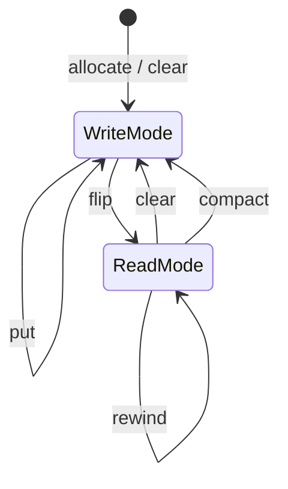
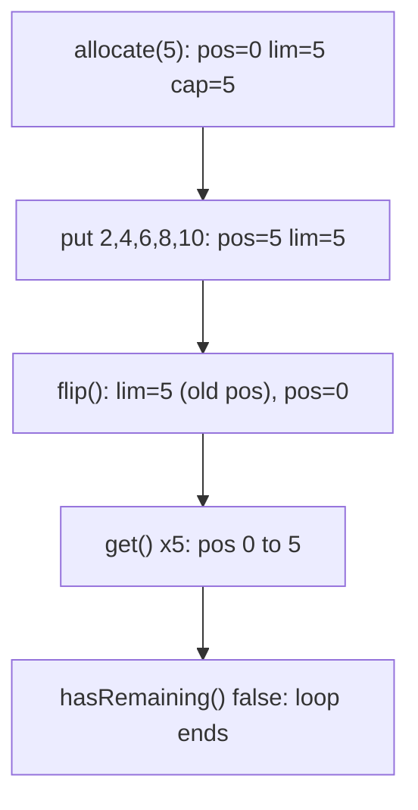
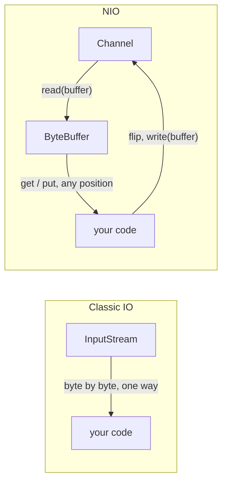

## In One Line
A NIO `Buffer` (`ByteBuffer`, `IntBuffer`, `CharBuffer`, ...) is a fixed-size container of primitives with three moving markers — **position**, **limit**, **capacity** — and you switch it between *filling* and *draining* with `flip()`, `clear()` and `compact()`; channels read into and write from buffers instead of streaming byte by byte.

## Mental Model
Picture a **cafeteria tray with 5 slots** and a waiter.

- **Capacity** is the number of slots on the tray: 5, fixed forever.
- **Position** is the slot the waiter's hand is on right now.
- **Limit** is a ribbon laid across the tray: "do not go past here".

Filling the tray: the ribbon is at the end (limit = 5), the hand moves right as each plate is put down (`put`). Now you want to **serve** the plates: you move the ribbon to where the hand stopped ("only this many are full") and move the hand back to slot 0. That move is exactly **`flip()`**. Serving (`get`) moves the hand right until it touches the ribbon (`hasRemaining()` becomes `false`). To reuse the tray, `clear()` puts the ribbon back at the end and the hand at 0 — the plates are not washed, they will just be overwritten.

In the example: `IntBuffer.allocate(5)` is the empty 5-slot tray, the loop `put`s 2, 4, 6, 8, 10, `flip()` moves the ribbon and the hand, and the `while (hasRemaining())` loop serves them in order.

## Concept
### Why buffers exist: stream IO vs buffer IO
Classic `java.io` is **stream-oriented**: you pull bytes one at a time (or into your own `byte[]`) from an `InputStream`, in one direction, and you cannot move back. NIO is **buffer-oriented**: a channel transfers a whole block of data into a buffer, and your code then moves freely around inside that buffer.

| | Classic IO (`java.io`) | NIO (`java.nio`) |
|---|---|---|
| Unit of work | Stream of bytes/chars | Block of data in a `Buffer` |
| Direction | One way: `InputStream` **or** `OutputStream` | A `Channel` can be read **and** written (e.g. `FileChannel`) |
| Moving around | Forward only (`skip`, maybe `mark/reset`) | Any index: `position(n)`, absolute `get(i)`/`put(i, v)` |
| Blocking | Always blocking | File channels block; socket channels can be non-blocking + `Selector` |
| Memory | Java heap arrays | Heap **or direct (off-heap)** buffers, memory-mapped files |
| Best at | Simple sequential reading/writing | High-throughput, many connections, binary protocols |

The full IO-vs-NIO comparison, including selectors, is in [FileChannel](lesson:a09-nio/04-filechannel).

### The buffer family
`java.nio.Buffer` is the abstract base. There is one subclass per primitive type **except `boolean`**:

`ByteBuffer`, `CharBuffer`, `ShortBuffer`, `IntBuffer`, `LongBuffer`, `FloatBuffer`, `DoubleBuffer` (and `MappedByteBuffer extends ByteBuffer` for memory-mapped files).

Only `ByteBuffer` talks to channels directly, because the OS moves bytes. The others are used for in-memory work or as **views** over a `ByteBuffer` (`byteBuffer.asIntBuffer()`).

### The four markers
| Marker | Meaning | Changes when |
|---|---|---|
| `capacity` | Total number of elements; fixed at creation | Never |
| `limit` | Index of the first element that must **not** be read or written | `flip()`, `clear()`, `limit(n)` |
| `position` | Index of the next element to read or write | Every relative `get()`/`put()`, `flip()`, `clear()`, `rewind()`, `position(n)` |
| `mark` | A remembered position (optional) | `mark()`; `reset()` jumps back to it |

The invariant is always **`0 <= mark <= position <= limit <= capacity`**. `remaining()` = `limit - position`; `hasRemaining()` = `position < limit`.

### The state-changing methods (memorise this table)
| Method | position | limit | Data | Use it |
|---|---|---|---|---|
| `allocate(n)` | 0 | n | zeroed | Create (write mode) |
| `put(x)` / `get()` | +1 | — | written / read | Relative access |
| `put(i, x)` / `get(i)` | unchanged | — | written / read | Absolute access (index checked against limit) |
| `flip()` | 0 | old position | kept | **Done writing, start reading** |
| `rewind()` | 0 | unchanged | kept | Read the same data again |
| `clear()` | 0 | capacity | kept but "forgotten" | Done reading everything, start writing afresh |
| `compact()` | remaining count | capacity | unread elements copied to the start | Done reading **some**, keep the rest, continue writing |
| `mark()` / `reset()` | reset → mark | — | kept | Bookmark and return |

`clear()` does **not** erase anything; it only moves the markers. Also, `flip()` discards the mark, and so do `clear()` and `rewind()`.

### Creating buffers
| Factory | Memory | Backing array? |
|---|---|---|
| `XxxBuffer.allocate(n)` | Java heap (`HeapIntBuffer`, `HeapByteBuffer`) | Yes: `array()` returns it; `hasArray()` is `true` |
| `XxxBuffer.wrap(array)` / `wrap(array, off, len)` | Your array — **no copy**; changes are visible both ways | Yes |
| `ByteBuffer.allocateDirect(n)` | Native memory outside the heap (`DirectByteBuffer`) | No: `hasArray()` is `false` |
| `channel.map(...)` | OS page cache mapped into memory (`MappedByteBuffer`) | No |
| `buf.duplicate()`, `buf.slice()`, `buf.slice(index, length)` (Java 13), `asReadOnlyBuffer()` | Share the **same content** with independent markers | Same as the original |

### Heap vs direct `ByteBuffer`
| | Heap (`allocate`) | Direct (`allocateDirect`) |
|---|---|---|
| Lives in | Java heap, a normal `byte[]` | Native memory |
| Allocation cost | Cheap | Expensive (system call, zeroing) — allocate once, reuse |
| Channel IO | The JDK copies it into a temporary direct buffer first | The OS reads/writes it directly — no extra copy |
| Freed | By GC like any array | When the buffer object is garbage-collected (via a `Cleaner`) |
| Limit | `-Xmx` | `-XX:MaxDirectMemorySize` → `OutOfMemoryError: Direct buffer memory` |
| Good for | Short-lived buffers, in-memory work | Long-lived IO buffers, large transfers, network servers |

### `ByteBuffer` extras
- **Typed access:** `putInt`, `getLong`, `putDouble(index, v)`, ... read/write multi-byte values.
- **Byte order:** the default is always `ByteOrder.BIG_ENDIAN` (network order), whatever the CPU. Change it with `order(ByteOrder.LITTLE_ENDIAN)`; `ByteOrder.nativeOrder()` tells you the CPU's order (little-endian on x86 and most ARM).
- **Views:** `asIntBuffer()`, `asCharBuffer()`, ... see the same bytes as another type.
- **Text:** a `Charset` converts between `CharBuffer`/`String` and `ByteBuffer`: `UTF_8.encode("Hi")`, `UTF_8.decode(byteBuf)`.

### Other rules worth knowing
- Buffers are **not thread-safe**. Give each thread its own, or synchronise.
- `equals` and `compareTo` look only at the **remaining** elements (position to limit), not the whole array. `mismatch(other)` (Java 11) finds the first different remaining index.
- `toString()` prints the markers, not the content: `java.nio.HeapIntBuffer[pos=0 lim=5 cap=5]`.
- Bulk operations `get(int[] dst)` / `put(int[] src)` move many elements at once and are much faster than a loop. Java 13 added **absolute** bulk versions `get(index, dst)` / `put(index, src)` that leave `position` alone.

> [!NOTE] Java 9 change: `flip()`, `clear()`, `rewind()`, `position(int)`, `limit(int)`, `mark()`, `reset()` were overridden in every subclass to return the subclass type (`ByteBuffer.flip()` returns `ByteBuffer`, not `Buffer`). Code compiled on JDK 9+ with `-source 8 -target 8` (instead of `--release 8`) therefore fails on a Java 8 JVM with `NoSuchMethodError: java.nio.ByteBuffer.flip()Ljava/nio/ByteBuffer;`. Fix: compile with `--release 8`, or write `((Buffer) buf).flip()`.

## Diagram

A buffer alternates between "being filled" and "being drained"; `flip()` is the only door from writing to reading, and `clear()`/`compact()` lead back.


The marker values while the original example runs; because the buffer was filled completely, `flip()` leaves the limit at 5 and only resets the position.


Streams hand you data sequentially in one direction; channels fill and drain buffers in blocks, and your code can move around inside the buffer.

## Code
@example NIO/BufferExample.java

Watching the markers move through every important method:
```java
import java.nio.Buffer;
import java.nio.IntBuffer;

public class BufferStates {
    static void show(String step, Buffer b) {
        System.out.printf("%-10s pos=%d lim=%d cap=%d remaining=%d%n",
                step, b.position(), b.limit(), b.capacity(), b.remaining());
    }

    public static void main(String[] args) {
        IntBuffer buf = IntBuffer.allocate(5);
        show("allocate", buf);
        buf.put(2).put(4).put(6);
        show("put x3", buf);
        buf.flip();
        show("flip", buf);
        System.out.println("get() = " + buf.get());
        show("get", buf);
        System.out.println("get(2) = " + buf.get(2) + " (absolute: position unchanged)");
        buf.compact();
        show("compact", buf);
        buf.flip();
        show("flip", buf);
        buf.rewind();
        show("rewind", buf);
        buf.clear();
        show("clear", buf);
        System.out.println(buf);
    }
}
```
```output
allocate   pos=0 lim=5 cap=5 remaining=5
put x3     pos=3 lim=5 cap=5 remaining=2
flip       pos=0 lim=3 cap=5 remaining=3
get() = 2
get        pos=1 lim=3 cap=5 remaining=2
get(2) = 6 (absolute: position unchanged)
compact    pos=2 lim=5 cap=5 remaining=3
flip       pos=0 lim=2 cap=5 remaining=2
rewind     pos=0 lim=2 cap=5 remaining=2
clear      pos=0 lim=5 cap=5 remaining=5
java.nio.HeapIntBuffer[pos=0 lim=5 cap=5]
```
`compact()` copied the two unread values (4 and 6) to indexes 0 and 1, set position to 2 (ready to append after them) and limit to capacity.

The classic mistakes and the exceptions they cause:
```java
IntBuffer noFlip = IntBuffer.allocate(5);
noFlip.put(7).put(8);
System.out.print("forgot flip -> ");
while (noFlip.hasRemaining()) System.out.print(noFlip.get() + " ");
System.out.println();

IntBuffer twice = IntBuffer.allocate(5);
twice.put(7).put(8);
twice.flip();
twice.flip();
System.out.println("flip twice  -> remaining=" + twice.remaining());

IntBuffer small = IntBuffer.allocate(2);
small.put(1).put(2);
try { small.put(3); }
catch (BufferOverflowException e) { System.out.println("put past limit -> " + e); }
small.flip();
small.get(); small.get();
try { small.get(); }
catch (BufferUnderflowException e) { System.out.println("get past limit -> " + e); }
try { small.get(5); }
catch (IndexOutOfBoundsException e) { System.out.println("get(5)         -> IndexOutOfBoundsException"); }

IntBuffer ro = IntBuffer.wrap(new int[] {1, 2}).asReadOnlyBuffer();
try { ro.put(0, 9); }
catch (ReadOnlyBufferException e) { System.out.println("read-only put  -> " + e); }
```
```output
forgot flip -> 0 0 0 
flip twice  -> remaining=0
put past limit -> java.nio.BufferOverflowException
get past limit -> java.nio.BufferUnderflowException
get(5)         -> IndexOutOfBoundsException
read-only put  -> java.nio.ReadOnlyBufferException
```
Without `flip()` the loop reads the three *unwritten* slots after position 2 (zeros). Flipping twice sets the limit to the position, which the first flip had reset to 0.

`ByteBuffer` features: byte order, views, sharing, direct memory, charsets:
```java
ByteBuffer big = ByteBuffer.allocate(4);
big.putInt(1);
System.out.println("putInt(1) big-endian    -> " + Arrays.toString(big.array()));
ByteBuffer little = ByteBuffer.allocate(4).order(ByteOrder.LITTLE_ENDIAN);
little.putInt(1);
System.out.println("putInt(1) little-endian -> " + Arrays.toString(little.array()));

ByteBuffer raw = ByteBuffer.allocate(8);
raw.putInt(0, 42).putInt(4, 7);                     // absolute puts
IntBuffer ints = raw.asIntBuffer();                 // view: same bytes, int-sized slots
System.out.println("asIntBuffer             -> " + ints.get(0) + ", " + ints.get(1));

int[] arr = {1, 2, 3};
IntBuffer wrapped = IntBuffer.wrap(arr);            // no copy: backed by arr
wrapped.put(0, 99);
System.out.println("wrap shares the array   -> " + Arrays.toString(arr));

IntBuffer base = IntBuffer.wrap(new int[] {10, 20, 30, 40});
base.position(2);
IntBuffer slice = base.slice();                     // shares content from position 2
slice.put(0, -1);
System.out.println("slice                   -> cap=" + slice.capacity() + ", base.get(2)=" + base.get(2));

ByteBuffer direct = ByteBuffer.allocateDirect(16);
System.out.println("direct                  -> isDirect=" + direct.isDirect() + ", hasArray=" + direct.hasArray());

ByteBuffer encoded = StandardCharsets.UTF_8.encode("Hi NIO");
System.out.println("encode                  -> " + encoded);
System.out.println("decode                  -> " + StandardCharsets.UTF_8.decode(encoded));
```
```output
putInt(1) big-endian    -> [0, 0, 0, 1]
putInt(1) little-endian -> [1, 0, 0, 0]
asIntBuffer             -> 42, 7
wrap shares the array   -> [99, 2, 3]
slice                   -> cap=2, base.get(2)=-1
direct                  -> isDirect=true, hasArray=false
encode                  -> java.nio.HeapByteBuffer[pos=0 lim=6 cap=6]
decode                  -> Hi NIO
```

## Walkthrough
- `import java.nio.IntBuffer;` — the buffer for `int` values. It lives in `java.nio`, the package NIO added in Java 1.4.
- `IntBuffer buffer = IntBuffer.allocate(5);` — creates a heap buffer backed by an `int[5]` of zeros. Markers: `position = 0`, `limit = 5`, `capacity = 5`. `IntBuffer` has no public constructor; you always use a factory (`allocate`, `wrap`).
- `for (int i = 1; i <= buffer.capacity(); i++) buffer.put(i * 2);` — `capacity()` is 5, so the loop runs 5 times and writes 2, 4, 6, 8, 10. Each **relative** `put` stores at `position` and then increments it. After the loop `position = 5 = limit`; one more `put` would throw `BufferOverflowException`.
- `buffer.flip();` — "switch from writing to reading": `limit = position` (5) and `position = 0`. Here the buffer is full, so the limit stays 5; with only 3 values written it would become 3 and the reader would never see the two unused slots.
- `while (buffer.hasRemaining())` — true while `position < limit`.
- `System.out.println(buffer.get());` — relative `get` returns the element at `position` and increments it: 2, 4, 6, 8, 10. After the fifth `get`, `position = 5 = limit` and the loop ends.
- The `// Output:` comment lists 2, 4, 6, 8, 10, which matches the recorded output.

What if you delete `flip()`? After the puts, `position = limit = 5`, so `hasRemaining()` is already `false` and the loop prints **nothing** — no exception, just silence. That silent failure is why forgetting `flip()` is the number-one buffer bug.

## Traps
> [!ERRATA] Minor: the comment says "Create a IntBuffer" — it should be "an IntBuffer". The code and the `// Output:` comment are otherwise correct.

- **Forgetting `flip()`** after writing: reads start at the end of your data. You get nothing (full buffer) or stale zeros (partly filled buffer), never an exception.
- **Calling `flip()` twice**: the second flip sets `limit` to the current position, which is 0 — the buffer now looks empty.
- **Using `clear()` when data is still unread**: the unread elements are "forgotten" and will be overwritten. Use `compact()` when some data was not consumed yet (typical after a partial channel write).
- **Thinking `clear()` erases the data**: it only moves the markers; the old values are still in the array.
- **Relative vs absolute access**: `get()`/`put(x)` move the position; `get(i)`/`put(i, x)` do not. Mixing them carelessly is confusing.
- **`array()` on a direct or read-only buffer** throws `UnsupportedOperationException` / `ReadOnlyBufferException`; check `hasArray()` first. And `array()` returns the **whole** backing array, ignoring position/limit (and `arrayOffset()` for slices).
- **`wrap`, `slice`, `duplicate` share data**: changing one changes the others. Copy explicitly if you need independence.
- **Byte order surprises**: `ByteBuffer` is big-endian by default even on little-endian CPUs; reading a little-endian file format without `order(LITTLE_ENDIAN)` gives garbage numbers.
- **Allocating direct buffers per request** is slow and can exhaust native memory; allocate once and reuse or pool them.
- **Sharing a buffer between threads** without synchronisation corrupts the markers.

## Tips & Tricks
- **The 3 words: "put, flip, get".** Fill, flip, drain. Then `clear` (all consumed) or `compact` (some left) to fill again.
- **Flip = "limit to where I stopped, position to the start".**
- **Clear forgets, compact keeps.**
- **Rewind = replay** (position 0, limit unchanged) — read the same data twice.
- **Invariant check:** `mark <= position <= limit <= capacity`. If a method would break it, it throws.
- **Printing a buffer shows the markers**, so `System.out.println(buf)` is a great debugging tool.
- **Channel read loop template:** `while (channel.read(buf) != -1) { buf.flip(); consume(buf); buf.compact(); }` — then a final `flip()` and drain for anything left.
- **Heap for short-lived, direct for long-lived IO buffers.**

## Interview Q&A
### [Basic] What are capacity, limit and position in a NIO buffer?
Capacity is the fixed number of elements the buffer can hold. Position is the index of the next element to be read or written; relative `get`/`put` advance it. Limit is the first index that must not be read or written: in write mode it is usually the capacity, in read mode it marks the end of valid data. They always satisfy `0 <= mark <= position <= limit <= capacity`, and `remaining() = limit - position`.

**Follow-up:** *What is `mark`?* — An optional saved position; `mark()` saves, `reset()` returns to it. It is discarded by `flip`, `clear` and `rewind`, and `reset()` without a mark throws `InvalidMarkException`.

### [Basic] What does `flip()` do, and why is it needed?
`flip()` switches the buffer from filling to draining: it sets `limit = position` (the end of the data just written) and `position = 0`, and discards the mark. It is needed because the same position marker is used for both writing and reading; without flipping, a read would start after the data. Typical use: `channel.read(buf); buf.flip(); process(buf);` or `buf.put(data); buf.flip(); channel.write(buf);`.

**Follow-up:** *What happens if you forget it?* — Reads start at the old write position: you read nothing, or unwritten zeros, with no exception.

### [Basic] What is the difference between `clear()`, `compact()` and `rewind()`?
- `clear()`: `position = 0`, `limit = capacity`. Ready to write from scratch; unread data is abandoned (not erased).
- `compact()`: copies the unread elements (`position` to `limit`) to the start, then `position = number copied`, `limit = capacity`. Ready to write **after** the leftover data. Used when a consumer (e.g. a non-blocking `write`) did not take everything.
- `rewind()`: `position = 0`, limit unchanged. Re-read (or re-write) the same data.

**Follow-up:** *Which one is right after a partial `channel.write(buf)`?* — `compact()`, so the unsent bytes are kept and new data is appended after them.

### [Intermediate] What is the difference between a heap buffer and a direct buffer?
A heap buffer (`allocate`) wraps a normal Java array on the GC heap; it is cheap to create and has `array()`. A direct buffer (`allocateDirect`, only for `ByteBuffer`) lives in native memory outside the heap. The OS can do IO straight into it, whereas a heap buffer passed to a channel is first copied into a temporary direct buffer by the JDK. Direct buffers are expensive to allocate, are freed only when their Java object is garbage-collected, and are capped by `-XX:MaxDirectMemorySize` (`OutOfMemoryError: Direct buffer memory`). Use them for long-lived, reused IO buffers; use heap buffers for short-lived or in-memory work.

**Follow-up:** *Is a `MappedByteBuffer` direct?* — Yes. It maps a file region into memory; reads and writes go to the OS page cache, and `force()` flushes changes to disk.

### [Intermediate] How is stream-based IO different from buffer-based NIO?
Streams (`InputStream`/`OutputStream`) are one-directional and sequential: you receive bytes in order and cannot go back, and every call blocks. NIO channels move blocks of data into and out of buffers; a buffer can be navigated by index, re-read, sliced, and viewed as other types. A `FileChannel` can read and write the same file and jump to any position. Socket channels can be put into non-blocking mode and multiplexed with a `Selector`, so one thread serves many connections. The trade-off is complexity: you must manage flip/clear/compact and partial reads/writes yourself.

**Follow-up:** *Is NIO always faster for files?* — No. For simple sequential reads, `BufferedInputStream` is comparable; NIO wins with direct buffers, `transferTo` zero-copy, memory mapping, and especially many network connections.

### [Intermediate] What default byte order does `ByteBuffer` use, and why does it matter?
Always big-endian (`ByteOrder.BIG_ENDIAN`, network byte order), regardless of the CPU. `putInt(1)` writes `[0, 0, 0, 1]`. When reading binary formats written little-endian (many Windows/x86 formats, for example), you must call `order(ByteOrder.LITTLE_ENDIAN)`, or multi-byte values come out wrong. `ByteOrder.nativeOrder()` returns the CPU's order; view buffers (`asIntBuffer()`) inherit the byte buffer's order at the time they are created.

**Follow-up:** *Does `order()` change the stored bytes?* — No, it only changes how later multi-byte gets/puts interpret them.

### [Intermediate] What do `duplicate()`, `slice()` and `asReadOnlyBuffer()` return?
New buffer objects that **share the same content** but have their own markers. `duplicate()` covers the whole buffer with the same position/limit/capacity values. `slice()` starts at the current position and has `capacity = remaining()`; index 0 of the slice is the original's position (`slice(index, length)` since Java 13). `asReadOnlyBuffer()` is a duplicate that throws `ReadOnlyBufferException` on writes. Changes through one are visible through the others.

**Follow-up:** *How do you get an independent copy?* — Allocate a new buffer and `put(original.duplicate())` into it, or copy the array.

### [Advanced] Why could code compiled on JDK 11 with `-source 8 -target 8` fail on Java 8 with `NoSuchMethodError: java.nio.ByteBuffer.flip()`?
In Java 9 the buffer subclasses got covariant overrides: `ByteBuffer.flip()` now returns `ByteBuffer` instead of inheriting `Buffer.flip()`. The compiler links the call to `ByteBuffer.flip()Ljava/nio/ByteBuffer;`, a method that does not exist in the Java 8 runtime. `-source/-target` only control language level and class-file version, not which API you compile against. Compile with `--release 8` (which uses the Java 8 API signatures), or cast: `((Buffer) buf).flip()`.

**Follow-up:** *Which methods are affected?* — The marker methods that used to be inherited from `Buffer`: `flip`, `clear`, `rewind`, `position(int)`, `limit(int)`, `mark`, `reset`.

### [Advanced] Are NIO buffers thread-safe, and how are they freed?
No — buffers are not safe for concurrent use; the markers are plain fields, so concurrent `get`/`put` corrupt them. Use one buffer per thread (a pool or `ThreadLocal`), or external synchronisation. Heap buffers are freed like normal arrays. Direct buffers own native memory that is released by a `Cleaner` when the `ByteBuffer` object becomes unreachable and is collected, so a program with plenty of heap can still run out of direct memory if GC rarely runs. The newer Foreign Function & Memory API (`Arena`, `MemorySegment`, final in Java 22) gives deterministic release of off-heap memory.

**Follow-up:** *How do you see direct-memory usage?* — `BufferPoolMXBean` (the "direct" and "mapped" pools) via JMX, or Native Memory Tracking (`-XX:NativeMemoryTracking=summary`).

## Quiz
### What does the original `BufferExample` print if the `buffer.flip()` line is removed?
- [ ] 2 4 6 8 10 on separate lines
- [ ] Five zeros
- [x] Nothing
- [ ] It throws BufferUnderflowException
> After five `put`s, `position = limit = 5`, so `hasRemaining()` is false immediately and the loop body never runs. No exception is thrown; that silence is what makes the missing `flip()` hard to spot. (With a partly filled buffer you would read zeros instead.)

### What does this print?
```java
IntBuffer b = IntBuffer.allocate(4);
b.put(1).put(2).put(3);
b.flip();
b.get();
b.compact();
System.out.println(b.position() + " " + b.limit());
```
- [ ] 0 4
- [x] 2 4
- [ ] 1 3
- [ ] 3 4
> After `flip` the buffer holds 3 values and one is consumed, so 2 remain. `compact()` moves them to the start, sets `position = 2` (append after them) and `limit = capacity = 4`. `clear()` would have given `0 4`.

### What does this print?
```java
IntBuffer c = IntBuffer.allocate(5);
for (int i = 1; i <= 3; i++) c.put(i * 10);
c.flip();
int sum = 0;
while (c.hasRemaining()) sum += c.get();
c.rewind();
System.out.println(sum + " " + c.get());
```
- [x] 60 10
- [ ] 60 30
- [ ] 60 0
- [ ] It throws BufferUnderflowException
> `flip` makes the limit 3, so the loop sums 10+20+30 = 60 and stops. `rewind()` puts the position back to 0 without changing the limit, so the next `get()` returns 10.

### Which statement about `clear()` is true?
- [ ] It fills the buffer with zeros
- [x] It sets position to 0 and limit to capacity, leaving the old data in place
- [ ] It sets limit to the current position
- [ ] It keeps the unread data at the front
> `clear()` only resets the markers; the old values remain until overwritten. Setting limit to position is `flip()`, and keeping unread data is `compact()`.

### What does `ByteBuffer.allocate(4).putInt(1).array()` contain on an x86 (little-endian) PC?
- [ ] [1, 0, 0, 0]
- [x] [0, 0, 0, 1]
- [ ] It depends on `ByteOrder.nativeOrder()`
- [ ] [0, 0, 1, 0]
> A new `ByteBuffer` is always big-endian, independent of the CPU. You get `[1, 0, 0, 0]` only after `order(ByteOrder.LITTLE_ENDIAN)`.

### Spot the bug: the message never gets written completely.
```java
ByteBuffer buf = ByteBuffer.allocate(64);
buf.put("hello".getBytes());
channel.write(buf);
```
- [ ] `allocate` must be `allocateDirect` for channels
- [x] `flip()` is missing, and a single `write` may not write everything
- [ ] `getBytes()` cannot be used with `ByteBuffer`
- [ ] `write` needs a position argument
> Without `flip()` the channel writes from position 5 to limit 64 — 59 zero bytes, not "hello". Correct code: `buf.flip(); while (buf.hasRemaining()) channel.write(buf);` because a channel write can be partial. Heap buffers work fine with channels.

## Takeaways
- A `Buffer` is a fixed-capacity container of one primitive type (`ByteBuffer`, `IntBuffer`, `CharBuffer`, ... no `boolean`) with position, limit, capacity and mark, always `0 <= mark <= position <= limit <= capacity`.
- Pattern: **put → flip → get**, then `clear()` (everything consumed) or `compact()` (keep unread data); `rewind()` re-reads; none of them erase data.
- `flip()` = `limit = position; position = 0`. Forgetting it gives silent wrong results, not an exception.
- Relative `get()`/`put()` move the position; absolute `get(i)`/`put(i, v)` do not; overflow/underflow throw `BufferOverflowException`/`BufferUnderflowException`.
- Heap buffers (`allocate`, `wrap`) are backed by a Java array; direct buffers (`allocateDirect`) live off-heap, avoid an extra copy during channel IO, and are costly to allocate — reuse them.
- `ByteBuffer` is big-endian by default; `wrap`, `slice`, `duplicate` and views share content; buffers are not thread-safe.
- NIO is buffer/channel-oriented (blocks, random access, two-way channels, non-blocking sockets), classic IO is stream-oriented (sequential, one-way, blocking).
