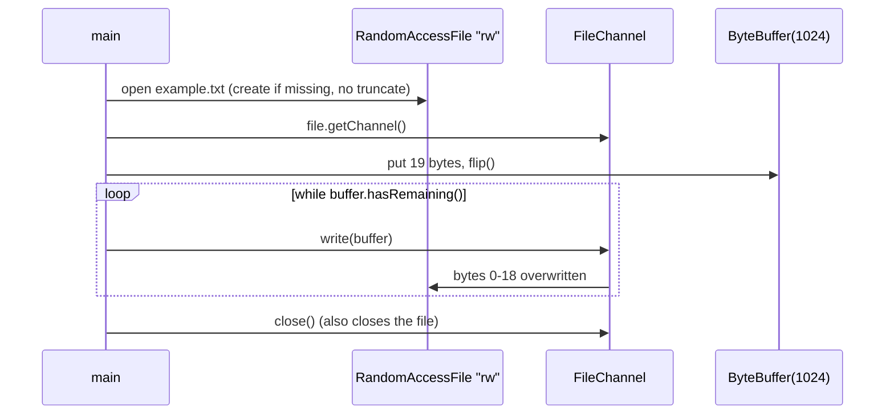
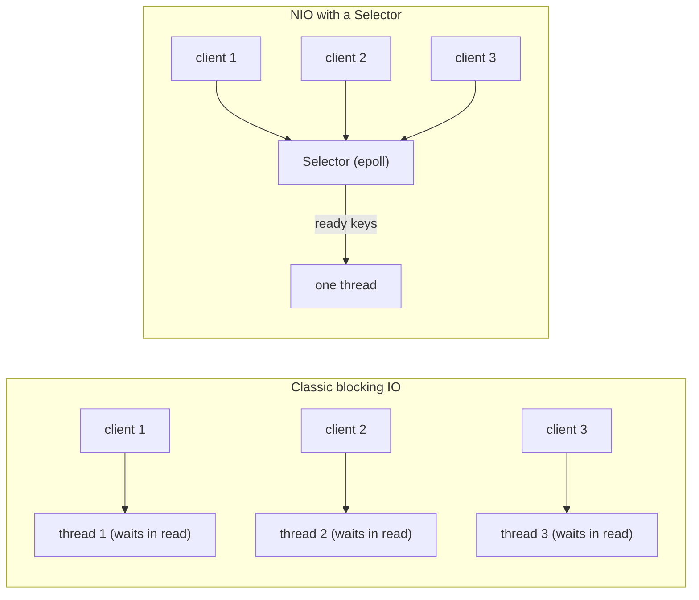
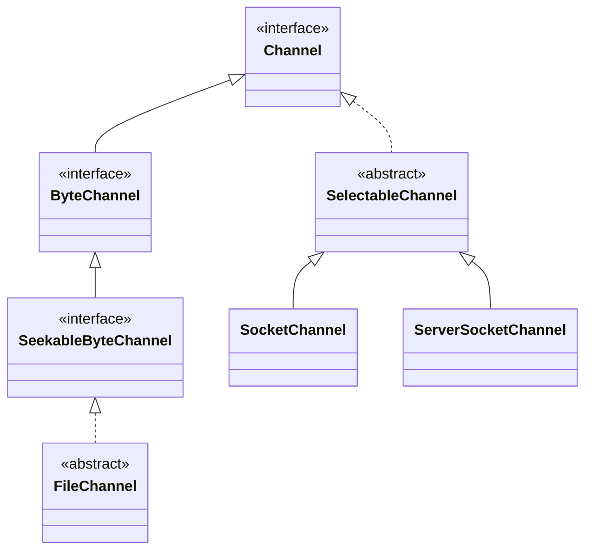

## In One Line
A `FileChannel` is a two-way connection to a file that moves **blocks of bytes** between the file and `ByteBuffer`s at any position, and adds features streams never had — random access, `truncate`, `force`, zero-copy `transferTo`, memory mapping and file locks; together with socket channels and `Selector`s it is the core of NIO's "buffers + channels" model.

## Mental Model
Think of a **conveyor belt between a warehouse (the file) and a loading bay (your buffer)**.

- Classic IO is a **bucket brigade**: people pass items one direction only, one at a time, in order. An `InputStream` only brings things in; an `OutputStream` only takes them out.
- A channel is a **belt that runs both ways** and can be moved to **any shelf** in the warehouse (`position(n)`). You load a whole crate (the `ByteBuffer`) and the belt carries it in one go.
- The belt may carry only **part of a crate** per trip — which is why you keep calling `write` while the crate still has items (`while (buffer.hasRemaining())`).
- Writing onto shelves 0–18 does **not** empty shelves 19 onwards. If you want the rest gone you must say so (`truncate`). That is exactly what the example forgets.

## Concept
### What a channel is
A **channel** (`java.nio.channels.Channel`) is an open connection to an entity that can do IO — a file, a socket, a pipe. Differences from streams:

| Stream (`java.io`) | Channel (`java.nio.channels`) |
|---|---|
| One direction (`InputStream` or `OutputStream`) | Can be bidirectional (`FileChannel`, `SocketChannel`) |
| Works with `byte`/`byte[]` | Works with `ByteBuffer` only |
| Always blocking | Socket/pipe channels can be **non-blocking** and used with a `Selector` |
| Sequential | `FileChannel` supports absolute positions |
| — | Scatter/gather: read into / write from several buffers in one call |

The channel interfaces build on each other:

| Interface | Adds |
|---|---|
| `Channel` | `isOpen()`, `close()` (it is `Closeable`) |
| `ReadableByteChannel` / `WritableByteChannel` | `read(ByteBuffer)` / `write(ByteBuffer)` |
| `ByteChannel` | Both |
| `SeekableByteChannel` (Java 7) | `position()`, `position(long)`, `size()`, `truncate(long)` |
| `ScatteringByteChannel` / `GatheringByteChannel` | `read(ByteBuffer[])` / `write(ByteBuffer[])` |
| `InterruptibleChannel` | Closing on thread interrupt (see Traps) |

`FileChannel` implements all of them. `SocketChannel`, `ServerSocketChannel`, `DatagramChannel` and `Pipe` channels extend `SelectableChannel` instead, which is what allows non-blocking mode.

### Getting a FileChannel
| Source | Mode | Notes |
|---|---|---|
| `FileChannel.open(path, options...)` (Java 7) | Whatever the `StandardOpenOption`s say (default `READ`) | **Preferred.** `CREATE, TRUNCATE_EXISTING, WRITE` = replace file |
| `new RandomAccessFile(name, "rw").getChannel()` | Read + write | `"rw"` creates the file if missing and **never truncates**; `"r"` is read-only |
| `new FileInputStream(f).getChannel()` | Read-only | `write` throws `NonWritableChannelException` |
| `new FileOutputStream(f).getChannel()` | Write-only | `FileOutputStream` truncates on open (unless append mode) |
| `Files.newByteChannel(path, options...)` | `SeekableByteChannel` | Returns a `FileChannel` for the default file system |

A channel from a stream or `RandomAccessFile` **shares the file position** with it, and closing either one closes both.

### Reading and writing correctly
A single `read` or `write` may transfer **fewer bytes than the buffer holds**. Always loop:
```java
// write everything
buffer.flip();
while (buffer.hasRemaining()) {
    channel.write(buffer);
}

// read until end of file
while (channel.read(buffer) != -1) {   // -1 = end of stream
    buffer.flip();
    consume(buffer);
    buffer.clear();                      // or compact() if consume() may leave bytes
}
```
- `read(buf)` returns the number of bytes read, `0` if the buffer had no room, `-1` at end of file.
- **Positional** `read(buf, pos)` / `write(buf, pos)` use an absolute file offset and do **not** change the channel's position. They are safe to use from several threads at once.
- `FileChannel` is documented as thread-safe: concurrent position-changing calls are serialised internally.

### Everything else FileChannel can do
| Method | What it does |
|---|---|
| `position()` / `position(n)` | Where the next relative read/write happens; setting it beyond the end then writing leaves a gap (a "hole") |
| `size()` | Current file size in bytes |
| `truncate(n)` | Cut the file to `n` bytes (no effect if already smaller); moves position back if it was beyond `n` |
| `force(metaData)` | Flush OS caches to the storage device (like `fsync`); `true` also flushes metadata such as modification time |
| `transferTo(pos, count, target)` / `transferFrom(src, pos, count)` | Copy between channels; on Linux the JDK can use zero-copy system calls such as `sendfile`, so the bytes never enter the JVM. May transfer less than asked — loop |
| `map(mode, pos, size)` | Memory-map a region as a `MappedByteBuffer` (`READ_ONLY`, `READ_WRITE`, `PRIVATE` copy-on-write); max 2 GB per mapping |
| `lock()` / `tryLock()` (also region + shared variants) | OS-level `FileLock` between **processes**; `lock()` blocks, `tryLock()` returns `null` if held |
| `read(ByteBuffer[])` / `write(ByteBuffer[])` | Scatter/gather: fill or drain several buffers in order, e.g. header + body |

`FileLock` notes: locks are held on behalf of the whole JVM, so a second lock on an overlapping region from the same JVM throws `OverlappingFileLockException` — they are not for coordinating threads. On some OSes locks are only advisory (other programs can ignore them).

### IO vs NIO: the full comparison
| Aspect | Classic IO (`java.io`) | NIO (`java.nio`, Java 1.4) | NIO.2 (Java 7) |
|---|---|---|---|
| Model | Stream-oriented | Buffer + channel-oriented | Adds file-system API and async channels |
| Data unit | byte / char at a time (or your own array) | Blocks in a `ByteBuffer` | Same |
| Direction | One-way streams | Two-way channels | Same |
| Blocking | Always blocks the calling thread | Sockets can be **non-blocking**; files still block | **Asynchronous** channels: call returns at once, result via `Future`/callback |
| Many connections | One thread per connection | One thread + `Selector` watches thousands | OS-driven completion with thread pools |
| Random access | `RandomAccessFile` only | `FileChannel.position`, positional reads | Same |
| Extras | Simple, decorators (`Buffered*`, `Data*`, `Object*`) | `transferTo` zero-copy, memory mapping, locks, direct buffers | `Path`, `Files`, `WatchService`, attributes |

### Blocking vs non-blocking vs asynchronous
- **Blocking**: the call waits until data is available (or written). `FileInputStream.read`, `FileChannel.read`, a blocking `SocketChannel.read`.
- **Non-blocking**: the call returns **immediately** with whatever is possible — maybe `0` bytes. Only `SelectableChannel`s (sockets, pipes) support `configureBlocking(false)`. You then need a way to know **when** to call again: a `Selector`.
- **Asynchronous**: you start an operation and are notified when it is **complete** (`Future` or `CompletionHandler`) — see [AsynchronousFileChannel](lesson:a09-nio/05-asynchronous-file-channel).

A **`Selector`** multiplexes many non-blocking channels on one thread:
1. `Selector.open()`; for each channel: `configureBlocking(false)` then `channel.register(selector, interestOps)` with `OP_ACCEPT`, `OP_CONNECT`, `OP_READ`, `OP_WRITE`. The result is a `SelectionKey`.
2. Loop: `selector.select()` blocks until at least one registered channel is ready (the OS does this with `epoll` on Linux, `kqueue` on macOS).
3. Iterate `selector.selectedKeys()`, **remove** each key, and handle it: `isAcceptable()` → `accept()` and register the new client for `OP_READ`; `isReadable()` → `read` into the buffer attached to the key; and so on.

This is the **Reactor pattern**, the engine inside Netty, Tomcat's NIO connector, Undertow, Kafka's network layer and Redis-style servers. It lets a few threads serve tens of thousands of connections, because idle connections cost no thread.

**`FileChannel` cannot be used with a Selector**: it is not a `SelectableChannel` (a regular file is always "ready" as far as the OS is concerned). For file IO that does not tie up your thread, use `AsynchronousFileChannel`.

> [!NOTE] Java 21's virtual threads change the trade-off: blocking code (classic sockets or blocking channels) on millions of cheap virtual threads scales much like a selector loop, with simpler code. Selectors remain the foundation of frameworks such as Netty. See [virtual threads](lesson:b03-concurrency/07-virtual-threads).

### Utility bridges
`java.nio.channels.Channels` converts between the worlds: `Channels.newInputStream(channel)`, `newOutputStream(channel)`, `newChannel(inputStream)`, `newReader(channel, charset)`, `newWriter(channel, charset)`.

## Diagram

The example writes 19 bytes at position 0; nothing after byte 18 is touched, so an older, longer file keeps its tail.


Blocking IO needs a thread per connection; a selector tells one thread which non-blocking channels are ready.


`FileChannel` is seekable but not selectable; socket channels are selectable, which is what allows non-blocking mode.

## Code
@example NIO/FileChannelExample.java

Why the file is not replaced — and how `truncate` fixes it:
```java
import java.io.RandomAccessFile;
import java.nio.ByteBuffer;
import java.nio.channels.FileChannel;
import java.nio.charset.StandardCharsets;
import java.nio.file.*;

public class NoTruncate {
    public static void main(String[] args) throws Exception {
        Path file = Path.of("example.txt");
        Files.writeString(file, "This is an example of writing to a file using BufferedWriter.\n");

        try (RandomAccessFile raf = new RandomAccessFile(file.toFile(), "rw");
             FileChannel channel = raf.getChannel()) {
            System.out.println("size before = " + channel.size() + ", position = " + channel.position());
            ByteBuffer buffer = ByteBuffer.wrap("Hello, FileChannel!".getBytes(StandardCharsets.UTF_8));
            while (buffer.hasRemaining()) {
                channel.write(buffer);
            }
            System.out.println("size after  = " + channel.size() + ", position = " + channel.position());
        }
        System.out.print(Files.readString(file));

        try (FileChannel ch = FileChannel.open(file, StandardOpenOption.WRITE)) {
            ch.truncate(19);                       // cut everything after byte 19
        }
        System.out.println(Files.readString(file) + "|end");
    }
}
```
```output
size before = 62, position = 0
size after  = 62, position = 19
Hello, FileChannel!of writing to a file using BufferedWriter.
Hello, FileChannel!|end
```

A tour of the modern API — open options, read loop, positional read, zero-copy copy, memory mapping, locking, scatter read:
```java
import java.nio.ByteBuffer;
import java.nio.MappedByteBuffer;
import java.nio.channels.FileChannel;
import java.nio.channels.FileLock;
import java.nio.charset.StandardCharsets;
import java.nio.file.*;
import static java.nio.file.StandardOpenOption.*;

public class ChannelTour {
    public static void main(String[] args) throws Exception {
        Path src = Path.of("channel-demo.txt");

        // 1. write: CREATE + TRUNCATE_EXISTING = "replace the file"
        try (FileChannel out = FileChannel.open(src, CREATE, TRUNCATE_EXISTING, WRITE)) {
            ByteBuffer buf = ByteBuffer.wrap("Hello, FileChannel!\nSecond line\n".getBytes(StandardCharsets.UTF_8));
            while (buf.hasRemaining()) out.write(buf);
            System.out.println("written = " + out.size() + " bytes, position = " + out.position());
        }

        // 2. read with a small buffer: fill -> flip -> drain -> clear
        try (FileChannel in = FileChannel.open(src, READ)) {
            ByteBuffer buf = ByteBuffer.allocate(8);
            StringBuilder text = new StringBuilder();
            int n, reads = 0;
            while ((n = in.read(buf)) != -1) {
                reads++;
                buf.flip();
                text.append(StandardCharsets.UTF_8.decode(buf));
                buf.clear();
            }
            System.out.println("reads = " + reads + ", last read returned " + n);
            System.out.print(text);

            // 3. random access: jump to byte 7
            ByteBuffer word = ByteBuffer.allocate(11);
            in.read(word, 7);                         // absolute read, channel position unchanged
            word.flip();
            System.out.println("at 7 = " + StandardCharsets.UTF_8.decode(word) + ", position still " + in.position());
        }

        // 4. copy with transferTo (can use zero-copy in the OS)
        Path copy = Path.of("channel-copy.txt");
        try (FileChannel in = FileChannel.open(src, READ);
             FileChannel out = FileChannel.open(copy, CREATE, TRUNCATE_EXISTING, WRITE)) {
            long pos = 0, size = in.size();
            while (pos < size) pos += in.transferTo(pos, size - pos, out);
            System.out.println("copied = " + out.size() + " bytes");
        }

        // 5. memory-mapped file
        try (FileChannel ch = FileChannel.open(copy, READ, WRITE)) {
            MappedByteBuffer map = ch.map(FileChannel.MapMode.READ_WRITE, 0, 5);
            map.put(0, (byte) 'J');                   // write straight into the file's pages
        }
        System.out.println("mapped edit = " + Files.readAllLines(copy).get(0));

        // 6. file lock
        try (FileChannel ch = FileChannel.open(copy, WRITE);
             FileLock lock = ch.lock()) {
            System.out.println("locked = " + lock.isValid() + ", shared = " + lock.isShared());
        }

        // 7. scatter read: header + body in one call
        try (FileChannel in = FileChannel.open(src, READ)) {
            ByteBuffer header = ByteBuffer.allocate(5);
            ByteBuffer body = ByteBuffer.allocate(64);
            long total = in.read(new ByteBuffer[] { header, body });
            header.flip();
            System.out.println("scatter = " + total + " bytes, header = " + StandardCharsets.UTF_8.decode(header));
        }
        Files.delete(src);
        Files.delete(copy);
    }
}
```
```output
written = 32 bytes, position = 32
reads = 4, last read returned -1
Hello, FileChannel!
Second line
at 7 = FileChannel, position still 32
copied = 32 bytes
mapped edit = Jello, FileChannel!
locked = true, shared = false
scatter = 32 bytes, header = Hello
```
Decoding each 8-byte chunk separately is safe here only because the text is ASCII; with multi-byte UTF-8 a character can be split across two chunks — use a `CharsetDecoder` with `compact()`, or `Channels.newReader`.

Non-blocking sockets and a `Selector`: one thread serves every client (the IO-vs-NIO difference in action):
```java
import java.net.InetSocketAddress;
import java.nio.ByteBuffer;
import java.nio.channels.*;
import java.nio.charset.StandardCharsets;
import java.util.*;
import java.util.concurrent.*;

public class SelectorEcho {
    public static void main(String[] args) throws Exception {
        Selector selector = Selector.open();
        ServerSocketChannel server = ServerSocketChannel.open();
        server.bind(new InetSocketAddress("localhost", 0));   // 0 = any free port
        server.configureBlocking(false);                       // required before register()
        server.register(selector, SelectionKey.OP_ACCEPT);
        int port = ((InetSocketAddress) server.getLocalAddress()).getPort();

        // Three ordinary blocking clients, each on its own thread
        ExecutorService clients = Executors.newFixedThreadPool(3);
        List<Future<String>> replies = new ArrayList<>();
        for (String name : List.of("alice", "bob", "carol")) {
            replies.add(clients.submit(() -> talk(port, "hi from " + name)));
        }

        // ONE server thread multiplexes every connection
        Set<String> serverThreads = new TreeSet<>();
        int open = 0, closed = 0;
        while (closed < 3) {
            selector.select();                                 // sleeps until something is ready
            Iterator<SelectionKey> it = selector.selectedKeys().iterator();
            while (it.hasNext()) {
                SelectionKey key = it.next();
                it.remove();                                   // must remove, or it is seen again
                if (key.isAcceptable()) {
                    SocketChannel ch = server.accept();
                    ch.configureBlocking(false);
                    ch.register(selector, SelectionKey.OP_READ, ByteBuffer.allocate(64));
                    open++;
                } else if (key.isReadable()) {
                    SocketChannel ch = (SocketChannel) key.channel();
                    ByteBuffer buf = (ByteBuffer) key.attachment();
                    serverThreads.add(Thread.currentThread().getName());
                    if (ch.read(buf) == -1) {                  // client finished sending
                        ch.close();                            // also cancels the key
                        closed++;
                        continue;
                    }
                    buf.flip();
                    ch.write(buf);                             // echo back (small message)
                    buf.compact();
                }
            }
        }
        for (Future<String> r : replies) System.out.println("client got: " + r.get());
        System.out.println(open + " connections served by server thread(s) " + serverThreads);
        clients.shutdown();
        server.close();
        selector.close();
    }

    static String talk(int port, String msg) throws Exception {
        try (SocketChannel ch = SocketChannel.open(new InetSocketAddress("localhost", port))) {
            ch.write(ByteBuffer.wrap(msg.getBytes(StandardCharsets.UTF_8)));
            ch.shutdownOutput();                               // tell the server we are done
            ByteBuffer in = ByteBuffer.allocate(64);
            while (ch.read(in) != -1) { }                      // blocking read until server closes
            in.flip();
            return StandardCharsets.UTF_8.decode(in).toString();
        }
    }
}
```
```output
client got: hi from alice
client got: hi from bob
client got: hi from carol
3 connections served by server thread(s) [main]
```
The order in which the server handles the three clients varies from run to run, but the printed lines do not, because replies are printed in submission order after the loop. A production server would also register `OP_WRITE` when `write` cannot send everything at once (here `compact()` just keeps any unsent bytes).

## Walkthrough
- `import java.io.RandomAccessFile; java.nio.ByteBuffer; java.nio.channels.FileChannel;` — an old `java.io` class used as the door to a new NIO channel.
- `new RandomAccessFile("example.txt", "rw")` — opens `example.txt` (relative to the working directory) for reading **and** writing. Mode `"rw"` creates the file if it does not exist, and otherwise opens it **as is**, without truncating. Other modes: `"r"` (read-only), `"rws"`/`"rwd"` (every write also synced to disk, content + metadata / content only).
- `FileChannel channel = file.getChannel();` — the channel shares the file descriptor and the file position (currently 0) with the `RandomAccessFile`.
- `ByteBuffer buffer = ByteBuffer.allocate(1024);` — a 1024-byte heap buffer. Far larger than needed; `ByteBuffer.wrap(bytes)` would avoid the extra copy.
- `buffer.put("Hello, FileChannel!".getBytes());` — `getBytes()` with no argument encodes with the default charset (UTF-8 since Java 18, platform-dependent before). The string is ASCII, so it becomes 19 bytes and the buffer position becomes 19.
- `buffer.flip();` — limit = 19, position = 0: "now drain these 19 bytes". Without it the channel would write the 1005 zero bytes after them.
- `while (buffer.hasRemaining()) { channel.write(buffer); }` — the correct idiom: `write` may send fewer bytes than remain, and it advances the buffer's position by however many it wrote. For a local file it usually writes everything in one call, but the loop makes it correct in all cases.
- `channel.close(); file.close();` — closing the channel also closes the `RandomAccessFile` (and vice versa), so the second call is redundant but harmless: `close()` on an already-closed resource does nothing.
- The program prints nothing — the recorded output is empty. That is expected, not a failure.

**The side effect on the next example.** In a fresh folder the file ends up containing exactly `Hello, FileChannel!`. In the recorded run, `example.txt` already held the two lines written by `BufferedWriterExample`. The 19 bytes replaced `This is an example ` and the rest stayed, so [FilesExample](lesson:a09-nio/02-files) later printed `Hello, FileChannel!of writing to a file using BufferedWriter.` The `NoTruncate` snippet above reproduces this and fixes it with `truncate(19)`.

## Traps
> [!ERRATA] The example is meant to write "Hello, FileChannel!" to the file, but `RandomAccessFile(..., "rw")` does not truncate: any older, longer content survives after byte 19. That is exactly why the next example prints `Hello, FileChannel!of writing to a file using BufferedWriter.` To replace the file, open it with `FileChannel.open(path, CREATE, TRUNCATE_EXISTING, WRITE)`, or call `channel.truncate(channel.position())` after writing.

> [!ERRATA] Resources are closed manually at the end of the `try` block, so any exception thrown by `write` skips both `close()` calls and leaks the file handle; `catch (Exception e)` + `printStackTrace()` then hides the problem. Use try-with-resources: `try (FileChannel ch = FileChannel.open(...)) { ... }`. Also, `"...".getBytes()` without a charset depends on the platform default before Java 18; write `getBytes(StandardCharsets.UTF_8)`.

- **Forgetting the write loop.** One `write` call is not guaranteed to write the whole buffer (especially for sockets). Always `while (buf.hasRemaining())`.
- **Forgetting `flip()` before writing** writes garbage (from position to limit). Forgetting `clear()`/`compact()` after reading makes the next `read` return `0` forever (the buffer is full), which turns a read loop into an infinite loop.
- **`transferTo`/`transferFrom` may move fewer bytes than requested** — loop until done.
- **Interrupting a thread closes the channel.** `FileChannel` is an `InterruptibleChannel`: if a thread blocked in IO on it is interrupted, the channel is **closed** for everyone and that thread gets `ClosedByInterruptException`; other threads then get `ClosedChannelException`.
- **A channel from `FileInputStream` is read-only** (`NonWritableChannelException` on write); from `FileOutputStream` it is write-only (`NonReadableChannelException`).
- **File locks are per JVM, not per thread.** Locking an overlapping region twice from the same JVM throws `OverlappingFileLockException`; use `java.util.concurrent` locks between threads.
- **Memory-mapped buffers stay mapped until garbage-collected**, even after the channel is closed. On Windows this can prevent deleting or truncating the file.
- **`FileChannel` cannot be registered with a `Selector`**; `configureBlocking` does not exist on it.
- **With a `Selector`, forgetting `it.remove()`** leaves the key in the selected set, so it is processed again on the next loop and `accept()` may return `null`.

## Tips & Tricks
- **Replace a file = `CREATE, TRUNCATE_EXISTING, WRITE`.** Add to it = `CREATE, APPEND`. Update in place = `READ, WRITE` (+ `truncate` if it may shrink).
- **The two loops to memorise:** write — `flip(); while (hasRemaining()) write(buf);` read — `while (read(buf) != -1) { flip(); use; compact(); }`.
- **Positional reads (`read(buf, pos)`) are the thread-friendly way** to let many threads read one file.
- **Fastest file copy:** `Files.copy(src, dst)`, or `transferTo` between channels — both let the OS do the work.
- **Mnemonic for IO vs NIO: "Stream, Blocking, Thread-per-connection" vs "Buffer, Non-blocking, Selector".** And NIO.2 adds "Async + Path".
- **Selector loop checklist:** `configureBlocking(false)` → `register` → `select()` → iterate `selectedKeys()` → `remove()` → handle by readiness → attach per-connection state with `key.attach(...)`.

## Interview Q&A
### [Basic] What is the difference between IO and NIO in Java?
Classic IO (`java.io`) is stream-oriented and blocking: one-directional `InputStream`/`OutputStream`s deliver bytes sequentially, and each read/write blocks the thread, so a server needs a thread per connection. NIO (Java 1.4) is buffer- and channel-oriented: channels move blocks of data into and out of `ByteBuffer`s, can be bidirectional, support random access for files, and — for sockets — can run in non-blocking mode with a `Selector` so one thread serves many connections. NIO also added direct buffers, memory-mapped files, zero-copy transfer and file locks. NIO.2 (Java 7) added the `Path`/`Files` file-system API, `WatchService`, and asynchronous channels.

**Follow-up:** *Does NIO make file reading non-blocking?* — No. `FileChannel` always blocks; it is not selectable. For file IO that does not block your thread, use `AsynchronousFileChannel`.

### [Basic] What does `RandomAccessFile` mode `"rw"` do if the file already exists and is longer than what you write?
It opens the existing file without truncating it and starts at position 0. Writing 19 bytes overwrites only bytes 0–18; everything after them remains. To shorten the file, call `setLength(n)` on the `RandomAccessFile` or `truncate(n)` on the channel, or open a `FileChannel` with `TRUNCATE_EXISTING`. This is why the course's `FilesExample` prints `Hello, FileChannel!of writing to a file using BufferedWriter.`

**Follow-up:** *And if the file does not exist?* — `"rw"` creates it; `"r"` throws `FileNotFoundException`.

### [Basic] Why do we write `while (buffer.hasRemaining()) channel.write(buffer);` instead of a single `write`?
`write` returns the number of bytes actually written and may write fewer than `remaining()` — commonly with non-blocking sockets (the OS send buffer is full), sometimes with pipes or large transfers. Each call advances the buffer's position by the amount written, so looping until nothing remains guarantees that all bytes go out. For a local file one call usually suffices, but relying on that is a bug waiting to happen.

**Follow-up:** *What is the equivalent for reads?* — Loop until `read` returns `-1` (end of stream), flipping and draining (or compacting) the buffer between reads.

### [Intermediate] What is a Selector and how does it work?
A `Selector` lets one thread monitor many `SelectableChannel`s (sockets, pipes) that are in non-blocking mode. You register each channel with the operations you care about (`OP_ACCEPT`, `OP_CONNECT`, `OP_READ`, `OP_WRITE`) and get a `SelectionKey`. `select()` blocks until at least one channel is ready, using the OS readiness API (`epoll`, `kqueue`, `poll`). You then iterate `selectedKeys()`, remove each key, and handle it — accept a connection, read available bytes, write pending bytes. Per-connection state goes in `key.attach(obj)`. This is the Reactor pattern used by Netty and Tomcat's NIO connector.

**Follow-up:** *Why must you call `iterator.remove()`?* — The selector never removes keys from the selected-key set itself; a stale key would be handled again on the next iteration even if the channel is no longer ready.

### [Intermediate] What is `transferTo` and why is it fast?
`FileChannel.transferTo(position, count, target)` copies bytes from a file channel to another writable channel (`transferFrom` is the reverse). The JDK can delegate this to the OS (for example `sendfile` on Linux), so the data moves from the page cache to the socket or file without being copied into JVM memory and back — "zero-copy". That reduces CPU use and context switches; Kafka uses it to serve log segments. It may transfer fewer bytes than requested, so call it in a loop.

**Follow-up:** *Other ways to copy a file?* — `Files.copy(src, dst)` (simplest, also OS-optimised), streams with a buffer, or memory mapping.

### [Intermediate] What is a memory-mapped file?
`FileChannel.map(mode, position, size)` maps a file region into the process's virtual memory and returns a `MappedByteBuffer`. Reads and writes are plain memory accesses served by the OS page cache; the OS loads pages lazily and writes dirty pages back (use `force()` to flush now). Modes: `READ_ONLY`, `READ_WRITE` (changes go to the file), `PRIVATE` (copy-on-write, not saved). Benefits: very fast random access to big files and sharing between processes. Limits: at most 2 GB (`Integer.MAX_VALUE`) per mapping, and the mapping is released only when the buffer is garbage-collected.

**Follow-up:** *Is a `MappedByteBuffer` on the heap?* — No, it is a direct buffer backed by the mapped pages, not by a Java array.

### [Intermediate] How does `FileLock` work, and can it synchronise threads?
`channel.lock()` (blocking) or `tryLock()` (returns `null` if unavailable) acquire an OS-level lock on the whole file or a region, exclusive or shared (shared requires a readable channel). It coordinates **processes**. Locks are held by the JVM as a whole, so they cannot coordinate threads of the same JVM — trying to lock an overlapping region again throws `OverlappingFileLockException`. Locks may be advisory on some OSes, and they are released by `release()`, by closing the channel, or when the JVM exits.

**Follow-up:** *What do you use between threads instead?* — `ReentrantLock`, `ReadWriteLock` or `synchronized`, possibly combined with positional reads/writes on one shared channel.

### [Advanced] Blocking, non-blocking and asynchronous IO — what is the difference, and which Java APIs provide each?
Blocking: the call waits until the operation can complete (`InputStream.read`, `FileChannel.read`, blocking sockets). Non-blocking: the call returns immediately with whatever it could do, possibly nothing; readiness is discovered with a `Selector` (`SocketChannel.configureBlocking(false)`) — the application still performs the IO itself when told the channel is ready (Reactor). Asynchronous: the call starts the operation and returns; completion is reported later through a `Future` or `CompletionHandler` (`AsynchronousFileChannel`, `AsynchronousSocketChannel`) — the system performs the IO (Proactor). Files support blocking and asynchronous, never selector-based non-blocking.

**Follow-up:** *Where do virtual threads fit?* — They make blocking calls cheap: the JDK parks the virtual thread instead of an OS thread, so simple blocking code scales to many connections.

### [Advanced] What happens if a thread is interrupted while it is blocked in `FileChannel.read`?
`FileChannel` implements `InterruptibleChannel`. The interrupt causes the channel to be **closed** and the blocked thread to receive `ClosedByInterruptException` (with its interrupt status set). Because the channel is shared, every other thread using it now gets `ClosedChannelException`. This surprises people who use `Future.cancel(true)` or interrupt-based shutdown around shared channels. Mitigations: don't interrupt threads doing channel IO, reopen the channel after interruption, or use `AsynchronousFileChannel`.

**Follow-up:** *Does a classic `FileInputStream.read` react the same way?* — No; classic stream reads ignore interrupts.

### [Advanced] Why can't `FileChannel` be used with a Selector?
A `Selector` works on readiness: "is there data to read / room to write without blocking?" For regular files the OS always reports ready — disk reads block in the kernel regardless — so readiness selection is meaningless, and `FileChannel` does not extend `SelectableChannel` (it has no `configureBlocking`). Non-blocking file access in Java comes from `AsynchronousFileChannel`, which on Linux runs blocking reads on a thread pool and on Windows uses overlapped IO with completion ports.

**Follow-up:** *Which channels are selectable?* — `SocketChannel`, `ServerSocketChannel`, `DatagramChannel`, `Pipe.SourceChannel`, `Pipe.SinkChannel` (and SCTP channels).

## Quiz
### What is in `example.txt` after the original `FileChannelExample` runs in a folder where `example.txt` held `This is an example of writing to a file using BufferedWriter.` (62 bytes)?
- [ ] `Hello, FileChannel!` only
- [x] `Hello, FileChannel!of writing to a file using BufferedWriter.`
- [ ] The old text followed by `Hello, FileChannel!`
- [ ] It throws an exception because the file exists
> `"rw"` opens the existing file at position 0 without truncating it. The 19 new bytes overwrite `This is an example ` and the remaining 43 bytes stay. Appending would need a position at the end; replacing needs `TRUNCATE_EXISTING` or `truncate`.

### What does the original `FileChannelExample` print?
- [ ] Hello, FileChannel!
- [ ] File operations completed successfully.
- [x] Nothing
- [ ] The number of bytes written
> There is no `println` in the program, so the recorded output is empty. Silence here means success; only an exception would print something (via `printStackTrace`).

### Which channel can be registered with a `Selector`?
- [ ] FileChannel
- [x] SocketChannel in non-blocking mode
- [ ] AsynchronousFileChannel
- [ ] Any channel obtained from a stream
> Only `SelectableChannel`s (socket, server-socket, datagram, pipe channels) can be registered, and only after `configureBlocking(false)` — otherwise `register` throws `IllegalBlockingModeException`. `FileChannel` is not selectable; asynchronous channels report completion themselves.

### Spot the bug: this read loop never ends on a file longer than 64 bytes.
```java
ByteBuffer buf = ByteBuffer.allocate(64);
while (channel.read(buf) != -1) {
    buf.flip();
    System.out.print(StandardCharsets.UTF_8.decode(buf));
}
```
- [ ] `read` needs a position argument
- [x] The buffer is never cleared, so after the first pass `read` keeps returning 0
- [ ] `decode` closes the channel
- [ ] `flip` must be called before `read`
> After `flip` and `decode`, position = limit, so the buffer has no room. Every later `read` returns `0`, never `-1`, and the loop spins. Add `buf.clear()` (or `compact()`) after consuming.

### What does `transferTo` return, and why is it called in a loop?
- [ ] Always `count`; the loop is only for safety
- [x] The number of bytes actually transferred, which can be less than requested
- [ ] `-1` at end of file, like `read`
- [ ] A `Future<Long>`
> `transferTo` may move fewer bytes than asked (OS limits, non-blocking targets), so you add the result to the position and repeat until done. It never returns `-1`.

### In the `SelectorEcho` server, how many threads run the server side?
- [ ] One per client
- [x] One (`main`) for all clients
- [ ] One per `SelectionKey` type
- [ ] A thread pool created by the `Selector`
> The server loop runs only on `main`; `select()` tells it which channels are ready, and each is handled quickly without blocking. The output line `3 connections served by server thread(s) [main]` confirms it. The clients have their own threads only to simulate separate programs.

## Takeaways
- A channel is a two-way connection that reads into and writes from `ByteBuffer`s; `FileChannel` adds random access (`position`, positional reads), `size`, `truncate`, `force`, `transferTo`/`transferFrom`, `map` and `lock`.
- Open a `FileChannel` with `FileChannel.open(path, options)`; `RandomAccessFile(..., "rw")` creates but never truncates — the cause of the garbled first line in `FilesExample`.
- Always loop: `flip(); while (hasRemaining()) write(buf);` and `while (read(buf) != -1) { flip(); use; clear()/compact(); }`.
- Closing the channel closes the underlying `RandomAccessFile`/stream (and vice versa); use try-with-resources instead of manual `close()` calls.
- IO = streams, blocking, one thread per connection; NIO = buffers + channels, non-blocking sockets multiplexed by a `Selector` (Reactor); NIO.2 = `Path`/`Files`, `WatchService` and asynchronous channels.
- `FileChannel` is always blocking and not selectable; interrupting a thread blocked on it closes the channel (`ClosedByInterruptException`).
- `FileLock` coordinates processes, not threads; memory-mapped buffers are off-heap and released only by GC.
