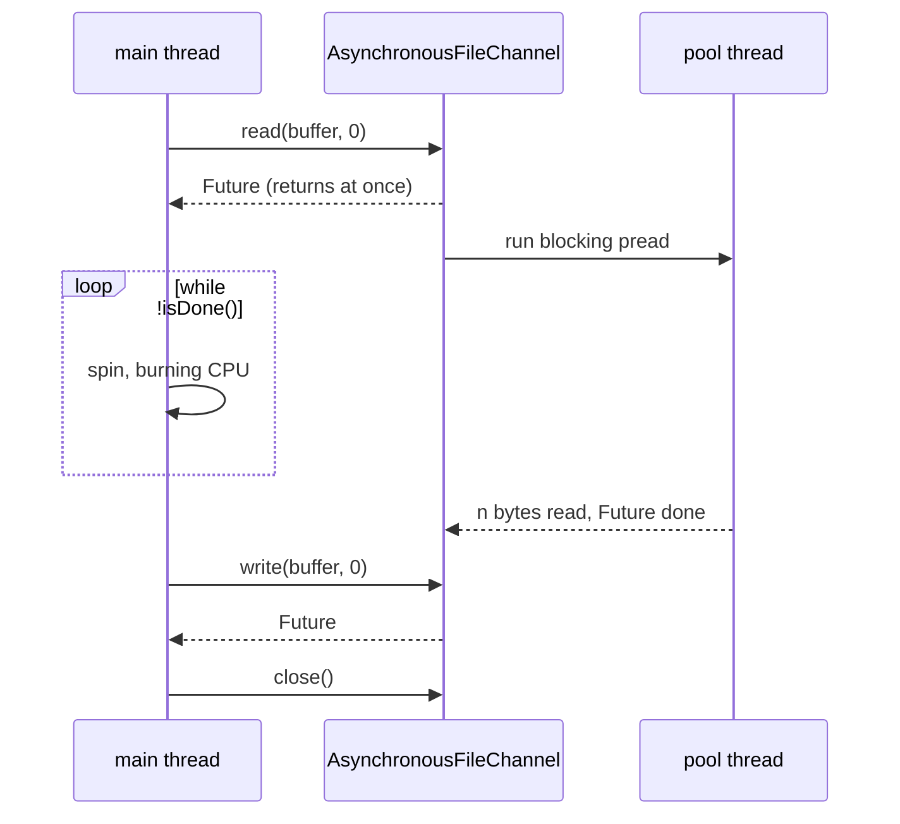
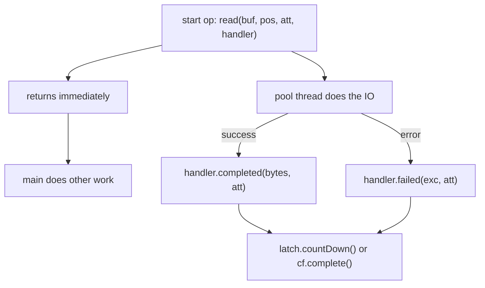

## In One Line
`AsynchronousFileChannel` (NIO.2, Java 7) starts a file read or write and **returns immediately**; you collect the result later through a `Future<Integer>` or get called back through a `CompletionHandler`, so the calling thread is never stuck waiting for the disk.

## Mental Model
Think of ordering at a **food court with a buzzer**.

- With a normal (blocking) `FileChannel`, you stand at the counter until your food is ready. You can do nothing else.
- With `AsynchronousFileChannel`, you place the order and get a **buzzer** — that is the `Future`. You can sit down, answer messages, and when you need the food you either check the buzzer now and then (`isDone()`) or simply wait for it (`get()`).
- Or you leave your **phone number** — that is the `CompletionHandler`. The kitchen calls you (`completed(...)`) when the food is ready, or tells you what went wrong (`failed(...)`). You do not even hold a buzzer.

The course example takes the buzzer and then **stares at it without blinking** in an empty `while (!isDone())` loop — it is free to do other work but does none, and it burns a CPU core while waiting.

## Concept
### Why it exists
`FileChannel` operations block the calling thread, and `FileChannel` cannot be used with a `Selector` (regular files are always "ready"). NIO.2 therefore added **asynchronous channels** (JSR 203, Java 7): `AsynchronousFileChannel`, `AsynchronousSocketChannel`, `AsynchronousServerSocketChannel`. You initiate an operation; the system completes it in the background and notifies you. This is the **Proactor** model ("tell me when it is *done*"), as opposed to the Selector's Reactor model ("tell me when it is *ready*").

### Opening the channel
```java
AsynchronousFileChannel ch = AsynchronousFileChannel.open(path, READ, WRITE);          // default thread pool
AsynchronousFileChannel ch2 = AsynchronousFileChannel.open(path,
        Set.of(READ, WRITE, CREATE), myExecutor);                                    // your own pool
```
- Options are the usual `StandardOpenOption`s. With neither `READ` nor `WRITE`, the channel is opened for reading. Without `CREATE`, a missing file throws `NoSuchFileException`.
- The default pool is shared by the JVM and its threads are **daemon** threads — if `main` ends while an operation is pending, the JVM may exit before it completes.
- Pass your own `ExecutorService` to control thread count and names; completion handlers then run on your threads.

### The API
| Operation | Future style | Callback style |
|---|---|---|
| Read | `Future<Integer> read(ByteBuffer dst, long position)` | `read(dst, position, attachment, CompletionHandler<Integer, A>)` |
| Write | `Future<Integer> write(ByteBuffer src, long position)` | `write(src, position, attachment, handler)` |
| Lock | `Future<FileLock> lock()` / `lock(pos, size, shared)` | `lock(attachment, handler)`, ... |
| Try-lock | `FileLock tryLock()` (synchronous) | — |
| Also (synchronous) | `size()`, `truncate(size)`, `force(metaData)`, `close()` | |

Key rules:
- **There is no current position.** Every `read`/`write` takes an explicit file position. (A `FileChannel` has a position; an async channel cannot, because many operations may be in flight at once.)
- The `Integer` result is the **number of bytes** transferred; a read at or past the end of file yields `-1`.
- A single read may return fewer bytes than the buffer's space — loop (issue another read at `position + n`) for large files.
- **Don't touch the buffer** while an operation using it is in progress; buffers are not thread-safe.
- The channel is safe for concurrent use: several reads and writes may be outstanding at the same time.

### Future vs CompletionHandler
| | `Future<Integer>` | `CompletionHandler<Integer, A>` |
|---|---|---|
| How you learn the result | Pull: `get()`, `get(timeout, unit)`, `isDone()` | Push: `completed(result, attachment)` / `failed(exc, attachment)` |
| Thread that handles the result | Whoever calls `get()` (often blocks there) | A pool thread (default pool or your executor) |
| Errors | `get()` throws `ExecutionException` wrapping the cause | `failed(Throwable, A)` receives the cause directly |
| The attachment | — | Any object you pass along (buffer, request id, context) |
| Composability | Poor (`Future` has no callbacks) | Wrap in a `CompletableFuture` to chain with `thenApply`, `thenCompose`... |
| Good for | Simple "start, do other work, then wait" | Fully non-blocking pipelines, servers |

`Future` here is the same `java.util.concurrent.Future` as in [Callable and Future](lesson:a07-executors/04-callable-and-future); `CompletableFuture` is covered in [CompletableFuture](lesson:a05-java8/23-completablefuture).

### How it works under the hood (JDK 21)
| OS | Implementation | Real kernel async IO? |
|---|---|---|
| Linux, macOS | `sun.nio.ch.SimpleAsynchronousFileChannelImpl` — each operation is an ordinary **blocking** `pread`/`pwrite` run on a thread-pool thread | No; it is "async for the caller", thread-backed |
| Windows | `WindowsAsynchronousFileChannelImpl` — overlapped IO with an IO Completion Port | Yes |

So on Linux the benefit is **freeing your thread**, not magically faster disks. With a few large files it rarely beats a well-used `FileChannel`; it shines when an application (for example a server using async sockets) must never block its event-loop threads.

### Comparing the file channels
| | `FileChannel` | `AsynchronousFileChannel` |
|---|---|---|
| Calling thread | Blocks until done | Returns at once |
| Position | Has one (relative and absolute calls) | None — every call is absolute |
| Result | Return value | `Future` or `CompletionHandler` |
| `transferTo`, `map` | Yes | No |
| Locks | `lock`/`tryLock` | `lock` (async) / `tryLock` |
| Selector | Not selectable | Not needed — completion is pushed to you |
| Obtained from streams | Yes (`getChannel()`) | No, only `open(...)` |

### Proper waiting
- `future.get()` blocks efficiently (the thread sleeps, no CPU use) and **rethrows failures** as `ExecutionException`.
- `future.get(5, TimeUnit.SECONDS)` adds a timeout (`TimeoutException`).
- `while (!future.isDone()) {}` is a **busy-wait**: it keeps one core at 100% and still never looks at the result or the error.
- With handlers, keep the program (and the channel) alive until the callback runs — for example with a `CountDownLatch` or by composing a `CompletableFuture` and calling `join()` at the edge.

## Diagram

The example's flow on Linux: the real IO happens on a pool thread while `main` busy-waits instead of doing useful work or calling `get()`.


With a `CompletionHandler` nobody polls: the pool thread calls you back, on success or on failure.


What the example actually does to the file: it reads the first bytes and writes the very same bytes back to the same place, so the file does not change.

## Code
@example NIO/AsynchronousFileChannelExample.java

The same idea done properly with `Future.get()` (no busy-wait, results checked):
```java
import java.nio.ByteBuffer;
import java.nio.channels.AsynchronousFileChannel;
import java.nio.charset.StandardCharsets;
import java.nio.file.*;
import java.util.concurrent.*;
import static java.nio.file.StandardOpenOption.*;

public class AsyncFuture {
    public static void main(String[] args) throws Exception {
        Path path = Path.of("async-demo.txt");

        try (AsynchronousFileChannel ch = AsynchronousFileChannel.open(path, CREATE, TRUNCATE_EXISTING, WRITE, READ)) {
            ByteBuffer data = ByteBuffer.wrap("Hello, async world!".getBytes(StandardCharsets.UTF_8));
            Future<Integer> write = ch.write(data, 0);          // returns immediately
            // ... do other useful work here ...
            int written = write.get(5, TimeUnit.SECONDS);       // block with a timeout, no busy spin
            System.out.println("wrote " + written + " bytes");

            ByteBuffer buf = ByteBuffer.allocate(64);
            int read = ch.read(buf, 7).get();                   // position is required on every call
            buf.flip();
            System.out.println("read " + read + " bytes from position 7: " + StandardCharsets.UTF_8.decode(buf));

            ByteBuffer past = ByteBuffer.allocate(8);
            System.out.println("read past EOF returns " + ch.read(past, 1000).get());
        }
        Files.delete(path);
    }
}
```
```output
wrote 19 bytes
read 12 bytes from position 7: async world!
read past EOF returns -1
```

Callback style with a `CompletionHandler` and an attachment:
```java
import java.nio.ByteBuffer;
import java.nio.channels.AsynchronousFileChannel;
import java.nio.channels.CompletionHandler;
import java.nio.charset.StandardCharsets;
import java.nio.file.*;
import java.util.concurrent.CountDownLatch;
import static java.nio.file.StandardOpenOption.READ;

public class AsyncHandler {
    public static void main(String[] args) throws Exception {
        Path path = Files.writeString(Path.of("handler-demo.txt"), "Callbacks instead of polling");
        CountDownLatch done = new CountDownLatch(1);
        String[] result = new String[1];

        try (AsynchronousFileChannel ch = AsynchronousFileChannel.open(path, READ)) {
            ByteBuffer buf = ByteBuffer.allocate(64);
            ch.read(buf, 0, buf, new CompletionHandler<Integer, ByteBuffer>() {
                @Override
                public void completed(Integer bytes, ByteBuffer attachment) {
                    attachment.flip();
                    result[0] = bytes + " bytes on " + Thread.currentThread().getName()
                            + ": " + StandardCharsets.UTF_8.decode(attachment);
                    done.countDown();
                }
                @Override
                public void failed(Throwable exc, ByteBuffer attachment) {
                    result[0] = "failed: " + exc;
                    done.countDown();
                }
            });
            System.out.println("read submitted; main thread is free");
            done.await();                     // keep the channel (and JVM) alive until the callback ran
        }
        System.out.println(result[0]);
        Files.delete(path);
    }
}
```
```output
read submitted; main thread is free
28 bytes on Thread-0: Callbacks instead of polling
```
`Thread-0` is a thread of the JDK's default pool (the name seen on Linux with JDK 21); with your own executor you would see your own thread names.

Turning the callback into a `CompletableFuture` so the result can be chained:
```java
static CompletableFuture<Integer> readAsync(AsynchronousFileChannel ch, ByteBuffer buf, long pos) {
    CompletableFuture<Integer> cf = new CompletableFuture<>();
    ch.read(buf, pos, null, new CompletionHandler<Integer, Void>() {
        @Override public void completed(Integer n, Void unused) { cf.complete(n); }
        @Override public void failed(Throwable t, Void unused) { cf.completeExceptionally(t); }
    });
    return cf;
}

public static void main(String[] args) throws Exception {
    Path path = Files.writeString(Path.of("cf-demo.txt"), "error=3 warn=5");
    try (AsynchronousFileChannel ch = AsynchronousFileChannel.open(path, READ)) {
        ByteBuffer buf = ByteBuffer.allocate(64);
        String summary = readAsync(ch, buf, 0)
                .thenApply(n -> StandardCharsets.UTF_8.decode(buf.flip()).toString())
                .thenApply(text -> text.toUpperCase())
                .join();
        System.out.println(summary);
    }
    AsynchronousFileChannel closed = AsynchronousFileChannel.open(path, READ);
    closed.close();                                          // simulate a failure
    String r = readAsync(closed, ByteBuffer.allocate(8), 0)
            .thenApply(n -> "read " + n)
            .exceptionally(t -> "failed: " + t.getCause().getClass().getSimpleName())
            .join();
    System.out.println(r);
    Files.delete(path);
}
```
```output
ERROR=3 WARN=5
failed: ClosedChannelException
```
A read on a closed channel does not throw at the call site; the error is delivered to `failed(...)`. In `exceptionally` it arrives wrapped in a `CompletionException`, hence `getCause()`.

## Walkthrough
- `import java.nio.channels.AsynchronousFileChannel; ... java.util.concurrent.Future;` — the async channel lives next to the other channels; `Future` is the standard concurrency interface for "a result that will exist later".
- `Path path = Paths.get("example.txt");` — relative path, resolved against the working directory.
- `AsynchronousFileChannel.open(path, StandardOpenOption.READ, StandardOpenOption.WRITE)` — opens the existing file for reading and writing. There is no `CREATE`, so if `example.txt` is missing you get `java.nio.file.NoSuchFileException: example.txt` (printed by the `catch`), which is what happens when this example runs alone in an empty folder. In the recorded run the file existed, left behind by the earlier file examples.
- `ByteBuffer buffer = ByteBuffer.allocate(1024);` — room for up to 1024 bytes.
- `long position = 0; Future<Integer> operation = channel.read(buffer, position);` — **starts** reading from byte 0 of the file and returns at once. On Linux a pool thread performs the actual read. When it finishes, the buffer holds the bytes (its position = number of bytes read) and the `Future` becomes done with that count.
- `while (!operation.isDone()) { // Do something else while waiting }` — a busy-wait: the loop body is empty, so `main` spins at full CPU until the read completes. It never calls `operation.get()`, so the byte count, and any exception, is ignored.
- `buffer.flip();` — limit = number of bytes read, position = 0. The comment says "prepare for writing": correct from the *channel's* point of view (we are about to write the buffer's contents to the file), while from the *buffer's* point of view we are about to read from it. Same `flip()`, two perspectives — the [Buffers](lesson:a09-nio/03-buffers) lesson called it "prepare for reading".
- `position = 0; Future<Integer> writeOperation = channel.write(buffer, position);` — starts writing those same bytes back at file position 0. The file content ends up exactly as before: this example changes nothing on disk.
- `while (!writeOperation.isDone()) {}` — a second busy-wait; again the result is never checked.
- `channel.close();` — closes the channel. If an exception happened earlier, this line is skipped and the channel leaks.
- `System.out.println("File operations completed successfully.");` — printed once both futures report done. "Done" also covers **failed** operations, so this message would appear even if the read or write had failed. The recorded output shows this single line.

## Traps
> [!ERRATA] `while (!operation.isDone()) { // Do something else while waiting }` does nothing else at all — it is a busy-wait that keeps a CPU core at 100% until the IO finishes. Either do real work and then call `operation.get()` (which sleeps efficiently), or use a `CompletionHandler`.

> [!ERRATA] The results are never checked. `isDone()` is also `true` when an operation **failed**, and without `get()` the exception is silently lost, so the program would still print "File operations completed successfully." Always call `get()` (it returns the byte count and throws `ExecutionException` on failure) or handle `failed(...)`.

> [!ERRATA] The example reads the file and writes the same bytes back to position 0, so the file does not change — the "write" demonstrates nothing visible. It also silently depends on `example.txt` already existing (no `CREATE` option → `NoSuchFileException` in a fresh folder), and it closes the channel manually instead of with try-with-resources.

- **Pending operations vs a finishing JVM.** The default pool uses daemon threads. If `main` returns before a callback-style operation completes, the JVM can exit and the write may never happen. Wait with a latch, `Future.get()` or `CompletableFuture.join()`.
- **Closing the channel too early.** Closing while operations are pending makes them fail with `AsynchronousCloseException`; starting an operation on a closed channel reports `ClosedChannelException` (to the handler, or through the `Future`).
- **Reusing a buffer before completion.** The buffer belongs to the operation until it completes; touching it from another thread is a data race.
- **Assuming one read reads everything.** Large files need repeated reads at `position + bytesRead` until `-1`.
- **Forgetting that there is no position.** `read(buffer)` without a position does not exist; appending needs `write(buf, channel.size())` (and races if several writers append).
- **Blocking inside a handler.** Handlers run on pool threads; long blocking work there starves the pool. Hand heavy work to another executor.
- **`Future.cancel(true)`** may close the channel for all users (javadoc: cancelling with interruption can leave the channel closed). Avoid it on shared channels.
- **Expecting real kernel async IO on Linux.** The JDK uses a thread pool there; the benefit is a free calling thread, not faster disk access.

## Tips & Tricks
- **"Buzzer or phone number."** `Future` = buzzer you check (`get()`), `CompletionHandler` = callback when done.
- **Never `while (!isDone()) {}`** — replace with `get()` / `get(timeout)` or a handler.
- **Async channels have no position:** every call says where (`read(buf, pos)`).
- **Wrap handlers in `CompletableFuture`** (the 5-line `readAsync` helper above) to use `thenApply`, `thenCompose`, `exceptionally` and `allOf`.
- **Use the attachment** to carry context into the handler (the buffer, a request id) instead of capturing lots of variables.
- **Keep the JVM and channel alive** until callbacks finish: latch, `join()`, or a managed executor you shut down after the work.
- **Choose the right tool:** simple file jobs → `Files` / `FileChannel`; many concurrent file operations where threads must stay free → `AsynchronousFileChannel`; massive concurrency with simple code on Java 21 → blocking IO on virtual threads.

## Interview Q&A
### [Basic] What is `AsynchronousFileChannel` and how is it different from `FileChannel`?
It is a NIO.2 (Java 7) channel whose `read`, `write` and `lock` operations are asynchronous: they return immediately and complete in the background, reporting the result through a `Future` or a `CompletionHandler`. `FileChannel` operations block the calling thread. An async channel has no current position — every read/write takes an explicit file position — and it has no `transferTo` or `map`. It is opened only with `AsynchronousFileChannel.open(...)`, optionally with your own `ExecutorService`.

**Follow-up:** *Why is there no position?* — Many operations can be in flight at once, so a shared "current position" would be meaningless; each operation states its own offset.

### [Basic] What are the two ways to get the result of an asynchronous operation?
The `Future` form — `Future<Integer> f = ch.read(buf, pos)` — lets you continue working and later call `f.get()` (or `get(timeout, unit)`) to obtain the byte count, or `isDone()` to check without blocking. The `CompletionHandler` form — `ch.read(buf, pos, attachment, handler)` — calls `completed(result, attachment)` or `failed(exc, attachment)` on a pool thread when the operation ends, so nobody waits at all.

**Follow-up:** *Which one is truly non-blocking?* — The handler form; with `Future` someone eventually blocks in `get()` (or polls).

### [Basic] What is wrong with `while (!future.isDone()) {}`?
It is a busy-wait. The thread spins in a tight loop, consuming a full CPU core, without doing any useful work, and it adds nothing over `future.get()`, which sleeps until the result is ready. It also ignores the result: `isDone()` is true for failed operations too, and without `get()` the exception is never seen. Correct code does real work between starting the operation and calling `get()`, or uses a `CompletionHandler`.

**Follow-up:** *What does `get()` throw if the read failed?* — `ExecutionException`, whose `getCause()` is the real `IOException`; also `InterruptedException`, and `TimeoutException` for the timed version.

### [Intermediate] On which thread does a `CompletionHandler` run?
On a thread of the channel's thread pool: the JVM-wide default pool (daemon threads, named like `Thread-0` on Linux with JDK 21) or the `ExecutorService` you passed to `open(path, options, executor)`. It never runs on the thread that started the operation unless that thread belongs to the pool. Consequences: handlers must be thread-safe, must not block for long, and the program must stay alive until they run.

**Follow-up:** *How do you control the threads?* — Open the channel with your own executor (custom thread factory for names, bounded size), and shut that executor down when done.

### [Intermediate] Is `AsynchronousFileChannel` truly asynchronous at the OS level?
It depends on the OS. On Windows the JDK uses overlapped IO with IO completion ports, which is true kernel-level async IO. On Linux and macOS (JDK 21) it uses `SimpleAsynchronousFileChannelImpl`, which runs ordinary blocking `pread`/`pwrite` calls on a thread pool — asynchronous from the caller's point of view, but backed by threads. So it frees the calling thread; it does not make the disk faster.

**Follow-up:** *Then why use it?* — When a thread must never block (for example an event loop also serving async sockets), or to issue many independent file operations concurrently with a bounded pool.

### [Intermediate] How would you read a large file completely with `AsynchronousFileChannel`?
Issue a read at position 0; in `completed(n, ...)`, if `n == -1` you are done; otherwise flip and consume the buffer, clear it, and issue the next read at `position + n` from inside the handler (passing the position in the attachment or a field). Signal the end with a latch or by completing a `CompletableFuture`. With `Future`, a simple loop works too: `n = ch.read(buf, pos).get(); pos += n;` until `-1`, but that blocks between reads.

**Follow-up:** *Can you issue several reads at once?* — Yes, at different positions with different buffers; the channel allows concurrent operations. Reassemble the results in position order.

### [Intermediate] How do you combine `AsynchronousFileChannel` with `CompletableFuture`?
Create a `CompletableFuture`, start the operation with a handler whose `completed` calls `cf.complete(result)` and whose `failed` calls `cf.completeExceptionally(exc)`, and return the future. Callers can then chain `thenApply`, `thenCompose` (to start the next read), `exceptionally`, or combine several reads with `allOf`, and only the outermost caller calls `join()`.

**Follow-up:** *Why not just use the `Future` returned by `read`?* — That `Future` has no callbacks and cannot be chained; you would have to block in `get()` to continue.

### [Advanced] Reactor vs Proactor — which one does Java NIO implement?
Both. The **Reactor** pattern (Java 1.4 NIO) uses readiness notification: a `Selector` reports that a non-blocking socket is readable or writable, and your code then performs the read/write itself. The **Proactor** pattern (NIO.2 asynchronous channels) uses completion notification: you start the operation with a buffer, the system performs it, and you get the finished result through a `Future` or `CompletionHandler`. Selectors only work with sockets and pipes; asynchronous channels exist for files and sockets.

**Follow-up:** *Which does Netty use?* — Mostly the Reactor model (NIO selectors, or native epoll/kqueue transports).

### [Advanced] What happens to pending operations if you close the channel, or if `main` ends?
Closing the channel makes outstanding operations fail with `AsynchronousCloseException` (delivered to `failed(...)` or thrown by `Future.get()` as the cause); new operations on the closed channel report `ClosedChannelException`. If `main` ends, the default pool's threads are daemon threads, so the JVM may exit before the operations and their callbacks run — writes can be lost. The fix is to wait for completion (latch, `get`, `join`) before closing the channel and ending the program, typically with try-with-resources around code that waits.

**Follow-up:** *Does `close()` wait for pending operations?* — No, it does not wait; it aborts them.

## Quiz
### What does the original example do to the contents of `example.txt`?
- [ ] Appends a copy of the first 1024 bytes to the end
- [ ] Empties the file
- [x] Nothing visible — it writes the same bytes back to the same place
- [ ] Doubles the file
> It reads up to 1024 bytes starting at position 0, flips the buffer, and writes those bytes at position 0 again. The file is byte-for-byte unchanged. Appending would need `write(buffer, channel.size())`.

### What does the original example print if `example.txt` does not exist?
- [ ] File operations completed successfully.
- [x] A `NoSuchFileException: example.txt` stack trace
- [ ] Nothing — the async read just returns -1
- [ ] It creates the file and prints the success message
> The open options are `READ, WRITE` without `CREATE`, so `open` itself throws before any async operation starts. The `catch` prints the stack trace and the success line is never reached.

### Why is `while (!operation.isDone()) {}` a bad way to wait?
- [ ] `isDone()` blocks forever
- [x] It burns CPU in a busy loop and ignores the result and any exception
- [ ] It causes a deadlock with the pool thread
- [ ] `isDone()` returns false for completed operations
> The loop spins without sleeping. `isDone()` becomes true on success **or** failure, and without `get()` the failure is lost. `get()` would sleep and rethrow errors as `ExecutionException`.

### Which statement about `AsynchronousFileChannel` is true?
- [ ] It keeps a current position like `FileChannel`
- [ ] It can be registered with a `Selector`
- [x] Every `read`/`write` call needs an explicit file position
- [ ] It supports `transferTo` and memory mapping
> An async channel has no position because many operations can run at once. It does not need a `Selector` — completion is pushed to you — and `transferTo`/`map` exist only on `FileChannel`.

### Spot the bug: the file is sometimes empty after this program ends.
```java
AsynchronousFileChannel ch = AsynchronousFileChannel.open(path, CREATE, WRITE);
ch.write(ByteBuffer.wrap(data), 0, null, new CompletionHandler<Integer, Void>() {
    public void completed(Integer n, Void a) { System.out.println("wrote " + n); }
    public void failed(Throwable t, Void a) { t.printStackTrace(); }
});
ch.close();
```
- [ ] `CREATE` must be combined with `APPEND`
- [ ] `CompletionHandler` cannot be anonymous
- [x] The channel is closed (and `main` ends) without waiting for the write to complete
- [ ] `ByteBuffer.wrap` must be followed by `flip()`
> `write` only starts the operation. Closing immediately aborts it (`AsynchronousCloseException`), and even without `close()` the JVM could exit because pool threads are daemons. Wait with a latch or a `CompletableFuture` before closing. A freshly wrapped buffer is already ready to be drained, so no `flip()` is needed.

### In the `AsyncHandler` snippet, which thread runs `completed(...)`?
- [ ] main
- [x] A thread from the channel's thread pool (`Thread-0` in the recorded run)
- [ ] A new thread created for each operation
- [ ] The thread that calls `done.await()`
> Callbacks run on the channel's pool — the JDK default pool here, whose thread showed up as `Thread-0` on Linux. `main` only submitted the read and then waited on the latch.

## Takeaways
- `AsynchronousFileChannel` (NIO.2, Java 7) starts `read`/`write`/`lock` and returns at once; you get the result via `Future<Integer>` (pull with `get()`) or a `CompletionHandler` (push to `completed`/`failed`).
- It has no current position: every call passes a file position; a read returns the byte count or `-1` at end of file.
- Never busy-wait with `while (!isDone())`; call `get()` (which also rethrows failures as `ExecutionException`) or use a handler — `isDone()` is true for failed operations too.
- Handlers run on pool threads (default pool = daemon threads, or your own `ExecutorService`); keep the channel and the JVM alive until they finish.
- On Linux/macOS the JDK implements it with blocking IO on a thread pool; on Windows with IO completion ports — it frees your thread rather than speeding up the disk.
- Wrap a `CompletionHandler` in a `CompletableFuture` to chain async file operations.
- The course example reads the file and writes the same bytes back (no visible change), busy-waits, ignores results, and requires `example.txt` to exist.
