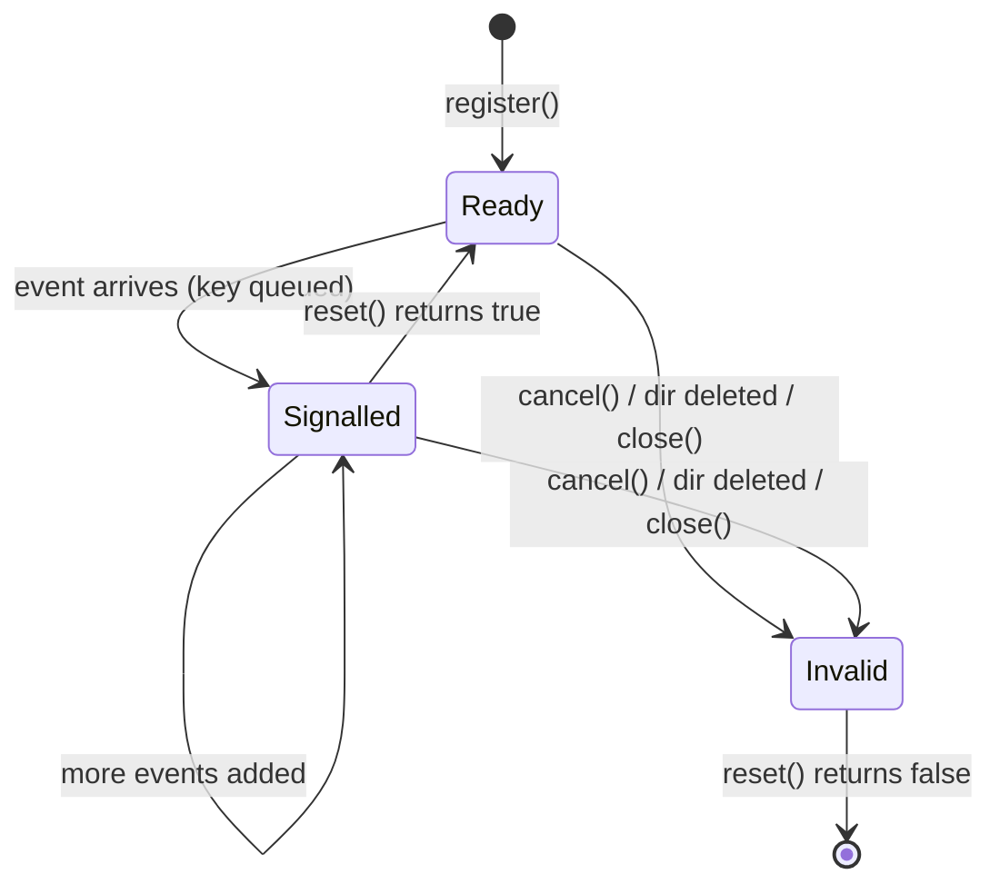
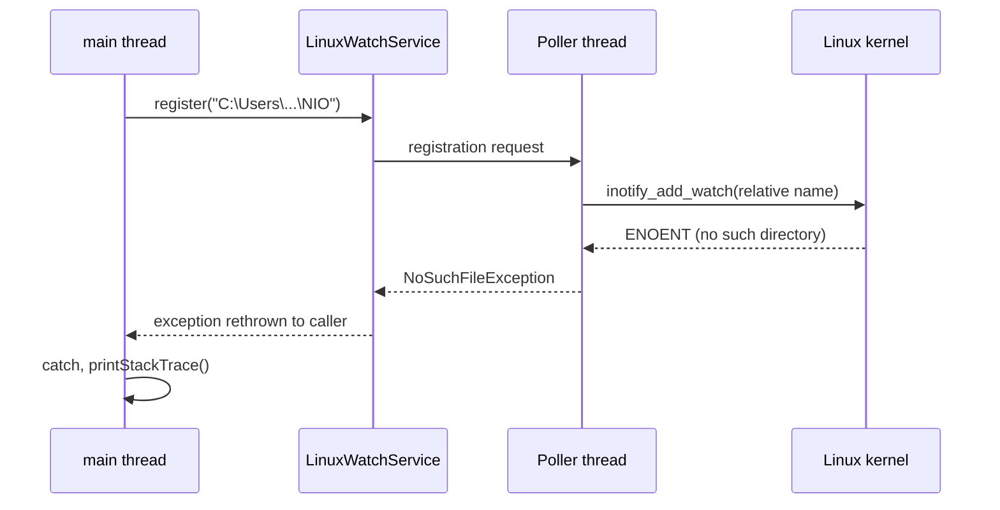
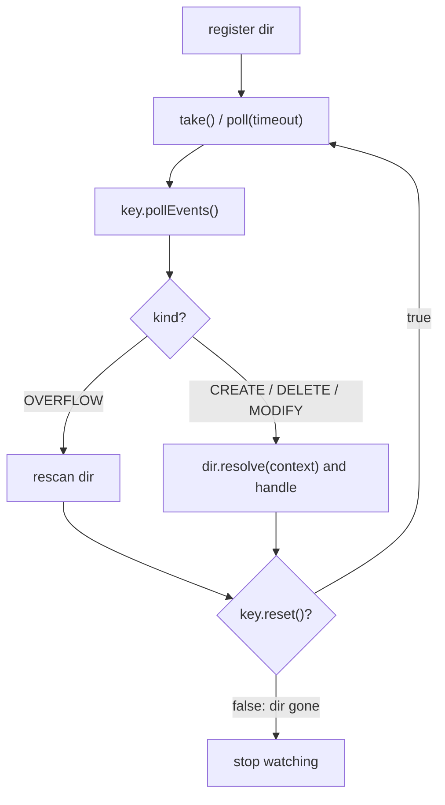

## In One Line
`WatchService` (NIO.2, Java 7) lets you **register a directory** for create/delete/modify events and then **wait for the OS to tell you** when entries change — `register` → `take()`/`poll()` a `WatchKey` → `pollEvents()` → `reset()` — instead of re-scanning the folder yourself.

## Mental Model
Think of a **doorbell with a visitor log** on each room of a building.

- **Registering** a directory installs a doorbell on that room's door (only that room — not the rooms inside it).
- When something happens (someone enters, leaves, rearranges), the bell rings and the event is **written in the room's log**. The room's log card (the `WatchKey`) is put in the **concierge's tray** (the `WatchService` queue).
- You, the concierge, `take()` a card from the tray (waiting if it is empty), read all its log entries (`pollEvents()`), and then **hand the card back** (`reset()`) so the bell can ring into it again. Forget to hand it back and that room's bell goes silent for you.
- If the room is demolished (directory deleted), the card becomes invalid and `reset()` returns `false`.

In the course example the concierge is told to watch a room at `C:\Users\hsahu\...` — an address that exists only on the author's Windows laptop. On Linux there is no such room, so installing the doorbell fails immediately with `NoSuchFileException`.

## Concept
### Why WatchService exists
Before Java 7 the only way to notice file changes was **polling**: list the directory every few seconds and compare timestamps — slow, wasteful and racy. `WatchService` uses the operating system's native change notification where available, so your thread sleeps until something actually happens. Typical uses: hot-reloading configuration, IDEs refreshing a project, dev servers restarting on save, "drop folder" importers.

### The moving parts
| Type | Role |
|---|---|
| `WatchService` | The queue of signalled keys; created by `FileSystem.newWatchService()`; `Closeable` |
| `Watchable` | Something that can be registered — `Path` implements it |
| `path.register(service, kinds...)` | Starts watching **one directory**; returns its `WatchKey` |
| `WatchKey` | Token for one registration: holds pending events, `pollEvents()`, `reset()`, `cancel()`, `isValid()`, `watchable()` |
| `WatchEvent<T>` | One event: `kind()`, `context()` (the **relative** name, a `Path`), `count()` |
| `StandardWatchEventKinds` | `ENTRY_CREATE`, `ENTRY_DELETE`, `ENTRY_MODIFY`, `OVERFLOW` |

### The four event kinds
| Kind | When | `context()` |
|---|---|---|
| `ENTRY_CREATE` | An entry appears in the directory (new file, new subfolder, moved/renamed **in**) | Relative `Path` of the entry |
| `ENTRY_DELETE` | An entry disappears (deleted, moved/renamed **out**) | Relative `Path` |
| `ENTRY_MODIFY` | An entry's content or attributes changed | Relative `Path` |
| `OVERFLOW` | Events were lost or discarded (queue full) | `null` |

`OVERFLOW` is always delivered — you do not register for it. A **rename** inside the folder shows up as `ENTRY_DELETE old` + `ENTRY_CREATE new`. A single "save" can produce several events (create + modify, or two modifies), and repeated identical events that have not been retrieved yet may be merged into one event with `count() > 1`.

### The WatchKey lifecycle
- **Ready** — just registered, or just `reset()`: waiting for events.
- **Signalled** — an event arrived: the key is queued in the `WatchService` and further events are added to it, but it is **not queued again** until you reset it.
- **Invalid** — `cancel()` was called, the directory became inaccessible or was deleted, or the service was closed. `reset()` then returns `false`.

### The standard event loop
```java
try (WatchService watcher = FileSystems.getDefault().newWatchService()) {
    dir.register(watcher, ENTRY_CREATE, ENTRY_DELETE, ENTRY_MODIFY);
    while (true) {
        WatchKey key = watcher.take();                 // wait for a signalled key
        for (WatchEvent<?> event : key.pollEvents()) { // retrieve and remove its events
            if (event.kind() == OVERFLOW) continue;    // rescan the directory if you need accuracy
            Path changed = dir.resolve((Path) event.context());
            // handle it
        }
        if (!key.reset()) break;                       // directory gone: stop watching it
    }
}
```
Retrieval methods on `WatchService`:

| Method | Behaviour |
|---|---|
| `take()` | Blocks until a key is signalled; throws `InterruptedException` |
| `poll()` | Returns a signalled key or `null` immediately |
| `poll(timeout, unit)` | Waits up to the timeout, then `null` |
| `close()` | Invalidates all keys; threads blocked in `take`/`poll` get `ClosedWatchServiceException` |

### Rules and limits you must know
- **Directories only.** Registering a regular file throws `NotDirectoryException`. To watch one file, watch its parent and filter by name.
- **Not recursive.** Changes inside sub-directories are not reported (only that a sub-directory itself was created/deleted/modified). To watch a tree, walk it with `Files.walkFileTree` and register every directory, and register new sub-directories as `ENTRY_CREATE` events arrive. (Windows-only: the JDK-specific modifier `com.sun.nio.file.ExtendedWatchEventModifier.FILE_TREE` watches a whole tree.)
- **The directory must exist when you register.** Otherwise `NoSuchFileException` — the course example's failure.
- **One key per directory per service.** Registering the same directory again returns the **same** key with the new set of event kinds.
- **`context()` is relative** to the watched directory: resolve it with `dir.resolve(name)` or `((Path) key.watchable()).resolve(name)` when you watch several directories.
- **Events describe the past.** By the time you handle `ENTRY_CREATE`, the file may be half-written or already deleted. Handle `IOException`s, and for "file is complete" detection use conventions like writing to a temp name and renaming.

### How each OS implements it (JDK 21)
| OS | Implementation | Notes |
|---|---|---|
| Linux | `LinuxWatchService` over **inotify** | Near-instant; limited by `fs.inotify.max_user_watches`; a background "poller" thread does the work |
| Windows | `WindowsWatchService` over `ReadDirectoryChangesW` | Near-instant; supports `FILE_TREE` |
| macOS | `PollingWatchService` — the source says "use polling implementation until we implement a BSD/kqueue one" | Scans every **2 seconds**, so events arrive late and fast changes can be missed or merged |

So `WatchService` behaviour (timing, number of `ENTRY_MODIFY` events) differs between platforms — design for "something changed, go look" rather than exact event counts.

### WatchService vs alternatives
| Approach | Pros | Cons |
|---|---|---|
| `WatchService` | Built in, native events on Linux/Windows, no polling code | Not recursive, directory-only, platform differences, macOS polls |
| Manual polling (`Files.walk` + timestamps) | Simple, predictable, works on network shares | Slow for big trees, delay = poll interval, CPU/IO cost |
| Libraries (Apache Commons IO `FileAlterationMonitor`, `directory-watcher`) | Recursive watching, better macOS support | Extra dependency |

Network file systems (NFS, SMB) often do not deliver native notifications at all; polling is the reliable fallback there.

## Diagram

A key is queued once when signalled; only `reset()` makes it able to be queued again, and a deleted directory makes it invalid.


Why the recorded stack trace has no `main` frames: the exception object is created on the JDK's background poller thread and then handed back to `main`.


The loop every WatchService program follows: wait, drain the events, reset, and stop when the key becomes invalid.

## Code
@example NIO/WatchServiceExample.java

A portable, well-behaved version. It watches a folder given on the command line (or a temp folder), simulates another program changing it, and stops instead of looping forever:
```java
import java.io.IOException;
import java.nio.file.*;
import java.util.concurrent.TimeUnit;
import static java.nio.file.StandardWatchEventKinds.*;

public class PortableWatch {
    public static void main(String[] args) throws Exception {
        // Portable: a folder passed on the command line, or a fresh temp folder on any OS
        Path dir = args.length > 0 ? Path.of(args[0]) : Files.createTempDirectory("watched");

        try (WatchService watcher = dir.getFileSystem().newWatchService()) {
            dir.register(watcher, ENTRY_CREATE, ENTRY_DELETE, ENTRY_MODIFY);
            System.out.println("Watching " + (args.length > 0 ? dir : "a temp folder"));

            // Simulate another program touching the folder
            new Thread(() -> {
                try {
                    Path f = dir.resolve("notes.txt");
                    Thread.sleep(200);  Files.writeString(f, "v1");
                    Thread.sleep(200);  Files.writeString(f, "v2", StandardOpenOption.APPEND);
                    Thread.sleep(200);  Files.delete(f);
                } catch (IOException | InterruptedException e) {
                    e.printStackTrace();
                }
            }).start();

            boolean running = true;
            while (running) {
                WatchKey key = watcher.poll(5, TimeUnit.SECONDS);    // take() would wait forever
                if (key == null) break;                              // nothing happened: stop
                for (WatchEvent<?> event : key.pollEvents()) {
                    if (event.kind() == OVERFLOW) continue;          // events were lost
                    Path name = (Path) event.context();              // relative to dir
                    Path full = dir.resolve(name);                   // absolute path if needed
                    System.out.println(event.kind() + " -> " + name + " (count " + event.count()
                            + ", exists now: " + Files.exists(full) + ")");
                    if (event.kind() == ENTRY_DELETE) running = false;
                }
                if (!key.reset()) break;                             // dir deleted: key is invalid
            }
        }
        if (args.length == 0) Files.deleteIfExists(dir);
    }
}
```
Typical output on Linux:
```output
Watching a temp folder
ENTRY_CREATE -> notes.txt (count 1, exists now: true)
ENTRY_MODIFY -> notes.txt (count 1, exists now: true)
ENTRY_MODIFY -> notes.txt (count 1, exists now: true)
ENTRY_DELETE -> notes.txt (count 1, exists now: false)
```
The output varies between runs. In some runs (1 of 13 during testing) the two modifications were merged into one event, because the second arrived before the key had been retrieved:
```output
Watching a temp folder
ENTRY_CREATE -> notes.txt (count 1, exists now: true)
ENTRY_MODIFY -> notes.txt (count 2, exists now: true)
ENTRY_DELETE -> notes.txt (count 1, exists now: false)
```
`Files.writeString(f, "v1")` produces **two** events — the file is created empty, then its content is written — which is why one "save" often looks like `CREATE` + `MODIFY`. On macOS (polling every 2 seconds) you would typically see far fewer events, or none at all for a file created and deleted between two scans.

The rules in action — directories only, not recursive, invalid keys, closed service:
```java
WatchService ws = FileSystems.getDefault().newWatchService();

Path file = Files.createTempFile("plain", ".txt");
try { file.register(ws, ENTRY_CREATE); }
catch (NotDirectoryException e) { System.out.println("register(file) -> NotDirectoryException"); }

Path dir = Files.createTempDirectory("watched");
WatchKey key = dir.register(ws, ENTRY_CREATE, ENTRY_DELETE);
Files.createDirectory(dir.resolve("sub"));
Files.writeString(dir.resolve("sub/inner.txt"), "not reported: watching is not recursive");
Files.delete(dir.resolve("sub/inner.txt"));
Files.delete(dir.resolve("sub"));
Files.delete(dir);                                   // delete the watched folder itself

WatchKey signalled = ws.poll(2, TimeUnit.SECONDS);
System.out.println("same key object? " + (signalled == key));
for (WatchEvent<?> e : signalled.pollEvents()) System.out.println(e.kind() + " " + e.context());
System.out.println("reset() = " + signalled.reset() + ", isValid() = " + signalled.isValid());

ws.close();
try { ws.poll(); }
catch (ClosedWatchServiceException e) { System.out.println("poll after close -> ClosedWatchServiceException"); }
```
```output
register(file) -> NotDirectoryException
same key object? true
ENTRY_CREATE sub
ENTRY_DELETE sub
reset() = false, isValid() = false
poll after close -> ClosedWatchServiceException
```
`inner.txt` never appears (only the watched directory's direct entries are reported), and there is no event for the watched folder's own deletion — the key just becomes invalid.

**The minimal fix to the original** is to replace the hard-coded path with one that exists on every machine, for example the directory the program is started from:
```java
Path directory = Paths.get(System.getProperty("user.dir"));
```
Running the original loop that way on Linux (compiled, in a folder where a shell then ran `echo hi > a.txt`, `echo more >> a.txt`, `mv a.txt b.txt`, `rm b.txt`) printed the following, and then kept waiting until it was killed:
```output
Event kind:ENTRY_CREATE. File affected: a.txt.
Event kind:ENTRY_MODIFY. File affected: a.txt.
Event kind:ENTRY_MODIFY. File affected: a.txt.
Event kind:ENTRY_DELETE. File affected: a.txt.
Event kind:ENTRY_CREATE. File affected: b.txt.
Event kind:ENTRY_DELETE. File affected: b.txt.
```
Note the rename: `mv a.txt b.txt` is reported as `ENTRY_DELETE a.txt` followed by `ENTRY_CREATE b.txt`.

## Walkthrough
- `import java.nio.file.*;` — brings in `WatchService`, `FileSystems`, `Path`, `Paths`, `StandardWatchEventKinds`, `WatchKey` and `WatchEvent`.
- `WatchService watchService = FileSystems.getDefault().newWatchService();` — asks the default (OS) file system for a watch service. On Linux this creates an inotify instance and starts a background daemon thread (the "poller") that reads inotify events. The service should be closed when no longer needed (it is `Closeable`); the example never closes it.
- `Path directory = Paths.get("C:\\Users\\hsahu\\Desktop\\hungrycoder\\hungrycoder\\src\\main\\java\\NIO");` — in Java source `\\` is one backslash, so the string is `C:\Users\hsahu\...\NIO`. On Windows that is an absolute path to the author's project folder. On Linux/macOS a backslash is an **ordinary filename character** and `C:` is not a drive, so `Paths.get` happily creates a *relative path with a single name element* — one strange file name, resolved against the current directory. `Paths.get` does not check existence, so no error yet.
- `directory.register(watchService, ENTRY_CREATE, ENTRY_DELETE, ENTRY_MODIFY);` — this is where the file system is consulted. `LinuxWatchService` hands the request to its poller thread, which calls `inotify_add_watch`; the kernel answers `ENOENT` because no such directory exists. The JDK translates that into `java.nio.file.NoSuchFileException: C:\Users\hsahu\Desktop\hungrycoder\hungrycoder\src\main\java\NIO` and rethrows it to `main`.
- `catch (Exception e) { e.printStackTrace(); }` — prints the trace and the program ends normally. That is the whole recorded output.
- **Reading the recorded stack trace:** `UnixException.translateToIOException` (errno → `NoSuchFileException`), `LinuxWatchService$Poller.implRegister`, `AbstractPoller.processRequests`, `LinuxWatchService$Poller.run`, `Thread.run`. There is no `WatchServiceExample.main` frame because a stack trace records where the exception object was **created** — on the poller thread — not where it was later rethrown.
- If the directory did exist (as on the author's machine), the rest would run:
  - `while (true)` — an infinite loop; the program only stops when killed.
  - `WatchKey key = watchService.take();` — blocks until some registered directory has events.
  - `for (WatchEvent<?> event : key.pollEvents())` — retrieves and removes all pending events of that key. `WatchEvent<?>` because the event kinds have different context types.
  - `event.kind()` prints as `ENTRY_CREATE` etc.; `event.context()` is the file name **relative** to the watched directory. The message is built as `"Event kind:" + kind + ". File affected: " + context + "."` — note the missing space after `kind:`.
  - `key.reset();` — puts the key back into the ready state so future events can signal it again. Its boolean result (false when the directory is gone) is ignored.

## Traps
> [!ERRATA] The hard-coded `C:\Users\hsahu\Desktop\...` path only exists on the author's Windows machine. Everywhere else `register` throws `NoSuchFileException` — the recorded Linux output is just that stack trace, and the watch loop never runs. Use a path that exists on every machine: `Paths.get(System.getProperty("user.dir"))`, `Path.of(args[0])`, or a folder created with `Files.createDirectories(...)`/`Files.createTempDirectory(...)`.

> [!ERRATA] The loop ignores the result of `key.reset()`. When the watched directory is deleted the key becomes invalid, `reset()` returns `false`, and the loop keeps calling `take()` forever on a service with no valid keys (it will never return). Write `if (!key.reset()) break;`. The loop also never checks for `OVERFLOW`, never closes the `WatchService` (use try-with-resources), and has no way to stop.

> [!ERRATA] `event.context()` is printed as if it were the affected file, but it is only the name **relative** to the watched directory. To open or inspect the file you need `directory.resolve((Path) event.context())`. (Cosmetic: `"Event kind:"` is missing a space, producing `Event kind:ENTRY_CREATE.`)

- **Forgetting `reset()`**: the key stays signalled and is never queued again — you silently stop receiving events for that directory.
- **Registering a file** throws `NotDirectoryException`; watch the parent and filter by name.
- **Expecting recursive watching**: only direct entries are reported. Register each sub-directory (and new ones as they appear).
- **Relying on exact event counts**: one save can produce CREATE + MODIFY, two MODIFYs, or a merged event with `count() > 1`; editors that save via a temp file produce DELETE + CREATE. Treat events as "something changed, re-read it".
- **Acting on a half-written file**: `ENTRY_CREATE` can arrive before the writer has finished. Retry on errors, wait for a quiet period, or have producers write to a temp name and rename atomically.
- **Blocking forever**: `take()` has no timeout and the original loop has no exit. Use `poll(timeout, unit)` or close the service from another thread (which makes `take()` throw `ClosedWatchServiceException`).
- **macOS latency**: the JDK polls every 2 seconds there; tests that expect instant events fail intermittently.
- **Linux limits**: each watched directory uses an inotify watch; big trees can hit `fs.inotify.max_user_watches` (registration then fails with an `IOException` about the user limit).

## Tips & Tricks
- **The loop mantra: "take, poll, handle, reset".** `take()` the key, `pollEvents()`, handle each event, `reset()` — and stop when `reset()` says `false`.
- **Context is a name, not a path**: always `dir.resolve(context)`.
- **Watch the folder, filter the file** — WatchService never watches single files.
- **Not recursive — walk and register**: `Files.walkFileTree(root, ...)` registering each directory in `preVisitDirectory`, and register new directories on `ENTRY_CREATE`. Keep a `Map<WatchKey, Path>` to know which directory a key belongs to (or use `key.watchable()`).
- **Debounce**: collect events for ~100–500 ms before reacting (for example reload config once, not three times per save).
- **Portable paths**: never hard-code `C:\...`; take the directory from arguments, configuration, `user.dir`, `user.home` or `java.io.tmpdir`.
- **Run the watcher on its own thread** (or a virtual thread) and shut it down by closing the `WatchService`.

## Interview Q&A
### [Basic] What is `WatchService` and how do you use it?
It is the NIO.2 (Java 7) API for file-system change notification. You create it with `FileSystems.getDefault().newWatchService()`, register a directory with `path.register(watcher, ENTRY_CREATE, ENTRY_DELETE, ENTRY_MODIFY)`, then loop: `WatchKey key = watcher.take()` (or `poll`), iterate `key.pollEvents()` reading `kind()` and `context()`, and call `key.reset()`; if `reset()` returns `false` the directory is no longer accessible and you stop watching it. Close the service when done.

**Follow-up:** *What does `context()` return?* — For entry events, a `Path` relative to the registered directory (the entry's name); for `OVERFLOW`, `null`.

### [Basic] Why did the course's `WatchServiceExample` fail on Linux?
It hard-codes a Windows path, `C:\Users\hsahu\Desktop\...\NIO`. On Linux a backslash is a normal character, so `Paths.get` builds a relative path with one oddly named element — no error, because creating a path does not check the disk. `register` does need the directory: the kernel reports "no such file or directory" and Java throws `NoSuchFileException`, which the example prints. The fix is a portable path, for example `Paths.get(System.getProperty("user.dir"))` or a directory passed as an argument.

**Follow-up:** *Why does the stack trace not mention `main`?* — On Linux the registration runs on the watch service's internal poller thread; the exception is created there and handed back, and a stack trace shows where the exception was created.

### [Basic] What event kinds exist?
`ENTRY_CREATE`, `ENTRY_DELETE`, `ENTRY_MODIFY` — which you choose when registering — and `OVERFLOW`, which is always delivered without registration and means events may have been lost or discarded, so you should re-scan the directory. Renames appear as a delete of the old name plus a create of the new name.

**Follow-up:** *What does `event.count()` mean?* — How many times this event occurred; repeated identical events that have not been retrieved yet can be merged into one with a count greater than 1.

### [Intermediate] What is the purpose of `WatchKey.reset()`?
When the first event arrives for a directory, its key becomes *signalled* and is queued in the watch service; further events are added to the same key, but the key is not queued again. After you have processed its events, `reset()` returns the key to the *ready* state so it can be signalled and queued again (immediately, if events are already pending). It returns `false` if the key is invalid — cancelled, service closed, or the directory deleted/inaccessible.

**Follow-up:** *What happens if you never call `reset()`?* — You receive that key once and never again, so you silently miss all later changes in that directory.

### [Intermediate] Does WatchService watch sub-directories? How would you watch a whole tree?
No. It reports changes to the direct entries of the registered directory only; a change inside `sub/` is invisible (at most the directory `sub` itself gets an event). To watch a tree, walk it with `Files.walkFileTree` and register every directory in `preVisitDirectory`, keep a `Map<WatchKey, Path>` (or use `key.watchable()`), and when an `ENTRY_CREATE` is a directory, register it (and walk it, since files may have been created before registration). On Windows only, the JDK-specific `ExtendedWatchEventModifier.FILE_TREE` watches a tree natively.

**Follow-up:** *Can you watch a single file?* — Not directly — registering a file throws `NotDirectoryException`. Watch its parent and filter events by `context()`.

### [Intermediate] What is the difference between `take()`, `poll()` and `poll(timeout, unit)`?
`take()` blocks until a key is signalled (interruptible, throws `InterruptedException`). `poll()` returns the next signalled key or `null` immediately. `poll(timeout, unit)` waits up to the timeout, then returns `null`. All of them throw `ClosedWatchServiceException` if the service is closed — also for threads already blocked — which is the normal way to stop a watcher thread from outside.

**Follow-up:** *Which would you use in a service that must shut down cleanly?* — `take()` on a dedicated thread plus `watchService.close()` on shutdown, or `poll(timeout)` in a loop that checks a stop flag.

### [Advanced] How is WatchService implemented on different operating systems, and why does it matter?
The JDK uses native notification where it can: **inotify** on Linux (`LinuxWatchService`, with a background poller thread) and **`ReadDirectoryChangesW`** on Windows. On macOS, the JDK 21 source still uses the generic `PollingWatchService`, which rescans registered directories every 2 seconds. Consequences: on macOS events are delayed and short-lived files can be missed; the number and grouping of `ENTRY_MODIFY` events differs per OS; Linux has per-user inotify watch limits; network file systems may not notify at all. Robust code treats events as hints and re-reads the actual state.

**Follow-up:** *What can you do on macOS?* — Accept the latency, use a library with native FSEvents support (e.g. `directory-watcher`), or poll yourself.

### [Advanced] How would you implement hot-reloading of a config file safely?
Watch the config file's **parent directory** for `ENTRY_CREATE` and `ENTRY_MODIFY` (editors often save by writing a temp file and renaming it over the original, which shows up as DELETE/CREATE). Filter events by `context().equals(fileName)`. Debounce — wait a short quiet period so one save triggers one reload. Then re-read and parse the whole file; if parsing fails (half-written), keep the old config and retry on the next event. Publish the new config atomically (for example via a `volatile` reference or `AtomicReference`). Handle `OVERFLOW` by simply reloading, check `reset()`, and run the watcher on its own thread, stopping it by closing the `WatchService`.

**Follow-up:** *Why watch for `ENTRY_CREATE` for a file that already exists?* — Because an atomic "write temp, rename over" save replaces the file: you see DELETE + CREATE, not MODIFY.

### [Advanced] Why might a `WatchService` loop hang or miss events, and how do you avoid it?
Hangs: `take()` waits forever if no event ever arrives, or if all keys became invalid (for example, the directory was deleted and the loop ignored `reset()`'s `false`). Use `poll(timeout)` or close the service, and exit when no valid keys remain. Missed events: not calling `reset()`; events in sub-directories (not recursive); `OVERFLOW` when the queue fills (the JDK caps pending events per key and the kernel caps its queue); macOS polling that misses short-lived files; events arriving between a directory's creation and its registration. Mitigate by resetting keys, handling `OVERFLOW` with a rescan, and rescanning newly registered directories.

**Follow-up:** *Is WatchService thread-safe?* — Yes, it can be used by multiple threads, but each signalled key is delivered to only one retriever, so typically one thread runs the loop.

## Quiz
### Why does the original example print a `NoSuchFileException` on Linux?
- [ ] `Paths.get` rejects backslashes on Linux
- [x] The hard-coded Windows folder does not exist, and `register` needs an existing directory
- [ ] `WatchService` is not supported on Linux
- [ ] `ENTRY_MODIFY` is Windows-only
> `Paths.get` accepts the string (a backslash is a legal filename character, so it is one relative name). The error comes from `register`, the first call that touches the file system. Linux supports `WatchService` through inotify.

### What does `event.context()` return for an `ENTRY_CREATE` in a watched directory `/data/in`?
- [ ] The absolute path `/data/in/report.csv`
- [x] The relative path `report.csv`
- [ ] The `WatchKey`
- [ ] A `File` object
> The context is the entry's name relative to the registered directory. Get the full path with `dir.resolve((Path) event.context())`.

### What happens if the loop never calls `key.reset()`?
- [ ] Events are duplicated
- [ ] `take()` throws an exception
- [x] After the first batch, no more events arrive for that directory
- [ ] The directory is unregistered and re-registered automatically
> A signalled key is not queued again until it is reset. Without `reset()` the watcher silently goes deaf for that directory.

### A program registers `/project` and a file `/project/src/App.java` is modified. What does the watcher report?
- [ ] ENTRY_MODIFY for `src/App.java`
- [ ] ENTRY_MODIFY for `App.java`
- [x] Nothing for `App.java` — at most an event for the directory `src` itself
- [ ] OVERFLOW
> Watching is not recursive: only direct entries of `/project` are reported. To see `App.java` you must also register `/project/src`.

### Spot the bug:
```java
Path config = Path.of("app.properties");
WatchService ws = FileSystems.getDefault().newWatchService();
config.register(ws, StandardWatchEventKinds.ENTRY_MODIFY);
```
- [ ] `ENTRY_MODIFY` must be combined with `ENTRY_CREATE`
- [x] A `WatchService` can only watch directories; this throws `NotDirectoryException`
- [ ] `register` must be called on the `WatchService`, not the `Path`
- [ ] The path must be absolute
> Register the parent directory (`config.toAbsolutePath().getParent()`) and filter events whose `context()` equals `app.properties`. `register` is indeed a method of `Path` (from `Watchable`), and relative paths are fine.

### In the `PortableWatch` run, why does one `Files.writeString(f, "v1")` usually produce both `ENTRY_CREATE` and `ENTRY_MODIFY`?
- [ ] `writeString` writes the file twice
- [x] The file is first created empty and then its content is written — two separate changes
- [ ] `ENTRY_MODIFY` is always sent after `ENTRY_CREATE` by the JDK
- [ ] Because the thread slept for 200 ms
> Opening with `CREATE` makes the entry appear (create), and writing bytes changes its content (modify). The events can also be merged or split differently depending on timing and OS, so never rely on exact counts.

### What does `mv a.txt b.txt` inside a watched folder produce?
- [ ] One ENTRY_MODIFY for `b.txt`
- [x] ENTRY_DELETE for `a.txt`, then ENTRY_CREATE for `b.txt`
- [ ] ENTRY_CREATE for `b.txt` only
- [ ] Nothing, because renames are not changes
> There is no "rename" event kind: the old name disappears and the new one appears. The recorded run of the fixed example shows exactly `ENTRY_DELETE ... a.txt` followed by `ENTRY_CREATE ... b.txt`.

## Takeaways
- `WatchService` (NIO.2, Java 7) delivers directory change events: create with `FileSystems.getDefault().newWatchService()`, `dir.register(ws, ENTRY_CREATE, ENTRY_DELETE, ENTRY_MODIFY)`, then loop `take()` → `pollEvents()` → handle → `reset()`.
- `context()` is the entry's name relative to the watched directory — resolve it against the directory to get a usable path; `OVERFLOW` (context `null`) means events were lost.
- Always check `key.reset()`: `false` means the key is invalid (directory deleted, cancelled, service closed); forgetting `reset()` stops further events.
- Only directories can be registered (`NotDirectoryException` for files), watching is not recursive, and the directory must exist (`NoSuchFileException` otherwise).
- The course example hard-codes a Windows path; on Linux it becomes one odd relative file name, so `register` fails with `NoSuchFileException` (thrown from the JDK's poller thread) — fix it with `user.dir`, an argument, or a created folder.
- Events are hints, not exact records: saves can produce several or merged events, renames are DELETE + CREATE, and macOS polls every 2 seconds in JDK 21 (inotify on Linux, `ReadDirectoryChangesW` on Windows).
