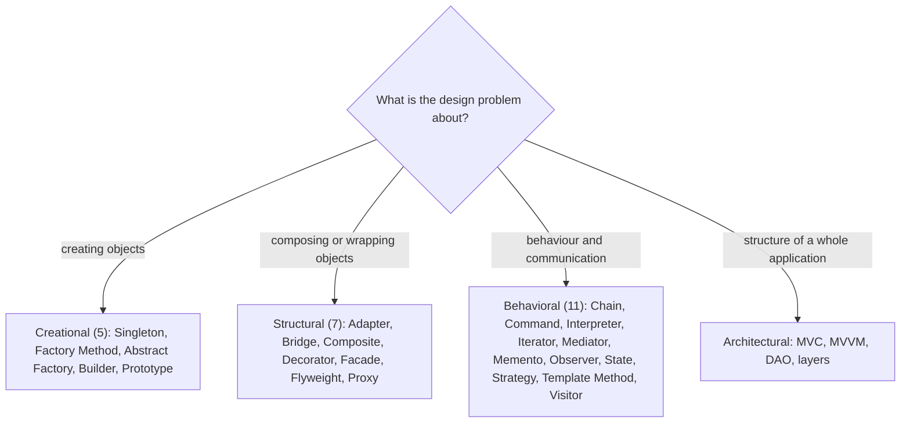
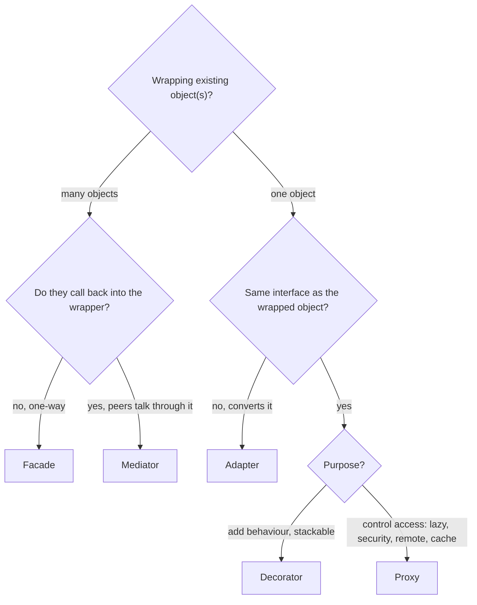
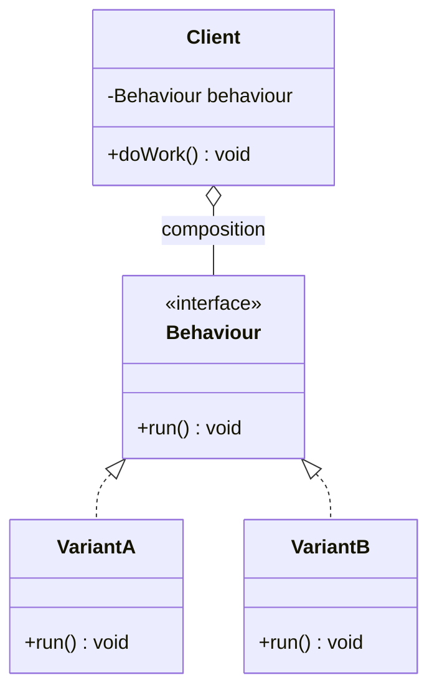

## In One Line
A design pattern is a **named, proven solution to a design problem that keeps coming back** — not code you copy, but a template of roles and relationships (who holds whom, who calls whom) that you adapt; the 23 "Gang of Four" patterns are the shared vocabulary every Java interview expects.

## Mental Model
Think of **chess openings**. Nobody invents a fresh plan for the first ten moves of every game. Players learned, over centuries, that certain move sequences solve recurring problems ("control the centre", "protect the king"), and gave them names: *Sicilian Defence*, *Queen's Gambit*. Saying "Sicilian" communicates a whole plan in one word, including its known strengths and weaknesses. You still have to play it on *this* board, against *this* opponent.

How it maps to software:
- **An opening's name** → the pattern name: *Decorator*, *Strategy*. One word replaces a paragraph of explanation in a design review.
- **The recurring problem** ("control the centre") → the pattern's **problem**: "I need to add features to objects without a subclass per combination".
- **The move sequence** → the pattern's **structure**: which interfaces, which classes, which references between them.
- **Known strengths and weaknesses** → the pattern's **consequences** (trade-offs): Decorator gives flexible combinations but many small objects and lost identity.
- **Adapting to this game** → you implement the roles in *your* classes; a pattern is never a library you import.
- **Playing an opening against a beginner who does something odd** → forcing a pattern where the problem is absent — over-engineering.

## Concept
### What a design pattern is (and is not)
The idea comes from the architect Christopher Alexander (*A Pattern Language*, 1977): "each pattern describes a problem which occurs over and over again in our environment, and then describes the core of the solution to that problem, in such a way that you can use this solution a million times over, without ever doing it the same way twice." In 1994 Erich Gamma, Richard Helm, Ralph Johnson and John Vlissides — the **Gang of Four (GoF)** — catalogued 23 object-oriented patterns in *Design Patterns: Elements of Reusable Object-Oriented Software*.

Every pattern has four essential elements:
| Element | Meaning | Example (Observer) |
|---|---|---|
| **Name** | A word for the design vocabulary | "Observer" |
| **Problem** | When to apply it; the context and forces | Many objects must react when one object changes, without tight coupling |
| **Solution** | Roles, responsibilities, relationships — not concrete code | Subject keeps a list of observers and calls `update()` on each |
| **Consequences** | Results and trade-offs | Loose coupling, but unexpected update cascades and ordering issues |

A pattern is **not**: an algorithm (quicksort is not a pattern), a library or framework (though frameworks are built from patterns), a language feature, or a goal in itself. Levels of "patterns": **idioms** (language-specific, e.g. try-with-resources, the holder-class singleton), **design patterns** (a few collaborating classes — GoF), **architectural patterns** (whole-application structure — MVC, layered, microservices, event-driven).

### Why patterns matter
- **Shared vocabulary** — "wrap it in a caching proxy" is understood instantly.
- **Proven trade-offs** — you inherit decades of experience about what goes wrong.
- **Reading frameworks** — Spring, Hibernate, `java.io`, `java.util` are built from patterns; recognising them makes unfamiliar code readable.
- **Design for change** — most patterns isolate *what varies* behind an interface, so new requirements become new classes, not edits to old ones.
- **Interviews** — they are a standard way to test OO design thinking.

### The principles underneath almost every pattern
GoF state two principles explicitly:
1. **"Program to an interface, not an implementation."** Clients depend on `Shape`, `Comparator`, `List` — never on `Circle`, `ArrayList`. This is what makes objects swappable ([Polymorphism](lesson:a01-oop/04-polymorphism)).
2. **"Favour object composition over class inheritance."** Instead of subclassing to vary behaviour, hold a reference to an object that provides it (Strategy, Decorator, Bridge, State). Composition can change at runtime and avoids fragile base classes.

Plus the recurring heuristic **"encapsulate what varies"** and the [SOLID principles](lesson:b01-fundamentals/13-solid-principles) — especially Open/Closed (add new behaviour by adding classes) and Dependency Inversion (depend on abstractions).

### The 23 GoF patterns — 5 creational, 7 structural, 11 behavioral
**Creational — how objects get created** (hide `new`, control how many, build step by step):
| Pattern | Intent in one line | Everyday Java |
|---|---|---|
| [Singleton](lesson:a10-patterns/01-singleton) | Exactly one instance, globally accessible | `Runtime.getRuntime()`, enum singletons, Spring singleton beans |
| Factory Method ([Factory](lesson:a10-patterns/02-factory)) | Subclass (or method) decides which class to instantiate | `Collection.iterator()`, `Calendar.getInstance()`, `List.of` (static factory) |
| Abstract Factory ([Factory](lesson:a10-patterns/02-factory)) | Create **families** of related objects without naming concrete classes | `DocumentBuilderFactory`, JDBC `Connection` creating `Statement`s |
| [Builder](lesson:a10-patterns/03-builder) | Construct a complex object step by step, then `build()` | `StringBuilder`, `HttpRequest.newBuilder()`, Lombok `@Builder` |
| [Prototype](lesson:a10-patterns/04-prototype) | Create new objects by copying a configured one | `clone()`, copy constructors, `List.copyOf` |

**Structural — how objects are composed** (wrap, combine, share):
| Pattern | Intent in one line | Everyday Java |
|---|---|---|
| [Adapter](lesson:a10-patterns/05-adapter) | Convert one interface into another the client expects | `Arrays.asList`, `InputStreamReader` |
| [Bridge](lesson:a10-patterns/06-bridge) | Split abstraction and implementation so both vary independently | JDBC API + drivers, SLF4J API + backends |
| [Composite](lesson:a10-patterns/07-composite) | Treat single objects and trees of objects uniformly | AWT `Container`/`Component`, file trees |
| [Decorator](lesson:a10-patterns/08-decorator) | Add responsibilities by wrapping, same interface | `BufferedReader`, `Collections.unmodifiableList` |
| [Facade](lesson:a10-patterns/09-facade) | One simple entry point to a complex subsystem | `Files.readString`, Spring `JdbcTemplate` |
| [Flyweight](lesson:a10-patterns/10-flyweight) | Share immutable intrinsic state among many objects | `Integer.valueOf` cache, string pool |
| [Proxy](lesson:a10-patterns/11-proxy) | Stand-in that controls access to the real object | `java.lang.reflect.Proxy`, Spring AOP, Hibernate lazy loading |

**Behavioral — how objects interact and share responsibility** (algorithms, communication, state):
| Pattern | Intent in one line | Everyday Java |
|---|---|---|
| [Chain of Responsibility](lesson:a10-patterns/12-chain-of-responsibility) | Pass a request along handlers until one handles it | Servlet `FilterChain`, Spring Security filter chain |
| [Command](lesson:a10-patterns/13-command) | Wrap a request as an object (queue, log, undo) | `Runnable`, `Callable`, Swing `Action` |
| [Interpreter](lesson:a10-patterns/14-interpreter) | Represent a grammar as classes and evaluate sentences | `java.util.regex.Pattern`, Spring SpEL |
| [Iterator](lesson:a10-patterns/15-iterator) | Traverse a collection without exposing its structure | `Iterator`, `Iterable`, for-each |
| [Mediator](lesson:a10-patterns/16-mediator) | Peers communicate through a central coordinator | `ExecutorService` coordinating tasks, chat rooms, UI dialogs |
| [Memento](lesson:a10-patterns/17-memento) | Capture and restore state without breaking encapsulation | Undo stacks, `Serializable` snapshots |
| [Observer](lesson:a10-patterns/19-observer) | Notify all dependents when a subject changes | Listeners, `PropertyChangeSupport`, `Flow` API, Spring events |
| [State](lesson:a10-patterns/20-state) | Behaviour changes with an internal state object | Workflow/order states, TCP connection states |
| [Strategy](lesson:a10-patterns/21-strategy) | Interchangeable algorithms behind one interface | `Comparator`, `ThreadPoolExecutor`'s `RejectedExecutionHandler` |
| [Template Method](lesson:a10-patterns/22-template-method) | Fixed algorithm skeleton, subclasses fill in steps | `AbstractList`, `HttpServlet.service` → `doGet` |
| [Visitor](lesson:a10-patterns/23-visitor) | Add operations to a class hierarchy without changing it | `FileVisitor` in `Files.walkFileTree`, compiler ASTs |

**Beyond GoF, in this course:**
| Pattern | Idea |
|---|---|
| [Null Object](lesson:a10-patterns/18-null-object) | A do-nothing implementation instead of `null` |
| [MVC](lesson:a10-patterns/24-mvc) | Model (data), View (display), Controller (input/glue) |
| [MVVM](lesson:a10-patterns/25-mvvm) | ViewModel exposes observable state that the View binds to |
| [DAO](lesson:a10-patterns/26-dao) | An interface hides how data is stored and retrieved |

Other names worth recognising: **Dependency Injection** (objects receive their collaborators — what Spring does), **Repository** (collection-like access to aggregates, DDD), **Service Locator** (a registry you ask for dependencies — usually inferior to DI), **Object Pool** (borrow/return expensive objects), **Multiton** (one instance per key), **Specification** (combinable business rules), and distributed-systems patterns such as **Circuit Breaker**, **Retry**, **Saga**, **CQRS** and **Outbox**.

### Class patterns vs object patterns (GoF's second axis)
GoF also classify by **scope**. **Class patterns** fix relationships at compile time through inheritance: Factory Method, class Adapter, Interpreter, Template Method. **Object patterns** use composition, so relationships can change at runtime: all the others, including the object form of Adapter. This is the "composition over inheritance" principle in action — the large majority of GoF patterns are object patterns.

### Pattern picker — start from the problem
| If you need to... | Consider |
|---|---|
| Guarantee one shared instance | Singleton (or just one Spring bean) |
| Hide which concrete class gets created | Factory Method / static factory |
| Create matching families of objects (UI theme, DB vendor) | Abstract Factory |
| Build an object with many optional parameters | Builder |
| Create many similar objects cheaply from a configured one | Prototype |
| Use a class whose interface doesn't fit | Adapter |
| Add optional, combinable features to objects at runtime | Decorator |
| Control access (lazy, security, remote, caching) | Proxy |
| Give clients one simple entry to a complicated subsystem | Facade |
| Represent part-whole trees, treat leaf and group alike | Composite |
| Vary two dimensions independently (shape × renderer) | Bridge |
| Handle millions of similar small objects | Flyweight |
| Swap an algorithm at runtime | Strategy |
| Change behaviour when internal state changes (no giant `switch`) | State |
| Fix an algorithm's skeleton, vary some steps | Template Method |
| Notify many objects of a change | Observer |
| Queue, log, schedule or undo operations | Command |
| Let several handlers try a request in turn | Chain of Responsibility |
| Stop many objects referencing each other | Mediator |
| Snapshot and restore state (undo) | Memento |
| Walk a collection without exposing its internals | Iterator |
| Add operations to a stable class hierarchy | Visitor (or, in Java 21, sealed types + pattern matching) |
| Evaluate a small language/rule grammar | Interpreter |
| Avoid `null` checks for "no behaviour" | Null Object (or `Optional`) |
| Separate data, UI and input handling | MVC / MVVM |
| Hide persistence details | DAO / Repository |

### The look-alike families interviewers love
| Family | Members | The one-line difference |
|---|---|---|
| **Wrappers of one object** | Adapter, Decorator, Proxy | Adapter **converts** the interface; Decorator keeps it and **adds**; Proxy keeps it and **controls** |
| **Front for many objects** | Facade, Mediator | Facade: subsystem doesn't know it (one-way). Mediator: colleagues know and call it (two-way) |
| **"Delegate to a swappable object"** | Strategy, State, Bridge, Command | Strategy: client picks the algorithm. State: the object switches its own state. Bridge: a structural split designed up front. Command: the request itself is the object |
| **Recursive structures** | Composite, Decorator, Chain of Responsibility, Interpreter | Composite has **many** children; Decorator wraps **one** and every layer runs; Chain passes along and **may stop**; Interpreter's tree **is** a composite of grammar rules |
| **Object creation** | Factory Method, Abstract Factory, Builder, Prototype | One product chosen by a subclass/method; a family of products; one complex product step by step; a copy of an existing object |
| **"Only a few instances"** | Singleton, Flyweight, Object Pool | One per class; one immutable instance per key, shared at once; mutable instances borrowed exclusively |
| **Broadcasting** | Observer, Mediator, Pub/Sub | Observer: subject knows its observers' interface. Mediator: coordination logic in the hub. Pub/Sub: a broker decouples publishers and subscribers completely |

### Patterns you already use in the JDK
| Pattern | JDK example |
|---|---|
| Singleton | `Runtime.getRuntime()`, `Desktop.getDesktop()` |
| Factory Method / static factory | `List.of`, `Integer.valueOf`, `Calendar.getInstance()`, `Collection.iterator()`, `NumberFormat.getInstance()` |
| Abstract Factory | `DocumentBuilderFactory`, `TransformerFactory`, JDBC `Connection` |
| Builder | `StringBuilder`, `HttpRequest.newBuilder()`, `Stream.builder()`, `Locale.Builder` |
| Prototype | `Object.clone()`, `ArrayList.clone()`, array `clone()` |
| Adapter | `Arrays.asList`, `InputStreamReader`, `Executors.callable` |
| Bridge | JDBC API + vendor drivers; AWT components and their native peers |
| Composite | AWT `Container`, `javax.swing.JComponent` trees |
| Decorator | `java.io` streams (`BufferedInputStream`, `GZIPOutputStream`), `Collections.synchronizedList` |
| Facade | `java.nio.file.Files`, `HttpClient` |
| Flyweight | `Integer.valueOf` (-128..127), `String.intern()`, `Boolean.valueOf` |
| Proxy | `java.lang.reflect.Proxy`, RMI stubs |
| Chain of Responsibility | `java.util.logging.Logger` passing records up to its parent loggers' handlers; (Jakarta) Servlet `FilterChain` |
| Command | `Runnable`, `Callable`, `TimerTask` |
| Interpreter | `java.util.regex.Pattern`, `java.text.Format` |
| Iterator | `Iterator`, `Spliterator`, `Enumeration` |
| Mediator | `java.util.concurrent.Executor` / `ExecutorService`, `java.util.Timer` |
| Memento | Serializing an object's state to restore it later (`Serializable`); undo stacks in editors |
| Observer | `PropertyChangeListener`, `java.util.concurrent.Flow` (`java.util.Observable` is deprecated since Java 9) |
| State | Rare in the JDK's public API; typical in applications: order/workflow states, connection states, parsers |
| Strategy | `Comparator`, `RejectedExecutionHandler`, `LayoutManager` in Swing |
| Template Method | `AbstractList`, `AbstractMap`, `InputStream.read(byte[])` built on `read()`, `HttpServlet` |
| Visitor | `FileVisitor` / `SimpleFileVisitor`, `javax.lang.model.element.ElementVisitor` |
| Null Object | `Collections.emptyList()`, `OutputStream.nullOutputStream()` (Java 11) |

### Patterns in Spring (a favourite follow-up)
| Pattern | In Spring |
|---|---|
| Singleton | Default bean scope — one instance **per container**, not per JVM |
| Factory | `BeanFactory`, `FactoryBean`, `@Bean` methods |
| Builder | `UriComponentsBuilder`, `MockMvcRequestBuilders`, `RestClient.builder()` |
| Prototype | `@Scope("prototype")` beans |
| Proxy | AOP: `@Transactional`, `@Cacheable`, `@Async`; `@Configuration` CGLIB classes |
| Decorator | `TaskDecorator`, `HttpServletRequestWrapper`, `TransactionAwareCacheDecorator` |
| Adapter | Spring MVC `HandlerAdapter` |
| Facade | `JdbcTemplate`, `RestTemplate`/`RestClient`, `ApplicationContext` |
| Template Method | `JdbcTemplate`, `AbstractController`, `AbstractApplicationContext.refresh()` |
| Observer | `ApplicationEvent` + `@EventListener` |
| Chain of Responsibility | Servlet filters, Spring Security's `SecurityFilterChain`, `HandlerInterceptor`s |
| Strategy | `Resource` loaders, `PlatformTransactionManager` implementations, `HandlerMethodArgumentResolver`s |
| Front Controller / MVC | `DispatcherServlet` |
| Dependency Injection | The whole container |

### Patterns and modern Java
Java 8–21 made many patterns lighter:
- **Lambdas and method references** turn single-method patterns into one-liners: Strategy (`Comparator.comparing(...)`), Command (`Runnable`), Observer callbacks, and Template Method via passed-in functions (`jdbcTemplate.query(sql, rowMapper)`). See [Lambda Expressions](lesson:a05-java8/02-lambda-expressions).
- **Enums** give the best Singleton (`enum Config { INSTANCE }`), fixed Strategy sets and simple State machines.
- **Records** make immutable value objects, flyweights and DTOs trivial.
- **Sealed types + pattern-matching `switch`** (Java 17/21) are a lighter alternative to Visitor for closed hierarchies — see [Sealed Classes](lesson:b05-modern-java/04-sealed-classes) and [Switch & Pattern Matching](lesson:b05-modern-java/05-switch-expressions-and-pattern-matching).
- **`Optional`** covers many Null Object cases for return values ([Optional](lesson:a05-java8/20-optional)).
- **Streams** replace hand-written external iteration.
- **DI containers** replace hand-rolled singletons, factories and service locators.

The *ideas* stay the same; only the ceremony shrinks.

### Overuse and anti-patterns
- **Golden hammer / pattern-itis** — using a pattern because you know it, not because the problem needs it. Three classes and two interfaces to print a string is worse than one method. Apply **KISS** and **YAGNI**; refactor *towards* a pattern when the need appears (often after the second or third variation).
- **Singleton abuse** — global mutable state in disguise: hidden dependencies, hard-to-test code, concurrency bugs. Prefer DI.
- **God object** — a "manager", "facade" or "util" class that knows everything.
- **Service Locator** — hides dependencies inside method bodies; constructor injection makes them explicit.
- **Naming without the structure** — calling something `XxxFactory` or `XxxAdapter` when it is not one misleads readers (Swing's `MouseAdapter` is not a GoF Adapter).

### How to talk about patterns in an interview
Use the same six-step shape for any pattern:
1. **Intent** in one sentence — "Decorator adds responsibilities to an object at runtime by wrapping it in an object with the same interface."
2. **Problem** it solves — "otherwise you need a subclass per combination of features."
3. **Structure / participants** — "Component interface, concrete component, decorator that implements *and* holds a component."
4. **Tiny code sketch** — 5–10 lines, e.g. `new BufferedReader(new FileReader(f))`.
5. **Trade-offs** — when not to use it, pitfalls (order, identity, boilerplate).
6. **Real-world usage and look-alikes** — "`java.io` streams; unlike Proxy it adds rather than controls; unlike Adapter it keeps the interface."

For "which patterns have you used?", tell a short story: the **problem** in your project, the pattern you chose and **why** (what alternative you rejected), and the **result** (what became easier). Two concrete stories beat a list of twenty names.

## Diagram

Classify a pattern by the question it answers: how things are made, how they are put together, or how they behave and talk.


The wrapper decision tree: count the wrapped objects, compare the interfaces, then ask about intent.


The shape behind Strategy, State, Bridge, Command, Decorator and Proxy: the client depends on an interface and holds an object that implements it — "program to an interface" plus "favour composition".

## Code
There is no course example for this overview. Two runnable programs show the patterns hiding in everyday Java and how a pattern grows out of a real problem.

**A tour of patterns in the JDK:**
```java
import java.beans.*;
import java.io.*;
import java.lang.reflect.Proxy;
import java.net.URI;
import java.net.http.HttpRequest;
import java.util.*;
import java.util.regex.Pattern;

public class PatternsInTheJdk {
    public static void main(String[] args) throws Exception {
        // ---- Creational ----
        System.out.println("Singleton  : " + (Runtime.getRuntime() == Runtime.getRuntime()));
        List<String> fixed = List.of("b", "a", "c");                        // static factory method
        System.out.println("Factory    : " + fixed.getClass().getSimpleName() + " from List.of");
        HttpRequest req = HttpRequest.newBuilder(URI.create("https://example.com/api"))
                .header("Accept", "application/json").timeout(java.time.Duration.ofSeconds(5)).GET().build();
        System.out.println("Builder    : " + req.method() + " " + req.uri());
        int[] original = {1, 2, 3};
        int[] copy = original.clone();                                        // copy an existing object
        System.out.println("Prototype  : " + Arrays.toString(copy) + " same array? " + (copy == original));

        // ---- Structural ----
        String[] arr = {"x", "y"};
        System.out.println("Adapter    : " + Arrays.asList(arr) + " (array seen as a List)");
        BufferedReader reader = new BufferedReader(new StringReader("line1\nline2"));   // adds readLine()
        System.out.println("Decorator  : " + reader.readLine());
        Integer i1 = 100, i2 = 100;
        System.out.println("Flyweight  : " + (i1 == i2) + " (Integer cache)");
        Runnable proxy = (Runnable) Proxy.newProxyInstance(Runnable.class.getClassLoader(),
                new Class<?>[] { Runnable.class }, (p, m, a) -> { System.out.println("Proxy      : intercepted " + m.getName()); return null; });
        proxy.run();

        // ---- Behavioral ----
        List<String> names = new ArrayList<>(fixed);
        names.sort(Comparator.reverseOrder());                                // pluggable algorithm
        System.out.println("Strategy   : " + names);
        Iterator<String> it = names.iterator();
        System.out.println("Iterator   : first=" + it.next() + ", hasNext=" + it.hasNext());
        List<Integer> squares = new AbstractList<>() {                        // fill in 2 steps, inherit the rest
            public Integer get(int index) { return index * index; }
            public int size() { return 4; }
        };
        System.out.println("Template   : " + squares + " contains 9? " + squares.contains(9));
        Runnable command = () -> System.out.println("Command    : request wrapped in an object, run later");
        command.run();
        PropertyChangeSupport subject = new PropertyChangeSupport(new Object());
        subject.addPropertyChangeListener(e -> System.out.println("Observer   : " + e.getPropertyName()
                + " " + e.getOldValue() + " -> " + e.getNewValue()));
        subject.firePropertyChange("price", 10, 12);
        System.out.println("Interpreter: " + Pattern.matches("[a-z]+\\d{2}", "java21"));
        System.out.println("Null Object: " + Collections.emptyList().size() + " elements, no null check needed");
    }
}
```
```output
Singleton  : true
Factory    : ListN from List.of
Builder    : GET https://example.com/api
Prototype  : [1, 2, 3] same array? false
Adapter    : [x, y] (array seen as a List)
Decorator  : line1
Flyweight  : true (Integer cache)
Proxy      : intercepted run
Strategy   : [c, b, a]
Iterator   : first=c, hasNext=true
Template   : [0, 1, 4, 9] contains 9? true
Command    : request wrapped in an object, run later
Observer   : price 10 -> 12
Interpreter: true
Null Object: 0 elements, no null check needed
```
No network access happens: `HttpRequest` is only built, never sent.

**How a pattern emerges from a problem — replacing an `if`/`else` chain with Strategy:**
```java
import java.util.*;

public class FromIfElseToStrategy {
    // BEFORE: one method knows every carrier; adding one means editing and re-testing it
    static double costBefore(String carrier, double kg) {
        if (carrier.equals("POST")) return 40 + 10 * kg;
        else if (carrier.equals("COURIER")) return 100 + 5 * kg;
        else throw new IllegalArgumentException("unknown carrier " + carrier);
    }

    // AFTER: Strategy - each pricing rule is an object behind one small interface
    @FunctionalInterface
    interface ShippingStrategy { double cost(double kg); }

    static final Map<String, ShippingStrategy> CARRIERS = new LinkedHashMap<>();
    static {
        CARRIERS.put("POST", kg -> 40 + 10 * kg);          // a lambda IS a strategy object
        CARRIERS.put("COURIER", kg -> 100 + 5 * kg);
    }

    static double costAfter(String carrier, double kg) {   // closed for modification
        ShippingStrategy s = CARRIERS.get(carrier);
        if (s == null) throw new IllegalArgumentException("unknown carrier " + carrier);
        return s.cost(kg);
    }

    public static void main(String[] args) {
        System.out.println("before: " + costBefore("POST", 2) + ", " + costBefore("COURIER", 2));
        System.out.println("after : " + costAfter("POST", 2) + ", " + costAfter("COURIER", 2));

        CARRIERS.put("DRONE", kg -> kg <= 5 ? 250 : Double.POSITIVE_INFINITY);   // open for extension
        CARRIERS.forEach((name, s) -> System.out.println(name + " for 4 kg = " + s.cost(4)));
    }
}
```
```output
before: 60.0, 110.0
after : 60.0, 110.0
POST for 4 kg = 80.0
COURIER for 4 kg = 120.0
DRONE for 4 kg = 250.0
```
Same results, but a new carrier is now a new entry, not an edit to tested code — the Open/Closed Principle delivered by Strategy, with lambdas removing the need for one class per rule.

## Walkthrough
This lesson has no course example; the walkthrough explains the two programs above.

**`PatternsInTheJdk`:**
- **Singleton** — `Runtime.getRuntime()` always returns the same object, so `==` is `true`.
- **Factory** — `List.of(...)` is a static factory method: you ask for "a list", and it picks a hidden implementation class (`ImmutableCollections.ListN` for three or more elements; `List12` for one or two). The client never names it — that is the point.
- **Builder** — `HttpRequest.newBuilder(uri)` collects optional settings (`header`, `timeout`, `GET`) fluently, and `build()` returns an immutable request.
- **Prototype** — `original.clone()` creates a new array with the same contents; `copy == original` is `false`.
- **Adapter** — `Arrays.asList(arr)` makes an array usable through the `List` interface.
- **Decorator** — `BufferedReader` wraps a `StringReader`, keeps the `Reader` interface and adds buffering plus `readLine()`.
- **Flyweight** — autoboxing `100` twice returns the same cached `Integer`, so `==` is `true` (values -128..127 only).
- **Proxy** — `Proxy.newProxyInstance` generates a `Runnable` whose calls go to the lambda handler; calling `run()` prints `intercepted run` without any real `Runnable` implementation.
- **Strategy** — `names.sort(Comparator.reverseOrder())` plugs a sorting rule into the sort algorithm → `[c, b, a]`.
- **Iterator** — traverses the list without knowing it is an `ArrayList`.
- **Template Method** — `AbstractList` implements `toString`, `contains`, iteration and more in terms of two "steps" the subclass provides: `get` and `size`.
- **Command** — a `Runnable` is a request packaged as an object; whoever holds it can run it now, later or on another thread.
- **Observer** — `PropertyChangeSupport` keeps a list of listeners; `firePropertyChange("price", 10, 12)` notifies each one (it only fires when old and new values differ).
- **Interpreter** — `Pattern.matches` compiles the regex (a small language) into an object structure and evaluates the input against it: `java21` is letters followed by two digits → `true`.
- **Null Object** — `Collections.emptyList()` is a real, shared, empty list: callers can iterate or ask its size without a `null` check.

**`FromIfElseToStrategy`:**
- `costBefore` hard-codes every carrier in one `if`/`else` chain — every new carrier modifies this method.
- `ShippingStrategy` is the strategy interface; being a functional interface, each rule is a lambda.
- `CARRIERS` is a registry (`LinkedHashMap`, so iteration keeps insertion order) that maps a name to its strategy. `costAfter` looks up and delegates; it never changes when carriers are added.
- Both versions print `60.0, 110.0` for 2 kg (`40 + 10*2`, `100 + 5*2`).
- Adding `DRONE` at runtime needs no edit to `costAfter`; the loop prints each carrier's cost for 4 kg.

> [!NOTE] A course-wide detail you will meet in the pattern examples: all examples of one category share a Java package (`CoreJava.StructuralPatterns`, `CoreJava.CreationalPatterns`...), and top-level class names must be unique inside a package. That is why you see names like `Shape2`, `Circle3`, `Shape4` and `Circle1` — the number exists only to avoid a clash with another example in the same package.

## Traps
- **"Factory" means three things.** The course's `ShapeFactory` with a `switch` is a **Simple Factory** (an idiom, not GoF). **Factory Method** lets a subclass or method decide what to create; **Abstract Factory** creates families. Say which one you mean.
- **Singleton ≠ static utility class.** A singleton is an object: it can implement interfaces, be passed around, be lazily created and be replaced in tests. A class of static methods can do none of that. And a Spring "singleton" is one per container, not per JVM.
- **Structure does not identify a pattern — intent does.** Decorator and Proxy can be identical code; Strategy and State have the same class diagram; Bridge looks like Adapter. Interviewers deliberately ask about these pairs.
- **Names can lie.** Swing's `MouseAdapter` is not a GoF Adapter; `java.util.Observable` is a deprecated (Java 9) Observer implementation you should not use; SLF4J calls itself a "facade" though structurally it is closer to Adapter/Bridge.
- **Patterns are not goals.** Adding a pattern "for flexibility" nobody needs adds indirection, classes and bugs. Refactor to a pattern when a real variation appears.
- **Patterns are language-dependent.** Several GoF patterns exist to work around missing language features (first-class functions, multiple dispatch). In modern Java, a lambda often *is* the Strategy/Command, and pattern matching can replace Visitor.
- **Don't recite all 23 unprompted.** Knowing the categories and being able to explain 8–10 deeply (Singleton, Factory, Builder, Adapter, Decorator, Proxy, Facade, Strategy, Observer, Template Method, Command) beats a shallow list.

## Tips & Tricks
- **Count: 5 + 7 + 11 = 23.** "Five ways to create, seven ways to compose, eleven ways to behave."
- **Structural is alphabetical: A B C D F F P** — Adapter, Bridge, Composite, Decorator, Facade, Flyweight, Proxy.
- **Behavioral comes in pairs: CC II MM O SS T V** — Chain, Command; Interpreter, Iterator; Mediator, Memento; Observer; State, Strategy; Template Method; Visitor.
- **Creational: "A Builder's Factory Produces Singletons"** — Abstract Factory, Builder, Factory Method, Prototype, Singleton.
- **Wrapper one-word test:** *convert* → Adapter, *add* → Decorator, *control* → Proxy, *simplify* → Facade.
- **Strategy vs State:** Strategy is chosen **from outside** by the client; State changes **from inside** as the object moves between states.
- **Spot a pattern in code by its fingerprint:** implements X *and* holds an X → Decorator/Proxy; private constructor + static accessor → Singleton; abstract class with a `final` method calling abstract steps → Template Method; `accept(visitor)` calling `visitor.visit(this)` → Visitor.
- **The interview answer shape:** Intent → Problem → Participants → Code sketch → Trade-offs → Real example & look-alikes.

## Interview Q&A
### [Basic] What is a design pattern, and why use one?
A design pattern is a general, reusable solution to a commonly occurring design problem in a given context — a description of roles and relationships between classes and objects, not finished code. Each pattern has a name, the problem it addresses, the solution's structure and its consequences. Patterns give teams a shared vocabulary ("put a caching proxy in front of it"), capture proven trade-offs, make designs easier to change by isolating what varies behind interfaces, and make frameworks like Spring or `java.io` easier to understand because they are built from them.

**Follow-up:** *Is a design pattern the same as an algorithm?* — No. An algorithm is a precise sequence of steps to compute something; a pattern is a structural/collaboration idea you adapt to your classes, with many valid implementations.

### [Basic] What are the three GoF categories? Give examples of each.
**Creational** patterns deal with object creation — Singleton, Factory Method, Abstract Factory, Builder, Prototype (5). **Structural** patterns deal with composing classes and objects into larger structures — Adapter, Bridge, Composite, Decorator, Facade, Flyweight, Proxy (7). **Behavioral** patterns deal with algorithms and the assignment of responsibilities and communication between objects — Chain of Responsibility, Command, Interpreter, Iterator, Mediator, Memento, Observer, State, Strategy, Template Method, Visitor (11). That is 23 in total.

**Follow-up:** *Where do MVC and DAO fit?* — They are not GoF patterns; they are architectural/enterprise patterns about structuring a whole application's layers, though MVC is itself built from GoF patterns (Observer, Strategy, Composite).

### [Basic] Which design patterns can you find in the JDK?
Singleton: `Runtime.getRuntime()`. Factory methods: `List.of`, `Integer.valueOf`, `Calendar.getInstance()`. Builder: `StringBuilder`, `HttpRequest.newBuilder()`. Prototype: `clone()`. Adapter: `Arrays.asList`, `InputStreamReader`. Decorator: the `java.io` stream classes. Flyweight: the `Integer` cache and the string pool. Proxy: `java.lang.reflect.Proxy`. Iterator: `Iterator`. Strategy: `Comparator`. Template Method: `AbstractList`. Command: `Runnable`. Observer: `PropertyChangeListener`. Interpreter: `java.util.regex.Pattern`. Visitor: `FileVisitor`.

**Follow-up:** *Is `java.util.Observable` still recommended?* — No, it has been deprecated since Java 9: its event model is limited, the order of notifications is unspecified, and it is a class you must extend rather than an interface. Use `PropertyChangeSupport`, your own listener interfaces, or the `Flow` API.

### [Intermediate] Explain "program to an interface, not an implementation" and "favour composition over inheritance".
Programming to an interface means declaring variables, parameters and return types with abstract types (`List`, `PaymentGateway`) and letting the concrete class be chosen elsewhere; callers then work with any implementation, which enables substitution, testing with fakes and extension without edits. Favouring composition means getting behaviour by **holding** an object that provides it rather than **inheriting** from a class: composition can change at runtime, combines freely, and depends only on public interfaces, while inheritance is fixed at compile time, multiplies subclasses for every combination and couples you to the parent's internals (the fragile base class problem). Most GoF patterns — Strategy, Decorator, Bridge, State, Proxy — are these two principles applied to specific problems.

**Follow-up:** *Does that mean inheritance is bad?* — No; use it for genuine is-a relationships and for Template Method-style frameworks designed for extension, and prefer composition when you only want to reuse or vary behaviour.

### [Intermediate] Which design patterns have you used in your projects?
A strong answer tells two or three short stories instead of listing names. For example: "Our checkout supported several payment providers with growing `if`/`else` blocks. I introduced a `PaymentGateway` interface with one implementation per provider — an **Adapter** over each vendor SDK — and selected them through a **Strategy** map keyed by provider, so adding a provider became a new class and a configuration entry. For audit logging across services I used Spring AOP, i.e. **Proxy**, instead of adding log lines in every method. And our report objects had many optional fields, so I replaced a telescoping constructor with a **Builder**." Each story states the problem, the pattern, why, and the result.

**Follow-up:** *Did any pattern cause problems?* — Mention a real trade-off, such as self-invocation bypassing the AOP proxy, or a singleton cache that made tests order-dependent until it became an injected bean.

### [Intermediate] How do you choose the right pattern — and when should you not use one?
Start from the problem, not from the catalogue: identify what varies or what hurts (object creation, incompatible interfaces, combinatorial features, growing conditionals, tight coupling between many objects), then pick the pattern whose intent matches and check its consequences against your constraints. Prefer the simplest thing first; refactor toward a pattern when a second or third variation appears (the "rule of three"). Don't use a pattern when there is only one variant, when the indirection makes the code harder to read than the problem it solves, or when a language feature (lambda, enum, record, sealed interface) already solves it.

**Follow-up:** *What is "pattern-itis"?* — Over-engineering by applying patterns everywhere "just in case": many interfaces with one implementation, factories for objects that never vary, layers that only forward calls.

### [Intermediate] Which design patterns does Spring use?
The IoC container itself is **Dependency Injection** with **Factory** (`BeanFactory`, `FactoryBean`) and **Singleton** scope (one per container). AOP features — `@Transactional`, `@Cacheable`, `@Async` — are **Proxies**. `JdbcTemplate`, `RestTemplate` and `JmsTemplate` are **Template Method**/callback designs that also act as **Facades**. `DispatcherServlet` is a **Front Controller** in an **MVC** architecture and calls handlers through **Adapters** (`HandlerAdapter`). Security and servlet filters form a **Chain of Responsibility**. `ApplicationEvent` publishing is **Observer**. `TaskDecorator` and request wrappers are **Decorators**; transaction managers and resource loaders are **Strategies**.

**Follow-up:** *Is a Spring singleton the same as a GoF Singleton?* — No: the GoF Singleton enforces one instance per class loader via a private constructor; a Spring singleton is one instance per container, created and injected by Spring, and the class itself can still be instantiated elsewhere.

### [Intermediate] Distinguish Strategy from State, and Factory Method from Abstract Factory.
**Strategy** and **State** share the same structure — a context holding an interface reference — but in Strategy the **client** chooses the algorithm and it usually stays fixed for the operation, while in State the **object itself** replaces its state object as it transitions, and states often know about each other. **Factory Method** creates **one** product and defers the choice of class to a subclass or overridable method; **Abstract Factory** is an object with several creation methods that produce a **family** of related products that must be used together (for example, all widgets of one UI theme).

**Follow-up:** *How is Builder different from Abstract Factory?* — Builder constructs one complex object step by step and returns it at the end; Abstract Factory returns several related objects, each immediately.

### [Advanced] How has modern Java (8–21) changed the way we implement patterns?
Lambdas and method references reduce single-method patterns — Strategy, Command, Observer callbacks, and Template Method via passed-in callbacks — to expressions (`Comparator.comparing(Person::age)`), so you rarely write one class per variant. Enums provide the safest Singleton and compact State/Strategy sets. Records make immutable value objects, DTOs and flyweights trivial. `Optional` handles many Null Object cases for return values. Streams replace hand-written iterators. Sealed interfaces with exhaustive pattern-matching `switch` (Java 21) offer a lighter, compiler-checked alternative to Visitor for closed hierarchies. And DI frameworks largely replace hand-written Singletons, Factories and Service Locators. The intent of each pattern is unchanged; the boilerplate is not.

**Follow-up:** *Is Visitor obsolete then?* — Not entirely: it is still useful when the hierarchy cannot be sealed (it spans libraries), on older Java, or when an API already exposes visitors (`FileVisitor`, annotation-processing visitors).

### [Advanced] Why is Singleton often called an anti-pattern, and what do you use instead?
A classic Singleton is global mutable state behind a static accessor: dependencies become hidden (any method can call `getInstance()`), unit tests cannot substitute it and may interfere with each other through shared state, lazy initialisation invites concurrency bugs, and it violates single responsibility by managing its own lifecycle. The usual alternative is to make it an ordinary class and let a DI container create exactly one instance and inject it through constructors — you keep "one instance" but gain explicit dependencies and testability. When a true JVM-wide singleton is needed without a container, an `enum` singleton is the safest implementation.

**Follow-up:** *Is Service Locator a good replacement?* — Generally no: it also hides dependencies inside method bodies; constructor injection makes them visible in the API.

### [Advanced] What is the difference between design patterns, architectural patterns and idioms?
They differ in scale. **Idioms** are low-level, language-specific techniques — try-with-resources, the initialization-on-demand holder, `equals`/`hashCode` contracts. **Design patterns** (GoF) organise a handful of collaborating classes and objects to solve one design problem — Decorator, Observer. **Architectural patterns** shape an entire application or system — layered architecture, MVC/MVVM, hexagonal (ports and adapters), microservices, event-driven, CQRS. Architectural patterns are often assembled from design patterns: MVC uses Observer between model and view, Strategy for controllers and Composite for nested views; hexagonal architecture is Adapter at system scale.

**Follow-up:** *Where does DAO fit?* — It is an enterprise/data-access pattern: an interface that hides persistence technology, sitting between design and architectural level; Repository is its domain-driven cousin.

## Quiz
### How many patterns are in each GoF category?
- [ ] 7 creational, 5 structural, 11 behavioral
- [x] 5 creational, 7 structural, 11 behavioral
- [ ] 5 creational, 11 structural, 7 behavioral
- [ ] 8 creational, 8 structural, 7 behavioral
> Five creational (Singleton, Factory Method, Abstract Factory, Builder, Prototype), seven structural (Adapter, Bridge, Composite, Decorator, Facade, Flyweight, Proxy) and eleven behavioral — 23 in total. The first option swaps creational and structural.

### Which of these is a Structural pattern?
- [ ] Observer
- [ ] Builder
- [x] Flyweight
- [ ] Template Method
> Flyweight is about how objects are composed and shared to save memory — structural. Observer and Template Method are behavioral (communication and algorithm steps); Builder is creational (constructing an object step by step).

### What does this print?
```java
List<Integer> squares = new AbstractList<>() {
    public Integer get(int index) { return index * index; }
    public int size() { return 4; }
};
System.out.println(squares + " " + squares.contains(9));
```
- [ ] [] false
- [x] [0, 1, 4, 9] true
- [ ] Compile error: AbstractList has more abstract methods
- [ ] UnsupportedOperationException
> `AbstractList` is a Template Method class: only `get` and `size` are abstract, and `toString`, `contains`, `iterator` and many more are implemented on top of them. `squares.add(16)` *would* throw `UnsupportedOperationException`, because `AbstractList.add` is a default step that refuses unless you override it — but reading is fully supported.

### A class implements `Reader` and takes a `Reader` in its constructor, adding buffering and `readLine()`. Which pattern is it?
- [ ] Adapter
- [x] Decorator
- [ ] Facade
- [ ] Bridge
> Same interface as the wrapped object plus added behaviour is Decorator — this is exactly `BufferedReader`. An Adapter would expose a *different* interface (like `InputStreamReader`, which turns an `InputStream` into a `Reader`).

### Which GoF principle does the Strategy refactoring (`if`/`else` chain → map of strategies) mainly apply?
- [ ] Favour inheritance over composition
- [x] Program to an interface, and encapsulate what varies
- [ ] Make every class a singleton
- [ ] Prefer static methods for flexibility
> The varying pricing rule is moved behind the `ShippingStrategy` interface, and `costAfter` depends only on that interface, so new carriers are added without editing it (Open/Closed). GoF recommend composition *over* inheritance, not the reverse.

### What is the main difference between Facade and Mediator?
- [ ] Facade is behavioral; Mediator is structural
- [x] A facade's subsystem doesn't know the facade (one-way); a mediator's colleagues know it and call it (two-way)
- [ ] A facade wraps exactly one object
- [ ] A mediator simplifies an interface; a facade coordinates peers
> Both put one object in front of many, but a facade is a one-way simplification for clients, while a mediator is a hub that colleagues talk *through*. Facade is structural and Mediator behavioral — the first option has them reversed.

### Which statement about Spring and patterns is correct?
- [ ] A Spring singleton bean is a GoF Singleton with a private constructor
- [x] `@Transactional` works through a Proxy, so a call from inside the same bean bypasses it
- [ ] `JdbcTemplate` is an example of the Prototype pattern
- [ ] `DispatcherServlet` is an Adapter over controllers
> Spring applies `@Transactional` by wrapping the bean in a proxy; `this.method()` calls inside the bean skip the proxy. A Spring singleton is one instance per container, not enforced by the class. `JdbcTemplate` is Template Method/Facade, and `DispatcherServlet` is a Front Controller that *uses* `HandlerAdapter`s.

### Which is the best way to answer "Explain the Decorator pattern" in an interview?
- [ ] Recite the full GoF definition and stop
- [ ] List every JDK class that ends in "Decorator"
- [x] Intent, the problem it solves, participants, a short code sketch, trade-offs, and a real example compared with look-alikes
- [ ] Say it is the same as Proxy
> Interviewers look for understanding: why the pattern exists, how it is structured, when it hurts, and where it appears (`java.io`). Comparing it with Proxy and Adapter shows you know the difference in intent — saying they are "the same" misses exactly that point.

## Takeaways
- A design pattern is a named, reusable solution to a recurring design problem — roles and relationships you adapt, not code you import; each has a name, problem, solution and consequences.
- GoF: 23 patterns — 5 creational (create), 7 structural (compose: A B C D F F P), 11 behavioral (interact: CC II MM O SS T V); this course adds Null Object, MVC, MVVM and DAO.
- The two principles behind most patterns: program to an interface, not an implementation; favour object composition over class inheritance.
- Choose a pattern from the problem (pattern picker), prefer the simplest solution, and refactor toward a pattern when real variation appears; overuse is an anti-pattern.
- Look-alikes are distinguished by intent: Adapter converts, Decorator adds, Proxy controls, Facade simplifies; Strategy is chosen from outside, State changes from inside.
- The JDK and Spring are full of patterns: `Runtime` (Singleton), `List.of` (Factory), `HttpRequest.newBuilder` (Builder), `java.io` (Decorator), `Integer.valueOf` (Flyweight), `Proxy`/AOP (Proxy), `Comparator` (Strategy), `AbstractList`/`JdbcTemplate` (Template Method), listeners/events (Observer).
- Modern Java shrinks the ceremony: lambdas for Strategy/Command, enums for Singleton/State, records for value objects, sealed types + pattern matching as an alternative to Visitor.
- Interview answer shape: intent → problem → participants → code sketch → trade-offs → real example and look-alikes; for "which have you used", tell problem–pattern–result stories.
