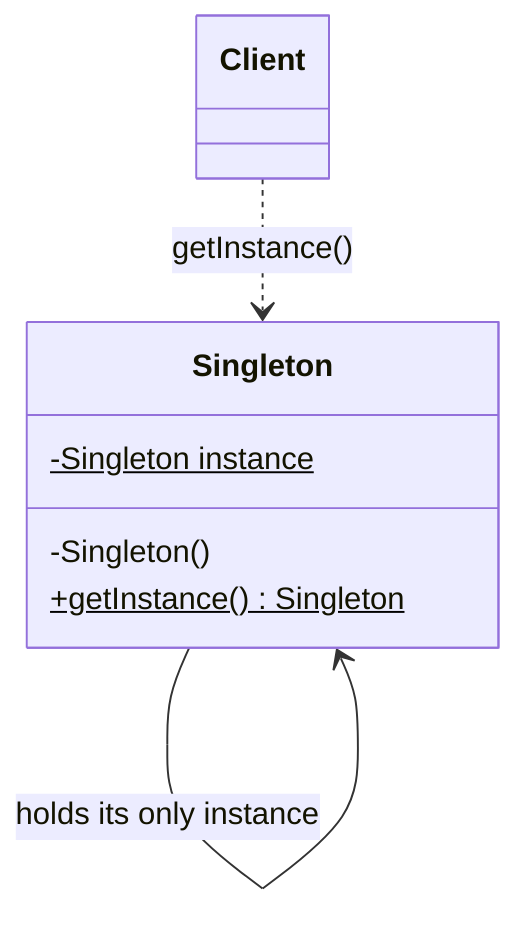
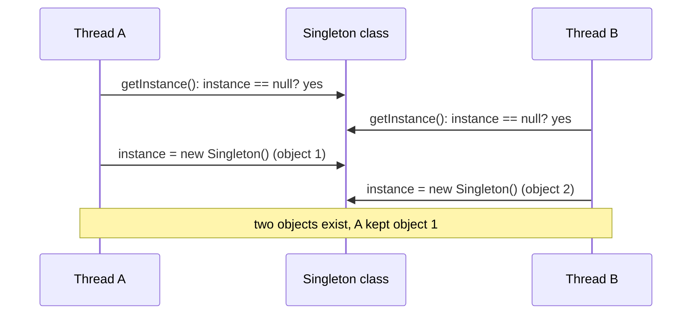
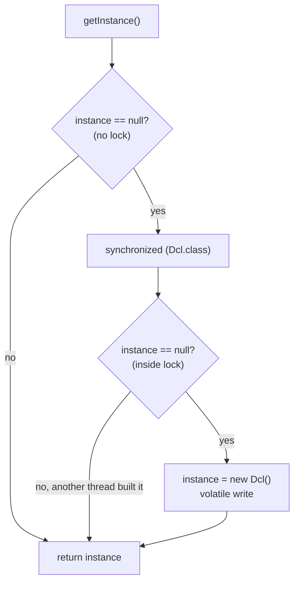

## In One Line
Singleton guarantees that a class has **exactly one instance** in the JVM (strictly: per class loader) and gives everyone a **global access point** to it, usually a static `getInstance()` method.

## Mental Model
Think of the **President of a country**. There is only one at a time. You never "create" a president yourself; you ask "who is the President?" and always get the same person.

How it maps to the code:
- **The constitution forbids anyone from appointing their own president** → the `private` constructor: no code outside the class can write `new Singleton()`.
- **The office itself, which remembers who holds it** → the `private static Singleton instance` field.
- **Asking "who is the President?"** → `Singleton.getInstance()`. The first question triggers the "election" (object creation); every later question returns the same person.
- **Two election commissions announcing two different winners at the same moment** → the race condition in the lazy version: two threads both see `instance == null` and both create an object. The rest of this lesson is mostly about preventing that second president.

## Concept
### Intent (Gang of Four)
> "Ensure a class only has one instance, and provide a global point of access to it."

Category: **creational** — it controls *how many* objects get created and *when*.

### The problem it solves
Some things must exist once per application: a configuration registry, a connection-pool manager, a cache, the `Runtime` of the JVM, a hardware device driver. If every caller did `new ConfigRegistry()`, you would get several copies that disagree with each other, waste memory, or fight over one physical resource. Singleton makes "only one" a rule the class enforces itself.

### Participants and how the example maps to them
| Participant | Role | In the example |
|---|---|---|
| **Singleton class** | Owns its only instance and blocks outside construction | `class Singleton` |
| **Private constructor** | Stops `new` from outside the class | `private Singleton()` |
| **Static instance field** | Holds the one object | `private static Singleton instance;` |
| **Global access point** | Returns (and, if lazy, creates) the instance | `public static Singleton getInstance()` |
| **Client** | Uses the instance, never creates it | `main` in `SingletonPatternExample` |

### The three building blocks every variant shares
1. **A `private` constructor** — the only way left to get an object is through the class itself.
2. **A `static` field** holding the instance — static means "belongs to the class", so there is one slot per class, not one per object.
3. **A `static` accessor** (`getInstance()`) — or a `public static final` field, or an enum constant.

The variants below differ only in **when** the object is created (eager vs lazy) and **how** they stay correct when many threads call `getInstance()` at once.

### Variant 1 — Lazy, not thread-safe (the course example)
```java
private static Singleton instance;
public static Singleton getInstance() {
    if (instance == null) {          // check
        instance = new Singleton();  // then act
    }
    return instance;
}
```
Fine in single-threaded code. In multithreaded code, "check-then-act" is **not atomic**: thread A sees `null`, is paused, thread B sees `null` too, and both run the constructor. The Code section runs this race with 8 threads and usually gets 8 different objects.

### Variant 2 — Eager initialisation
```java
public final class Eager {
    private static final Eager INSTANCE = new Eager();
    private Eager() { }
    public static Eager getInstance() { return INSTANCE; }
}
```
- **Thread-safe for free.** Static initialisers run during *class initialisation*, and the JVM guarantees class initialisation happens exactly once, under a lock (JLS §12.4.2). Every thread that later reads `INSTANCE` sees the fully built object.
- "Eager" means **eager relative to the class**, not "at JVM start-up". The class is initialised on its first active use — calling any static method, reading a non-constant static field, or `new`. So calling an unrelated static method like `Eager.hello()` still creates the instance (see the Code section).
- Downside: the object is created even if nobody ever calls `getInstance()`, and a constructor exception turns into `ExceptionInInitializerError` (and every later access into `NoClassDefFoundError`).

**Static-block variant** — same thing, but lets you handle checked exceptions:
```java
private static final Eager INSTANCE;
static {
    try { INSTANCE = new Eager(); }
    catch (Exception e) { throw new RuntimeException("Could not create singleton", e); }
}
```

### Variant 3 — Synchronized accessor
```java
public static synchronized Singleton getInstance() {
    if (instance == null) instance = new Singleton();
    return instance;
}
```
Correct and lazy, because only one thread at a time can run the method, and the monitor's release/acquire makes the new object visible to the next thread. The cost: **every** call takes the class lock, even the millions of calls after the object exists. Uncontended locks are cheap on modern JVMs, but under heavy contention this becomes a bottleneck.

### Variant 4 — Double-checked locking (DCL) with `volatile`
```java
public final class Dcl {
    private static volatile Dcl instance;          // volatile is NOT optional
    private Dcl() { }
    public static Dcl getInstance() {
        Dcl local = instance;                      // read the volatile field once
        if (local == null) {                       // 1st check: no lock (fast path)
            synchronized (Dcl.class) {
                local = instance;
                if (local == null) {               // 2nd check: with lock
                    instance = local = new Dcl();
                }
            }
        }
        return local;
    }
}
```
- **Why two checks?** The first avoids locking once the instance exists. The second is needed because two threads can both pass the first check; the one that enters the lock second must see that the first already created it.
- **Why `volatile`?** `instance = new Dcl()` is really three steps: (1) allocate memory, (2) run the constructor, (3) store the reference. Without `volatile`, the compiler or CPU may reorder (2) and (3). Another thread doing the *unlocked* first check can then see a **non-null reference to a half-constructed object** and use it. Since Java 5 (JSR-133, the new Java Memory Model), a `volatile` write *happens-before* every later read of that field, which forbids this reordering and guarantees the reader sees a fully constructed object. Before Java 5, DCL was broken even with `volatile`.
- **Why the `local` variable?** It is optional; reading a volatile field has a cost, and the local variable means the common path reads it only once (Effective Java, Item 83).

### Variant 5 — Initialization-on-demand holder (Bill Pugh idiom)
```java
public final class Holder {
    private Holder() { }
    private static class InstanceHolder {
        static final Holder INSTANCE = new Holder();
    }
    public static Holder getInstance() { return InstanceHolder.INSTANCE; }
}
```
- **Lazy:** the nested class `InstanceHolder` is not initialised until `getInstance()` first touches `InstanceHolder.INSTANCE`. Other static methods of `Holder` do not create the instance.
- **Thread-safe without any `synchronized` or `volatile` in your code:** it reuses the JVM's once-only, locked class initialisation.
- **Fast:** after initialisation it is a plain static field read.
- Limitation: the constructor cannot take runtime arguments, and if it throws, the holder class is permanently unusable (`NoClassDefFoundError` on later calls).

### Variant 6 — Enum singleton (Effective Java, Item 3)
```java
public enum Registry {
    INSTANCE;
    private final Map<String, String> settings = new ConcurrentHashMap<>();
    public String get(String key) { return settings.get(key); }
}
// use: Registry.INSTANCE.get("mode")
```
Joshua Bloch: *"a single-element enum type is often the best way to implement a singleton."*
- Thread-safe creation (enum constants are created in the enum's static initialiser).
- **Serialization-safe for free:** enums are serialized by *name* and deserialized with `Enum.valueOf`, so you always get the same constant back.
- **Reflection-safe:** `Constructor.newInstance` refuses enum types with `IllegalArgumentException: Cannot reflectively create enum objects`.
- **Clone-safe:** `Enum.clone()` is `final` and throws `CloneNotSupportedException`.
- Limitations: an enum cannot extend another class (it already extends `java.lang.Enum`), though it can implement interfaces; it looks unusual to some teams; it is lazy only in the sense that the enum class is initialised on first use.

### Comparison of all variants
| Variant | Lazy? | Thread-safe? | Cost per call | Survives reflection / serialization? |
|---|---|---|---|---|
| Lazy, unsynchronized (course example) | Yes | **No** | Cheapest | No / No |
| Eager (static field or static block) | No (on class init) | Yes (class init) | Field read | No / No (needs guards) |
| `synchronized` method | Yes | Yes | Lock on every call | No / No |
| Double-checked locking + `volatile` | Yes | Yes (Java 5+) | Volatile read | No / No |
| Holder idiom | Yes | Yes (class init) | Field read | No / No |
| Enum | On enum class init | Yes | Field read | **Yes / Yes** |

### How Singleton gets broken — and the defences
| Attack | How it creates a 2nd instance | Defence |
|---|---|---|
| **Reflection** | `getDeclaredConstructor()`, `setAccessible(true)`, `newInstance()` calls the private constructor | Throw from the constructor if the instance already exists (works for eager/holder; for lazy variants it fails if the attacker goes first), or use an **enum** |
| **Serialization** | `readObject()` builds a brand-new object *without calling your constructor* | Add `private Object readResolve() { return INSTANCE; }`, mark other instance fields `transient`, or use an **enum** |
| **Cloning** | If the class (or a superclass) is `Cloneable`, `clone()` copies the object field by field | Override `clone()` to throw `CloneNotSupportedException` (or return `INSTANCE`); do not implement `Cloneable` |
| **Multiple class loaders** | Each class loader loads its own copy of the class, each with its own static field (common in app servers, plugin systems) | Load the class from a shared parent loader; accept "one per loader" |
| **Race condition** | Two threads pass the `null` check together | Any of the thread-safe variants |
| `Unsafe.allocateInstance` / deep JVM tricks | Allocates without any constructor | No defence in plain Java; out of scope for normal code |

> [!NOTE] A private constructor only blocks `new` at **compile time**. It is an access rule, not a security boundary — reflection can switch it off (for classes on the class path; since Java 9, strong encapsulation of *modules* can prevent `setAccessible` across module boundaries).

### When to use it
- A resource that genuinely must be one per process: JVM runtime info, a registry of drivers, a hardware gateway, an in-memory cache, a stateless utility service with expensive setup.
- When you need **one shared object that can implement an interface** or be passed around (something a class of static methods cannot do).

### When NOT to use it
- **Global mutable state in disguise.** Any code anywhere can change it, so bugs become action-at-a-distance.
- **Hidden dependencies.** A method that calls `Config.getInstance()` inside does not show that dependency in its signature.
- **Hard to unit test.** You cannot easily substitute a fake; tests leak state into each other through the shared instance.
- **Violates Single Responsibility.** The class does its job *and* controls its own lifecycle.
- **Better alternative in modern apps:** let a **dependency-injection container** create one instance and inject it. You get "only one" without the static access point, and tests can inject a mock.

### Real JDK and Spring examples
| Where | What |
|---|---|
| `Runtime.getRuntime()` | Classic eager singleton: `private static final Runtime currentRuntime = new Runtime();` |
| `Desktop.getDesktop()`, `LogManager.getLogManager()` | Singleton access points |
| `Collections.emptyList()` / `emptyMap()` | Return one shared immutable instance each time |
| `Comparator.naturalOrder()` | Returns an **enum** singleton (`NaturalOrderComparator.INSTANCE`) inside the JDK |
| Spring beans (default **singleton scope**) | One instance **per bean definition per `ApplicationContext`**, created and injected by the container — the class itself has a normal public constructor. It is "container-managed singleton", not the GoF Singleton: two contexts, or two bean definitions of the same class, give two instances. |

### Singleton vs look-alikes
| | Singleton | Static utility class (`Math`) | Spring singleton bean | Flyweight | Monostate |
|---|---|---|---|---|---|
| Number of objects | Exactly one | Zero (no instances) | One per bean definition per container | One **per key** (e.g. per colour) | Many objects, **shared static state** |
| Can implement an interface / be passed as a parameter | Yes | No | Yes | Yes | Yes |
| Lazy init possible | Yes | Only for static fields | Yes (`@Lazy`) | Yes | N/A |
| Who enforces "one" | The class itself | N/A | The container | A factory | N/A |

## Diagram

The class holds a static reference to its own single instance; clients can only reach it through the static `getInstance()`.


The race in the course's lazy version: both threads pass the check before either assigns, so two objects get built.


Double-checked locking: the lock is taken only while the instance does not exist yet; `volatile` makes the published object fully constructed for every reader.

## Code
@example CoreJava/CreationalPatterns/SingletonPatternExample.java

**The race in action.** The course version, hit by 8 threads at once (the constructor sleeps 50 ms to widen the race window):
```java
import java.util.Set;
import java.util.concurrent.*;

public class RaceDemo {
    static class LazySingleton {
        private static LazySingleton instance;
        private LazySingleton() {
            try { Thread.sleep(50); } catch (InterruptedException e) { }  // slow constructor widens the race window
        }
        static LazySingleton getInstance() {
            if (instance == null) {              // check ...
                instance = new LazySingleton();  // ... then act: not atomic!
            }
            return instance;
        }
    }

    public static void main(String[] args) throws Exception {
        Set<LazySingleton> seen = ConcurrentHashMap.newKeySet();
        ExecutorService pool = Executors.newFixedThreadPool(8);
        CountDownLatch start = new CountDownLatch(1);
        for (int i = 0; i < 8; i++) {
            pool.submit(() -> { start.await(); seen.add(LazySingleton.getInstance()); return null; });
        }
        start.countDown();          // release all 8 threads at once
        pool.shutdown();
        pool.awaitTermination(5, TimeUnit.SECONDS);
        System.out.println("Distinct instances created: " + seen.size());
    }
}
```
```output
Distinct instances created: 8
```
The number varies by run (six runs gave 8, 5, 8, 8, 8, 8) — it depends on thread scheduling. Any number above 1 proves the pattern is broken.

**Eager vs holder: when is the object really created?**
```java
public class EagerVsHolder {
    static class Eager {
        private static final Eager INSTANCE = new Eager();
        private Eager() { System.out.println("Eager instance created"); }
        static Eager getInstance() { return INSTANCE; }
        static void hello() { System.out.println("Eager.hello()"); }
    }

    static class Lazy {
        private Lazy() { System.out.println("Lazy instance created"); }
        private static class Holder { static final Lazy INSTANCE = new Lazy(); }
        static Lazy getInstance() { return Holder.INSTANCE; }
        static void hello() { System.out.println("Lazy.hello()"); }
    }

    public static void main(String[] args) {
        Eager.hello();
        Lazy.hello();
        Lazy.getInstance();
    }
}
```
```output
Eager instance created
Eager.hello()
Lazy.hello()
Lazy instance created
```
Calling *any* static method of `Eager` initialises the class and builds the instance. The holder version builds it only when `getInstance()` touches the nested `Holder` class.

**Breaking a singleton three ways, and the defences:**
```java
import java.io.*;
import java.lang.reflect.Constructor;

public class BreakIt {
    static class Base implements Cloneable {
        @Override protected Object clone() throws CloneNotSupportedException { return super.clone(); }
    }

    // A "normal" singleton with no defences
    static class Weak extends Base implements Serializable {
        private static final Weak INSTANCE = new Weak();
        private Weak() { }
        static Weak getInstance() { return INSTANCE; }
    }

    // The same singleton with all three defences
    static class Strong extends Base implements Serializable {
        private static final Strong INSTANCE = new Strong();
        private Strong() {
            if (INSTANCE != null) throw new IllegalStateException("Use getInstance()");
        }
        static Strong getInstance() { return INSTANCE; }
        @Serial private Object readResolve() { return INSTANCE; }          // serialization
        @Override protected Object clone() throws CloneNotSupportedException {
            throw new CloneNotSupportedException("Singleton");            // cloning
        }
    }

    enum EnumSingleton { INSTANCE }

    static Object roundTrip(Object o) throws Exception {
        ByteArrayOutputStream bytes = new ByteArrayOutputStream();
        try (ObjectOutputStream out = new ObjectOutputStream(bytes)) { out.writeObject(o); }
        try (ObjectInputStream in = new ObjectInputStream(new ByteArrayInputStream(bytes.toByteArray()))) {
            return in.readObject();
        }
    }

    public static void main(String[] args) throws Exception {
        // 1. Reflection
        Constructor<Weak> c = Weak.class.getDeclaredConstructor();
        c.setAccessible(true);
        System.out.println("Reflection    breaks Weak?   " + (c.newInstance() != Weak.getInstance()));
        Constructor<Strong> cs = Strong.class.getDeclaredConstructor();
        cs.setAccessible(true);
        try { cs.newInstance(); }
        catch (java.lang.reflect.InvocationTargetException e) {
            System.out.println("Reflection    on Strong:     " + e.getCause());
        }

        // 2. Serialization
        System.out.println("Serialization breaks Weak?   " + (roundTrip(Weak.getInstance()) != Weak.getInstance()));
        System.out.println("Serialization breaks Strong? " + (roundTrip(Strong.getInstance()) != Strong.getInstance()));

        // 3. Cloning
        System.out.println("Clone         breaks Weak?   " + (Weak.getInstance().clone() != Weak.getInstance()));
        try { Strong.getInstance().clone(); }
        catch (CloneNotSupportedException e) { System.out.println("Clone         on Strong:     " + e); }

        // 4. Enum is immune to all of them
        System.out.println("Enum  serialized copy same?  " + (roundTrip(EnumSingleton.INSTANCE) == EnumSingleton.INSTANCE));
        Constructor<EnumSingleton> ce = EnumSingleton.class.getDeclaredConstructor(String.class, int.class);
        ce.setAccessible(true);
        try { ce.newInstance("COPY", 1); }
        catch (IllegalArgumentException e) { System.out.println("Enum  reflection:            " + e.getMessage()); }
    }
}
```
```output
Reflection    breaks Weak?   true
Reflection    on Strong:     java.lang.IllegalStateException: Use getInstance()
Serialization breaks Weak?   true
Serialization breaks Strong? false
Clone         breaks Weak?   true
Clone         on Strong:     java.lang.CloneNotSupportedException: Singleton
Enum  serialized copy same?  true
Enum  reflection:            Cannot reflectively create enum objects
```
Every enum has a hidden `(String name, int ordinal)` constructor, which is why the reflection attempt asks for those parameter types — and the JDK still refuses.

## Walkthrough
- `package CoreJava.CreationalPatterns;` — all four creational examples share this package, which is why other files use names like `Circle1` (top-level class names must be unique inside a package).
- `class Singleton` — package-private and not `final`. Nothing outside the file's package can even see it.
- `private static Singleton instance;` — the single slot. Being `static`, it belongs to the class, and it starts as `null` (default value for references). It is not `final` (it is assigned later) and not `volatile` — fine for one thread, a problem for many.
- `private Singleton() { System.out.println("Singleton instance created"); }` — the private constructor means `new Singleton()` compiles only inside `Singleton` itself. The `println` is a probe: it lets you *see* how many times an object is built.
- `public static Singleton getInstance()` — **lazy initialisation**. First call: `instance` is `null`, so the object is created (printing the message) and stored. Every later call skips the `if` and returns the stored reference.
- `Singleton singleton1 = Singleton.getInstance();` — first call → prints **`Singleton instance created`**.
- `Singleton singleton2 = Singleton.getInstance();` — second call → returns the same object, prints nothing.
- `singleton1 == singleton2` — `==` on references compares **identity** (same object on the heap), not content. Both variables hold the same reference, so it prints **`Are both instances the same? true`**.
- The output is deterministic (no `.varies` file): `main` is single-threaded, so the race cannot happen here.

## Traps
> [!ERRATA] The class is presented as "the" Singleton, but its `getInstance()` is **not thread-safe**: `if (instance == null) instance = new Singleton();` is a check-then-act race. Two threads can both see `null` and both run the constructor (the Code section's `RaceDemo` creates up to 8 instances). Use the holder idiom, an enum, a `synchronized` accessor, or double-checked locking with `volatile`.

> [!ERRATA] Line 30's comment says `// Ouitput:` — a typo for `// Output:`. The expected text after it is correct.

> [!ERRATA] The comment "Private constructor to prevent instantiation" is only true for normal code. Reflection (`setAccessible(true)`), deserialization (the class is not `Serializable` here, but would be vulnerable if it were) and cloning (if a superclass were `Cloneable`) can all create extra instances. The class should also be declared `final` to make the intent explicit.

- **DCL without `volatile` is broken.** It compiles, it passes tests on your laptop, and it can still hand out a partially constructed object on another CPU. Interviewers ask this specifically.
- **`synchronized` on the wrong lock.** `synchronized (this)` inside a *static* method does not compile; `synchronized (new Object())` locks nothing useful. Lock on `Singleton.class` or a `private static final Object LOCK`.
- **Eager is not "at JVM startup".** The instance is created when the class is initialised — on first use of any static member (see `EagerVsHolder`).
- **Reflection guard + lazy init = order bug.** In a lazy singleton, the `if (instance != null) throw` guard does nothing if the attacker calls the constructor *before* anyone calls `getInstance()`.
- **`readResolve` must return `Object`.** The serialization machinery looks for exactly `Object readResolve()` (any access modifier; `private` is usual). Writing `private Singleton readResolve()` compiles but is silently ignored — a quick test shows the deserialized copy is still a different object.
- **Deserialization does not call your constructor.** A print in the constructor will not tell you that a second object appeared (see the Quiz).
- **One per class loader, not per JVM.** Web containers and plugin frameworks can load the same class twice.
- **Singletons that hold mutable state need their own thread-safety.** Creating the instance safely does not make its methods safe; use `ConcurrentHashMap`, locks or immutability inside.
- **Exception in a static initialiser** turns into `ExceptionInInitializerError`, and the class is then unusable for the rest of the JVM's life (`NoClassDefFoundError`).

> [!WARNING] Singletons make unit tests order-dependent: state set by one test leaks into the next. If you must keep one, give it a package-private `reset()` for tests or, better, inject it.

## Tips & Tricks
- **Mnemonic — "P-S-S": Private constructor, Static field, Static accessor.** Every singleton has these three.
- **Pick the variant with one question: "Do I need to extend a class?"** No → **enum**. Yes → **holder idiom**. Only reach for DCL if you need lazy creation *with runtime arguments* or a non-static instance field.
- **DCL memory hook — "Check, Lock, Check, Volatile".** If you forget any of the four words, it is broken.
- **"Enum beats all three breakers"** — reflection, serialization, cloning.
- **Holder idiom hook:** "the JVM is my lock" — class initialisation is already lazy and thread-safe, so let it do the work.
- In interviews, after writing a singleton, say: *"In production I would usually let the DI container manage a single instance instead, because static singletons hide dependencies and hurt testability."* That one sentence shows judgement.
- To unit-test code that uses a singleton, depend on an **interface** the singleton implements and pass the instance in; tests pass a fake.

## Interview Q&A
### [Basic] What is the Singleton pattern and how do you implement it in Java?
Singleton ensures a class has only one instance and provides a global access point to it. The recipe has three parts: a `private` constructor so no outside code can call `new`, a `private static` field that holds the one instance, and a `public static` method (or field) that returns it. The simplest correct version is eager:
```java
public final class AppConfig {
    private static final AppConfig INSTANCE = new AppConfig();
    private AppConfig() { }
    public static AppConfig getInstance() { return INSTANCE; }
}
```
**Follow-up:** *Is it lazy?* — Not truly: the instance is created when the class is initialised, which happens on the first use of any static member of `AppConfig`. Use the holder idiom if you need creation strictly on `getInstance()`.

### [Basic] Why is the lazy version in the course example not thread-safe?
`if (instance == null) instance = new Singleton();` is a check-then-act sequence with no synchronisation. Thread A checks and sees `null`; before it assigns, thread B also checks and sees `null`. Both call the constructor, so two objects exist, and different callers may keep different ones. There is also a visibility problem: without synchronisation or `volatile`, one thread's write to `instance` is not guaranteed to be seen by another thread at all.

**Follow-up:** *What is the quickest fix?* — Make `getInstance()` `synchronized`, or switch to the holder idiom, which is lazy and lock-free.

### [Intermediate] Explain double-checked locking. Why is `volatile` required?
DCL checks `instance == null` without a lock (fast path), and only if it is null enters `synchronized (Singleton.class)` and checks again before creating. The second check is needed because two threads can both pass the first check. `volatile` is required because `instance = new Singleton()` is allocate → construct → publish, and without `volatile` the JIT or CPU may publish the reference before the constructor finishes. A thread on the unlocked fast path could then see a non-null but half-initialised object. Under the Java 5+ memory model a volatile write happens-before any subsequent volatile read of the same field, so readers always see a fully constructed object.

**Follow-up:** *Did DCL work before Java 5?* — No. The old memory model did not give `volatile` these ordering guarantees, so DCL was considered broken until JSR-133 (Java 5).

### [Intermediate] What is the Bill Pugh (holder) singleton and why is it thread-safe without `synchronized`?
You put the instance in a private static nested class:
```java
private static class Holder { static final Singleton INSTANCE = new Singleton(); }
public static Singleton getInstance() { return Holder.INSTANCE; }
```
The nested class is not initialised until `getInstance()` first reads `Holder.INSTANCE`, so creation is lazy. The JVM specification (JLS §12.4.2) guarantees that class initialisation runs exactly once, with a lock, and that every thread sees the result — so the JVM provides the synchronisation, and later calls are a plain field read.

**Follow-up:** *What happens if the constructor throws?* — The holder's initialisation fails with `ExceptionInInitializerError`; later calls get `NoClassDefFoundError`. The singleton can never be created in that JVM.

### [Intermediate] Why does Joshua Bloch recommend an enum singleton?
`enum Singleton { INSTANCE; }` is concise and gets three protections from the language for free: the JVM creates the constant once during enum initialisation (thread-safe); serialization writes enums by name and deserialization looks the constant up with `valueOf`, so no copy is created; and reflection cannot instantiate enums (`Cannot reflectively create enum objects`). `Enum.clone()` is final and throws, so cloning is blocked too.

**Follow-up:** *When can you not use it?* — When the singleton must extend a superclass (enums already extend `java.lang.Enum`), or when a framework needs a regular class (for example, one that must be proxied by subclassing).

### [Intermediate] How can a singleton be broken, and how do you prevent each case?
- **Reflection:** `setAccessible(true)` on the private constructor. Prevent by throwing from the constructor if the instance exists, or use an enum.
- **Serialization:** deserialization creates a new object without calling the constructor. Prevent with `private Object readResolve() { return INSTANCE; }` (and `transient` instance fields), or use an enum.
- **Cloning:** if the class or a superclass is `Cloneable`. Override `clone()` to throw `CloneNotSupportedException`.
- **Multithreading:** use a thread-safe variant.
- **Multiple class loaders:** each loader gets its own class and static field; load it from a common parent loader.

**Follow-up:** *Which single choice covers most of them?* — The enum singleton: it covers reflection, serialization, cloning and thread-safety.

### [Intermediate] Singleton vs a class with only static methods — which would you choose?
A static utility class (`Math`, `Collections`) has no instance at all; it is right for stateless helper functions. A singleton is a real object: it can implement an interface, be passed as a parameter, be replaced by a mock in tests, hold state, be lazily initialised, and take part in polymorphism. Choose a static class for pure functions; a singleton (ideally container-managed) when you need an object with state or an interface.

**Follow-up:** *Can a static class be lazy?* — Its static fields can use the holder trick, but you cannot swap its implementation, since static methods are not overridable.

### [Intermediate] Is a Spring singleton bean the same as the GoF Singleton?
No. Spring's singleton scope means **one instance per bean definition per `ApplicationContext`**. The class itself has an ordinary public constructor; nothing stops you from calling `new` or defining two beans of the same class, and two application contexts give two instances. The GoF Singleton is enforced by the class itself and is (per class loader) global. Spring's approach keeps the benefits — one shared object — while dependencies stay visible and replaceable through injection.

**Follow-up:** *Are Spring singleton beans thread-safe?* — Not automatically. Spring creates them safely, but concurrent calls to their methods are your responsibility; keep them stateless or protect shared state.

### [Advanced] Why is Singleton sometimes called an anti-pattern?
Because it is global mutable state with a nicer name. It hides dependencies (a method calls `X.getInstance()` internally, so its signature lies about what it needs), couples code to a concrete class, makes tests order-dependent and hard to mock, breaks the Single Responsibility Principle (the class manages its own lifecycle as well as its job), and becomes a contention point under concurrency. Modern practice is to keep the "only one instance" property but move the responsibility to a DI container, which creates one instance and injects it where needed.

**Follow-up:** *When is a real Singleton still justified?* — For truly process-wide, stateless or infrastructure objects with no DI available: `Runtime`, a JVM-wide registry, library internals like `Comparator.naturalOrder()`.

### [Advanced] Write a thread-safe lazy singleton that needs a constructor argument read at runtime.
The holder idiom and enum cannot take arguments, so use double-checked locking and decide what to do on a second call with a different argument:
```java
public final class Db {
    private static volatile Db instance;
    private final String url;
    private Db(String url) { this.url = url; }

    public static Db init(String url) {
        Db local = instance;
        if (local == null) {
            synchronized (Db.class) {
                local = instance;
                if (local == null) instance = local = new Db(url);
            }
        }
        if (!local.url.equals(url)) throw new IllegalStateException("Already initialised with " + local.url);
        return local;
    }
}
```
**Follow-up:** *Why make `url` final?* — `final` fields have their own safe-publication guarantee and make the singleton immutable, so its methods are safe to call from many threads.

### [Advanced] How does `readResolve` work, and what is its weakness?
During deserialization, after `ObjectInputStream` builds the new object and fills its fields, it checks whether the class has a `readResolve()` method; if so, it returns whatever that method returns instead of the new object. Returning `INSTANCE` makes the freshly built copy immediately garbage. The weakness (Effective Java, Item 89): if the singleton has non-transient reference fields, a crafted byte stream can grab a reference to the temporary copy *before* `readResolve` runs. So all instance fields should be `transient` — or use an enum, which never needs `readResolve`.

**Follow-up:** *Is the constructor called during deserialization?* — No. Java calls the no-arg constructor of the first non-serializable superclass (here `Object`) and fills fields from the stream.

## Quiz
### In the original example, how many times is "Singleton instance created" printed if `main` calls `getInstance()` five times?
- [ ] Five times
- [x] Once
- [ ] Never, because the constructor is private
- [ ] Twice: once for the class and once for the object
> The first call finds `instance == null` and runs the constructor; the next four calls return the stored reference. "Private" only restricts *who* may call the constructor, not whether it runs — `getInstance()` is inside the class, so it can call it.

### What does this print?
```java
public class EagerVsHolder {
    static class Eager {
        private static final Eager INSTANCE = new Eager();
        private Eager() { System.out.println("Eager instance created"); }
        static Eager getInstance() { return INSTANCE; }
        static void hello() { System.out.println("Eager.hello()"); }
    }
    static class Lazy {
        private Lazy() { System.out.println("Lazy instance created"); }
        private static class Holder { static final Lazy INSTANCE = new Lazy(); }
        static Lazy getInstance() { return Holder.INSTANCE; }
        static void hello() { System.out.println("Lazy.hello()"); }
    }
    public static void main(String[] args) {
        Eager.hello();
        Lazy.hello();
        Lazy.getInstance();
    }
}
```
- [ ] Eager.hello() / Lazy.hello() / Lazy instance created
- [x] Eager instance created / Eager.hello() / Lazy.hello() / Lazy instance created
- [ ] Eager instance created / Lazy instance created / Eager.hello() / Lazy.hello()
- [ ] Eager.hello() / Eager instance created / Lazy.hello() / Lazy instance created
> Calling the static method `Eager.hello()` initialises class `Eager`, which runs its static field initialiser first — so the instance is built before `hello()` prints. `Lazy.hello()` does not touch the nested `Holder` class, so no instance yet; only `getInstance()` initialises `Holder`. The tempting first option forgets that "eager" means "at class initialisation", which any static call triggers.

### Spot the bug in this double-checked locking.
```java
private static Singleton instance;
public static Singleton getInstance() {
    if (instance == null) {
        synchronized (Singleton.class) {
            if (instance == null) instance = new Singleton();
        }
    }
    return instance;
}
```
- [ ] The second `if` is redundant
- [ ] It should lock on `this`
- [x] `instance` is not `volatile`, so another thread can see a partially constructed object
- [ ] `synchronized` blocks cannot be used in static methods
> Without `volatile`, the write of the reference can be reordered before the constructor finishes, and a thread on the unlocked first check can use a half-built object. The second `if` is essential (two threads may pass the first check); `this` does not exist in a static method; static methods can use `synchronized (Singleton.class)`.

### What does this print?
```java
import java.io.*;

public class SerQuiz {
    static class Config implements Serializable {
        static final Config INSTANCE = new Config();
        private Config() { System.out.println("constructor"); }
    }
    public static void main(String[] args) throws Exception {
        ByteArrayOutputStream bytes = new ByteArrayOutputStream();
        new ObjectOutputStream(bytes).writeObject(Config.INSTANCE);
        Object copy = new ObjectInputStream(new ByteArrayInputStream(bytes.toByteArray())).readObject();
        System.out.println(copy == Config.INSTANCE);
    }
}
```
- [ ] constructor / true
- [ ] constructor / constructor / false
- [x] constructor / false
- [ ] true
> The constructor runs once, during class initialisation. Deserialization creates a new object **without calling `Config`'s constructor** (it only calls `Object()`), so nothing extra is printed, yet `copy` is a different object → `false`. Adding `private Object readResolve() { return INSTANCE; }` would make it `true`.

### Which implementation is protected against reflection, serialization AND cloning without extra code?
- [ ] Holder idiom
- [ ] Double-checked locking with `volatile`
- [x] `enum Singleton { INSTANCE; }`
- [ ] Eager `private static final` field
> The JVM refuses to create enum instances reflectively, serializes enums by name, and `Enum.clone()` always throws. The holder, DCL and eager variants are thread-safe but still need a constructor guard, `readResolve` and a throwing `clone()`.

### Why is a `synchronized getInstance()` often replaced by the holder idiom?
- [ ] `synchronized` does not make it thread-safe
- [x] It takes a lock on every call, even after the instance exists
- [ ] It cannot be lazy
- [ ] It breaks serialization
> The synchronized version is correct and lazy, but every single call acquires the class lock, which can become a bottleneck under contention. The holder idiom is equally lazy and safe, with a plain field read after initialisation. Serialization is unrelated to locking.

### In Spring, a bean class `ReportService` has the default scope, and two separate `ApplicationContext`s load the same configuration. How many `ReportService` objects exist?
- [ ] One per JVM
- [x] Two — one per container
- [ ] One per request
- [ ] Zero until someone calls `getInstance()`
> Spring's singleton scope means one instance per bean definition **per container**, created by the container through a normal constructor. It is not a JVM-wide GoF Singleton, so two contexts give two objects.

## Takeaways
- Singleton = one instance per class loader + a global access point; the recipe is a private constructor, a static field and a static accessor.
- The course's lazy `if (instance == null)` version is not thread-safe: two threads can both create an instance.
- Thread-safe variants: eager static field (or static block), `synchronized` accessor, double-checked locking **with `volatile`**, the holder idiom, and the enum.
- DCL needs `volatile` because object creation can be reordered and publish a half-built object; it works only since Java 5.
- The holder idiom is lazy and lock-free because the JVM's class initialisation is itself lazy and thread-safe.
- Reflection, serialization and cloning can all create extra instances; defend with a constructor guard, `readResolve()` and a throwing `clone()` — or use an enum, which is immune to all three.
- Singletons are global state: they hide dependencies and hurt testing, so prefer a DI container's singleton scope in application code.
