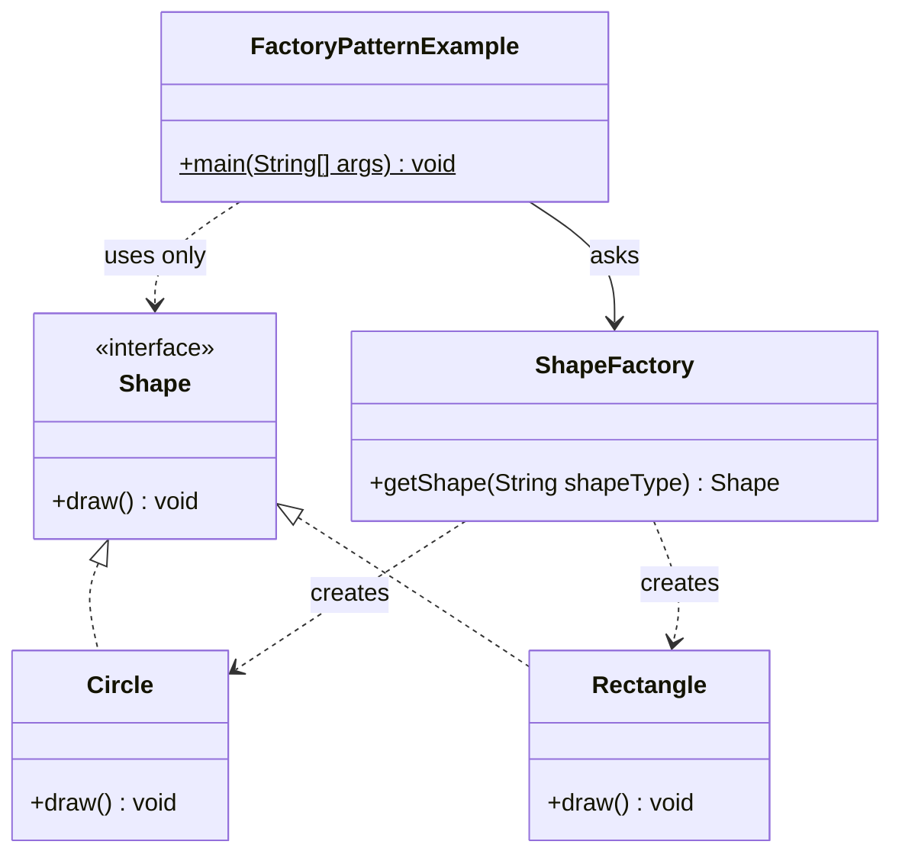
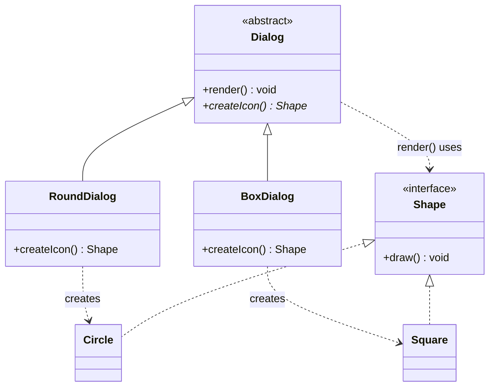
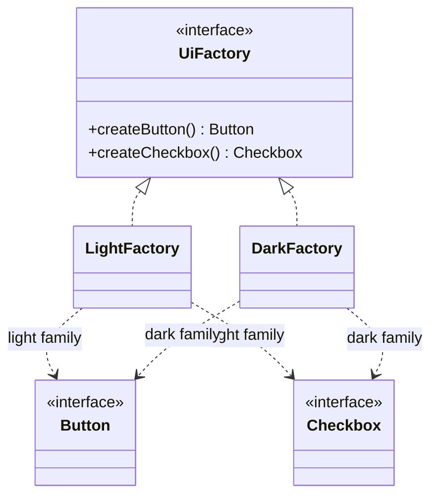

## In One Line
A factory moves `new ConcreteClass()` out of the caller and behind a method: the caller asks for "a `Shape` of type CIRCLE" and gets back something that implements `Shape`, without ever naming `Circle`.

## Mental Model
Think of a **car-rental counter**. You say "I want an SUV". The counter decides which exact model you get (a Creta today, an XUV tomorrow) and hands you the keys. You only ever use the standard controls — steering, pedals — so you can drive whatever arrives.

How it maps to the code:
- **The counter** → `ShapeFactory`: the one place that knows how to pick and create a concrete object.
- **"I want an SUV"** → the request `getShape("CIRCLE")`.
- **The standard controls every car has** → the `Shape` interface with `draw()`.
- **The actual model you receive** → `Circle` or `Rectangle`. The customer never deals with the model directly; the counter can change its fleet without customers changing how they rent.
- **"Sorry, we don't rent tanks"** → an unknown type. A good counter says so clearly (an exception); the course's factory hands you an empty key ring (`null`) and you find out only when you try to drive.

## Concept
### "Factory" is a family, not one pattern
Interviewers use the word loosely. Know the four members and say which one you mean:

| Name | GoF pattern? | What varies | Shape of the code |
|---|---|---|---|
| **Simple Factory** (the course example) | No — a common idiom | A parameter picks the class | One class with a `create(type)` method containing `if`/`switch` |
| **Factory Method** | Yes (creational) | A **subclass** picks the class | An abstract/overridable method `createX()` in a creator class; subclasses override it |
| **Abstract Factory** | Yes (creational) | A whole **family** of related products | An interface with several `createA()`, `createB()` methods; one implementation per family |
| **Static factory method** | No — Effective Java, Item 1 | Hides constructors, may cache or return subtypes | `Integer.valueOf(5)`, `List.of(...)`, `EnumSet.of(...)` |

### The problem factories solve
`new Circle()` hard-wires the caller to one concrete class. When the choice depends on input, configuration or platform, that choice (`if type == ...`) ends up copied into every caller. Factories:
- **centralise** the creation decision in one place;
- let callers depend on the **abstraction** (`Shape`), not the implementation (`Circle`) — "program to an interface";
- make it possible to change, cache, pool or swap implementations without touching callers.

### Simple Factory — the course example
| Participant | Role | In the example |
|---|---|---|
| **Product** | Common interface the client uses | `interface Shape { void draw(); }` |
| **Concrete products** | Real implementations | `Circle`, `Rectangle` |
| **Factory** | Chooses and creates the concrete class | `ShapeFactory.getShape(String)` |
| **Client** | Asks the factory, uses only `Shape` | `main` in `FactoryPatternExample` |

Its weakness: every new shape means **editing** `getShape` (adding an `else if`) — it violates the Open/Closed Principle. Three ways to improve it:
1. **Enum + switch expression** — no typos, and the compiler forces you to handle every constant:
   ```java
   enum ShapeType { CIRCLE, RECTANGLE }
   static Shape create(ShapeType type) {
       return switch (type) {          // no default needed: exhaustive over the enum
           case CIRCLE -> new Circle();
           case RECTANGLE -> new Rectangle();
       };
   }
   ```
2. **Registry of constructors** — `Map<String, Supplier<Shape>>` filled with `Circle::new`; new types are *registered*, not coded into the factory (see Code).
3. **Fail loudly** — throw `IllegalArgumentException` for unknown types instead of returning `null`.

### Factory Method (GoF)
> "Define an interface for creating an object, but let subclasses decide which class to instantiate. Factory Method lets a class defer instantiation to subclasses."

| Participant | Role | In the Code-section snippet |
|---|---|---|
| **Product** | Interface of created objects | `Shape` |
| **ConcreteProduct** | Implementation | `Circle`, `Square` |
| **Creator** | Declares the factory method and usually has logic that *uses* the product | `abstract class Dialog` with `abstract Shape createIcon()` and `render()` |
| **ConcreteCreator** | Overrides the factory method to return a specific product | `RoundDialog`, `BoxDialog` |

The key idea: the creator's own algorithm (`render()`) calls `createIcon()` without knowing which class comes back. It is a **hook** inside a larger algorithm — often combined with Template Method. In the JDK, `Iterable.iterator()` is a factory method: `ArrayList` returns its own `Itr`, `HashSet` returns a key iterator, and the for-each loop never knows which.

### Abstract Factory (GoF)
> "Provide an interface for creating families of related or dependent objects without specifying their concrete classes."

| Participant | Role | In the Code-section snippet |
|---|---|---|
| **AbstractFactory** | One creation method per product kind | `UiFactory { createButton(); createCheckbox(); }` |
| **ConcreteFactory** | Creates one consistent family | `LightFactory`, `DarkFactory` |
| **AbstractProduct** | Interface per product kind | `Button`, `Checkbox` |
| **ConcreteProduct** | Family members | light/dark buttons and checkboxes |
| **Client** | Receives a factory, uses only abstract types | `buildScreen(UiFactory)` |

It guarantees **consistency**: you cannot accidentally mix a dark button with a light checkbox, because one factory object makes the whole family. Its cost: adding a new *kind* of product (say `Slider`) changes the interface and every concrete factory. Each concrete factory is often a Singleton, and its methods are usually Factory Methods.

### Static factory methods (Effective Java, Item 1)
"Consider static factory methods instead of constructors." Advantages over `new`:
1. **They have names** — `BigInteger.probablePrime(...)` says more than a constructor.
2. **They need not create a new object** — `Integer.valueOf(100)` and `Boolean.valueOf(true)` return cached instances.
3. **They can return any subtype** — `List.of()` returns hidden classes (`ListN`, `List12`), so callers depend only on `List`.
4. **The returned class can vary with the input** — `EnumSet.of(...)` returns `RegularEnumSet` for enums with up to 64 constants and `JumboEnumSet` above that.
5. **The class need not exist when the factory is written** — `ServiceLoader`, JDBC `DriverManager.getConnection`.

Downsides: a class with only private constructors cannot be subclassed, and factories are harder to spot in Javadoc. Common names: `from`, `of`, `valueOf`, `getInstance`/`instance`, `newInstance`/`create`, `getType`, `newType`, `type` (e.g. `Files.newBufferedReader`, `Collections.list`).

### When to use a factory
- The exact class depends on input, configuration, environment or platform.
- You want callers to depend only on an interface (testing, plug-ins, swapping implementations).
- Creation is complicated (caching, pooling, validation) and should live in one place.
- You need consistent families of objects (Abstract Factory).

### When NOT to use one
- There is only one implementation and no sign of a second — `new` is clearer (YAGNI).
- The object has many optional parameters — that is a **Builder** problem, not a factory problem.
- A DI container already decides which implementation to inject — a hand-written factory just duplicates it.

### Real JDK and Spring examples
| Where | Kind |
|---|---|
| `Calendar.getInstance()`, `NumberFormat.getInstance()`, `Charset.forName("UTF-8")` | Static factory choosing a subclass by locale/name |
| `List.of`, `Map.of`, `EnumSet.of`, `Integer.valueOf`, `Path.of` | Static factory methods |
| `Collection.iterator()`, `Iterable.iterator()` | Factory Method |
| `Executors.newFixedThreadPool(...)`, `ThreadFactory.newThread(...)` | Factory methods for pools and threads |
| `DocumentBuilderFactory.newInstance()`, `TransformerFactory`, `XMLInputFactory` | Abstract Factory (plus static factory to pick the provider) |
| JDBC `Connection.createStatement()` / `prepareStatement()` | Each driver's `Connection` creates its own family of `Statement` objects |
| Spring `BeanFactory` / `ApplicationContext.getBean(...)` | The container is one big factory |
| Spring `FactoryBean<T>`, `@Bean` methods | You write a factory method; the container calls it |

### Factory vs look-alikes
| | Factory (any kind) | Builder | Prototype | Singleton |
|---|---|---|---|---|
| Question it answers | *Which* class to create? | *How* to assemble one complex object step by step? | How to create by **copying** an existing object? | How to ensure only **one** exists? |
| Result | Usually in one call | After several calls + `build()` | `clone()` / copy | Same object every time |
| Typical sign | `create(type)`, `valueOf` | `builder().x().y().build()` | `copy()`, `clone()` | `getInstance()` returning the same object |

Note the naming overlap: a method called `getInstance()` may be a Singleton accessor (`Runtime.getRuntime()`) or a factory returning a new object each time (`Calendar.getInstance()`). The behaviour, not the name, decides.

## Diagram

The course's Simple Factory: the client talks to the factory and the interface; only the factory knows the concrete classes.


Factory Method: the creator's `render()` calls the abstract `createIcon()`; each subclass decides which product it returns.


Abstract Factory: one factory object creates a whole matching family, so products never mix.

## Code
@example CoreJava/CreationalPatterns/FactoryPatternExample.java

**What happens with an unknown type in the original design:**
```java
public class NullFactory {
    interface Shape { void draw(); }
    static class Circle implements Shape { public void draw() { System.out.println("Drawing Circle"); } }
    static class ShapeFactory {
        public Shape getShape(String shapeType) {
            if (shapeType == null) return null;
            if (shapeType.equalsIgnoreCase("CIRCLE")) return new Circle();
            return null;
        }
    }
    public static void main(String[] args) {
        ShapeFactory f = new ShapeFactory();
        f.getShape("circle").draw();
        Shape s = f.getShape("TRIANGLE");
        System.out.println("Got: " + s);
        s.draw();
    }
}
```
```output
Drawing Circle
Got: null
Exception in thread "main" java.lang.NullPointerException: Cannot invoke "NullFactory$Shape.draw()" because "s" is null
	at NullFactory.main(NullFactory.java:16)
```
The failure shows up far from its cause. (Compiled with `javac -g`; with `java NullFactory.java` the message says `"<local2>"` instead of `"s"`, because the source launcher compiles without local-variable names.)

**A registry-based simple factory and a real GoF Factory Method:**
```java
import java.util.*;
import java.util.function.Supplier;

public class FactoryVariants {
    interface Shape { void draw(); }
    static class Circle implements Shape { public void draw() { System.out.println("Drawing Circle"); } }
    static class Rectangle implements Shape { public void draw() { System.out.println("Drawing Rectangle"); } }
    static class Square implements Shape { public void draw() { System.out.println("Drawing Square"); } }

    // Simple factory, improved: registry of constructors instead of an if/else chain
    static class ShapeRegistry {
        private static final Map<String, Supplier<Shape>> MAKERS = new HashMap<>();
        static {
            MAKERS.put("CIRCLE", Circle::new);
            MAKERS.put("RECTANGLE", Rectangle::new);
        }
        static void register(String type, Supplier<Shape> maker) { MAKERS.put(type.toUpperCase(), maker); }
        static Shape create(String type) {
            Supplier<Shape> maker = MAKERS.get(Objects.requireNonNull(type, "type").toUpperCase());
            if (maker == null) throw new IllegalArgumentException("Unknown shape: " + type);
            return maker.get();
        }
    }

    // Factory Method (GoF): the subclass decides which product to create
    static abstract class Dialog {
        abstract Shape createIcon();          // the factory method
        void render() {                       // uses the product without knowing its class
            System.out.print("Dialog icon -> ");
            createIcon().draw();
        }
    }
    static class RoundDialog extends Dialog { Shape createIcon() { return new Circle(); } }
    static class BoxDialog extends Dialog { Shape createIcon() { return new Square(); } }

    public static void main(String[] args) {
        ShapeRegistry.create("circle").draw();
        ShapeRegistry.register("square", Square::new);   // extend without editing the factory
        ShapeRegistry.create("Square").draw();
        try { ShapeRegistry.create("triangle"); }
        catch (IllegalArgumentException e) { System.out.println(e.getMessage()); }

        for (Dialog d : List.of(new RoundDialog(), new BoxDialog())) d.render();
    }
}
```
```output
Drawing Circle
Drawing Square
Unknown shape: triangle
Dialog icon -> Drawing Circle
Dialog icon -> Drawing Square
```

**Abstract Factory — consistent families:**
```java
public class AbstractFactoryDemo {
    interface Button { String paint(); }
    interface Checkbox { String paint(); }

    // Abstract factory: one method per product in the family
    interface UiFactory {
        Button createButton();
        Checkbox createCheckbox();
    }

    static class LightFactory implements UiFactory {
        public Button createButton() { return () -> "light button"; }
        public Checkbox createCheckbox() { return () -> "light checkbox"; }
    }
    static class DarkFactory implements UiFactory {
        public Button createButton() { return () -> "dark button"; }
        public Checkbox createCheckbox() { return () -> "dark checkbox"; }
    }

    // Client code only knows the abstract factory and abstract products
    static void buildScreen(UiFactory factory) {
        System.out.println(factory.createButton().paint() + " + " + factory.createCheckbox().paint());
    }

    public static void main(String[] args) {
        buildScreen(new LightFactory());
        buildScreen(new DarkFactory());
    }
}
```
```output
light button + light checkbox
dark button + dark checkbox
```

**Modern Java: enum + exhaustive switch, and JDK static factories returning hidden classes:**
```java
import java.util.*;

public class EnumFactory {
    sealed interface Shape permits Circle, Rectangle {}
    record Circle() implements Shape {}
    record Rectangle() implements Shape {}

    enum ShapeType { CIRCLE, RECTANGLE }

    static Shape create(ShapeType type) {
        return switch (type) {               // no default: the compiler checks every constant is covered
            case CIRCLE -> new Circle();
            case RECTANGLE -> new Rectangle();
        };
    }

    public static void main(String[] args) {
        System.out.println(create(ShapeType.valueOf("CIRCLE")));
        System.out.println(create(ShapeType.RECTANGLE));

        // Static factory methods in the JDK can return different hidden subclasses
        enum Small { A, B }
        System.out.println(EnumSet.allOf(Small.class).getClass().getSimpleName());
        System.out.println(List.of().getClass().getSimpleName() + " " + List.of(1).getClass().getSimpleName()
                + " " + List.of(1, 2, 3).getClass().getSimpleName());
        System.out.println(Integer.valueOf(100) == Integer.valueOf(100));
        try { ShapeType.valueOf("TRIANGLE"); }
        catch (IllegalArgumentException e) { System.out.println(e.getMessage()); }
    }
}
```
```output
Circle[]
Rectangle[]
RegularEnumSet
ListN List12 ListN
true
No enum constant EnumFactory.ShapeType.TRIANGLE
```
`List.of` picks a different internal class depending on how many elements you pass — callers only ever see `List`. `Integer.valueOf(100)` returns a cached object, which a constructor could never do.

## Walkthrough
- `interface Shape { void draw(); }` — the **product** abstraction. Everything the client needs to know about a shape.
- `class Circle implements Shape` / `class Rectangle implements Shape` — the **concrete products**. Their `draw()` methods are `public` because interface methods are implicitly `public` and an implementation may not reduce visibility. (They lack `@Override`, which still compiles but loses the compiler check.)
- `class ShapeFactory` — the **factory**. `getShape(String shapeType)`:
  - `if (shapeType == null) return null;` — guards against calling `equalsIgnoreCase` on `null`, but just pushes the problem to the caller.
  - `shapeType.equalsIgnoreCase("CIRCLE")` — case-insensitive match, so `"circle"`, `"Circle"` and `"CIRCLE"` all work.
  - `return new Circle();` / `return new Rectangle();` — **the only `new` of a concrete shape in the program**. This is the whole point of the pattern.
  - `return null;` — for any other string.
  - The return type is `Shape`, so callers cannot depend on `Circle` even if they wanted to.
- `ShapeFactory shapeFactory = new ShapeFactory();` — the factory has no state, so creating an instance is unnecessary; a `static` method would do.
- `Shape shape1 = shapeFactory.getShape("CIRCLE"); shape1.draw();` — the client asks by name and calls through the interface; runtime polymorphism picks `Circle.draw()` → **`Drawing Circle`**.
- `Shape shape2 = shapeFactory.getShape("RECTANGLE"); shape2.draw();` → **`Drawing Rectangle`**.
- The `// Output:` comments match the recorded output exactly, and the output is deterministic.

## Traps
> [!ERRATA] The file calls itself "the Factory pattern", but what it implements is the **Simple Factory** idiom — one class with a conditional. The GoF catalogue has **Factory Method** (subclasses decide via an overridden method) and **Abstract Factory** (families of products). Interviewers often probe this difference.

> [!ERRATA] `getShape` returns `null` for `null` or unknown input. The caller does not check, so `getShape("TRIANGLE").draw()` fails with a `NullPointerException` far from the real cause. Throw `IllegalArgumentException("Unknown shape: " + type)` (or accept an enum) instead.

> [!ERRATA] Design smells in the example: types are "stringly typed" (a typo like `"CIRCEL"` compiles and silently returns `null`); every new shape requires editing the `if`/`else` chain (violates Open/Closed); `getShape` uses no instance state yet forces `new ShapeFactory()`; the `draw()` implementations have no `@Override`. Use an enum with a switch expression, or a `Map<String, Supplier<Shape>>` registry, and make the method `static`.

- **Returning a new object vs a cached one.** A factory is free to return the same object (`Integer.valueOf(100)`), so never compare factory results with `==` unless the contract says so.
- **`getInstance()` does not mean Singleton.** `Calendar.getInstance()` returns a new object every call.
- **Abstract Factory rigidity.** Adding a new product *kind* means changing the interface and every concrete factory — plan the product list up front.
- **Factory Method called from a constructor.** If a base-class constructor calls an overridable `createX()`, the subclass override runs before the subclass's fields are initialised.
- **Over-engineering.** A factory with one product and no variation is noise. Add it when the second implementation appears.

## Tips & Tricks
- **Three questions → three patterns.** "Which class, chosen by a parameter?" → Simple Factory. "Which class, chosen by a subclass?" → Factory Method. "Which *family* of classes?" → Abstract Factory.
- **Mnemonic — "Factory Method is ONE method in a class hierarchy; Abstract Factory is ONE object with MANY methods."**
- **Never return `null` from a factory.** Throw, return `Optional`, or return a Null Object ([Null Object](lesson:a10-patterns/18-null-object)).
- **Prefer enum parameters to strings.** You get compile-time safety and exhaustive switches for free.
- **Registry trick:** `Map<Key, Supplier<Product>>` with constructor references (`Circle::new`) is the simplest open/closed factory.
- **Name static factories by convention** (`of`, `from`, `valueOf`, `newX`) so readers recognise them instantly.

## Interview Q&A
### [Basic] What is the Factory pattern and why would you use it?
A factory encapsulates object creation: instead of calling `new ConcreteClass()`, clients call a method that decides which concrete class to instantiate and returns it through an interface. It removes the dependency on concrete classes from client code, puts the "which class?" decision in one place, and allows implementations to be changed, cached or pooled without touching callers. In the course example, `main` only knows `Shape`; `ShapeFactory` knows `Circle` and `Rectangle`.

**Follow-up:** *Which SOLID principle does it support?* — Dependency Inversion (clients depend on the `Shape` abstraction). A well-designed factory (registry-based) also supports Open/Closed.

### [Basic] What is the difference between Simple Factory, Factory Method and Abstract Factory?
- **Simple Factory**: one class with a method that uses a parameter and a conditional to pick the class. Not a GoF pattern.
- **Factory Method**: a creator class declares a method `createProduct()` that subclasses override; the creator's own logic uses whatever the subclass returns. Creation is chosen by **inheritance**.
- **Abstract Factory**: an interface with several creation methods for a **family** of related products; each concrete factory produces one consistent family. Creation is chosen by **composition** — you pass a factory object in.

**Follow-up:** *How are they related?* — Abstract Factory methods are often implemented as Factory Methods, and concrete factories are often singletons.

### [Intermediate] The course's `ShapeFactory` returns `null` for unknown input. What would you do instead?
Fail fast: throw `IllegalArgumentException` with the bad value in the message, so the error points at the cause. Better still, remove the possibility of bad input by taking an `enum ShapeType` and using a switch expression, which the compiler checks for exhaustiveness. If "no result" is a valid business case, return `Optional<Shape>` so the caller is forced to handle it, or a Null Object whose `draw()` does nothing.

**Follow-up:** *Why is `null` especially bad here?* — The `NullPointerException` happens later, at `shape.draw()`, far from the factory call that caused it, and nothing in the method signature warns the caller.

### [Intermediate] How would you make a factory follow the Open/Closed Principle?
Replace the `if`/`else` chain with a registry:
```java
private static final Map<String, Supplier<Shape>> MAKERS = new ConcurrentHashMap<>();
static void register(String type, Supplier<Shape> maker) { MAKERS.put(type, maker); }
static Shape create(String type) {
    Supplier<Shape> maker = MAKERS.get(type);
    if (maker == null) throw new IllegalArgumentException("Unknown shape: " + type);
    return maker.get();
}
```
New shapes register themselves (`register("SQUARE", Square::new)`) — the factory code never changes. Plug-in systems go further with `ServiceLoader`, which discovers implementations on the class path.

**Follow-up:** *Trade-off?* — You lose compile-time exhaustiveness; an enum-based factory is safer when the set of types is fixed.

### [Intermediate] What are static factory methods, and what advantages do they have over constructors?
They are static methods that return an instance, like `Integer.valueOf`, `List.of`, `EnumSet.of`, `Optional.of`. Effective Java Item 1 lists the advantages: they have descriptive names; they need not create a new object (caching — `Integer.valueOf(100) == Integer.valueOf(100)` is `true`); they can return any subtype, hiding implementation classes (`List.of` returns internal `ListN`/`List12`); the returned class can depend on the arguments (`EnumSet` picks `RegularEnumSet` or `JumboEnumSet`); and the implementation class need not exist when the API is written (service providers). Disadvantages: classes without public constructors cannot be subclassed, and they are less visible in documentation.

**Follow-up:** *Is a static factory method the same as the GoF Factory Method?* — No. GoF Factory Method is an overridable instance method used by a class hierarchy; a static factory method cannot be overridden.

### [Intermediate] Give examples of factories in the JDK and in Spring.
JDK: `Calendar.getInstance()`, `NumberFormat.getInstance()`, `Charset.forName()`, `List.of()`, `Executors.newFixedThreadPool()`, `Iterable.iterator()` (Factory Method), `DocumentBuilderFactory.newInstance()` (Abstract Factory), JDBC `Connection.createStatement()`. Spring: the `BeanFactory`/`ApplicationContext` is a factory for all beans; `FactoryBean<T>` lets you plug custom creation logic in; every `@Bean` method is a factory method the container calls.

**Follow-up:** *What does `&myBean` mean in Spring?* — Asking the context for `"&myBean"` returns the `FactoryBean` itself instead of the object it produces.

### [Intermediate] Factory vs Builder — when do you choose which?
Use a **factory** when the question is *which* class to instantiate and construction is simple — one call returns a ready object. Use a **builder** when a single class has many parameters, most optional, and you want to assemble it step by step, validate once, and produce an immutable object. They combine well: a static factory can return a builder (`HttpRequest.newBuilder()`), and a builder's `build()` can use a factory to pick the implementation.

**Follow-up:** *And Abstract Factory vs Builder?* — Abstract Factory returns each product immediately and focuses on families; Builder focuses on constructing one complex product over several steps.

### [Advanced] What problem does Abstract Factory solve that several Simple Factories do not?
Consistency across related products. With separate factories, nothing stops code from combining a Windows button with a macOS scrollbar. An Abstract Factory is a single object that creates the whole family, so choosing the factory once (at start-up, from configuration) guarantees every product matches. It also makes swapping the whole family a one-line change. The price is rigidity: adding a new product kind changes the abstract interface and every implementation.

**Follow-up:** *How can you reduce that rigidity?* — Use a parameterised creation method (`create(Class<T> kind)`) or default methods on the factory interface — at the cost of some type safety.

### [Advanced] How is Factory Method related to Template Method?
Factory Method is frequently a *step* inside a Template Method. The base class has a fixed algorithm (`render()`: create the icon, then draw it) and leaves one step — creating the object — to subclasses (`createIcon()`). Template Method is about varying steps of an algorithm; Factory Method is the special case where the varying step is object creation. `AbstractList.iterator()` is an example: `AbstractList` implements iteration logic in terms of `get(int)`, and subclasses customise it.

**Follow-up:** *Can lambdas replace Factory Method?* — Often yes: pass a `Supplier<Shape>` into the class instead of subclassing it. That turns inheritance-based Factory Method into composition.

## Quiz
### What does the original `FactoryPatternExample` print?
- [x] Drawing Circle / Drawing Rectangle
- [ ] Drawing Rectangle / Drawing Circle
- [ ] Nothing — `getShape` returns `null`
- [ ] Compile error: `Shape` is an interface and cannot be returned
> `"CIRCLE"` and `"RECTANGLE"` both match (`equalsIgnoreCase`), so real objects come back and `draw()` runs polymorphically in call order. Returning an interface type is normal — the object is a `Circle`/`Rectangle`.

### What happens if `main` calls `shapeFactory.getShape("triangle").draw();`?
- [ ] Prints nothing
- [ ] Compile error
- [x] `NullPointerException` at runtime
- [ ] `IllegalArgumentException` thrown by the factory
> No branch matches, so `getShape` returns `null`, and calling `draw()` on `null` throws `NullPointerException`. The factory never throws `IllegalArgumentException` — that is what it *should* do. The compiler cannot know which strings are valid.

### Which pattern lets a subclass decide which class to instantiate by overriding a creation method?
- [ ] Simple Factory
- [x] Factory Method
- [ ] Abstract Factory
- [ ] Builder
> That is the GoF definition of Factory Method: "let subclasses decide which class to instantiate". Simple Factory uses a parameter and conditional in one class; Abstract Factory is an object creating a family of products.

### What does this print?
```java
Set<Thread.State> states = EnumSet.of(Thread.State.NEW);
System.out.println(states.getClass().getSimpleName());
```
- [ ] EnumSet
- [x] RegularEnumSet
- [ ] HashSet
- [ ] JumboEnumSet
> `EnumSet` is abstract; its static factory returns a hidden subclass chosen by the enum's size — `RegularEnumSet` (a single `long` bit vector) for up to 64 constants, `JumboEnumSet` beyond that. `Thread.State` has 6 constants.

### Which change makes the course's factory open for extension without editing it?
- [ ] Add another `else if` for each new shape
- [ ] Make `getShape` `synchronized`
- [x] Store `Supplier<Shape>` constructors in a map and let new types register themselves
- [ ] Return `Object` instead of `Shape`
> A registry (`Map<String, Supplier<Shape>>`) lets you add `Square::new` without touching the factory's code. Adding branches is exactly the modification Open/Closed tries to avoid; synchronisation and returning `Object` are unrelated (the latter even loses type safety).

### Spot the problem: which of these static factory calls is NOT guaranteed to return a new object?
- [ ] `new StringBuilder()`
- [x] `Integer.valueOf(42)`
- [ ] `new ArrayList<>()`
- [ ] `new Object()`
> `new` always creates a new object. `Integer.valueOf` returns a cached instance for values from -128 to 127 — one of the main advantages of static factories over constructors, and a reason never to compare boxed numbers with `==`.

### A GUI needs light and dark themes, and a button must never be mixed with a checkbox from the other theme. Which pattern fits best?
- [ ] Simple Factory with a `String theme` parameter per call
- [ ] Singleton
- [x] Abstract Factory
- [ ] Prototype
> One `UiFactory` object per theme creates every widget, so a screen built from one factory is always consistent. Separate per-call parameters allow mixing by mistake.

## Takeaways
- A factory hides `new ConcreteClass()` behind a method and returns an interface type, so clients depend on abstractions.
- The course example is a **Simple Factory** (a parameter plus a conditional), not the GoF Factory Method.
- **Factory Method** = a subclass overrides a creation method used by the base class; **Abstract Factory** = one object creates a consistent family of related products.
- Static factory methods (`valueOf`, `of`, `getInstance`) can have names, cache instances, and return hidden subtypes — Effective Java Item 1.
- Never return `null` from a factory: throw `IllegalArgumentException`, use an enum with an exhaustive switch, or return `Optional`/a Null Object.
- Make a factory open/closed with a `Map<Key, Supplier<Product>>` registry.
- Factory answers "which class?"; Builder answers "how to assemble one complex object?"
