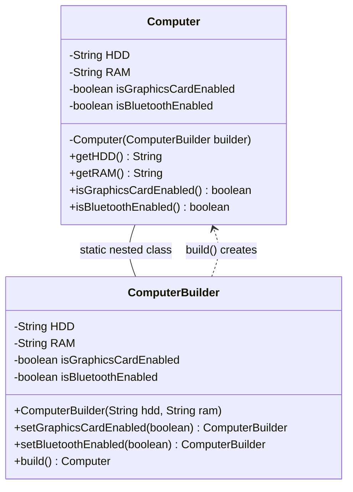
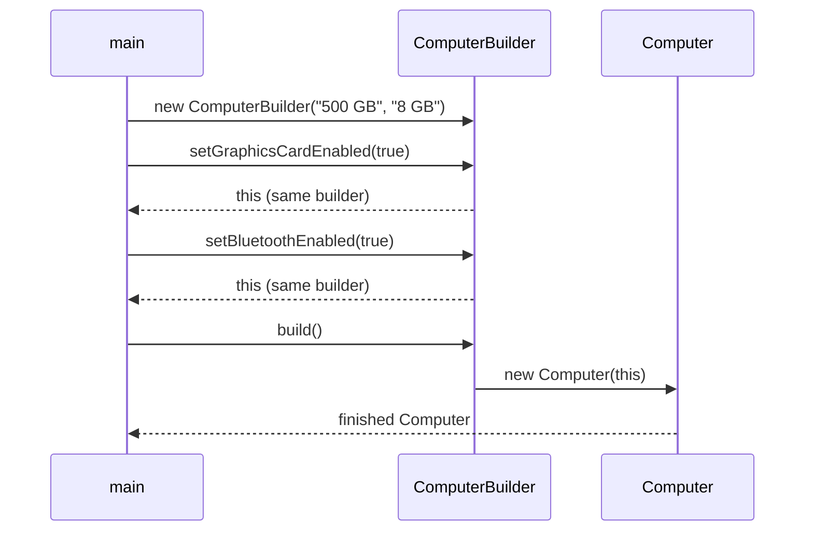
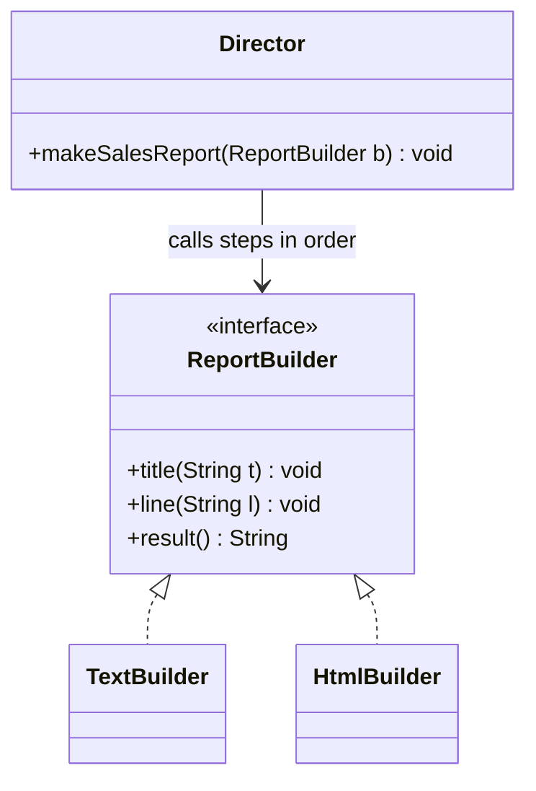

## In One Line
Builder assembles a complex object **step by step** through a separate helper object and hands you the finished product with one final `build()` call — ideal when a class has a few required and many optional parameters.

## Mental Model
Think of **ordering a custom PC at a computer shop**. The clerk will not start an order slip without the essentials (hard disk and RAM). Then you tick optional extras one at a time — graphics card, Bluetooth — in any order, skipping what you do not want. When you say "build it", the workshop assembles the machine and hands you a sealed box. After that, the box does not change.

How it maps to the code:
- **The order slip** → `Computer.ComputerBuilder`: a separate, mutable object that collects choices.
- **"No slip without HDD and RAM"** → the builder's constructor `ComputerBuilder(String hdd, String ram)` takes the required parameters.
- **Ticking optional extras** → `setGraphicsCardEnabled(true)`, `setBluetoothEnabled(true)`; each returns the same slip (`return this`) so you can keep ticking.
- **"Build it"** → `build()`, which calls the private `Computer(ComputerBuilder)` constructor.
- **The sealed box** → the `Computer` object: it has only getters, no setters.

## Concept
### Intent (Gang of Four)
> "Separate the construction of a complex object from its representation so that the same construction process can create different representations."

Category: **creational**. In everyday Java the pattern is used mostly in Joshua Bloch's simplified form (Effective Java, Item 2: *"Consider a builder when faced with many constructor parameters"*), which is what the course example shows.

### The problem: three ways to create an object with optional parameters
**1. Telescoping constructors** — one constructor per combination:
```java
new Computer("500 GB", "8 GB");
new Computer("500 GB", "8 GB", true);
new Computer("500 GB", "8 GB", true, true);   // which boolean is which?
```
Hard to read, easy to swap two same-typed arguments silently, and the number of constructors explodes.

**2. JavaBeans** — a no-arg constructor plus setters:
```java
Computer c = new Computer();
c.setHdd("500 GB");
c.setRam("8 GB");            // between these lines the object is half-built
c.setBluetoothEnabled(true);
```
Readable, but the object exists in an **inconsistent state** during construction, it cannot be immutable (it needs setters), validation of rules involving several fields has no natural place, and sharing it between threads needs extra care.

**3. Builder** — readable like JavaBeans, safe like a constructor:
```java
Computer c = new Computer.ComputerBuilder("500 GB", "8 GB")
        .setGraphicsCardEnabled(true)
        .setBluetoothEnabled(true)
        .build();
```
The half-built state lives in the **builder**; the product is created in one step, fully initialised, and can be immutable.

### Participants and how the example maps to them (Bloch-style builder)
| Participant | Role | In the example |
|---|---|---|
| **Product** | The complex object being built; no public constructor | `Computer` with a `private Computer(ComputerBuilder builder)` |
| **Builder** | Mutable holder of the parameters; fluent methods; `build()` | `public static class ComputerBuilder` |
| **Required parameters** | Must be supplied before anything else | builder constructor `(String hdd, String ram)` |
| **Optional parameters** | Default values unless set | `isGraphicsCardEnabled`, `isBluetoothEnabled` (default `false`) |
| **Client** | Chains calls and calls `build()` | `main` in `BuilderPatternExample` |

### Anatomy of a good Java builder
1. **Static nested class.** `static` because a builder must exist *before* any `Computer` exists — an inner (non-static) class would need an outer instance. Being nested also gives mutual access to `private` members: the builder can call `Computer`'s private constructor, and the constructor can read the builder's private fields.
2. **Private product constructor that takes the builder.** The only way to get a `Computer` is through `build()`.
3. **Required values in the builder's constructor (or its static factory),** so they cannot be forgotten.
4. **Optional values via fluent methods that `return this`,** enabling method chaining.
5. **Validation in `build()` (or in the product constructor).** Single-field checks can happen early (`Objects.requireNonNull`), but rules that involve several fields ("a graphics card needs 16+ GB RAM") must wait until `build()`. Throw `IllegalStateException` or `IllegalArgumentException`.
6. **Immutable product.** `private final` fields, no setters, and **defensive copies** of mutable inputs such as lists (`List.copyOf(builder.items)`), otherwise later builder changes leak into already-built objects (see the Quiz).
7. **The builder itself is mutable and not thread-safe.** Use one builder per thread; do not share one across threads.

### Two flavours of Builder
| | Bloch builder (Effective Java) | GoF builder |
|---|---|---|
| Goal | Readable construction of **one class** with many optional parameters | **Same construction steps → different representations** |
| Structure | Product + nested static Builder | Builder **interface**, several ConcreteBuilders, a **Director**, Products |
| Who decides the order of steps | The client, by chaining | The **Director** |
| Typical example | `Computer.builder(...).x().y().build()` | One `Director.makeReport(builder)` produces text with `TextBuilder`, HTML with `HtmlBuilder` |
| Result retrieval | `build()` | `getResult()` on the concrete builder (the Director does not know the product type) |

The GoF version is shown in the Code section: the `Director` knows *what steps and in what order*, each concrete builder knows *how to represent them*.

### Builders for class hierarchies
With inheritance, a base builder's `addTopping()` would normally return the **base** builder type, so a subclass-only method like `sauceInside()` would no longer be reachable in the chain. Effective Java solves this with a recursive generic, `Builder<T extends Builder<T>>`, and an abstract `self()` method that each subclass implements as `return this;` (the "simulated self-type" idiom). See the `GenericBuilder` snippet.

### Lombok and records
- The course's pom includes **Lombok**: `@Builder` on a class generates the whole builder — `Computer.builder().hdd("500 GB").ram("8 GB").bluetoothEnabled(true).build()`. Methods are named after the fields (no `set` prefix). Use `@Builder.Default` for default values, `@Singular` for adding collection elements one by one, and `toBuilder = true` for copy-and-modify.
- **Records** (Java 16+) give you an immutable class with a canonical constructor; for many optional components you can still write (or generate) a builder that calls the record's constructor, and put validation in the record's compact constructor.

### When to use Builder
- Four or more constructor parameters, especially several optional ones or several of the same type.
- You want **immutable** objects with many fields.
- Construction has rules across fields that must be validated once, at the end.
- The same construction process must produce different representations (GoF form).

### When NOT to use it
- Two or three parameters — a constructor or a static factory is shorter and just as clear.
- Performance-critical code creating millions of tiny objects — every build allocates an extra builder (usually negligible, but real).
- The object is legitimately mutable and simple — plain setters are fine.

### Real JDK and Spring examples
| Where | Notes |
|---|---|
| `HttpRequest.newBuilder()`, `HttpClient.newBuilder()` (Java 11) | Textbook fluent builders producing immutable objects |
| `Locale.Builder`, `Calendar.Builder` (Java 7/8) | Build and validate before creating |
| `Thread.ofPlatform()` / `Thread.ofVirtual()` (Java 21) | `Thread.Builder`: `.name(...)`, `.daemon(...)`, then `.start(task)` or `.unstarted(task)` |
| `Stream.builder()` | Add elements, then `build()` a stream |
| `DateTimeFormatterBuilder` | Assemble a formatter step by step |
| `StringBuilder`, `ProcessBuilder` | Builder-like: accumulate state, then `toString()` / `start()`; both are reusable and mutable, so they are looser than a strict Builder |
| Spring: `UriComponentsBuilder`, `ResponseEntity.ok().header(...).body(...)`, `WebClient.builder()`, `RestClient.builder()`, `MockMvcRequestBuilders.get(...)`, `SpringApplicationBuilder`, `BeanDefinitionBuilder` | Fluent builders across the framework |

### Builder vs look-alikes
| | Builder | Factory / Abstract Factory | Fluent interface (e.g. streams) | Prototype |
|---|---|---|---|---|
| Focus | *How* to assemble one complex object | *Which* class to instantiate | Readable chained calls on the object itself | Create by copying an existing object |
| Returns product | After several steps, at `build()` | Immediately | Chaining is on the real object, no separate `build()` | Immediately (`clone()`/copy) |
| Separate helper object? | Yes (the builder) | The factory | No | No |

Method chaining alone does not make something a Builder: `stream.filter(...).map(...)` is a fluent interface; `StringBuilder.append(...)` chains on a mutable accumulator. A Builder is defined by the **separate construction object** and the **final creation step**.

## Diagram

The builder mirrors the product's fields, collects them, and is the only code that can call `Computer`'s private constructor.


Every setter returns the same builder, which is why the calls chain; only `build()` creates the product.


The GoF form: one Director, one sequence of steps, different concrete builders producing different representations.

## Code
@example CoreJava/CreationalPatterns/BuilderPatternExample.java

**A production-grade version:** immutable product, required values checked early, a cross-field rule checked in `build()`, conventional method names.
```java
import java.util.Objects;

public class BetterBuilder {
    static final class Computer {
        private final String hdd;                 // required
        private final int ramGb;                  // required
        private final boolean graphicsCard;       // optional, default false
        private final boolean bluetooth;          // optional, default false

        private Computer(Builder b) {
            this.hdd = b.hdd;
            this.ramGb = b.ramGb;
            this.graphicsCard = b.graphicsCard;
            this.bluetooth = b.bluetooth;
        }

        static Builder builder(String hdd, int ramGb) { return new Builder(hdd, ramGb); }

        @Override public String toString() {
            return "Computer[hdd=" + hdd + ", ram=" + ramGb + " GB, gpu=" + graphicsCard + ", bt=" + bluetooth + "]";
        }

        static final class Builder {
            private final String hdd;
            private final int ramGb;
            private boolean graphicsCard;
            private boolean bluetooth;

            private Builder(String hdd, int ramGb) {
                this.hdd = Objects.requireNonNull(hdd, "hdd");
                this.ramGb = ramGb;
            }
            Builder graphicsCard(boolean on) { this.graphicsCard = on; return this; }
            Builder bluetooth(boolean on)    { this.bluetooth = on;    return this; }

            Computer build() {
                if (graphicsCard && ramGb < 16)            // cross-field rule, checked once
                    throw new IllegalStateException("graphics card needs 16+ GB RAM, got " + ramGb);
                return new Computer(this);
            }
        }
    }

    public static void main(String[] args) {
        Computer gamer = Computer.builder("1 TB", 32).graphicsCard(true).bluetooth(true).build();
        Computer office = Computer.builder("256 GB", 8).build();
        System.out.println(gamer);
        System.out.println(office);
        try {
            Computer.builder("512 GB", 8).graphicsCard(true).build();
        } catch (IllegalStateException e) {
            System.out.println("Rejected: " + e.getMessage());
        }
        try {
            Computer.builder(null, 8);
        } catch (NullPointerException e) {
            System.out.println("Rejected: " + e.getMessage());
        }
    }
}
```
```output
Computer[hdd=1 TB, ram=32 GB, gpu=true, bt=true]
Computer[hdd=256 GB, ram=8 GB, gpu=false, bt=false]
Rejected: graphics card needs 16+ GB RAM, got 8
Rejected: hdd
```

**The GoF form — a Director and two representations:**
```java
public class GofBuilder {
    // Builder interface: the steps
    interface ReportBuilder {
        void title(String t);
        void line(String l);
        String result();
    }

    // Two concrete builders produce different representations
    static class TextBuilder implements ReportBuilder {
        private final StringBuilder sb = new StringBuilder();
        public void title(String t) { sb.append(t.toUpperCase()).append('\n'); }
        public void line(String l)  { sb.append("- ").append(l).append('\n'); }
        public String result()      { return sb.toString(); }
    }
    static class HtmlBuilder implements ReportBuilder {
        private final StringBuilder sb = new StringBuilder();
        public void title(String t) { sb.append("<h1>").append(t).append("</h1>"); }
        public void line(String l)  { sb.append("<p>").append(l).append("</p>"); }
        public String result()      { return sb.append('\n').toString(); }
    }

    // Director: knows the ORDER of steps, not the representation
    static class Director {
        void makeSalesReport(ReportBuilder b) {
            b.title("Sales");
            b.line("Q1: 10");
            b.line("Q2: 12");
        }
    }

    public static void main(String[] args) {
        Director director = new Director();
        TextBuilder text = new TextBuilder();
        HtmlBuilder html = new HtmlBuilder();
        director.makeSalesReport(text);
        director.makeSalesReport(html);
        System.out.print(text.result());
        System.out.print(html.result());
    }
}
```
```output
SALES
- Q1: 10
- Q2: 12
<h1>Sales</h1><p>Q1: 10</p><p>Q2: 12</p>
```

**Builders in a class hierarchy (Effective Java's Pizza/Calzone):**
```java
import java.util.*;

public class GenericBuilder {
    // Effective Java Item 2: builders for a class hierarchy (simulated self-type)
    static abstract class Pizza {
        enum Topping { HAM, MUSHROOM, ONION }
        final Set<Topping> toppings;

        abstract static class Builder<T extends Builder<T>> {
            EnumSet<Topping> toppings = EnumSet.noneOf(Topping.class);
            public T addTopping(Topping t) { toppings.add(t); return self(); }
            abstract Pizza build();
            protected abstract T self();          // subclasses return "this"
        }
        Pizza(Builder<?> b) { toppings = EnumSet.copyOf(b.toppings); }   // defensive copy
    }

    static class Calzone extends Pizza {
        final boolean sauceInside;
        static class Builder extends Pizza.Builder<Builder> {
            private boolean sauceInside = false;
            public Builder sauceInside() { sauceInside = true; return this; }
            @Override Calzone build() { return new Calzone(this); }
            @Override protected Builder self() { return this; }
        }
        private Calzone(Builder b) { super(b); sauceInside = b.sauceInside; }
        @Override public String toString() { return "Calzone" + toppings + " sauceInside=" + sauceInside; }
    }

    public static void main(String[] args) {
        // addTopping() returns Calzone.Builder, so sauceInside() is still reachable - no cast
        Calzone c = new Calzone.Builder().addTopping(Pizza.Topping.HAM).sauceInside().build();
        System.out.println(c);
    }
}
```
```output
Calzone[HAM] sauceInside=true
```

**Builders you already use in the JDK:**
```java
import java.net.URI;
import java.net.http.HttpRequest;
import java.time.Duration;
import java.util.Locale;
import java.util.stream.Stream;

public class JdkBuilders {
    public static void main(String[] args) throws Exception {
        HttpRequest req = HttpRequest.newBuilder(URI.create("https://example.com/api"))
                .timeout(Duration.ofSeconds(5))
                .header("Accept", "application/json")
                .GET()
                .build();
        System.out.println(req.method() + " " + req.uri() + " " + req.headers().map());

        Locale loc = new Locale.Builder().setLanguage("en").setRegion("IN").build();
        System.out.println(loc);

        Thread t = Thread.ofPlatform().name("worker-1").daemon(true).unstarted(() -> {});
        System.out.println(t.getName() + " daemon=" + t.isDaemon());

        Stream<String> s = Stream.<String>builder().add("a").add("b").build();
        System.out.println(s.toList());

        ProcessBuilder pb = new ProcessBuilder("echo", "hi").redirectErrorStream(true);
        System.out.println(pb.command());
    }
}
```
```output
GET https://example.com/api {Accept=[application/json]}
en_IN
worker-1 daemon=true
[a, b]
[echo, hi]
```
Nothing is sent over the network here — `build()` only creates the request object.

## Walkthrough
- **`class Computer` — the product.**
  - `private String HDD; private String RAM;` — the required parameters (the comment says so). `boolean isGraphicsCardEnabled; boolean isBluetoothEnabled;` — optional, default `false`.
  - Four getters: `getHDD()`, `getRAM()`, `isGraphicsCardEnabled()`, `isBluetoothEnabled()`. The `is` prefix is the JavaBeans convention for `boolean` getters. There are **no setters**, so once built the object cannot be changed from outside.
  - `private Computer(ComputerBuilder builder)` — the only constructor, and it is private: nobody can write `new Computer(...)` except code inside `Computer` (which includes its nested builder). It copies the four values from the builder.
- **`public static class ComputerBuilder` — the builder.**
  - It repeats the same four fields. They start at defaults (`null`, `false`).
  - `public ComputerBuilder(String hdd, String ram)` — you cannot get a builder without the two required values.
  - `setGraphicsCardEnabled(boolean)` / `setBluetoothEnabled(boolean)` — store the value and `return this;`, so the next call can chain on the same builder.
  - `public Computer build()` — `return new Computer(this);` passes the whole builder to the private constructor. Allowed because nested and enclosing classes can access each other's private members.
- **`main`:**
  - `new Computer.ComputerBuilder("500 GB", "8 GB")` — the nested class is referenced as `Outer.Nested`; being `static`, it needs no `Computer` instance.
  - `.setGraphicsCardEnabled(true).setBluetoothEnabled(true).build()` — each call returns the same builder until `build()` returns a `Computer`.
  - The four `println` calls print `HDD: 500 GB`, `RAM: 8 GB`, `Graphics Card Enabled: true`, `Bluetooth Enabled: true` — string concatenation turns the booleans into `"true"`.
- The output is deterministic and matches the comments (apart from their punctuation — see Traps).

## Traps
> [!ERRATA] The fields are named `HDD` and `RAM`. By Java convention `UPPER_CASE` names are reserved for constants (`static final`); instance fields should be camelCase (`hdd`, `ram`), which also gives the conventional getters `getHdd()`/`getRam()`. Similarly, a boolean field is usually named `graphicsCardEnabled` with getter `isGraphicsCardEnabled()` — naming the field itself `isGraphicsCardEnabled` confuses bean tools and Lombok.

> [!ERRATA] The product's fields are not `final`. `Computer` has no setters, so it behaves immutably, but `private final` fields make that a compiler-checked guarantee and give safe publication across threads (final-field semantics of the Java Memory Model).

> [!ERRATA] `build()` does no validation: `new Computer.ComputerBuilder(null, null).build()` happily creates a computer with no disk and no RAM. Check required values (`Objects.requireNonNull`) and cross-field rules in `build()`. Also, builder methods conventionally drop the `set` prefix (`graphicsCardEnabled(true)`), because `setX` suggests a JavaBeans setter that returns `void`.

> [!ERRATA] Minor: two output comments are missing the colon (`// Output HDD: 500 GB`, `// Output Bluetooth Enabled: true`) while the others have it. The expected text itself is correct.

- **Builder state leaks into built objects** if the product stores a mutable object (like a `List`) from the builder without copying it — later builder changes then modify already-built products. Copy in the product constructor: `this.items = List.copyOf(b.items);`.
- **Reusing a builder** is fine for primitive/immutable fields (each `build()` copies the current values), but confusing; create a new builder per object unless you mean to.
- **Forgetting `build()`** — `Computer c = new ComputerBuilder(...).setBluetoothEnabled(true);` does not compile (the type is `ComputerBuilder`), but with `var` it compiles and you end up with a builder, not a computer.
- **Non-static nested builder** — `public class ComputerBuilder` (without `static`) would require `computer.new ComputerBuilder(...)`, i.e. a `Computer` before you can build one. The pattern needs `static`.
- **Builders are not thread-safe.** Never share one builder between threads.

## Tips & Tricks
- **Rule of thumb (Effective Java): four or more parameters, especially optional ones → Builder.**
- **Mnemonic — "Required in the constructor, optional in the chain, rules in build()."**
- **"Builder is the mutable twin of an immutable product."** Everything mutable lives in the builder so the product can be `final` all the way through.
- **Director = recipe, Builder = kitchen.** Same recipe (steps and order), different kitchens (representations).
- Add a static `builder(...)` factory on the product (`Computer.builder("500 GB", 8)`) — shorter than `new Computer.ComputerBuilder(...)` and hides the builder's class name.
- Offer `toBuilder()` for "copy with one change" on immutable objects.
- On Lombok projects, reach for `@Builder` (plus `@Singular`, `@Builder.Default`) before hand-writing one.

## Interview Q&A
### [Basic] What is the Builder pattern and what problem does it solve?
Builder separates the construction of a complex object from the object itself: a separate builder collects parameters step by step and a final `build()` creates the object in one go. It solves the **telescoping-constructor** problem (many constructors, unreadable argument lists, easy to swap two `boolean`s) and the **JavaBeans** problem (objects in inconsistent states during construction, and impossible to make immutable). The result is readable, like named parameters, and safe, like a constructor.

**Follow-up:** *Why not just use setters?* — Setters leave the object half-built between calls, prevent immutability, and give no single place to validate rules that span several fields.

### [Basic] Walk me through the course's `Computer`/`ComputerBuilder` example.
`Computer` has private fields, getters only, and a private constructor that takes a `ComputerBuilder`. `ComputerBuilder` is a public static nested class with the same fields; its constructor takes the required HDD and RAM, and its `setX` methods set optional flags and `return this` for chaining. `build()` calls `new Computer(this)`. The client writes `new Computer.ComputerBuilder("500 GB", "8 GB").setGraphicsCardEnabled(true).setBluetoothEnabled(true).build()` and gets a fully initialised `Computer`.

**Follow-up:** *How can the builder call a private constructor?* — A nested class is a member of its enclosing class, and Java allows members of the same top-level class to access each other's private members.

### [Intermediate] Why is the builder a `static` nested class?
Because the builder must exist before the product does. A non-static inner class instance is tied to an instance of its outer class (`outer.new Inner()`), so you would need a `Computer` to build a `Computer`. A static nested class needs no outer instance but still has access to the outer class's private constructor.

**Follow-up:** *Could the builder be a separate top-level class?* — Yes, but then the product's constructor cannot be private; you would widen it to package-private, weakening the guarantee that only the builder creates products.

### [Intermediate] Where do you validate in a builder?
Validate single parameters as early as possible (in the builder constructor or setter: `Objects.requireNonNull`, range checks) so errors point at the bad call. Validate **invariants spanning several fields** in `build()` or in the product's constructor, after all values are known, and throw `IllegalStateException` (or `IllegalArgumentException`). Effective Java also suggests checking again *after* copying the values into the product, so the object that gets checked is the one that gets stored.

**Follow-up:** *Why check after copying?* — If you validated the builder's mutable fields and then copied them, another thread (or later code) could change them between the check and the copy.

### [Intermediate] Differentiate the GoF Builder from the Effective Java builder.
The GoF Builder has a **Director** that runs a fixed sequence of steps against a **Builder interface**, and several **ConcreteBuilders** that turn those steps into different representations (the same report as text or HTML). Its intent is "same construction process, different representations". Bloch's builder is a pragmatic variant for **one** product with many optional parameters: no Director, no interface — the client chains calls and calls `build()`. In interviews, most people mean Bloch's version; mention that you know both.

**Follow-up:** *How does the Director differ from Template Method?* — Template Method fixes the step order in a superclass and varies steps by inheritance; the Director fixes the order in a separate object and varies steps by passing in a different builder (composition).

### [Intermediate] Builder vs Factory vs Abstract Factory?
Factory answers *which* class to instantiate and returns the object in one call. Abstract Factory creates *families* of related objects, each product returned immediately. Builder answers *how to assemble one complex object* over several steps, returning it at the end. They combine: a static factory often returns a builder (`HttpRequest.newBuilder()`), and a Director may use an Abstract Factory to obtain parts.

**Follow-up:** *Is `StringBuilder` a Builder?* — Loosely: it accumulates parts and produces a `String` with `toString()`. But it is a reusable, mutable accumulator rather than a one-shot builder of a complex immutable object; it is often cited as the JDK's Builder example anyway.

### [Intermediate] Give examples of builders in the JDK and Spring.
JDK: `HttpRequest.newBuilder()` and `HttpClient.newBuilder()` (Java 11), `Locale.Builder`, `Calendar.Builder`, `Stream.builder()`, `DateTimeFormatterBuilder`, `Thread.ofVirtual()`/`Thread.ofPlatform()` (Java 21), and the looser `StringBuilder`/`ProcessBuilder`. Spring: `UriComponentsBuilder`, `ResponseEntity.ok().header(...).body(...)`, `WebClient.builder()`, `RestClient.builder()`, `MockMvcRequestBuilders`, `SpringApplicationBuilder`, `BeanDefinitionBuilder`. Lombok's `@Builder` generates builders at compile time.

**Follow-up:** *What does Lombok's `@Singular` do?* — On a collection field it generates methods to add one element at a time (`.tag("x").tag("y")`) and builds an immutable collection.

### [Advanced] How do you write builders for a class hierarchy?
Use a recursive generic builder: `abstract static class Builder<T extends Builder<T>>` whose fluent methods return `T` via an abstract `self()` method. Each subclass's builder extends `Pizza.Builder<Calzone.Builder>` and implements `self()` as `return this;`, and overrides `build()` with a covariant return type (`Calzone build()`). Without this, a base method like `addTopping()` would return the base builder type and the chain would lose access to subclass methods like `sauceInside()`.

**Follow-up:** *Why not just cast?* — Casts in every client call are noisy and unsafe; the generic self-type keeps the chain type-safe with no casts.

### [Advanced] Is an object built by a builder automatically thread-safe?
Only if the product is immutable: all fields `private final`, no setters, and defensive copies of mutable inputs. Then it can be shared freely after `build()` — `final` fields are guaranteed visible to other threads once the constructor completes. The **builder** is never thread-safe; it is a mutable, single-use scratchpad. And if the product keeps a reference to a mutable list from the builder, later builder changes can leak into the "immutable" product.

**Follow-up:** *How do you prevent that leak?* — Copy in the product constructor: `this.items = List.copyOf(builder.items);` (which also rejects `null` elements).

### [Advanced] What are the downsides of the Builder pattern?
More code (every field is declared twice), an extra object allocation per build, required parameters are only enforced if you put them in the builder's constructor (otherwise errors move to runtime), and it is easy to forget to update the builder when a field is added. A *step builder* (a chain of interfaces, each returning the next required step) can enforce required parameters at compile time, at the cost of even more code. For small classes, a constructor or record is simpler.

**Follow-up:** *How do records change things?* — Records remove the boilerplate of immutable data classes; for few components, the canonical constructor is enough, and the compact constructor is the natural place for validation. For many optional components, a builder can still wrap the record's constructor.

## Quiz
### What does this print (using the course's `Computer` and `ComputerBuilder`)?
```java
Computer.ComputerBuilder b = new Computer.ComputerBuilder("500 GB", "8 GB");
Computer c1 = b.setBluetoothEnabled(true).build();
Computer c2 = b.setBluetoothEnabled(false).build();
System.out.println(c1.isBluetoothEnabled() + " " + c2.isBluetoothEnabled() + " " + (c1 == c2));
```
- [ ] false false true
- [x] true false false
- [ ] false false false
- [ ] true true false
> Each `build()` calls `new Computer(this)`, which **copies** the builder's current values into a new object. Changing the builder afterwards does not affect `c1` (it copied a primitive `true`), and `c1` and `c2` are different objects. The tempting "false false" assumes the product keeps a live link to the builder — it does not for primitives.

### What does this print?
```java
static final class Team {
    private final List<String> members;
    private Team(Builder b) { this.members = b.members; }        // no copy!
    List<String> members() { return members; }
    static class Builder {
        private final List<String> members = new ArrayList<>();
        Builder add(String m) { members.add(m); return this; }
        Team build() { return new Team(this); }
    }
}
// in main:
Team.Builder b = new Team.Builder().add("Ann");
Team t1 = b.build();
b.add("Bob");
Team t2 = b.build();
System.out.println(t1.members() + " " + t2.members());
```
- [ ] [Ann] [Ann, Bob]
- [x] [Ann, Bob] [Ann, Bob]
- [ ] [Ann] [Bob]
- [ ] UnsupportedOperationException
> `Team` stores a reference to the builder's own `ArrayList`, so both teams share it, and adding "Bob" after `t1` was built changes `t1` too. `final` only stops the field being reassigned, not the list being modified. The fix is `this.members = List.copyOf(b.members);`, which would print `[Ann] [Ann, Bob]`.

### Why must `ComputerBuilder` be declared `static`?
- [ ] So its methods can be called without an object
- [x] So a builder can be created without first having a `Computer` instance
- [ ] Because `build()` is a static method
- [ ] Because nested classes cannot be public otherwise
> A non-static inner class needs an enclosing instance (`computer.new ComputerBuilder(...)`), which is impossible before the first `Computer` exists. The builder's own methods are instance methods — you do call them on a builder object.

### Which is the main problem with the telescoping-constructor approach that Builder fixes?
- [ ] Constructors cannot be overloaded
- [x] Long argument lists are unreadable and same-typed arguments can be swapped silently
- [ ] Constructors cannot validate their arguments
- [ ] Objects created by constructors cannot be immutable
> `new Computer("500 GB", "8 GB", true, false)` compiles even if the two booleans are swapped. Constructors can be overloaded, can validate, and are the usual way to make immutable objects — the problem is readability and parameter explosion.

### In the GoF Builder, what is the Director's job?
- [ ] Creating the final product with `new`
- [x] Calling the builder's steps in the right order, without knowing the concrete representation
- [ ] Choosing which subclass to instantiate, like a factory
- [ ] Copying an existing product
> The Director encodes the construction *process* (title, then lines); each ConcreteBuilder decides how to represent it (text vs HTML) and provides the result. Choosing a subclass is a factory's job; copying is Prototype.

### Spot the bug: why can't other code build a `Computer` with this design?
```java
class Computer {
    private Computer(Builder b) { }
    public class Builder {
        public Computer build() { return new Computer(this); }
    }
}
// elsewhere:
Computer c = new Computer.Builder().build();
```
- [ ] `build()` must be static
- [ ] The constructor must be public
- [x] `Builder` is an inner (non-static) class, so it needs an existing `Computer` to be created
- [ ] `this` cannot be passed to a constructor
> Without `static`, `new Computer.Builder()` does not compile ("an enclosing instance that contains Computer.Builder is required"). The private constructor is fine — the nested builder can call it — and passing `this` is exactly how the product reads the builder.

### Which JDK API is a fluent Builder that produces an immutable object?
- [ ] `ArrayList.add`
- [ ] `Stream.filter`
- [x] `HttpRequest.newBuilder(...).header(...).build()`
- [ ] `Collections.sort`
> `HttpRequest.Builder` collects settings and `build()` returns an immutable `HttpRequest`. `Stream.filter` is a fluent interface on the stream itself (no separate builder, no `build()`), and the other two are ordinary mutating methods.

## Takeaways
- Builder separates step-by-step construction (a mutable builder) from the finished product, created once by `build()`.
- It fixes telescoping constructors (unreadable, swappable arguments) and JavaBeans setters (half-built, mutable objects).
- Bloch's recipe: private product constructor taking the builder, `static` nested builder, required values in the builder constructor, optional ones via methods that `return this`, validation in `build()`.
- Make the product immutable: `private final` fields, no setters, defensive copies of mutable inputs — otherwise builder changes can leak into built objects.
- The GoF form adds a Director that fixes the order of steps, with different ConcreteBuilders producing different representations.
- Use recursive generics (`Builder<T extends Builder<T>>` + `self()`) for builders in class hierarchies; use Lombok `@Builder` to generate builders.
- JDK examples: `HttpRequest.newBuilder()`, `Locale.Builder`, `Thread.ofVirtual()`, `Stream.builder()`; Spring: `UriComponentsBuilder`, `ResponseEntity`, `WebClient.builder()`.
