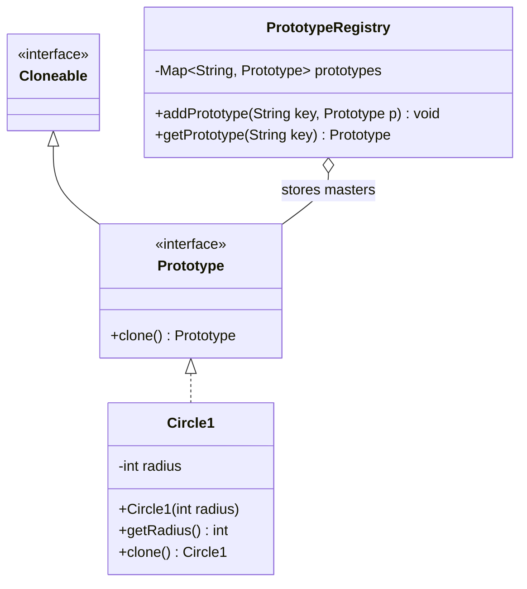
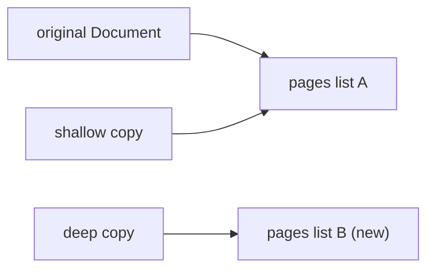
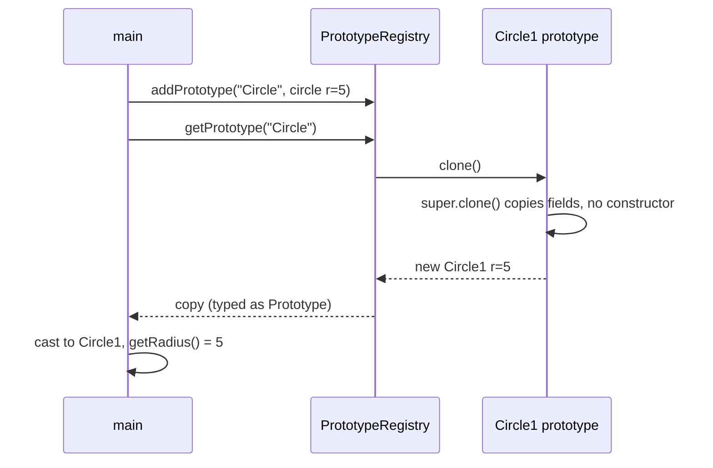

## In One Line
Prototype creates new objects by **copying an existing, pre-configured object** (the prototype) instead of building them from scratch with `new` — in Java, usually through `clone()` or a copy constructor.

## Mental Model
Think of a **photocopier and a master form**. The office prepares one master copy of a form, already filled with the standard details. When someone needs a form, nobody retypes it — they photocopy the master and then scribble their own changes on the copy. The master stays clean in the drawer.

How it maps to the code:
- **The master form** → the prototype object `circlePrototype = new Circle1(5)`.
- **The drawer of masters, labelled** → `PrototypeRegistry` with its `Map<String, Prototype>`.
- **Pressing "copy"** → `prototype.clone()`, which uses `Object.clone()` to duplicate the object field by field.
- **Scribbling on the copy** → changing the clone; the master in the registry is untouched.
- **A photocopy of a form with a sticky note attached** → a *shallow* copy: the copy has the same sticky note (the same referenced object), not a new one. Getting your own sticky note is a *deep* copy.

## Concept
### Intent (Gang of Four)
> "Specify the kinds of objects to create using a prototypical instance, and create new objects by copying this prototype."

Category: **creational**.

### The problem it solves
- **Creation is expensive**: the object is built from a database query, a file parse, or a long computation. Copying the finished object is cheaper than repeating the work.
- **The configuration is decided at runtime**: users define "templates" (a gold badge of radius 10, a red enemy with 3 lives). You cannot write a subclass for every template, but you can store configured instances and copy them.
- **The client should not know concrete classes**: the registry hands out copies through the `Prototype` interface, so the client never calls `new Circle1(...)`.
- **Avoiding a parallel hierarchy of factories**: instead of one factory class per product class, each product knows how to copy itself.

### Participants and how the example maps to them
| Participant | Role | In the example |
|---|---|---|
| **Prototype** | Declares the copy operation | `interface Prototype extends Cloneable { Prototype clone() throws CloneNotSupportedException; }` |
| **ConcretePrototype** | Implements copying of itself | `Circle1`, whose `clone()` calls `super.clone()` |
| **Prototype registry (manager)** | Stores named prototypes and returns copies | `PrototypeRegistry` with `addPrototype` / `getPrototype` |
| **Client** | Asks for a copy, customises it | `main` in `PrototypePatternExample` |

### How `Object.clone()` works
`clone()` is a `protected native` method of `java.lang.Object`:
1. If the object's class does **not** implement `Cloneable`, it throws `CloneNotSupportedException`.
2. Otherwise it allocates a new object of the **same runtime class** and copies every field's value — primitives by value, references **as references**. That is a **shallow copy**.
3. **No constructor runs** — not yours, not a superclass's. Field initialisers and constructor logic are skipped.

`Cloneable` is a **marker interface**: it has no methods. It only switches on the behaviour of `Object.clone()`. That is why a class has to both implement `Cloneable` **and** override `clone()` (usually widening it to `public`) to be cloneable from outside.

The general contract (from the `Object.clone()` Javadoc) — conventions, not absolute rules:
- `x.clone() != x` — a different object.
- `x.clone().getClass() == x.getClass()` — holds if every class in the chain calls `super.clone()`.
- `x.clone().equals(x)` — usually true.

### Shallow vs deep copy
| | Shallow copy | Deep copy |
|---|---|---|
| Primitive fields | Copied | Copied |
| Reference fields | **Same object shared** by original and copy | **New copies** of the referenced objects |
| How | `super.clone()` alone | `super.clone()`, then replace each mutable reference field with its own copy |
| Risk | Changing a shared list through the copy changes the original | More work, and cycles in the object graph need care |

`Circle1` has only an `int` field, so shallow and deep are the same thing. As soon as a prototype holds a `List`, `Date`, array or other mutable object, a shallow clone makes the copy and the prototype **share** it (see `ShallowDeep` in the Code section).

Immutable fields (`String`, `Integer`, records with immutable components) can safely be shared, so they never need deep copying.

### Ways to copy in Java
| Technique | Pros | Cons |
|---|---|---|
| `Cloneable` + `clone()` | Built in, copies the exact runtime class, fast | Marker interface is awkward, checked exception, no constructor runs, conflicts with `final` fields that need deep copying, shallow by default |
| **Copy constructor** `Circle(Circle other)` | Explicit, works with `final` fields, no casts, no checked exception | Must be written for each class; copies the declared class, not a subclass |
| **Copy factory** `static Circle copyOf(Circle c)` / instance `copy()` | Same as copy constructor; can be declared in an interface (`Shape copy()`) and stay polymorphic | Must be written |
| Serialization round trip | Automatic deep copy of whole graphs | Slow, needs `Serializable` everywhere, security concerns |
| Libraries / mappers (Jackson, MapStruct) | Handle big graphs | Extra dependency, reflection cost |

Effective Java, Item 13: *"Override clone judiciously"* — Bloch recommends copy constructors or copy factories for new classes; the exception is arrays, where `clone()` is the best way to copy.

### Implementing `clone()` well (if you do use it)
```java
@Override
public Circle1 clone() {                       // public + covariant return type
    try {
        Circle1 copy = (Circle1) super.clone();
        copy.tags = new ArrayList<>(tags);      // deep-copy each mutable field
        return copy;
    } catch (CloneNotSupportedException e) {
        throw new AssertionError(e);            // cannot happen: we implement Cloneable
    }
}
```
Because the class implements `Cloneable`, `super.clone()` can never throw — so do not force every caller to catch a checked exception that is impossible.

### When to use Prototype
- Objects are expensive to create and many similar ones are needed.
- The set of object "kinds" is configured at runtime (templates, presets, game units, document templates).
- You need copies of objects whose concrete class you do not know (you only have an interface).
- Undo/snapshots or "duplicate this item" features in editors.

### When NOT to use it
- Creation is cheap and simple — `new` is clearer.
- The objects are immutable — just share them; copying immutable objects is pointless.
- The object graph has many mutable references, cycles or external resources (sockets, file handles) that cannot be meaningfully copied.

### Real JDK and Spring examples
| Where | Notes |
|---|---|
| `Object.clone()` + `Cloneable` | The language-level Prototype mechanism |
| Arrays: `int[].clone()`, `String[].clone()` | Public, no checked exception, **shallow** (a 2-D array's rows are shared) |
| `ArrayList.clone()`, `HashMap.clone()`, `TreeMap.clone()` | Shallow: a new collection, the same element objects |
| `Date.clone()`, `Calendar.clone()`, `Locale.clone()` | Copying mutable value objects |
| Copy constructors: `new ArrayList<>(other)`, `new HashMap<>(other)`; copy factories `List.copyOf`, `EnumSet.copyOf` | The modern alternative to `clone()` |
| Spring **prototype scope** (`@Scope("prototype")`) | Despite the name, Spring does **not** clone anything: every `getBean()` creates a **new** instance from the bean definition (constructor + injection). It shares the *idea* (a template → many instances), not the copying mechanism. |

### Prototype vs look-alikes
| | Prototype | Factory | Builder | Memento |
|---|---|---|---|---|
| How new objects appear | Copy an existing object | `new` inside a factory | Step-by-step assembly | Snapshot of internal state (not a usable object) |
| Needs to know the concrete class? | No — the object copies itself | The factory does | The builder does | The originator does |
| Typical use | Presets, expensive objects | Choosing an implementation | Many optional parameters | Undo |

## Diagram

The registry stores masters by name and hands out `clone()`s; `Prototype` extends the marker interface `Cloneable`.


A shallow copy shares the same `List` object with the original; a deep copy gets its own list, so changes stay separate.


The client never calls a constructor for the copy; `Object.clone()` duplicates the prototype's fields.

## Code
@example CoreJava/CreationalPatterns/PrototypePatternExample.java

**Shallow vs deep copy — the trap that bites everyone:**
```java
import java.util.*;

public class ShallowDeep {
    static class Document implements Cloneable {
        private String title;
        private List<String> pages = new ArrayList<>();

        Document(String title) {
            this.title = title;
            System.out.println("constructor ran for " + title);
        }

        // Shallow: Object.clone() copies the fields, so both documents share one list
        Document shallowCopy() {
            try {
                return (Document) super.clone();
            } catch (CloneNotSupportedException e) {
                throw new AssertionError(e);          // cannot happen: we implement Cloneable
            }
        }

        // Deep: clone, then replace mutable fields with copies of their own
        Document deepCopy() {
            Document d = shallowCopy();
            d.pages = new ArrayList<>(pages);
            return d;
        }

        @Override public String toString() { return title + pages; }
    }

    public static void main(String[] args) {
        Document original = new Document("Report");
        original.pages.add("intro");

        Document shallow = original.shallowCopy();
        Document deep = original.deepCopy();

        shallow.pages.add("added via shallow");
        deep.pages.add("added via deep");
        shallow.title = "Shallow";

        System.out.println("original: " + original);
        System.out.println("shallow : " + shallow);
        System.out.println("deep    : " + deep);
        System.out.println("same list? " + (original.pages == shallow.pages) + " / " + (original.pages == deep.pages));
    }
}
```
```output
constructor ran for Report
original: Report[intro, added via shallow]
shallow : Shallow[intro, added via shallow]
deep    : Report[intro, added via deep]
same list? true / false
```
The constructor ran once — neither copy ran it. Reassigning `shallow.title` did not affect the original (the copy has its own `title` *field*), but adding to the shared list did.

**Facts about `clone()` you will be asked:**
```java
import java.util.*;

public class CloneFacts {
    static class Circle1 implements Cloneable {
        private int radius;
        Circle1(int radius) { this.radius = radius; System.out.println("new Circle1(" + radius + ")"); }
        @Override public Circle1 clone() throws CloneNotSupportedException { return (Circle1) super.clone(); }
    }
    static class NotCloneable {
        @Override public Object clone() throws CloneNotSupportedException { return super.clone(); }
    }

    public static void main(String[] args) throws Exception {
        Circle1 a = new Circle1(5);
        Circle1 b = a.clone();
        System.out.println((a == b) + " " + (a.getClass() == b.getClass()) + " " + b.radius);

        try { new NotCloneable().clone(); }
        catch (CloneNotSupportedException e) { System.out.println("Caught: " + e); }

        int[][] grid = {{1, 2}, {3, 4}};
        int[][] copy = grid.clone();          // arrays: public clone(), shallow
        copy[0][0] = 99;
        copy[1] = new int[] {7, 7};
        System.out.println(Arrays.deepToString(grid) + " " + Arrays.deepToString(copy));
    }
}
```
```output
new Circle1(5)
false true 5
Caught: java.lang.CloneNotSupportedException: CloneFacts$NotCloneable
[[99, 2], [3, 4]] [[99, 2], [7, 7]]
```
Overriding `clone()` is not enough — without `implements Cloneable`, `Object.clone()` throws. Cloning a 2-D array copies only the outer array: `copy[0][0] = 99` changes the shared row, while replacing `copy[1]` does not touch `grid`.

**The modern way: a `copy()` method backed by a copy constructor, and a registry that never leaks its masters:**
```java
import java.util.*;

public class CopyRegistry {
    // Prototype without Cloneable: a copy() method backed by a copy constructor
    interface Shape {
        Shape copy();
    }

    static class Circle implements Shape {
        int radius;
        String color;
        List<String> tags;

        Circle(int radius, String color, List<String> tags) {
            this.radius = radius;
            this.color = color;
            this.tags = new ArrayList<>(tags);
        }
        Circle(Circle other) {                      // copy constructor does the deep copy
            this(other.radius, other.color, other.tags);
        }
        @Override public Circle copy() { return new Circle(this); }   // covariant return type
        @Override public String toString() { return color + " circle r=" + radius + " " + tags; }
    }

    static class ShapeRegistry {
        private final Map<String, Shape> prototypes = new HashMap<>();
        void add(String key, Shape prototype) { prototypes.put(key, prototype); }
        Shape get(String key) {
            Shape p = prototypes.get(key);
            if (p == null) throw new IllegalArgumentException("No prototype: " + key);
            return p.copy();                        // hand out copies, never the prototype itself
        }
    }

    public static void main(String[] args) {
        ShapeRegistry registry = new ShapeRegistry();
        registry.add("badge", new Circle(10, "gold", List.of("shiny")));

        Circle mine = (Circle) registry.get("badge");
        mine.radius = 99;
        mine.tags.add("edited");

        System.out.println("copy     : " + mine);
        System.out.println("fresh    : " + registry.get("badge"));
    }
}
```
```output
copy     : gold circle r=99 [shiny, edited]
fresh    : gold circle r=10 [shiny]
```

## Walkthrough
- `import java.util.HashMap; import java.util.Map;` — for the registry's map.
- `interface Prototype extends Cloneable { Prototype clone() throws CloneNotSupportedException; }` — the **Prototype** role. Extending `Cloneable` means every implementation is automatically marked cloneable. Declaring `clone()` in the interface makes it **public** (interface methods are implicitly public), so the registry can call it through the interface — `Object.clone()` itself is `protected`.
- `class Circle1 implements Prototype` — the **ConcretePrototype**. It is called `Circle1` because `Circle` already exists in the same package (the Factory example); top-level names must be unique per package.
  - `private int radius;` + constructor + `getRadius()` — ordinary state.
  - `@Override public Circle1 clone() throws CloneNotSupportedException { return (Circle1) super.clone(); }` — two legal changes versus the interface: a **covariant return type** (`Circle1` instead of `Prototype`) and, compared with `Object.clone()`, **wider access** (`public` instead of `protected`). `super.clone()` is `Object.clone()`, which returns `Object`, hence the cast. Because the only field is an `int`, this shallow copy is a complete copy.
- `class PrototypeRegistry` — the **registry**.
  - `private Map<String, Prototype> prototypes = new HashMap<>();` — masters stored by name.
  - `addPrototype(String key, Prototype prototype)` — registers a master.
  - `getPrototype(String key)` — looks the master up; if found returns `prototype.clone()` (a copy, never the master); otherwise returns `null`. It must declare `throws CloneNotSupportedException` because the interface method does.
- `main`:
  - `new PrototypeRegistry()` then `new Circle1(5)` and `addPrototype("Circle", circlePrototype)` — set up the master.
  - `(Circle1) registry.getPrototype("Circle")` — returns a `Prototype`; the cast is needed to call `getRadius()`. The clone is a **different object** with the same radius.
  - `println` → **`Radius of cloned Circle: 5`**, matching the comment.
  - `catch (CloneNotSupportedException e) { e.printStackTrace(); }` — required by the compiler, but it can never run here, since `Circle1` is `Cloneable`.

## Traps
> [!ERRATA] `Circle1.clone()` still declares `throws CloneNotSupportedException`, even though the class implements `Cloneable` and `super.clone()` therefore can never throw. This forces the registry and `main` to handle an impossible exception (the `try`/`catch` in `main` is dead code). Effective Java's advice: catch it inside `clone()` and throw `AssertionError`, and declare `public Circle1 clone()` without `throws`.

> [!ERRATA] `getPrototype` returns `null` for an unknown key. `(Circle1) registry.getPrototype("Square")` succeeds (casting `null` never fails), and the program then crashes with a `NullPointerException` at `getRadius()`. Throw `IllegalArgumentException("No prototype: " + key)` instead.

> [!ERRATA] The example only demonstrates the easy case: a single `int` field, where a shallow copy is automatically a full copy. It never mentions shallow vs deep copying, which is the whole difficulty of the pattern — any mutable reference field (a `List`, a `Date`, an array) would be **shared** between the prototype and every clone. Also, `prototypes` should be `final`, and the client must still downcast because the registry returns `Prototype`.

- **Overriding `clone()` without `implements Cloneable`** compiles fine and throws `CloneNotSupportedException` at runtime.
- **No constructor runs during `clone()`.** Counters, validation, logging or resource acquisition in constructors are all skipped for clones.
- **`final` fields and deep copies don't mix.** After `super.clone()`, you cannot assign a new list to a `final` field. Use a copy constructor instead.
- **Arrays clone shallowly.** `int[][].clone()` shares the inner arrays; `Person[].clone()` shares the `Person` objects.
- **`ArrayList.clone()` is shallow** — a new list holding the *same* element objects.
- **Returning the master by mistake.** A registry that returns `prototypes.get(key)` instead of a copy lets callers corrupt the template for everyone.
- **Spring's prototype scope is not cloning** — it creates a brand-new bean each time.

## Tips & Tricks
- **Mnemonic — "Prototype = Photocopy."** Copy the master, then customise the copy.
- **"Shallow shares, deep duplicates."** For each reference field ask: *is it mutable?* If yes, deep-copy it; if it is immutable (`String`, `Integer`, a record of immutables), sharing is fine.
- **Clone recipe (if you must): implement `Cloneable`, override as `public` with a covariant return type, call `super.clone()`, deep-copy mutable fields, catch the impossible exception.**
- **Prefer copy constructors / `copy()` methods for new code**; use `clone()` for arrays.
- **Registries hand out copies, never originals.**
- Immutable objects never need Prototype — share them.

## Interview Q&A
### [Basic] What is the Prototype pattern?
Prototype creates new objects by copying an existing, fully configured instance instead of constructing them from scratch. Each object knows how to copy itself (`clone()` or `copy()`), and often a registry stores named prototypes and hands out copies. It is useful when creation is expensive, when object "kinds" are configured at runtime, and when the client should not depend on concrete classes. In the course example, `PrototypeRegistry` stores a `Circle1(5)` and returns clones of it.

**Follow-up:** *How is it different from a factory?* — A factory builds a new object (usually with `new`) and must know the concrete class; a prototype copies an existing object, which already knows its own class and configuration.

### [Basic] What is the difference between a shallow copy and a deep copy?
A shallow copy duplicates the object's fields as they are: primitives are copied, but reference fields point to the **same** objects as the original. A deep copy also copies the objects those references point to (recursively, as far as needed), so the copy shares no mutable state with the original. `Object.clone()` is shallow; a deep copy needs extra code after `super.clone()`, or a copy constructor that copies each mutable field.

**Follow-up:** *When is a shallow copy enough?* — When every reference field points to an immutable object (like `String`) or the sharing is intentional.

### [Intermediate] How does `Object.clone()` work, and why do you need `Cloneable`?
`Object.clone()` is a protected native method. It checks whether the object's class implements the `Cloneable` marker interface; if not, it throws `CloneNotSupportedException`. If it does, it creates a new object of the same runtime class and copies all fields bit by bit — without calling any constructor. `Cloneable` has no methods; it just changes the behaviour of `Object.clone()`. To make a class cloneable from outside you must implement `Cloneable` **and** override `clone()` as `public`.

**Follow-up:** *Why is this design criticised?* — The capability is declared by an interface with no methods, the method lives in `Object` and is protected, it skips constructors, it throws a checked exception, and it clashes with `final` fields — Bloch calls `Cloneable` "broken" and prefers copy constructors.

### [Intermediate] Why does `Circle1.clone()` return `Circle1` when the interface says `Prototype`?
That is a **covariant return type** (Java 5+): an override may return a subtype of the overridden method's return type. Callers holding a `Circle1` get a `Circle1` without a cast, while callers using the `Prototype` interface still get a `Prototype`. The override also widens access from `Object.clone()`'s `protected` to `public`, which is allowed.

**Follow-up:** *Why does `main` still cast?* — Because it calls the registry, whose `getPrototype` returns `Prototype`; the static type is `Prototype`, so a downcast is needed to call `getRadius()`.

### [Intermediate] What are the alternatives to `clone()`, and which do you prefer?
Copy constructors (`new Circle(other)`), copy factories (`Circle.copyOf(other)` or an instance `copy()` method declared in an interface), serialization round trips, and mapping libraries. I prefer copy constructors/factories for new classes: they are explicit, work with `final` fields, throw no checked exceptions and need no casts. An interface method `Shape copy()` keeps the polymorphism of Prototype. `clone()` remains the best choice for arrays.

**Follow-up:** *What is the weakness of a copy constructor for polymorphism?* — `new Circle(other)` always creates a `Circle`, even if `other` is a subclass; a polymorphic `copy()` method (overridden in each subclass) avoids that.

### [Intermediate] Does `clone()` call the constructor? What are the consequences?
No. `Object.clone()` allocates the object and copies the fields directly. So any work done in constructors — validation, incrementing an instance counter, registering with a listener, opening resources, initialising `final` fields to fresh objects — does not happen for clones. You have to repeat what matters in `clone()` itself, which is error-prone.

**Follow-up:** *Can clone() break a singleton?* — Yes, if the singleton (or its superclass) is `Cloneable`. Override `clone()` to throw `CloneNotSupportedException`.

### [Intermediate] Is Spring's prototype scope an implementation of the Prototype pattern?
Not literally. With `@Scope("prototype")`, each `getBean()` call (or injection point) gets a **new instance** that Spring creates from the bean definition — calling the constructor and performing dependency injection. Nothing is copied. It shares the idea of "a template that produces many independent instances", but the GoF Prototype creates objects by copying an existing instance.

**Follow-up:** *What happens when a prototype-scoped bean is injected into a singleton?* — It is injected once, so the singleton keeps the same instance forever; use `ObjectProvider`, `@Lookup` or a scoped proxy to get a fresh one per use.

### [Advanced] How do you implement a correct deep `clone()` for a class with a `List` field?
```java
@Override
public Document clone() {
    try {
        Document copy = (Document) super.clone();   // copies title (immutable String) and the list reference
        copy.pages = new ArrayList<>(this.pages);    // new list; elements are Strings, so sharing them is fine
        return copy;
    } catch (CloneNotSupportedException e) {
        throw new AssertionError(e);
    }
}
```
If the list held mutable objects, you would also copy each element (`pages.stream().map(Page::copy).toList()`). The `pages` field cannot be `final`, because it is reassigned after `super.clone()` — one of clone's design flaws.

**Follow-up:** *How do you deep-copy a graph with cycles?* — Keep an `IdentityHashMap<Object, Object>` of already-copied objects and reuse copies when you meet the same original again (this is what serialization does internally).

### [Advanced] How does a prototype registry differ from a cache or a flyweight factory?
A **flyweight factory** or cache returns the **same shared** instance for a key, so callers must not modify it (it should be immutable). A **prototype registry** returns a **new copy** each time, so callers may freely customise their object without affecting anyone else. Use a flyweight for sharing immutable state to save memory; use prototypes when each caller needs its own mutable object that starts from a preset.

**Follow-up:** *What would happen if the registry returned `prototypes.get(key)` directly?* — Every caller would get the same master object, and one caller's changes would corrupt the template for all later callers.

## Quiz
### What does this print, using the course's `PrototypeRegistry` and `Circle1` (with the master registered as `"Circle"`, radius 5)?
```java
Circle1 a = (Circle1) registry.getPrototype("Circle");
Circle1 b = (Circle1) registry.getPrototype("Circle");
System.out.println((a == b) + " " + (a.getRadius() == b.getRadius()));
```
- [ ] true true
- [x] false true
- [ ] false false
- [ ] true false
> Every `getPrototype` call returns a new `clone()`, so `a` and `b` are different objects (`==` is `false`), but both copied `radius = 5` from the same master (`true`).

### What does this print?
```java
class Circle1 implements Cloneable {
    private int radius;
    Circle1(int radius) { this.radius = radius; System.out.println("new Circle1(" + radius + ")"); }
    @Override public Circle1 clone() throws CloneNotSupportedException { return (Circle1) super.clone(); }
}
// in main:
Circle1 a = new Circle1(5);
Circle1 b = a.clone();
Circle1 c = b.clone();
System.out.println("done");
```
- [ ] new Circle1(5) / new Circle1(5) / new Circle1(5) / done
- [x] new Circle1(5) / done
- [ ] done
- [ ] CloneNotSupportedException
> `Object.clone()` copies fields without calling any constructor, so only the explicit `new` prints. The class implements `Cloneable`, so no exception.

### What does this print?
```java
List<String> pages = new ArrayList<>(List.of("intro"));
Document original = new Document(pages);        // stores the list reference
Document copy = original.shallowCopy();          // (Document) super.clone()
copy.getPages().add("appendix");
System.out.println(original.getPages());
```
- [ ] [intro]
- [x] [intro, appendix]
- [ ] [appendix]
- [ ] Compile error
> A shallow clone copies the *reference* to the list, so original and copy share one `ArrayList`. Adding through the copy is visible through the original. A deep copy (`copy.pages = new ArrayList<>(pages)`) would leave the original as `[intro]`.

### A class overrides `clone()` to call `super.clone()` but does NOT implement `Cloneable`. What happens when you call it?
- [ ] Compile error
- [ ] It returns a shallow copy
- [x] `CloneNotSupportedException` at runtime
- [ ] It returns `null`
> The compiler cannot check it, because `clone()` is declared in `Object`. At runtime `Object.clone()` sees that the class is not `Cloneable` and throws. The marker interface is what enables cloning.

### What does this print?
```java
int[][] grid = {{1, 2}, {3, 4}};
int[][] copy = grid.clone();
copy[0][0] = 99;
System.out.println(grid[0][0]);
```
- [ ] 1
- [x] 99
- [ ] 0
- [ ] Compile error: arrays cannot be cloned
> Array `clone()` is shallow: the outer array is new, but its elements — the row arrays — are shared. `copy[0]` and `grid[0]` are the same `int[]`, so the change shows through `grid`.

### Spot the bug in this registry.
```java
Shape get(String key) {
    return prototypes.get(key);
}
```
- [ ] It should be `synchronized`
- [x] It returns the master prototype itself, so callers can modify the shared template
- [ ] `Map.get` cannot return an interface type
- [ ] It should use `==` to compare keys
> The whole point of a prototype registry is to return **copies**. Returning the stored object means one caller's `setRadius(99)` changes the template for everyone. It should return `prototypes.get(key).copy()` (and fail clearly on an unknown key).

### Why does Effective Java recommend copy constructors over `clone()` for new classes?
- [ ] Copy constructors are faster
- [ ] `clone()` cannot copy private fields
- [x] `clone()` skips constructors, forces a checked exception and casts, and cannot deep-copy `final` fields
- [ ] Copy constructors always make deep copies automatically
> `clone()` copies private fields just fine (it is a field-by-field copy of the whole object). Its problems are design ones: the marker interface, no constructor, the checked exception, the cast, and the clash with `final`. Copy constructors are only as deep as you write them.

## Takeaways
- Prototype creates objects by copying a configured instance; a registry stores named masters and returns copies, never the masters.
- `Object.clone()` needs the `Cloneable` marker interface, copies fields shallowly, returns the same runtime class and runs no constructor.
- Shallow copies share referenced objects; deep-copy every mutable reference field (lists, arrays, dates) after `super.clone()`.
- A good `clone()` override is `public`, has a covariant return type, deep-copies mutable fields, and catches the impossible `CloneNotSupportedException`.
- Prefer copy constructors or `copy()` methods for new classes; they work with `final` fields and need no casts. Use `clone()` for arrays.
- Array and collection clones (`ArrayList.clone()`, `int[][].clone()`) are shallow.
- Spring's prototype scope creates new beans from the definition — it does not clone.
