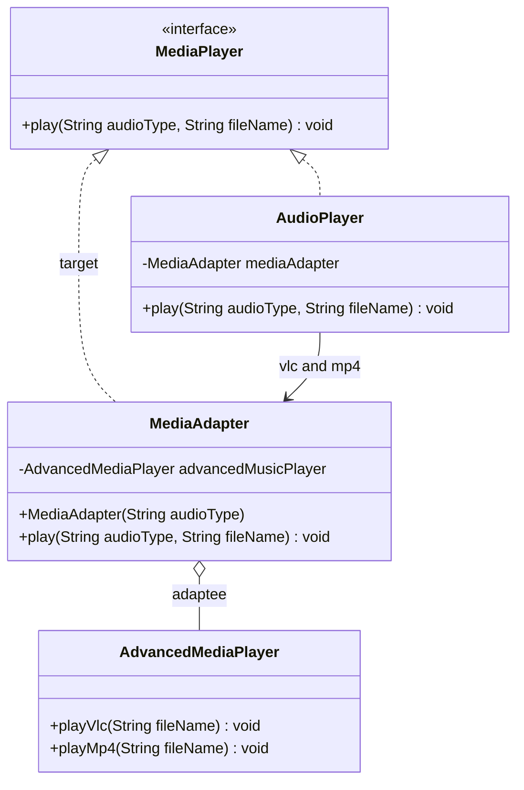
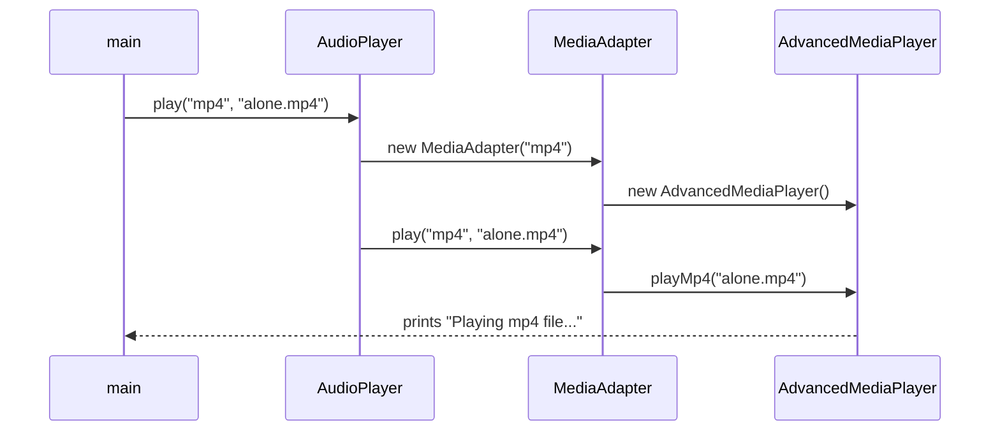
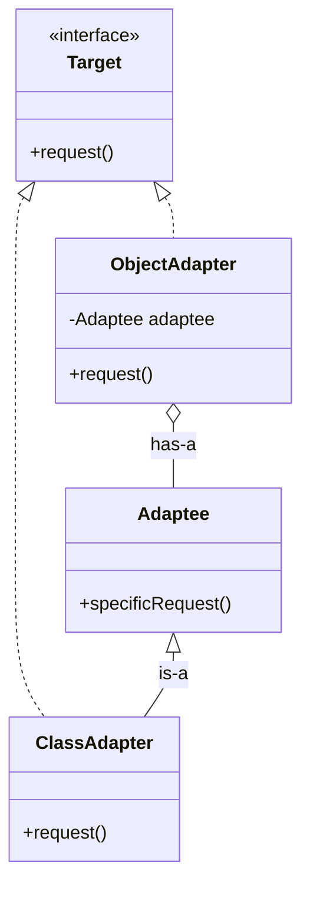

## In One Line
Adapter wraps an object that has the **wrong interface** and exposes the interface the client expects, translating each call — so two classes that could not work together now can, without changing either of them.

## Mental Model
Think of a **travel plug adapter**. Your laptop charger has an Indian plug; the hotel wall in London only has UK sockets. You do not rewire the charger or the hotel — you put an adapter in between: UK pins on one side, an Indian socket on the other. The electricity is exactly the same; only the *shape of the connection* changes.

How it maps to the code:
- **The UK wall socket** → the **target** interface the client expects: `MediaPlayer.play(audioType, fileName)`.
- **Your laptop charger with an Indian plug** → the **adaptee**: `AdvancedMediaPlayer`, which can play files but only through `playVlc(...)` and `playMp4(...)`.
- **The travel adapter** → `MediaAdapter`: it *is* a `MediaPlayer` on the outside and *has* an `AdvancedMediaPlayer` inside.
- **The hotel guest plugging things in** → the client `AudioPlayer`, which only ever speaks `play(type, file)`.
- **The adapter adds no new power** → an adapter changes the interface, not the behaviour. If it started adding features, it would be a Decorator.

## Concept
### Intent (Gang of Four)
> "Convert the interface of a class into another interface clients expect. Adapter lets classes work together that couldn't otherwise because of incompatible interfaces."

Also known as **Wrapper**. Category: **structural** — it is about how classes and objects are composed.

### The problem it solves
You have code written against one interface (`MediaPlayer`) and a useful class with a different interface (`AdvancedMediaPlayer`) — often a **third-party or legacy** class you cannot or should not modify. Editing either side would ripple through the code base. The adapter is a small translation layer that keeps both sides untouched.

Typical triggers:
- Integrating a third-party library, SDK or legacy module.
- Replacing one library with another behind your existing interface.
- Making old APIs (arrays, `Enumeration`, byte streams) usable by newer APIs (`List`, `Iterator`, character streams).

### Participants and how the example maps to them
| Participant | Role | In the example |
|---|---|---|
| **Target** | The interface the client expects | `interface MediaPlayer { void play(String audioType, String fileName); }` |
| **Adaptee** | Existing class with an incompatible interface | `class AdvancedMediaPlayer` with `playVlc(...)`, `playMp4(...)` |
| **Adapter** | Implements Target, holds the adaptee, translates calls | `class MediaAdapter implements MediaPlayer` |
| **Client** | Works only through Target | `AudioPlayer` (plays mp3 itself, delegates vlc/mp4 to `MediaAdapter`) and `main` |

`AudioPlayer` wears two hats here: it implements `MediaPlayer` itself (for mp3) and is the client of the adapter (for vlc/mp4).

### Object adapter vs class adapter
| | Object adapter (composition) | Class adapter (inheritance) |
|---|---|---|
| Structure | `class Adapter implements Target { private final Adaptee a; }` | `class Adapter extends Adaptee implements Target` |
| Adapts | The adaptee **and all its subclasses** (any instance you pass in) | Only that one concrete class |
| Can override adaptee behaviour? | No (only wrap it) | Yes (it is a subclass) |
| Works if adaptee is `final` or an interface? | Yes | No — cannot extend a `final` class; Java has no multiple class inheritance |
| Coupling | Low; adaptee can be injected and mocked | High; tied to one class |
| Preferred in Java? | **Yes** — "favour composition over inheritance" | Rarely |

The course's `MediaAdapter` is an **object adapter** (it holds an `AdvancedMediaPlayer` field).

### What an adapter may translate
- **Method names and signatures** — `play("vlc", f)` → `playVlc(f)`.
- **Data formats and units** — Fahrenheit → Celsius, `java.util.Date` → `Instant`, XML → objects.
- **Protocols and error models** — checked vs unchecked exceptions, callbacks vs futures, error codes vs exceptions.

It should **not** add new business behaviour. Keep adapters thin.

### Variants you may be asked about
- **Two-way adapter** — implements both interfaces, so each side can use the other.
- **Pluggable adapter / lambda adapter** — when the target is a functional interface, a lambda or method reference *is* the adapter: `Runnable r = legacyJob::runNow;`.
- **Ports and Adapters (Hexagonal architecture)** and the DDD **anti-corruption layer** — the same idea at architecture level: the domain defines interfaces (ports), and adapters translate to databases, message brokers or external APIs.

### When to use Adapter
- You want to use an existing class whose interface does not match what you need.
- You want to isolate your code from a third-party API so it can be swapped later.
- You need to make several unrelated classes look alike to one client.

### When NOT to use it
- You control both sides and can simply change one interface — refactor instead of adding a layer.
- The "adapter" is starting to add features, caching or access checks — that is a Decorator or Proxy; name it honestly.
- You want to simplify a *whole subsystem* — that is a Facade.

### Real JDK and Spring examples
| Where | What it adapts |
|---|---|
| `Arrays.asList(array)` | An array → the `List` interface (a fixed-size view that writes through to the array) |
| `InputStreamReader` / `OutputStreamWriter` | Byte streams → character streams (`Reader`/`Writer`), decoding with a charset |
| `Executors.callable(Runnable, result)` | `Runnable` → `Callable` (implemented by an internal class literally named `RunnableAdapter`) |
| `Collections.enumeration(coll)` / `Collections.list(enumeration)` | Modern collections ↔ legacy `Enumeration` |
| `Collections.newSetFromMap(map)` | A `Map` → the `Set` interface |
| Spring MVC `HandlerAdapter` | `DispatcherServlet` calls every kind of handler (`@RequestMapping` methods, `HttpRequestHandler`, old `Controller`s) through one adapter interface |
| Spring `MessageListenerAdapter`, `JpaVendorAdapter` | Plain POJO methods → JMS listeners; a JPA provider (Hibernate) → Spring's JPA setup |

> [!WARNING] Swing/AWT `MouseAdapter`, `WindowAdapter`, `KeyAdapter` are **not** the GoF Adapter despite the name. They are convenience classes with empty implementations of a listener interface, so you only override the methods you need. A classic interview trick question.

### Adapter vs look-alikes
| Pattern | Interface seen by client | Purpose |
|---|---|---|
| **Adapter** | **Different** from the wrapped object's | Make an incompatible interface fit |
| **Decorator** | **Same** as the wrapped object's | Add behaviour, stackable |
| **Proxy** | **Same** as the wrapped object's | Control access (lazy, security, remote, caching) |
| **Facade** | **New, simpler** interface over **many** objects | Simplify a subsystem |
| **Bridge** | Abstraction over an implementation interface | Designed **up front** so both sides vary independently; Adapter is applied **after the fact** |

## Diagram

`MediaAdapter` looks like a `MediaPlayer` from outside and holds the incompatible `AdvancedMediaPlayer` inside (an object adapter).


The adapter turns the generic `play(type, file)` call into the adaptee's specific `playMp4(file)`.


Object adapter wraps an instance (composition); class adapter extends the adaptee (inheritance) — Java allows only one superclass, so it is less flexible.

## Code
@example CoreJava/StructuralPatterns/AdapterPatternExample.java

**Object adapter, class adapter and lambda adapter — translating data, not just names:**
```java
public class AdapterKinds {
    // Target: what our code expects
    interface CelsiusSensor {
        double celsius();
    }

    // Adaptee: a legacy/third-party class we cannot change
    static class FahrenheitThermometer {
        double readFahrenheit() { return 98.6; }
    }

    // Object adapter: HAS-A adaptee (composition) - the usual choice
    static class ThermometerAdapter implements CelsiusSensor {
        private final FahrenheitThermometer adaptee;
        ThermometerAdapter(FahrenheitThermometer adaptee) { this.adaptee = adaptee; }
        @Override public double celsius() {
            return (adaptee.readFahrenheit() - 32) * 5 / 9;   // translate the call AND the data
        }
    }

    // Class adapter: IS-A adaptee (inheritance) - possible only because the adaptee is a class we can extend
    static class ThermometerClassAdapter extends FahrenheitThermometer implements CelsiusSensor {
        @Override public double celsius() { return (readFahrenheit() - 32) * 5 / 9; }
    }

    static void report(CelsiusSensor sensor) {           // client knows only the target interface
        System.out.printf("%s -> %.1f C%n", sensor.getClass().getSimpleName(), sensor.celsius());
    }

    public static void main(String[] args) {
        FahrenheitThermometer legacy = new FahrenheitThermometer();
        report(new ThermometerAdapter(legacy));
        report(new ThermometerClassAdapter());

        // Lambda adapter: a functional-interface target can be adapted inline
        CelsiusSensor inline = () -> (legacy.readFahrenheit() - 32) * 5 / 9;
        System.out.printf("lambda -> %.1f C%n", inline.celsius());
    }
}
```
```output
ThermometerAdapter -> 37.0 C
ThermometerClassAdapter -> 37.0 C
lambda -> 37.0 C
```

**Adapters you already use in the JDK:**
```java
import java.io.*;
import java.nio.charset.StandardCharsets;
import java.util.*;
import java.util.concurrent.*;

public class JdkAdapters {
    public static void main(String[] args) throws Exception {
        // Array -> List: a fixed-size view that writes through to the array
        String[] arr = {"a", "b", "c"};
        List<String> list = Arrays.asList(arr);
        list.set(0, "z");
        System.out.println(arr[0] + " " + list);
        try { list.add("d"); } catch (UnsupportedOperationException e) { System.out.println("add -> UnsupportedOperationException"); }

        // Byte stream -> character stream
        InputStream bytes = new ByteArrayInputStream("hello".getBytes(StandardCharsets.UTF_8));
        Reader reader = new InputStreamReader(bytes, StandardCharsets.UTF_8);
        System.out.println((char) reader.read() + "" + (char) reader.read());

        // Runnable -> Callable
        Callable<String> task = Executors.callable(() -> System.out.println("runnable ran"), "done");
        System.out.println(task.call());

        // Legacy Enumeration <-> modern collections
        Enumeration<String> en = Collections.enumeration(List.of("x", "y"));
        System.out.println(Collections.list(en));
    }
}
```
```output
z [z, b, c]
add -> UnsupportedOperationException
he
runnable ran
done
[x, y]
```
`Arrays.asList` is a view: `set` changes the original array, but the size is fixed, so `add` is unsupported.

**How the course's adapter breaks when built for an unknown type:**
```java
MediaAdapter adapter = new MediaAdapter("avi");
System.out.println("adaptee: " + adapter.advancedMusicPlayer);
adapter.play("vlc", "song.vlc");
```
```output
adaptee: null
Exception in thread "main" java.lang.NullPointerException: Cannot invoke "AdvancedMediaPlayer.playVlc(String)" because "this.advancedMusicPlayer" is null
	at MediaAdapter.play(AdapterNpe.java:39)
	at AdapterNpe.main(AdapterNpe.java:5)
```
(Run with the course's classes copied into one file, `AdapterNpe.java`.)

**A cleaner version of the course adapter** (injected adaptee, one adapter reused, unsupported types rejected):
```java
class MediaAdapter implements MediaPlayer {
    private final AdvancedMediaPlayer adaptee;
    MediaAdapter(AdvancedMediaPlayer adaptee) { this.adaptee = adaptee; }

    @Override
    public void play(String audioType, String fileName) {
        switch (audioType.toLowerCase()) {
            case "vlc" -> adaptee.playVlc(fileName);
            case "mp4" -> adaptee.playMp4(fileName);
            default -> throw new IllegalArgumentException(audioType + " is not supported");
        }
    }
}

class AudioPlayer implements MediaPlayer {
    private final MediaPlayer advanced = new MediaAdapter(new AdvancedMediaPlayer());  // created once

    @Override
    public void play(String audioType, String fileName) {
        if (audioType.equalsIgnoreCase("mp3")) System.out.println("Playing mp3 file. Name: " + fileName);
        else advanced.play(audioType, fileName);
    }
}
```

## Walkthrough
- `interface MediaPlayer { void play(String audioType, String fileName); }` — the **Target**: the one method the rest of the program knows.
- `class AdvancedMediaPlayer` — the **Adaptee**. It can play vlc and mp4 files, but through two differently named methods, `playVlc(String)` and `playMp4(String)`, with no audio-type parameter. Its methods are package-private, which works because everything is in one package.
- `class MediaAdapter implements MediaPlayer` — the **Adapter**.
  - `AdvancedMediaPlayer advancedMusicPlayer;` — the wrapped adaptee (object adapter). Package-private and not `final`.
  - Constructor `MediaAdapter(String audioType)` — creates the adaptee when the type is `"vlc"` or `"mp4"` (case-insensitive). Both branches do exactly the same thing; for any other type the field stays `null`.
  - `play(audioType, fileName)` — the translation: `"vlc"` → `playVlc(fileName)`, `"mp4"` → `playMp4(fileName)`. Anything else silently does nothing.
- `class AudioPlayer implements MediaPlayer` — the **client** of the adapter (and a Target implementation itself).
  - `MediaAdapter mediaAdapter;` — a field that is overwritten on each vlc/mp4 call.
  - `"mp3"` → handled directly: prints `Playing mp3 file. Name: ...`.
  - `"vlc"` or `"mp4"` → `mediaAdapter = new MediaAdapter(audioType); mediaAdapter.play(audioType, fileName);` — builds a new adapter and delegates.
  - Anything else → `Invalid media. <type> format not supported`.
- `main` makes four calls:
  1. `play("mp3", "beyond the horizon.mp3")` → **`Playing mp3 file. Name: beyond the horizon.mp3`** (no adapter involved).
  2. `play("mp4", "alone.mp4")` → adapter → `playMp4` → **`Playing mp4 file. Name: alone.mp4`**.
  3. `play("vlc", "far far away.vlc")` → adapter → `playVlc` → **`Playing vlc file. Name: far far away.vlc`**.
  4. `play("avi", "mind me.avi")` → **`Invalid media. avi format not supported`**.
- All four `// Output:` comments match the recorded output; the run is deterministic.

## Traps
> [!ERRATA] In `MediaAdapter`'s constructor both branches are identical (`advancedMusicPlayer = new AdvancedMediaPlayer();`), so the `if`/`else if` is dead logic — a leftover from the classic version of this example, where `VlcPlayer` and `Mp4Player` were two separate classes implementing an `AdvancedMediaPlayer` *interface*. Worse, for any other type the field stays `null`: `new MediaAdapter("avi").play("vlc", ...)` throws `NullPointerException` (shown in the Code section). Create the adaptee unconditionally, or better, inject it through the constructor.

> [!ERRATA] `AudioPlayer` creates a **new** `MediaAdapter` (and a new `AdvancedMediaPlayer`) on every vlc/mp4 call and stores it in a mutable field. That is needless allocation and shared mutable state (not thread-safe). The adapter is stateless — create it once in a `private final` field.

> [!ERRATA] The audio type is checked twice (in `AudioPlayer` and again in `MediaAdapter`) with raw strings, and `MediaAdapter.play` silently ignores unknown types. Use an enum or throw `IllegalArgumentException` for unsupported types. Minor naming slip: the field of type `AdvancedMediaPlayer` is called `advancedMusicPlayer`.

- **Adapters that grow features** become hard-to-find business logic. Keep them to translation only.
- **`Arrays.asList` is not an `ArrayList`** you can grow: `add`/`remove` throw `UnsupportedOperationException`, and `set` writes through to the array. Wrap it: `new ArrayList<>(Arrays.asList(arr))`.
- **`Arrays.asList(intArray)`** on a primitive `int[]` gives a `List<int[]>` of size 1, not a list of numbers.
- **`InputStreamReader` without a charset** uses the platform default (UTF-8 by default since Java 18, JEP 400; before that it depended on the OS). Always pass one.
- **Class adapters cannot adapt `final` classes or interfaces**, and use up your one superclass.
- **`MouseAdapter` is not an Adapter** in the GoF sense.

## Tips & Tricks
- **Mnemonic — "Adapter changes the plug, not the power."** Different interface, same behaviour.
- **The one-word test for wrappers:** *different* interface → Adapter; *same* interface + extra behaviour → Decorator; *same* interface + access control → Proxy; *simpler* interface over *many* classes → Facade.
- **Prefer object adapters**, and inject the adaptee — it makes the adapter trivially testable with a mock adaptee.
- **Name adapters after both sides** (`FahrenheitToCelsiusAdapter`, `LegacyBillingPaymentGateway`) so readers see what is being translated.
- **Wrap every third-party API behind your own interface + adapter.** Swapping the vendor later means writing one new adapter.
- **Functional-interface target? Use a lambda or method reference** as the adapter — no class needed.

## Interview Q&A
### [Basic] What is the Adapter pattern?
Adapter is a structural pattern that converts the interface of an existing class into another interface that clients expect, so classes with incompatible interfaces can work together without modifying either. The adapter implements the target interface and holds (or extends) the adaptee, translating each call. In the course example, `MediaAdapter` implements `MediaPlayer.play(type, file)` and translates it into `AdvancedMediaPlayer.playVlc(file)` or `playMp4(file)`.

**Follow-up:** *Does an adapter change behaviour?* — It should not; it changes the interface (and maybe data formats). Adding behaviour is the Decorator's job.

### [Basic] Identify Target, Adaptee, Adapter and Client in the course example.
Target is `MediaPlayer` (the interface the client uses). Adaptee is `AdvancedMediaPlayer` (the class with the incompatible `playVlc`/`playMp4` methods). Adapter is `MediaAdapter`, which implements `MediaPlayer` and wraps an `AdvancedMediaPlayer`. The client is `AudioPlayer` (and ultimately `main`), which only calls `play(type, file)` and delegates vlc/mp4 to the adapter.

**Follow-up:** *Why does `AudioPlayer` also implement `MediaPlayer`?* — So that `main` treats it as a media player too; it is both a Target implementation and the adapter's client.

### [Intermediate] Object adapter vs class adapter — which do you prefer in Java and why?
An object adapter implements the target and **holds** an adaptee instance (composition); a class adapter **extends** the adaptee and implements the target (inheritance). In Java I prefer object adapters: they work with `final` classes, interfaces and any subclass of the adaptee; the adaptee can be injected and mocked; and they do not consume the single superclass slot. A class adapter is only useful when you must override some adaptee behaviour or need access to its protected members.

**Follow-up:** *Can you write a class adapter if the adaptee is an interface?* — Then you just implement both interfaces — but at that point there is nothing to inherit, so it is simply a class implementing two interfaces (a two-way adapter).

### [Intermediate] What is the difference between Adapter, Decorator and Proxy? All three wrap an object.
The difference is the interface and the intent. An **Adapter** exposes a **different** interface from the object it wraps, to make it fit a client. A **Decorator** exposes the **same** interface and **adds** behaviour; decorators are stackable. A **Proxy** exposes the **same** interface and **controls access** — lazy loading, security checks, remote calls, caching — and usually manages the real object's lifecycle.

**Follow-up:** *Is `Collections.unmodifiableList` a decorator or a proxy?* — It has the same interface and restricts access, so it is usually described as a protection proxy; some books call it a decorator because it wraps and changes behaviour. Explain the intent and either answer is accepted.

### [Intermediate] Adapter vs Facade?
Both wrap existing code, but an Adapter makes **one** class conform to an **existing** interface the client already expects, while a Facade defines a **new, simpler** interface over a **whole subsystem** of classes. Adapter is about compatibility; Facade is about simplicity. A facade can use adapters internally.

**Follow-up:** *Can one class be both?* — Yes: a gateway class that simplifies a vendor SDK (facade) while implementing your own `PaymentGateway` interface (adapter).

### [Intermediate] Adapter vs Bridge?
Their structures look similar (an abstraction holding an implementation), but the timing and intent differ. Adapter is applied **after the fact** to make existing, incompatible classes work together. Bridge is designed **up front** to split an abstraction and its implementation into two hierarchies that can vary independently (shapes × renderers).

**Follow-up:** *Memory hook?* — "Adapter makes things work *after* they are designed; Bridge makes them work *before* they are."

### [Intermediate] Give examples of Adapter in the JDK.
`Arrays.asList` adapts an array to `List`; `InputStreamReader`/`OutputStreamWriter` adapt byte streams to character streams; `Executors.callable(Runnable)` adapts a `Runnable` to a `Callable` via the internal `RunnableAdapter`; `Collections.enumeration` and `Collections.list` bridge legacy `Enumeration` and modern collections; `Collections.newSetFromMap` makes a `Map` look like a `Set`.

**Follow-up:** *What is special about the list from `Arrays.asList`?* — It is a fixed-size view backed by the array: `set` writes through, `add`/`remove` throw `UnsupportedOperationException`.

### [Intermediate] Are Swing's `MouseAdapter` and `WindowAdapter` examples of the Adapter pattern?
No. They are abstract classes that implement a listener interface with empty method bodies, so you can override just the one or two methods you care about. They do not convert one interface into another. Since Java 8, default methods in interfaces solve the same problem, which is why newer listener-style interfaces rarely need such "adapter" classes.

**Follow-up:** *What pattern are they closer to?* — A convenience base class / default implementation; they are sometimes loosely compared to Null Object, since every method does nothing.

### [Advanced] How does Spring MVC use the Adapter pattern?
`DispatcherServlet` must invoke very different handler types: annotated `@RequestMapping` methods, `HttpRequestHandler` beans, legacy `Controller` implementations, functional endpoints. Instead of `instanceof` checks, it asks each registered `HandlerAdapter` "do you `supports(handler)`?" and calls `handle(request, response, handler)` on the one that does. `RequestMappingHandlerAdapter` then resolves method arguments, invokes the method and handles the return value. The dispatcher depends only on the `HandlerAdapter` interface, so new handler styles can be added by adding a new adapter.

**Follow-up:** *Which other pattern works alongside it there?* — Chain of Responsibility–like lookup across `HandlerMapping`s to find the handler, and Strategy for argument resolvers.

### [Advanced] How does Adapter relate to Hexagonal (Ports and Adapters) architecture?
Hexagonal architecture applies Adapter at system level. The domain core defines **ports** — interfaces such as `OrderRepository` or `PaymentGateway`. **Adapters** implement those ports for concrete technologies — a JPA repository, a Stripe client, a Kafka publisher — translating between domain objects and external formats. The domain never depends on frameworks, and technologies can be swapped by writing new adapters. DDD's anti-corruption layer is the same idea, protecting your model from a foreign model's concepts.

**Follow-up:** *Where is the dependency direction?* — Adapters depend on the ports (the domain's interfaces), never the other way round — Dependency Inversion.

## Quiz
### What does this print, using the course's `AudioPlayer`?
```java
AudioPlayer p = new AudioPlayer();
p.play("MP4", "a.mp4");
p.play("wav", "b.wav");
```
- [ ] Invalid media. MP4 format not supported / Invalid media. wav format not supported
- [x] Playing mp4 file. Name: a.mp4 / Invalid media. wav format not supported
- [ ] Playing mp4 file. Name: a.mp4 / (nothing)
- [ ] NullPointerException
> Every comparison uses `equalsIgnoreCase`, so `"MP4"` matches `"mp4"` and goes through the adapter to `playMp4`. `"wav"` matches nothing in `AudioPlayer`, so its `else` branch prints the "Invalid media" message — the adapter is never created for it.

### What happens here, using the course's classes?
```java
MediaAdapter adapter = new MediaAdapter("avi");
adapter.play("vlc", "song.vlc");
```
- [ ] Prints `Playing vlc file. Name: song.vlc`
- [ ] Prints nothing
- [x] `NullPointerException`
- [ ] Compile error
> The constructor only creates the adaptee for `"vlc"` or `"mp4"`, so for `"avi"` the field stays `null`. `play("vlc", ...)` then calls `playVlc` on `null`. The duplicated branches hide the fact that the adaptee should simply always be created (or injected).

### After `p.play("vlc", "c.vlc")` and then `p.play("vlc", "d.vlc")` on the same `AudioPlayer`, is `p.mediaAdapter` the same object both times?
- [ ] Yes, it is created once and reused
- [x] No, a new `MediaAdapter` is created on each vlc/mp4 call
- [ ] It is `null` after each call
- [ ] Only if the audio types are the same
> `AudioPlayer.play` executes `mediaAdapter = new MediaAdapter(audioType);` every time — running it and comparing the references prints `false`. The adapter is stateless, so creating it once in a `final` field is the better design.

### What does this print?
```java
String[] arr = {"a", "b", "c"};
List<String> list = Arrays.asList(arr);
list.set(0, "z");
System.out.println(arr[0] + " " + list.size());
```
- [ ] a 3
- [x] z 3
- [ ] z 4
- [ ] UnsupportedOperationException
> `Arrays.asList` returns an adapter view over the array, so `set` writes straight through to `arr[0]`. Only size-changing operations (`add`, `remove`) throw `UnsupportedOperationException`.

### Which wrapper exposes a DIFFERENT interface from the object it wraps?
- [x] Adapter
- [ ] Decorator
- [ ] Proxy
- [ ] All three
> Decorators and proxies deliberately keep the same interface as the wrapped object (so they can be swapped in transparently). Only the adapter's job is to present a different interface.

### Which JDK class adapts a byte stream into a character stream?
- [ ] `BufferedReader`
- [x] `InputStreamReader`
- [ ] `FileInputStream`
- [ ] `PrintStream`
> `InputStreamReader` takes an `InputStream` (bytes) and exposes the `Reader` interface (characters), decoding with a charset — an adapter. `BufferedReader` wraps a `Reader` and keeps the `Reader` interface while adding buffering and `readLine()` — a decorator.

### Why is the object adapter usually preferred over the class adapter in Java?
- [ ] Class adapters cannot implement interfaces
- [x] Java allows only one superclass, and a class adapter cannot adapt `final` classes or other subclasses of the adaptee
- [ ] Object adapters are faster
- [ ] Class adapters are not allowed by the compiler
> A class adapter must `extends Adaptee`, which uses the single inheritance slot, is impossible for `final` classes, and is tied to that one class. An object adapter can wrap any instance (including subclasses) and can be injected and mocked.

## Takeaways
- Adapter converts one interface into another that the client expects, so incompatible classes can cooperate without changing either.
- Roles: Target (`MediaPlayer`), Adaptee (`AdvancedMediaPlayer`), Adapter (`MediaAdapter`), Client (`AudioPlayer`).
- Prefer object adapters (composition, injectable) over class adapters (inheritance, one superclass, no `final` adaptees).
- An adapter translates calls and data; it should not add behaviour — that is Decorator (same interface, extra behaviour) or Proxy (same interface, access control).
- JDK adapters: `Arrays.asList`, `InputStreamReader`, `Executors.callable`, `Collections.enumeration/list`; Spring MVC's `HandlerAdapter`. Swing's `MouseAdapter` is not a GoF Adapter.
- The course's adapter has dead duplicate branches that leave the adaptee `null` for unknown types (NPE), and `AudioPlayer` needlessly creates a new adapter on every call.
- Adapter is applied after the fact; Bridge is designed up front; Facade simplifies a whole subsystem.
