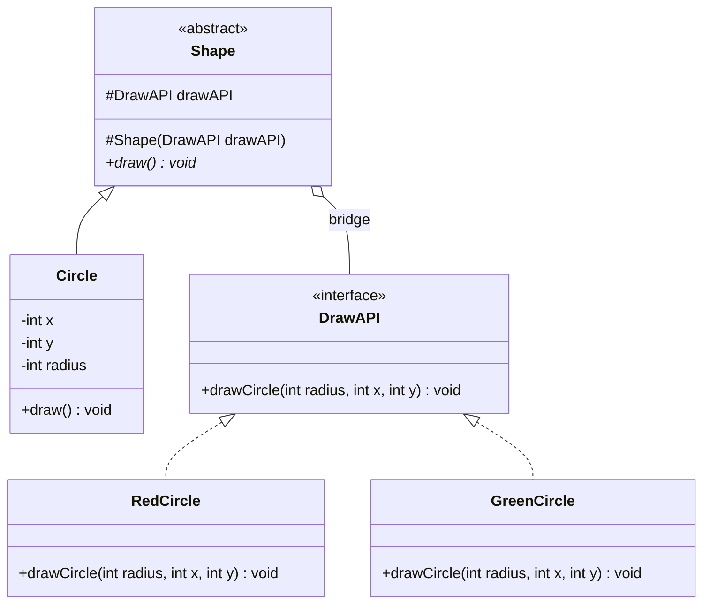
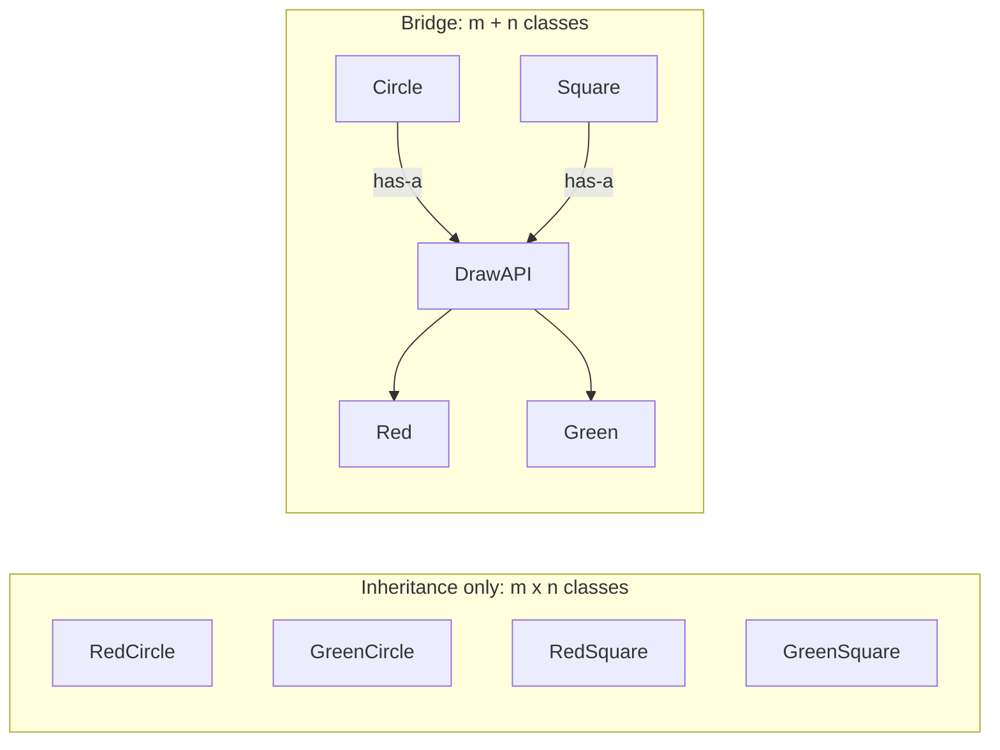
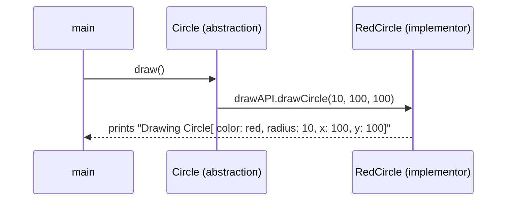

## In One Line
Bridge splits one big class hierarchy into **two independent hierarchies** — the *abstraction* (what the object is, e.g. `Shape`) and the *implementation* (how the low-level work is done, e.g. `DrawAPI`) — and connects them with a reference, so each side can grow without multiplying classes.

## Mental Model
Think of a **TV remote and the TV**. Remotes come in several kinds (basic remote, voice remote, phone app); TVs come from several brands (Sony, LG, Samsung). You do not need a "Sony-basic-remote", a "Sony-voice-remote", an "LG-basic-remote"... Each remote talks to *any* TV through a common set of signals (power, volume up, channel). Add a new remote: it works with every TV. Add a new TV brand: every remote works with it.

How it maps to the code:
- **The remote** → the **abstraction**: `abstract class Shape` and its refined version `Circle`. It is what the client holds and uses.
- **The TV** → the **implementor**: `interface DrawAPI` with concrete implementors `RedCircle` and `GreenCircle`.
- **The infrared signal between them** → the **bridge**: the field `protected DrawAPI drawAPI` inside `Shape`, and the call `drawAPI.drawCircle(radius, x, y)`.
- **Pairing any remote with any TV** → `new Circle(100, 100, 10, new RedCircle())` or `... new GreenCircle()` — mix and match at construction time.

## Concept
### Intent (Gang of Four)
> "Decouple an abstraction from its implementation so that the two can vary independently."

Also known as **Handle/Body**. Category: **structural**.

"Implementation" here does **not** mean "a class that implements an interface". It means the *platform-level* or *low-level* side: the drawing API, the database driver, the operating-system window, the message transport.

### The problem: the Cartesian-product class explosion
Suppose shapes can be circles or squares and must be drawn in red or green. With inheritance alone, every combination needs its own class:

| | Red | Green | Blue (new) |
|---|---|---|---|
| Circle | `RedCircle` | `GreenCircle` | `BlueCircle` |
| Square | `RedSquare` | `GreenSquare` | `BlueSquare` |
| Triangle (new) | `RedTriangle` | `GreenTriangle` | `BlueTriangle` |

That is **m × n** classes (3 × 3 = 9), and every new colour or shape adds a whole row or column. Bridge turns the grid into two short lists — shapes and colours — so you need **m + n** classes (3 + 3 = 6), and any shape can be combined with any colour at runtime.

The trick is **composition over inheritance**: instead of `RedCircle extends Circle`, a `Circle` **has a** colour/drawing implementation.

### Participants and how the example maps to them
| Participant | Role | In the example |
|---|---|---|
| **Abstraction** | High-level interface for clients; holds a reference to an Implementor | `abstract class Shape` with `protected DrawAPI drawAPI` and `abstract void draw()` |
| **RefinedAbstraction** | Extends the abstraction with specific behaviour | `class Circle extends Shape` (knows `x`, `y`, `radius`) |
| **Implementor** | Interface for the low-level operations | `interface DrawAPI { void drawCircle(int radius, int x, int y); }` |
| **ConcreteImplementor** | A real implementation of those operations | `RedCircle`, `GreenCircle` (really: "red renderer", "green renderer") |
| **Client** | Chooses a pairing and uses the abstraction | `main` in `BridgePatternExample` |

### How the call flows
`redCircle.draw()` → `Circle.draw()` (abstraction side, knows the geometry) → `drawAPI.drawCircle(radius, x, y)` (crosses the bridge) → `RedCircle.drawCircle(...)` (implementation side, knows how to paint red). The abstraction **delegates** to the implementor; the client never calls the implementor directly.

### Designing the implementor interface well
In the GoF design, the implementor offers **primitive** operations (`drawLine`, `fillRect`, `fillCircle`), and the abstraction builds **higher-level** operations from them (`Square.draw()` = `fillRect(...)`). The course's `DrawAPI.drawCircle(...)` is shape-specific: adding a `Square` would force a new `drawSquare` method into **every** implementor, which erodes the independence the pattern promises. The `BridgeGrow` snippet in the Code section shows the primitive-operations version, where adding a new shape changes no renderer.

### Consequences
- **Independent extension:** add shapes without touching renderers, and renderers without touching shapes.
- **Runtime switching:** the implementor is just a field — you can inject a different one, or even swap it later.
- **Hiding implementation details:** clients depend only on `Shape`; platform-specific code stays behind `DrawAPI`.
- **Cost:** one more interface and one more level of indirection; overkill when there is only one dimension of variation.

### When to use Bridge
- A class varies along **two (or more) orthogonal dimensions** (shape × colour, message × transport, device × remote, report × output format).
- You want to switch implementations at runtime or share one implementation among many objects.
- You want platform independence: the same high-level API over different platforms, drivers or vendors.

### When NOT to use it
- There is only one dimension of variation — plain polymorphism is enough.
- The two sides are not really independent (every new abstraction needs a new implementor method anyway).
- You are integrating an existing class with the wrong interface — that is an Adapter.

### Real JDK and framework examples
| Where | Abstraction side | Implementor side |
|---|---|---|
| **JDBC** | Your code against `java.sql` (`DriverManager`, `Connection`, `Statement`) | Vendor drivers (MySQL, PostgreSQL, Oracle) implementing `Driver`, `Connection`... |
| `java.util.logging` | `Logger` | `Handler`s (`ConsoleHandler`, `FileHandler`), which in turn use `Formatter`s |
| AWT (classic GoF example) | `java.awt.Component`, `Button`, `Frame` | Native "peer" objects per operating system |
| SLF4J | The SLF4J API your code calls | A binding: Logback, Log4j 2, JUL |
| Spring cache abstraction | `@Cacheable`, `Cache`, `CacheManager` | Caffeine, Redis, Ehcache providers |

### Bridge vs look-alikes
| | Bridge | Adapter | Strategy | Abstract Factory |
|---|---|---|---|---|
| When applied | **Up front**, by design | **After the fact**, to fit existing code | Up front | Up front |
| What varies | A whole abstraction hierarchy **and** its implementation hierarchy | Nothing — it fixes an interface mismatch | One algorithm used by a context | Which family of objects is created |
| Category | Structural | Structural | Behavioral | Creational |
| Typical lifetime of the link | Long-lived, usually set at construction | Fixed | Often swapped per call or per configuration | N/A — it creates objects |

Bridge and Strategy have **the same structure** (an object holding an interface reference). The difference is intent: Strategy swaps *one behaviour* of a context; Bridge separates *two whole hierarchies* that are both extended by subclassing. An Abstract Factory is often used to create and plug in the right implementor for a Bridge.

## Diagram

Two hierarchies — shapes on the left, drawing implementations on the right — joined by the `drawAPI` reference (the bridge).


Every new colour adds one class with Bridge, instead of one class per shape.


The abstraction supplies the data; the implementor decides how to render it.

## Code
@example CoreJava/StructuralPatterns/BridgePatternExample.java

**Bridge with primitive implementor operations** — a new shape (`Square`) and a new renderer can be added independently:
```java
import java.util.List;

public class BridgeGrow {
    // Implementor: low-level PRIMITIVE operations, not shape-specific ones
    interface Renderer {
        void fillCircle(int x, int y, int r);
        void fillRect(int x, int y, int w, int h);
    }

    static class VectorRenderer implements Renderer {
        public void fillCircle(int x, int y, int r) { System.out.println("SVG <circle cx=" + x + " cy=" + y + " r=" + r + ">"); }
        public void fillRect(int x, int y, int w, int h) { System.out.println("SVG <rect x=" + x + " y=" + y + " w=" + w + " h=" + h + ">"); }
    }
    static class AsciiRenderer implements Renderer {
        public void fillCircle(int x, int y, int r) { System.out.println("ASCII  (o) at " + x + "," + y + " r" + r); }
        public void fillRect(int x, int y, int w, int h) { System.out.println("ASCII  [#] at " + x + "," + y + " " + w + "x" + h); }
    }

    // Abstraction: high-level shapes that HAVE-A renderer (the bridge)
    static abstract class Shape {
        protected final Renderer renderer;
        Shape(Renderer renderer) { this.renderer = renderer; }
        abstract void draw();
    }
    static class Circle extends Shape {
        private final int x, y, r;
        Circle(Renderer renderer, int x, int y, int r) { super(renderer); this.x = x; this.y = y; this.r = r; }
        @Override void draw() { renderer.fillCircle(x, y, r); }
    }
    static class Square extends Shape {           // new abstraction: no renderer changes needed
        private final int x, y, side;
        Square(Renderer renderer, int x, int y, int side) { super(renderer); this.x = x; this.y = y; this.side = side; }
        @Override void draw() { renderer.fillRect(x, y, side, side); }
    }

    public static void main(String[] args) {
        for (Renderer r : List.of(new VectorRenderer(), new AsciiRenderer())) {
            List<Shape> shapes = List.of(new Circle(r, 5, 5, 2), new Square(r, 0, 0, 3));
            shapes.forEach(Shape::draw);
        }
    }
}
```
```output
SVG <circle cx=5 cy=5 r=2>
SVG <rect x=0 y=0 w=3 h=3>
ASCII  (o) at 5,5 r2
ASCII  [#] at 0,0 3x3
```
2 shapes × 2 renderers = 4 combinations from 4 small classes; a third renderer would give 6 combinations from 5 classes.

**Parameter order and runtime switching with the course's classes:**
```java
Shape s = new Circle(10, 20, 5, new GreenCircle());
s.draw();
s.drawAPI = new RedCircle();     // protected field, same package
s.draw();
```
```output
Drawing Circle[ color: green, radius: 5, x: 10, y: 20]
Drawing Circle[ color: red, radius: 5, x: 10, y: 20]
```
The constructor takes `(x, y, radius, ...)` but `drawCircle` takes `(radius, x, y)` — same numbers, different order. Swapping `drawAPI` switches the implementation of the same shape object.

## Walkthrough
- `// BridgePatternExample.java` — just a file-name comment.
- `interface DrawAPI { void drawCircle(int radius, int x, int y); }` — the **Implementor**: the low-level drawing contract. Note the parameter order: radius first.
- `class RedCircle implements DrawAPI` / `class GreenCircle implements DrawAPI` — the **ConcreteImplementors**. Each prints `Drawing Circle[ color: red, radius: ..., x: ..., y: ...]` (or green). Despite their names they are not circles — they are two ways of *drawing* a circle.
- `abstract class Shape` — the **Abstraction**.
  - `protected DrawAPI drawAPI;` — the **bridge** itself. `protected` so subclasses can call it.
  - `protected Shape(DrawAPI drawAPI)` — every shape must be given an implementor when it is created (constructor injection). The constructor is `protected` because only subclasses should call it — an abstract class cannot be instantiated anyway.
  - `public abstract void draw();` — the high-level operation clients use.
- `class Circle extends Shape` — the **RefinedAbstraction**.
  - `private int x, y, radius;` — the circle's own data (the abstraction side owns the "what").
  - `Circle(int x, int y, int radius, DrawAPI drawAPI)` — `super(drawAPI)` must be the first statement; then the fields are stored.
  - `draw()` — `drawAPI.drawCircle(radius, x, y);` delegates across the bridge, reordering the values to match `DrawAPI`'s signature.
- `main`:
  - `Shape redCircle = new Circle(100, 100, 10, new RedCircle());` — x=100, y=100, radius=10, drawn red. The variable type is `Shape`: the client depends only on the abstraction.
  - `Shape greenCircle = new Circle(100, 100, 10, new GreenCircle());` — same geometry, green implementor.
  - `redCircle.draw()` → **`Drawing Circle[ color: red, radius: 10, x: 100, y: 100]`**; `greenCircle.draw()` → the green line.
- The output is deterministic and matches the `// Output:` comments. With x = y = 100, the parameter-order difference is invisible in this run.

## Traps
> [!ERRATA] The concrete implementors are named `RedCircle` and `GreenCircle`, which are exactly the "one class per combination" names Bridge exists to avoid. They are not circles; they are drawing implementations (a red pen, a green pen). Names like `RedPen`/`GreenPen` or `RedRenderer`/`GreenRenderer` would show the two independent hierarchies clearly.

> [!ERRATA] The implementor method is shape-specific (`drawCircle`). As soon as a `Square` abstraction is added, every implementor needs a `drawSquare` too, so the two sides no longer vary independently. GoF-style implementors expose *primitive* operations (`fillCircle`, `fillRect`, `drawLine`) and let abstractions combine them (see `BridgeGrow`).

> [!ERRATA] Parameter order is inconsistent: `Circle(int x, int y, int radius, ...)` versus `drawCircle(int radius, int x, int y)`. The example hides it by using `x = y = 100`, but it is an easy source of silent bugs (see the Quiz). Also, `Circle.draw()` lacks `@Override`, and the fields `drawAPI`, `x`, `y`, `radius` could be `final`.

- **Confusing "implementation" with "implements".** In Bridge, the Implementor is the low-level platform side, not "the class that implements the abstraction's interface".
- **Bridge applied to a single dimension** is just indirection — no benefit.
- **Leaking implementor details into the abstraction** (for example, `Shape` methods that take SVG-specific arguments) ties the two sides back together.
- **A mutable `protected` bridge field** lets any subclass or same-package code swap the implementor unexpectedly; prefer `private final` plus a getter or an explicit setter if runtime switching is a feature.

## Tips & Tricks
- **Spot it with the "AND" test:** if you can describe a class as "*kind of X* AND *kind of Y*" (red AND circle, PDF AND invoice), you have two dimensions — consider Bridge.
- **Mnemonic — "m × n becomes m + n."**
- **Remote and TV:** the abstraction is the remote, the implementor is the TV, the signal is the bridge field.
- **Adapter vs Bridge timing:** "Adapter *after* design, Bridge *before* design."
- **Bridge vs Strategy:** same shape of code; ask "am I splitting two hierarchies (Bridge) or swapping one algorithm (Strategy)?"
- Design the implementor interface around **primitive** operations.

## Interview Q&A
### [Basic] What is the Bridge pattern?
Bridge decouples an abstraction from its implementation so the two can vary independently. Instead of one inheritance tree containing every combination (`RedCircle`, `GreenSquare`...), you create two hierarchies — the abstraction (`Shape`, `Circle`) and the implementor (`DrawAPI`, `RedCircle`, `GreenCircle`) — and the abstraction holds a reference to an implementor and delegates low-level work to it. In the course example, `Circle.draw()` calls `drawAPI.drawCircle(radius, x, y)`.

**Follow-up:** *What principle is behind it?* — Favour composition over inheritance: the abstraction *has* an implementation rather than *being* one.

### [Basic] What problem does Bridge solve? Give numbers.
The class explosion that happens when a class varies in two dimensions. With 4 shapes and 3 colours, pure inheritance needs 4 × 3 = 12 concrete classes, and each new colour adds 4 more. With Bridge you need 4 shape classes + 3 colour classes = 7, and a new colour adds exactly one class that works with every shape.

**Follow-up:** *And with three dimensions?* — You can bridge more than once (e.g., a shape has a renderer, and the renderer has a colour model): the counts stay additive instead of multiplicative.

### [Intermediate] Identify the participants in the course example.
Abstraction: `Shape` (abstract class holding `protected DrawAPI drawAPI`). RefinedAbstraction: `Circle`. Implementor: `DrawAPI`. ConcreteImplementors: `RedCircle` and `GreenCircle`. Client: `main`, which picks a pairing (`new Circle(100, 100, 10, new RedCircle())`) and calls `draw()` through the `Shape` type.

**Follow-up:** *What is misleading in the naming?* — `RedCircle`/`GreenCircle` sound like shapes but are drawing implementations; better names would be `RedPen`/`GreenPen`.

### [Intermediate] How is Bridge different from Adapter?
Both put an interface between two classes, but Adapter is a **retrofit**: it makes an existing class with the wrong interface fit a client, after both were designed. Bridge is an **up-front design** decision to keep an abstraction and its implementation in separate hierarchies so both can evolve. Adapter changes an interface; Bridge separates concerns.

**Follow-up:** *Could an adapter be used inside a bridge?* — Yes. If a third-party renderer does not match your `DrawAPI`, you write an adapter that implements `DrawAPI` and plug it in as a concrete implementor.

### [Intermediate] Bridge and Strategy look identical in code. What is the difference?
Structurally they are the same: a context/abstraction holds an interface reference and delegates. The difference is intent and scope. Strategy (behavioral) swaps **one algorithm** used by a context — often chosen per call or per configuration, and the context itself is usually not subclassed. Bridge (structural) separates **two class hierarchies** — the abstraction side is itself extended (`Circle`, `Square`) and so is the implementation side — and the link is typically long-lived, set when the object is built.

**Follow-up:** *So is `Comparator` passed to `sort` a Bridge?* — No, that is Strategy: one algorithm (ordering) swapped for one operation.

### [Intermediate] Where do you see Bridge in the JDK or common libraries?
JDBC is the usual answer: application code is written against the `java.sql` API, and each database vendor supplies a driver implementing `Driver`, `Connection`, `Statement` and so on; you can switch databases without changing the code that uses JDBC. Others: `java.util.logging`'s `Logger` with pluggable `Handler`s and `Formatter`s, AWT components with native peers (the original GoF example), and SLF4J's API with Logback or Log4j bindings.

**Follow-up:** *Is JDBC also another pattern?* — `DriverManager.getConnection` is a factory, and each driver's `Connection` creating `Statement`s is Abstract Factory-like. Real APIs mix patterns.

### [Advanced] How should the Implementor interface be designed?
It should offer **primitive, implementation-level operations** (`drawLine`, `fillRect`, `fillCircle`, `sendBytes`), while the abstraction offers **higher-level, domain operations** built from them (`Square.draw()`, `Message.sendUrgent()`). If the implementor mirrors the abstraction one-to-one (`drawCircle`, `drawSquare`), every new abstraction subclass forces changes in every implementor, and the two hierarchies no longer vary independently — which defeats the pattern. The course's `DrawAPI.drawCircle` has exactly that weakness.

**Follow-up:** *What if an implementor lacks a primitive?* — Provide a default method in the implementor interface built from other primitives, or have the abstraction fall back to a composition of available primitives.

### [Advanced] Design a notification system with Bridge.
Two dimensions: message type (alert, reminder, marketing) and channel (email, SMS, push).
```java
interface Channel { void send(String to, String text); }                      // implementor
class EmailChannel implements Channel { public void send(String to, String t) { /* SMTP */ } }
class SmsChannel implements Channel { public void send(String to, String t) { /* SMS API */ } }

abstract class Notification {                                                  // abstraction
    protected final Channel channel;
    Notification(Channel channel) { this.channel = channel; }
    abstract void notify(String user);
}
class Alert extends Notification {
    Alert(Channel c) { super(c); }
    void notify(String user) { channel.send(user, "[ALERT] Action needed"); }
}
```
Three message types and three channels need six classes instead of nine, and a WhatsApp channel is one new class that works with every message type.

**Follow-up:** *How would you choose the channel at runtime?* — Inject it from configuration or user preferences — often via a factory or the DI container.

## Quiz
### What does the original example print for the red circle?
- [ ] Drawing Circle[ color: red, radius: 100, x: 100, y: 10]
- [x] Drawing Circle[ color: red, radius: 10, x: 100, y: 100]
- [ ] Drawing Circle[ color: red, radius: 10, x: 10, y: 100]
- [ ] Drawing Circle[ color: green, radius: 10, x: 100, y: 100]
> `new Circle(100, 100, 10, new RedCircle())` sets x=100, y=100, radius=10. `draw()` calls `drawCircle(radius, x, y)`, and `RedCircle` prints them with their labels, so radius shows 10 and both coordinates 100.

### What does this print, using the course's classes?
```java
Shape s = new Circle(10, 20, 5, new GreenCircle());
s.draw();
```
- [ ] Drawing Circle[ color: green, radius: 10, x: 20, y: 5]
- [x] Drawing Circle[ color: green, radius: 5, x: 10, y: 20]
- [ ] Drawing Circle[ color: green, radius: 20, x: 10, y: 5]
- [ ] Drawing Circle[ color: green, radius: 5, x: 20, y: 10]
> The constructor order is `(x, y, radius)` → x=10, y=20, radius=5. `draw()` passes `(radius, x, y)` to `drawCircle(int radius, int x, int y)`, so the labels stay correct. The tempting first option assumes the constructor's first argument is the radius.

### With 4 shapes and 3 colours, how many concrete classes do you need with pure inheritance vs Bridge?
- [ ] 7 vs 12
- [x] 12 vs 7
- [ ] 12 vs 12
- [ ] 4 vs 3
> Inheritance needs one class per combination (4 × 3 = 12). Bridge needs one class per shape plus one per colour (4 + 3 = 7). That additive growth is the whole point of the pattern.

### What does this print, using the course's classes?
```java
Shape s = new Circle(1, 2, 3, new GreenCircle());
s.drawAPI = new RedCircle();
s.draw();
```
- [ ] Drawing Circle[ color: green, radius: 3, x: 1, y: 2]
- [x] Drawing Circle[ color: red, radius: 3, x: 1, y: 2]
- [ ] Compile error: `drawAPI` is protected
- [ ] Both a green and a red line
> `drawAPI` is `protected`, which also grants access within the same package, so the assignment compiles here. The shape now delegates to the red implementor — Bridge lets you switch implementations at runtime. Only the latest implementor is used.

### Which statement best distinguishes Bridge from Adapter?
- [ ] Bridge changes an interface; Adapter adds behaviour
- [x] Bridge is designed up front to let abstraction and implementation vary independently; Adapter retrofits an incompatible existing class
- [ ] Adapter uses composition; Bridge uses inheritance only
- [ ] They are the same pattern with different names
> Timing and intent: Bridge is a planned separation of two hierarchies; Adapter fixes an interface mismatch after the fact. Both usually use composition.

### In JDBC viewed as a Bridge, which part is the Implementor side?
- [ ] Your DAO classes
- [ ] The SQL strings
- [x] The vendor drivers (MySQL, PostgreSQL...) implementing `Driver`, `Connection`, `Statement`
- [ ] `System.out`
> Application code works against the stable `java.sql` API (the abstraction side); each vendor supplies the low-level implementation behind those interfaces, so you can switch databases without rewriting the application.

### Spot the design flaw: what happens when a `Square` is added to the course's design?
- [ ] Nothing — Square just extends Shape
- [x] Every `DrawAPI` implementor needs a new `drawSquare` method, because the implementor API is shape-specific
- [ ] `Circle` must be modified
- [ ] The `Shape` constructor must become public
> `DrawAPI` only knows `drawCircle`. A square cannot be drawn with it, so the interface grows and every implementor changes — the sides no longer vary independently. An implementor with primitive operations (`fillRect`, `fillCircle`) avoids this.

## Takeaways
- Bridge decouples an abstraction (`Shape`, `Circle`) from its implementation (`DrawAPI`, `RedCircle`, `GreenCircle`) so both hierarchies can grow independently.
- It replaces an m × n inheritance grid of combination classes with m + n classes joined by a reference — composition over inheritance.
- The abstraction holds the implementor (the bridge field) and delegates low-level work to it; the implementor can be chosen or switched at runtime.
- Design the implementor with primitive operations; a shape-specific `drawCircle` couples the two sides again.
- Bridge is designed up front; Adapter is a retrofit. Bridge and Strategy share structure but Strategy swaps one algorithm, Bridge separates two hierarchies.
- Real examples: JDBC API vs vendor drivers, `Logger` + `Handler`/`Formatter`, AWT peers, SLF4J bindings.
- The course's implementor names (`RedCircle`, `GreenCircle`) are misleading, and its constructor and `drawCircle` use different parameter orders.
