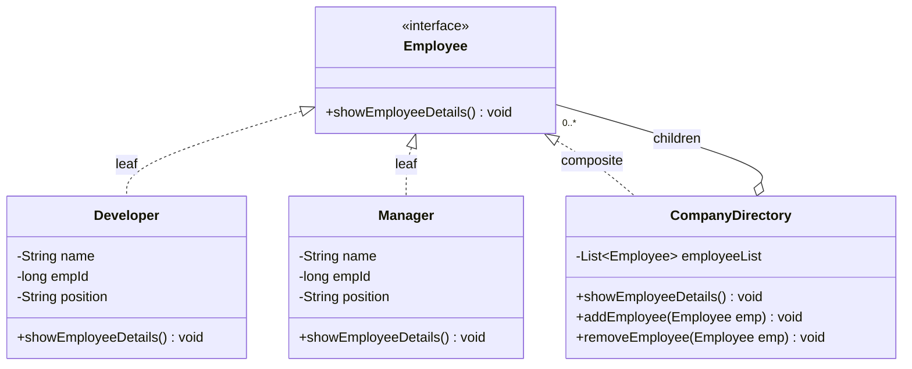
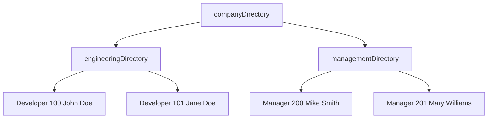
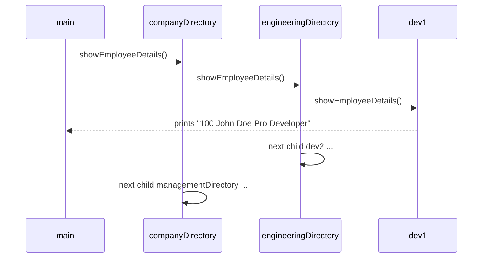

## In One Line
Composite arranges objects into a **tree** and lets you treat a single object (a leaf) and a group of objects (a composite) **the same way**, through one common interface — calling an operation on a group simply calls it on every child, recursively.

## Mental Model
Think of **folders and files** on your computer. A folder can contain files *and other folders*. When you ask "how big is this?", a file answers with its own size; a folder asks each thing inside it and adds up the answers — and a sub-folder does the same, all the way down. You never need different commands for "size of a file" and "size of a folder".

How it maps to the code:
- **"Something that can be in a folder"** → the component interface `Employee` with `showEmployeeDetails()`.
- **A file** → the leaves `Developer` and `Manager`: they answer directly by printing their own details.
- **A folder** → the composite `CompanyDirectory`: it holds a `List<Employee>` and answers by asking each child.
- **A folder inside a folder** → `companyDirectory.addEmployee(engineeringDirectory)`: a directory is itself an `Employee`, so it can be put inside another directory.
- **Asking the top folder** → `companyDirectory.showEmployeeDetails()` walks the whole tree.

## Concept
### Intent (Gang of Four)
> "Compose objects into tree structures to represent part-whole hierarchies. Composite lets clients treat individual objects and compositions of objects uniformly."

Category: **structural**.

### The problem it solves
Many domains are trees: organisation charts, file systems, UI widgets inside panels, menus with sub-menus, product bundles, arithmetic expressions, XML/HTML documents. Without Composite, client code is full of type checks:
```java
if (x instanceof Developer d) d.show();
else if (x instanceof Directory dir) for (Employee e : dir.list()) { /* ...and recurse by hand... */ }
```
Every operation (print, count, total salary, search) repeats this logic, and every new node type breaks it. Composite moves the recursion **into the objects**: each node knows how to perform the operation for itself, and composites forward it to their children.

### Participants and how the example maps to them
| Participant | Role | In the example |
|---|---|---|
| **Component** | Common interface for leaves and composites | `interface Employee { void showEmployeeDetails(); }` |
| **Leaf** | An object with no children; does the real work | `Developer`, `Manager` |
| **Composite** | Stores child components; implements operations by delegating to children; offers child management | `CompanyDirectory` with `List<Employee> employeeList`, `addEmployee`, `removeEmployee` |
| **Client** | Builds the tree and calls operations through `Component` | `main` in `CompositePatternExample` |

### The recursion is the pattern
`CompanyDirectory.showEmployeeDetails()` loops over its children and calls `showEmployeeDetails()` on each. If a child is a leaf, it prints; if it is another directory, the same loop runs one level deeper. The client makes **one call** on the root and the tree walks itself in **depth-first, pre-order** (children in insertion order).

Typical composite operations:
- **Aggregate**: total salary, file size, price of a bundle (`sum of children`).
- **Broadcast**: render, print, enable/disable every widget.
- **Search**: find an employee by id anywhere in the tree.
- **Count / depth**: number of leaves, height of the tree.

### Transparency vs safety: where do `add`/`remove` live?
| | Transparent design | Safe design (the course example) |
|---|---|---|
| `add`/`remove` declared in | The **Component** interface | Only the **Composite** class |
| Client can treat every node identically | Yes | For operations yes; for building the tree no — it needs the `CompanyDirectory` type |
| What a leaf does with `add` | Must throw `UnsupportedOperationException` (a runtime error) | Leaves simply don't have the method (a compile-time guarantee) |
| Example | `org.w3c.dom.Node.appendChild` — a `Text` node throws `DOMException` | AWT: only `Container` has `add(Component)` |

GoF leans towards transparency; most modern Java code prefers safety. Either answer is fine in an interview if you explain the trade-off.

### Implementation concerns
- **Cycles.** Nothing stops `dir.addEmployee(dir)` or adding an ancestor as a child. The recursion then never ends and you get `StackOverflowError`. Guard `add` (see `OrgChart` in the Code section).
- **Parent references.** Storing `parent` in each node makes upward navigation (breadcrumbs, "which team is this person in?") easy, but `add`/`remove` must keep parent and children consistent.
- **Sharing.** The same leaf object can be added to two composites (a DAG, not a tree) — it will then be visited twice, and a single `parent` field cannot be correct.
- **Ordering.** Use a `List` if order matters (menus, documents); a `Set` if it must not contain duplicates.
- **Caching.** Aggregates on large trees can be cached in the composite and invalidated when children change.
- **Equality for `remove`.** `employeeList.remove(emp)` uses `equals()`; without an override that means identity.

### Composite with modern Java
Records and sealed interfaces make small composites very compact:
```java
sealed interface Expr permits Num, Add {}
record Num(int value) implements Expr {}
record Add(Expr left, Expr right) implements Expr {}   // composite with two children

static int eval(Expr e) {
    return switch (e) {                 // pattern matching over the tree (Java 21)
        case Num n -> n.value();
        case Add a -> eval(a.left()) + eval(a.right());
    };
}
```
This is Composite for the structure, with the operation written outside the classes — close to the Visitor idea ([Visitor](lesson:a10-patterns/23-visitor)).

### When to use Composite
- The data is naturally a part-whole hierarchy of arbitrary depth.
- Clients should not care whether they talk to one object or a group.
- You need recursive operations (sum, render, search) over the structure.

### When NOT to use it
- The structure is flat or fixed at one level — a plain list is simpler.
- Leaves and groups have very different operations — forcing one interface creates meaningless methods.
- You need strict type rules about what can contain what (for example, "a department may contain teams but not companies") — a uniform interface makes that harder to enforce.

### Real JDK and Spring examples
| Where | Component / Composite |
|---|---|
| AWT / Swing | `Component` / `Container` (`Panel`, `JPanel`), with `add(Component)` |
| JavaFX | `Node` / `Parent` (`Pane`, `Group`) — the scene graph |
| XML DOM | `org.w3c.dom.Node` / `Element` with `appendChild` (transparent design) |
| `java.io.File`, `java.nio.file.Path` | A path can be a file (leaf) or directory (composite); `Files.walk` traverses the tree |
| Spring | `CompositeCacheManager`, `CompositePropertySource`, Spring Batch `CompositeItemWriter`, Actuator `CompositeHealthContributor`, Micrometer `CompositeMeterRegistry` — a group that looks like a single instance and forwards calls to all members |

### Composite vs look-alikes
| | Composite | Decorator | Chain of Responsibility | Interpreter |
|---|---|---|---|---|
| Children per node | **Many** | Exactly **one** wrapped object | One successor | Many (sub-expressions) |
| Purpose | Represent part-whole trees; aggregate over them | Add behaviour to one object | Pass a request until someone handles it | Evaluate sentences of a grammar |
| Relationship | Often combined with **Iterator** (walk the tree) and **Visitor** (add operations) | Can decorate a composite | Often runs along a composite's parent links | Its syntax tree **is** a Composite |

## Diagram

The composite both **is** an `Employee` and **has** many `Employee`s — that double relationship is what lets directories nest.


The object tree built by `main`; one call on the root visits the leaves left to right, which is exactly the printed order.


The composite forwards the same call to each child; recursion does the traversal.

## Code
@example CoreJava/StructuralPatterns/CompositePatternExample.java

**A fuller composite:** aggregation (`monthlyCost`), an indented print that shows the tree, a record as the leaf, and a cycle guard in `add`.
```java
import java.util.*;

public class OrgChart {
    // Component: operations that make sense for leaves AND groups
    interface OrgUnit {
        String name();
        double monthlyCost();
        void print(String indent);
    }

    // Leaf
    record Person(String name, String role, double salary) implements OrgUnit {
        public double monthlyCost() { return salary; }
        public void print(String indent) { System.out.println(indent + "- " + name + " (" + role + ")"); }
    }

    // Composite: holds children, implements every operation by delegating to them
    static final class Team implements OrgUnit {
        private final String name;
        private final List<OrgUnit> members = new ArrayList<>();
        Team(String name) { this.name = name; }

        Team add(OrgUnit unit) {                     // "safe" design: add() only exists on the composite
            if (unit == this || (unit instanceof Team t && t.contains(this)))
                throw new IllegalArgumentException("cycle: " + unit.name() + " already contains " + name);
            members.add(unit);
            return this;
        }
        private boolean contains(OrgUnit target) {
            for (OrgUnit m : members)
                if (m == target || (m instanceof Team t && t.contains(target))) return true;
            return false;
        }

        public String name() { return name; }
        public double monthlyCost() {                  // recursive aggregation
            return members.stream().mapToDouble(OrgUnit::monthlyCost).sum();
        }
        public void print(String indent) {
            System.out.println(indent + "+ " + name + " [" + monthlyCost() + "]");
            members.forEach(m -> m.print(indent + "   "));
        }
    }

    public static void main(String[] args) {
        Team backend = new Team("Backend")
                .add(new Person("John", "Pro Developer", 9000))
                .add(new Person("Jane", "Entry Level Developer", 5000));
        Team management = new Team("Management")
                .add(new Person("Mike", "SEO Manager", 7000));
        Team company = new Team("Company").add(backend).add(management)
                .add(new Person("Mary", "CFO", 12000));

        company.print("");
        System.out.println("Backend cost only: " + backend.monthlyCost());
        try {
            backend.add(company);
        } catch (IllegalArgumentException e) {
            System.out.println("Rejected " + e.getMessage());
        }
    }
}
```
```output
+ Company [33000.0]
   + Backend [14000.0]
      - John (Pro Developer)
      - Jane (Entry Level Developer)
   + Management [7000.0]
      - Mike (SEO Manager)
   - Mary (CFO)
Backend cost only: 14000.0
Rejected cycle: Company already contains Backend
```
Any node answers `monthlyCost()` — a person with their salary, a team with the sum of its subtree. The guard stops `Backend` from containing its own ancestor.

**The course's classes with a shared leaf, a removal, and a cycle:**
```java
CompanyDirectory eng = new CompanyDirectory();
eng.addEmployee(dev1);
eng.addEmployee(dev2);

CompanyDirectory company = new CompanyDirectory();
company.addEmployee(man1);
company.addEmployee(eng);
company.addEmployee(dev1);          // the same leaf in two places
eng.removeEmployee(dev2);
company.showEmployeeDetails();

System.out.println("--- cycle ---");
company.addEmployee(company);
try {
    company.showEmployeeDetails();
} catch (StackOverflowError e) {
    System.out.println("StackOverflowError");
}
```
```output
200 Mike Smith SEO Manager
100 John Doe Pro Developer
100 John Doe Pro Developer
--- cycle ---
200 Mike Smith SEO Manager
100 John Doe Pro Developer
100 John Doe Pro Developer
200 Mike Smith SEO Manager
100 John Doe Pro Developer
100 John Doe Pro Developer
StackOverflowError
```
(`dev1`, `dev2`, `man1` are the objects from the original `main`. The cycle part is shortened here: the real run printed the three lines over and over — about 19,000 times — before the stack overflowed.)

## Walkthrough
- `import java.util.ArrayList; import java.util.List;` — for the composite's child list.
- `interface Employee { void showEmployeeDetails(); }` — the **Component**. The comment calls it "Component class", but it is an interface, which is the more flexible choice.
- `class Developer implements Employee` — a **Leaf**. Fields `name`, `empId` (`long`), `position`; the constructor takes `(empId, name, position)`; `showEmployeeDetails()` prints `empId + " " + name + " " + position`. Since `empId` is a `long` and the next operand is a `String`, `+` means string concatenation.
- `class Manager implements Employee` — another **Leaf**, identical in code to `Developer`.
- `class CompanyDirectory implements Employee` — the **Composite**.
  - `private List<Employee> employeeList = new ArrayList<Employee>();` — children of type `Employee`, so both leaves and other directories fit.
  - `showEmployeeDetails()` — `for (Employee emp : employeeList) emp.showEmployeeDetails();` — the recursive delegation. The directory prints nothing about itself.
  - `addEmployee(Employee)` / `removeEmployee(Employee)` — child management, only on the composite (the "safe" design). `remove` uses `equals`, i.e. identity here.
- `main`:
  - Creates `dev1` (100, John Doe) and `dev2` (101, Jane Doe) and puts them into `engineeringDirectory`.
  - Creates `man1` (200, Mike Smith) and `man2` (201, Mary Williams) and puts them into `managementDirectory`.
  - Creates `companyDirectory` and adds the **two directories** — this is where the tree gets its second level.
  - `companyDirectory.showEmployeeDetails()` → engineering (dev1, dev2) then management (man1, man2), giving the four lines `100 John Doe Pro Developer`, `101 Jane Doe Entry Level Developer`, `200 Mike Smith SEO Manager`, `201 Mary Williams CFO Manager`.
- The output order is the insertion order of the `ArrayList`s, depth-first; it is deterministic and matches the comment block.

## Traps
> [!ERRATA] `Developer` and `Manager` are identical copies (same fields, constructor and method body). Duplicated leaf classes add nothing — one `Staff` leaf class with a `position` would do. And modelling `Manager` as a **leaf** is odd for an org chart: a real manager has reports, i.e. would be a composite. Here the "reports" live in a separate `CompanyDirectory`.

> [!ERRATA] `CompanyDirectory.addEmployee` has no cycle check. `companyDirectory.addEmployee(companyDirectory)` (or adding any ancestor) makes `showEmployeeDetails()` recurse forever: it prints the same lines about 19,000 times and dies with `StackOverflowError` (shown in the Code section). Guard `add`, as `OrgChart.add` does.

> [!ERRATA] Minor: `new ArrayList<Employee>()` can use the diamond `new ArrayList<>()` (Java 7+), the list field can be `final`, and the leaf fields can be `final`. The flat output also hides the hierarchy — printing the directory level with indentation (see `OrgChart`) makes the tree visible.

- **Shared nodes are visited twice.** The same leaf added to two composites appears twice in every traversal (and twice in every sum).
- **`remove` depends on `equals`.** Remove a *different but equal-looking* `Developer` object and nothing is removed, because `equals` is not overridden.
- **Deep trees and recursion.** Very deep trees can overflow the stack even without cycles; use an explicit stack (`ArrayDeque`) for iterative traversal if depth can be huge.
- **Transparent design leaks runtime errors.** Declaring `add` in the component forces leaves to throw `UnsupportedOperationException`.
- **Modifying the child list while iterating it** (for example, a child removing itself during `showEmployeeDetails`) throws `ConcurrentModificationException`.

## Tips & Tricks
- **Mnemonic — "IS-A and HAS-MANY."** The composite *is a* component and *has many* components. If you see both relationships to the same interface, it is Composite.
- **"One call on the root, recursion does the rest."**
- **Folder/file** is the default analogy interviewers accept instantly.
- **Composite + Iterator** = walk the tree; **Composite + Visitor** = add new operations to the tree without changing node classes.
- **Always ask "can this create a cycle?"** when a composite accepts arbitrary children.
- Prefer the **safe design** (child management only on composites) unless clients truly must build trees without knowing node types.

## Interview Q&A
### [Basic] What is the Composite pattern?
Composite organises objects into tree structures that represent part-whole hierarchies and lets clients treat single objects and groups uniformly. Leaves and composites implement the same component interface; a composite stores children of that interface type and implements each operation by delegating to its children. In the course example, `Developer` and `Manager` are leaves, `CompanyDirectory` is the composite, and one call to `companyDirectory.showEmployeeDetails()` prints everyone.

**Follow-up:** *Why is it structural?* — It is about how objects are composed into larger structures (trees), not about creating them or about their communication protocol.

### [Basic] What are the participants, and how does the example map to them?
Component: `Employee`, the common interface. Leaf: `Developer` and `Manager`, which print their own details. Composite: `CompanyDirectory`, which holds a `List<Employee>`, implements `showEmployeeDetails()` by looping over children, and offers `addEmployee`/`removeEmployee`. Client: `main`, which builds a three-level tree (company → two directories → four people) and calls the root once.

**Follow-up:** *What makes nesting possible?* — `CompanyDirectory` implements `Employee` and its list holds `Employee`s, so a directory can be added to another directory.

### [Intermediate] Where should `add` and `remove` be declared — the component or the composite?
Declaring them in the component gives **transparency**: the client can treat every node identically, but leaves must implement them by throwing `UnsupportedOperationException`, so mistakes are found at runtime. Declaring them only in the composite gives **safety**: the compiler prevents adding children to a leaf, but code that builds the tree must know which nodes are composites. The course example uses the safe design. GoF favoured transparency; in modern Java I usually prefer safety, since trees are normally built by code that knows the types.

**Follow-up:** *Give a JDK example of the transparent design.* — `org.w3c.dom.Node.appendChild`: calling it on a `Text` node throws a `DOMException` (`HIERARCHY_REQUEST_ERR`).

### [Intermediate] How would you compute the total salary of a department using Composite?
Add an operation to the component interface and implement it at both levels:
```java
interface Employee { double salary(); }
class Developer implements Employee { public double salary() { return salary; } }
class CompanyDirectory implements Employee {
    public double salary() { return employeeList.stream().mapToDouble(Employee::salary).sum(); }
}
```
Calling `salary()` on any node gives the total of its subtree — the leaf answers directly, the composite sums its children recursively.

**Follow-up:** *What if you need many such operations?* — Adding a method to every class each time violates Open/Closed; use a Visitor or pattern matching over a sealed hierarchy instead.

### [Intermediate] What can go wrong with the course's `CompanyDirectory`?
Adding a directory to itself or to one of its descendants creates a cycle, and `showEmployeeDetails()` recurses until `StackOverflowError`. The same employee added to two directories is printed twice. `removeEmployee` relies on `equals`, which is identity because it is not overridden. Also, the leaf classes are duplicated code and the fields are not `final`.

**Follow-up:** *How do you prevent cycles?* — In `add`, reject the node if it is `this` or if it already contains `this` somewhere in its subtree; or maintain parent pointers and walk up from `this` to check.

### [Intermediate] How is Composite different from Decorator? Both wrap objects of the same interface.
Both use recursive composition through a shared interface, but a **decorator wraps exactly one** component to **add behaviour** to it, while a **composite holds many** children to **represent a part-whole structure** and aggregate over it. A decorator is transparent — clients cannot tell a decorated object from a plain one; a composite is a genuine grouping. They combine well: you can decorate a whole composite (e.g., add a border around a panel of widgets).

**Follow-up:** *And Composite vs Chain of Responsibility?* — A chain passes a request along one successor until it is handled; composites often *use* the parent links of a tree as such a chain (for example, a UI event bubbling up to parent containers).

### [Intermediate] Where do you see Composite in Java and Spring?
AWT/Swing: `Container` is a `Component` that contains `Component`s (`JPanel` holding buttons and other panels). JavaFX: `Parent` nodes in the scene graph. XML DOM: `Node`/`Element`. File systems: directories containing files and directories (`Files.walk`). In Spring: `CompositeCacheManager`, `CompositePropertySource`, Spring Batch's `CompositeItemWriter`, Actuator's `CompositeHealthContributor`, Micrometer's `CompositeMeterRegistry` — a group that presents itself as one instance and forwards calls to each member.

**Follow-up:** *Is `java.util.List` a composite?* — No. A list holds elements but is not itself an element type of the same interface; Composite needs the container and the contents to share one interface.

### [Advanced] How would you traverse a composite without recursion, and why would you?
Use an explicit stack (or queue for breadth-first):
```java
Deque<Employee> stack = new ArrayDeque<>();
stack.push(root);
while (!stack.isEmpty()) {
    Employee e = stack.pop();
    if (e instanceof CompanyDirectory dir) {
        List<Employee> kids = dir.children();
        for (int i = kids.size() - 1; i >= 0; i--) stack.push(kids.get(i));   // keep left-to-right order
    } else {
        e.showEmployeeDetails();
    }
}
```
It avoids `StackOverflowError` on very deep trees, lets you implement an external `Iterator` over the tree, and makes it easy to add a visited-set for graphs that may share nodes or contain cycles.

**Follow-up:** *What is the trade-off?* — The client now needs to know about composites (the `instanceof`), which breaks the uniformity the pattern gives; put this logic in an iterator inside the composite to keep clients clean.

### [Advanced] How does Composite relate to Interpreter and Visitor?
The abstract syntax tree in Interpreter **is** a Composite: terminal expressions are leaves, non-terminal expressions (And, Or, Add) are composites, and `interpret()` recurses through the tree. Visitor is the usual way to add new operations (pretty-print, evaluate, type-check) to a stable Composite structure without editing every node class. In Java 21, sealed interfaces plus records plus switch pattern matching give a lightweight alternative to Visitor for such trees.

**Follow-up:** *When is Visitor a bad fit?* — When new node types are added often: every visitor must then get a new method.

## Quiz
### What does the original example print first?
- [ ] 200 Mike Smith SEO Manager
- [x] 100 John Doe Pro Developer
- [ ] Nothing — `CompanyDirectory` prints only its own name
- [ ] The two directory objects' `toString()` values
> `companyDirectory` contains `engineeringDirectory` first, whose first child is `dev1`. The composite prints nothing about itself; it forwards the call, so the first line is the first leaf in depth-first order.

### What does this print, using the course's classes (`dev1`, `dev2`, `man1` as in the original)?
```java
CompanyDirectory eng = new CompanyDirectory();
eng.addEmployee(dev1);
eng.addEmployee(dev2);
CompanyDirectory company = new CompanyDirectory();
company.addEmployee(man1);
company.addEmployee(eng);
company.addEmployee(dev1);
eng.removeEmployee(dev2);
company.showEmployeeDetails();
```
- [ ] 200 Mike Smith... / 100 John Doe... / 101 Jane Doe...
- [x] 200 Mike Smith... / 100 John Doe... / 100 John Doe...
- [ ] 200 Mike Smith... / 100 John Doe...
- [ ] 100 John Doe... / 101 Jane Doe... / 200 Mike Smith...
> Children print in insertion order: `man1`, then `eng` (which now holds only `dev1`, since `dev2` was removed before printing), then `dev1` again. The same leaf object in two places is visited twice. The composite holds references, so removing from `eng` after adding it is still reflected.

### What happens after `company.addEmployee(company); company.showEmployeeDetails();`?
- [ ] Compile error: a directory cannot contain itself
- [ ] It prints each employee once and stops
- [x] It prints the same lines again and again until `StackOverflowError`
- [ ] `ConcurrentModificationException`
> The compiler cannot see the cycle. Each time the loop reaches the last child — `company` itself — it recurses, printing the leaves again, until the call stack overflows. The list is not modified during iteration, so there is no `ConcurrentModificationException`.

### In the course example, where are `addEmployee` and `removeEmployee` declared, and what design is that called?
- [ ] In `Employee` — the transparent design
- [x] Only in `CompanyDirectory` — the safe design
- [ ] In `Developer` and `Manager` — the leaf design
- [ ] Nowhere; children are passed in the constructor
> Child management exists only on the composite, so the compiler prevents `developer.addEmployee(...)`. The trade-off is that tree-building code must know it holds a `CompanyDirectory`, not just an `Employee`.

### Which statement best separates Composite from Decorator?
- [ ] Composite changes the interface; Decorator keeps it
- [x] A composite holds many children to form a part-whole tree; a decorator wraps exactly one object to add behaviour
- [ ] Decorator uses inheritance; Composite uses composition
- [ ] They are the same pattern
> Both share the component interface with what they contain and both are recursive, but the number of children and the intent differ: aggregation of parts vs added responsibilities for one object.

### Which JDK type is the composite in AWT/Swing's use of this pattern?
- [ ] `java.awt.Button`
- [x] `java.awt.Container`
- [ ] `java.awt.Color`
- [ ] `javax.swing.JLabel`
> `Container extends Component` and holds a list of `Component`s via `add(Component)`, so panels can contain buttons and other panels. `Button` and `JLabel` are used as leaves (`JLabel` technically inherits `Container` through `JComponent`, but is not meant to hold children); `Color` is not a component at all.

### Why does `employeeList.remove(emp)` in the course example compare by identity?
- [ ] Because `ArrayList.remove` always uses `==`
- [x] Because `Developer`/`Manager` do not override `equals`, so `Object.equals` (identity) is used
- [ ] Because the list is declared `private`
- [ ] Because `remove` compares `hashCode` values
> `List.remove(Object)` uses `equals`. Without an override, `equals` is inherited from `Object`, which is `==`. A different `Developer` object with the same id would not be removed.

## Takeaways
- Composite builds part-whole trees in which leaves and groups share one interface, so clients treat them uniformly.
- The composite **is a** component and **has many** components; operations on it delegate recursively to children (depth-first, insertion order with a `List`).
- Roles in the example: Component `Employee`, Leaves `Developer`/`Manager`, Composite `CompanyDirectory`, Client `main`.
- Transparent design puts `add`/`remove` in the component (leaves throw); safe design puts them only in the composite (the course's choice).
- Guard against cycles (they cause infinite recursion and `StackOverflowError`), remember shared nodes are visited twice, and that `remove` uses `equals`.
- Composite pairs naturally with Iterator (traversal), Visitor (new operations) and Interpreter (syntax trees).
- Real examples: AWT `Container`, JavaFX `Parent`, DOM `Node`, file systems, Spring's `Composite*` classes.
