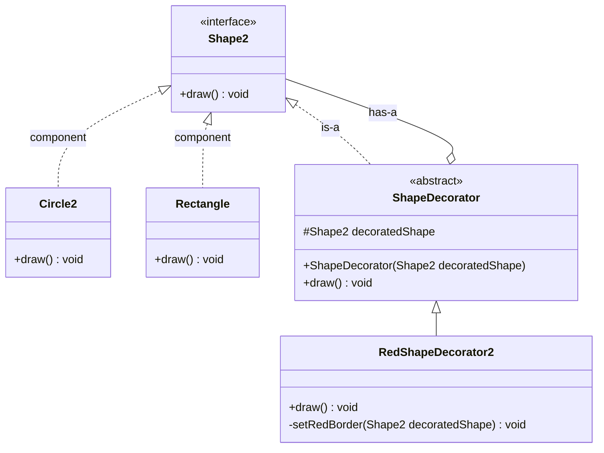
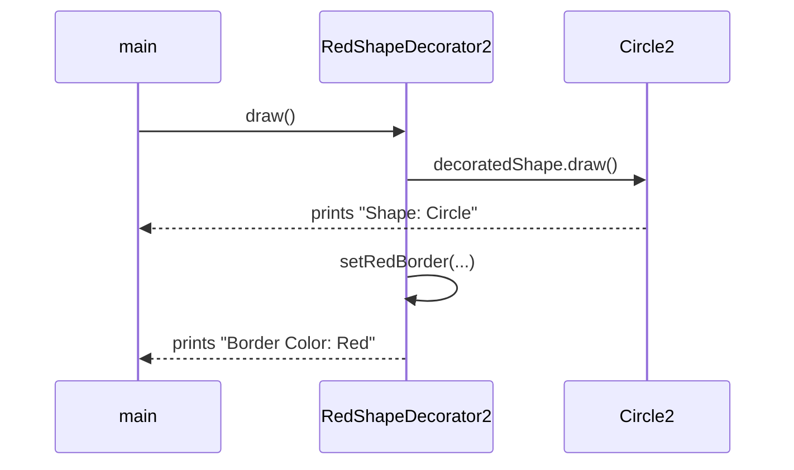
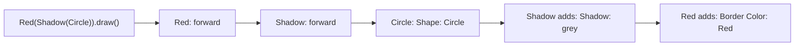

## In One Line
Decorator wraps an object in another object that has the **same interface**, forwards every call to it and adds a little extra behaviour before or after — so you can stack features onto one object at runtime instead of writing a subclass for every combination.

## Mental Model
Think of **wrapping a gift**. The box is the gift. You can put it in wrapping paper, then tie a ribbon round the paper, then stick a card on top. Each layer adds something, each layer still looks like "a present" from the outside, and you choose the layers per gift — you never needed a factory that makes "box-with-paper-and-ribbon" as a separate product.

How it maps to the code:
- **The gift in its plain box** → the **concrete component**: `new Circle2()` or `new Rectangle()`.
- **"It is a present"** → the shared **component interface**: `Shape2` with `draw()`. Whoever receives it only knows it is a `Shape2`.
- **A layer of wrapping** → a **concrete decorator**: `RedShapeDecorator2`, which holds the shape inside it and adds a red border when drawn.
- **Wrapping a wrapped gift** → decorators wrap decorators: `new RedShapeDecorator2(new ShadowDecorator(new Circle2()))`. The order of the layers is the order you applied them.
- **Unwrapping from the outside in** → a call enters the outermost decorator first and travels inward to the real object; "after" work then happens on the way back out.

## Concept
### Intent (Gang of Four)
> "Attach additional responsibilities to an object dynamically. Decorators provide a flexible alternative to subclassing for extending functionality."

Also known as **Wrapper**. Category: **structural**, object scope — it composes objects at runtime rather than classes at compile time.

### The problem it solves
You have a type (`Shape2`) with several implementations and a set of optional extras: a red border, a shadow, a label, a dashed outline. With inheritance you need a subclass per combination: `RedCircle`, `ShadowCircle`, `RedShadowCircle`, `RedRectangle`... With **n** optional extras there are **2ⁿ** combinations for *every* concrete shape — the **class explosion**. And a subclass fixes the combination at compile time; you cannot add a border to one particular circle at runtime.

Decorator replaces those classes with **one small class per extra**. Each extra wraps "some `Shape2`" and adds its bit; combinations are built by nesting: `n` extras → `n` decorator classes, any combination, chosen at runtime.

### Participants and how the example maps to them
| Participant | Role | In the example |
|---|---|---|
| **Component** | The interface both real objects and decorators implement | `interface Shape2 { void draw(); }` |
| **ConcreteComponent** | The real object being decorated | `Circle2`, `Rectangle` |
| **Decorator** (base) | Implements Component, **holds** a Component, forwards every call | `abstract class ShapeDecorator implements Shape2` with `protected Shape2 decoratedShape` |
| **ConcreteDecorator** | Adds one responsibility before/after forwarding | `RedShapeDecorator2` — draws the shape, then the red border |
| **Client** | Works through Component, cannot tell decorated from plain | `main` calls `draw()` on three `Shape2` references |

### The two relationships that define it: IS-A and HAS-A the same type
A decorator **is a** `Shape2` (so it can go wherever a shape goes, including inside another decorator) and **has a** `Shape2` (the thing it wraps). That double relationship to the *same* interface is the fingerprint of the pattern — and it is what makes decorators stackable and transparent.

### Before, after, or around
A concrete decorator decides where its extra work goes relative to the forwarded call:
| Style | Code shape | Example |
|---|---|---|
| **After** (post-processing) | `inner.draw(); addBorder();` | `RedShapeDecorator2` — border after the shape |
| **Before** (pre-processing) | `checkSomething(); inner.draw();` | validation, logging the input |
| **Around** | `start(); try { inner.draw(); } finally { stop(); }` | timing, transactions, locking |
| **Transforming the result** | `return inner.cost() + 20;` | the coffee example in Code: each add-on adds to the price |

With several layers, "before" code runs **outermost first** and "after" code runs **innermost first** — like layers of an onion.

### Why the abstract base decorator exists
`ShapeDecorator` holds the wrapped reference and forwards `draw()` by default. Concrete decorators extend it and override **only the methods they change**. With a one-method interface this looks like overkill, but with a large interface (in JDK 21 `List` has 25 abstract methods plus 16 `default` ones) the base class is what saves every concrete decorator from re-writing all the forwarding. Java has no built-in delegation (Kotlin has `class X(inner: Shape) : Shape by inner`), so the forwarding class is the idiom; Guava ships ready-made ones (`ForwardingList`, `ForwardingMap`).

It is declared `abstract` even though it has no abstract methods: a plain `ShapeDecorator` would add nothing, so the class forbids `new ShapeDecorator(...)`.

### Decorator vs subclassing
| | Subclassing | Decorator |
|---|---|---|
| When is the extra chosen? | Compile time (the class) | Runtime (the wrapping) |
| Combinations of n extras | Up to 2ⁿ classes per component | n classes |
| Works on any implementation? | No — tied to one parent class | Yes — any `Shape2` |
| Can add to an existing object? | No | Yes, wrap it |
| Coupling | Depends on the parent's internal self-calls (fragile base class) | Depends only on the public interface |
| Identity | One object | Several objects; the wrapper is not the original |

The fragile-base-class point is Effective Java Item 18 ("favour composition over inheritance"): a `HashSet` subclass that counts `add` calls double-counts, because `HashSet.addAll` internally calls `add`. A wrapper that forwards to a `Set` does not care how the wrapped set is implemented (see `CountingSets` in Code).

### Decorators in modern Java: higher-order functions
When the component is a functional interface, a decorator is just a function that takes a function and returns a function: `logged(name, fn)`, `retrying(fn)`, `timed(supplier)`. `Function.andThen`/`compose`, `Predicate.and/or/negate` and `Comparator.reversed()`/`thenComparing` are built-in wrapper-builders. Libraries such as Resilience4j build whole stacks this way (`Decorators.ofSupplier(s).withRetry(r).withCircuitBreaker(cb).decorate()`).

### When to use Decorator
- You need to add responsibilities to **individual objects**, dynamically and transparently.
- The extras are **optional and combinable**, and subclassing would explode.
- You cannot subclass (a `final` class) or do not want to depend on a class's internals.
- Cross-cutting concerns around one interface: buffering, compression, encryption, caching, logging, metrics, retries, synchronisation, read-only views.

### When NOT to use it
- There is one fixed extra that every object needs — just put it in the class.
- Clients need the **concrete type** (`instanceof Circle2`, `Circle2`-only methods) — a wrapper hides it.
- Object **identity** matters (`==`, identity maps, locks on the object) — the decorator is a different object.
- The interface is huge and changes often — every change ripples into the base decorator.
- Deep stacks make debugging harder (long stack traces of `draw → draw → draw`); if you only ever use one fixed stack, a single class may be clearer.

### Real JDK, Jakarta and Spring examples
| Where | Component | Decorators |
|---|---|---|
| `java.io` byte streams | `InputStream` / `OutputStream` | `BufferedInputStream`, `DataInputStream`, `GZIPInputStream`, `CipherInputStream`, `PushbackInputStream` — all extend `FilterInputStream`, the abstract base decorator |
| `java.io` character streams | `Reader` / `Writer` | `BufferedReader` (adds `readLine()`), `LineNumberReader`, `PushbackReader`, `PrintWriter` |
| `java.util.Collections` | `List`, `Set`, `Map`... | `unmodifiableList`, `synchronizedList`, `checkedList` — same interface, changed behaviour, a **view** of the original |
| Jakarta Servlet | `HttpServletRequest` / `Response` | `HttpServletRequestWrapper`, `HttpServletResponseWrapper` — filters wrap the request to change headers or cache the body (Spring's `ContentCachingRequestWrapper`) |
| Spring | `Runnable`, `Cache`, `DataSource` | `TaskDecorator` (wraps each task, e.g. to copy the MDC or security context to the worker thread), `TransactionAwareCacheDecorator`, `DelegatingSecurityContextRunnable` |

> [!NOTE] `FilterInputStream` is to `InputStream` what `ShapeDecorator` is to `Shape2`: it holds `protected volatile InputStream in` and forwards every method to it. `BufferedInputStream` then overrides only what it changes.

### Decorator vs look-alikes
| Pattern | Interface the client sees | Wraps | Purpose |
|---|---|---|---|
| **Decorator** | **Same** as the wrapped object | One object, supplied by the client | **Add** responsibilities; stackable |
| **[Proxy](lesson:a10-patterns/11-proxy)** | **Same** | One object, often created/managed by the proxy itself | **Control access** — lazy loading, security, remote, caching |
| **[Adapter](lesson:a10-patterns/05-adapter)** | **Different** from the wrapped object | One object | **Convert** an interface so it fits |
| **[Composite](lesson:a10-patterns/07-composite)** | Same | **Many** children | Represent part-whole trees |
| **[Chain of Responsibility](lesson:a10-patterns/12-chain-of-responsibility)** | Same handler interface | A successor | Any link may **stop** the request; in a decorator stack every layer runs |
| **[Strategy](lesson:a10-patterns/21-strategy)** | — | — | Changes the **inside** (the algorithm) of an object; Decorator changes the **outside** ("skin vs guts", GoF) |

## Diagram

The decorator both **is** a `Shape2` and **has** a `Shape2` — that is why a decorator can wrap a plain shape or another decorator.


The call enters the wrapper, is forwarded to the real circle, and the wrapper adds its border **after** the circle has drawn.


With "after" decorators the innermost extra prints first; swapping the wrapping order swaps the last two lines.

## Code
@example CoreJava/StructuralPatterns/DecoratorPatternExample.java

**Stacking decorators — order matters, and a wrapper is not the original** (the course's classes copied into one file, plus a second decorator):
```java
class ShadowDecorator extends ShapeDecorator {
    ShadowDecorator(Shape2 inner) { super(inner); }
    @Override public void draw() {
        super.draw();                        // let the wrapped shape draw first
        System.out.println("Shadow: grey");  // then add this decorator's extra
    }
}

public class DecoratorStack {
    public static void main(String[] args) {
        Shape2 a = new ShadowDecorator(new RedShapeDecorator2(new Circle2()));
        Shape2 b = new RedShapeDecorator2(new ShadowDecorator(new Circle2()));
        Shape2 c = new RedShapeDecorator2(new RedShapeDecorator2(new Rectangle()));

        System.out.println("-- Shadow(Red(Circle))");
        a.draw();
        System.out.println("-- Red(Shadow(Circle))");
        b.draw();
        System.out.println("-- Red(Red(Rectangle))");
        c.draw();

        Shape2 redCircle = new RedShapeDecorator2(new Circle2());
        System.out.println("instanceof Circle2? " + (redCircle instanceof Circle2));
        System.out.println("instanceof Shape2?  " + (redCircle instanceof Shape2));
        System.out.println("class: " + redCircle.getClass().getSimpleName());
    }
}
```
```output
-- Shadow(Red(Circle))
Shape: Circle
Border Color: Red
Shadow: grey
-- Red(Shadow(Circle))
Shape: Circle
Shadow: grey
Border Color: Red
-- Red(Red(Rectangle))
Shape: Rectangle
Border Color: Red
Border Color: Red
instanceof Circle2? false
instanceof Shape2?  true
class: RedShapeDecorator2
```
Nothing stops the same decorator being applied twice, and the decorated circle no longer passes `instanceof Circle2`.

**Decorators that transform a result — the classic coffee shop:**
```java
public class Cafe {
    // Component
    interface Beverage {
        String description();
        int cost();                              // in rupees
    }

    // Concrete components
    static final class Espresso implements Beverage {
        public String description() { return "Espresso"; }
        public int cost() { return 100; }
    }
    static final class GreenTea implements Beverage {
        public String description() { return "Green tea"; }
        public int cost() { return 60; }
    }

    // Base decorator: holds the wrapped component and forwards everything
    abstract static class AddOn implements Beverage {
        private final Beverage inner;
        protected AddOn(Beverage inner) { this.inner = java.util.Objects.requireNonNull(inner); }
        public String description() { return inner.description(); }
        public int cost() { return inner.cost(); }
    }

    // Concrete decorators: call the inner result, then add to it
    static final class Milk extends AddOn {
        Milk(Beverage b) { super(b); }
        @Override public String description() { return super.description() + " + milk"; }
        @Override public int cost() { return super.cost() + 20; }
    }
    static final class Caramel extends AddOn {
        Caramel(Beverage b) { super(b); }
        @Override public String description() { return super.description() + " + caramel"; }
        @Override public int cost() { return super.cost() + 30; }
    }

    static void bill(Beverage b) {                // client sees only Beverage
        System.out.println(b.description() + " = Rs " + b.cost());
    }

    public static void main(String[] args) {
        bill(new Espresso());
        bill(new Milk(new Espresso()));
        bill(new Caramel(new Milk(new Milk(new Espresso()))));   // double milk: wrap twice
        bill(new Milk(new GreenTea()));                          // same decorator, different component
    }
}
```
```output
Espresso = Rs 100
Espresso + milk = Rs 120
Espresso + milk + milk + caramel = Rs 170
Green tea + milk = Rs 80
```
Two beverages and two add-ons are four classes; as subclasses, every drink × add-on combination (including "double milk") would need its own class. Note the cleaner base decorator: `private final` field, null check, subclasses call `super`.

**Decorators you already use in the JDK:**
```java
import java.io.*;
import java.util.*;
import java.util.zip.*;

public class JdkDecorators {
    @SuppressWarnings({"unchecked", "rawtypes"})
    public static void main(String[] args) throws IOException {
        // 1. java.io: each layer IS-A OutputStream and HAS-A OutputStream
        ByteArrayOutputStream sink = new ByteArrayOutputStream();          // concrete component
        try (DataOutputStream out = new DataOutputStream(                    // adds writeInt/writeUTF
                new BufferedOutputStream(                                    // adds buffering
                    new GZIPOutputStream(sink)))) {                          // adds compression
            out.writeInt(42);
            out.writeUTF("hello");
        }                                                                    // closing the outer closes all
        try (DataInputStream in = new DataInputStream(
                new BufferedInputStream(
                    new GZIPInputStream(new ByteArrayInputStream(sink.toByteArray()))))) {
            System.out.println(in.readInt() + " " + in.readUTF());
        }

        // 2. A Reader decorator adds a new method: readLine() / getLineNumber()
        LineNumberReader r = new LineNumberReader(new StringReader("alpha\nbeta"));
        String line;
        while ((line = r.readLine()) != null) System.out.println(r.getLineNumber() + ": " + line);

        // 3. Collections wrappers: same List interface, changed behaviour, a VIEW of the original
        List<String> base = new ArrayList<>(List.of("a"));
        List<String> readOnly = Collections.unmodifiableList(base);
        base.add("b");
        System.out.println("view sees: " + readOnly);
        try { readOnly.add("c"); } catch (UnsupportedOperationException e) { System.out.println("add -> UnsupportedOperationException"); }

        List raw = Collections.checkedList(new ArrayList<String>(), String.class);
        try { raw.add(1); } catch (ClassCastException e) { System.out.println("checkedList -> ClassCastException"); }
    }
}
```
```output
42 hello
1: alpha
2: beta
view sees: [a, b]
add -> UnsupportedOperationException
checkedList -> ClassCastException
```
The read side must unwrap in the mirror order of the write side (data → buffer → gzip). `unmodifiableList` is a read-only **view**: changes to `base` show through it.

**Why a wrapper beats a subclass (Effective Java, Item 18):**
```java
import java.util.*;

public class CountingSets {
    // Inheritance: fragile, depends on HashSet's internal self-calls
    static class InstrumentedHashSet<E> extends HashSet<E> {
        int addCount = 0;
        @Override public boolean add(E e) { addCount++; return super.add(e); }
        @Override public boolean addAll(Collection<? extends E> c) { addCount += c.size(); return super.addAll(c); }
    }

    // Decorator (wrapper): counts calls on ANY Set, immune to the wrapped set's internals
    static class CountingSet<E> extends AbstractSet<E> {
        private final Set<E> inner;
        int addCount = 0;
        CountingSet(Set<E> inner) { this.inner = inner; }
        @Override public boolean add(E e) { addCount++; return inner.add(e); }
        @Override public boolean addAll(Collection<? extends E> c) { addCount += c.size(); return inner.addAll(c); }
        @Override public Iterator<E> iterator() { return inner.iterator(); }
        @Override public int size() { return inner.size(); }
    }

    public static void main(String[] args) {
        InstrumentedHashSet<String> s1 = new InstrumentedHashSet<>();
        s1.addAll(List.of("a", "b", "c"));
        System.out.println("subclass count  = " + s1.addCount);

        CountingSet<String> s2 = new CountingSet<>(new HashSet<>());
        s2.addAll(List.of("a", "b", "c"));
        System.out.println("decorator count = " + s2.addCount);

        CountingSet<String> s3 = new CountingSet<>(new TreeSet<>());   // decorate a different Set
        s3.addAll(List.of("c", "a", "b"));
        System.out.println("decorated TreeSet = " + s3 + ", count = " + s3.addCount);
    }
}
```
```output
subclass count  = 6
decorator count = 3
decorated TreeSet = [a, b, c], count = 3
```
`HashSet.addAll` (inherited from `AbstractCollection`) calls `add` for each element, so the subclass counts every element twice. The wrapper only sees the calls made on *it*, and it works for any `Set`.

**Functional decorators — a function that wraps a function:**
```java
import java.util.function.*;

public class LambdaDecorators {
    // A decorator is just a higher-order function: takes a Function, returns a Function
    static <T, R> Function<T, R> logged(String name, Function<T, R> fn) {
        return x -> {
            System.out.println("-> " + name + "(" + x + ")");
            R result = fn.apply(x);
            System.out.println("<- " + result);
            return result;
        };
    }

    static <T, R> Function<T, R> nullSafe(Function<T, R> fn, R fallback) {
        return x -> x == null ? fallback : fn.apply(x);
    }

    public static void main(String[] args) {
        Function<String, Integer> length = String::length;

        Function<String, Integer> decorated = logged("length", nullSafe(length, 0));
        decorated.apply("hello");
        decorated.apply(null);

        // andThen / compose build a pipeline of wrappers too
        UnaryOperator<String> trim = String::trim;
        Function<String, String> clean = trim.andThen(String::toUpperCase).andThen(s -> "[" + s + "]");
        System.out.println(clean.apply("  java  "));
    }
}
```
```output
-> length(hello)
<- 5
-> length(null)
<- 0
[JAVA]
```

## Walkthrough
- `package CoreJava.StructuralPatterns;` — all structural examples share this package. Top-level class names must be unique inside a package, and the Bridge example already declares `Shape` and `Circle`, hence `Shape2` and `Circle2` here. `Rectangle` has no clash in this package, so it keeps its plain name (and the Facade example later has to use `Rectangle3`).
- `interface Shape2 { void draw(); }` — the **Component**. Everything the client touches is typed as `Shape2`.
- `class Circle2 implements Shape2` — a **ConcreteComponent**; `draw()` prints `Shape: Circle`.
- `class Rectangle implements Shape2` — a second ConcreteComponent; prints `Shape: Rectangle`. One decorator class works for both — that is the point.
- `abstract class ShapeDecorator implements Shape2` — the **base Decorator**.
  - `protected Shape2 decoratedShape;` — the wrapped object. Typed as the **interface**, so it can hold a plain shape or another decorator. `protected` lets subclasses use it (and, in Java, every class in the same package too).
  - The constructor stores the shape to wrap — the "has-a" link is fixed at construction.
  - `public void draw() { decoratedShape.draw(); }` — default behaviour is pure forwarding. It must be `public` because interface methods are implicitly `public`. (It has no `@Override`, which is legal but loses the compiler check.)
  - `abstract` although nothing is abstract — it prevents creating a do-nothing decorator directly.
- `class RedShapeDecorator2 extends ShapeDecorator` — the **ConcreteDecorator**.
  - `super(decoratedShape)` — hands the wrapped shape to the base class.
  - `draw()` — `decoratedShape.draw()` first (the real shape draws itself), then `setRedBorder(decoratedShape)` prints `Border Color: Red`. So the extra comes **after** the forwarded call.
  - `private void setRedBorder(Shape2 decoratedShape)` — the added responsibility. Its parameter is never used (see Traps).
- `main`:
  - `Shape2 circle = new Circle2();` — a plain, undecorated circle.
  - `Shape2 redCircle = new RedShapeDecorator2(new Circle2());` — a circle wrapped once. The variable type is still `Shape2`: the client cannot tell the difference.
  - `Shape2 redRectangle = new RedShapeDecorator2(new Rectangle());` — the **same** decorator class reused for a different component.
  - `System.out.println("Circle with normal border"); circle.draw();` → `Circle with normal border`, `Shape: Circle`.
  - `"\nCircle with red border"` — the leading `\n` prints the blank line you see in the output; then `redCircle.draw()` → `Shape: Circle`, `Border Color: Red`.
  - `"\nRectangle with red border"` → blank line, then `Shape: Rectangle`, `Border Color: Red`.
- Every `// Output:` comment matches the recorded output; the program is deterministic.

## Traps
> [!ERRATA] `setRedBorder(Shape2 decoratedShape)` takes a parameter it never uses, and that parameter **shadows** the field of the same name. The name `set...` also suggests a setter that changes state, but the method only prints. A clearer version is `private void drawRedBorder() { System.out.println("Border Color: Red"); }` called as `drawRedBorder();`.

> [!ERRATA] The wrapped reference is `protected` and not `final`, and it is never null-checked. `new RedShapeDecorator2(null)` constructs fine and fails later with a `NullPointerException` inside `draw()`. Because `protected` includes package access, any class in the package can even swap the wrapped shape after construction (`d.decoratedShape = new Rectangle();` — see the Quiz). Prefer `private final Shape2 inner` with `Objects.requireNonNull`, and let subclasses call `super.draw()` instead of touching the field — as `AddOn` does in the Code section.

> [!ERRATA] Minor: `RedShapeDecorator2.draw()` repeats `decoratedShape.draw()` instead of calling `super.draw()`, so any logic later added to the base decorator would be skipped; `ShapeDecorator.draw()` lacks `@Override`. Naming: the `2` in `RedShapeDecorator2` avoids no clash (there is no other `RedShapeDecorator` in the package), and "Circle with normal border" is misleading — the plain circle draws no border at all.

- **Order matters.** `Red(Shadow(x))` and `Shadow(Red(x))` produce different output. Document the intended order, or build stacks in one place (a factory or builder).
- **Identity and type are lost.** `redCircle instanceof Circle2` is `false`, `redCircle != circle`, and `Circle2`-only methods are unreachable. Code that checks concrete types or uses objects as locks or `IdentityHashMap` keys breaks when you add a decorator.
- **`equals`/`hashCode`.** A decorator inherits `Object.equals` (identity) unless it forwards them. The JDK's `Collections.unmodifiableList(...)` does forward `equals`; hand-written decorators usually do not.
- **Default methods are not forwarded automatically.** If `Shape` gains `default String name()` and `Circle` overrides it, a decorator that does not also override `name()` answers with the **interface default**, not the circle's value (quiz below: `circle / shape`). Forward default methods explicitly in the base decorator.
- **Self-calls bypass the decorator.** If `Circle.drawTwice()` calls its own `draw()`, those inner calls go to `Circle.draw()`, not to the decorator's `draw()` — the wrapped object does not know it is wrapped. Running `new RedBorder(new Circle()).drawTwice()` prints `Circle` twice with **no** border.
- **Closing and flushing stacks.** Close the **outermost** stream: it flushes its buffer into the next layer and closes the whole chain. Closing only the inner `FileOutputStream` loses data still sitting in a `BufferedOutputStream`.
- **Views are not copies.** `Collections.unmodifiableList(base)` still changes when `base` changes. For a true snapshot use `List.copyOf(base)` (Java 10+).

## Tips & Tricks
- **Mnemonic — "Same face, extra feature."** Same interface as what it wraps + one added behaviour = Decorator.
- **The fingerprint:** a class that `implements X` **and** has a constructor parameter of type `X`. If you see that in a code review, you are looking at a decorator (or a proxy — then ask about intent).
- **The one-word test for wrappers:** *add* → Decorator; *control* → Proxy; *convert* → Adapter; *simplify* → Facade.
- **Onion rule:** "before" code runs outside-in, "after" code runs inside-out.
- **One responsibility per decorator.** `BufferedX` buffers, `GZIPX` compresses, `DataX` formats — that is why they combine so well.
- **Write a forwarding base class once**, then each decorator overrides only what it changes. Forward `default` methods too.
- **Read the stream stack from the inside out:** `new DataInputStream(new BufferedInputStream(new FileInputStream(f)))` = "a file, buffered, read as data".
- **Functional interface? Decorate with a lambda** — `logged(fn)`, `andThen`, `Comparator.reversed()` — no class needed.

## Interview Q&A
### [Basic] What is the Decorator pattern?
Decorator is a structural pattern that adds responsibilities to an individual object at runtime by wrapping it in another object that implements the **same interface**. The wrapper holds a reference to the wrapped object, forwards each call to it, and adds behaviour before or after the call. Because the decorator is itself a component, decorators can wrap other decorators, so features are combined by nesting instead of by subclassing. In the course example, `RedShapeDecorator2` implements `Shape2`, wraps any `Shape2`, and adds a red border after the shape draws.

**Follow-up:** *Why is it called "a flexible alternative to subclassing"?* — Subclassing fixes the extra behaviour per class at compile time and multiplies classes for every combination; decorators add behaviour per object at runtime, and n extras need only n classes.

### [Basic] Map the participants of the pattern onto the course example.
`Shape2` is the **Component** interface. `Circle2` and `Rectangle` are **ConcreteComponents**. `ShapeDecorator` is the abstract **Decorator**: it implements `Shape2`, holds a `Shape2` in `decoratedShape`, and forwards `draw()`. `RedShapeDecorator2` is a **ConcreteDecorator**: it forwards `draw()` and then prints the red border. `main` is the **client** and only uses `Shape2` references.

**Follow-up:** *Why is `decoratedShape` typed as `Shape2` and not `Circle2`?* — So the decorator can wrap any shape, including another decorator; typing it as `Circle2` would kill both reuse and stacking.

### [Intermediate] Why prefer Decorator to inheritance for optional features?
Three reasons. **Combinatorics:** with n optional features, subclassing needs up to 2ⁿ classes per base class; decorators need n. **Runtime choice:** a decorator can be added to an existing object, chosen from configuration, or applied twice; a subclass is fixed when you write `new`. **Coupling:** a subclass depends on its parent's implementation details — Effective Java's `InstrumentedHashSet` double-counts because `HashSet.addAll` calls `add` internally — whereas a wrapper only depends on the public interface and works for every implementation (`HashSet`, `TreeSet`...).

**Follow-up:** *When is inheritance still the better choice?* — When there is a genuine is-a relationship and a single, fixed specialisation, or when you need access to protected internals; and when identity or the concrete type must be preserved.

### [Intermediate] Decorator, Proxy and Adapter all wrap one object. How do you tell them apart?
By the interface and the intent. An **Adapter** presents a **different** interface from the object it wraps, to make it fit a client. A **Decorator** presents the **same** interface and **adds** behaviour; the client builds the stack and decorators are designed to be combined. A **Proxy** presents the **same** interface and **controls access** to the real object — lazily creating it, checking permissions, going over the network, caching — and typically creates or manages the real object itself, so the client often does not know a proxy is there. Structurally Decorator and Proxy can be identical; the difference is purpose.

**Follow-up:** *Is `Collections.synchronizedList` a decorator or a proxy?* — It is the same interface with added locking around each call; most books call it a decorator (it adds a responsibility), some call it a synchronisation proxy. State the intent and either is accepted.

### [Intermediate] Where is Decorator used in the JDK?
The `java.io` library is the textbook example: `FilterInputStream`/`FilterOutputStream` are base decorators, and `BufferedInputStream`, `DataInputStream`, `GZIPInputStream`, `CipherInputStream` wrap any `InputStream`. On the character side, `BufferedReader`, `LineNumberReader` and `PrintWriter` wrap other `Reader`s/`Writer`s. In collections, `Collections.unmodifiableList`, `synchronizedList` and `checkedList` wrap a list with the same interface and changed behaviour. In Jakarta Servlet, `HttpServletRequestWrapper` lets filters decorate the request.

**Follow-up:** *Is `InputStreamReader` a decorator too?* — No, it turns an `InputStream` into a `Reader` — a different interface — so it is an adapter. `BufferedReader` wrapping it is the decorator.

### [Intermediate] Does the order of decorators matter?
Yes. Each decorator's "before" code runs from the outermost layer inwards and its "after" code from the innermost layer outwards, so swapping layers changes the result. `Red(Shadow(circle))` prints the shadow line before the border line; `Shadow(Red(circle))` prints them the other way round. In real stacks order can be a correctness issue: compress-then-encrypt works, encrypt-then-compress barely compresses; a retry decorator outside a circuit breaker behaves differently from one inside it; on the read side the stream stack must mirror the write side.

**Follow-up:** *How do you keep the order consistent?* — Build the stack in one place — a factory method, builder, or configuration (like Spring's filter ordering) — instead of letting every caller nest wrappers by hand.

### [Intermediate] Is `Collections.unmodifiableList` immutable?
No — it is an unmodifiable **view**. It is a decorator that throws `UnsupportedOperationException` on mutators and forwards reads to the original list, so if someone still holds the original and changes it, the view shows the change. For an immutable snapshot use `List.copyOf(list)` or `List.of(...)` (Java 9/10+), which copy the elements (and reject `null`s).

**Follow-up:** *Are the elements protected?* — No. Neither the view nor `List.copyOf` deep-copies elements; mutable elements can still be changed through any reference.

### [Advanced] What are the drawbacks and pitfalls of Decorator?
Lots of small objects and classes, and long stack traces through the layers. The decorated object is a different object: `instanceof`, `getClass()`, `==` and identity-based locking or maps no longer see the original. `equals`/`hashCode` must be forwarded deliberately. Java has no automatic delegation, so every interface method — including `default` methods — must be forwarded by hand; a missing forward silently runs the interface default. And self-calls inside the wrapped object bypass the decorator (the "self problem"): if `Circle.drawTwice()` calls `this.draw()`, the decorator's `draw()` never runs for those calls.

**Follow-up:** *How do you reduce the boilerplate?* — A forwarding base class (like `ShapeDecorator`, `FilterInputStream`, Guava's `ForwardingList`), IDE "generate delegate methods", or for functional interfaces, lambdas.

### [Advanced] How would you implement Decorator in a functional style?
When the component is a functional interface, a decorator is a higher-order function: it takes a `Function<T,R>` (or `Supplier`, `Runnable`) and returns another one with extra behaviour. For example `logged(name, fn)` returns `x -> { log(x); R r = fn.apply(x); log(r); return r; }`, and decorators nest like objects: `logged("len", nullSafe(String::length, 0))`. The JDK's `Function.andThen/compose`, `Predicate.negate/and/or` and `Comparator.reversed/thenComparing` are built-in wrappers, and Resilience4j's `Decorators` builds retry/circuit-breaker/rate-limiter stacks this way.

**Follow-up:** *What do you lose compared with class-based decorators?* — Only single-method interfaces fit, and there is no named type to inspect or configure; for multi-method components you still need classes.

### [Advanced] Where does Spring (and the Servlet stack) use decorators?
Servlet filters wrap the request and response in `HttpServletRequestWrapper`/`HttpServletResponseWrapper` subclasses — for example Spring's `ContentCachingRequestWrapper` caches the body so it can be logged. Spring's `TaskDecorator` wraps every `Runnable` submitted to a `ThreadPoolTaskExecutor`, typically to copy the MDC logging context or security context onto the worker thread; Spring Security has `DelegatingSecurityContextRunnable` for the same purpose. `TransactionAwareCacheDecorator` wraps a `Cache` so puts happen only after the transaction commits. Much of what Spring calls "proxies" (AOP, `@Transactional`) is decorator-like in structure — the proxy lesson covers how those are generated.

**Follow-up:** *What does a `TaskDecorator` look like?* — `runnable -> { var ctx = MDC.getCopyOfContextMap(); return () -> { MDC.setContextMap(ctx); try { runnable.run(); } finally { MDC.clear(); } }; }`.

## Quiz
### What does this print, using the course's classes?
```java
Shape2 s = new RedShapeDecorator2(new RedShapeDecorator2(new Circle2()));
s.draw();
```
- [ ] Shape: Circle / Border Color: Red
- [x] Shape: Circle / Border Color: Red / Border Color: Red
- [ ] Border Color: Red / Border Color: Red / Shape: Circle
- [ ] Compile error: a decorator cannot wrap a decorator
> The outer decorator forwards to the inner decorator, which forwards to the circle (`Shape: Circle`) and then prints its border; control returns to the outer decorator, which prints its border. A decorator is a `Shape2`, so wrapping one in another compiles — that is how stacking works — and nothing prevents applying the same decorator twice.

### With `ShadowDecorator` printing `Shadow: grey` after `super.draw()`, what does `new RedShapeDecorator2(new ShadowDecorator(new Circle2())).draw()` print?
- [ ] Shape: Circle / Border Color: Red / Shadow: grey
- [x] Shape: Circle / Shadow: grey / Border Color: Red
- [ ] Border Color: Red / Shadow: grey / Shape: Circle
- [ ] Shadow: grey / Border Color: Red / Shape: Circle
> Both decorators add their extra **after** forwarding, so the innermost extra (shadow) prints first and the outermost (red border) last. The first option is the output of the reverse nesting, `Shadow(Red(Circle))` — which is exactly why wrapping order matters.

### What does this print, using the `Cafe` classes from the Code section?
```java
Beverage b = new Milk(new Caramel(new Espresso()));
System.out.println(b.description() + " = Rs " + b.cost());
```
- [ ] Espresso + milk + caramel = Rs 150
- [x] Espresso + caramel + milk = Rs 150
- [ ] Espresso = Rs 100
- [ ] Espresso + caramel + milk = Rs 120
> Each add-on calls the inner result first and then appends its own text and price. The innermost wrapper (caramel) appends first, milk last; the costs add up to 100 + 30 + 20 = 150. The first option reverses the wrapping order.

### What does this print?
```java
interface Shape {
    void draw();
    default String name() { return "shape"; }
}
class Circle implements Shape {
    public void draw() { System.out.println("Circle"); }
    @Override public String name() { return "circle"; }
}
class RedBorder implements Shape {                 // forwards only draw()
    private final Shape inner;
    RedBorder(Shape inner) { this.inner = inner; }
    public void draw() { inner.draw(); System.out.println("Border Color: Red"); }
}

Shape plain = new Circle();
Shape red = new RedBorder(new Circle());
System.out.println(plain.name() + " / " + red.name());
```
- [ ] circle / circle
- [x] circle / shape
- [ ] shape / shape
- [ ] Compile error: RedBorder must implement name()
> `RedBorder` does not override `name()`, so calling it on the decorator runs the interface's **default** method, which returns `"shape"` — the call never reaches the wrapped circle. It compiles because default methods need no implementation. Decorators must forward default methods explicitly.

### Using the course's classes in the same package, what does this print?
```java
ShapeDecorator d = new RedShapeDecorator2(new Circle2());
d.decoratedShape = new Rectangle();
d.draw();
```
- [ ] Shape: Circle / Border Color: Red
- [x] Shape: Rectangle / Border Color: Red
- [ ] Compile error: `decoratedShape` is protected
- [ ] NullPointerException
> `protected` in Java also means package access, and the field is not `final`, so any class in `CoreJava.StructuralPatterns` can replace the wrapped shape after construction. The decorator then draws the rectangle. This is why the base decorator should use a `private final` field.

### What does this print?
```java
Shape2 redCircle = new RedShapeDecorator2(new Circle2());
System.out.println(redCircle instanceof Circle2);
```
- [ ] true
- [x] false
- [ ] Compile error
- [ ] ClassCastException
> The object is a `RedShapeDecorator2` that *contains* a `Circle2`; it is not a `Circle2` itself. It compiles because `Shape2` could in principle refer to a `Circle2`. Decorators hide the concrete type — code that relies on `instanceof` checks breaks when a decorator is added.

### Which JDK class is a Decorator rather than an Adapter?
- [ ] `InputStreamReader`
- [x] `BufferedReader`
- [ ] `Arrays.asList`
- [ ] `Executors.callable`
> `BufferedReader` takes a `Reader` and is a `Reader`, adding buffering and `readLine()` — same interface plus behaviour. `InputStreamReader` turns an `InputStream` into a `Reader`, `Arrays.asList` turns an array into a `List`, and `Executors.callable` turns a `Runnable` into a `Callable` — all interface conversions, i.e. adapters.

### What does this print?
```java
List<String> base = new ArrayList<>(List.of("a"));
List<String> readOnly = Collections.unmodifiableList(base);
base.add("b");
System.out.println(readOnly);
```
- [ ] [a]
- [x] [a, b]
- [ ] UnsupportedOperationException
- [ ] [b]
> `unmodifiableList` is a decorator that blocks writes **through the wrapper** but reads from the original list, so a change made through `base` is visible. Only `readOnly.add(...)` would throw. Use `List.copyOf(base)` for a snapshot.

## Takeaways
- Decorator adds responsibilities to one object at runtime by wrapping it in an object with the same interface that forwards calls and adds behaviour before, after or around them.
- The fingerprint is IS-A and HAS-A the same interface: `class RedShapeDecorator2 extends ShapeDecorator implements Shape2` holding a `Shape2`.
- Roles: Component (`Shape2`), ConcreteComponent (`Circle2`, `Rectangle`), Decorator (`ShapeDecorator`), ConcreteDecorator (`RedShapeDecorator2`).
- n optional features need n decorator classes instead of up to 2ⁿ subclasses, and decorators avoid the fragile-base-class problem (Effective Java Item 18).
- Order of wrapping matters; "before" code runs outside-in, "after" code inside-out.
- Pitfalls: lost identity and `instanceof`, un-forwarded `default` methods, self-calls bypassing the wrapper, `equals`/`hashCode`, and views that are not copies.
- JDK: `java.io` streams (`FilterInputStream`, `BufferedReader`, `GZIPOutputStream`), `Collections.unmodifiableList/synchronizedList/checkedList`; Servlet `HttpServletRequestWrapper`; Spring `TaskDecorator`.
- Decorator = same interface + add; Proxy = same interface + control; Adapter = different interface; Composite = many children.
