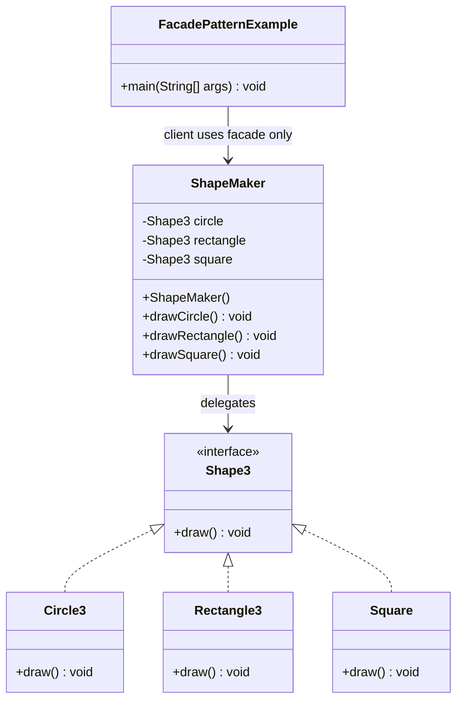
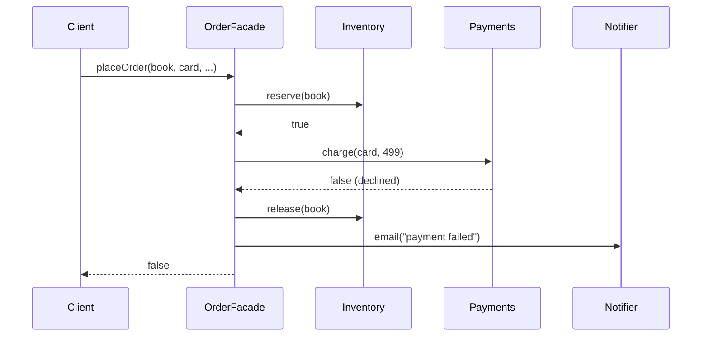

## In One Line
Facade puts **one simple class in front of a complicated group of classes**, so clients call a few high-level methods (`drawCircle()`, `placeOrder(...)`) instead of creating, wiring and sequencing the subsystem's objects themselves.

## Mental Model
Think of a **hotel reception desk**. Behind it are housekeeping, the kitchen, the laundry, the taxi company and the billing system — each with its own procedures. As a guest you do not phone the laundry and then the billing office; you tell reception "please send my suit for pressing and put it on my bill", and reception talks to the right departments in the right order. The departments still exist, and staff can still walk into the kitchen directly — reception is just the easy front door.

How it maps to the code:
- **Reception** → the **facade**: `ShapeMaker`.
- **The departments** → the **subsystem classes**: `Circle3`, `Rectangle3`, `Square` (behind the `Shape3` interface).
- **"Press my suit"** → a high-level facade method: `shapeMaker.drawCircle()`. The guest never learns which department did the work, or how it was set up.
- **Departments don't report to the guest or to reception** → subsystem classes have no idea the facade exists; the calls flow one way.
- **Staff can still use the back door** → nothing stops code from writing `new Circle3().draw()`; a facade simplifies, it does not lock anything away.

## Concept
### Intent (Gang of Four)
> "Provide a unified interface to a set of interfaces in a subsystem. Facade defines a higher-level interface that makes the subsystem easier to use."

Category: **structural**, object scope.

### The problem it solves
Subsystems grow many small, focused classes — good for the subsystem, painful for its users. Every client must know which classes exist, how to construct and configure them, in which order to call them, and how to clean up after a failure. That knowledge gets copied into every caller, and every caller is **coupled** to every subsystem class, so any internal change ripples outwards.

A facade moves that knowledge into one place. Clients depend on the facade alone; the subsystem can be reorganised behind it.

```text
Without a facade                      With a facade
client A --> Inventory                client A --\
client A --> Payments                 client B ---> OrderFacade --> Inventory, Payments,
client A --> Shipping                 client C --/                   Shipping, Notifier
client B --> Inventory ...  (N x M links)          (N + M links)
```

### Participants and how the example maps to them
| Participant | Role | In the example |
|---|---|---|
| **Facade** | Knows which subsystem classes handle a request; delegates to them | `ShapeMaker` with `drawCircle()`, `drawRectangle()`, `drawSquare()` |
| **Subsystem classes** | Do the real work; know nothing about the facade | `Shape3` and its implementations `Circle3`, `Rectangle3`, `Square` |
| **Client** | Talks to the facade instead of the subsystem | `FacadePatternExample.main` |

What `ShapeMaker` hides from `main`: that there is a `Shape3` interface at all, which classes implement it, that they must be instantiated, and which object handles which request. `main` never writes `new Circle3()` or mentions `Shape3`.

### What a good facade method does
The course example is the minimal form — each facade method forwards to exactly one object. Real facades earn their keep by **coordinating several objects**:
- **Construction and wiring** — create and configure subsystem objects (connections, parsers, clients) with sensible defaults.
- **Sequencing** — call the steps in the right order: reserve stock → charge card → ship → notify.
- **Compensation and cleanup** — if step 3 fails, undo steps 1–2; always close resources.
- **Translation** — convert low-level results and exceptions into something the client understands (`boolean`, a domain result, one unchecked exception type).

It should **not** contain the business rules of the subsystem itself — only the orchestration. A facade that starts doing everything becomes a "god object".

### Key properties
- **The subsystem does not know the facade.** Calls go one way: client → facade → subsystem.
- **The facade does not prevent direct access.** Advanced clients can still use subsystem classes. If you *want* to hide them, use visibility: make subsystem classes package-private, or export only the facade's package from a JPMS module.
- **Several facades can exist** for one subsystem, one per kind of client or use case.
- **Often a single instance** is enough (GoF note it is frequently a Singleton); in modern code let a DI container manage it rather than a static `getInstance()`.
- It supports the **Principle of Least Knowledge (Law of Demeter)**: the client talks to one "friend" instead of reaching through chains of subsystem objects.

### When to use Facade
- You want a **simple default entry point** to a complex subsystem, while keeping the detailed API for power users.
- You want to **decouple clients** from subsystem classes so the subsystem can change freely.
- You are **layering** a system: each layer exposes a facade (a service layer over repositories, an API over a module).
- You are wrapping a **legacy or third-party** library that is awkward to use (often combined with Adapter).

### When NOT to use it
- The subsystem is already simple — a facade that only renames methods adds a layer for nothing.
- Clients genuinely need fine-grained control — do not force them through a narrow facade; let them bypass it.
- The "facade" keeps growing unrelated methods — split it by use case before it becomes a god class.

### Real JDK, Spring and architecture examples
| Where | What the facade hides |
|---|---|
| `java.nio.file.Files` | `readString`, `writeString`, `readAllLines`, `copy`, `walk` hide channels, streams, charset encoders, file-system providers and closing (see `FilesFacade` in Code) |
| `java.net.http.HttpClient` | Connection pooling, TLS, HTTP/1.1 vs HTTP/2 negotiation, redirects behind `send(request, handler)` |
| `java.net.URL.openStream()` | Shortcut for `openConnection().getInputStream()`, hiding the protocol handler machinery (note: the `URL(String)` constructors are deprecated since Java 20 — use `URI.create(s).toURL()`) |
| Spring `JdbcTemplate` | Getting a connection, creating statements, iterating `ResultSet`s, translating `SQLException`s, closing everything — one `query(sql, rowMapper)` call (also a Template Method with callbacks) |
| Spring `RestClient`/`RestTemplate`, `JmsTemplate`, `KafkaTemplate` | The raw client libraries of HTTP, JMS and Kafka |
| Spring `ApplicationContext` | One object in front of the bean factory, message source, event publisher, environment and resource loader |
| SLF4J ("Simple Logging **Facade** for Java") | One logging API in front of Logback, Log4j 2 or JUL. Strictly, the chosen backend is plugged in through a provider/adapter, so structurally it is closer to Adapter/Bridge — a good nuance to mention |
| Service layer (`OrderService`) | Coordinates repositories, payment clients and messaging for the controllers |
| API Gateway / Backend-for-Frontend | One entry point in front of many microservices; J2EE's **Session Facade** did the same for EJBs to cut network round trips |

### Facade vs look-alikes
| Pattern | How many objects behind it | Interface | Direction of knowledge | Purpose |
|---|---|---|---|---|
| **Facade** | **Many** (a subsystem) | **New, simpler** | One-way: subsystem does not know the facade | Simplify |
| **[Mediator](lesson:a10-patterns/16-mediator)** | Many colleagues | New | **Two-way**: colleagues know the mediator and call it | Coordinate peers so they don't reference each other |
| **[Adapter](lesson:a10-patterns/05-adapter)** | Usually **one** | An **existing** interface the client already expects | One-way | Make an incompatible class fit |
| **[Decorator](lesson:a10-patterns/08-decorator)** | One | **Same** as the wrapped object | One-way | Add behaviour |
| **[Proxy](lesson:a10-patterns/11-proxy)** | One | **Same** as the real subject | One-way | Control access |
| **Abstract Factory** ([Factory](lesson:a10-patterns/02-factory)) | — | — | — | Can be used *by* a facade to create subsystem objects in a platform-independent way |

> [!INTERVIEW] "A Facade gives clients a simpler door into a subsystem; the subsystem does not know it exists. A Mediator sits *between* peers that all talk to it and hear back from it."

## Diagram

The client has one arrow — to `ShapeMaker`. Only the facade knows `Shape3` and its three implementations.


A real facade coordinates several subsystem objects in order and cleans up when a step fails; the client sees one call and one result.

## Code
@example CoreJava/StructuralPatterns/FacadePatternExample.java

**A facade that earns its keep** — sequencing, compensation and translation over a four-class subsystem:
```java
import java.util.*;

public class Shop {
    // ----- subsystem: four classes that know nothing about the facade -----
    static class Inventory {
        private final Map<String, Integer> stock = new HashMap<>(Map.of("book", 2, "pen", 0));
        boolean reserve(String item) {
            int left = stock.getOrDefault(item, 0);
            if (left == 0) return false;
            stock.put(item, left - 1);
            System.out.println("  inventory: reserved " + item);
            return true;
        }
        void release(String item) {
            stock.merge(item, 1, Integer::sum);
            System.out.println("  inventory: released " + item);
        }
    }
    static class Payments {
        boolean charge(String card, int amount) {
            boolean ok = !card.startsWith("0000");
            System.out.println("  payments: charge " + amount + (ok ? " OK" : " DECLINED"));
            return ok;
        }
    }
    static class Shipping {
        private int next = 100;
        String ship(String item, String address) {
            System.out.println("  shipping: " + item + " -> " + address);
            return "TRK-" + next++;
        }
    }
    static class Notifier {
        void email(String to, String text) { System.out.println("  email to " + to + ": " + text); }
    }

    // ----- facade: one high-level operation, the subsystem's order and rules inside -----
    static class OrderFacade {
        private final Inventory inventory;
        private final Payments payments;
        private final Shipping shipping;
        private final Notifier notifier;

        OrderFacade(Inventory i, Payments p, Shipping s, Notifier n) {
            inventory = i; payments = p; shipping = s; notifier = n;
        }

        boolean placeOrder(String item, int price, String card, String address, String email) {
            if (!inventory.reserve(item)) {
                notifier.email(email, item + " is out of stock");
                return false;
            }
            if (!payments.charge(card, price)) {
                inventory.release(item);                  // compensate the earlier step
                notifier.email(email, "payment failed");
                return false;
            }
            String tracking = shipping.ship(item, address);
            notifier.email(email, "shipped, tracking " + tracking);
            return true;
        }
    }

    public static void main(String[] args) {
        Inventory inventory = new Inventory();
        OrderFacade shop = new OrderFacade(inventory, new Payments(), new Shipping(), new Notifier());

        System.out.println("order 1: " + shop.placeOrder("book", 499, "4111-1111", "Pune", "a@x.com"));
        System.out.println("order 2: " + shop.placeOrder("book", 499, "0000-9999", "Pune", "b@x.com"));
        System.out.println("order 3: " + shop.placeOrder("pen", 20, "4111-1111", "Delhi", "c@x.com"));

        // The subsystem is still public: advanced clients may bypass the facade
        System.out.println("direct: " + inventory.reserve("book"));
    }
}
```
```output
  inventory: reserved book
  payments: charge 499 OK
  shipping: book -> Pune
  email to a@x.com: shipped, tracking TRK-100
order 1: true
  inventory: reserved book
  payments: charge 499 DECLINED
  inventory: released book
  email to b@x.com: payment failed
order 2: false
  email to c@x.com: pen is out of stock
order 3: false
  inventory: reserved book
direct: true
```
Each subsystem line is printed *before* the `order N:` line because the argument `shop.placeOrder(...)` is evaluated completely before `println` runs. The facade's constructor takes the subsystem objects as parameters, so a test can pass fakes.

**A facade from the JDK — `java.nio.file.Files`:**
```java
import java.io.*;
import java.nio.charset.StandardCharsets;
import java.nio.file.*;
import java.util.List;

public class FilesFacade {
    public static void main(String[] args) throws IOException {
        Path file = Files.createTempFile("facade", ".txt");

        // Without the facade: you pick, stack, flush and close the stream classes yourself
        try (BufferedWriter w = new BufferedWriter(
                new OutputStreamWriter(new FileOutputStream(file.toFile()), StandardCharsets.UTF_8))) {
            w.write("alpha");
            w.newLine();
            w.write("beta");
        }
        StringBuilder sb = new StringBuilder();
        try (BufferedReader r = new BufferedReader(
                new InputStreamReader(new FileInputStream(file.toFile()), StandardCharsets.UTF_8))) {
            String line;
            while ((line = r.readLine()) != null) sb.append(line).append('|');
        }
        System.out.println("by hand : " + sb);

        // With the facade: one call each, same subsystem underneath
        Files.writeString(file, "gamma\ndelta");                       // UTF-8 by default
        List<String> lines = Files.readAllLines(file);
        System.out.println("facade  : " + lines);
        System.out.println("size    : " + Files.size(file) + " bytes");

        Files.delete(file);
        System.out.println("exists? : " + Files.exists(file));
    }
}
```
```output
by hand : alpha|beta|
facade  : [gamma, delta]
size    : 11 bytes
exists? : false
```
The "by hand" version makes the caller choose four stream classes (a decorator and adapter stack) and manage closing; `Files.writeString`/`readAllLines` do the same work behind one static call each.

**Making the course facade more useful** — a higher-level operation and hidden subsystem:
```java
// In a real package, Shape3/Circle3/Rectangle3/Square would be package-private
// and only ShapeMaker public, so other packages can use nothing but the facade.
public class ShapeMaker {
    private final Shape3 circle = new Circle3();
    private final Shape3 rectangle = new Rectangle3();
    private final Shape3 square = new Square();

    public void drawCircle()    { circle.draw(); }
    public void drawRectangle() { rectangle.draw(); }
    public void drawSquare()    { square.draw(); }

    public void drawScene() {          // one call, several subsystem steps
        drawSquare();
        drawCircle();
    }
}
```

## Walkthrough
- `package CoreJava.StructuralPatterns;` — shared with the other structural examples, hence the suffixed names: `Shape3` and `Circle3` because the Bridge example already has `Shape`/`Circle` and the Decorator example has `Shape2`/`Circle2`; `Rectangle3` because the Decorator example already declares `Rectangle`. `Square` has no clash, so it keeps its plain name.
- `class ShapeMaker` — the **Facade** (despite the `// Subsystem classes` comment above it — see Traps).
  - `private Shape3 circle; private Shape3 rectangle; private Shape3 square;` — the facade holds the subsystem objects, typed by the **interface**. They are `private`, so clients cannot reach them through the facade.
  - `public ShapeMaker()` — creates one `Circle3`, one `Rectangle3` and one `Square`. **Construction is hidden**: the client never learns these classes exist.
  - `drawCircle()`, `drawRectangle()`, `drawSquare()` — each forwards to one subsystem object's `draw()`. These are the simple, intention-revealing methods of the facade.
  - `ShapeMaker` is declared *before* `Shape3` in the file. That is fine: the order of top-level types in a source file does not matter to the compiler.
- `interface Shape3 { void draw(); }` — the subsystem's common interface.
- `Circle3`, `Rectangle3`, `Square` — the **subsystem classes**; each `draw()` prints `ClassName::draw()`. None of them refers to `ShapeMaker`.
- `main` (the **client**):
  - `ShapeMaker shapeMaker = new ShapeMaker();` — the only class `main` knows.
  - `shapeMaker.drawCircle();` → `Circle::draw()`.
  - `shapeMaker.drawRectangle();` → `Rectangle::draw()`.
  - `shapeMaker.drawSquare();` → `Square::draw()`.
- The three `// Output:` comments match the recorded output. Note that the printed text says `Circle::draw()` and `Rectangle::draw()`, not `Circle3::draw()` — the strings are hard-coded, not taken from the class names.

## Traps
> [!ERRATA] The comment `// Subsystem classes` sits directly above `class ShapeMaker`, but `ShapeMaker` is the **Facade**, not a subsystem class. The subsystem is `Shape3`, `Circle3`, `Rectangle3` and `Square` (the block under `// Shape interface and its implementations`). Read it as `// Facade` above `ShapeMaker` and `// Subsystem classes` above `Shape3`.

> [!ERRATA] Minor: the three fields are assigned once and never change, so they should be `private final` (or initialised at declaration, as in the improved version in Code). And the example shows only the thinnest kind of facade — one-to-one forwarding. It hides construction and concrete classes, but the pattern's real value (sequencing several subsystem calls, cleanup, translation) is shown in `Shop` above.

- **Facade ≠ access control.** A facade does not hide the subsystem unless you also restrict visibility (package-private classes, unexported JPMS packages). Don't claim "the client *can't* access the subsystem" in an interview unless you did that.
- **God facade.** A facade that grows into `EverythingService` with fifty unrelated methods is just a new, bigger subsystem. Split facades by client or use case.
- **Leaky facade.** Returning subsystem objects (`getInventory()`) or subsystem exceptions (`SQLException`) from facade methods re-couples clients to the subsystem. Return client-level results and translate exceptions.
- **Business logic creeping in.** A facade orchestrates; pricing rules or validation belong in the subsystem/domain. Otherwise the same rule gets duplicated when someone bypasses the facade.
- **Hard-wired subsystem.** A facade that `new`s everything internally (like `ShapeMaker`) cannot be unit-tested with fakes. Inject the subsystem objects (as `OrderFacade` does).
- **Missing compensation.** When a facade performs several steps, a failure midway must undo earlier steps (release stock, refund) — or use a transaction. That responsibility now lives in the facade.

## Tips & Tricks
- **Mnemonic — "One door, many rooms."** Facade = one entry point to a house of classes; the rooms don't know about the door, and you may still use the back door.
- **Facade vs Mediator in one line:** *Facade: the subsystem doesn't know it exists. Mediator: every colleague knows it and talks through it.*
- **Wrapper word test:** *simplify many* → Facade; *convert one* → Adapter; *add to one* → Decorator; *control one* → Proxy.
- **Name facade methods after client intentions** (`placeOrder`, `drawScene`, `readString`), not after subsystem steps.
- **Default path in the facade, full power underneath** — keep the subsystem API available for the 10% of clients who need it.
- **Thin and stateless** — a facade usually holds references to the subsystem and nothing else, so one shared instance (a Spring bean) is fine.
- **Spot facades by their shape:** many private fields of different subsystem types + public methods that each call several of them in sequence.

## Interview Q&A
### [Basic] What is the Facade pattern?
Facade is a structural pattern that provides one simplified, higher-level interface to a set of classes in a subsystem. The facade knows which subsystem objects to create, in which order to call them and how to clean up, so clients make one call instead of coordinating many objects. It reduces coupling — clients depend only on the facade — while the subsystem stays available for clients that need more control. In the course example, `ShapeMaker` creates `Circle3`, `Rectangle3` and `Square` and exposes `drawCircle()`, `drawRectangle()` and `drawSquare()`, so `main` never deals with `Shape3` or its implementations.

**Follow-up:** *Does the facade add new functionality?* — Not new capabilities — everything it does could be done with the subsystem directly. It adds convenience: defaults, sequencing, error translation.

### [Basic] Identify the facade, subsystem and client in the course example. Is it a good facade?
The facade is `ShapeMaker`; the subsystem is `Shape3` with `Circle3`, `Rectangle3` and `Square`; the client is `main`. It demonstrates the essentials — the client never instantiates or names subsystem classes — but it is the thinnest possible facade: each method forwards to one object. A more convincing facade method would combine several subsystem calls (for example `drawScene()`), handle setup and failure, and the subsystem classes would be package-private so other packages see only the facade.

**Follow-up:** *What is wrong with the comments in that file?* — `// Subsystem classes` is placed above `ShapeMaker`, which is actually the facade.

### [Intermediate] What is the difference between Facade and Mediator?
Both put one object in front of many, but the direction of communication differs. A **Facade** is a **one-way** simplification: clients call the facade, the facade calls the subsystem, and the subsystem classes do not know the facade exists — they can still be used directly. A **Mediator** coordinates **peers**: each colleague holds a reference to the mediator and calls it, and the mediator calls colleagues back, so colleagues never reference each other. Facade is structural (simplify access); Mediator is behavioral (centralise interaction rules).

**Follow-up:** *Give an example of each.* — Facade: `JdbcTemplate` in front of JDBC. Mediator: a chat room that relays messages between users, or a dialog that coordinates its widgets.

### [Intermediate] What is the difference between Facade and Adapter?
An **Adapter** makes **one** existing class conform to an interface the client **already expects** — its goal is compatibility. A **Facade** defines a **new, simpler** interface over a **whole subsystem** — its goal is ease of use and decoupling. Adapter is often forced on you by an interface you must implement; a facade's interface is designed freely for its clients. They combine well: a `PaymentGateway` adapter can be a facade over a vendor SDK's many classes.

**Follow-up:** *Can a facade wrap just one class?* — Yes, if that class has a complicated API (many setup calls, options, cleanup); the defining feature is simplification, not the number of classes.

### [Intermediate] Does a facade prevent clients from using the subsystem directly? Should it?
Not by itself — GoF explicitly say a facade does not prevent direct use; it just offers a simpler default. Whether you *should* hide the subsystem depends on the design. In a layered architecture or a library you often do: make subsystem classes package-private, or export only the facade's package from a JPMS module, so the facade becomes the module's public API. In other cases, power users legitimately need the detailed API, and hiding it would force the facade to grow every feature.

**Follow-up:** *How do you enforce layering in a Spring app?* — Package structure with package-private implementations, JPMS or build modules, and architecture tests (for example ArchUnit rules like "controllers may only access services").

### [Intermediate] Give real examples of Facade in Java and Spring.
In the JDK, `java.nio.file.Files` is a facade over channels, streams, charsets and file-system providers — `Files.readString(path)` replaces a stack of stream classes plus closing. `HttpClient.send` hides connection pooling, TLS and HTTP/2; `URL.openStream()` hides the protocol handlers. In Spring, `JdbcTemplate` hides connection handling, statements, result-set iteration, exception translation and closing; `RestClient`, `JmsTemplate` and `KafkaTemplate` do the same for their client libraries; `ApplicationContext` fronts the bean factory, events, messages and resources. At architecture level, a service layer is a facade for controllers, and an API Gateway is a facade over microservices.

**Follow-up:** *Is SLF4J a facade?* — By name and intent, yes: one simple logging API for many frameworks. Structurally, it delegates to one pluggable backend through a provider, which is closer to Adapter/Bridge — mentioning that nuance scores points.

### [Advanced] How do you keep a facade from turning into a god object?
Keep it to **orchestration**: construction, sequencing, compensation and translation — no domain rules. Split facades by client or use case (`CheckoutFacade`, `ReportingFacade`) instead of one per subsystem. Keep them stateless apart from references to subsystem objects. Inject those objects through the constructor so each facade stays small and testable. Do not leak subsystem types in signatures. If a facade method grows long, that usually means a missing domain concept that belongs in the subsystem.

**Follow-up:** *How do you test a facade?* — With the subsystem objects injected, pass mocks or fakes and verify the call order and the compensation path (for example "release is called when charge fails").

### [Advanced] What was the J2EE Session Facade, and what is its modern equivalent?
In EJB-era systems, clients calling many fine-grained remote entity beans paid a network round trip per call. A **Session Facade** — a coarse-grained session bean — exposed use-case methods (`placeOrder`) and made the fine-grained calls locally on the server, also demarcating the transaction around them. Today the same idea appears as a transactional **service layer** (`@Service` with `@Transactional` methods), as **API Gateways** and **Backend-for-Frontend** services that aggregate several microservice calls into one response for a client, and as coarse-grained remote APIs in general.

**Follow-up:** *What is the risk of an API Gateway as a facade?* — It can become a bottleneck and a dumping ground for business logic; keep it to routing, aggregation and cross-cutting concerns.

### [Advanced] Should a facade be a Singleton?
GoF note that usually only one facade object is needed, so it is often a Singleton. In modern Java prefer letting a DI container create a single instance (Spring beans are singletons by default) rather than a static `getInstance()`: you keep the single instance but avoid hidden global state and gain constructor injection, which makes the facade testable. A stateless facade is naturally thread-safe as long as the subsystem objects it uses are.

**Follow-up:** *When might you want several facade instances?* — When each is configured differently, for example one per tenant, region or data source.

## Quiz
### What does the original example print?
- [ ] Circle3::draw() / Rectangle3::draw() / Square::draw()
- [x] Circle::draw() / Rectangle::draw() / Square::draw()
- [ ] Nothing — `ShapeMaker` only creates the shapes
- [ ] Square::draw() / Circle::draw() / Rectangle::draw()
> `main` calls `drawCircle()`, `drawRectangle()`, `drawSquare()` in that order, and each subsystem class prints a hard-coded string without the `3` suffix. The class names `Circle3`/`Rectangle3` exist only to avoid clashes in the shared package; they never appear in the output.

### In the course example, which class is the Facade?
- [ ] `Shape3`
- [ ] `Circle3`
- [x] `ShapeMaker`
- [ ] `FacadePatternExample`
> `ShapeMaker` is the single entry point that creates and delegates to the subsystem objects. The comment above it says "Subsystem classes", which is misleading — the subsystem is `Shape3` and its implementations; `FacadePatternExample.main` is the client.

### Using the `Shop` classes from the Code section on a fresh `OrderFacade`, what does this print?
```java
System.out.println(shop.placeOrder("pen", 20, "4111-1111", "Delhi", "c@x.com"));
```
- [ ] `payments: charge 20 OK`, then `true`
- [x] `email to c@x.com: pen is out of stock`, then `false`
- [ ] `inventory: released pen`, then `false`
- [ ] `false` only
> The pen's stock is 0, so `inventory.reserve("pen")` returns `false` without printing, and the facade notifies the customer and returns `false` — payment is never attempted, so there is nothing to release. The email line appears before `false` because the argument is evaluated before `println` runs.

### Spot the bug in this facade method.
```java
boolean placeOrder(String item, int price, String card) {
    if (!inventory.reserve(item)) return false;
    if (!payments.charge(card, price)) return false;
    shipping.ship(item);
    return true;
}
```
- [ ] It should call `payments.charge` before `inventory.reserve`
- [x] When the charge fails, the reserved stock is never released
- [ ] A facade must not return `boolean`
- [ ] Facade methods must be `static`
> Once a facade coordinates several steps, it owns the cleanup. After a declined payment the item stays reserved forever, so stock leaks. The fix is `inventory.release(item)` before returning (or a transaction). Charging first would just move the problem: a successful charge for an out-of-stock item would then need a refund.

### Which statement correctly separates Facade from Mediator?
- [ ] A facade coordinates peers that call it back; a mediator only simplifies access
- [x] Subsystem classes don't know their facade; colleagues know and call their mediator
- [ ] A facade always wraps exactly one class
- [ ] Mediator is structural and Facade is behavioral
> Facade is one-way (client → facade → subsystem), and the subsystem is unaware of it. In Mediator, every colleague holds a reference to the mediator and both sides call each other. The first option swaps the two; Facade is structural and Mediator behavioral, not the reverse.

### Which JDK API is best described as a Facade?
- [x] `Files.readString(path)`
- [ ] `BufferedReader`
- [ ] `Arrays.asList(array)`
- [ ] `Collections.unmodifiableList(list)`
> `Files.readString` hides the file system provider, channels or streams, charset decoding and closing behind one call. `BufferedReader` and `unmodifiableList` keep the wrapped object's interface and add or restrict behaviour (decorators), and `Arrays.asList` converts an array into the `List` interface (an adapter).

### After adding a facade, can the client still call `new Circle3().draw()` in the course example?
- [x] Yes — a facade simplifies access but does not hide the subsystem by itself
- [ ] No — the facade makes the subsystem classes private
- [ ] Only through reflection
- [ ] Only if `ShapeMaker` is a Singleton
> `Circle3` is a package-private top-level class in the same package, so code in that package can use it freely. A facade does not change visibility; to force clients through the facade you must make subsystem classes non-public (and keep clients in other packages) or use JPMS exports.

## Takeaways
- Facade provides one simpler, higher-level interface to a subsystem of many classes, reducing client coupling and duplicated setup code.
- Roles: Facade (`ShapeMaker`), subsystem (`Shape3`, `Circle3`, `Rectangle3`, `Square`), client (`main`); the original's `// Subsystem classes` comment wrongly labels the facade.
- Communication is one-way: the subsystem does not know the facade, and the facade does not stop direct access unless visibility is restricted.
- A useful facade orchestrates: construction, sequencing, compensation on failure and translation of results/exceptions — but no domain rules.
- Avoid god facades and leaky facades; split by use case and inject subsystem objects for testability.
- Examples: `Files.readString/writeString`, `HttpClient`, Spring `JdbcTemplate`/`RestClient`/`ApplicationContext`, service layers, API Gateways, SLF4J (by name).
- Facade simplifies many; Adapter converts one to an existing interface; Mediator coordinates peers that know it; Decorator and Proxy keep the same interface.
