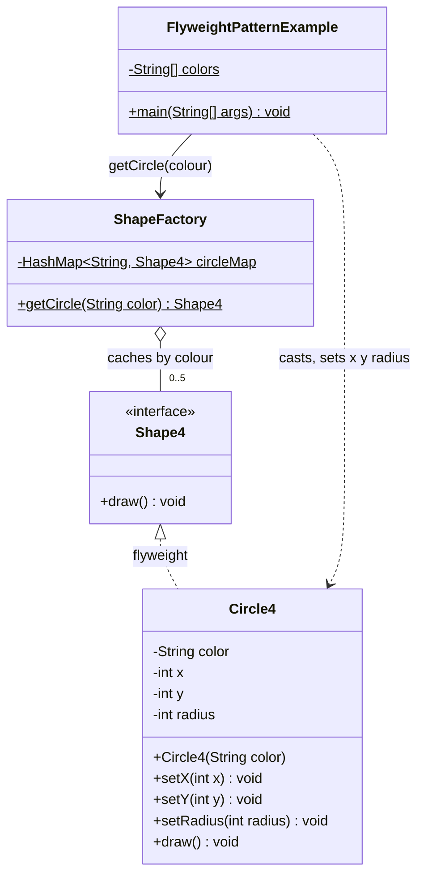
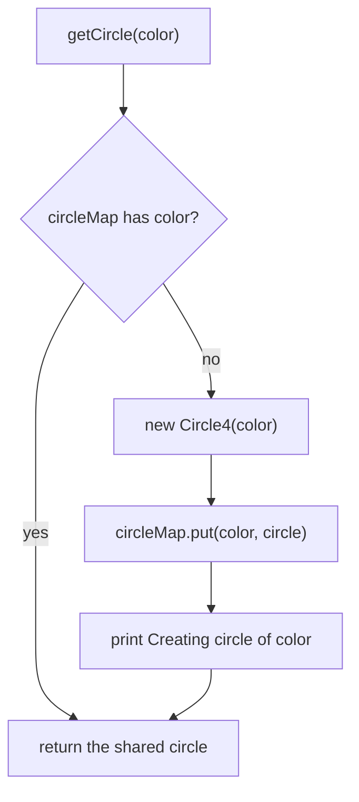
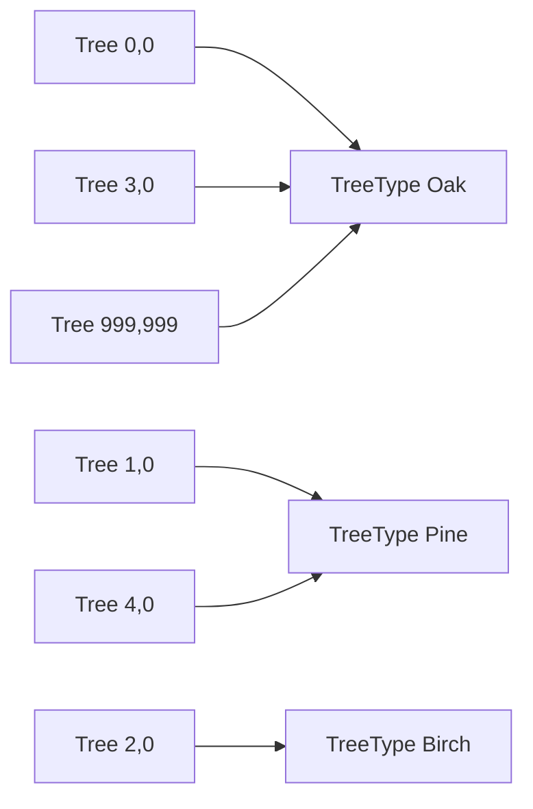

## In One Line
Flyweight saves memory when you need huge numbers of similar objects: the part they have in common (**intrinsic state**, e.g. a colour) lives in a few **shared, immutable** objects handed out by a factory, and the part that differs per use (**extrinsic state**, e.g. x/y position) is kept outside and passed in when needed.

## Mental Model
Think of **movable type in a printing press**. A newspaper page has thousands of letters, but the printer does not cast a new metal "e" for every "e" on the page. There is one tray of letter blocks — one shape per character — and each block is placed at many positions. The *shape of the letter* is shared; *where it stands on the page* belongs to the page layout, not to the block.

How it maps to the code:
- **The metal letter block** → the **flyweight**: one `Circle4` object per colour.
- **The letter's shape** → **intrinsic state**: `color`, which is the same wherever that circle is used.
- **The position on the page** → **extrinsic state**: `x`, `y`, `radius`, which differ for every circle drawn.
- **The type tray** → the **flyweight factory**: `ShapeFactory` with its `circleMap`, which returns the existing block for a colour or casts a new one the first time.
- **The printer placing blocks** → the **client** `main`, which asks for a colour and supplies the position for each draw.
- **A block that remembers where it was last placed** would be nonsense — you'd place it again elsewhere and the "memory" would be wrong. That is exactly the bug in the course's `Circle4`, which stores `x`/`y` inside the shared object (see Traps).

## Concept
### Intent (Gang of Four)
> "Use sharing to support large numbers of fine-grained objects efficiently."

Category: **structural**, object scope. The name comes from boxing: a flyweight is a very light object.

### The problem it solves
Some programs need **millions of small objects**: characters in a text editor, trees and particles in a game, map tiles, cells in a spreadsheet, tokens in a parser. If each one carries all its data, memory (and GC time) explodes — yet most of that data is **duplicated**: every "e" in Times New Roman 12pt has the same glyph, every oak tree the same mesh and texture.

Flyweight splits each object's state in two:
| | Intrinsic state | Extrinsic state |
|---|---|---|
| Meaning | Independent of context; identical for all uses | Depends on where/how the object is used |
| Stored | **Inside** the shared flyweight | **Outside** — in the client or a small context object |
| Mutability | **Immutable** (it is shared) | Can change freely |
| In the example | `color` | `x`, `y`, `radius` |
| Text editor | Glyph shape, font | Row, column |
| Game forest | Species, mesh, texture | Position, age, health |

Once the extrinsic part is removed, many objects become identical, so a few shared ones can stand in for all of them.

### Participants and how the example maps to them
| Participant | Role | In the example |
|---|---|---|
| **Flyweight** | Interface through which flyweights receive extrinsic state | `interface Shape4 { void draw(); }` — see Traps: it should be `draw(x, y, radius)` |
| **ConcreteFlyweight** | Stores intrinsic state; must be shareable | `Circle4` (stores `color` — and, wrongly, `x`, `y`, `radius`) |
| **UnsharedConcreteFlyweight** | Implements the interface but is not shared (optional) | none here; in a document, a row or column object that holds shared glyphs |
| **FlyweightFactory** | Creates flyweights and guarantees sharing: returns the existing one for a key | `ShapeFactory.getCircle(color)` with `HashMap<String, Shape4> circleMap` |
| **Client** | Keeps references to flyweights and computes/stores extrinsic state | `FlyweightPatternExample.main` — picks a random colour, sets random x/y and radius 100, draws |

### The factory is what makes it a flyweight
Sharing only works if clients cannot bypass it. The factory's algorithm is "look up by key; if absent, create, store, return; if present, return the stored one" — the sequence in `getCircle`. In Java 8+ that is one line: `map.computeIfAbsent(key, Circle::new)` on a `ConcurrentHashMap`. Ideally the flyweight's constructor is not reachable from clients (package-private or private with a static factory), so nobody creates unshared copies by accident.

### Rules for a correct flyweight
1. **Immutable.** A flyweight is shared by many clients (and often threads); any change is seen by all of them. Records are ideal.
2. **No extrinsic state inside.** Context goes in method parameters (`draw(x, y, radius)`) or in a separate context object that *references* the flyweight.
3. **Thread-safe factory.** Use `ConcurrentHashMap.computeIfAbsent`, not an unsynchronised `HashMap` check-then-put.
4. **No reliance on identity for meaning.** Clients must not care that "their" red circle is the same object as someone else's; equality should come from the intrinsic state.
5. **Bounded key space**, or an eviction policy — otherwise the factory's map is a memory leak.

### When to use Flyweight (GoF's checklist)
Use it only when **all** of these hold:
- The application uses a **large number of objects**.
- Storage costs are high **because of** that quantity.
- **Most** object state can be made extrinsic.
- Once extrinsic state is removed, many groups of objects can be replaced by **relatively few shared objects**.
- The application **does not depend on object identity**.

### When NOT to use it
- You have hundreds or thousands of objects, not millions — the complexity is not worth it. **Measure first** (heap histogram, JFR, JOL).
- Most state is unique per object — there is nothing to share.
- Computing or passing extrinsic state everywhere costs more CPU and complexity than the memory saved.
- The objects must be mutable individually.

### Flyweight in the JDK
| Where | What is shared |
|---|---|
| `Integer.valueOf(int)` (and autoboxing) | A cache of `Integer` objects for **-128 to 127**; the upper bound can be raised with `-XX:AutoBoxCacheMax=<n>` (or `-Djava.lang.Integer.IntegerCache.high=<n>`) |
| `Short`, `Byte`, `Long` `.valueOf` | Cache for -128 to 127 (fixed) |
| `Character.valueOf` | Cache for 0 to 127 |
| `Boolean.valueOf` | Only two objects exist: `Boolean.TRUE` and `Boolean.FALSE` |
| `BigInteger.valueOf`, `BigDecimal.valueOf` | Small constants (`BigInteger` -16..16; `BigDecimal` 0..10 with scale 0) |
| String literals, `String.intern()` | The **string pool**: one `String` object per distinct literal/interned value |
| `List.of()`, `Set.of()`, `Map.of()`, `Collections.emptyList()`, `Optional.empty()` | One shared immutable empty instance each |
| `enum` constants | The ultimate flyweight factory: a fixed, JVM-guaranteed set of shared instances |
| `Double.valueOf`, `Float.valueOf` | **Not** cached — there is no small, finite range worth caching |

GC-level relatives: `-XX:+UseStringDeduplication` makes the collector share the backing arrays of equal strings (G1 since 8u20; supported by the other collectors since JDK 18), and **compact strings** (Java 9) store Latin-1 text in one byte per char — both attack the same problem of duplicated fine-grained data.

### Flyweight vs look-alikes
| | Flyweight | [Singleton](lesson:a10-patterns/01-singleton) | Object Pool | Cache / memoization | [Prototype](lesson:a10-patterns/04-prototype) |
|---|---|---|---|---|---|
| Instances | **One per key** (intrinsic value) | One per class | A fixed set of interchangeable objects | One result per input | Copies of a master |
| Shared how? | **Simultaneously** by many clients | Globally | **Exclusively**: borrow, use, return | Result reused | Not shared — each client gets its own copy |
| Mutable? | **No** | Often yes | Yes (reset on return) | Values should be immutable | Yes |
| Goal | Memory | Single point of access | Avoid expensive creation (connections, threads) | Avoid recomputation | Cheap creation by copying |

Flyweight also combines with other patterns: shared leaves in a [Composite](lesson:a10-patterns/07-composite) (glyphs in a document tree), shared terminal symbols in an [Interpreter](lesson:a10-patterns/14-interpreter), stateless [State](lesson:a10-patterns/20-state) and [Strategy](lesson:a10-patterns/21-strategy) objects shared by all contexts.

## Diagram

The factory owns at most one `Circle4` per colour. The client reaches past the `Shape4` interface into `Circle4`'s setters — the design flaw discussed in Traps.


"Creating circle of color" is printed only on the first request for each colour — so the program prints at most five of them, however many circles it draws.


The correct split (the `Forest` example in Code): many small context objects hold the extrinsic position, all pointing at a handful of shared, immutable flyweights.

## Code
@example CoreJava/StructuralPatterns/FlyweightPatternExample.java

**The bug hiding in the course version** — extrinsic state stored inside a shared object (the course's classes copied into the file):
```java
// Reuses the course's classes from the example above: save it in the same package as that file.
import java.util.List;

public class SharedStateBug {
    public static void main(String[] args) {
        Circle4 a = (Circle4) ShapeFactory.getCircle("Red");
        a.setX(10); a.setY(10); a.setRadius(100);

        Circle4 b = (Circle4) ShapeFactory.getCircle("Red");   // "another" red circle
        b.setX(90); b.setY(90); b.setRadius(5);

        System.out.println("same object? " + (a == b));
        List<Shape4> scene = List.of(a, b);                     // draw later, e.g. on the next frame
        for (Shape4 s : scene) s.draw();
    }
}
```
```output
Creating circle of color : Red
same object? true
Circle: Draw() [Color : Red, x : 90, y :90, radius :5
Circle: Draw() [Color : Red, x : 90, y :90, radius :5
```
Both "circles" are one object, so the second set of coordinates overwrote the first. The original only looks correct because it draws immediately after setting the coordinates.

**The course example done right** — immutable flyweight, extrinsic state as parameters, thread-safe factory:
```java
import java.util.*;
import java.util.concurrent.ConcurrentHashMap;

public class FixedCircles {
    interface Shape {                                   // extrinsic state is a PARAMETER now
        void draw(int x, int y, int radius);
    }

    record Circle(String color) implements Shape {      // intrinsic state only, immutable
        public void draw(int x, int y, int radius) {
            System.out.println("Circle [color=" + color + ", x=" + x + ", y=" + y + ", radius=" + radius + "]");
        }
    }

    static final class ShapeFactory {
        private static final Map<String, Shape> CIRCLES = new ConcurrentHashMap<>();
        static Shape getCircle(String color) {
            return CIRCLES.computeIfAbsent(color, c -> {
                System.out.println("Creating circle of color : " + c);
                return new Circle(c);
            });
        }
    }

    record Placement(Shape shape, int x, int y, int radius) {   // the client stores extrinsic state
        void draw() { shape.draw(x, y, radius); }
    }

    public static void main(String[] args) {
        List<Placement> scene = List.of(
                new Placement(ShapeFactory.getCircle("Red"), 10, 10, 100),
                new Placement(ShapeFactory.getCircle("Red"), 90, 90, 5),
                new Placement(ShapeFactory.getCircle("Blue"), 50, 50, 20));
        scene.forEach(Placement::draw);                 // drawn later: still correct
        System.out.println("same Red flyweight? " + (scene.get(0).shape() == scene.get(1).shape()));
    }
}
```
```output
Creating circle of color : Red
Creating circle of color : Blue
Circle [color=Red, x=10, y=10, radius=100]
Circle [color=Red, x=90, y=90, radius=5]
Circle [color=Blue, x=50, y=50, radius=20]
same Red flyweight? true
```
Still one shared red circle, but because it holds nothing position-specific, deferred drawing is correct. No casts are needed: the interface carries the extrinsic state.

**At scale — a million trees, three flyweights:**
```java
import java.util.*;
import java.util.concurrent.ConcurrentHashMap;

public class Forest {
    // Flyweight: ONLY intrinsic state, immutable, safe to share (a record is ideal)
    record TreeType(String species, String color) {
        void draw(int x, int y) {                              // extrinsic state passed in
            System.out.println(species + " (" + color + ") at " + x + "," + y);
        }
    }

    // Flyweight factory: one TreeType per key, thread-safe
    static final class TreeTypes {
        private static final Map<String, TreeType> CACHE = new ConcurrentHashMap<>();
        static TreeType of(String species, String color) {
            return CACHE.computeIfAbsent(species + "|" + color, k -> new TreeType(species, color));
        }
        static int created() { return CACHE.size(); }
    }

    // Context: the unshared, per-object extrinsic state + a reference to the shared flyweight
    record Tree(int x, int y, TreeType type) {
        void draw() { type.draw(x, y); }
    }

    public static void main(String[] args) {
        String[][] kinds = {{"Oak", "green"}, {"Pine", "dark green"}, {"Birch", "white"}};
        List<Tree> forest = new ArrayList<>();
        for (int i = 0; i < 1_000_000; i++) {
            String[] k = kinds[i % kinds.length];
            forest.add(new Tree(i % 1000, i / 1000, TreeTypes.of(k[0], k[1])));
        }
        System.out.println("trees: " + forest.size() + ", tree types created: " + TreeTypes.created());
        forest.subList(0, 4).forEach(Tree::draw);
        System.out.println("shared? " + (forest.get(0).type() == forest.get(3).type()));
    }
}
```
```output
trees: 1000000, tree types created: 3
Oak (green) at 0,0
Pine (dark green) at 1,0
Birch (white) at 2,0
Oak (green) at 3,0
shared? true
```
Every `Tree` is still an object (x, y and a reference), but the heavy, shared part exists three times instead of a million. In a real game `TreeType` would hold a mesh and texture of many kilobytes, which is where the saving becomes dramatic.

**Flyweights you already use in the JDK:**
```java
import java.math.BigInteger;
import java.util.*;

public class JdkFlyweights {
    public static void main(String[] args) {
        Integer a = 127, b = 127;          // autoboxing calls Integer.valueOf
        Integer c = 128, d = 128;
        System.out.println("Integer 127: " + (a == b) + ", 128: " + (c == d) + ", equals: " + c.equals(d));
        System.out.println("Long 127: " + (Long.valueOf(127) == Long.valueOf(127))
                + ", Long 128: " + (Long.valueOf(128) == Long.valueOf(128)));
        System.out.println("Character 'a': " + (Character.valueOf('a') == Character.valueOf('a')));
        System.out.println("Boolean: " + (Boolean.valueOf("TRUE") == Boolean.TRUE));
        System.out.println("Double 1.0: " + (Double.valueOf(1.0) == Double.valueOf(1.0)));
        System.out.println("BigInteger 16: " + (BigInteger.valueOf(16) == BigInteger.valueOf(16))
                + ", 17: " + (BigInteger.valueOf(17) == BigInteger.valueOf(17)));

        String s1 = "java";
        String s2 = new String("java");
        System.out.println("literal == new: " + (s1 == s2) + ", literal == intern: " + (s1 == s2.intern()));

        System.out.println("List.of() shared: " + (List.of() == List.of())
                + ", Optional.empty() shared: " + (Optional.empty() == Optional.empty())
                + ", emptyList shared: " + (Collections.emptyList() == Collections.emptyList()));
    }
}
```
```output
Integer 127: true, 128: false, equals: true
Long 127: true, Long 128: false
Character 'a': true
Boolean: true
Double 1.0: false
BigInteger 16: true, 17: false
literal == new: false, literal == intern: true
List.of() shared: true, Optional.empty() shared: true, emptyList shared: true
```
With `java -XX:AutoBoxCacheMax=1000`, `Integer x = 1000, y = 1000; x == y` printed `true` (it prints `false` with default settings). Never rely on either — compare wrappers with `equals`.

## Walkthrough
- `import java.util.HashMap;` — the factory's cache.
- `interface Shape4 { void draw(); }` — the **Flyweight** interface (named `Shape4` because `Shape`, `Shape2`, `Shape3` already exist in this package). Its `draw()` takes no parameters, so there is no way to pass extrinsic state through the interface.
- `class Circle4 implements Shape4` — the **ConcreteFlyweight**.
  - `private String color;` — **intrinsic** state, set once in the constructor `Circle4(String color)`.
  - `private int x, y, radius;` with `setX`, `setY`, `setRadius` — **extrinsic** state, but stored *inside* the shared object and changed by every client (see Traps).
  - `draw()` — prints `Circle: Draw() [Color : <color>, x : <x>, y :<y>, radius :<radius>`. (The `[` is never closed and the spacing around the colons is inconsistent; that is just the string.)
- `class ShapeFactory` — the **FlyweightFactory**.
  - `private static final HashMap<String, Shape4> circleMap` — one cached circle per colour for the whole program (static). `final` fixes the reference, not the map's contents.
  - `getCircle(String color)`: `(Circle4) circleMap.get(color)` — look up (the cast is needed because the map stores `Shape4`); if `null`, create a `Circle4`, `put` it, and print `Creating circle of color : <color>`; return the (new or cached) circle.
- `class FlyweightPatternExample` — the **client**.
  - `private static final String colors[] = {"Red", "Green", "Blue", "White", "Black"};` — five possible keys (C-style array syntax; `String[] colors` is the usual Java style).
  - `main` loops 20 times (`++i` vs `i++` makes no difference in a `for` update). Each iteration: get a circle for a random colour, **downcast** it to `Circle4` to reach the setters, set a random `x` and `y` and `radius = 100`, then `draw()` immediately.
  - `getRandomColor()` — `Math.random()` returns a `double` in `[0.0, 1.0)`; multiplying by `colors.length` (5) and casting to `int` gives an index 0–4, uniformly.
  - `getRandomX()` / `getRandomY()` — `(int) (Math.random() * 100)` gives 0–99.
- **Why the output differs every run** (the recorded output is marked as varying): colours and coordinates come from `Math.random()`. What is always true:
  - Exactly **20** `Circle: Draw()` lines, all with `radius :100`.
  - A `Creating circle of color : X` line appears exactly once per colour, **immediately before the first draw of that colour**, never again.
  - At most **5** "Creating" lines — at most five `Circle4` objects exist no matter how many circles are drawn. That is the saving the pattern is about.
  - Fewer than five appear if some colour is never picked in 20 draws; the chance of that is about **5.7%** (computed exactly with inclusion–exclusion, and confirmed by a million simulated runs).
- In the recorded run, White, Green, Red and Black were created within the first five draws and Blue only at draw 13 — the later "Blue" line reused that object. The `// Output:` comment at the bottom of the source is simply a different random run (it starts with Black).

## Traps
> [!ERRATA] `Circle4` stores **extrinsic** state (`x`, `y`, `radius`) in the **shared** flyweight and exposes setters for it. Every client asking for "Red" gets the same object, so setting coordinates for one red circle overwrites them for all others. The example only works because `main` draws immediately after setting; keep two red circles and draw them later, and both show the last coordinates (`SharedStateBug` in Code). A flyweight must hold only intrinsic state and be immutable; x/y/radius should be parameters: `draw(int x, int y, int radius)`.

> [!ERRATA] Because `Shape4.draw()` has no parameters, the client has to **downcast** `(Circle4) ShapeFactory.getCircle(...)` to reach the setters, and the factory itself casts `(Circle4) circleMap.get(color)`. The flyweight interface is effectively bypassed. Putting the extrinsic state in the interface's method signature removes both casts.

> [!ERRATA] `ShapeFactory` uses a plain static `HashMap` with check-then-put. Two threads asking for a new colour at the same time can both see `null` and create two "Red" circles (breaking sharing), and concurrent `put`s can corrupt a `HashMap`. Use `ConcurrentHashMap.computeIfAbsent`. Minor: the class is called `ShapeFactory` but only makes circles, and `String colors[]` uses C-style array syntax.

- **The `// Output:` block is one random run**, not *the* output. Any line-by-line comparison with your own run will differ; only the invariants listed in the Walkthrough hold.
- **`==` on boxed numbers.** `Integer a = 127, b = 127; a == b` is `true` because of the cache, but `128` gives `false`. This is the most famous flyweight trap in Java. Always use `equals` (or unbox).
- **Mutable flyweights are shared bugs.** Any setter on a shared object changes it for every user — and for every thread (a data race).
- **Unbounded factories leak memory.** A cache keyed by user input (for example, one flyweight per arbitrary string) grows forever. Bound the key space, or use a size-limited cache.
- **`WeakHashMap` is not an automatic fix.** If the cached value references its own key (a `Circle` holding its `color` string), the entry is never cleared, because the value keeps the key strongly reachable. See [WeakHashMap](lesson:a03-collections/19-weakhashmap).
- **Identity-sensitive code.** Synchronising on a flyweight (for example `synchronized (Integer.valueOf(1))` or on a string literal) locks an object shared with unrelated code — a classic cause of mysterious contention or deadlocks.
- **Premature optimisation.** For a few thousand objects, flyweight adds complexity for no measurable gain. Profile the heap first.

## Tips & Tricks
- **Mnemonic — "Share the shape, pass the place."** Intrinsic (shape/colour/font) lives in the flyweight; extrinsic (position/size/context) is passed in.
- **Intrinsic = "would be the same for every use"; extrinsic = "depends on where I am".** If a field changes per use, it does not belong in the flyweight.
- **Flyweight test in one question:** "If I give this object to two clients, can either one tell?" If yes (it has setters or per-use fields), it is not a valid flyweight.
- **Records + `ConcurrentHashMap.computeIfAbsent`** = a correct flyweight and factory in a few lines.
- **An `enum` is a flyweight factory** with a fixed key set and guaranteed sharing — use one when the set of shared objects is known at compile time.
- **Remember the cache ranges:** `Byte`/`Short`/`Integer`/`Long` → -128..127, `Character` → 0..127, `Boolean` → 2 objects, `Float`/`Double` → none.
- **Flyweight is a memory pattern, Pool is a creation-cost pattern:** flyweights are shared at the same time and immutable; pooled objects are borrowed exclusively and mutable.

## Interview Q&A
### [Basic] What is the Flyweight pattern?
Flyweight is a structural pattern that reduces memory use when an application needs very many fine-grained objects. It separates each object's state into **intrinsic** state, which is the same for many objects and is stored in a small number of **shared, immutable** flyweight objects, and **extrinsic** state, which depends on context and is kept by the client and passed in when an operation runs. A **factory** caches flyweights by their intrinsic key and returns the existing instance instead of creating a new one. In the course example, `ShapeFactory.getCircle(color)` returns one `Circle4` per colour, so drawing 20 circles creates at most 5 objects.

**Follow-up:** *Why is the factory essential?* — Sharing only happens if every client obtains flyweights through one place that looks up existing instances; if clients call `new`, nothing is shared.

### [Basic] What are intrinsic and extrinsic state? Classify the fields of `Circle4`.
Intrinsic state is independent of context and identical wherever the object is used, so it can be shared; it lives inside the flyweight and must not change. Extrinsic state varies with context, so it cannot be shared; the client stores or computes it and passes it to the flyweight's methods. In `Circle4`, `color` is intrinsic (it is the factory key), while `x`, `y` and `radius` are extrinsic — they differ for every circle drawn. The course example stores both kinds inside the shared object, which is a bug.

**Follow-up:** *`radius` is always 100 in the example — could it be intrinsic?* — Only if every circle of a colour will always have that radius; then it would become part of the key (`color + radius`). As soon as sizes vary, it is extrinsic.

### [Intermediate] What is wrong with the course's `Circle4` as a flyweight, and how would you fix it?
It has setters for `x`, `y` and `radius` and stores them in the shared object. Every "Red" circle is the same object, so if one client sets coordinates and another sets different ones before the first draws, the first sees the second's values; the example only works because it draws immediately. It is also not thread-safe. The fix: make the flyweight immutable with only the intrinsic `color` (a `record Circle(String color)`), change the interface to `draw(int x, int y, int radius)`, keep x/y/radius in the client or a small context object, and build the factory on `ConcurrentHashMap.computeIfAbsent`. That also removes the casts to `Circle4`.

**Follow-up:** *What else would you change?* — Hide the flyweight's constructor from clients so all instances go through the factory, and use `String[]` instead of the C-style `String colors[]`.

### [Intermediate] Explain `Integer a = 127, b = 127; a == b` versus 128.
Autoboxing compiles to `Integer.valueOf(int)`, which returns cached `Integer` objects for values from -128 to 127 — a flyweight factory built into the JDK. Both 127s are the same cached object, so `==` (reference comparison) is `true`. 128 is outside the cache, so each `valueOf` creates a new object and `==` is `false`, although `equals` is `true`. The upper bound can be raised with `-XX:AutoBoxCacheMax=<n>`; `Short`, `Byte` and `Long` cache -128..127, `Character` 0..127, `Boolean` has only `TRUE`/`FALSE`, and `Float`/`Double` are not cached.

**Follow-up:** *And `new Integer(127) == new Integer(127)`?* — `false`: `new` always creates a new object and bypasses the cache. The `Integer` constructors have been deprecated since Java 9 and marked for removal since Java 16, precisely to push code towards `valueOf`.

### [Intermediate] How does Flyweight differ from Singleton, Object Pool and a cache?
**Singleton** guarantees one instance per class; Flyweight has **one instance per intrinsic key** (sometimes called a *multiton*) and the instances must be immutable. An **Object Pool** holds expensive, usually mutable objects (connections, threads) that are **borrowed exclusively** and returned; flyweights are **shared simultaneously** by many clients. A general **cache/memoizer** stores computed results to save time; Flyweight's goal is saving **memory** by sharing value-like objects, though a flyweight factory is technically a cache.

**Follow-up:** *Is the String pool a flyweight?* — Yes: string literals and `intern()` return one shared, immutable `String` per distinct value.

### [Intermediate] Why must flyweights be immutable, and how do you make the factory thread-safe?
A flyweight is shared by many clients and usually many threads. Any mutation is visible to all of them — a logic bug in single-threaded code and a data race in multi-threaded code. Immutable objects are automatically thread-safe and can be shared freely, which is why records, enums, `String` and the wrapper types make good flyweights. The factory must also avoid the check-then-act race of `get`/`if null`/`put` on a `HashMap`: use `ConcurrentHashMap.computeIfAbsent(key, factory)`, which creates at most one value per key atomically.

**Follow-up:** *What must the function passed to `computeIfAbsent` not do?* — It should be short and must not modify the same map (recursive updates can throw `IllegalStateException` or deadlock); do heavy work before or keep it trivial like a constructor call.

### [Advanced] When is Flyweight actually worth it? How would you decide?
Only when there are very many objects, memory is the bottleneck because of them, most of their state can be made extrinsic, and the remaining intrinsic state has few distinct values — plus nobody relies on object identity. I would first measure: a heap histogram (`jcmd <pid> GC.class_histogram`), a heap dump, or JFR, to see which class dominates and how many duplicates exist; JOL can show exact object sizes. A rough estimate helps too: on a 64-bit HotSpot JVM with compressed references an object header is 12 bytes and objects are padded to 8, so even a tiny object costs 16–24 bytes, and sharing a heavy part (a mesh, a font glyph, a big string) across millions of instances saves far more. Then weigh the costs: extra parameters on every call, extrinsic state to store elsewhere, and a factory to manage.

**Follow-up:** *Does the JVM do any of this automatically?* — Partly: compact strings (Java 9) and GC string deduplication share or shrink string data; future value classes (Project Valhalla) aim to remove per-object header and identity costs.

### [Advanced] Where does Flyweight appear together with other patterns?
GoF show it with **Composite**: a document is a tree of rows and columns (unshared composites) whose leaves are shared character flyweights, with position given by the tree. **Interpreter** can share terminal expressions. **State** and **Strategy** objects that carry no per-context data can be shared by all contexts — often as enum constants or singletons. **Factory** is always involved to hand out the shared instances, and immutable **value objects** in general (money, colours, units) are natural flyweight candidates.

**Follow-up:** *What is the unshared concrete flyweight in the document example?* — The row and column composites: they implement the same glyph interface but are not shared, because each has its own children.

### [Advanced] Can a flyweight factory leak memory? How do you prevent it?
Yes. The factory's map holds every flyweight ever requested forever, so if keys come from an unbounded domain — user input, IDs, arbitrary strings — it grows without limit. Prevent it by keeping the key space small and fixed (an enum is ideal), capping it with a bounded cache (for example Caffeine with a maximum size), or using weak references. With `WeakHashMap` be careful: entries are cleared only when the **key** becomes unreachable, and if the value references its key (a `Circle` holding its `color`), the key never becomes unreachable and the entry never goes away.

**Follow-up:** *Why is `String.intern()` on arbitrary input risky?* — It fills the string table with values you may never need again; the pool is GC-able in modern JVMs, but heavy interning of unique strings costs CPU and table space for no sharing benefit.

## Quiz
### What does this print, using the course's classes (and a fresh `ShapeFactory`)?
```java
Circle4 a = (Circle4) ShapeFactory.getCircle("Red");
a.setX(10); a.setY(10); a.setRadius(100);
Circle4 b = (Circle4) ShapeFactory.getCircle("Red");
b.setX(90); b.setY(90); b.setRadius(5);
a.draw();
```
- [ ] Creating circle of color : Red / Circle: Draw() [Color : Red, x : 10, y :10, radius :100
- [x] Creating circle of color : Red / Circle: Draw() [Color : Red, x : 90, y :90, radius :5
- [ ] Creating circle of color : Red / Creating circle of color : Red / Circle: Draw() [Color : Red, x : 10, y :10, radius :100
- [ ] NullPointerException
> The second `getCircle("Red")` returns the **same** cached object, so `b`'s setters overwrite the values `a` set — `a` and `b` are one object. "Creating" is printed only once. This is why a flyweight must never hold extrinsic state.

### How many `Creating circle of color` lines can the original program print?
- [ ] Always exactly 20
- [ ] Always exactly 5
- [x] Between 1 and 5, depending on the random colours
- [ ] Between 0 and 20
> A circle is created only the first time each of the five colours is requested. All five appear in about 94% of runs; in about 5.7% at least one colour is never picked in 20 draws. It can never be 0 (the first request always creates) nor more than 5.

### What does this print?
```java
Integer a = 127, b = 127;
Integer c = 128, d = 128;
System.out.println((a == b) + " " + (c == d) + " " + c.equals(d));
```
- [ ] true true true
- [x] true false true
- [ ] false false true
- [ ] true false false
> Autoboxing uses `Integer.valueOf`, which returns shared cached objects for -128..127, so the two 127s are the same object. 128 is outside the default cache, so `c` and `d` are different objects and `==` is `false`; `equals` compares values and is `true`.

### Which state belongs inside a flyweight object?
- [x] Intrinsic state: identical for every use, and immutable
- [ ] Extrinsic state: position, size and other per-use data
- [ ] Both, as long as the factory is synchronised
- [ ] Whatever the client sets through setters
> Only context-independent state can be shared. Extrinsic state differs per use, so storing it in a shared object makes every client overwrite every other client's values — synchronisation would only make the overwriting thread-safe, not correct.

### How is a flyweight different from a pooled object (for example a database connection from a pool)?
- [ ] There is no difference; both reuse objects
- [x] Flyweights are immutable and shared by many clients at the same time; pooled objects are borrowed exclusively and returned
- [ ] Pooled objects are immutable; flyweights are mutable
- [ ] Flyweights are created per request and discarded
> A pool lends a (mutable) connection to one client at a time to avoid expensive creation. A flyweight is used simultaneously by everyone who asked for that key, which is only safe because it is immutable. The goals differ too: pool = creation cost, flyweight = memory.

### Spot the bug in this flyweight factory used by many threads.
```java
class GlyphFactory {
    private static final Map<Character, Glyph> CACHE = new HashMap<>();
    static Glyph get(char c) {
        Glyph g = CACHE.get(c);
        if (g == null) { g = new Glyph(c); CACHE.put(c, g); }
        return g;
    }
}
```
- [ ] `final` prevents `put` from working
- [x] The unsynchronised check-then-put on a `HashMap` can create duplicate glyphs and corrupt the map under concurrency
- [ ] `Character` keys are not allowed in a `HashMap`
- [ ] Static methods cannot return cached objects
> Two threads can both see `null` and each create a `Glyph` for the same character, and concurrent writes to a `HashMap` are unsafe. `final` only fixes the reference, not the contents. Use `ConcurrentHashMap` with `computeIfAbsent(c, Glyph::new)`.

### What does this print?
```java
System.out.println((Long.valueOf(127) == Long.valueOf(127)) + " "
        + (Double.valueOf(1.0) == Double.valueOf(1.0)) + " "
        + (Boolean.valueOf("TRUE") == Boolean.TRUE));
```
- [ ] true true true
- [x] true false true
- [ ] false false true
- [ ] true false false
> `Long` caches -128..127, so the first is `true`. `Double.valueOf` has no cache (there is no small finite range of doubles worth caching), so it is `false`. `Boolean.valueOf` returns one of the two shared constants — `"TRUE"` is parsed case-insensitively — so it is `true`.

## Takeaways
- Flyweight shares a few immutable objects holding intrinsic (context-independent) state and passes extrinsic (per-use) state in from outside, to support huge numbers of fine-grained objects cheaply.
- Roles: Flyweight (`Shape4`), ConcreteFlyweight (`Circle4`), FlyweightFactory (`ShapeFactory.getCircle`), Client (`main`); at most five `Circle4` objects exist in the example.
- The course's `Circle4` is a flawed flyweight: it stores x/y/radius in the shared object via setters, forcing downcasts and breaking as soon as drawing is deferred.
- Correct recipe: record/immutable flyweight, `draw(x, y, radius)` with extrinsic parameters, `ConcurrentHashMap.computeIfAbsent` factory, bounded key space.
- JDK flyweights: `Integer/Long/Short/Byte.valueOf` (-128..127), `Character` (0..127), `Boolean.TRUE/FALSE`, string pool and `intern()`, `List.of()`/`Optional.empty()`, enum constants; `Double` is not cached.
- Never compare boxed numbers with `==`, never lock on shared flyweights, and do not rely on identity.
- Flyweight vs Singleton (one per key vs one per class), vs Pool (shared immutable vs borrowed mutable), vs Prototype (shared vs copied). Use it only when profiling shows many duplicate objects.
