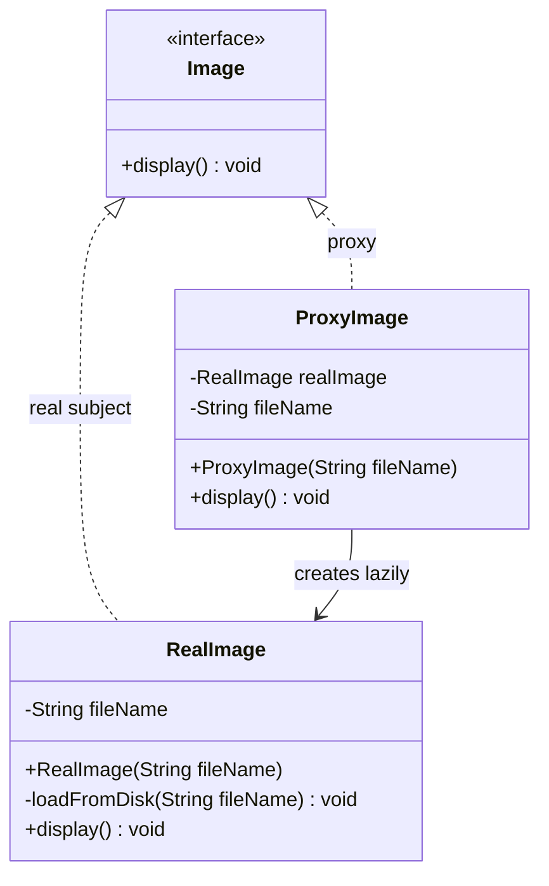
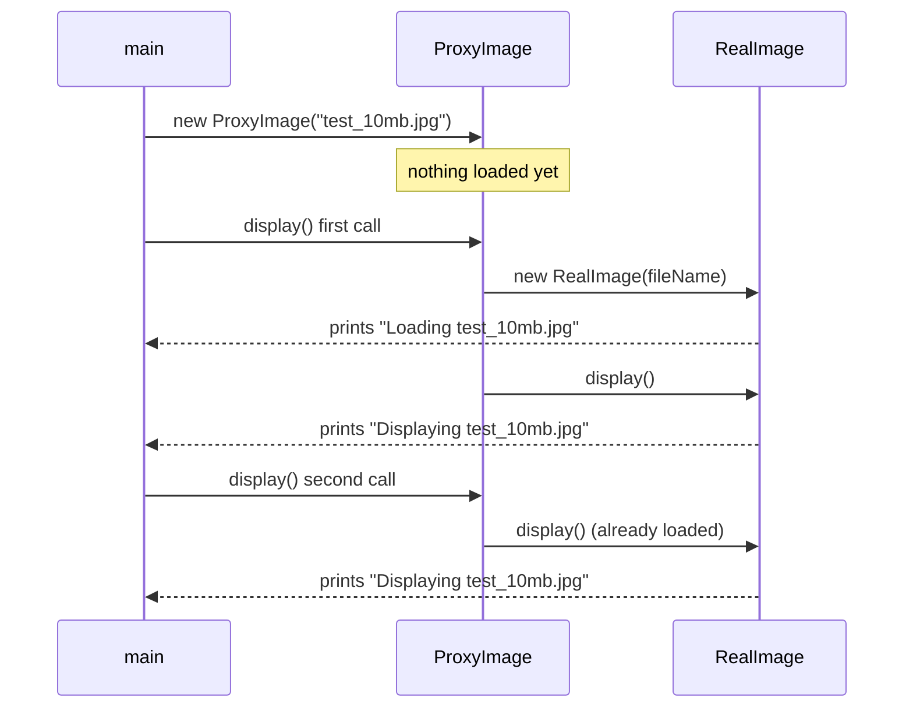
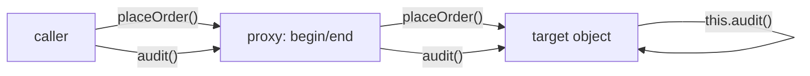

## In One Line
A Proxy is a stand-in object with the **same interface** as the real object; the client talks to the proxy, and the proxy decides **whether, when and how** the call reaches the real object — creating it lazily, checking permissions, caching, logging or sending the call over the network.

## Mental Model
Think of a **celebrity's personal assistant**. Fans, journalists and business partners all contact the assistant, not the celebrity. The assistant has the same "contact me" interface as the celebrity, but decides what actually gets through: she says "no" to unauthorised people (protection), answers common questions from notes without disturbing anyone (caching), books the celebrity only when a real meeting is needed (lazy), and keeps a log of every request (logging). Callers may never know they spoke to an assistant.

How it maps to the code:
- **"Contact me" interface** → the **Subject** interface: `Image` with `display()`.
- **The celebrity** → the **RealSubject**: `RealImage`, which is expensive to create (it "loads from disk" in its constructor).
- **The assistant** → the **Proxy**: `ProxyImage`, which also implements `Image` and holds a reference to the real object.
- **Booking the celebrity only when a meeting is really needed** → `ProxyImage.display()` creates the `RealImage` only on the **first** call, then reuses it. This is a **virtual proxy**.
- **The caller** → `main`, which holds an `Image` and has no idea whether it is real or a stand-in.

## Concept
### Intent (Gang of Four)
> "Provide a surrogate or placeholder for another object to control access to it."

Also known as **Surrogate**. Category: **structural**, object scope.

### The problem it solves
Sometimes you must put logic **between** a client and an object without changing either:
- The object is **expensive** to create (a 10 MB image, a DB connection, a heavy service) and may never be used.
- Access must be **restricted** (only admins may delete).
- The object lives **somewhere else** (another JVM, another machine).
- Calls should be **cached, logged, counted, timed, retried, or wrapped in a transaction**.

Putting that logic in the real class mixes concerns and is impossible for third-party classes; putting it in every client duplicates it. A proxy implements the same interface, so it can be dropped in wherever the real object is expected, and the control logic lives in one place.

### Participants and how the example maps to them
| Participant | Role | In the example |
|---|---|---|
| **Subject** | Common interface of proxy and real object, so they are interchangeable | `interface Image { void display(); }` |
| **RealSubject** | The object that does the real work | `RealImage` — loads in the constructor, prints `Displaying ...` |
| **Proxy** | Implements Subject, holds a reference to the RealSubject, controls access to it | `ProxyImage` — holds `fileName` and a lazily created `RealImage` |
| **Client** | Uses the Subject interface only | `ProxyPatternExample.main` with `Image image = new ProxyImage(...)` |

Note what the proxy stores: **just enough to create the real object later** (`fileName`). That is typical of a virtual proxy.

### Kinds of proxy
| Kind | What it controls | Example |
|---|---|---|
| **Virtual proxy** | *When* the real object is created — lazily, on first use | The course's `ProxyImage`; Hibernate lazy-loaded entities; Spring `@Lazy` injection points |
| **Protection proxy** | *Who* may call what | A proxy that throws `SecurityException` for non-admins; Spring Security `@PreAuthorize`; `Collections.unmodifiableList` (read-only access) |
| **Remote proxy** | *Where* the object lives — hides the network | RMI stubs; Feign clients; Spring `@HttpExchange` interface clients; gRPC stubs |
| **Caching proxy** | *Whether* the real call is needed at all | Spring `@Cacheable`; an HTTP caching layer |
| **Smart reference / logging proxy** | Extra housekeeping on every call: counting references, logging, metrics, locking | Spring AOP advice, `@Transactional`, `@Async`, `@Retryable` |
| **Synchronisation proxy** | Thread-safe access to a non-thread-safe object | `Collections.synchronizedList` (often called a decorator too) |

### Static vs dynamic proxies
A **static proxy** (like `ProxyImage`) is a hand-written class per interface. That is fine for one or two interfaces, but a logging or transaction proxy for fifty service interfaces would mean fifty near-identical classes. Java therefore generates proxies at runtime:

| | JDK dynamic proxy | Class-based proxy (CGLIB, ByteBuddy) |
|---|---|---|
| API | `java.lang.reflect.Proxy.newProxyInstance(loader, interfaces, handler)` | Library-generated **subclass** of the target class |
| Needs | One or more **interfaces** — passing a class throws `IllegalArgumentException: ... is not an interface` | A non-`final` class with non-`final` methods and an accessible constructor |
| Intercepts | Every interface method, plus `equals`, `hashCode`, `toString` (all go to `InvocationHandler.invoke`) | Every overridable method |
| Cannot intercept | Methods not in the interfaces | `final`, `private` and `static` methods |
| Result type | Implements the interfaces; `instanceof TargetClass` is **false** | Is a subclass, so `instanceof TargetClass` is true |
| Used by | Spring AOP for interface-based beans (when configured), Spring Data repositories, Feign, MyBatis mappers | Spring AOP by default in Spring Boot 2+ (`proxyTargetClass=true`), `@Configuration` classes, Hibernate entity proxies, Mockito mocks |

Every dynamic proxy routes each call through one `invoke(proxy, method, args)` method, so the cross-cutting code is written **once** and applied to any interface (`DynamicProxyDemo` in Code). Since Java 16, `InvocationHandler.invokeDefault(...)` lets a handler call an interface's `default` method.

### When to use Proxy
- Creation is expensive and often unnecessary → **virtual** proxy.
- You need access control, auditing or rate-limiting around an existing object → **protection** proxy.
- The object is remote and you want callers to see a plain local interface → **remote** proxy.
- Repeated identical calls are slow → **caching** proxy.
- The same concern (transactions, logging, metrics, retries) applies to many objects → **dynamic** proxy / AOP.

### When NOT to use it
- The real object is cheap and always used — a lazy proxy only adds a null check and a thread-safety problem.
- Callers depend on the **concrete class** (`instanceof RealImage`, `getClass()`) or on identity — a proxy is a different object.
- You need to intercept **internal** calls inside the real object — a proxy only sees calls that come *through* it (see the self-invocation trap).
- The indirection hides costs that callers must know about: a remote proxy makes a network call look like a cheap local call, which invites chatty, slow code.

### Real JDK and Spring examples
| Where | Kind |
|---|---|
| `java.lang.reflect.Proxy` + `InvocationHandler` | The JDK's dynamic proxy engine |
| RMI stubs (`java.rmi`) | Remote proxy — the client calls a local stub that marshals the call over the network |
| `Collections.unmodifiableList`, `synchronizedList` | Protection / synchronisation proxies (same interface, controlled access) |
| Spring AOP: `@Transactional`, `@Cacheable`, `@Async`, `@PreAuthorize`, `@Retryable` | Smart-reference, caching, protection proxies generated around your beans |
| Spring `@Configuration` classes | CGLIB subclass so that calling a `@Bean` method from another returns the container's singleton (`proxyBeanMethods = true`) |
| Spring scoped proxies (`proxyMode = ScopedProxyMode.TARGET_CLASS`), `@Lazy` injection | A singleton-held proxy that fetches the current request/session bean, or creates the bean on first use |
| Spring Data repositories | A JDK dynamic proxy implementing your `interface UserRepository extends JpaRepository<...>` |
| Hibernate/JPA `getReference`, lazy `@ManyToOne` | Virtual proxy subclasses of your entity (ByteBuddy); touching them outside a session throws `LazyInitializationException` |

### Proxy vs look-alikes
| Pattern | Interface | Who creates the wrapped object? | Purpose |
|---|---|---|---|
| **Proxy** | **Same** as the real subject | Usually the **proxy** (virtual) or the framework; client often unaware | **Control access**: when, who, where, whether |
| **[Decorator](lesson:a10-patterns/08-decorator)** | **Same** | The **client**, who composes the stack on purpose | **Add** responsibilities; designed to be stacked |
| **[Adapter](lesson:a10-patterns/05-adapter)** | **Different** | Client or configuration | **Convert** an interface |
| **[Facade](lesson:a10-patterns/09-facade)** | **New, simpler**, over many objects | The facade | **Simplify** a subsystem |

Structurally a proxy and a decorator can be the same code. The honest interview answer is about **intent**: a decorator adds a feature to the object's behaviour; a proxy governs access to the object and often manages its lifecycle.

## Diagram

Both classes implement `Image`, so `main` cannot tell them apart; only the proxy knows about `RealImage`, and it creates it on demand.


The expensive load happens inside the **first** `display()`, not in the proxy's constructor — and never again.


A call from inside the target (`this.audit()`) never passes through the proxy, so no advice (logging, transaction, async) is applied to it.

## Code
@example CoreJava/StructuralPatterns/ProxyPatternExample.java

**When exactly does loading happen?** A marker line between construction and the first call (the course's classes copied into one file):
```java
// Reuses the course's classes from the example above: save it in the same package as that file.
public class WhenLoaded {
    public static void main(String[] args) {
        Image image = new ProxyImage("test_10mb.jpg");
        System.out.println("proxy created");
        image.display();
        System.out.println("--");
        image.display();

        System.out.println("== without a proxy ==");
        Image eager = new RealImage("eager.jpg");
        System.out.println("real image created");
        eager.display();
    }
}
```
```output
proxy created
Loading test_10mb.jpg
Displaying test_10mb.jpg
--
Displaying test_10mb.jpg
== without a proxy ==
Loading eager.jpg
real image created
Displaying eager.jpg
```
With the proxy, "Loading" comes **after** "proxy created" — inside the first `display()`. Without it, the load happens in the constructor, before anyone asked to see the image.

**Protection and caching proxies, stacked:**
```java
import java.util.*;

public class ProxyKinds {
    interface ReportService {
        String report(String month);
        void delete(String month);
    }

    // Real subject: slow and unprotected
    static class RealReportService implements ReportService {
        public String report(String month) {
            System.out.println("  (expensive query for " + month + ")");
            return "Report[" + month + "]";
        }
        public void delete(String month) { System.out.println("  deleted " + month); }
    }

    // Protection proxy: checks permissions, then delegates
    static class SecuredReportService implements ReportService {
        private final ReportService target;
        private final String role;
        SecuredReportService(ReportService target, String role) { this.target = target; this.role = role; }
        public String report(String month) { return target.report(month); }
        public void delete(String month) {
            if (!role.equals("ADMIN")) throw new SecurityException(role + " may not delete");
            target.delete(month);
        }
    }

    // Caching proxy: answers repeated reads from memory
    static class CachingReportService implements ReportService {
        private final ReportService target;
        private final Map<String, String> cache = new HashMap<>();
        CachingReportService(ReportService target) { this.target = target; }
        public String report(String month) { return cache.computeIfAbsent(month, target::report); }
        public void delete(String month) { cache.remove(month); target.delete(month); }   // keep the cache honest
    }

    public static void main(String[] args) {
        ReportService real = new RealReportService();
        ReportService forViewer = new SecuredReportService(new CachingReportService(real), "VIEWER");

        System.out.println(forViewer.report("2024-01"));
        System.out.println(forViewer.report("2024-01"));      // served from the cache
        try {
            forViewer.delete("2024-01");
        } catch (SecurityException e) {
            System.out.println("SecurityException: " + e.getMessage());
        }
    }
}
```
```output
  (expensive query for 2024-01)
Report[2024-01]
Report[2024-01]
SecurityException: VIEWER may not delete
```
The second read never reaches the real service, and the delete is stopped before it does. This caching proxy is single-threaded; a shared one would use `ConcurrentHashMap` and an expiry policy.

**JDK dynamic proxy — one handler for any interface:**
```java
import java.lang.reflect.*;
import java.util.*;

public class DynamicProxyDemo {
    interface Greeter {
        String greet(String name);
        String farewell(String name);
    }

    static class SimpleGreeter implements Greeter {
        public String greet(String name) { return "Hello, " + name; }
        public String farewell(String name) { return "Bye, " + name; }
    }

    // One handler class can proxy ANY interface: the cross-cutting logic is written once
    static class LoggingHandler implements InvocationHandler {
        private final Object target;
        LoggingHandler(Object target) { this.target = target; }

        @Override
        public Object invoke(Object proxy, Method method, Object[] args) throws Throwable {
            System.out.println("before " + method.getName() + (args == null ? "[]" : Arrays.toString(args)));
            try {
                Object result = method.invoke(target, args);       // forward to the real subject
                System.out.println("after  " + method.getName() + " -> " + result);
                return result;
            } catch (InvocationTargetException e) {
                throw e.getCause();                              // rethrow the real exception
            }
        }
    }

    @SuppressWarnings("unchecked")
    static <T> T logged(T target, Class<T> iface) {
        return (T) Proxy.newProxyInstance(
                iface.getClassLoader(),
                new Class<?>[] { iface },
                new LoggingHandler(target));
    }

    @SuppressWarnings("unchecked")
    public static void main(String[] args) {
        Greeter g = logged(new SimpleGreeter(), Greeter.class);
        g.greet("Asha");
        g.farewell("Ravi");

        System.out.println("proxy class: " + g.getClass().getName());
        System.out.println("isProxyClass: " + Proxy.isProxyClass(g.getClass()));
        System.out.println("instanceof Greeter: " + (g instanceof Greeter)
                + ", instanceof SimpleGreeter: " + (g instanceof SimpleGreeter));

        // The same handler works for a JDK interface too
        List<String> list = logged(new ArrayList<>(), List.class);
        list.add("x");
        list.size();
        System.out.println("List proxy class: " + list.getClass().getName());

        // Only interfaces can be proxied by java.lang.reflect.Proxy
        try {
            Proxy.newProxyInstance(DynamicProxyDemo.class.getClassLoader(),
                    new Class<?>[] { SimpleGreeter.class }, new LoggingHandler(new SimpleGreeter()));
        } catch (IllegalArgumentException e) {
            System.out.println("IllegalArgumentException: " + e.getMessage());
        }
    }
}
```
```output
before greet[Asha]
after  greet -> Hello, Asha
before farewell[Ravi]
after  farewell -> Bye, Ravi
proxy class: $Proxy0
isProxyClass: true
instanceof Greeter: true, instanceof SimpleGreeter: false
before add[x]
after  add -> true
before size[]
after  size -> 1
List proxy class: jdk.proxy1.$Proxy1
IllegalArgumentException: DynamicProxyDemo$SimpleGreeter is not an interface
```
The generated classes are named `$ProxyN`. A proxy for a non-public interface is defined in that interface's package (here the unnamed package); a proxy for public interfaces goes into a dynamic module package such as `jdk.proxy1` (JDK 16+; older JDKs used `com.sun.proxy`). `args` is `null` for a no-argument method, hence the check. `method.invoke` wraps exceptions thrown by the target in `InvocationTargetException`, so the handler unwraps it.

**The self-invocation trap** — why `@Transactional` or `@Async` "does nothing" on an internal call:
```java
import java.lang.reflect.*;

public class SelfInvocation {
    interface OrderService {
        void placeOrder(String id);
        void audit(String id);          // imagine @Transactional(REQUIRES_NEW) or @Async here
    }

    static class OrderServiceImpl implements OrderService {
        public void placeOrder(String id) {
            System.out.println("  placing " + id);
            audit(id);                   // this.audit(...) - a plain call on the target, not the proxy
        }
        public void audit(String id) { System.out.println("  auditing " + id); }
    }

    public static void main(String[] args) {
        OrderService target = new OrderServiceImpl();
        OrderService proxy = (OrderService) Proxy.newProxyInstance(
                OrderService.class.getClassLoader(),
                new Class<?>[] { OrderService.class },
                (p, method, a) -> {
                    System.out.println("[proxy] begin " + method.getName());
                    Object r = method.invoke(target, a);
                    System.out.println("[proxy] end   " + method.getName());
                    return r;
                });

        System.out.println("call placeOrder through the proxy:");
        proxy.placeOrder("A-1");
        System.out.println("call audit through the proxy:");
        proxy.audit("A-2");
    }
}
```
```output
call placeOrder through the proxy:
[proxy] begin placeOrder
  placing A-1
  auditing A-1
[proxy] end   placeOrder
call audit through the proxy:
[proxy] begin audit
  auditing A-2
[proxy] end   audit
```
`audit` is advised only when it is called **through** the proxy. Inside `placeOrder`, `audit(id)` means `this.audit(id)`, and `this` is the target, not the proxy.

**A thread-safe virtual proxy** (double-checked locking):
```java
import java.util.concurrent.*;
import java.util.concurrent.atomic.AtomicInteger;

public class LazyThreadSafe {
    interface Image { void display(); }

    static final AtomicInteger LOADS = new AtomicInteger();

    static final class RealImage implements Image {
        private final String fileName;
        RealImage(String fileName) { this.fileName = fileName; LOADS.incrementAndGet(); }
        public void display() { /* draw pixels */ }
    }

    // Virtual proxy with double-checked locking: at most one load, even with many threads
    static final class ProxyImage implements Image {
        private final String fileName;
        private volatile RealImage realImage;            // volatile is essential for DCL
        ProxyImage(String fileName) { this.fileName = fileName; }

        @Override public void display() {
            RealImage img = realImage;                   // one volatile read on the fast path
            if (img == null) {
                synchronized (this) {
                    img = realImage;
                    if (img == null) realImage = img = new RealImage(fileName);
                }
            }
            img.display();
        }
    }

    public static void main(String[] args) throws Exception {
        Image image = new ProxyImage("test_10mb.jpg");
        try (ExecutorService pool = Executors.newFixedThreadPool(8)) {   // Java 19+: ExecutorService is AutoCloseable
            for (int i = 0; i < 1000; i++) pool.submit(image::display);
        }
        System.out.println("loads = " + LOADS.get());
    }
}
```
```output
loads = 1
```
1,000 concurrent `display()` calls from 8 threads, one load (the same result on every run). With the course's unsynchronised `if (realImage == null)`, two threads can both see `null` and load the image twice.

## Walkthrough
- `interface Image { void display(); }` — the **Subject**. `main` declares its variable as `Image`, which is what makes the proxy transparent.
- `class RealImage implements Image` — the **RealSubject**.
  - `private String fileName;`
  - Constructor: stores the name and immediately calls `loadFromDisk(fileName)`. So **creating** a `RealImage` is the expensive part — that is why a proxy is useful here.
  - `private void loadFromDisk(String fileName)` — simulates the expensive load by printing `Loading <fileName>`; nothing is really read.
  - `display()` — prints `Displaying <fileName>`.
- `class ProxyImage implements Image` — the **Proxy** (a virtual proxy).
  - `private RealImage realImage;` — starts as `null`; typed as the concrete `RealImage` because the proxy must know how to create it.
  - `private String fileName;` — everything needed to create the real object later.
  - Constructor — only stores `fileName`. **No loading happens here.**
  - `display()` — `if (realImage == null) realImage = new RealImage(fileName);` creates (and so loads) the real image on the first call only; then `realImage.display()` delegates.
- `main` (the **client**):
  - `Image image = new ProxyImage("test_10mb.jpg");` — cheap; prints nothing (despite the comment — see Traps).
  - First `image.display()` — `realImage` is `null`, so the `RealImage` is constructed → **`Loading test_10mb.jpg`**, then **`Displaying test_10mb.jpg`**.
  - `System.out.println("");` — prints an empty line (the blank line in the output).
  - Second `image.display()` — `realImage` already exists, so only **`Displaying test_10mb.jpg`**. The comment "Image will not be loaded from disk" is correct.
- The recorded output is exactly `Loading`, `Displaying`, blank line, `Displaying`, and it is deterministic. "Loading" appears only once however many times `display()` is called.

## Traps
> [!ERRATA] The comment on `Image image = new ProxyImage("test_10mb.jpg"); // Output: Loading test_10mb.jpg` is wrong. The proxy's constructor only stores the file name and prints nothing; `Loading test_10mb.jpg` is printed during the **first** `display()` call, when the proxy creates the `RealImage`. Because that happens immediately before the first `Displaying`, the program's output looks the same, which hides the mistake — but it contradicts the whole point of a virtual proxy. Adding a print between the two lines proves it (`WhenLoaded` in Code: "proxy created" comes before "Loading").

> [!ERRATA] The lazy initialisation `if (realImage == null) realImage = new RealImage(fileName);` is **not thread-safe**. Two threads calling `display()` at the same time can both see `null` and load the image twice, and without `volatile`/synchronisation another thread may even see a partially constructed object. For a proxy shared between threads, use double-checked locking with a `volatile` field (see `LazyThreadSafe` in Code), a `synchronized` method, or create it eagerly.

> [!ERRATA] Minor: `System.out.println("")` is simply `System.out.println()`; the `fileName` fields in both classes never change and should be `final`; `ProxyImage` is hard-wired to create a `RealImage`, so it cannot be tested with a fake — accepting a `Supplier<? extends Image>` would make the loading strategy injectable.

- **Self-invocation bypasses the proxy.** A method of the real object calling another of its own methods uses `this`, not the proxy — so in Spring, `@Transactional`, `@Async`, `@Cacheable` or `@PreAuthorize` on the inner method are silently ignored (`SelfInvocation` in Code).
- **JDK proxies need interfaces.** `Proxy.newProxyInstance` with a class throws `IllegalArgumentException: ... is not an interface`, and the proxy is *not* an instance of the target class — injecting a JDK-proxied bean by its class type fails in Spring.
- **Class-based proxies cannot intercept `final` or `private` methods**, and cannot proxy `final` classes at all. Advice on such methods silently does nothing.
- **`equals`, `hashCode` and `toString` go through the handler** for JDK proxies; `getClass()` does not — it returns `$ProxyN`. Hibernate proxies return a generated subclass from `getClass()`, which breaks `equals` implementations that compare `getClass()`.
- **Lazy proxies move failures in time.** An error loading the real object now appears on first use, maybe far from where the proxy was created — like Hibernate's `LazyInitializationException` when a lazy entity is touched after the session is closed.
- **Remote proxies hide latency.** A call that looks local may cost milliseconds and can fail with network errors; design coarse-grained remote interfaces.
- **Caching proxies must be invalidated** on writes (as `CachingReportService.delete` does), bounded in size, and thread-safe if shared.

## Tips & Tricks
- **Mnemonic — "Same face, controlled door."** Same interface as the real object, but the proxy decides when, who, where and whether calls get through.
- **The four W's of proxy kinds:** *When* (virtual), *Who* (protection), *Where* (remote), *Whether* (caching) — plus logging/smart reference for "what else happens".
- **Wrapper word test:** *control* → Proxy; *add* → Decorator; *convert* → Adapter; *simplify* → Facade.
- **Spring AOP rule of thumb:** "Annotations work only on calls that come from **outside** the bean, on non-private, non-final methods."
- **Fixing self-invocation:** move the inner method to another bean (cleanest), inject the bean's own proxy (`@Lazy` self-injection or `ObjectProvider`), use `AopContext.currentProxy()` with `exposeProxy = true`, or use AspectJ weaving.
- **In a dynamic-proxy handler, always unwrap `InvocationTargetException`** and handle `args == null` for no-arg methods.
- **Lazy + shared = synchronise.** Any lazily initialised field reachable from several threads needs `volatile` + locking, or an atomic/holder approach.

## Interview Q&A
### [Basic] What is the Proxy pattern?
Proxy is a structural pattern in which a surrogate object implements the same interface as a real object and controls access to it. The client talks to the proxy exactly as it would to the real object; the proxy decides whether and when to forward the call, and can add work around it. Typical uses are lazy creation of expensive objects, access control, remote access, caching and logging. In the course example, `ProxyImage` implements `Image` and creates the expensive `RealImage` only on the first `display()` call, reusing it afterwards.

**Follow-up:** *Why must the proxy implement the same interface?* — So it can be substituted wherever the real object is expected; the client stays unchanged and unaware.

### [Basic] What kinds of proxies are there?
**Virtual** proxies delay creating an expensive object until it is needed (the course's `ProxyImage`, Hibernate lazy entities). **Protection** proxies check permissions before forwarding (Spring Security method security). **Remote** proxies represent an object in another address space and hide the network (RMI stubs, Feign clients). **Caching** proxies return stored results for repeated calls (`@Cacheable`). **Smart-reference/logging** proxies do housekeeping on every call — reference counting, logging, metrics, transactions. A **synchronisation** proxy serialises access to a non-thread-safe object.

**Follow-up:** *Which kind is `Collections.unmodifiableList`?* — A protection proxy: same interface, but mutating operations are refused.

### [Basic] Map the participants to the course example and describe the output.
`Image` is the **Subject**, `RealImage` the **RealSubject** (it "loads from disk" in its constructor), `ProxyImage` the **Proxy** (it stores the file name and creates the `RealImage` lazily), and `main` the **client**. The first `display()` creates the real image — printing `Loading test_10mb.jpg` — and then prints `Displaying test_10mb.jpg`; after the blank line, the second `display()` prints only `Displaying test_10mb.jpg`, because the real image already exists.

**Follow-up:** *Is the comment on the proxy's constructor line right?* — No; it claims the constructor prints "Loading", but the load happens inside the first `display()`.

### [Intermediate] What is the difference between Proxy and Decorator?
Both implement the same interface as the object they wrap and forward calls, so the code can look identical. The difference is intent and who controls the wrapped object. A **Decorator** adds responsibilities; the client composes it deliberately, often stacking several, and the decorated object exists independently. A **Proxy** controls access — deciding when the real object is created, whether a caller may use it, where it lives, or whether a call is needed at all — and usually creates or manages the real subject itself, so the client often does not know it is there. An **Adapter**, in contrast, changes the interface.

**Follow-up:** *So is a logging wrapper a proxy or a decorator?* — Either description is defensible; say "a logging decorator" if the client adds it for extra behaviour, "a logging proxy" if a framework transparently interposes it (as Spring AOP does).

### [Intermediate] Is the course's `ProxyImage` thread-safe? How would you fix it?
No. `display()` performs an unsynchronised check-then-act: two threads can both see `realImage == null` and both construct a `RealImage`, loading the file twice, and because the field is not `volatile`, a thread could observe a reference to a not-fully-constructed object. Fixes: make `display()` `synchronized` (simple, but every call takes the lock); use **double-checked locking** with a `volatile` field so only the first calls synchronise; or, if laziness is not really needed, create the real object eagerly in the constructor. For a per-instance lazy value, a memoizing `Supplier` built on the same idea is a neat reusable option.

**Follow-up:** *Why is `volatile` required for double-checked locking?* — Without it, the write of the reference can be reordered before the constructor's writes, so another thread could see a non-null but partly initialised object; `volatile` creates the happens-before edge that forbids this.

### [Intermediate] How do JDK dynamic proxies work?
`Proxy.newProxyInstance(classLoader, interfaces, handler)` generates, at runtime, a class named `$ProxyN` that implements the given interfaces. Every method of those interfaces — plus `equals`, `hashCode` and `toString` — is implemented to call `handler.invoke(proxy, method, args)`. The handler typically does some work, calls `method.invoke(target, args)` on the real object, and returns the result, unwrapping `InvocationTargetException` to rethrow the target's real exception. This lets one handler implement a cross-cutting concern (logging, transactions, remoting) for any interface. Limitations: only interfaces can be proxied, the proxy is not an instance of the target class, and reflection adds a little overhead.

**Follow-up:** *How do you call a `default` method from a handler?* — Since Java 16, `InvocationHandler.invokeDefault(proxy, method, args)`.

### [Intermediate] JDK dynamic proxies vs CGLIB/ByteBuddy proxies — what is the difference, and which does Spring use?
JDK proxies implement **interfaces** and delegate to the target; class-based proxies (CGLIB, ByteBuddy) generate a **subclass** of the target class and override its methods. Class-based proxies work without interfaces and pass `instanceof TargetClass`, but cannot intercept `final`/`private`/`static` methods or proxy `final` classes. Spring AOP can use either; Spring Boot 2.0+ defaults to class-based proxies (`spring.aop.proxy-target-class=true`) even when interfaces exist, which avoids injection failures by concrete type. Spring uses its repackaged CGLIB for `@Configuration` classes; Hibernate uses ByteBuddy for lazy entity proxies; Spring Data repositories and Feign clients are JDK proxies because they start from interfaces.

**Follow-up:** *Why are Spring `@Configuration` classes proxied?* — So that one `@Bean` method calling another returns the container-managed singleton instead of creating a new object each time (`proxyBeanMethods = true`, the default).

### [Advanced] Explain the self-invocation problem in Spring AOP and how to solve it.
Spring applies `@Transactional`, `@Async`, `@Cacheable`, `@PreAuthorize` and similar annotations by wrapping the bean in a proxy. The advice runs only when a call **enters through the proxy**. When a method inside the bean calls another method of the same bean, it calls `this.method()` — and `this` is the raw target, not the proxy — so the inner method's annotation is ignored: no new transaction, no async execution, no cache. Solutions, in order of preference: move the inner method into a separate bean and inject it; inject the bean's own proxy (`@Lazy` self-injection or `ObjectProvider<MyService>`) and call through it; enable `exposeProxy` and call `((MyService) AopContext.currentProxy()).method()`; use programmatic control (`TransactionTemplate`); or switch to AspectJ compile-/load-time weaving, which modifies the class itself instead of using a proxy.

**Follow-up:** *Does the same problem affect private methods?* — Yes, even when called from outside: private (and final) methods cannot be overridden by the proxy, so annotations on them are never applied.

### [Advanced] How does Hibernate use proxies, and what goes wrong?
For lazy associations (`@ManyToOne(fetch = LAZY)`) and `EntityManager.getReference(...)`, Hibernate returns a generated **subclass** of the entity that holds only the id — a virtual proxy. The first call to a non-id getter triggers a SQL query to initialise it. Problems: touching the proxy after the persistence context is closed throws `LazyInitializationException`; the N+1 query problem when iterating lazy proxies; `getClass()` returns the proxy class, so `equals` implementations that compare `getClass()` fail — use `instanceof` or `Hibernate.getClass(...)`/`Hibernate.unproxy(...)`; and entity classes or their methods must not be `final`, or proxying fails.

**Follow-up:** *How do you avoid `LazyInitializationException`?* — Fetch what you need inside the transaction (fetch joins, entity graphs, DTO projections) rather than relying on open-session-in-view.

### [Advanced] What is a remote proxy? Give modern examples.
A remote proxy is a local object implementing an interface whose calls are serialised and sent to an object in another process or machine, with the response deserialised and returned — the caller sees an ordinary method call. Java RMI stubs are the classic example. Modern ones are generated from interfaces: OpenFeign clients (built on `java.lang.reflect.Proxy`), Spring's `@HttpExchange` interfaces via `HttpServiceProxyFactory`, and gRPC stubs. The risk is that the proxy hides latency and partial failure, so remote interfaces should be coarse-grained and callers must handle timeouts and retries.

**Follow-up:** *How does a remote proxy relate to a DTO?* — Remote calls pass serialisable data objects (DTOs) instead of live object graphs, to keep each round trip meaningful and the contract explicit.

## Quiz
### Add `System.out.println("proxy created");` right after `Image image = new ProxyImage("test_10mb.jpg");` in the original. What are the first two lines printed?
- [ ] Loading test_10mb.jpg / proxy created
- [x] proxy created / Loading test_10mb.jpg
- [ ] proxy created / Displaying test_10mb.jpg
- [ ] Loading test_10mb.jpg / Displaying test_10mb.jpg
> The proxy's constructor only stores the file name. The `RealImage` — and so the "Loading" line — is created inside the first `display()`. The original's `// Output: Loading ...` comment on the constructor line suggests the first option, which is wrong.

### How many times is `Loading test_10mb.jpg` printed if the original's `main` called `image.display()` five times?
- [x] Once
- [ ] Five times
- [ ] Never
- [ ] Twice — once at construction, once on first display
> After the first call, `realImage` is no longer `null`, so the proxy reuses the same `RealImage` and only its `display()` runs. That is the whole purpose of the virtual proxy: pay the loading cost once, and only if needed.

### Using the `SelfInvocation` classes, how many `[proxy] begin` lines does `proxy.placeOrder("A-1")` print?
- [x] 1
- [ ] 2
- [ ] 0
- [ ] It loops forever
> Only the call that enters through the proxy is intercepted. Inside `placeOrder`, `audit(id)` is `this.audit(id)` on the target object, so it runs without passing through the proxy. This is why Spring's `@Transactional`/`@Async` on an internally called method has no effect.

### What does this print, using the `DynamicProxyDemo` classes?
```java
Greeter g = logged(new SimpleGreeter(), Greeter.class);
System.out.println((g instanceof Greeter) + " " + (g instanceof SimpleGreeter));
```
- [ ] true true
- [x] true false
- [ ] false true
- [ ] ClassCastException
> A JDK dynamic proxy is a generated `$ProxyN` class that implements the listed interfaces; it is not a subclass of the target. That is why a JDK-proxied Spring bean cannot be injected by its concrete class type, and why Spring Boot defaults to class-based proxies.

### What happens when you pass a class (not an interface) to `Proxy.newProxyInstance`?
- [ ] A CGLIB subclass is generated automatically
- [ ] It compiles but the proxy ignores all calls
- [x] `IllegalArgumentException: ... is not an interface`
- [ ] Compile error
> `java.lang.reflect.Proxy` can only implement interfaces. The array is typed `Class<?>[]`, so it compiles, and the check happens at runtime. Proxying a class needs a bytecode library such as CGLIB or ByteBuddy, which generates a subclass.

### Which statement best separates Proxy from Decorator?
- [ ] A proxy changes the interface; a decorator keeps it
- [x] Both keep the interface; a proxy controls access to the real object (often creating it), a decorator adds behaviour the client composes
- [ ] A decorator can only wrap one object; a proxy can wrap many
- [ ] Proxies must be generated at runtime; decorators are written by hand
> Changing the interface is the Adapter's job. Proxy and Decorator share the same structure, so the distinction is intent: control (when/who/where/whether) versus added responsibility. Both can be hand-written or generated.

### Using `ProxyKinds`, what does this print?
```java
ReportService forViewer = new SecuredReportService(new CachingReportService(new RealReportService()), "VIEWER");
forViewer.report("2024-01");
forViewer.report("2024-01");
forViewer.report("2024-02");
```
- [ ] Nothing — reads are blocked for viewers
- [ ] Three `(expensive query ...)` lines
- [x] Two lines: `(expensive query for 2024-01)` and `(expensive query for 2024-02)`
- [ ] One line: `(expensive query for 2024-01)`
> The protection proxy lets reads through for every role. The caching proxy forwards only the first request for each month; the repeated `2024-01` is served from the map. The printed report strings are returned, not printed, here.

## Takeaways
- Proxy provides a stand-in with the same interface as the real object to control access to it: when it is created, who may call it, where it lives, whether a call is needed.
- Roles: Subject (`Image`), RealSubject (`RealImage`), Proxy (`ProxyImage`), Client (`main`); the course example is a virtual proxy that loads on the first `display()`.
- The original's comment on the constructor line is wrong — nothing loads until `display()` — and its lazy check is not thread-safe (use `volatile` + double-checked locking or `synchronized`).
- Kinds: virtual, protection, remote, caching, smart-reference/logging, synchronisation.
- JDK dynamic proxies (`Proxy.newProxyInstance` + `InvocationHandler`) need interfaces; CGLIB/ByteBuddy subclass proxies need non-final classes and methods.
- Spring AOP (`@Transactional`, `@Async`, `@Cacheable`) works through proxies, so self-invocation and private/final methods bypass the advice.
- Proxy vs Decorator: same structure, different intent (control vs add); Adapter changes the interface; Facade simplifies many objects.
