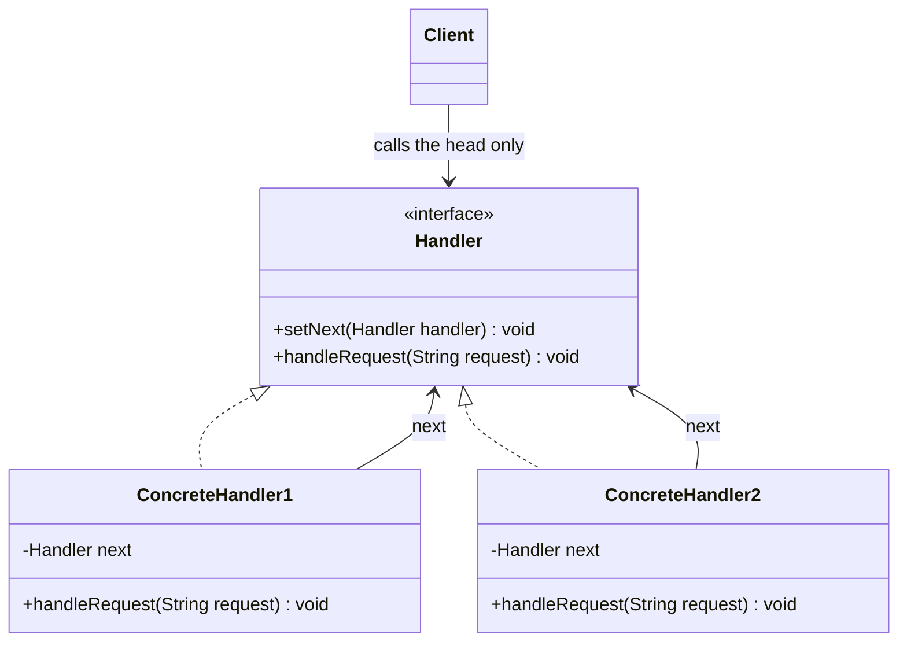
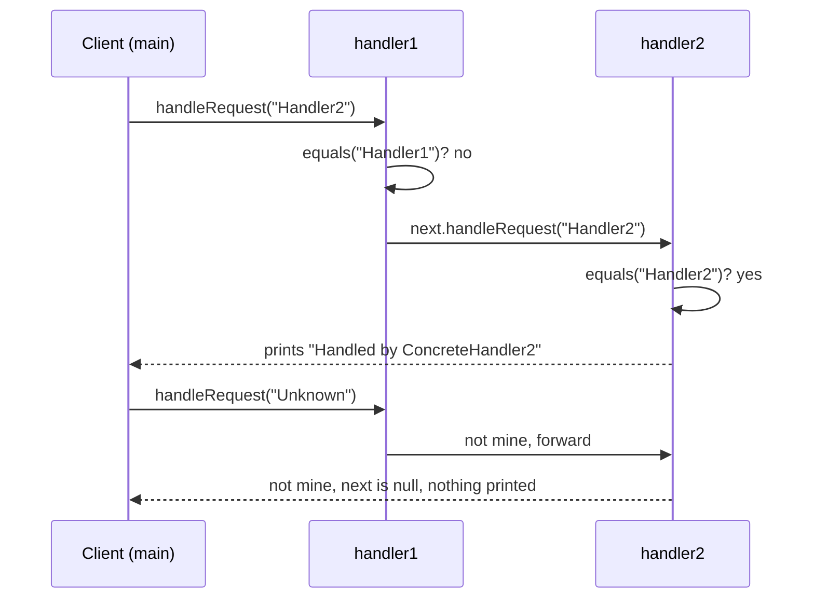

## In One Line
Chain of Responsibility sends a request along a line of handler objects; each handler either **handles it or passes it to the next one**, so the sender never needs to know which object will finally deal with the request.

## Mental Model
Think of a **customer-support hotline**. Your call first reaches a Level-1 agent. If they can answer ("reset my password"), the call ends there. If not, they transfer you to Level 2, who may transfer you to an engineer. You (the caller) dialled **one** number and never needed to know who could actually solve your problem.

How it maps to the code:
- **Your call** is the request: `handleRequest("Handler2")`.
- **Each support desk** is a handler: `ConcreteHandler1`, `ConcreteHandler2`.
- **"Transfer to the next desk"** is the successor link: the `next` field and `next.handleRequest(request)`.
- **The one number you dial** is the head of the chain: the client only ever calls `handler1`.
- **Nobody could help and the call just drops** is what happens to `"Unknown"` in the example: it falls off the end of the chain and nothing is printed.

## Concept
### Intent (Gang of Four)
> "Avoid coupling the sender of a request to its receiver by giving more than one object a chance to handle the request. Chain the receiving objects and pass the request along the chain until an object handles it."

Category: **behavioral** (it is about how objects share work and pass messages, not about how they are created or composed).

### The problem it solves
Without the pattern the *sender* has to know every possible receiver and the rules for choosing one:

```java
// sender is coupled to every approver AND to the order of the checks
if (amount <= 1_000)        teamLead.approve(amount);
else if (amount <= 10_000)  manager.approve(amount);
else if (amount <= 100_000) director.approve(amount);
else                        board.approve(amount);
```

Every new approver, or every change of order, means editing this sender. Chain of Responsibility moves **each branch into its own object** (the handler knows its own rule) and moves **the order into the wiring** (who is linked to whom). The sender just calls the first handler.

### Participants and how the example maps to them
| Participant | Role | In the example |
|---|---|---|
| **Handler** | Declares the method to handle a request and (optionally) how to link a successor | `interface Handler { setNext(Handler); handleRequest(String); }` |
| **ConcreteHandler** | Handles the requests it is responsible for; otherwise forwards to its successor | `ConcreteHandler1` (accepts `"Handler1"`), `ConcreteHandler2` (accepts `"Handler2"`) |
| **Successor link** | Reference to the next handler | `private Handler next;` in each concrete handler |
| **Client** | Builds the chain and sends requests to its **head** | `main`: `handler1.setNext(handler2)`, then always calls `handler1.handleRequest(...)` |

### How a request travels
Each handler makes one decision:
1. **"Is this mine?"** If yes, handle it and (in the classic form) **stop**.
2. If not, and there is a successor, **forward** the same request.
3. If not, and there is no successor, the request is **unhandled**. GoF lists this as a real consequence: *"receipt isn't guaranteed"*.

### Two flavours you will meet
| | Pure chain (GoF) | Pipeline / filter chain |
|---|---|---|
| Who handles | Exactly **one** handler (the first that accepts) | **Every** handler does some work, then passes it on |
| Can a handler stop the flow? | Yes — handling it *is* stopping | Yes — by not calling the next one (e.g. authentication fails) |
| Typical examples | Approval limits, `HandlerMapping` lookup, exception `catch` search | Servlet `Filter`s, Spring Security, logging handlers, interceptors |
| Example in this lesson | The original file, the approval chain | The mini `FilterChain` snippet |

Interviewers accept both as Chain of Responsibility; say which flavour you mean.

### Implementation choices (the interesting part)
1. **Where does the `next` link live?**
   - In every concrete handler, as in the example — simple but **duplicated** in each class, and a handler that forgets to forward silently breaks the chain.
   - In an **abstract base class** that owns `next` and the forwarding logic; subclasses only answer "can I handle this?" (a Template Method — see the approval chain in *Code*).
   - Outside the handlers, in a **list plus an index** (`FilterChain`): handlers don't know each other at all; the chain object calls the next one.
   - As **lambdas in a `List`**, walked with a stream (`findFirst` stops at the first handler that returns a result).
2. **Who builds the chain?** The client (example), a builder, configuration, or a DI container (Spring orders filters and interceptors with `@Order` / `Ordered`).
3. **What is the request?** A `String` (example), a typed request object, or a **Command** object. Return `void` (fire and forget), `boolean` ("handled?"), or a result/`Optional` so the caller knows the outcome.
4. **Recursion or a loop?** The linked version recurses once per handler, so a very long (or accidentally **circular**) chain ends in `StackOverflowError`. A list walked in a loop has no such limit.
5. **Guaranteed handling?** Put a **terminal/default handler** at the end (log, reject, throw), or let the base class handle "no successor".

### When to use it
- More than one object may handle a request and the handler **should be chosen at runtime**, not hard-coded in the sender.
- You want to **add, remove or reorder** processing steps without touching the sender (open/closed principle).
- You are building a **processing pipeline**: validation → authentication → logging → business logic.

### When not to use it
- There is exactly one obvious receiver — just call it.
- Every request **must** be handled and silently dropping one would be a bug — you then need a terminal handler anyway, and maybe a plain lookup (`Map<Type, Handler>`) is simpler and O(1).
- The order of handlers is hard to see and debug. Long chains make stack traces deep and "who handled this?" hard to answer — log it.

### Real JDK and Spring examples
| Where | How it is a chain |
|---|---|
| **Exception propagation** (`throw`) | The exception travels up the call stack; each frame's `catch` clauses are checked; the first matching `catch` handles it. Nobody catches it → the thread's `UncaughtExceptionHandler` (the "end of chain"). |
| **`ClassLoader.loadClass`** | Parent-delegation: a loader first asks its parent, and only if the parent cannot find the class does it try `findClass` itself. |
| **`java.util.logging.Logger`** | A `LogRecord` is published to the logger's handlers, then to its **parent** logger's handlers, up to the root — unless `setUseParentHandlers(false)` stops it. |
| **Jakarta Servlet `Filter` / `FilterChain`** | Each filter does work and calls `chain.doFilter(req, res)`; not calling it stops the request (e.g. returning 401). |
| **Spring Security** | `FilterChainProxy` runs a `SecurityFilterChain` — an ordered list of filters (authentication, exception translation, authorization...). |
| **Spring MVC `DispatcherServlet`** | Asks each `HandlerMapping` in order until one returns a handler; asks each `HandlerExceptionResolver` in order until one resolves the exception; `HandlerInterceptor.preHandle` returning `false` stops the chain. |
| **Spring AOP** | `MethodInvocation.proceed()` walks a list of `MethodInterceptor`s, each deciding whether and when to call `proceed()`. |

(Outside Spring: Netty's `ChannelPipeline` and OkHttp interceptors are the same idea.)

### Look-alike patterns
| Pattern | Looks similar because | The difference |
|---|---|---|
| **Decorator** | Also a linked line of objects with the same interface, each holding "the next one" | A decorator **always** delegates and **adds** behaviour; all decorators run. A chain handler may **stop** the request, and usually only one handler handles it. |
| **Composite** | GoF often uses a component's **parent** as the successor (a click bubbles up a widget tree) | Composite is a *structure* (part-whole tree); CoR is a *behaviour* (pass a request along). They are often combined. |
| **Observer** | A request/event reaches several objects | Observer **broadcasts to all** subscribers; a pure chain stops at the **first** handler that accepts. |
| **Strategy** | Different objects do the work differently | With Strategy the **client picks** one algorithm up front; in a chain the **handlers decide** themselves at runtime. |
| **Command** | Both turn requests into objects | Command packages *what to do*; CoR decides *who does it*. A chain often passes command objects along. |
| **Mediator** | Both decouple sender from receiver | Mediator is a **hub** that knows everyone and routes; a chain is a **line** where each handler only knows the next one. |

## Diagram

Each handler points to the next one through the `Handler` **interface**, not a concrete class — that is why any handler can be linked to any other.


The client always talks to the head; the request walks down until someone accepts it — or silently falls off the end.

## Code
@example CoreJava/BehavioralPattern/ChainOfResponsibilityPatternExample.java

**A production-style chain.** The successor link and forwarding logic live once in an abstract base class, `linkWith` returns its argument so the chain reads left to right, and a request nobody can handle is reported instead of dropped:
```java
public class ApprovalChain {
    public static void main(String[] args) {
        Approver chain = new TeamLead();
        chain.linkWith(new Manager())
             .linkWith(new Director());     // linkWith returns its argument, so links read left to right

        for (int amount : new int[]{500, 7_000, 60_000, 250_000}) {
            chain.approve(amount);
        }
    }
}

abstract class Approver {
    private Approver next;

    public Approver linkWith(Approver next) {
        this.next = next;
        return next;
    }

    // the forwarding logic lives in ONE place (a template method)
    public final void approve(int amount) {
        if (canApprove(amount)) {
            System.out.println(getClass().getSimpleName() + " approved " + amount);
        } else if (next != null) {
            next.approve(amount);
        } else {
            System.out.println("No one can approve " + amount + " -> escalate to the board");
        }
    }

    protected abstract boolean canApprove(int amount);
}

class TeamLead extends Approver { protected boolean canApprove(int a) { return a <= 1_000; } }
class Manager  extends Approver { protected boolean canApprove(int a) { return a <= 10_000; } }
class Director extends Approver { protected boolean canApprove(int a) { return a <= 100_000; } }
```
```output
TeamLead approved 500
Manager approved 7000
Director approved 60000
No one can approve 250000 -> escalate to the board
```

**A functional chain (Java 9+).** Handlers are lambdas returning `Optional`; the stream is lazy, so `findFirst()` stops asking as soon as one handler answers:
```java
import java.util.List;
import java.util.Optional;
import java.util.function.Function;

public class LambdaChain {
    public static void main(String[] args) {
        List<Function<String, Optional<String>>> chain = List.of(
            r -> r.equals("Handler1") ? Optional.of("Handled by H1") : Optional.empty(),
            r -> r.equals("Handler2") ? Optional.of("Handled by H2") : Optional.empty()
        );

        for (String request : List.of("Handler1", "Handler2", "Unknown")) {
            String result = chain.stream()
                    .map(h -> h.apply(request))     // lazily ask each handler in order
                    .flatMap(Optional::stream)     // skip handlers that said "not mine"
                    .findFirst()                   // stop at the first one that handled it
                    .orElse("Unhandled: " + request);
            System.out.println(result);
        }
    }
}
```
```output
Handled by H1
Handled by H2
Unhandled: Unknown
```

**The pipeline flavour (how servlet filters work).** Handlers don't know each other; a `FilterChain` object holds the list and an index. Code after `chain.doFilter(...)` runs on the way back, like layers of an onion:
```java
import java.util.List;

public class MiniFilterChain {
    public static void main(String[] args) {
        List<Filter> filters = List.of(
            (req, chain) -> {
                if (!req.startsWith("token:")) { System.out.println("auth: 401, chain stops"); return; }
                System.out.println("auth: ok");
                chain.doFilter(req);
            },
            (req, chain) -> {
                System.out.println("log: before");
                chain.doFilter(req);              // pass the request on...
                System.out.println("log: after"); // ...and run again on the way back
            }
        );
        new FilterChain(filters).doFilter("token:abc /orders");
        System.out.println("---");
        new FilterChain(filters).doFilter("/orders");
    }
}

interface Filter { void doFilter(String request, FilterChain chain); }

class FilterChain {
    private final List<Filter> filters;
    private int pos = 0;
    FilterChain(List<Filter> filters) { this.filters = filters; }

    void doFilter(String request) {
        if (pos < filters.size()) {
            filters.get(pos++).doFilter(request, this);
        } else {
            System.out.println("servlet handles " + request);   // end of the chain
        }
    }
}
```
```output
auth: ok
log: before
servlet handles token:abc /orders
log: after
---
auth: 401, chain stops
```

## Walkthrough
**The `Handler` interface (lines 3–7).**
- `void setNext(Handler handler)` — lets the client link a successor. Note the parameter type is the *interface*, so a handler can be linked to **any** kind of handler.
- `void handleRequest(String request)` — the single operation every handler supports. The request is a plain `String`; in real code it would be a request object.

**`ConcreteHandler1` (lines 9–28).**
- `private Handler next;` — the successor link. It starts as `null`, which means "I am the last in the chain".
- `setNext` simply stores the reference.
- `handleRequest`: `if (request.equals("Handler1"))` — this handler's own rule. If it matches, it prints `Handled by ConcreteHandler1` and **does not forward** — handling ends the journey.
- `else { if (next != null) next.handleRequest(request); }` — not mine: forward the **same** request. The `null` check is what makes the last handler safe; without it the last handler would throw `NullPointerException`.

**`ConcreteHandler2` (lines 30–49).** Identical shape, different rule (`"Handler2"`). Notice the copy-paste: the `next` field, `setNext`, and the forwarding `else` block are duplicated — the reason real code moves them into an abstract base class.

**The client, `main` (lines 52–63).**
- `Handler handler1 = new ConcreteHandler1(); Handler handler2 = new ConcreteHandler2();` — both are declared as `Handler`, so the client depends only on the abstraction.
- `handler1.setNext(handler2);` — builds the chain `handler1 → handler2`. `handler2.next` stays `null`, so `handler2` is the tail.
- `handler1.handleRequest("Handler1")` — `handler1` accepts it: prints **`Handled by ConcreteHandler1`**. `handler2` is never asked.
- `handler1.handleRequest("Handler2")` — `handler1` rejects it and forwards; `handler2` accepts: prints **`Handled by ConcreteHandler2`**.
- `handler1.handleRequest("Unknown")` — `handler1` forwards, `handler2` rejects it, and `handler2.next` is `null`, so the request is dropped. **It prints nothing**, which is why the recorded output has only two lines. The line has no `// Output:` comment for the same reason.

The output is deterministic — everything runs on one thread in a fixed order.

## Traps
> [!ERRATA] The request `"Unknown"` is **silently dropped** — no output, no exception, no return value, and the caller cannot tell that nothing happened. The example is fine as a demo, but in real code an unhandled request is usually a bug. Add a terminal handler at the end (reject/log/throw), handle "no successor" in a base class, or return a result (`boolean` / `Optional`) so the caller knows.

> [!ERRATA] `request.equals("Handler1")` throws `NullPointerException` when `request` is `null` (verified: *Cannot invoke "String.equals(Object)"...*). Write the constant first — `"Handler1".equals(request)` — or validate the request once, at the head of the chain.

- **Duplicated forwarding logic.** Every concrete handler repeats `next`, `setNext` and the `else` block. A new handler that forgets the `else next.handleRequest(...)` silently becomes a dead end for every request after it. Put forwarding in one abstract base class.
- **Order matters.** The first handler that accepts wins. If a broad handler (say "anything under 100,000") comes before a narrow one ("under 1,000"), the narrow one is never reached. Order handlers from specific to general.
- **The chain is one-way.** Calling `handler2.handleRequest("Handler1")` prints nothing: `handler2` has no successor and never looks backwards. Always send requests to the head.
- **Cycles.** `handler2.setNext(handler1)` on top of `handler1.setNext(handler2)` creates a loop; an unhandled request then bounces forever and ends in `StackOverflowError` (verified).
- **Deep chains = deep stacks.** Each forward is a nested call. For hundreds of handlers, use a list and a loop (or the `FilterChain` style) instead of recursion.
- **Mutable, shared chains.** `setNext` can rewire a chain while other threads are using it. Build the chain once, then treat it as immutable (final fields set in constructors, or an immutable `List`).

> [!WARNING] In a pipeline, **forgetting `chain.doFilter(...)`** in a servlet or Spring Security filter means the request never reaches your controller — the response is just empty. It is the most common filter bug.

## Tips & Tricks
- **Mnemonic — "Mine? Handle. Not mine? Hand it on."** That sentence *is* the body of every handler.
- **"One number to call"**: the client talks only to the head. If your client calls middle handlers directly, you have lost the point of the pattern.
- **Always ask "what happens if nobody handles it?"** Interviewers love this question. Answer: terminal handler, default in the base class, or return an `Optional`/status.
- **Specific before general** when ordering handlers.
- **Refactor signal:** a long `if / else if` chain where each branch has its own rule and its own action — and the branches keep changing — is a candidate for a chain (or for a `Map` lookup if the rule is a simple key).
- **Pipeline trick:** code *before* `next` runs on the way in, code *after* it runs on the way out (first in, last out). That is how logging/timing filters measure a whole request.
- In Spring, you rarely write the linking yourself: declare handler beans, give them `@Order`, inject `List<Handler>` and loop — Spring gives you the list already sorted.

## Interview Q&A
### [Basic] What is the Chain of Responsibility pattern and what problem does it solve?
It is a behavioral pattern that decouples the **sender** of a request from its **receiver** by giving several objects a chance to handle it. The handlers are linked in a chain; each one either handles the request or passes it to its successor. The sender calls only the head of the chain and does not know which object will finally handle it.

It replaces a sender-side `if/else` cascade that knows every receiver. Each rule lives in its own handler, and the order lives in the wiring, so you can add, remove or reorder handlers without touching the sender — open/closed principle.

**Follow-up:** *Is it guaranteed that a request is handled?* — No. GoF lists "receipt isn't guaranteed" as a consequence. You add a terminal/default handler or return a result so the caller can react.

### [Basic] Who are the participants? Map them to a simple example.
- **Handler** — the interface with `handleRequest` (and often `setNext`).
- **ConcreteHandler** — handles what it is responsible for, forwards the rest to its **successor**.
- **Client** — builds the chain and sends requests to the head.

In the course example, `Handler` is the interface, `ConcreteHandler1`/`ConcreteHandler2` are the concrete handlers with a `next` field, and `main` is the client that links `handler1 → handler2` and always calls `handler1`.

**Follow-up:** *Why is `next` typed as `Handler` and not `ConcreteHandler2`?* — So any handler can be linked to any other; the chain depends only on the abstraction and can be rewired freely.

### [Intermediate] What happens to a request that no handler can process, and how would you handle it in production code?
In a naive chain it reaches the tail, `next` is `null`, and it is silently dropped — the course example does exactly this for `"Unknown"`. Options:
1. A **terminal handler** at the end that rejects, logs, or throws (`UnsupportedRequestException`).
2. A **base class** whose forwarding code handles "no successor" in one place.
3. **Return a result** — `boolean handled`, a response object, or `Optional<Response>` — so the caller decides.

```java
Optional<String> result = chain.stream().map(h -> h.apply(req))
        .flatMap(Optional::stream).findFirst();
```
**Follow-up:** *Which would you choose for an HTTP API?* — A terminal handler that produces an explicit error response (for example 404 or 400), so every request gets an answer.

### [Intermediate] What is the difference between a "pure" chain and a filter/pipeline chain?
In the **pure** (GoF) chain, exactly one handler handles the request — the first that accepts it — and the journey stops there. In a **pipeline** (servlet filters, Spring Security, interceptors), every handler does some work (logging, authentication, compression) and passes the request on; any handler can still stop it by not calling the next one. Pipelines usually also run code **on the way back** (after `chain.doFilter(...)` returns), so they wrap the target like onion layers.

**Follow-up:** *In what order does the "after" code run?* — Reverse order: the first filter's "after" code runs last (it is a call stack).

### [Intermediate] Where do you see Chain of Responsibility in the JDK and in Spring?
- **Exception handling**: an exception propagates up the call stack until the first matching `catch`; uncaught → `UncaughtExceptionHandler`.
- **ClassLoader parent delegation**: `loadClass` asks the parent first, then tries itself.
- **`java.util.logging`**: records go to a logger's handlers, then to its parent's, unless `useParentHandlers` is false.
- **Servlet `Filter`/`FilterChain`** and **Spring Security's `SecurityFilterChain`**.
- **Spring MVC `DispatcherServlet`**: first `HandlerMapping` that returns a handler wins; first `HandlerExceptionResolver` that resolves the exception wins; `HandlerInterceptor.preHandle` returning `false` stops processing.
- **Spring AOP**: `MethodInvocation.proceed()` walks a list of interceptors.

**Follow-up:** *Which of these are pure chains and which are pipelines?* — Exception `catch` search, `HandlerMapping` lookup and exception resolvers are pure (first match wins); servlet/security filters, logging handlers and AOP interceptors are pipelines.

### [Intermediate] How is Chain of Responsibility different from Decorator? They look the same.
Structurally they are nearly identical: objects with the same interface, each holding a reference to the next. The difference is **intent and control flow**:
- A **decorator always delegates** to the wrapped object and adds behaviour before/after it; every decorator in the stack runs, and the client usually treats the result as one enhanced object (`new BufferedReader(new FileReader(f))`).
- A **chain handler decides** whether to handle the request or pass it on, and may **stop** the flow; usually only one handler actually handles it.

**Follow-up:** *Where do they blur?* — Servlet filters: each one wraps the rest of the chain like a decorator, but can stop the request like a chain. That is why they are described as a "pipeline" variant of CoR (also called Intercepting Filter).

### [Advanced] The example duplicates the `next` field in every handler. How would you design it better?
Move the successor link and the forwarding into an **abstract base class** and leave only the decision to subclasses (a Template Method):
```java
abstract class Approver {
    private Approver next;
    public Approver linkWith(Approver next) { this.next = next; return next; }
    public final void approve(int amount) {
        if (canApprove(amount)) System.out.println(getClass().getSimpleName() + " approved " + amount);
        else if (next != null)  next.approve(amount);
        else                    System.out.println("No one can approve " + amount);
    }
    protected abstract boolean canApprove(int amount);
}
```
`approve` is `final`, so no subclass can forget to forward. Alternatives: an external `List<Handler>` walked in a loop (no recursion, easy reordering, handlers don't know each other), or a list of lambdas with `stream().map(...).flatMap(Optional::stream).findFirst()`.

**Follow-up:** *Why return `next` from `linkWith`?* — So wiring reads fluently: `a.linkWith(b).linkWith(c)` builds `a → b → c`. Returning `this` instead would link everything to `a`.

### [Advanced] What are the downsides and risks of this pattern?
- **No guaranteed handling** — requests can be dropped silently.
- **Hidden flow** — the path a request takes depends on runtime wiring; debugging "who handled it?" needs logging.
- **Order sensitivity** — a general handler placed early shadows specific ones.
- **Performance** — a request may visit many handlers (O(n)); a `Map` lookup is O(1) when the choice is a simple key.
- **Stack depth and cycles** — recursive forwarding on a long or circular chain ends in `StackOverflowError`.
- **Thread safety** — rewiring a chain while it is being used is a data race; build it once and keep it immutable.

**Follow-up:** *How do you unit-test a chain?* — Test each handler in isolation with a mock successor (verify it forwards what it does not handle), then one integration test for the assembled order.

### [Advanced] How does exception handling in Java behave like a Chain of Responsibility?
When code throws, the JVM looks for a handler in the current method's exception table (the `catch` clauses, in order). If none matches, the frame is popped and the search continues in the caller — the next link in the chain — and so on up the stack. The first `catch` whose type matches handles it and the search stops (pure-chain behaviour). If the stack is exhausted, the thread's `UncaughtExceptionHandler` (or the default one that prints the stack trace) acts as the terminal handler. `finally` blocks run as frames unwind, a bit like the "after" code in a pipeline.

**Follow-up:** *Why must `catch (IOException)` come before `catch (Exception)`?* — Same rule as ordering handlers "specific before general": the broader catch would shadow the narrower one, and Java makes it a compile error (*exception has already been caught*).

## Quiz
### What does the third call in the original, `handler1.handleRequest("Unknown")`, print?
- [ ] `Handled by ConcreteHandler2`
- [ ] It throws `NullPointerException` because `next` is `null`
- [x] Nothing — the request falls off the end of the chain
- [ ] `Unknown`
> `handler1` forwards it, `handler2` rejects it, and `handler2.next` is `null`, so the `if (next != null)` check quietly skips forwarding. No NPE, because of that check — and no output, which is why the recorded output has only two lines.

### What does this print?
```java
class Handler {
    final String name, accepts; Handler next;
    Handler(String name, String accepts) { this.name = name; this.accepts = accepts; }
    void handle(String req) {
        if (req.equals(accepts)) System.out.print(name);
        else if (next != null) next.handle(req);
        else System.out.print("-");
    }
}
// in main:
Handler a = new Handler("A", "x");
Handler b = new Handler("B", "y");
Handler c = new Handler("C", "x");
a.next = b; b.next = c;
a.handle("x"); a.handle("y"); a.handle("z");
```
- [ ] `ACB-`
- [x] `AB-`
- [ ] `AB`
- [ ] `ABC-`
> `"x"` is accepted by `A` first, so `C` (which also accepts `"x"`) is never asked — first match wins. `"y"` goes A → B. `"z"` reaches the tail `C`, which has no successor, so it prints `-`.

### What does this pipeline print?
```java
interface Step { void run(Runnable next); }

Step outer = next -> { System.out.print("1 "); next.run(); System.out.print("2 "); };
Step inner = next -> { System.out.print("3 "); next.run(); System.out.print("4 "); };
Runnable target = () -> System.out.print("T ");
outer.run(() -> inner.run(target));
```
- [ ] `1 2 3 4 T`
- [ ] `1 3 T 2 4`
- [x] `1 3 T 4 2`
- [ ] `T 1 3 4 2`
> Code before `next.run()` runs on the way in (`1`, then `3`), then the target (`T`), then the "after" code unwinds in reverse order (`4`, then `2`) — it is a call stack. `1 3 T 2 4` is the tempting wrong answer; `outer` cannot finish before `inner` returns.

### Spot the bug: an unknown request crashes the program.
```java
Handler handler1 = new ConcreteHandler1();
Handler handler2 = new ConcreteHandler2();
handler1.setNext(handler2);
handler2.setNext(handler1);
handler1.handleRequest("Unknown");
```
- [ ] `handleRequest` must be `synchronized`
- [x] The chain is circular, so an unhandled request bounces between the two handlers until `StackOverflowError`
- [ ] `setNext` cannot be called twice
- [ ] `ConcreteHandler2` cannot be the successor of `ConcreteHandler1`
> Each forward is a nested method call, and with a cycle nobody ever has `next == null`. Requests that *are* handled still work, which makes this bug easy to miss in testing. Chains must be acyclic, ending in a tail or a terminal handler.

### Which statement best separates Chain of Responsibility from Decorator?
- [ ] Decorator uses an interface; Chain of Responsibility uses an abstract class
- [ ] Only Chain of Responsibility holds a reference to the next object
- [x] A decorator always delegates and adds behaviour; a chain handler may handle the request and stop it from going further
- [ ] Decorator is creational; Chain of Responsibility is behavioral
> Both hold a reference to "the next object" and both can use interfaces or abstract classes. The difference is control flow: every decorator runs, while a chain handler can end the journey. Decorator is a **structural** pattern, not creational.

### Which of these is NOT an example of Chain of Responsibility?
- [ ] An exception propagating up the call stack to the first matching `catch`
- [ ] `ClassLoader.loadClass` delegating to its parent before trying itself
- [ ] A servlet `Filter` calling `chain.doFilter(request, response)`
- [x] `Collections.sort(list, comparator)` using the comparator you pass in
> Passing a `Comparator` is **Strategy**: the client picks one algorithm up front and it always runs. The other three pass a request along a line of candidates until one handles it (or all process it, for filters).

### What does the original example print if `main` calls `handler2.handleRequest("Handler1")`?
- [ ] `Handled by ConcreteHandler1`
- [x] Nothing
- [ ] `Handled by ConcreteHandler2`
- [ ] It throws `NullPointerException`
> The chain only goes forward: `handler1 → handler2`. `handler2` rejects `"Handler1"`, its `next` is `null`, so the request is dropped. Handlers never look backwards — always send requests to the head.

## Takeaways
- Chain of Responsibility links handler objects so a request is passed along until one handles it; the sender only knows the head of the chain.
- Each handler answers "is this mine?" — handle it (and stop), or forward it to its successor; the order of handlers is part of the design (specific before general).
- Receipt is not guaranteed: add a terminal/default handler or return a result, or unhandled requests vanish silently (as `"Unknown"` does in the example).
- Put the successor link and forwarding in one abstract base class (or an external list) instead of duplicating it in every handler.
- Two flavours: pure chain (first match wins, e.g. `catch` search, `HandlerMapping`) and pipeline (every handler works and passes on, e.g. servlet filters, Spring Security).
- Versus Decorator: decorators always delegate and add behaviour; chain handlers may stop the request. Versus Observer: broadcast to all vs first taker.
