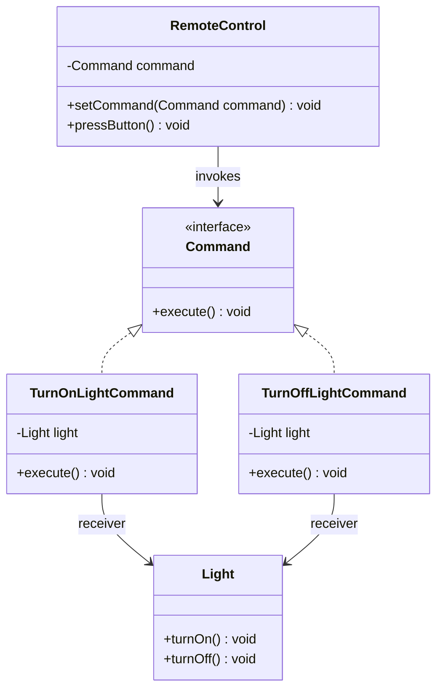
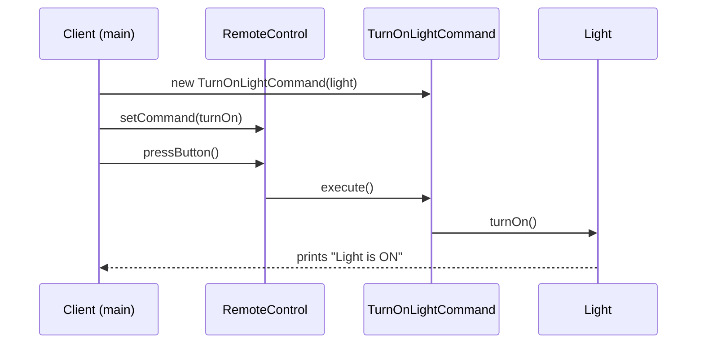
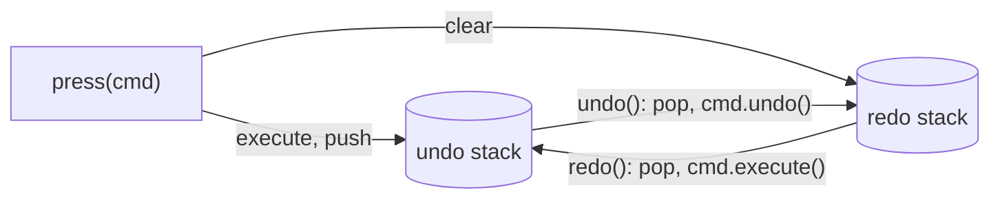

## In One Line
The Command pattern turns a request ("turn the light on") into an **object** with an `execute()` method, so the code that triggers an action (a button) is decoupled from the code that performs it (the light) — and the request can be stored, passed around, queued, logged or undone.

## Mental Model
Think of a **restaurant order slip**. You (the client) tell the waiter what you want; the waiter writes it on a slip and pins it on the kitchen rail. The waiter does not know how to cook. The cook does not care which waiter took the order. The slip can wait in a queue, be cancelled, or be reprinted.

How it maps to the code:
- **The order slip** is the command object: `new TurnOnLightCommand(light)`.
- **"Cook this dish"** written on the slip is `execute()`, which calls `light.turnOn()`.
- **The cook** is the receiver: `Light` — the object that really knows how to do the work.
- **The waiter** is the invoker: `RemoteControl` — it just calls `command.execute()` when the button is pressed, without knowing what the command does.
- **You, choosing the dish** is the client: `main` creates the commands and hands them to the remote.

## Concept
### Intent (Gang of Four)
> "Encapsulate a request as an object, thereby letting you parameterize clients with different requests, queue or log requests, and support undoable operations."

Also known as **Action** or **Transaction**. Category: behavioral. GoF also describes commands as *"an object-oriented replacement for callbacks"* — which is exactly what a Java lambda passed as a `Runnable` is.

### The problem it solves
A button, menu item, scheduler or thread pool must trigger *some* action, but it cannot know every possible action in advance. If the invoker calls receivers directly, it is hard-wired:

```java
class RemoteControl {
    void pressButton(String what) {
        if (what.equals("lightOn")) light.turnOn();        // invoker knows the Light,
        else if (what.equals("fanOn")) fan.start();        // the Fan, the TV...
    }
}
```

With Command, the invoker depends only on a tiny interface, `Command.execute()`. Any action — even one invented next year — can be plugged in. And because the request is now an *object*, you get extra powers for free: keep it in a list (history, undo), put it in a queue (run later, on another thread), write it to a log (replay after a crash), or combine several (macro).

### Participants and how the example maps to them
| Participant | Role | In the example |
|---|---|---|
| **Command** | Interface declaring `execute()` (often `undo()` too) | `interface Command { void execute(); }` |
| **ConcreteCommand** | Binds a receiver to an action; `execute()` calls the receiver | `TurnOnLightCommand`, `TurnOffLightCommand` |
| **Receiver** | Knows how to actually do the work | `Light` with `turnOn()` / `turnOff()` |
| **Invoker** | Asks the command to run; does not know the receiver | `RemoteControl` with `setCommand` / `pressButton` |
| **Client** | Creates receivers and commands, configures the invoker | `main` |

Key point: the **invoker never talks to the receiver**. `RemoteControl` has no idea a `Light` exists.

### What you can do once a request is an object
| Power | How | Example |
|---|---|---|
| **Parameterize** | Give the invoker a different command | One remote button, any action |
| **Queue / schedule** | Store commands, run them later or on another thread | `ExecutorService.submit(runnable)`, job queues |
| **Log / replay** | Persist commands; re-run them after a crash | Database redo logs, event/command sourcing |
| **Undo / redo** | Add `undo()`; keep executed commands on a stack | Text editors, drawing apps |
| **Macro** | A command that runs a list of commands | "Good night" = all lights off + lock doors |
| **Transaction** | Run a macro; if one step fails, undo the executed ones in reverse | Multi-step workflows |

### Undo and redo — the classic interview extension
1. Add `void undo()` to `Command`.
2. A command must **remember what it needs to undo** — typically the receiver's previous state, captured **inside `execute()`** (not in the constructor — the state may change between creating and running the command).
3. The invoker keeps two stacks: after `execute`, push onto **undo**; `undo()` pops from undo, calls `undo()`, pushes onto **redo**; `redo()` does the reverse. **Any new command clears the redo stack** (the old "future" no longer makes sense).
4. Use `ArrayDeque` as the stack (`push`/`pop`), not the legacy synchronized `Stack` class.

Undo by **inverse operation** (turnOn ↔ turnOff) is cheap but only works when an inverse exists. When it doesn't (e.g. "apply blur filter"), the command stores a **snapshot** of the state before it ran — that snapshot is a [Memento](lesson:a10-patterns/17-memento).

### Commands in modern Java: lambdas
`Command` has exactly one abstract method, so it is a **functional interface**. A lambda or method reference *is* a command object — no class per action needed:
```java
remote.setCommand(light::turnOn);                       // replaces TurnOnLightCommand
remote.setCommand(() -> System.out.println("Hello"));
```
Keep full classes when a command carries **state** (undo data, parameters to serialize) or several methods (`execute` + `undo` + `description`). The JDK already has generic command interfaces: `Runnable` (no result) and `Callable<V>` (returns a result, may throw).

### When to use it
- An invoker (button, menu, scheduler, message consumer) must trigger actions it cannot know in advance.
- You need **undo/redo**, **history**, **queuing**, **scheduling**, **retry**, or **logging/replay** of operations.
- You want to build complex operations (macros, transactions) from simple ones.

### When not to use it
- A direct method call does the job and you need none of the "powers" above — a command class per action is pure ceremony.
- For simple one-off callbacks, a lambda typed as `Runnable`/`Consumer` is the command; do not create a class hierarchy for it.

### Real JDK and Spring examples
| Where | Command | Invoker |
|---|---|---|
| `java.lang.Runnable`, `java.util.concurrent.Callable<V>` | The task object (`run()` / `call()`) | `Thread`, `ExecutorService.execute/submit`, `CompletableFuture.runAsync` |
| `java.util.TimerTask` (implements `Runnable`) | A scheduled command | `java.util.Timer`, also `ScheduledExecutorService` |
| `javax.swing.Action` / `AbstractAction` | One action object shared by a menu item and a toolbar button (with name, icon, enabled flag) | Swing buttons and menus |
| `javax.swing.undo.UndoableEdit` + `UndoManager` | An undoable command (`undo()`, `redo()`) | `UndoManager` keeps the history |
| Spring `TransactionTemplate.execute(TransactionCallback)` | Your callback (the work) | The template runs it inside a transaction |
| Spring `JdbcTemplate.execute(ConnectionCallback)` | Your callback | The template supplies the connection and handles errors |
| Spring `TaskExecutor` / `@Async` | A `Runnable` wrapping the method call | The executor's thread pool |

In CQRS architectures, "commands" (`PlaceOrderCommand`) are the same idea at system scale: an immutable request object sent to a handler.

### Look-alike patterns
| Pattern | Looks similar because | The difference |
|---|---|---|
| **Strategy** | Both put behaviour in an object with one method | Strategy = **how** to do a task (interchangeable algorithms the context calls as part of its work, e.g. a `Comparator`). Command = **what** to do (a self-contained request with its receiver and arguments, which can be stored, queued, undone). |
| **Memento** | Both appear in undo | Command undoes by running an **inverse** operation; Memento undoes by restoring a **snapshot**. A command may *hold* a memento. |
| **Chain of Responsibility** | Both decouple sender and receiver | Command decides *what* is requested; the chain decides *who* handles it. Chains often pass command objects along. |
| **Observer** | Listeners are callback objects too | Observer is about *notifying many* dependents of a change; a command is *one* request run on demand. |
| **Composite** | Macro commands | A macro command *is* a Composite of commands. |

## Diagram

The invoker (`RemoteControl`) points only at the `Command` interface; only the concrete commands know the receiver (`Light`).


Creating the command (client) and running it (invoker) are separate steps — that gap is what makes queuing, scheduling and undo possible.


Undo/redo is two stacks moving the same command objects back and forth; a new command wipes the redo stack.

## Code
@example CoreJava/BehavioralPattern/CommandPatternExample.java

**Adding undo and redo.** The command captures the previous level inside `execute()`, and the invoker keeps two `ArrayDeque` stacks:
```java
import java.util.ArrayDeque;
import java.util.Deque;

public class UndoRemote {
    public static void main(String[] args) {
        Light light = new Light();
        RemoteControl remote = new RemoteControl();

        remote.press(new DimCommand(light, 80));
        remote.press(new DimCommand(light, 30));
        remote.press(new DimCommand(light, 5));
        remote.undo();          // back to 30
        remote.undo();          // back to 80
        remote.redo();          // forward to 30 again
        remote.press(new DimCommand(light, 50));   // a new command clears the redo history
        remote.redo();
    }
}

interface Command {
    void execute();
    void undo();
}

class Light {                                   // Receiver
    private int level;                          // 0 = off, 100 = full
    int level() { return level; }
    void setLevel(int level) {
        this.level = level;
        System.out.println("Light at " + level + "%");
    }
}

class DimCommand implements Command {           // ConcreteCommand
    private final Light light;
    private final int newLevel;
    private int previousLevel;                  // the state needed to undo

    DimCommand(Light light, int newLevel) { this.light = light; this.newLevel = newLevel; }

    @Override public void execute() {
        previousLevel = light.level();          // remember before changing
        light.setLevel(newLevel);
    }
    @Override public void undo() { light.setLevel(previousLevel); }
}

class RemoteControl {                           // Invoker with history
    private final Deque<Command> undoStack = new ArrayDeque<>();
    private final Deque<Command> redoStack = new ArrayDeque<>();

    void press(Command c) {
        c.execute();
        undoStack.push(c);
        redoStack.clear();                      // new action -> old "future" is invalid
    }
    void undo() {
        if (undoStack.isEmpty()) { System.out.println("Nothing to undo"); return; }
        Command c = undoStack.pop();
        c.undo();
        redoStack.push(c);
    }
    void redo() {
        if (redoStack.isEmpty()) { System.out.println("Nothing to redo"); return; }
        Command c = redoStack.pop();
        c.execute();
        undoStack.push(c);
    }
}
```
```output
Light at 80%
Light at 30%
Light at 5%
Light at 30%
Light at 80%
Light at 30%
Light at 50%
Nothing to redo
```

**Commands as lambdas, a macro command, and a command queue:**
```java
import java.util.ArrayDeque;
import java.util.List;
import java.util.Queue;

public class LambdaCommands {
    @FunctionalInterface
    interface Command { void execute(); }

    static class Light {
        private final String room;
        Light(String room) { this.room = room; }
        void turnOn()  { System.out.println(room + " light is ON"); }
        void turnOff() { System.out.println(room + " light is OFF"); }
    }

    public static void main(String[] args) {
        Light kitchen = new Light("Kitchen");
        Light hall = new Light("Hall");

        // 1. A method reference IS a command object: no TurnOnLightCommand class needed
        Command kitchenOn = kitchen::turnOn;
        kitchenOn.execute();

        // 2. Macro command: a command made of commands (Composite)
        List<Command> goodNight = List.of(kitchen::turnOff, hall::turnOff);
        Command macro = () -> goodNight.forEach(Command::execute);
        macro.execute();

        // 3. Queue commands now, run them later
        Queue<Command> queue = new ArrayDeque<>();
        queue.add(hall::turnOn);
        queue.add(() -> System.out.println("Play music"));
        System.out.println("Queued " + queue.size() + " commands, nothing ran yet");
        while (!queue.isEmpty()) queue.poll().execute();
    }
}
```
```output
Kitchen light is ON
Kitchen light is OFF
Hall light is OFF
Queued 2 commands, nothing ran yet
Hall light is ON
Play music
```
`kitchen::turnOn` is a *bound* method reference: it captures the `kitchen` receiver, exactly like the `light` field inside `TurnOnLightCommand`.

## Walkthrough
**`interface Command { void execute(); }` (lines 3–6).** The whole contract between invoker and action: one method, no parameters, no return value. Because there is one abstract method, it is also a functional interface (lambdas work), even without `@FunctionalInterface`.

**`class Light` — the receiver (lines 8–17).** Ordinary business object with `turnOn()` and `turnOff()`, each printing a line. It knows nothing about commands or remotes; the pattern does not change it at all.

**`TurnOnLightCommand` (lines 19–31).**
- `private Light light;` — the command **binds** to a specific receiver. This is what lets the invoker stay ignorant of it.
- The constructor receives the `Light` (dependency injection by constructor).
- `execute()` delegates: `light.turnOn()`. A concrete command is usually this thin — it translates "execute" into "the right call on the right receiver with the right arguments".

**`TurnOffLightCommand` (lines 33–45).** Same shape, calls `light.turnOff()`. Both commands share the **same** `Light` object, so they act on the same lamp.

**`RemoteControl` — the invoker (lines 47–58).**
- `private Command command;` — one slot, typed as the interface.
- `setCommand(Command)` — lets the client plug in any action at runtime (this is "parameterize clients with different requests").
- `pressButton()` — calls `command.execute()`. It does not know whether this turns a light on, opens a garage door, or plays music.

**The client, `main` (lines 61–81).**
- `Light light = new Light();` — create the receiver.
- `Command turnOn = new TurnOnLightCommand(light); Command turnOff = new TurnOffLightCommand(light);` — package two requests as objects. **Nothing runs yet** — creating a command does not execute it.
- `RemoteControl remote = new RemoteControl();` — create the invoker.
- `remote.setCommand(turnOn); remote.pressButton();` — the remote runs `TurnOnLightCommand.execute()` → `light.turnOn()` → prints **`Light is ON`**.
- `remote.setCommand(turnOff); remote.pressButton();` — swaps the command in the same slot → prints **`Light is OFF`**.

The output is deterministic (single thread, fixed order), and both `// Output:` comments match the recorded output.

## Traps
> [!ERRATA] `RemoteControl.pressButton()` has no default command. Pressing the button before `setCommand(...)` throws `NullPointerException` (verified: *Cannot invoke "Command.execute()" because "this.command" is null*). Initialise the slot with a do-nothing command — `private Command command = () -> {};` — which is the [Null Object](lesson:a10-patterns/18-null-object) pattern, or reject `null` in `setCommand` with `Objects.requireNonNull`.

> [!NOTE] The example shows only half of the pattern's value. The commands cannot be undone, queued or logged, so here they are just indirection. The powers in the GoF intent — "queue or log requests, and support undoable operations" — are what justify the pattern; see the undo/redo snippet in *Code*. The `light` fields could also be `final`, since a command's receiver never changes.

- **Capturing undo state too early.** If a command reads the receiver's "previous state" in its **constructor**, and several commands are created before any runs, they all remember the *initial* state; undo then restores the wrong value. Capture it inside `execute()`.
- **Forgetting to clear the redo stack** after a new command. Redo would then replay a "future" that no longer follows from the current state.
- **Mutable arguments.** A queued command that holds a reference to a mutable object (a `List`, a `StringBuilder`) sees changes made *after* it was created. Copy arguments or use immutable ones.
- **Lambdas capture variables, not snapshots of objects.** `() -> sb.append(s)` captures the reference `sb`; running the command twice appends twice. Commands are not automatically idempotent.
- **Using `java.util.Stack` for history** — it extends `Vector` (synchronized, legacy). Use `ArrayDeque` with `push`/`pop`.
- **Commands and threads.** Once commands are queued to an executor, `execute()` runs on another thread; the receiver must then be thread-safe.

## Tips & Tricks
- **Mnemonic — "CIRCE": Client creates, Invoker invokes, Receiver does the work, Command carries the request, Execute is the one method.**
- **Restaurant rule:** the waiter (invoker) never cooks, the cook (receiver) never takes orders — the slip (command) connects them.
- **"Command = what, Strategy = how."** A `Runnable` handed to a thread pool is a command; a `Comparator` handed to `sort` is a strategy.
- **Undo recipe:** two `ArrayDeque`s; capture previous state in `execute()`; clear redo on every new command.
- If your `Command` has one method, **don't write a class per action** — use lambdas and method references (`light::turnOn`). Write classes only when a command needs state or `undo()`.
- In interviews, when asked "design a text editor / calculator with undo", say *Command pattern with an undo stack* — then mention Memento for operations with no inverse.

## Interview Q&A
### [Basic] What is the Command pattern?
It is a behavioral pattern that encapsulates a request as an object. The object implements a common interface, typically `execute()`, and holds everything needed to perform the action: the receiver and any arguments. The invoker (a button, a scheduler, a thread pool) calls `execute()` without knowing what the command does or which object performs it. Because the request is an object, it can be passed around, stored, queued, logged, combined into macros, and undone.

**Follow-up:** *What is the JDK's built-in command interface?* — `Runnable` (and `Callable<V>` when a result is needed). A thread pool is an invoker that runs queued commands.

### [Basic] Name the participants of the Command pattern and map them to the remote-control example.
- **Command** — `interface Command { void execute(); }`
- **ConcreteCommand** — `TurnOnLightCommand`, `TurnOffLightCommand`; each holds a `Light` and calls one method on it.
- **Receiver** — `Light`, which does the real work.
- **Invoker** — `RemoteControl`, which stores a command and calls `execute()` on `pressButton()`.
- **Client** — `main`, which creates the light, the commands, and configures the remote.

**Follow-up:** *Which participant knows the receiver?* — Only the concrete command (and the client that created it). The invoker knows only the `Command` interface.

### [Intermediate] How would you implement undo and redo with the Command pattern?
Add `undo()` to the interface. Each command stores the information needed to reverse itself — usually the receiver's state **before** it ran, captured inside `execute()`. The invoker keeps two stacks (`ArrayDeque`):
```java
void press(Command c) { c.execute(); undo.push(c); redo.clear(); }
void undo() { Command c = undo.pop(); c.undo();    redo.push(c); }
void redo() { Command c = redo.pop(); c.execute(); undo.push(c); }
```
Any new command clears the redo stack. For multi-level undo you just keep more commands on the stack; to limit memory you cap the stack size.

**Follow-up:** *What if an operation has no inverse (e.g. an image filter)?* — The command saves a snapshot of the receiver's state before executing (a Memento) and restores it in `undo()`.

### [Intermediate] What is the difference between Command and Strategy?
Both wrap behaviour in an object with a single method, so they look alike. The intent differs:
| Strategy | Command |
|---|---|
| **How** to do a job — interchangeable algorithms for the same task | **What** to do — a specific request/action |
| Used *by* a context as part of its own work (`sort(list, comparator)`) | Triggered *by* an invoker that doesn't know what it does |
| Usually stateless, no receiver | Bound to a receiver and arguments; may hold undo state |
| Not stored for later | Often stored, queued, logged, undone |

**Follow-up:** *Can one lambda be both?* — Technically yes — both are functional interfaces. What makes it one or the other is how it is used: an algorithm plugged into a context, or a request handed to an invoker.

### [Intermediate] Where is the Command pattern used in the JDK and in Spring?
- `Runnable`/`Callable` with `Thread`, `ExecutorService`, `CompletableFuture.runAsync` — the task is the command, the pool is the invoker, the work queue stores commands.
- `TimerTask` with `Timer`, and `ScheduledExecutorService` — scheduled commands.
- Swing `Action`/`AbstractAction` — one action object shared by a menu item and a toolbar button; `UndoableEdit` with `UndoManager` for undo/redo.
- Spring `TransactionTemplate.execute(TransactionCallback)` and `JdbcTemplate.execute(ConnectionCallback)` — you hand over the work as a callback object; the template runs it in the right context. `@Async` methods are wrapped into tasks for a `TaskExecutor`.

**Follow-up:** *In `executor.submit(task)`, who is the receiver?* — Whatever object the task's `run()`/`call()` calls into; the executor never knows.

### [Intermediate] How did lambdas change the Command pattern in Java?
Before Java 8 you needed one class (often an anonymous inner class) per action. Since Java 8, any single-method command interface is a functional interface, so a lambda or method reference is a complete command: `remote.setCommand(light::turnOn)`. That removes the boilerplate `TurnOnLightCommand` class. Classes are still worth it when a command has state (undo data), several methods (`execute`, `undo`, `name`), or must be serialized for a log or queue.

**Follow-up:** *What does `light::turnOn` capture?* — It is a bound method reference: it captures the `light` object at creation time, just like the `light` field in `TurnOnLightCommand`.

### [Advanced] How would you implement a macro command, and how do you make it transactional?
A macro command holds a list of commands and executes them in order — a Composite of commands. To make it all-or-nothing, remember which commands have succeeded; if one fails, undo the succeeded ones **in reverse order**, then rethrow:
```java
class MacroCommand implements Command {
    private final List<Command> steps;
    MacroCommand(List<Command> steps) { this.steps = List.copyOf(steps); }
    public void execute() {
        Deque<Command> done = new ArrayDeque<>();
        try {
            for (Command c : steps) { c.execute(); done.push(c); }
        } catch (RuntimeException e) {
            while (!done.isEmpty()) done.pop().undo();   // compensate in reverse
            throw e;
        }
    }
    public void undo() {
        for (int i = steps.size() - 1; i >= 0; i--) steps.get(i).undo();
    }
}
```
**Follow-up:** *Where is this idea used at scale?* — The Saga pattern in microservices: each step has a compensating action that runs in reverse if a later step fails.

### [Advanced] How does the Command pattern support logging, queuing and crash recovery?
If commands are serializable (or can be described as data — a type plus arguments), you can write each one to a durable log before or after executing it. After a crash you replay the log to rebuild state; a remote worker can read them from a message queue and execute them later. This requires commands that carry **all** their data (no references to live objects) and are **idempotent** or de-duplicated by an ID, because a command may be delivered twice.

**Follow-up:** *What is the difference between command sourcing and event sourcing?* — Command sourcing logs the *requests* ("place order"), which may still be rejected; event sourcing logs the *facts that happened* ("order placed"). Replaying events is safer because they are already validated.

### [Advanced] Undo by inverse command or by Memento snapshot — how do you choose?
- **Inverse operation** (turnOn ↔ turnOff, `add(x)` ↔ `remove(x)`): cheap in memory, but needs a correct inverse and the command must store its arguments and relevant previous values.
- **Snapshot (Memento)**: works for any operation, but costs memory proportional to the saved state, and restoring may be slower.

Editors often mix them: small edits store inverses, big irreversible operations store snapshots. Capping history size bounds memory either way.

**Follow-up:** *Where does the command store the snapshot?* — In a field set inside `execute()`, before changing the receiver; `undo()` gives it back to the receiver to restore.

## Quiz
### In the original example, which class is the Invoker?
- [ ] `Light`
- [ ] `TurnOnLightCommand`
- [x] `RemoteControl`
- [ ] `CommandPatternExample`
> The invoker triggers `execute()` without knowing what it does — that is `RemoteControl.pressButton()`. `Light` is the receiver (does the work), `TurnOnLightCommand` is a concrete command, and `main` in `CommandPatternExample` is the client.

### What does this print?
```java
StringBuilder sb = new StringBuilder();
List<Runnable> queue = new ArrayList<>();
for (String s : List.of("a", "b", "c")) {
    queue.add(() -> sb.append(s));
}
System.out.println(sb.length());
queue.forEach(Runnable::run);
queue.get(0).run();
System.out.println(sb);
```
- [ ] `3` then `abc`
- [ ] `0` then `abc`
- [x] `0` then `abca`
- [ ] `3` then `abca`
> Creating a command does not run it, so the length is still `0`. Running all three appends `abc`; running the first one again appends another `a`. Commands can be executed any number of times — they are not automatically idempotent.

### What does this print, using `UndoRemote`'s `Light`, `DimCommand` and `RemoteControl` from the Code section?
```java
remote.press(new DimCommand(light, 80));
remote.press(new DimCommand(light, 30));
remote.undo();
remote.undo();
remote.undo();
```
- [x] `Light at 80%`, `Light at 30%`, `Light at 80%`, `Light at 0%`, `Nothing to undo`
- [ ] `Light at 80%`, `Light at 30%`, `Light at 30%`, `Light at 80%`, `Nothing to undo`
- [ ] `Light at 80%`, `Light at 30%`, `Light at 80%`, `Light at 80%`, `Light at 80%`
- [ ] It throws `NoSuchElementException` on the third undo
> The first undo pops the 30% command and restores its previous level (80); the second pops the 80% command and restores 0 (the light started at 0). The stack is then empty, and the invoker checks `isEmpty()` before popping, so it prints `Nothing to undo` instead of throwing.

### Spot the bug: why does `dim.undo()` print `Light at 0%` instead of `Light at 80%`?
```java
class DimCommand implements Command {
    private final Light light; private final int newLevel; private final int previousLevel;
    DimCommand(Light light, int newLevel) {
        this.light = light; this.newLevel = newLevel;
        this.previousLevel = light.level;          // <--
    }
    public void execute() { light.setLevel(newLevel); }
    public void undo()    { light.setLevel(previousLevel); }
}
Command bright = new DimCommand(light, 80);
Command dim    = new DimCommand(light, 30);
bright.execute(); dim.execute(); dim.undo();
```
- [ ] `previousLevel` should not be `final`
- [x] The previous level is captured in the constructor, before `bright` ran, so `dim` remembers 0
- [ ] `undo()` must call `execute()` first
- [ ] `setLevel` is not thread-safe
> Both commands were created while the light was at 0, so both stored `previousLevel = 0`. Capture undo state inside `execute()` — the moment the change actually happens. Making the field non-final alone would change nothing.

### Which JDK type is most directly an implementation of the Command pattern's "command" role?
- [ ] `java.util.Comparator`
- [x] `java.lang.Runnable`
- [ ] `java.util.Iterator`
- [ ] `java.util.Observer`
> A `Runnable` packages an action behind one method (`run()`), and invokers like `Thread` or `ExecutorService` run it without knowing what it does — often later, from a queue. `Comparator` is a Strategy (how to compare), `Iterator` is Iterator, `Observer` is Observer.

### What is the best fix for `pressButton()` throwing `NullPointerException` when no command has been set?
- [ ] Wrap `command.execute()` in `try/catch (NullPointerException e)`
- [ ] Make `command` a `static` field
- [x] Initialise the slot with a do-nothing command, e.g. `private Command command = () -> {};`
- [ ] Declare `execute()` as `default` in the interface
> A no-op command is the Null Object pattern: the invoker always has something safe to call, with no null checks. Catching NPE hides real bugs; `static` would share one slot among all remotes; a `default` method on the interface does not help when the reference itself is `null`.

## Takeaways
- Command turns a request into an object with `execute()`, decoupling the invoker (who triggers) from the receiver (who does the work).
- Participants: Command, ConcreteCommand (binds receiver + action), Receiver, Invoker, Client — only the concrete command knows the receiver.
- Requests as objects can be queued, scheduled, logged, replayed, combined into macros, and undone — that is the reason to use the pattern.
- Undo/redo: add `undo()`, capture previous state inside `execute()`, keep two `ArrayDeque` stacks, clear redo on each new command.
- `Runnable`/`Callable` + `ExecutorService` is the JDK's Command pattern; in modern Java a lambda or method reference (`light::turnOn`) is a command object.
- Command = *what* to do (a request); Strategy = *how* to do a job (an algorithm); Memento = undo by snapshot instead of inverse operation.
