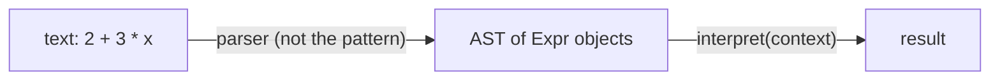
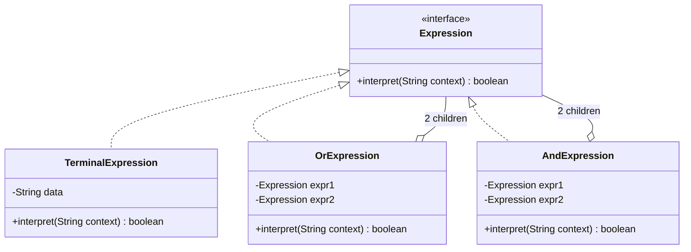
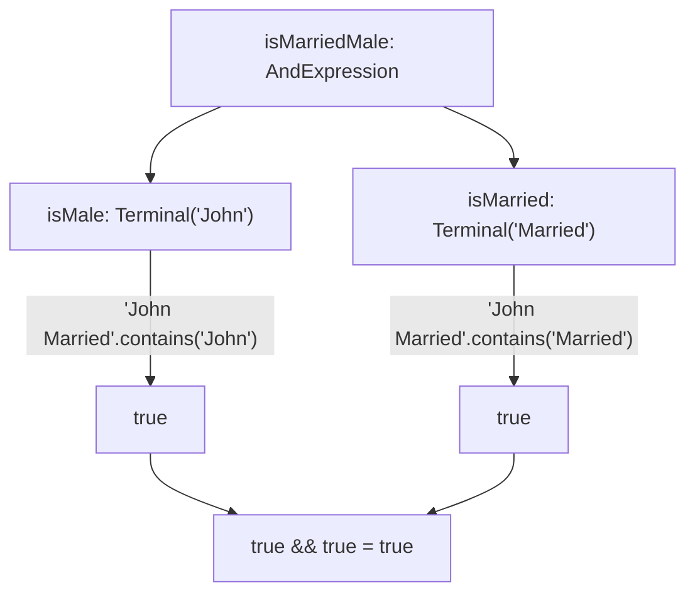

## In One Line
The Interpreter pattern represents each rule of a small language (grammar) as a class, builds sentences of that language as a **tree of expression objects**, and evaluates a sentence by calling `interpret(context)` on the root, which recursively asks its children.

## Mental Model
Think of the **search filter in an email app**: `from contains "John" AND subject contains "Married"`.
- Each little box on the filter screen ("from contains John") is a **terminal expression** — a rule that can be checked directly against one email.
- The **AND / OR connectors** join boxes into bigger rules — **non-terminal expressions**, which don't check anything themselves; they combine the answers of their parts.
- Each **email** being tested is the **context** — the input the rule is evaluated against.
- The mail app **walks the filter tree** for every email: ask the left box, ask the right box, combine with AND.

In the code: `TerminalExpression("John")` is a box, `AndExpression(isMale, isMarried)` is the AND connector, the string `"John Married"` is the email, and `isMarriedMale.interpret("John Married")` is the app testing that email.

## Concept
### Intent (Gang of Four)
> "Given a language, define a representation for its grammar along with an interpreter that uses the representation to interpret sentences in the language."

Category: behavioral. It is the least used GoF pattern in everyday business code, but it is **everywhere inside tools**: regular expressions, expression languages, formatters, query languages, rule engines.

### Key vocabulary
| Term | Meaning | In the example |
|---|---|---|
| **Grammar** | The rules that say which sentences are valid | `expr ::= word \| expr AND expr \| expr OR expr` |
| **Terminal expression** | A leaf rule that is evaluated directly (no sub-expressions) | `TerminalExpression` — "does the text contain this word?" |
| **Non-terminal expression** | A rule built from other expressions; combines their results | `AndExpression`, `OrExpression` |
| **Abstract syntax tree (AST)** | The tree of expression objects representing one sentence | `AndExpression(Terminal("John"), Terminal("Married"))` |
| **Context** | Input/state shared during interpretation (variables, the text being tested...) | The `String context` parameter, e.g. `"John Married"` |

**One class per grammar rule** is the core idea. Each class knows how to interpret *itself*; complex sentences are handled by recursion through the tree.

### Participants and how the example maps to them
| Participant | Role | In the example |
|---|---|---|
| **AbstractExpression** | Declares `interpret(Context)` | `interface Expression { boolean interpret(String context); }` |
| **TerminalExpression** | Implements `interpret` for leaf symbols | `TerminalExpression` — `context.contains(data)` |
| **NonterminalExpression** | Holds child expressions; `interpret` combines their results | `OrExpression` (`\|\|`), `AndExpression` (`&&`) |
| **Context** | Global information for the interpreter | The `String` passed to `interpret` |
| **Client** | Builds (or gets from a parser) the AST and calls `interpret` | `main` |

### What the pattern does NOT cover: parsing
GoF is explicit: the Interpreter pattern says **how to represent and evaluate** a sentence, not how to turn text into the tree. In the course example the client builds the tree by hand with `new`. In real code a **parser** turns text like `"2 + 3 * x"` into the tree — a hand-written *recursive-descent* parser for tiny grammars (see *Code*), or a parser generator (ANTLR, JavaCC) for serious ones.



### How interpretation runs
`interpret` is **recursive**: a non-terminal calls `interpret` on its children with the same context, then combines the results. Leaves stop the recursion. Evaluation is therefore a **post-order tree walk**. Java's `&&` and `||` are short-circuit operators, so `AndExpression` never evaluates its right child when the left is `false`, and `OrExpression` never evaluates its right child when the left is `true`.

The **same tree** can be interpreted against many contexts — build once, evaluate many times (like a compiled regex `Pattern` used with many inputs).

### When to use it
- You have a **simple, stable grammar** (boolean rules, filters, small arithmetic, a config/query mini-language, Roman numerals).
- Sentences must be **stored as data** and evaluated later (rules in a database, user-defined filters, feature-flag conditions).
- Efficiency is not critical, or you can cache the built tree.

### When not to use it
- **Complex grammars** — one class per rule becomes a class explosion; use a parser generator or an existing expression language (Spring SpEL, Jakarta EL, MVEL, JEXL).
- **Performance-critical** evaluation — walking an object tree is slower than compiled code; real engines compile ASTs to bytecode or closures.
- A fixed set of rules that never change at runtime — plain code or `Predicate` composition is simpler.

### Adding new operations: Visitor and Java 21 pattern matching
Classic Interpreter puts the operation (`interpret`) inside each node class. Adding a *second* operation (pretty-print, type-check, optimise) means editing every node class. Two fixes:
- The **[Visitor](lesson:a10-patterns/23-visitor)** pattern — nodes get an `accept(visitor)` method; each operation is a visitor.
- **Java 21**: make the nodes `record`s implementing a `sealed interface`, and write each operation as a `switch` with **record patterns**. The compiler checks that every node type is handled (no `default` needed). Records arrived in Java 16, sealed types in 17, pattern matching for `switch` and record patterns became final in **Java 21**.

This trade-off is the classic *expression problem*: OO style makes adding **node types** easy; switch/visitor style makes adding **operations** easy.

### A lightweight interpreter you already know: `Predicate`
For boolean rules, `java.util.function.Predicate` composition *is* a tiny interpreter — `and`, `or`, `negate` build a tree of lambdas, and `test(context)` walks it:
```java
Predicate<String> isJohn    = s -> s.contains("John");
Predicate<String> isMarried = s -> s.contains("Married");
Predicate<String> singleJohn = isJohn.and(isMarried.negate());
```
The DDD **Specification** pattern and Spring Data JPA's `Specification.where(a).and(b).or(c)` are the same idea applied to business rules and database queries.

### Real JDK and Spring examples
| Where | The language | Tree + interpret |
|---|---|---|
| `java.util.regex.Pattern` | Regular expressions | `Pattern.compile` builds a graph of internal `Node` objects; `Matcher.matches()/find()` walks it against the input (the context). |
| `java.text.MessageFormat`, `SimpleDateFormat`, `DecimalFormat` | Format patterns (`"{0} has {1} items"`, `"dd-MM-yyyy"`) | The pattern is parsed once, then applied to many values. |
| `java.time.format.DateTimeFormatter.ofPattern` | Date/time patterns | Builds a composite of printer-parser objects, one per pattern letter group. |
| **Spring Expression Language (SpEL)** | `"price * qty > 100 and customer.premium"` | `SpelExpressionParser.parseExpression(...)` returns an expression whose AST is made of `SpelNode`s (`OpPlus`, `OpAnd`, literals, property references); `getValue(EvaluationContext)` interprets it — the `EvaluationContext` is literally the GoF *Context*. |
| Spring Security `@PreAuthorize("hasRole('ADMIN')")` | SpEL | Evaluated per method call. |
| Jakarta Expression Language | `${user.name}` in JSP/JSF | Same idea. |

### Look-alike patterns
| Pattern | Relationship |
|---|---|
| **[Composite](lesson:a10-patterns/07-composite)** | The AST **is** a Composite: terminals are leaves, non-terminals are composites. Interpreter = Composite + a grammar + an `interpret` operation. Composite is structural; Interpreter adds the language semantics. |
| **[Visitor](lesson:a10-patterns/23-visitor)** | Used *with* Interpreter to add operations over the AST without editing node classes. |
| **[Flyweight](lesson:a10-patterns/10-flyweight)** | Terminal symbols that appear many times (the same literal or variable) can be shared. |
| **[Iterator](lesson:a10-patterns/15-iterator)** | Can traverse the AST; Interpreter itself traverses by recursion. |
| **[Strategy](lesson:a10-patterns/21-strategy)** | Each `Expression` looks like a strategy (one method), but Strategy swaps one algorithm; Interpreter *composes* many small rule objects into a tree that represents a sentence. |

## Diagram

Non-terminals hold other `Expression`s, so trees of any depth can be built — the same recursive shape as Composite.


Evaluating the root asks each child with the same context and combines the answers — a post-order walk of the tree.

## Code
@example CoreJava/BehavioralPattern/InterpreterPatternExample.java

**A real grammar with a parser.** Arithmetic with `+`, `*`, parentheses and variables. The records are the expression classes (the pattern); the `Parser` turns text into the tree (not part of the pattern, but always needed in practice); the `Map` is the context:
```java
import java.util.ArrayList;
import java.util.List;
import java.util.Map;
import java.util.regex.Matcher;
import java.util.regex.Pattern;

public class Calc {
    // ---- AbstractExpression + concrete expressions (the AST) ----
    interface Expr { int interpret(Map<String, Integer> ctx); }

    record Num(int value) implements Expr {                       // terminal
        public int interpret(Map<String, Integer> ctx) { return value; }
    }
    record Var(String name) implements Expr {                     // terminal, value comes from the context
        public int interpret(Map<String, Integer> ctx) {
            Integer v = ctx.get(name);
            if (v == null) throw new IllegalArgumentException("unknown variable " + name);
            return v;
        }
    }
    record Add(Expr left, Expr right) implements Expr {           // non-terminal
        public int interpret(Map<String, Integer> ctx) { return left.interpret(ctx) + right.interpret(ctx); }
    }
    record Mul(Expr left, Expr right) implements Expr {           // non-terminal
        public int interpret(Map<String, Integer> ctx) { return left.interpret(ctx) * right.interpret(ctx); }
    }

    // ---- Parser (NOT part of the GoF pattern): text -> AST ----
    // expr   := term   ('+' term)*
    // term   := factor ('*' factor)*
    // factor := NUMBER | NAME | '(' expr ')'
    static class Parser {
        private final List<String> tokens = new ArrayList<>();
        private int pos;

        Parser(String text) {
            Matcher m = Pattern.compile("\\d+|[A-Za-z]+|[+*()]").matcher(text);
            while (m.find()) tokens.add(m.group());
        }
        Expr parse() {
            Expr e = expr();
            if (pos != tokens.size()) throw new IllegalArgumentException("unexpected " + tokens.get(pos));
            return e;
        }
        private Expr expr() {
            Expr e = term();
            while (peek("+")) { pos++; e = new Add(e, term()); }
            return e;
        }
        private Expr term() {
            Expr e = factor();
            while (peek("*")) { pos++; e = new Mul(e, factor()); }
            return e;
        }
        private Expr factor() {
            if (pos >= tokens.size()) throw new IllegalArgumentException("unexpected end");
            String t = tokens.get(pos++);
            if (t.equals("(")) { Expr e = expr(); expect(")"); return e; }
            if (Character.isDigit(t.charAt(0))) return new Num(Integer.parseInt(t));
            return new Var(t);
        }
        private void expect(String s) {
            if (!peek(s)) throw new IllegalArgumentException("expected " + s);
            pos++;
        }
        private boolean peek(String s) { return pos < tokens.size() && tokens.get(pos).equals(s); }
    }

    public static void main(String[] args) {
        Expr e = new Parser("2 + 3 * x").parse();
        System.out.println(e);
        System.out.println(e.interpret(Map.of("x", 4)));
        System.out.println(e.interpret(Map.of("x", 10)));      // same tree, new context
        System.out.println(new Parser("(2 + 3) * x").parse().interpret(Map.of("x", 4)));
        try {
            new Parser("(2 + 3").parse();
        } catch (IllegalArgumentException ex) {
            System.out.println("syntax error: " + ex.getMessage());
        }
    }
}
```
```output
Add[left=Num[value=2], right=Mul[left=Num[value=3], right=Var[name=x]]]
14
32
20
syntax error: expected )
```
Precedence comes from the grammar: `term` handles `*` one level deeper than `expr` handles `+`, so `3 * x` becomes a subtree *under* the `Add`. The record `toString()` prints the AST for free.

**The same idea in Java 21 style.** Sealed records hold only data; each operation is a `switch` with record patterns. Adding `show` did not touch the records:
```java
public class SealedCalc {
    sealed interface Expr permits Num, Add, Mul {}
    record Num(int value) implements Expr {}
    record Add(Expr left, Expr right) implements Expr {}
    record Mul(Expr left, Expr right) implements Expr {}

    // operation 1: evaluate
    static int eval(Expr e) {
        return switch (e) {
            case Num n -> n.value();
            case Add(Expr l, Expr r) -> eval(l) + eval(r);
            case Mul(Expr l, Expr r) -> eval(l) * eval(r);
        };                                  // no default: the compiler knows the list is complete
    }

    // operation 2: pretty-print, added WITHOUT touching the records
    static String show(Expr e) {
        return switch (e) {
            case Num n -> String.valueOf(n.value());
            case Add(Expr l, Expr r) -> "(" + show(l) + " + " + show(r) + ")";
            case Mul(Expr l, Expr r) -> show(l) + " * " + show(r);
        };
    }

    public static void main(String[] args) {
        Expr e = new Mul(new Add(new Num(2), new Num(3)), new Num(4));
        System.out.println(show(e) + " = " + eval(e));
    }
}
```
```output
(2 + 3) * 4 = 20
```

**Fixing the course example's rules.** Whole-word matching (no more `"Johnny"` matching `"John"`), a `Not` expression, and "single John" written correctly as `John AND NOT Married`:
```java
import java.util.Arrays;
import java.util.Set;
import java.util.stream.Collectors;

public class FixedRules {
    interface Expression { boolean interpret(Set<String> words); }

    record Word(String word) implements Expression {                 // terminal: whole-word match
        public boolean interpret(Set<String> words) { return words.contains(word.toLowerCase()); }
    }
    record And(Expression left, Expression right) implements Expression {
        public boolean interpret(Set<String> words) { return left.interpret(words) && right.interpret(words); }
    }
    record Or(Expression left, Expression right) implements Expression {
        public boolean interpret(Set<String> words) { return left.interpret(words) || right.interpret(words); }
    }
    record Not(Expression inner) implements Expression {
        public boolean interpret(Set<String> words) { return !inner.interpret(words); }
    }

    // the "context": the sentence turned into a set of lower-case words, built once
    static Set<String> context(String sentence) {
        return Arrays.stream(sentence.toLowerCase().split("\\W+")).collect(Collectors.toSet());
    }

    public static void main(String[] args) {
        Expression isJohn = new Word("John");
        Expression isMarriedJohn = new And(isJohn, new Word("Married"));
        Expression isSingleJohn  = new And(isJohn, new Not(new Word("Married")));

        for (String s : new String[]{"John Married", "John Single", "Johnny Married", "Jane Single"}) {
            Set<String> ctx = context(s);
            System.out.printf("%-15s married John? %-5b  single John? %b%n",
                    s, isMarriedJohn.interpret(ctx), isSingleJohn.interpret(ctx));
        }
        System.out.println(isSingleJohn);
    }
}
```
```output
John Married    married John? true   single John? false
John Single     married John? false  single John? true
Johnny Married  married John? false  single John? false
Jane Single     married John? false  single John? false
And[left=Word[word=John], right=Not[inner=Word[word=Married]]]
```

## Walkthrough
**`interface Expression` (lines 3–6).** The AbstractExpression. One method, `boolean interpret(String context)`: "is this rule true for this input?". Every node of the tree — leaf or not — has this same method, so a parent never needs to know what kind of child it has.

**`TerminalExpression` (lines 8–20).**
- `private String data;` — the word this leaf looks for, set by the constructor.
- `interpret` returns `context.contains(data)` — a plain, case-sensitive **substring** test. This is the only place the input is actually inspected. It has no children, so recursion stops here.

**`OrExpression` (lines 22–36).**
- Two fields, `expr1` and `expr2`, of the *interface* type, so each can be a terminal or another And/Or — trees of any depth.
- `interpret` returns `expr1.interpret(context) || expr2.interpret(context)`: pass the **same context** down to both children and combine with OR. Because `||` short-circuits, `expr2` is not evaluated when `expr1` is already `true`.

**`AndExpression` (lines 38–52).** Same shape with `&&`; `expr2` is skipped when `expr1` is `false`.

**The client, `main` (lines 55–68).**
- `Expression isMale = new TerminalExpression("John");` and `isMarried = new TerminalExpression("Married");` — two leaves. (Despite the name, `isMale` checks only that the text contains `"John"`; see Traps.)
- `isMarriedMale = new AndExpression(isMale, isMarried)` — the tree `John AND Married`.
- `isSingleMale = new OrExpression(isMale, new TerminalExpression("Single"))` — the tree `John OR Single`. Note that `isMale` is **shared** by two trees; that is safe because expressions are stateless.
- `isMarriedMale.interpret("John Married")` → `"John Married".contains("John")` is `true`, and `.contains("Married")` is `true` → `true`. Printed: **`John is a married male? true`**.
- `isSingleMale.interpret("John Single")` → `contains("John")` is `true`, so `||` short-circuits and `"Single"` is **never checked** → `true`. Printed: **`John is a single male? true`**.

Both `// Output:` comments match the recorded output, and the run is deterministic. But the second answer is `true` for the wrong reason — see Traps.

## Traps
> [!ERRATA] `isSingleMale` is built with **`OrExpression`**, so it means "text contains John **OR** contains Single". It returns `true` for `"John Married"` and for `"Jane Single"` (both verified) — neither is a single male. The printed `true` for `"John Single"` comes only from `"John"`; the `"Single"` test is never even evaluated. A "single male" rule needs **AND**: `new AndExpression(isMale, new TerminalExpression("Single"))`, or better `John AND NOT Married` (see *Code*).

> [!ERRATA] The names promise more than the code checks. `isMale = new TerminalExpression("John")` does not test gender; it tests whether the text contains the substring `"John"`. Name expressions after what they test (`mentionsJohn`, `isJohn`).

> [!ERRATA] `context.contains(data)` is a **case-sensitive substring** match: `"Johnny Married"` counts as John married, and `"John Not Married"` counts as married (both return `true`, verified), while `"john married"` returns `false`. For word rules, split the context into words once and compare whole words, ignoring case.

- **Parsing is your job.** The pattern gives you the tree and its evaluation; turning text into the tree needs a parser. Don't claim in an interview that the Interpreter pattern "parses".
- **Class explosion.** One class per grammar rule is fine for 5 rules and painful for 50. Past that, use a parser generator or an existing expression language.
- **Deep trees and recursion.** A very deep AST (e.g. 100,000 chained `+` nodes built left-leaning) can overflow the stack during `interpret`.
- **Evaluating untrusted expressions.** Letting users type SpEL/EL expressions that are evaluated on the server can lead to remote code execution (SpEL can call `T(java.lang.Runtime).getRuntime().exec(...)`). Use `SimpleEvaluationContext` in Spring or your own restricted grammar.
- **Keep expressions stateless.** The same tree is often shared and evaluated by many threads; put per-evaluation state in the context, not in the nodes.

## Tips & Tricks
- **Mnemonic — "one rule, one class; leaves check, branches combine".** Terminals look at the context; non-terminals only combine their children's answers.
- **Interpreter = Composite + grammar + `interpret()`.** If you can draw the Composite, you can draw the Interpreter.
- **Three steps to remember:** grammar → AST (built by a client or a parser) → `interpret(context)` recursively.
- **Build once, evaluate many.** Cache the tree (like `Pattern.compile` once, `matcher(...)` many times).
- For boolean business rules, reach for **`Predicate.and/or/negate`** or the Specification pattern before writing expression classes.
- In Java 21, **sealed interface + records + pattern-matching `switch`** is the cleanest way to write an AST when you need several operations over it.
- Name the real-world examples in interviews: **regex `Pattern`, SpEL, `DateTimeFormatter`, `MessageFormat`**.

## Interview Q&A
### [Basic] What is the Interpreter pattern?
It is a behavioral pattern for evaluating sentences of a small language. You define the language's grammar and create one class per grammar rule, all implementing a common `interpret(context)` method. A sentence is represented as an abstract syntax tree of these objects. Calling `interpret` on the root evaluates the sentence: terminal expressions (leaves) check the context directly, and non-terminal expressions (like AND/OR/plus) call `interpret` on their children and combine the results.

**Follow-up:** *Why is it rarely used in business code?* — Most applications don't define their own language; when they need one, they use an existing engine (SpEL, regex, SQL), which uses the pattern internally.

### [Basic] What is the difference between a terminal and a non-terminal expression? Use the course example.
A **terminal expression** is a leaf with no sub-expressions; it evaluates itself against the context directly. In the example, `TerminalExpression("John")` returns `context.contains("John")`. A **non-terminal expression** is built from other expressions and combines their results: `AndExpression` returns `expr1.interpret(ctx) && expr2.interpret(ctx)`, `OrExpression` uses `||`. Non-terminals make the grammar recursive — an `And` can contain an `Or` that contains terminals, to any depth.

**Follow-up:** *In `2 + 3 * x`, which nodes are terminals?* — `2`, `3` and `x` (a number literal and a variable); `+` and `*` are non-terminals.

### [Intermediate] What is the "context" in the Interpreter pattern?
It is the information the expressions need while being evaluated, passed down unchanged through the tree. In the course example it is just the input string being tested. In a calculator it is the **variable bindings** (`Map.of("x", 4)`); in SpEL it is the `EvaluationContext` (root object, variables, functions). Keeping evaluation state in the context — not in the nodes — lets the same tree be evaluated many times, even from several threads, with different inputs.

**Follow-up:** *Can interpretation modify the context?* — Yes, for languages with assignment or side effects (e.g. `x = 5`); then the context is the interpreter's memory, and sharing it between threads needs care.

### [Intermediate] Does the Interpreter pattern include parsing?
No. GoF says it does not address parsing: it defines how to represent and evaluate a sentence once you have its tree. Someone must build the tree — the client by hand (as in the course example), a hand-written recursive-descent parser (one method per grammar rule: `expr()`, `term()`, `factor()`), or a generated parser (ANTLR, JavaCC). Operator precedence comes from the grammar: `term` (for `*`) is parsed one level below `expr` (for `+`), so multiplications become subtrees under additions.

**Follow-up:** *How does a recursive-descent parser handle parentheses?* — `factor` sees `(`, recursively calls `expr()`, then expects `)`; the bracketed expression becomes one subtree.

### [Intermediate] How are Interpreter and Composite related?
The abstract syntax tree **is** a Composite: terminal expressions are leaves, non-terminal expressions are composites holding children of the same interface. Composite is a structural pattern about treating parts and wholes uniformly; Interpreter reuses that structure and adds meaning — a grammar and an `interpret` operation that evaluates the tree. So "Interpreter = Composite + grammar + evaluate".

**Follow-up:** *Which pattern helps when you need many operations over the AST?* — Visitor (or, in Java 21, sealed records with pattern-matching `switch`).

### [Intermediate] Where do you see the Interpreter pattern in the JDK and Spring?
- **`java.util.regex.Pattern`**: `compile` turns the regex into a graph of internal node objects; the `Matcher` walks it against the input.
- **Formatters**: `SimpleDateFormat`, `MessageFormat`, `DecimalFormat`, and `DateTimeFormatter.ofPattern` parse a pattern once and apply it to many values.
- **Spring Expression Language (SpEL)**: `SpelExpressionParser` builds an AST of `SpelNode`s; `getValue(EvaluationContext)` interprets it. It powers `@Value("#{...}")`, `@PreAuthorize`, `@Cacheable(condition = ...)`.
- **Jakarta EL** (`${...}` in JSP/JSF).

**Follow-up:** *Why compile a regex once and reuse it?* — Building the tree is the expensive part; `String.matches` recompiles the pattern on every call.

### [Advanced] What are the drawbacks of the Interpreter pattern, and what are the alternatives?
- **Class per rule** — complex grammars mean many classes that are hard to maintain.
- **Performance** — walking an object tree with virtual calls is slower than compiled code; deep trees risk stack overflow.
- **Adding operations** means editing every node class.

Alternatives: a parser generator (ANTLR) plus a Visitor for complex grammars; an existing expression language (SpEL, MVEL, JEXL) instead of inventing one; for speed, compile the AST into lambdas/closures once or generate bytecode (what high-performance engines do); for boolean rules, `Predicate` composition or the Specification pattern.

**Follow-up:** *What does "compile the AST into closures" mean?* — Walk the tree once and return a `Function<Context, Result>` built from nested lambdas; evaluating it avoids re-inspecting node types every time.

### [Advanced] How would you add a second operation (for example pretty-printing) to an interpreter's AST?
In the classic design each node class has `interpret`, so a new operation means adding a method to every class. Options:
1. **Visitor** — add `accept(Visitor)` to nodes once; each operation becomes a visitor class.
2. **Java 21 sealed types + pattern matching** — make the nodes records implementing a `sealed interface`, and write each operation as a `switch` with record patterns:
```java
static int eval(Expr e) {
    return switch (e) {
        case Num n -> n.value();
        case Add(Expr l, Expr r) -> eval(l) + eval(r);
        case Mul(Expr l, Expr r) -> eval(l) * eval(r);
    };
}
```
The compiler checks exhaustiveness, so adding a new node type breaks compilation of every `switch` that does not handle it — a safety net Visitor also gives. This is the **expression problem**: OO style makes new node types easy; switch/visitor style makes new operations easy.

**Follow-up:** *Why no `default` branch?* — Because the interface is sealed and every permitted subtype is covered; a `default` would hide a missing case when you add a subtype later.

### [Advanced] Design a small rule engine for discounts like "customer is premium AND (cart total > 100 OR coupon = 'SALE')".
Define `interface Rule { boolean matches(Order ctx); }` with terminal rules (`IsPremium`, `TotalAbove(100)`, `HasCoupon("SALE")`) and non-terminals (`And`, `Or`, `Not`). Store rules as data (JSON or a tiny text grammar), parse them into the tree once at startup, cache it, and evaluate `rule.matches(order)` per order. The `Order` is the context. Keep rules stateless and immutable so they can be shared across threads. For a quick version, `Predicate<Order>` with `and/or/negate` gives the same tree without custom classes; for rules that must also query a database, Spring Data JPA's `Specification` builds the same tree into a SQL `WHERE` clause.

**Follow-up:** *How would you let business users edit rules safely?* — Give them a restricted grammar you parse yourself (or SpEL with `SimpleEvaluationContext`), never arbitrary code evaluation.

## Quiz
### In the original example, what does `isSingleMale.interpret("John Married")` return?
- [ ] `false`, because John is married
- [x] `true`
- [ ] It throws an exception because `"Single"` is missing
- [ ] `false`, because `OrExpression` needs both sides
> `isSingleMale` is `John OR Single`. The text contains `"John"`, so `||` is already `true` and `"Single"` is not even checked. This is the bug in the example: a "single male" rule needs AND (and really `NOT Married`).

### What does `isMarriedMale.interpret("Johnny Married")` return in the original example?
- [x] `true`
- [ ] `false`
- [ ] Compile error
- [ ] It depends on the JVM
> `TerminalExpression` uses `String.contains`, a substring test, and `"Johnny"` contains `"John"`. Whole-word matching (split into words, compare with `equals`) would return `false`.

### What does this print?
```java
Expression loud = ctx -> { System.out.print("checked "); return true; };
Expression and = new AndExpression(new TerminalExpression("x"), loud);
Expression or  = new OrExpression(new TerminalExpression("a"), loud);
System.out.println(and.interpret("abc"));
System.out.println(or.interpret("abc"));
System.out.println(new OrExpression(new TerminalExpression("z"), loud).interpret("abc"));
```
- [ ] `checked false` / `checked true` / `checked true`
- [x] `false` / `true` / `checked true`
- [ ] `false` / `true` / `true`
- [ ] Compile error: `Expression` is not a functional interface
> `And` stops when the left child (`"abc"` contains `"x"`?) is `false`; `Or` stops when the left child (`"a"`) is `true`. Only the last `Or` needs its right child, so only it prints `checked`. `Expression` has one abstract method, so a lambda is fine.

### Which class in the original example is a non-terminal expression?
- [ ] `TerminalExpression`
- [x] `AndExpression`
- [ ] `String`
- [ ] `InterpreterPatternExample`
> Non-terminals are built from other expressions and combine their results — `AndExpression` and `OrExpression`. `TerminalExpression` is a leaf; the `String` is the context; `InterpreterPatternExample.main` is the client.

### Using the `Calc` parser from the Code section, what does this print?
```java
Expr e = new Parser("2 * 3 + x * 2").parse();
System.out.println(e.interpret(Map.of("x", 5)));
System.out.println(e.getClass().getSimpleName());
```
- [ ] `40` then `Mul`
- [x] `16` then `Add`
- [ ] `16` then `Mul`
- [ ] `22` then `Add`
> `*` binds tighter because `term` is parsed below `expr`, so the tree is `Add(Mul(2,3), Mul(x,2))` = 6 + 10 = 16, and the root is the `Add`. `40` would be strict left-to-right evaluation, `((2*3)+5)*2`, which the grammar does not do.

### What does the GoF Interpreter pattern deliberately NOT specify?
- [ ] How to represent grammar rules as classes
- [ ] How to evaluate a sentence
- [x] How to parse text into the abstract syntax tree
- [ ] What the context object is for
> The pattern covers representation (one class per rule, an AST) and evaluation (`interpret(context)`). Building the tree from text is the job of a separate parser — the course example sidesteps it by building the tree by hand in `main`.

### Which JDK class is built on the Interpreter idea: a pattern compiled once into a tree of nodes, then evaluated against many inputs?
- [ ] `java.util.ArrayList`
- [ ] `java.lang.Runnable`
- [x] `java.util.regex.Pattern`
- [ ] `java.util.Observer`
> `Pattern.compile` builds a graph of internal node objects representing the regex grammar; each `Matcher` interprets that structure against an input string. The others are a collection, a Command-style task, and the old Observer interface.

## Takeaways
- Interpreter defines one class per grammar rule; a sentence is a tree of these objects, evaluated by calling `interpret(context)` on the root.
- Terminal expressions (leaves) inspect the context; non-terminal expressions (And, Or, Add) only combine their children's results — the tree is a Composite.
- The pattern does not parse: the client builds the tree, or a separate parser (recursive descent, ANTLR) does; precedence comes from the grammar.
- The course example's `isSingleMale` uses OR where AND (and NOT Married) is needed, and `contains` makes `"Johnny"` match `"John"`.
- Use it for small, stable grammars (rules, filters, formulas); for complex ones use a parser generator or an existing language (SpEL, regex).
- JDK/Spring examples: `java.util.regex.Pattern`, `MessageFormat`/`DateTimeFormatter`, SpEL (`EvaluationContext` is the Context); `Predicate.and/or/negate` is a tiny built-in interpreter.
- To add operations over an AST, use Visitor or Java 21 sealed records with pattern-matching `switch`.
