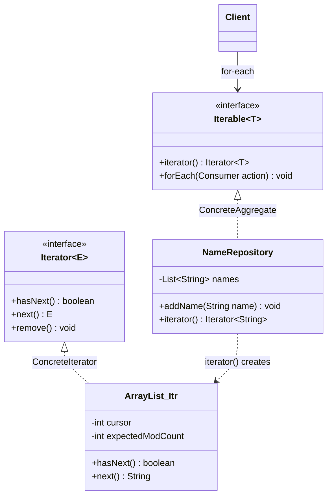
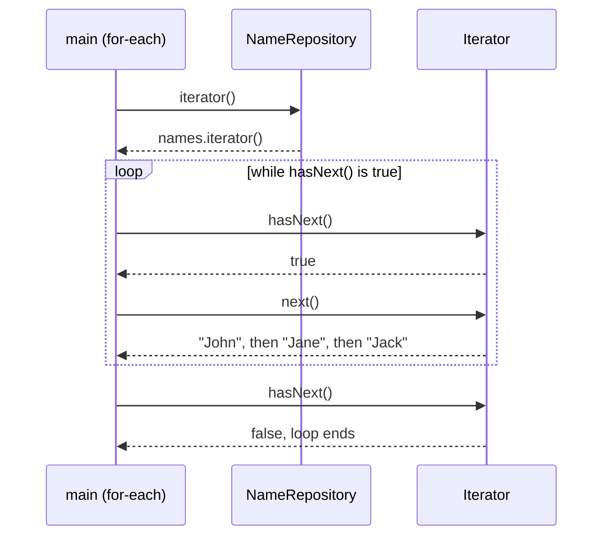

## In One Line
The Iterator pattern gives you a separate **cursor object** that walks through the elements of a collection one by one (`hasNext()` / `next()`) **without exposing how the collection stores them** — and in Java it is built into the language through `Iterable`, `Iterator` and the for-each loop.

## Mental Model
Think of a **TV remote's channel-up button**. You press "next" and see the next channel; you don't know (or care) whether the channels are stored in a list, a satellite table, or a cable frequency map. Two people with two remotes can be on different channels at the same time.

How it maps to the code:
- **The TV's channel list** is the aggregate: `NameRepository` with its private `List<String> names`.
- **The remote** is the iterator: the object returned by `iterator()`.
- **"Is there another channel?" and "next channel"** are `hasNext()` and `next()`.
- **Two remotes, two positions** — every call to `iterator()` returns a **new** cursor, so two traversals don't disturb each other.
- **You never open the TV** — the client loop `for (String name : nameRepository)` never touches the `ArrayList` inside.

## Concept
### Intent (Gang of Four)
> "Provide a way to access the elements of an aggregate object sequentially without exposing its underlying representation."

Also known as **Cursor**. Category: behavioral.

### The problem it solves
Without iterators, every client must know how each collection is built: an index loop for an array, `node = node.next` for a linked list, a stack for a tree, bucket-walking for a hash table. Changing the data structure breaks every client. And a collection that wants to support several traversals at once (or several traversal orders) would have to store the traversal position *inside itself*.

The Iterator pattern moves **traversal state and logic out of the collection into a separate object**. Clients learn one protocol — `hasNext()`/`next()` — and it works for every collection. That gives three wins:
1. **Encapsulation** — the representation stays private.
2. **Uniform access** — one loop works for lists, sets, trees, files, database cursors, even infinite sequences.
3. **Multiple simultaneous traversals** — each iterator keeps its own position.

### Participants and how Java maps them
| GoF participant | Java type | In the course example |
|---|---|---|
| **Iterator** | `java.util.Iterator<E>`: `hasNext()`, `next()`, `remove()` (default since Java 8), `forEachRemaining(...)` | the `Iterator<String>` returned by `iterator()` |
| **ConcreteIterator** | a class implementing `Iterator`, usually a private inner class of the collection | `ArrayList`'s private inner class `Itr` |
| **Aggregate** | `java.lang.Iterable<T>`: `iterator()`, plus defaults `forEach(...)`, `spliterator()` | `Iterable<String>` |
| **ConcreteAggregate** | the collection | `NameRepository` |
| **Client** | code that loops | `main` with its for-each loop |

GoF's original iterator had four methods — `First()`, `Next()`, `IsDone()`, `CurrentItem()`. Java merges them into two: `hasNext()` (≈ not `IsDone`) and `next()` (advance **and** return the current item). There is no "reset": you ask the aggregate for a **new** iterator. Note that `iterator()` is itself a **Factory Method**: each collection creates its own kind of iterator.

### The contract of `java.util.Iterator`
| Method | Contract |
|---|---|
| `boolean hasNext()` | `true` if `next()` would return an element. Must **not** move the cursor — calling it twice in a row is harmless. |
| `E next()` | Returns the next element and advances. Throws **`NoSuchElementException`** when there are no more. |
| `default void remove()` | Removes the element last returned by `next()`. At most once per `next()`, otherwise **`IllegalStateException`**. The default implementation throws **`UnsupportedOperationException`** (Java 8+; before Java 8 every iterator had to implement it). |
| `default void forEachRemaining(Consumer)` | Java 8: passes each remaining element to the lambda. |

`Iterable<T>` has one abstract method, `iterator()`, so a lambda can be an `Iterable`: `Iterable<Integer> it = () -> List.of(1, 2).iterator();`. It also got `forEach(Consumer)` and `spliterator()` as default methods in Java 8.

### How the for-each loop uses the pattern
The enhanced for loop (Java 5) works on **arrays** and on **anything that implements `Iterable`** — nothing else. The compiler rewrites
```java
for (String name : nameRepository) { ... }
```
into
```java
for (Iterator<String> it = nameRepository.iterator(); it.hasNext(); ) {
    String name = it.next();
    ...
}
```
For arrays it becomes a plain index loop instead (arrays are not `Iterable`). A `Map` is **not** `Iterable` either — loop over `entrySet()`, `keySet()` or `values()`.

### External vs internal iteration
| | External iterator | Internal iterator |
|---|---|---|
| Who drives the loop | The **client** (`hasNext`/`next`, for-each) | The **collection** (`forEach(lambda)`, streams) |
| Can stop early, skip, interleave two iterators (e.g. merge) | Easy | Hard (streams offer `limit`, `takeWhile`, `findFirst`) |
| Can use checked exceptions, `break`, `return` | Yes | No (inside a lambda) |
| Parallelism | Manual | Streams can split the work (`Spliterator`) |
| Java examples | `Iterator`, `ListIterator`, for-each | `Iterable.forEach`, `Iterator.forEachRemaining`, `Stream` |

### The family of Java iterators
| Type | Since | Notes |
|---|---|---|
| `Enumeration` | 1.0 | `hasMoreElements()`/`nextElement()`, no `remove`; used by `Vector`, `Hashtable`, `StringTokenizer`. Java 9 added `asIterator()`. |
| `Iterator` | 1.2 | Adds `remove()`; collection iterators are usually **fail-fast**. |
| `ListIterator` | 1.2 | For lists: **both directions** (`hasPrevious`/`previous`), indexes, `add` and `set`. See [ListIterator](lesson:a03-collections/04-list-iterator). |
| `Iterable` + for-each | 5 | Language support (`Iterable` moved from `java.util` to `java.lang`). |
| `Spliterator` | 8 | "Splittable iterator" behind streams: `tryAdvance`, `trySplit` (for parallel), `estimateSize`, characteristics (`ORDERED`, `SIZED`, ...). |
| `Stream` | 8 | A lazy, **one-shot**, internal iteration pipeline. `stream.iterator()` bridges back to an `Iterator`. |

### Robustness: what happens if the collection changes?
- **Fail-fast** (`ArrayList`, `HashMap`...) — the iterator remembers the collection's `modCount`; a structural change not made through the iterator makes the next `next()` throw `ConcurrentModificationException`. Best-effort only. See [fail-fast iterators](lesson:a03-collections/22-fail-fast-iterators).
- **Snapshot** (`CopyOnWriteArrayList`) — iterates over the array as it was when the iterator was created; never throws CME; `remove()` is unsupported.
- **Weakly consistent** (`ConcurrentHashMap`, `ConcurrentLinkedQueue`) — never throws CME; may or may not show changes made after creation. See [fail-safe iterators](lesson:a03-collections/23-fail-safe-iterators).
- The only safe way to remove while iterating a normal collection: `iterator.remove()` or `collection.removeIf(predicate)` (Java 8).

### When to use it (write your own)
- Your class **holds a collection** and should be loopable with for-each without exposing it — implement `Iterable`.
- Elements are **computed lazily** or are **infinite** (number sequences, lines of a huge file, pages from an API).
- You need a **special traversal order** (tree depth-first, breadth-first, filtered, reversed).

### When not to
- You can simply return an unmodifiable view or a `Stream` — often clearer than a custom iterator.
- Random access by index is what clients really need — expose `get(int)` or a `List` view.

### Real JDK and Spring examples
| Where | How |
|---|---|
| Every `Collection` | `ArrayList.Itr`, `HashMap.KeyIterator`... private concrete iterators behind `iterator()` |
| `java.util.Scanner` | `implements Iterator<String>` — tokens from any input |
| `java.nio.file.DirectoryStream<Path>` | `Iterable` over directory entries — but **one-shot**: a second `iterator()` call throws `IllegalStateException` |
| `java.nio.file.Path` | `Iterable<Path>` over the **name elements** (`/a/b/c` → `a`, `b`, `c`) |
| `java.util.ServiceLoader<S>` | `Iterable` that lazily loads service providers |
| `java.sql.ResultSet` | A cursor in all but name: `next()` moves to the next row |
| Spring Data `CrudRepository.findAll()` | Returns `Iterable<T>`; `Page`/`Slice` are `Streamable` (which extends `Iterable`) |
| Spring Batch `ItemReader` | `read()` returns the next item, `null` at the end — an iterator for batch jobs |

### Look-alike and partner patterns
| Pattern | Relationship |
|---|---|
| **[Composite](lesson:a10-patterns/07-composite)** | Iterators are often used to walk composite trees; an external tree iterator keeps a stack of pending nodes. |
| **[Visitor](lesson:a10-patterns/23-visitor)** | Iterator decides **the order** of elements and the client does the work; Visitor puts **the operation** in a separate object and uses double dispatch on element types. They combine well: iterate, then `element.accept(visitor)`. |
| **Factory Method** | `iterator()` is a factory method: each aggregate returns its own concrete iterator class. |
| **[Memento](lesson:a10-patterns/17-memento)** | An iterator can use a memento to save and restore a traversal position. |
| **Stream** | A modern, internal, lazy, one-shot relative: great for transformations, but you can't pause it and resume like an external iterator. |

## Diagram

The client only sees the two interfaces; the concrete iterator (`ArrayList`'s private `Itr` class) and the private list stay hidden.


One for-each loop = one `iterator()` call, then `hasNext()`/`next()` pairs until `hasNext()` returns `false`.

## Code
@example CoreJava/BehavioralPattern/IteratorPatternExample.java

**Writing the concrete iterator yourself.** An aggregate backed by an array, an anonymous inner-class iterator holding the cursor, what for-each compiles to, two independent iterators, and a lazy infinite `Iterable`:
```java
import java.util.Iterator;
import java.util.NoSuchElementException;

public class HandMade {
    public static void main(String[] args) {
        NameArray names = new NameArray("John", "Jane", "Jack");

        for (String n : names) System.out.print(n + " ");          // for-each works on any Iterable
        System.out.println();

        // what the compiler turns the for-each into
        for (Iterator<String> it = names.iterator(); it.hasNext(); ) {
            String n = it.next();
            System.out.print(n.toUpperCase() + " ");
        }
        System.out.println();

        // a second, independent traversal: every iterator() call = fresh cursor
        Iterator<String> a = names.iterator(), b = names.iterator();
        a.next();
        System.out.println(a.next() + " / " + b.next());

        // lazy, infinite sequence: no collection behind it at all
        int count = 0;
        for (long f : new Fibonacci()) {
            if (++count > 10) break;
            System.out.print(f + " ");
        }
        System.out.println();

        try { a.next(); a.next(); }
        catch (NoSuchElementException e) { System.out.println("NoSuchElementException: " + e.getMessage()); }
        try { a.remove(); }
        catch (UnsupportedOperationException e) { System.out.println("UnsupportedOperationException: " + e.getMessage()); }
    }
}

// ConcreteAggregate backed by a plain array (representation hidden from clients)
class NameArray implements Iterable<String> {
    private final String[] names;
    NameArray(String... names) { this.names = names.clone(); }

    @Override
    public Iterator<String> iterator() {
        return new Iterator<>() {                      // ConcreteIterator (anonymous inner class)
            private int cursor = 0;                    // traversal state lives in the iterator

            @Override public boolean hasNext() { return cursor < names.length; }

            @Override public String next() {
                if (!hasNext()) throw new NoSuchElementException("no more names");
                return names[cursor++];
            }
            // remove() not overridden: the default throws UnsupportedOperationException
        };
    }
}

// An Iterable that computes elements on demand
class Fibonacci implements Iterable<Long> {
    @Override
    public Iterator<Long> iterator() {
        return new Iterator<>() {
            private long a = 0, b = 1;
            @Override public boolean hasNext() { return true; }     // never ends
            @Override public Long next() {
                long result = a;
                long next = a + b; a = b; b = next;
                return result;
            }
        };
    }
}
```
```output
John Jane Jack 
JOHN JANE JACK 
Jane / John
0 1 1 2 3 5 8 13 21 34 
NoSuchElementException: no more names
UnsupportedOperationException: remove
```

**The encapsulation leak in the original, and the fix.** The original returns the list's own iterator, whose `remove()` works — so any client can delete from the "private" list:
```java
import java.util.*;

public class Leak {
    public static void main(String[] args) {
        NameRepository repo = new NameRepository();
        repo.addName("John"); repo.addName("Jane"); repo.addName("Jack");

        Iterator<String> it = repo.iterator();
        it.next();
        it.remove();                          // removes "John" from the PRIVATE list
        for (String name : repo) System.out.println("Name: " + name);

        try {
            for (String name : repo) {
                if (name.equals("Jane")) repo.addName("Jill");   // modify during iteration
            }
        } catch (ConcurrentModificationException e) {
            System.out.println("CME: " + e.getClass().getSimpleName());
        }

        SafeRepository safe = new SafeRepository();
        safe.addName("John");
        Iterator<String> it2 = safe.iterator();
        it2.next();
        try { it2.remove(); } catch (UnsupportedOperationException e) { System.out.println("remove() blocked: " + e); }
    }
}
class NameRepository implements Iterable<String> {         // same as the original
    private List<String> names = new ArrayList<>();
    public void addName(String name) { names.add(name); }
    @Override public Iterator<String> iterator() { return names.iterator(); }
}
class SafeRepository implements Iterable<String> {          // the fix
    private final List<String> names = new ArrayList<>();
    public void addName(String name) { names.add(name); }
    @Override public Iterator<String> iterator() { return Collections.unmodifiableList(names).iterator(); }
}
```
```output
Name: Jane
Name: Jack
CME: ConcurrentModificationException
remove() blocked: java.lang.UnsupportedOperationException
```

**Internal iteration and the legacy `Enumeration`:**
```java
import java.util.*;

public class Internal {
    public static void main(String[] args) {
        List<String> names = List.of("John", "Jane", "Jack");
        names.forEach(n -> System.out.print(n + " "));           // internal: the collection drives
        System.out.println();
        Iterator<String> it = names.iterator();
        System.out.print("first=" + it.next() + ", rest=");
        it.forEachRemaining(n -> System.out.print(n + " "));      // hand the rest to a lambda
        System.out.println();
        Enumeration<String> en = Collections.enumeration(names);  // legacy Iterator (Java 1.0)
        while (en.hasMoreElements()) System.out.print(en.nextElement().charAt(0));
        System.out.println();
        Iterator<String> fromEnum = en.asIterator();              // Java 9 bridge
        System.out.println(fromEnum.hasNext());
    }
}
```
```output
John Jane Jack 
first=John, rest=Jane Jack 
JJJ
false
```
The last line is `false` because `asIterator()` wraps the *same*, already exhausted enumeration — it does not restart.

## Walkthrough
**Imports (lines 3–5).** `ArrayList` and `List` for storage, and `java.util.Iterator` — the pattern's Iterator interface. `Iterable` needs no import: it lives in `java.lang`.

**`class NameRepository implements Iterable<String>` (lines 7–19) — the ConcreteAggregate.**
- `private List<String> names = new ArrayList<>();` — the hidden representation. Clients never see that it is an `ArrayList`; it could become a `LinkedList`, an array or a database query without any client changing.
- `addName(String)` — the only way to add data; it appends to the list.
- `@Override public Iterator<String> iterator()` — the single method `Iterable` requires. It **delegates** to `names.iterator()`, which returns a new `ArrayList.Itr` object (the ConcreteIterator) with its own `cursor` starting at 0. Implementing `Iterable` is what allows the for-each loop on a `NameRepository`.

**`main` — the client (lines 22–38).**
- Creates the repository and adds `"John"`, `"Jane"`, `"Jack"` in that order.
- `for (String name : nameRepository)` — the compiler calls `nameRepository.iterator()` once, then loops `hasNext()`/`next()`. `ArrayList` iterates in insertion (index) order, so the output is **`Name: John`**, **`Name: Jane`**, **`Name: Jack`** — exactly as the `// Output:` comment says. The order is deterministic because it comes from the list's indexes.
- The client code never mentions `ArrayList` or an index — that is the pattern's promise.

## Traps
> [!ERRATA] `iterator()` returns the internal list's own iterator, and `ArrayList`'s iterator **supports `remove()`**. So a client can do `Iterator<String> it = repo.iterator(); it.next(); it.remove();` and delete `"John"` from the private list (verified: only Jane and Jack remain). For a class whose whole point is hiding its representation, return a read-only iterator: `Collections.unmodifiableList(names).iterator()` (then `remove()` throws `UnsupportedOperationException`). The field could also be `final`.

- **Calling `next()` twice per `hasNext()`.** `while (it.hasNext()) print(it.next() + it.next());` skips elements and throws `NoSuchElementException` on odd-sized collections. One `next()` per `hasNext()` check.
- **Modifying the collection during for-each** throws `ConcurrentModificationException` (fail-fast) — except in a sneaky case: removing the **second-to-last** element makes `hasNext()` return `false` early, so the loop silently skips the last element with no exception. Use `it.remove()` or `removeIf`.
- **`remove()` rules**: only after `next()`, only once per `next()` (else `IllegalStateException`), and only if supported (else `UnsupportedOperationException` — e.g. `List.of(...)`, unmodifiable views, custom iterators).
- **One-shot `Iterable`s.** `Iterable<T> it = stream::iterator;` compiles and works in a for-each **once**; the second loop throws `IllegalStateException: stream has already been operated upon or closed`. `DirectoryStream` is also one-shot. A proper `Iterable` returns a fresh iterator on every call.
- **Infinite iterators** (`hasNext()` always `true`) need a `break` or `limit` — never pass one to code that collects everything.
- **`hasNext()` must not have side effects.** If it advances the cursor, any caller that calls it twice loses elements.
- **Iterators are not thread-safe.** Sharing one iterator between threads, or iterating while another thread modifies a non-concurrent collection, is a bug.

## Tips & Tricks
- **Mnemonic — "Iter-ABLE is ABLE to give you an Iter-ATOR."** `Iterable` = the thing you can loop over (one method: `iterator()`); `Iterator` = the cursor (`hasNext`, `next`, `remove`).
- **"hasNext looks, next moves."** `hasNext()` never moves the cursor; `next()` returns the element and moves past it.
- **Fresh remote per viewer:** every `iterator()` call must return a new, independent cursor.
- **Remove safely:** `it.remove()` inside an explicit iterator loop, or `list.removeIf(x -> ...)` — never `list.remove(x)` inside a for-each.
- Implement `Iterable` on your own container classes so they work with for-each — and return a read-only iterator unless removal is part of your API.
- For lazy sequences, prefer `Stream.iterate(seed, hasNext, next)` (Java 9) or `Stream.generate` over hand-written iterators, unless you need external control.
- In interviews, name the concrete iterator: "`ArrayList.iterator()` returns an instance of the private inner class `Itr`, which keeps a `cursor` and an `expectedModCount`."

## Interview Q&A
### [Basic] What is the Iterator pattern and what problem does it solve?
It is a behavioral pattern that provides a way to access the elements of a collection sequentially without exposing its internal representation. The traversal logic and position are moved out of the collection into a separate iterator object with a small protocol — in Java, `hasNext()` and `next()`. Clients use the same loop for any collection, the collection's structure stays private, and several independent traversals can run at once because each iterator keeps its own position.

**Follow-up:** *Where is it in Java?* — Built into the language: `java.lang.Iterable`, `java.util.Iterator`, and the enhanced for loop, which works on any `Iterable`.

### [Basic] What is the difference between `Iterable` and `Iterator`?
`Iterable<T>` is the **aggregate**: something that can be iterated. It has one abstract method, `iterator()`, and each call should return a **new** iterator. `Iterator<E>` is the **cursor**: it has state (the current position) and the methods `hasNext()`, `next()`, and optionally `remove()`. The for-each loop requires an `Iterable` (or an array). A collection is iterable; the iterator is a short-lived object you get from it.

**Follow-up:** *Why doesn't `Collection` just implement `Iterator` itself?* — Then the position would live in the collection, so you could only have one traversal at a time, and nested loops over the same collection would break.

### [Basic] How does the enhanced for loop work internally?
For an `Iterable`, the compiler generates `Iterator<T> it = expr.iterator(); while (it.hasNext()) { T x = it.next(); body }`. For an array it generates an index-based loop instead, because arrays do not implement `Iterable`. That is why for-each works on arrays and on any class implementing `Iterable` — including your own — but not on a `Map` (use `entrySet()`), and why you cannot remove elements from inside it (you have no access to the hidden iterator).

**Follow-up:** *What exception do you get if you call `list.remove(x)` inside a for-each over an `ArrayList`?* — Usually `ConcurrentModificationException` on the next `next()` — but if you remove the second-to-last element, the loop just ends early with no exception, silently skipping the last element.

### [Intermediate] How do you implement a custom iterator correctly?
Implement `Iterable<T>` on the aggregate and return a new `Iterator<T>` (usually a private inner or anonymous class) from `iterator()`. Rules:
- Keep the cursor in the **iterator**, not the aggregate.
- `hasNext()` must be side-effect free and repeatable.
- `next()` must throw **`NoSuchElementException`** when exhausted (not return `null`, not throw `IndexOutOfBoundsException`).
- Don't override `remove()` unless removal is supported; the default throws `UnsupportedOperationException`.
```java
public Iterator<String> iterator() {
    return new Iterator<>() {
        private int cursor = 0;
        public boolean hasNext() { return cursor < names.length; }
        public String next() {
            if (!hasNext()) throw new NoSuchElementException();
            return names[cursor++];
        }
    };
}
```
**Follow-up:** *How would you make it fail-fast?* — Keep a modification counter in the aggregate, copy it into the iterator at creation (`expectedModCount`), and throw `ConcurrentModificationException` in `next()` when they differ — exactly what `ArrayList.Itr` does.

### [Intermediate] What is the difference between internal and external iterators?
With an **external** iterator the client controls the loop: it calls `hasNext()`/`next()`, can stop at any point, can walk two collections in step (e.g. merging two sorted lists), and can use `break`, `return` and checked exceptions. With an **internal** iterator the collection controls the loop and the client passes the action: `list.forEach(x -> ...)`, `iterator.forEachRemaining(...)`, streams. Internal iteration is shorter and lets the library optimise or parallelise (streams split work with a `Spliterator`), but early exit and checked exceptions are awkward inside lambdas.

**Follow-up:** *Is a `Stream` an iterator?* — It is a lazy, one-shot, internal iteration pipeline. You can get an external iterator from it with `stream.iterator()`, but only once.

### [Intermediate] Compare `Enumeration`, `Iterator`, `ListIterator` and `Spliterator`.
| | Enumeration | Iterator | ListIterator | Spliterator |
|---|---|---|---|---|
| Since | 1.0 | 1.2 | 1.2 | 8 |
| Methods | `hasMoreElements`, `nextElement` | `hasNext`, `next`, `remove` | + `hasPrevious`, `previous`, `nextIndex`, `add`, `set` | `tryAdvance`, `forEachRemaining`, `trySplit`, `estimateSize` |
| Direction | forward | forward | both | forward, splittable |
| Modify | no | remove | remove, add, set | no |
| Used by | `Vector`, `Hashtable`, `StringTokenizer` | all collections | `List` only | streams (esp. parallel) |

**Follow-up:** *Can you turn an `Enumeration` into an `Iterator`?* — Yes, `enumeration.asIterator()` since Java 9 (or `Collections.list(e)` to copy it into an `ArrayList`).

### [Intermediate] What are fail-fast and fail-safe iterators?
A **fail-fast** iterator (`ArrayList`, `HashMap`) detects structural modification of the collection made outside the iterator — using a `modCount` check — and throws `ConcurrentModificationException` on the next `next()`. It is best-effort, meant to reveal bugs, not to guarantee thread safety. **Fail-safe** iterators don't throw: `CopyOnWriteArrayList` iterates a **snapshot** of the array (changes after creation are invisible, `remove()` unsupported), and `ConcurrentHashMap` iterators are **weakly consistent** (they may or may not reflect later changes, never throw CME).

**Follow-up:** *How do you remove elements while iterating an `ArrayList` safely?* — `iterator.remove()` inside an explicit iterator loop, or `list.removeIf(predicate)`.

### [Advanced] Why does removing an element inside a for-each sometimes NOT throw `ConcurrentModificationException`?
`ArrayList.Itr.hasNext()` is simply `cursor != size`; the modification check happens only in `next()`. If you remove the **second-to-last** element while the cursor points past it, the size shrinks to equal the cursor, `hasNext()` returns `false`, and the loop ends without ever calling `next()` again — so no exception, but the last element is never visited. With `List.of("John", "Jane")` copied into an `ArrayList`, removing `"John"` during the loop leaves `[Jane]` with no error. It proves fail-fast is best-effort and why the Javadoc says never to rely on CME for correctness.

**Follow-up:** *Does the same happen with `HashMap`?* — Similar best-effort behaviour: the check is in `nextNode()`, so an exception only appears if the iteration continues.

### [Advanced] How would you write an external iterator over a tree (a Composite)?
Recursion is natural for internal traversal, but an external iterator must be able to *pause* between elements, so it keeps the "rest of the work" in an explicit **stack** (depth-first) or **queue** (breadth-first):
```java
public Iterator<Node> iterator() {                 // depth-first, pre-order
    Deque<Node> stack = new ArrayDeque<>();
    stack.push(this);
    return new Iterator<>() {
        public boolean hasNext() { return !stack.isEmpty(); }
        public Node next() {
            if (stack.isEmpty()) throw new NoSuchElementException();
            Node n = stack.pop();
            for (int i = n.children().size() - 1; i >= 0; i--) stack.push(n.children().get(i));
            return n;
        }
    };
}
```
Children are pushed in reverse so the first child is popped first. For a tree `root → (src → Main.java), pom.xml` it yields `root src Main.java pom.xml`. Swap the `Deque` for a queue (`addLast`/`pollFirst`) to get breadth-first order.

**Follow-up:** *Why not just recurse?* — A recursive method cannot return one element and resume later; Java has no generators (`yield` in the Python sense), so the call stack must become an explicit data structure.

### [Advanced] Can an `Iterable` be iterated more than once? Give a case where it can't.
A well-behaved `Iterable` returns a fresh iterator on each `iterator()` call, so it can be looped any number of times. But the interface doesn't enforce it. `Iterable<Integer> it = stream::iterator;` compiles, and the first for-each works, but the second calls `stream.iterator()` again and throws `IllegalStateException: stream has already been operated upon or closed`. `java.nio.file.DirectoryStream` is documented as one-shot too. If you accept an `Iterable` and need two passes, copy it into a `List` first.

**Follow-up:** *How do you turn an `Iterable` into a `Stream`?* — `StreamSupport.stream(iterable.spliterator(), false)`.

## Quiz
### What does this print?
```java
Iterator<String> it = List.of("a", "b", "c").iterator();
try {
    while (it.hasNext()) {
        System.out.print(it.next() + it.next() + " ");
    }
} catch (NoSuchElementException e) {
    System.out.println("-> " + e.getClass().getSimpleName());
}
```
- [ ] `ab c`
- [x] `ab -> NoSuchElementException`
- [ ] `ab cnull`
- [ ] `abc`
> Each loop pass calls `next()` twice. The first pass prints `ab `; the second pass gets `c`, then the second `next()` has nothing left and throws `NoSuchElementException`. Iterators never return `null` at the end — they throw.

### What does this print?
```java
Iterable<Integer> fromList = () -> List.of(1, 2).iterator();
Stream<Integer> stream = Stream.of(1, 2);
Iterable<Integer> fromStream = stream::iterator;

for (int x : fromList) System.out.print(x);
for (int x : fromList) System.out.print(x);
System.out.println();
for (int x : fromStream) System.out.print(x);
try {
    for (int x : fromStream) System.out.print(x);
} catch (IllegalStateException e) {
    System.out.println(" -> " + e.getMessage());
}
```
- [ ] `1212` then `1212`
- [x] `1212` then `12 -> stream has already been operated upon or closed`
- [ ] `12` then `12`
- [ ] Compile error: a lambda cannot implement `Iterable`
> `fromList` creates a new list iterator on every call, so it loops twice. `fromStream` calls `stream.iterator()` each time, but a stream is one-shot, so the second loop throws. `Iterable` has one abstract method, so lambdas and method references are allowed.

### What does this print?
```java
List<String> names = new ArrayList<>(List.of("John", "Jane"));
for (String n : names) {
    if (n.equals("John")) names.remove(n);
}
System.out.println(names);
```
- [ ] `ConcurrentModificationException`
- [x] `[Jane]`
- [ ] `[John, Jane]`
- [ ] `[]`
> After removing `"John"` the size is 1 and the cursor is 1, so `hasNext()` (`cursor != size`) is `false` and the loop ends before `next()` can check `modCount`. No exception — but `"Jane"` was never visited. This "second-to-last element" case is why fail-fast is only best-effort.

### What does this print?
```java
List<Integer> nums = new ArrayList<>(List.of(1, 2, 3, 4, 5, 6));
Iterator<Integer> it = nums.iterator();
while (it.hasNext()) {
    if (it.next() % 2 == 0) it.remove();
}
System.out.println(nums);
```
- [x] `[1, 3, 5]`
- [ ] `[2, 4, 6]`
- [ ] `ConcurrentModificationException`
- [ ] `IllegalStateException`
> `Iterator.remove()` is the supported way to remove during iteration: it removes the element last returned by `next()` and updates the iterator's expected modification count, so no CME. It would throw `IllegalStateException` only if called twice for one `next()`.

### In the course example, which role does `NameRepository` play?
- [ ] Iterator
- [ ] ConcreteIterator
- [x] ConcreteAggregate
- [ ] Client
> `NameRepository` holds the elements and creates iterators through `iterator()` — the ConcreteAggregate (implementing `Iterable`, the Aggregate). The ConcreteIterator is `ArrayList`'s private `Itr` class returned by `names.iterator()`, and `main` is the client.

### Which of these is an internal iterator?
- [ ] `for (String s : list) { ... }`
- [ ] `ListIterator<String> li = list.listIterator();`
- [x] `list.forEach(s -> System.out.println(s));`
- [ ] `while (en.hasMoreElements()) en.nextElement();`
> With `forEach(Consumer)` the collection runs the loop and calls your lambda — internal iteration. The for-each loop, `ListIterator` and `Enumeration` are external: your code drives `hasNext()`/`next()`.

### Spot the design problem in `NameRepository.iterator()` returning `names.iterator()`.
- [ ] It returns elements in random order
- [ ] It cannot be used in a for-each loop
- [x] Callers can call `remove()` on the returned iterator and delete elements from the private list
- [ ] It throws `UnsupportedOperationException` on `next()`
> An `ArrayList` iterator supports `remove()`, so the "hidden" list can be modified from outside, bypassing `addName`-style control. Return `Collections.unmodifiableList(names).iterator()` to keep the aggregate read-only. The order is insertion order, and for-each works fine.

## Takeaways
- Iterator provides sequential access to a collection's elements through a separate cursor object, without exposing the collection's internal structure.
- In Java: `Iterable` (aggregate, `iterator()`) + `Iterator` (cursor: `hasNext`, `next`, optional `remove`) + the for-each loop, which compiles to an iterator loop (arrays use an index loop).
- Every `iterator()` call should return a new, independent cursor; `next()` throws `NoSuchElementException` at the end; `hasNext()` must not move the cursor.
- Remove only via `iterator.remove()` or `removeIf`; collection iterators are fail-fast (CME), `CopyOnWriteArrayList` is snapshot, `ConcurrentHashMap` is weakly consistent.
- Returning an internal list's iterator leaks `remove()`; return an unmodifiable view's iterator to keep encapsulation.
- External iterators (client drives) allow early exit and interleaving; internal iterators (`forEach`, streams) let the library drive; streams are one-shot.
- Family: `Enumeration` (1.0) → `Iterator` and `ListIterator` (1.2) → `Iterable` + for-each (5) → `Spliterator`/`forEach` (8).
