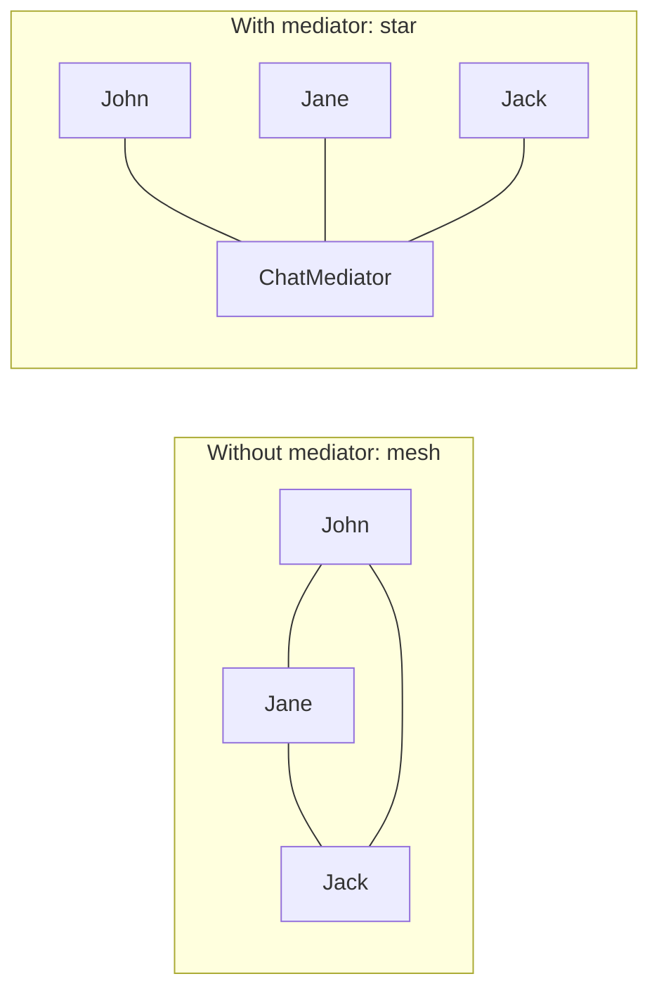
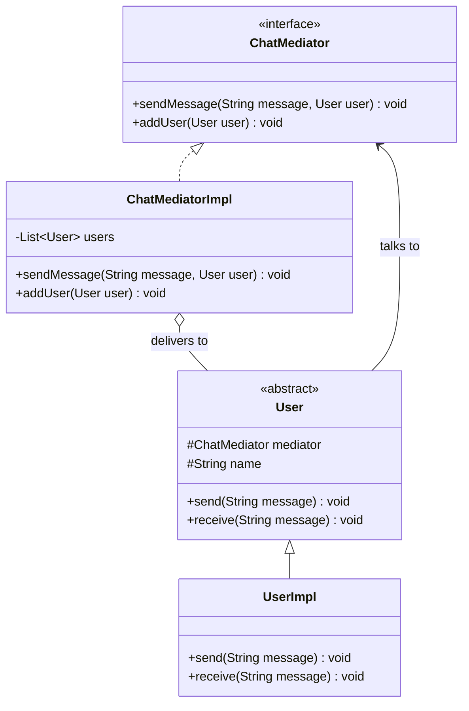
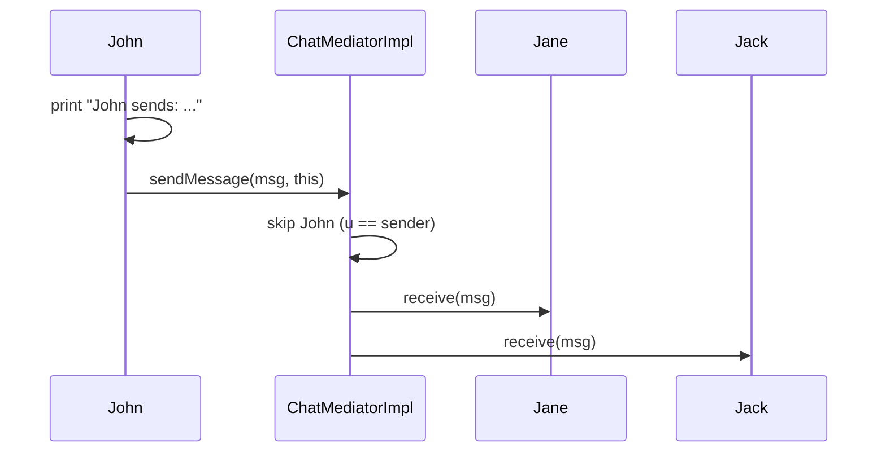

## In One Line
The Mediator pattern puts a **central object in the middle** of a group of objects so they stop talking to each other directly: each object ("colleague") talks only to the mediator, and the mediator decides who gets what — turning a tangled many-to-many web into a simple star.

## Mental Model
Think of an **airport control tower**. Dozens of planes want to land and take off. If every pilot had to radio every other pilot to agree on the runway, it would be chaos. Instead, every pilot talks **only to the tower**, and the tower decides who lands next and tells the others to wait.

How it maps to the code:
- **The tower** is the mediator: `ChatMediatorImpl`.
- **Each plane** is a colleague: `UserImpl` ("John", "Jane", "Jack").
- **The radio link to the tower** is the `mediator` field every `User` holds.
- **Radioing the tower** is `mediator.sendMessage(message, this)`.
- **The tower relaying the message to everyone else** is the loop that calls `u.receive(message)` for every user except the sender.
- Planes never hold references to each other — `UserImpl` has no field pointing at another user.

## Concept
### Intent (Gang of Four)
> "Define an object that encapsulates how a set of objects interact. Mediator promotes loose coupling by keeping objects from referring to each other explicitly, and it lets you vary their interaction independently."

Category: behavioral.

### The problem it solves
When many objects must react to each other, direct references create a **mesh**. With N objects there can be up to N(N−1)/2 connections (5 objects → 10 links, 10 objects → 45 links). Every object knows many others, so:
- you cannot reuse one object without dragging the others along;
- the interaction rules ("when A changes, B must disable and C must refresh") are **scattered** across all the classes;
- adding one new object means editing many existing ones.

The mediator replaces the mesh with a **star**: N objects, N links, all to the mediator. The interaction rules move into **one** class. Colleagues become simple and reusable; the mediator is the only thing that knows "how the group behaves".

### Participants and how the example maps to them
| Participant | Role | In the example |
|---|---|---|
| **Mediator** | Interface colleagues use to communicate | `interface ChatMediator { sendMessage(String, User); addUser(User); }` |
| **ConcreteMediator** | Knows the colleagues and implements the coordination rules | `ChatMediatorImpl` with `List<User> users` and the "everyone except the sender" rule |
| **Colleague** | Knows its mediator; talks to it instead of to other colleagues | `abstract class User` with `protected ChatMediator mediator` |
| **ConcreteColleague** | A real participant | `UserImpl` — `send` goes to the mediator, `receive` prints |
| **Client** | Wires colleagues and mediator | `main` |

Notice the two-way relationship: colleagues know the mediator (to send), and the mediator knows the colleagues (to deliver). What disappears is colleague-to-colleague knowledge.

### Two typical kinds of mediator
| | Relay / event-bus mediator | Coordinating ("director") mediator |
|---|---|---|
| What it does | Routes messages: broadcast, private, per room/topic | Holds real logic: "if checkbox is ticked, disable fields and enable the button" |
| Example | Chat room (this lesson's example), event bus | GoF's dialog box with widgets, the login form in *Code* |
| Colleagues | Send messages | Report "I changed"; the mediator reads their state and updates others |

### When to use it
- A set of objects communicates in **well-defined but complex** ways, and the dependencies are unstructured and hard to follow.
- Reusing an object is hard because it refers to many others.
- Behaviour distributed across many classes should be customisable **without subclassing all of them** — change one mediator instead.
- Classic cases: GUI dialogs (fields, checkboxes, buttons), chat rooms, air-traffic control, game lobbies, workflow coordinators, auction houses.

### When not to use it
- Only two or three objects interact simply — a direct call is clearer.
- The mediator starts to hold **all** the business logic of the application — it has become a **god object**. Split it (one mediator per dialog, per room, per use case).

### Consequences
| Benefit | Cost |
|---|---|
| Colleagues are decoupled and reusable | The mediator can grow into a large, complex god object |
| Interaction rules live in one place | Single point of failure / bottleneck |
| Many-to-many replaced by one-to-many | Harder to see *who* ends up receiving what without reading the mediator |
| Easier to change group behaviour (swap the mediator) | Colleagues depend on the mediator interface |

### Real JDK and Spring examples
| Where | How it mediates |
|---|---|
| **`javax.swing.ButtonGroup`** (and JavaFX `ToggleGroup`) | Radio buttons don't know each other; the group deselects the previously selected button when another is selected. |
| **Spring MVC `DispatcherServlet`** | Coordinates `HandlerMapping`, `HandlerAdapter`, `ViewResolver` and exception resolvers — none of them reference each other. |
| **Spring `ApplicationEventPublisher`** + `@EventListener` | Publishers and listeners never know each other; the event multicaster sits in the middle (an event-bus style mediator). |
| **`java.util.concurrent.ExecutorService`, `java.util.Timer`** | Often cited: task submitters and worker threads never reference each other; the executor coordinates them. |
| **MVC controllers** | A controller mediates between view and model (see [MVC](lesson:a10-patterns/24-mvc)). |
| **Message brokers** (Kafka, RabbitMQ) | The same idea at system scale: services talk to the broker, not to each other. |

### Look-alike patterns
| Pattern | Looks similar because | The difference |
|---|---|---|
| **[Observer](lesson:a10-patterns/19-observer)** | Both decouple senders from receivers and often broadcast | Observer is **one-to-many and one-way**: a subject notifies its dependents, and the subject has no coordination logic. Mediator is **many-to-many and two-way**, with the interaction rules centralised. A mediator is often *implemented* with Observer (colleagues notify the mediator). |
| **[Facade](lesson:a10-patterns/09-facade)** | Both put one object in front of many | A facade is a **one-way simplification**: clients call it, the subsystem does not know the facade exists. A mediator is **two-way**: colleagues know and call the mediator, and it calls them back. Facade is structural; Mediator is behavioral. |
| **Publish/subscribe event bus** | Central hub that routes messages | A pure event bus is a mediator with **no domain logic** — it routes by topic/type only. |
| **[Chain of Responsibility](lesson:a10-patterns/12-chain-of-responsibility)** | Both decouple sender from receiver | A chain is a **line** where each handler knows only the next; a mediator is a **hub** that knows everyone. |

## Diagram

With N objects the mesh grows as N(N−1)/2 links; the star grows as N — and every interaction rule lives in the centre.


Colleagues point only at the mediator interface; only the concrete mediator holds the list of colleagues.


John never calls Jane or Jack; the mediator loops over its registered users and skips the sender by identity.

## Code
@example CoreJava/BehavioralPattern/MediatorPatternExample.java

**A more realistic chat room.** Joining the room *is* registration (it can't be forgotten), routing and policy rules (private messages, muting) live only in the mediator, and a `CopyOnWriteArrayList` makes it safe for someone to join during a broadcast:
```java
import java.util.List;
import java.util.Set;
import java.util.concurrent.ConcurrentHashMap;
import java.util.concurrent.CopyOnWriteArrayList;

public class ChatRoomDemo {
    public static void main(String[] args) {
        ChatRoom room = new ChatRoom();
        Member john = room.join("John");          // joining = registering; no way to forget it
        Member jane = room.join("Jane");
        Member jack = room.join("Jack");

        john.say("Hello, everyone!");
        jane.whisper("Jack", "Lunch?");            // routing rule lives in the mediator
        room.mute("Jack");
        jack.say("Can anyone hear me?");           // policy rule lives in the mediator
        jane.whisper("Julie", "Hi");
    }
}

class ChatRoom {                                    // ConcreteMediator: ALL interaction rules are here
    private final List<Member> members = new CopyOnWriteArrayList<>();   // safe if someone joins mid-broadcast
    private final Set<String> muted = ConcurrentHashMap.newKeySet();

    Member join(String name) {
        Member m = new Member(name, this);
        members.add(m);
        return m;
    }
    void mute(String name) { muted.add(name); }

    void broadcast(Member from, String text) {
        if (muted.contains(from.name())) {
            from.receive("[room]", "you are muted");
            return;
        }
        for (Member m : members) {
            if (m != from) m.receive(from.name(), text);
        }
    }
    void direct(Member from, String to, String text) {
        members.stream()
               .filter(m -> m.name().equals(to))
               .findFirst()
               .ifPresentOrElse(m -> m.receive(from.name() + " (private)", text),
                                () -> from.receive("[room]", to + " is not in the room"));
    }
}

class Member {                                      // Colleague: knows only the mediator
    private final String name;
    private final ChatRoom room;
    Member(String name, ChatRoom room) { this.name = name; this.room = room; }
    String name() { return name; }

    void say(String text)                { room.broadcast(this, text); }
    void whisper(String to, String text) { room.direct(this, to, text); }
    void receive(String from, String text) {
        System.out.println(name + " <- " + from + ": " + text);
    }
}
```
```output
Jane <- John: Hello, everyone!
Jack <- John: Hello, everyone!
Jack <- Jane (private): Lunch?
Jack <- [room]: you are muted
Jane <- [room]: Julie is not in the room
```

**A coordinating mediator (the GoF "dialog director").** The widgets only say "I changed"; the dialog holds every rule about which widget is enabled:
```java
public class LoginForm {
    public static void main(String[] args) {
        LoginDialog dialog = new LoginDialog();
        dialog.user.type("john");
        dialog.password.type("s3cret");
        dialog.guest.toggle();                     // guest mode: fields disabled, button enabled
        dialog.guest.toggle();
        dialog.password.type("");
    }
}

interface Mediator { void changed(Component source); }

abstract class Component {                         // Colleague base: talks only to the mediator
    protected final Mediator mediator;
    protected final String name;
    Component(Mediator mediator, String name) { this.mediator = mediator; this.name = name; }
}
class TextField extends Component {
    String text = ""; boolean enabled = true;
    TextField(Mediator m, String name) { super(m, name); }
    void type(String t) { text = t; System.out.println(name + " = \"" + t + "\""); mediator.changed(this); }
}
class CheckBox extends Component {
    boolean checked;
    CheckBox(Mediator m, String name) { super(m, name); }
    void toggle() { checked = !checked; System.out.println(name + " checked = " + checked); mediator.changed(this); }
}
class Button extends Component {
    boolean enabled;
    Button(Mediator m, String name) { super(m, name); }
}

class LoginDialog implements Mediator {            // ConcreteMediator: the "director" of the form
    final TextField user = new TextField(this, "user");
    final TextField password = new TextField(this, "password");
    final CheckBox guest = new CheckBox(this, "guest");
    final Button login = new Button(this, "login");

    @Override
    public void changed(Component source) {        // one place holds every UI rule
        user.enabled = password.enabled = !guest.checked;
        login.enabled = guest.checked || (!user.text.isEmpty() && !password.text.isEmpty());
        System.out.println("  -> fields enabled: " + user.enabled + ", login enabled: " + login.enabled);
    }
}
```
```output
user = "john"
  -> fields enabled: true, login enabled: false
password = "s3cret"
  -> fields enabled: true, login enabled: true
guest checked = true
  -> fields enabled: false, login enabled: true
guest checked = false
  -> fields enabled: true, login enabled: true
password = ""
  -> fields enabled: true, login enabled: false
```
Without the mediator, the checkbox would need references to both text fields and the button, and each text field would need a reference to the button and the other field.

## Walkthrough
**`interface ChatMediator` (lines 6–10).** The Mediator. Two operations: `sendMessage(String message, User user)` — "please deliver this message from this user" — and `addUser(User user)` — register a colleague. The second parameter of `sendMessage` is the **sender**.

**`ChatMediatorImpl` (lines 12–34) — the ConcreteMediator.**
- `private List<User> users;` initialised to a new `ArrayList` in the constructor — the registry of colleagues, in registration order.
- `addUser` appends to the list.
- `sendMessage` loops over every registered user. The comment explains the rule: *the message should not be received by the user sending it*. The check `u != user` uses **reference identity** (`!=`), which is exactly right here — we mean "not this same object", not "not an equal object". Every other user gets `u.receive(message)`. This loop is the entire interaction policy of the chat, in one place.

**`abstract class User` (lines 36–48) — the Colleague.**
- `protected ChatMediator mediator;` — each colleague's only link to the outside world. It is typed as the *interface*, so any mediator implementation can be plugged in.
- `protected String name;` — for display.
- The constructor takes both, so a user cannot exist without a mediator.
- `send` and `receive` are abstract — each concrete colleague decides how it sends and reacts.

**`UserImpl` (lines 50–66) — the ConcreteColleague.**
- `super(mediator, name)` — passes both up to `User`.
- `send(message)`: prints `"<name> sends: <message>"`, then hands the message to `mediator.sendMessage(message, this)`. Passing `this` tells the mediator who the sender is.
- `receive(message)`: prints `"<name> received: <message>"`.

**The client, `main` (lines 69–88).**
- Creates one `ChatMediatorImpl` and three `UserImpl`s sharing it.
- `mediator.addUser(...)` three times — registration order John, Jane, Jack.
- `user1.send("Hello, everyone!")`: John prints **`John sends: Hello, everyone!`**; the mediator loops: John is skipped (he is the sender), Jane prints **`Jane received: Hello, everyone!`**, Jack prints **`Jack received: Hello, everyone!`**.

The receive order equals the **registration order**, because `ArrayList` keeps insertion order. The output is deterministic and matches the `// Output:` comment.

## Traps
> [!ERRATA] Registration is a separate step from construction, which makes two silent bugs easy (both verified): a user created with the mediator but **never passed to `addUser`** can still `send` to everyone, yet never receives anything; and a user **added twice** receives every message twice. Let the mediator create or register colleagues in one step (`room.join("John")` in *Code*), or have the mediator ignore duplicates (e.g. a `LinkedHashSet`). The sender parameter is also misleadingly named `user` in `sendMessage(String message, User user)` — `sender` says what it is.

- **Concurrent modification.** The mediator iterates an `ArrayList` while calling out to colleagues. If a colleague's `receive` causes a user to join (or leave), the loop throws `ConcurrentModificationException` (verified). Use `CopyOnWriteArrayList` for listener-style registries, or copy the list before looping.
- **One bad colleague breaks the broadcast.** If `receive` throws, the remaining users never get the message. Catch per colleague if delivery must continue.
- **Synchronous delivery.** `send` does not return until every `receive` has finished; a slow colleague slows everyone. Real chat servers hand messages to an executor or a queue.
- **God object.** A mediator that coordinates too many unrelated things becomes the hardest class in the system. One mediator per cohesive group (per dialog, per room).
- **Re-entrancy loops.** A colleague that reacts to a message by sending a message (an auto-reply bot talking to another bot) can recurse through the mediator forever. Guard against it in the mediator.
- **Identity vs equality.** `u != user` is correct for "skip the sender". Changing it to `!u.equals(user)` would behave differently if two users were considered equal (e.g. same name).

## Tips & Tricks
- **Mnemonic — "Control Tower": planes talk to the tower, never to each other.**
- **Count the links:** if drawing your objects' references looks like a spider web, a mediator turns the web into a star (N(N−1)/2 → N).
- **Mediator vs Observer in one line:** *Observer broadcasts changes one way; Mediator centralises two-way coordination rules.*
- **Mediator vs Facade in one line:** *Facade: the subsystem doesn't know it exists. Mediator: every colleague knows it and talks through it.*
- **Pass `this`** when a colleague calls the mediator, so the mediator knows the sender (for "everyone but me" or reply routing).
- Keep colleagues dumb ("I changed", "please send this") and put decisions in the mediator — but split the mediator before it becomes a god object.
- Swing hook to remember: **`ButtonGroup`** — radio buttons never talk to each other.

## Interview Q&A
### [Basic] What is the Mediator pattern and what problem does it solve?
It is a behavioral pattern that introduces a central object to manage how a group of objects interact. Instead of colleagues holding references to each other and calling each other directly — a many-to-many mesh — each colleague knows only the mediator, and the mediator contains the rules for who is notified and what happens. This reduces coupling (N links instead of up to N(N−1)/2), makes colleagues reusable, and puts the interaction logic in one place, so the group's behaviour can be changed by changing only the mediator.

**Follow-up:** *What is the main risk?* — The mediator can become a god object that knows too much; keep one mediator per cohesive group.

### [Basic] Name the participants and map them to the chat example.
- **Mediator** — `ChatMediator` (`sendMessage`, `addUser`).
- **ConcreteMediator** — `ChatMediatorImpl`, which keeps the `List<User>` and delivers each message to everyone except the sender.
- **Colleague** — the abstract `User`, which holds a `ChatMediator` reference.
- **ConcreteColleague** — `UserImpl`, whose `send` calls `mediator.sendMessage(message, this)` and whose `receive` prints.
- **Client** — `main`, which wires them together.

**Follow-up:** *Does any user hold a reference to another user?* — No. That absence is the whole point; only the mediator knows the list of users.

### [Intermediate] What is the difference between Mediator and Observer?
Observer defines a **one-to-many, one-way** dependency: when the subject changes, it notifies all registered observers; the subject has no idea what they do and contains no coordination logic. Mediator handles **many-to-many, two-way** communication: colleagues send to the mediator, and the mediator decides — with real logic — which colleagues to call and how. In practice they are often combined: colleagues *notify* the mediator Observer-style (`changed(this)`), and the mediator coordinates.

**Follow-up:** *Is a chat room a mediator or an observer?* — A mediator: every participant both sends and receives through the room, and the room applies rules (skip the sender, private messages, muting).

### [Intermediate] What is the difference between Mediator and Facade?
Both place one object in front of many, but:
- A **Facade** gives clients a simpler interface to a subsystem. Communication is **one-way** (client → facade → subsystem); the subsystem classes don't know the facade exists and can still be used directly. It is a structural pattern.
- A **Mediator** coordinates peers. Communication is **two-way**: colleagues know the mediator and call it, and it calls them back. The colleagues are designed around it. It is a behavioral pattern.

**Follow-up:** *Can a class be both?* — It can play both roles for different sides, but if subsystem objects start calling back into your "facade", it has become a mediator.

### [Intermediate] Give real examples of the Mediator pattern in the JDK or Spring.
- **`javax.swing.ButtonGroup`** (and JavaFX `ToggleGroup`): radio buttons don't know each other; the group deselects the previous selection.
- **Spring MVC `DispatcherServlet`**: coordinates handler mappings, handler adapters, view resolvers and exception resolvers, which never reference each other.
- **Spring's `ApplicationEventPublisher` / `ApplicationEventMulticaster`**: publishers and `@EventListener`s are decoupled through the multicaster — an event-bus mediator.
- **`ExecutorService` / `Timer`** are often cited: submitters and worker threads coordinate only through the executor.
- At system level, **message brokers** such as Kafka or RabbitMQ.

**Follow-up:** *Why is an event bus considered a "degenerate" mediator?* — It only routes by event type and has no domain rules; the decision logic stays in the listeners.

### [Intermediate] What problems can you see in the course example's `ChatMediatorImpl`?
- Registration is separate from construction: an unregistered user can send but never receive; a user added twice receives duplicates.
- `ArrayList` is not thread-safe, and a user joining from inside `receive` causes `ConcurrentModificationException`.
- Delivery is synchronous; one slow or failing `receive` delays or stops delivery to the rest.
- There is no `removeUser`, so users can never leave (and are never garbage-collected while the mediator lives).

Fixes: register inside the mediator (`join(name)`), use a `CopyOnWriteArrayList` or a `Set`, add `leave`, catch exceptions per recipient, and deliver asynchronously if needed.

**Follow-up:** *Why is `u != user` correct here?* — Because "don't echo to the sender" is about the same object, not an equal one; reference comparison expresses identity exactly.

### [Advanced] How would you evolve the chat mediator to support private messages, rooms and muting without touching the user classes?
Keep colleagues minimal — `say(text)`, `whisper(to, text)`, `receive(from, text)` — and put every rule in the mediator: a `direct(from, to, text)` method that looks up the recipient and reports "not in the room"; a `muted` set checked in `broadcast`; for rooms, either one mediator instance per room or a mediator holding `Map<String, List<Member>>`. Because the rules are centralised, each new feature is a change in one class, and colleagues stay reusable. For scale, the mediator hands deliveries to an executor so `say` returns immediately.

**Follow-up:** *At what point would you split the mediator?* — When it mixes unrelated responsibilities (e.g. moderation, routing, persistence); extract collaborators such as a `ModerationPolicy` (a Strategy) and keep the mediator as the coordinator.

### [Advanced] How does the Mediator pattern relate to event-driven and microservice architectures?
A message broker is a mediator at system scale: services publish messages to the broker and consume from it, never calling each other directly. It gives the same benefits — decoupling, independent deployment, one place for routing — and the same risks: a central bottleneck and single point of failure (handled with clustering), and flows that are hard to trace (handled with correlation IDs and tracing). Inside one service, Spring's application events play the same role between components.

**Follow-up:** *Orchestration vs choreography?* — Orchestration is a mediator with logic (a saga orchestrator tells each service what to do next); choreography is an event bus where each service reacts to events on its own.

### [Advanced] How do you test code that uses a mediator?
Colleagues are easy to test in isolation: give them a mock or fake mediator and verify they call it correctly (for example `send("hi")` calls `sendMessage("hi", this)`). The mediator is tested with fake colleagues: register several, trigger an interaction, and assert which fakes received what (sender excluded, private messages routed, muted user blocked). Centralising the rules in the mediator is what makes this possible — without it, every test would need the whole web of real objects.

**Follow-up:** *What does that say about coupling?* — If a class can be unit-tested with only one collaborator mocked (the mediator), it is loosely coupled.

## Quiz
### What does this print, using the original classes?
```java
ChatMediator mediator = new ChatMediatorImpl();
User john = new UserImpl(mediator, "John");
User jane = new UserImpl(mediator, "Jane");
User jack = new UserImpl(mediator, "Jack");
mediator.addUser(jack);
mediator.addUser(jane);
mediator.addUser(john);
jane.send("Hi");
```
- [ ] `Jane sends: Hi` / `John received: Hi` / `Jack received: Hi`
- [x] `Jane sends: Hi` / `Jack received: Hi` / `John received: Hi`
- [ ] `Jane sends: Hi` / `Jack received: Hi` / `Jane received: Hi` / `John received: Hi`
- [ ] `Jack received: Hi` / `John received: Hi` / `Jane sends: Hi`
> Delivery follows the order of the mediator's `ArrayList` — the **registration** order (Jack, Jane, John) — not the construction order. Jane is skipped because `u != user` excludes the sender, and she prints her "sends" line before calling the mediator.

### In the original, a user `julie` is created with the mediator but never passed to `addUser`. What happens when she sends a message, and when others send?
- [ ] Her `send` throws `NullPointerException`
- [x] Everyone registered receives her message, but she never receives anyone's messages
- [ ] Nobody receives her message, but she receives everyone else's
- [ ] It does not compile
> `send` only needs her `mediator` field, which was set by the constructor, so her messages go to all registered users. But the mediator only delivers to users in its list, and she is not in it. This two-step registration is why the improved version makes joining the room the only way to get a member.

### How many direct links can 5 colleagues need without a mediator, and how many with one?
- [ ] 25 without, 5 with
- [x] 10 without, 5 with
- [ ] 20 without, 1 with
- [ ] 5 without, 10 with
> Every pair may need a link: 5 × 4 / 2 = 10. With a mediator each colleague has one link, to the mediator: 5. The gap grows fast — 10 colleagues: 45 vs 10. (20 would be directed links, counting each direction separately.)

### Spot the bug: why does this broadcast crash?
```java
User b = new UserImpl(m2, "B") {
    @Override public void receive(String message) {
        super.receive(message);
        m2.addUser(new UserImpl(m2, "Newbie"));   // joins while a broadcast is running
    }
};
// users a, b, c registered; then:
a.send("x");
```
- [ ] `UserImpl` cannot be subclassed anonymously
- [ ] `addUser` must be `static`
- [x] `addUser` modifies the mediator's `ArrayList` while `sendMessage` is iterating it, so the next iteration throws `ConcurrentModificationException`
- [ ] The newbie receives the message twice
> `B received: x` prints, then the list changes during the for-each loop and the iterator fails fast. A `CopyOnWriteArrayList` (iteration over a snapshot) or copying the list before looping fixes it.

### Which statement best distinguishes Mediator from Observer?
- [ ] Mediator is creational; Observer is behavioral
- [ ] Observer needs an interface; Mediator does not
- [x] Observer is a one-way, one-to-many notification with no coordination logic; Mediator centralises two-way, many-to-many coordination rules
- [ ] They are the same pattern with different names
> Both are behavioral. The subject in Observer just tells everyone "I changed"; a mediator receives requests from colleagues and decides — with rules — whom to call. A mediator is often built on Observer-style notifications, which is why they get confused.

### Which Swing class is a textbook Mediator?
- [ ] `javax.swing.JButton`
- [x] `javax.swing.ButtonGroup`
- [ ] `javax.swing.JFrame`
- [ ] `java.awt.event.ActionListener`
> Radio buttons in a `ButtonGroup` never reference each other; when one is selected, the group deselects the previous one — coordination rules in a central object. `ActionListener` is an Observer-style callback, and `JButton`/`JFrame` are components.

## Takeaways
- Mediator centralises how a group of objects interacts: colleagues talk only to the mediator, never to each other, turning a mesh (N(N−1)/2 links) into a star (N links).
- Participants: Mediator, ConcreteMediator (holds colleagues and the rules), Colleague (holds the mediator), ConcreteColleague; pass `this` so the mediator knows the sender.
- The course's chat mediator broadcasts to every registered user except the sender (identity check `u != user`), in registration order.
- Pitfalls: separate registration (unregistered users never receive, duplicates receive twice), `ConcurrentModificationException` on join-during-broadcast, synchronous delivery, and the god-object mediator.
- Mediator vs Observer: two-way coordination with rules vs one-way broadcast. Mediator vs Facade: colleagues know the mediator; a subsystem doesn't know its facade.
- Real examples: Swing `ButtonGroup`, Spring `DispatcherServlet`, Spring application events, and message brokers at system scale.
