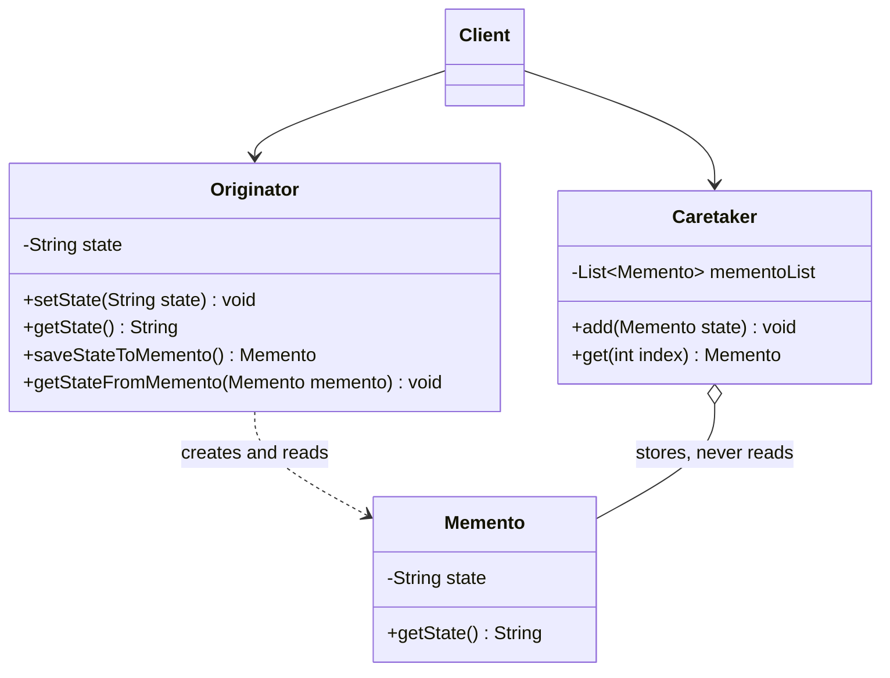
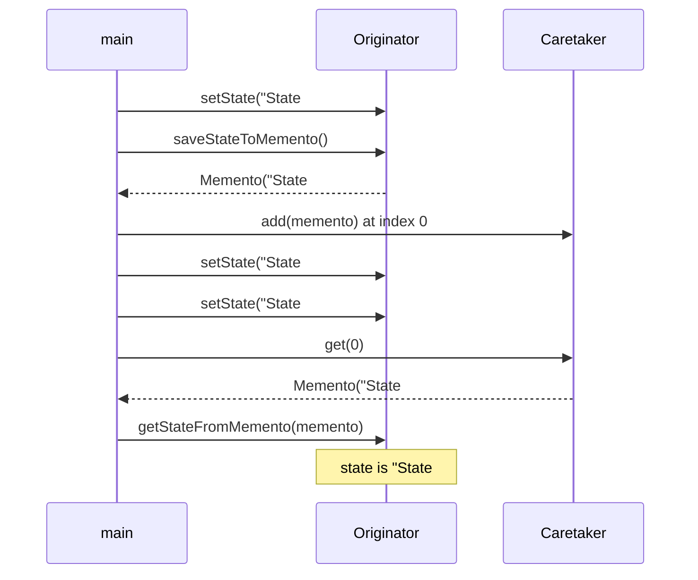

## In One Line
The Memento pattern lets an object take a **snapshot of its own internal state** (the memento), hand it to someone else to keep, and later **restore itself** from that snapshot — without letting the keeper look inside or change it. It is the classic way to implement undo, checkpoints and "save game".

## Mental Model
Think of **saving a video game**. The game (the only thing that understands its own data) writes a **save file** — player position, health, inventory. The **save-slot menu** lists "Slot 1, Slot 2" and can hand a save file back to the game, but it cannot read or edit what is inside. When you load a slot, the game reads the file and puts itself back exactly as it was.

How it maps to the code:
- **The game** is the originator: `Originator` — it creates snapshots (`saveStateToMemento()`) and restores from them (`getStateFromMemento(...)`).
- **The save file** is the memento: `Memento` holding the `state` string.
- **The save-slot menu** is the caretaker: `Caretaker` with its `List<Memento>` — it stores and returns mementos by index.
- **Loading slot 1** is `originator.getStateFromMemento(caretaker.get(0))`.
- **A progress you never saved is lost** — `"State #1"` in the example was never saved, so it can never be restored.

## Concept
### Intent (Gang of Four)
> "Without violating encapsulation, capture and externalize an object's internal state so that the object can be restored to this state later."

Also known as **Token**. Category: behavioral.

The key words are *without violating encapsulation*. Undo is easy if you make every field public and let an undo manager copy them — but then every class that stores history knows your internals. Memento keeps the knowledge of "what my state is" **inside the originator**; everyone else just holds an opaque token.

### Participants and how the example maps to them
| Participant | Role | In the example |
|---|---|---|
| **Originator** | The object whose state is saved; creates mementos of itself and restores itself from them | `Originator` with `saveStateToMemento()` and `getStateFromMemento(Memento)` |
| **Memento** | Stores a snapshot of the originator's internal state; should be immutable and opaque to outsiders | `Memento` with a `state` field |
| **Caretaker** | Decides *when* to save and keeps mementos; never inspects or modifies them | `Caretaker` with `List<Memento> mementoList`, `add`, `get(index)` |
| **Client** | Drives the flow | `main` |

### Narrow and wide interfaces (the heart of the pattern)
GoF describes a memento with **two interfaces**:
- A **narrow interface** for the caretaker: it can only pass the memento around. No reading, no writing.
- A **wide interface** for the originator: it can read everything it needs to restore itself.

C++ achieved this with `friend`. In Java you have these options:
| Technique | How | Caretaker can read state? |
|---|---|---|
| Public class with public getter (**the course example**) | `class Memento { public String getState() }` | Yes — encapsulation broken |
| **Nested class with private members** | `Originator.Memento` as a `static` nested class with `private` fields and constructor; the outer class can access a nested class's private members, nobody else can | No |
| **Opaque interface + private nested record** (modern) | `public interface Memento {}` exposed; `private record Snapshot(...) implements Memento` inside the originator; `restore` checks `instanceof Snapshot s` | No |
| Package-private | Originator and memento in one package, caretaker elsewhere | Only same-package code |

### Rules for a correct memento
1. **Immutable** — `final` fields, no setters. A memento is a photo, not a live view.
2. **Deep enough copy** — if the state contains mutable objects (`List`, arrays, `StringBuilder`, `Date`), copy them when saving (and again when restoring). Otherwise the snapshot keeps changing with the originator. `String`, `Integer`, records of immutable values are safe to share.
3. **Only what is needed to restore** — not caches, not derived data, not references to services.
4. **Only the originator creates and reads it** — otherwise mementos can be forged or inspected.

### Undo with mementos
The caretaker takes a snapshot **before** each change and pushes it on an undo stack. Undo = push the *current* snapshot on the redo stack, then restore the top of the undo stack. Redo is the mirror image. Any new change clears the redo stack. (Exactly the same two-stack mechanics as [Command](lesson:a10-patterns/13-command) undo — only what is stored differs.)

### Costs and how to control them
| Problem | Remedy |
|---|---|
| Big state × many snapshots = lots of memory | Cap the history size; drop the oldest snapshots |
| Most of the state didn't change | Store **incremental** changes (diffs or commands) instead of full snapshots; or share unchanged immutable parts (persistent data structures) |
| Snapshots must survive a restart | Persist them (serialization, JSON, a database row) — then version the format |
| Saving must be consistent in multithreaded code | Take the snapshot while holding the originator's lock |

### When to use it
- You need **undo/redo**, **checkpoints/rollback**, "save game", or "cancel the edit dialog and restore the original values".
- Exposing the object's fields just to save them would break encapsulation.
- Operations have no cheap inverse (so Command-style undo doesn't work).

### When not to use it
- State is huge and changes a little at a time — snapshots waste memory; prefer commands/diffs.
- The state is not owned by the object (e.g. it lives in a database) — use the database's own mechanisms (transactions, savepoints).
- Creating the snapshot is expensive and undo is rare.

### Real JDK and Spring examples
| Where | Memento-like behaviour |
|---|---|
| **`java.sql.Savepoint`** | `connection.setSavepoint()` returns an opaque token; `connection.rollback(savepoint)` restores the transaction to that point. You cannot see the data inside — a textbook narrow interface. |
| **`java.io.Serializable`** | Serialization externalizes an object's state to bytes; deserialization rebuilds it. A persistent memento — but it can see private fields, and the stream can be read or tampered with. |
| **`javax.swing.undo.StateEdit` / `StateEditable`** | An editable object writes its state into a `Hashtable` in `storeState(...)` and reloads it in `restoreState(...)`; `StateEdit` keeps the before/after states for undo/redo. |
| **Spring Batch `ExecutionContext`** | An `ItemStream` saves its position (e.g. how many items were read) in `update(ExecutionContext)`; the framework (the caretaker) persists it, and on restart `open(ExecutionContext)` restores the reader. |
| Everyday systems | Text-editor undo, browser form restore, VM snapshots, Git commits, game save slots |

### Look-alike patterns
| Pattern | Difference |
|---|---|
| **[Command](lesson:a10-patterns/13-command)** | Both enable undo. Command undoes by running an **inverse operation**; Memento undoes by **restoring a snapshot**. A command can store a memento when no inverse exists. |
| **[Prototype](lesson:a10-patterns/04-prototype)** | Prototype **clones a whole object** to get a new, usable instance. Memento captures **only the state needed to restore the same object**, in an opaque, inert form. |
| **[State](lesson:a10-patterns/20-state)** | Despite the name, State is about changing **behaviour** by swapping state objects; Memento is about saving and restoring **data**. |
| **[Iterator](lesson:a10-patterns/15-iterator)** | An iterator's position can be captured as a memento to resume traversal later. |
| **Serialization** | A mechanism, not a pattern: one way to persist a memento. |

## Diagram

Only the originator should create and read mementos; the caretaker just keeps them. (In the course code, `Memento.getState()` is public, so this rule is not enforced — see Traps.)


Only states that were explicitly saved can come back; `"State #1"` was overwritten before any snapshot was taken.

## Code
@example CoreJava/BehavioralPattern/MementoPatternExample.java

**Encapsulated mementos with undo/redo.** The caretaker only sees the empty `Editor.Memento` interface; the real data is a private nested record that only `Editor` can create and read:
```java
import java.util.ArrayDeque;
import java.util.Deque;

public class EditorDemo {
    public static void main(String[] args) {
        Editor editor = new Editor();
        History history = new History(editor);

        history.run(() -> editor.type("Hello"));
        history.run(() -> editor.type(", world"));
        history.run(() -> editor.moveCursor(0));
        System.out.println(editor);

        history.undo();  System.out.println(editor);
        history.undo();  System.out.println(editor);
        history.redo();  System.out.println(editor);

        Editor.Memento m = editor.save();
        // m.text();                  // does not compile: Memento has no methods, Snapshot is private
    }
}

class Editor {                                         // Originator
    private final StringBuilder text = new StringBuilder();
    private int cursor;

    // Narrow interface: all that outsiders (the caretaker) can see. No methods at all.
    public interface Memento {}

    // Wide interface: a private nested record only Editor can create or read.
    private record Snapshot(String text, int cursor) implements Memento {}

    public void type(String s) { text.insert(cursor, s); cursor += s.length(); }
    public void moveCursor(int pos) { cursor = Math.max(0, Math.min(pos, text.length())); }

    public Memento save() { return new Snapshot(text.toString(), cursor); }   // String is immutable: safe copy

    public void restore(Memento m) {
        if (!(m instanceof Snapshot s)) throw new IllegalArgumentException("not my memento");
        text.setLength(0);
        text.append(s.text());
        cursor = s.cursor();
    }

    @Override public String toString() {
        return "\"" + text + "\" cursor=" + cursor;
    }
}

class History {                                        // Caretaker: stores mementos, never looks inside
    private final Editor editor;
    private final Deque<Editor.Memento> undo = new ArrayDeque<>();
    private final Deque<Editor.Memento> redo = new ArrayDeque<>();

    History(Editor editor) { this.editor = editor; }

    void run(Runnable change) {
        undo.push(editor.save());      // snapshot BEFORE the change
        redo.clear();
        change.run();
    }
    void undo() {
        if (undo.isEmpty()) return;
        redo.push(editor.save());
        editor.restore(undo.pop());
    }
    void redo() {
        if (redo.isEmpty()) return;
        undo.push(editor.save());
        editor.restore(redo.pop());
    }
}
```
```output
"Hello, world" cursor=0
"Hello, world" cursor=12
"Hello" cursor=5
"Hello, world" cursor=12
```
Uncommenting `m.text()` fails with *cannot find symbol — method text() — location: variable m of type Memento*: the caretaker really cannot read the snapshot. Note the memento saves the **cursor** too — undoing the cursor move restores `cursor=12` although the text did not change.

**The shallow-copy bug.** If the state is a mutable object and the memento just keeps a reference to it, the "snapshot" changes along with the originator:
```java
import java.util.ArrayList;
import java.util.List;

public class ShallowBug {
    static class Memento {
        private final List<String> lines;
        Memento(List<String> lines) { this.lines = lines; }
    }
    static class Document {
        private List<String> lines = new ArrayList<>();
        void write(String line) { lines.add(line); }
        Memento saveShallow() { return new Memento(lines); }                  // BUG: shares the list
        Memento saveDeep()    { return new Memento(List.copyOf(lines)); }     // copy
        void restore(Memento m) { lines = new ArrayList<>(m.lines); }
        public String toString() { return lines.toString(); }
    }
    public static void main(String[] args) {
        Document doc = new Document();
        doc.write("a");
        Memento shallow = doc.saveShallow();
        Memento deep = doc.saveDeep();
        doc.write("b");
        doc.restore(shallow);
        System.out.println("after restoring shallow: " + doc);
        doc.restore(deep);
        System.out.println("after restoring deep:    " + doc);
    }
}
```
```output
after restoring shallow: [a, b]
after restoring deep:    [a]
```
`final` on the field did not help: it stops the *reference* from changing, not the list it points to. `restore` also copies (`new ArrayList<>(...)`) so that later edits don't leak back into the saved memento.

## Walkthrough
**Imports (lines 3–4).** `ArrayList` and `List` for the caretaker's history.

**`class Memento` (lines 6–17).**
- `private String state;` — the snapshot. Because `String` is immutable, storing the reference is a safe copy.
- `public Memento(String state)` — stores the value at the moment of saving.
- `public String getState()` — returns the saved value. It is meant for the originator, but being `public` it is available to anyone (see Traps).

**`class Originator` (lines 19–38).**
- `private String state;` with `setState`/`getState` — the live state that changes over time.
- `saveStateToMemento()` — `return new Memento(state);` — captures the current value in a new object. The originator is the one that decides *what* goes into a memento.
- `getStateFromMemento(Memento memento)` — `state = memento.getState();` — **restores** the originator from a snapshot. Despite the "get" name, this method changes the originator.

**`class Caretaker` (lines 40–51).**
- `private List<Memento> mementoList = new ArrayList<>();` — the history, oldest first.
- `add(Memento)` appends; `get(int index)` returns a saved memento by position. The caretaker never looks at the state; it only stores and hands back.

**The client, `main` (lines 55–73).**
- `setState("State #1")` then immediately `setState("State #2")` — `"State #1"` is overwritten before anyone saves it, so it is gone for good.
- `caretaker.add(originator.saveStateToMemento())` — snapshot `"State #2"` at index 0.
- `setState("State #3")` + save — snapshot `"State #3"` at index 1.
- `setState("State #4")` — the current state, **not** saved.
- Prints **`Current State: State #4`**.
- `getStateFromMemento(caretaker.get(0))` → state becomes `"State #2"` → prints **`First saved State: State #2`**.
- `getStateFromMemento(caretaker.get(1))` → `"State #3"` → prints **`Second saved State: State #3`**.

Restoring does **not** remove the memento from the list — the same snapshot can be restored again and again. All three `// Output:` comments match the recorded output, and the run is deterministic.

## Traps
> [!ERRATA] The example breaks the very promise in the pattern's intent — *"without violating encapsulation"*. `Memento` is a top-level class with a **public constructor and a public `getState()`**, so the caretaker (or anyone) can read the saved state (`caretaker.get(0).getState()` returns `"State #2"`, verified) and can even forge mementos with `new Memento("anything")`. The field is also not `final`. Make the memento immutable and opaque: a nested class with private members, or a public marker interface with a private nested record, as in *Code*.

> [!ERRATA] Misleading names: `getStateFromMemento(Memento)` sounds like a getter but it **restores** (mutates) the originator — `restore(Memento)` or `undoTo(Memento)` says what it does. In `Caretaker.add(Memento state)` the parameter is a memento, not a state.

- **Shallow snapshots of mutable state.** Storing a reference to a `List`, array, `StringBuilder` or `Date` means the "snapshot" keeps changing (verified: restoring the shallow memento gave `[a, b]` instead of `[a]`). Copy on save — `List.copyOf`, `array.clone()`, `sb.toString()` — and copy again on restore.
- **Records are only shallowly immutable.** `record Snapshot(List<String> lines)` still shares the list; copy it in a compact constructor: `Snapshot { lines = List.copyOf(lines); }`.
- **Unsaved state is gone.** Only states captured by `saveStateToMemento()` can be restored — `"State #1"` in the example can never come back.
- **Index-based history** (`caretaker.get(2)` with two saved mementos) throws `IndexOutOfBoundsException` (*Index 2 out of bounds for length 2*). For undo, a stack (`ArrayDeque`) is the natural structure.
- **Snapshot of a never-initialised originator** holds `null` — restoring it resets the originator to `null`. Decide whether that is valid.
- **Memory growth.** Unlimited history of large snapshots is a slow memory leak; cap it.
- **Serialized mementos are not private.** If you persist mementos (files, caches), anyone with the bytes can read or modify them; sign or encrypt if that matters, and version the format.

## Tips & Tricks
- **Mnemonic — "O-M-C: the Originator Makes it, the Caretaker Carries it (blind)."**
- **Save-game rule:** the game writes and reads the save file; the slot menu only stores it.
- **Photo, not window:** a memento must be an immutable copy — if changing the originator changes the memento, you stored a window.
- **Snapshot before the change**, push on the undo stack, clear redo on every new change.
- In modern Java, the cleanest memento is a **private nested record** behind a **public empty interface**; `restore` uses `instanceof Snapshot s` pattern matching (Java 16+).
- Command or Memento for undo? **Cheap inverse → Command. No inverse or complex state → Memento.** Big state with small changes → store diffs/commands, not full snapshots.
- Interview name-drop: **`java.sql.Savepoint`** is a memento — an opaque token you give back to `rollback(savepoint)`.

## Interview Q&A
### [Basic] What is the Memento pattern?
It is a behavioral pattern for saving and restoring an object's state without breaking its encapsulation. The **originator** creates a **memento** — an immutable snapshot of its internal state — and gives it to a **caretaker**, which stores it (for example in an undo history) but never looks inside. Later the caretaker hands the memento back and the originator restores itself from it. It is used for undo/redo, checkpoints, rollback and save/load.

**Follow-up:** *Why not just let the undo manager copy the object's fields?* — Then the undo manager depends on the originator's internals, and those fields must be exposed; any change to the originator breaks it. Memento keeps that knowledge inside the originator.

### [Basic] Map the participants to the course example.
- **Originator** — `Originator`: holds `state`, creates snapshots with `saveStateToMemento()`, restores with `getStateFromMemento(...)`.
- **Memento** — `Memento`: holds a copy of `state`.
- **Caretaker** — `Caretaker`: keeps a `List<Memento>` and returns one by index.
- **Client** — `main`: changes the state, asks for snapshots, restores them.

The output shows restore working: after moving to `"State #4"`, restoring memento 0 gives `"State #2"` and memento 1 gives `"State #3"`.

**Follow-up:** *Why is "State #1" never printed?* — It was overwritten by `"State #2"` before any snapshot was taken; only saved states can be restored.

### [Intermediate] How do you keep the memento opaque to the caretaker in Java?
Give the caretaker a **narrow interface** and the originator a **wide one**. Options: make the memento a static nested class of the originator with `private` fields and constructor (the outer class can access its nested class's private members; nobody else can), or expose an empty public interface and implement it with a private nested record:
```java
class Editor {
    public interface Memento {}                                   // narrow
    private record Snapshot(String text, int cursor) implements Memento {}   // wide
    public Memento save() { return new Snapshot(text.toString(), cursor); }
    public void restore(Memento m) {
        if (!(m instanceof Snapshot s)) throw new IllegalArgumentException();
        text.setLength(0); text.append(s.text()); cursor = s.cursor();
    }
}
```
The caretaker stores `Editor.Memento` values and cannot read them or create fake ones.

**Follow-up:** *What does the course example do instead?* — A public class with a public getter and constructor, so encapsulation is not protected.

### [Intermediate] Why must a memento be a deep (enough) copy? Show the bug.
Because a memento must not change after it is taken. If the originator's state is a mutable `List` and the memento stores the same reference, later `add` calls on the originator also change the "snapshot". Restoring then brings back the *current* state, not the old one:
```java
Memento saveShallow() { return new Memento(lines); }             // shares the list
Memento saveDeep()    { return new Memento(List.copyOf(lines)); } // independent copy
```
With `write("a")`, save, `write("b")`, restore: the shallow version gives `[a, b]`, the deep version `[a]`. Copy mutable parts when saving **and** when restoring. Immutable values (`String`, boxed numbers, immutable records) can be shared safely.

**Follow-up:** *Does declaring the field `final` fix it?* — No. `final` fixes the reference, not the object's contents.

### [Intermediate] How would you implement undo/redo with mementos?
The caretaker keeps two stacks (`ArrayDeque`). Before every change it pushes `originator.save()` on the undo stack and clears the redo stack. **Undo**: push the current `save()` on the redo stack, then `restore(undo.pop())`. **Redo**: push the current `save()` on the undo stack, then `restore(redo.pop())`. Cap the stacks to bound memory.

**Follow-up:** *Why clear the redo stack after a new change?* — The redo snapshots describe a "future" that branched from an older state; after a new edit they no longer follow from the current state.

### [Intermediate] Memento vs Command for undo — when do you pick which?
Command undo runs an **inverse operation** stored in the command (`turnOff` for `turnOn`, `remove(x)` for `add(x)`): cheap in memory, but needs a correct inverse for every operation. Memento undo **restores a snapshot**: works for any operation (image filters, complex multi-field edits), but costs memory proportional to the state size. They combine well: a command's `execute()` saves a memento of the receiver and `undo()` restores it.

**Follow-up:** *What do editors with huge documents do?* — Store small diffs or commands per edit rather than full snapshots, sometimes with periodic full checkpoints.

### [Intermediate] Where do you see Memento in the JDK or Spring?
- **`java.sql.Savepoint`**: `setSavepoint()` returns an opaque token, `rollback(savepoint)` restores the transaction — the caller can't see what is inside.
- **Serialization** (`Serializable`): an object's state externalized to bytes and later restored — a persistent memento (with weaker encapsulation).
- **`javax.swing.undo.StateEdit`/`StateEditable`**: objects store and restore their state in a `Hashtable` for undoable edits.
- **Spring Batch `ExecutionContext`**: item readers/writers save their position in `update(...)`, and the framework restores it with `open(...)` when a failed job is restarted.

**Follow-up:** *Why is `Savepoint` a good example of the narrow interface?* — It only exposes an ID or name; the actual saved data stays inside the database and driver.

### [Advanced] Memento vs Prototype vs serialization — what is the difference?
- **Prototype** clones an object to produce a **new, usable object** of the same type; the clone is live and independent.
- **Memento** captures **only the state needed to restore the same originator**, in an inert, opaque form that nobody else can use.
- **Serialization** is a **mechanism** to turn state into bytes; it can implement a persistent memento or a deep clone, but it reads private fields reflectively, so the bytes are neither opaque nor tamper-proof.

You might use `clone()` or serialization *inside* `save()` to build a memento, but the memento's role — opaque snapshot for restore — is what makes it the pattern.

**Follow-up:** *What risk comes with persisting mementos across releases?* — Format evolution: add a version field (or `serialVersionUID`) and migration code, or old saves won't load.

### [Advanced] Your undo history is using too much memory. What can you do?
- **Cap** the number of mementos (drop the oldest — a bounded deque).
- Store **incremental** changes (diffs or commands) and take a full snapshot only every N steps.
- **Share immutable parts** between snapshots (persistent/immutable data structures: unchanged sub-trees are reused, only changed parts are copied).
- **Compress** or **offload** old snapshots to disk.
- Don't snapshot derived data or caches — only what `restore` really needs.

**Follow-up:** *Would `SoftReference` mementos help?* — They let the GC drop old snapshots under memory pressure, but then undo can silently fail; a hard cap is more predictable.

## Quiz
### In the original, why is the first restored state `"State #2"` and not `"State #1"`?
- [ ] The caretaker's list is zero-based, so `get(0)` skips the first state
- [x] `"State #1"` was overwritten by `"State #2"` before any memento was saved
- [ ] `getStateFromMemento` always returns the second-last state
- [ ] `ArrayList` does not keep insertion order
> `setState("State #1")` is immediately followed by `setState("State #2")`, and only then `saveStateToMemento()` is called. A memento captures whatever the state is *at save time*; unsaved states are lost. `get(0)` returns the first saved memento, which holds `"State #2"`.

### What does this print, using the original classes?
```java
originator.setState("State #1");
originator.setState("State #2");
caretaker.add(originator.saveStateToMemento());
originator.setState("State #3");
caretaker.add(originator.saveStateToMemento());
originator.setState("State #4");
originator.getStateFromMemento(caretaker.get(1));
originator.getStateFromMemento(caretaker.get(0));
System.out.println(originator.getState());
```
- [ ] `State #3`
- [x] `State #2`
- [ ] `State #4`
- [ ] `State #1`
> The last restore wins: memento 0 holds `"State #2"`. Restoring does not remove mementos from the caretaker, and the restore order is independent of the save order.

### What does this print?
```java
Document doc = new Document();          // lines = new ArrayList<>()
doc.write("a");
Memento shallow = doc.saveShallow();    // new Memento(lines)  -- same list
doc.write("b");
doc.restore(shallow);                   // lines = new ArrayList<>(m.lines)
System.out.println(doc);
```
- [ ] `[a]`
- [x] `[a, b]`
- [ ] `[]`
- [ ] `[b]`
> The memento stored a reference to the originator's own list, so `write("b")` also changed the "snapshot". A memento must copy mutable state (`List.copyOf(lines)`) at save time.

### Using `Editor` and `History` from the Code section, what is printed?
```java
history.run(() -> editor.type("A"));
history.run(() -> editor.type("B"));
history.undo();
history.run(() -> editor.type("C"));
history.redo();
System.out.println(editor);
history.undo(); history.undo(); history.undo();
System.out.println(editor);
```
- [ ] `"ABC" cursor=3` then `"" cursor=0`
- [x] `"AC" cursor=2` then `"" cursor=0`
- [ ] `"AB" cursor=2` then `"A" cursor=1`
- [ ] `"AC" cursor=2` then `"A" cursor=1`
> Undo removes `B`; typing `C` is a new change, so the redo stack (holding the `AB` state) is cleared and `redo()` does nothing → `"AC"`. Only two snapshots are on the undo stack (before `A`, before `C`), so two undos reach the empty document and the third undo does nothing.

### Which participant must never read or modify the memento's contents?
- [ ] Originator
- [x] Caretaker
- [ ] Client creating the originator
- [ ] Nobody — mementos are public data
> The caretaker only stores and returns mementos (the narrow interface). The originator is the one that creates and reads them (the wide interface). In the course code the caretaker *could* call `getState()`, which is the encapsulation flaw.

### Which JDK type behaves like a memento with a narrow interface?
- [ ] `java.util.Iterator`
- [ ] `java.lang.Runnable`
- [x] `java.sql.Savepoint`
- [ ] `java.util.Observer`
> `Connection.setSavepoint()` returns a `Savepoint` token you can only give back to `rollback(savepoint)`; the saved state stays inside the database. `Runnable` is a Command, `Iterator` is Iterator, `Observer` is Observer.

## Takeaways
- Memento saves an object's internal state as an opaque snapshot so the object can be restored later, without exposing its internals.
- Participants: Originator (creates and restores from mementos), Memento (immutable snapshot), Caretaker (stores mementos, never looks inside).
- Java encapsulation: public empty `Memento` interface (narrow) + private nested record or class (wide); the course's public `getState()` breaks this.
- Mementos must be immutable and copy mutable state (`List.copyOf`, `clone()`), or the snapshot changes with the originator.
- Undo/redo: snapshot before each change onto an undo stack; undo/redo move snapshots between two stacks; a new change clears redo.
- Memento undo restores snapshots; Command undo runs inverse operations; Prototype clones live objects.
- Real examples: `java.sql.Savepoint`, serialization, Swing `StateEdit`, Spring Batch `ExecutionContext`; control memory with caps and diffs.
