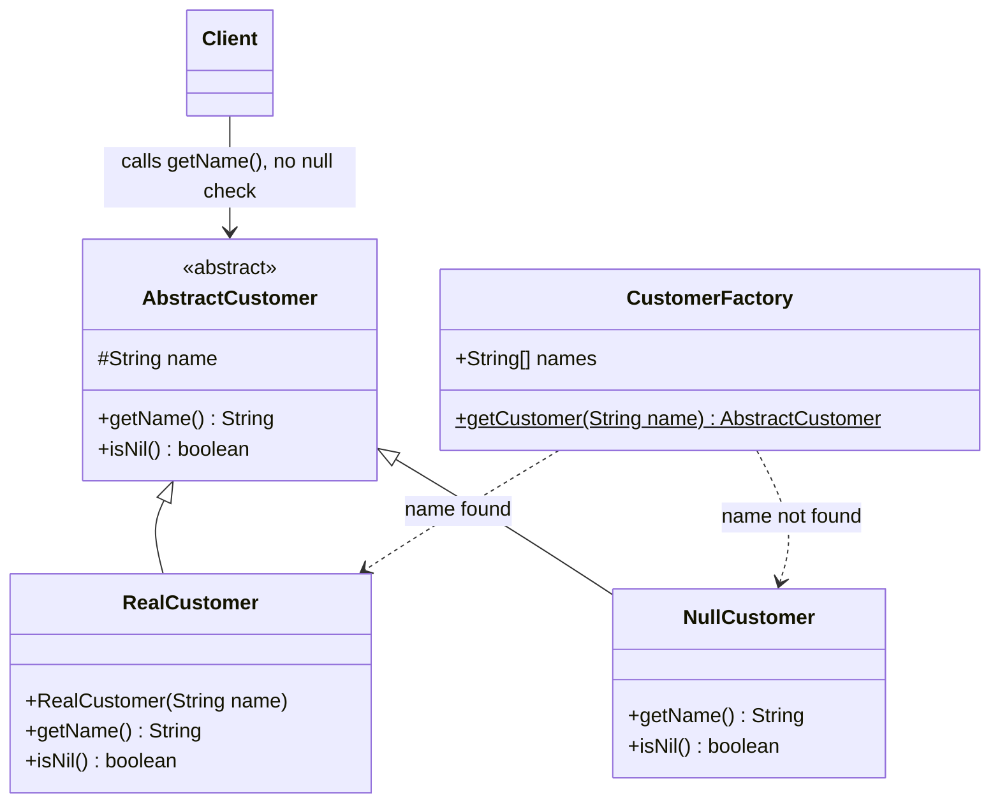
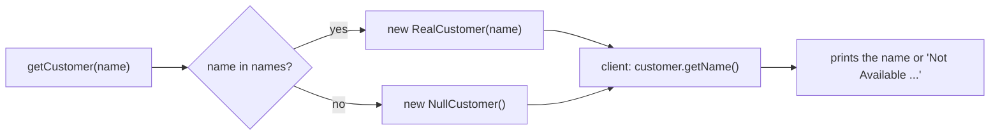

## In One Line
The Null Object pattern replaces `null` with a **real object that implements the same interface but does nothing (or returns neutral values)**, so client code can call methods on it safely without writing `if (x != null)` checks everywhere.

## Mental Model
Think of a shop checkout that serves **members and guests**. A member swipes a loyalty card: they get a discount and an emailed receipt. A shopper without a card is not refused and does not crash the till — the cashier rings them up as **"Guest"**: 0% discount, no email. The checkout procedure is exactly the same for both; only the profile behind it differs.

How it maps to the code:
- **The customer profile the till works with** is the abstract type: `AbstractCustomer`.
- **A member's profile** is the real object: `RealCustomer("John")`.
- **The "Guest" profile** is the null object: `NullCustomer` — it answers every question with a safe default (`"Not Available in Customer Database"`).
- **The front desk that looks you up** is the factory: `CustomerFactory.getCustomer(name)` — it never answers "nobody"; it hands back either a member or the guest profile.
- **The cashier never asks "is there a customer?"** — `main` calls `customer4.getName()` exactly like the others, with no null check.

## Concept
### Origin and intent
Null Object is **not** one of the 23 Gang of Four patterns. It was described by **Bobby Woolf** ("Null Object", *Pattern Languages of Program Design 3*, late 1990s) and popularised by Martin Fowler's refactoring *Introduce Null Object* (later generalised as *Introduce Special Case*).

> Intent: provide a surrogate for another object that shares the same interface but does nothing, so that the absence of an object can be treated the same way as its presence.

Tony Hoare called his invention of the null reference his *"billion-dollar mistake"*. The Null Object pattern is one of the oldest object-oriented answers: **model "nothing" as an object with behaviour**, so polymorphism handles it.

### The problem it solves
When a lookup can fail, returning `null` forces every caller to remember a check:
```java
Customer c = repo.find(name);
String label = (c != null) ? c.getName() : "Not Available";   // repeated in every caller
if (c != null) c.sendReceipt(text);                            // forget once -> NullPointerException
```
The checks are **duplicated** across callers, easy to **forget**, and they hide the real logic. With a null object, the factory/repository returns an object that already knows what "no customer" means, and every caller simply writes `c.getName()`.

### Participants and how the example maps to them
| Participant | Role | In the example |
|---|---|---|
| **AbstractObject** | The interface/abstract class clients use | `AbstractCustomer` (`getName()`, `isNil()`) |
| **RealObject** | The normal implementation | `RealCustomer` — returns the stored name, `isNil()` is `false` |
| **NullObject** | Same interface; neutral or do-nothing behaviour | `NullCustomer` — returns a fixed message, `isNil()` is `true` |
| **Client** | Uses the abstract type, never checks for `null` | `main` |
| (Factory) | Decides which one to return — the only place that knows about absence | `CustomerFactory.getCustomer(String)` |

### What a good null object does
- **Queries** return neutral values: empty string or a label, `0`, `false`, empty collections, `Optional.empty()`.
- **Commands** (void methods) **do nothing**: `sendReceipt(...)` is an empty method.
- **Methods returning other objects** return *their* null objects (`NullCustomer.getAddress()` returns `NullAddress`), so chains of calls stay safe.
- It is **stateless and immutable**, so **one shared instance** is enough (a `static final` constant or an `enum` singleton).
- It is created at a **boundary** — a factory, repository, or `map.getOrDefault(key, NULL_CUSTOMER)` — so the rest of the code never sees `null`.

### Null Object vs Special Case
The course's `NullCustomer` does not do "nothing": it returns a specific message, `"Not Available in Customer Database"`. Fowler calls this more general idea **Special Case** — a subclass that provides special behaviour for a particular case (`UnknownCustomer`, `MissingCustomer`, `GuestCustomer`). A null object is the special case whose behaviour is "neutral / do nothing". Interviewers accept either name for this example; mentioning the distinction scores points.

### The `isNil()` escape hatch
The example's abstract class declares `isNil()`. It is useful where the UI really must behave differently ("please sign in" instead of a profile page). But if every caller starts writing `if (customer.isNil())`, you have simply renamed the null check. The goal is that **most** callers never need to ask. Notice that the course's `main` never calls `isNil()` at all.

### Choosing between null, Optional, Null Object and exceptions
| Approach | Is absence visible to the caller? | Does the compiler/type force handling? | Use when |
|---|---|---|---|
| Return `null` | No — until an NPE | No | Low-level code, performance-critical internals |
| Return `Optional<T>` (Java 8) | Yes, in the type | Yes, the caller must unwrap | The **caller** should decide what absence means ([Optional](lesson:a05-java8/20-optional)) |
| Return a **Null Object** | No — it behaves like a normal object | No | There is **one sensible default behaviour** for "none" (do nothing, zero, guest) |
| Throw an exception | Yes | Checked: yes | Absence is an **error** (`findById` of an ID that must exist) |

Rule of thumb: *if every caller would write the same fallback, bake it into a Null Object; if callers need different fallbacks, return `Optional`; if absence is a bug, throw.*

### When to use it
- Many callers would repeat the same null check and the same default behaviour.
- A **collaborator is optional**: a logger, a listener, a cache, a discount policy, a command slot — "none" should mean "do nothing".
- You want to remove `if (x != null)` branches that obscure the main logic.

### When not to use it
- Absence is a **real problem** the caller must know about (payment account missing, required config missing). A silent null object turns a loud bug into wrong data — **fail fast** instead.
- Callers need **different** fallbacks — use `Optional`.
- There is no meaningful neutral behaviour (what would `NullBankAccount.withdraw(100)` do?).

### Real JDK and Spring examples
| Where | Null object |
|---|---|
| `Collections.emptyList()`, `emptySet()`, `emptyMap()`, `emptyIterator()`, `List.of()` | Empty but fully working collections — iterate zero times instead of returning `null` |
| `InputStream.nullInputStream()`, `OutputStream.nullOutputStream()`, `Reader.nullReader()`, `Writer.nullWriter()` (Java 11) | Streams that are always at end-of-input, or that silently discard output |
| `ProcessBuilder.Redirect.DISCARD` (Java 9) | Throw away a child process's output |
| `Function.identity()`, `UnaryOperator.identity()` | The "do nothing" transformation |
| `Stream.empty()` | A stream with no elements |
| Spring `NoOpCacheManager` | Turns caching off without changing any `@Cacheable` code |
| Spring Security `NoOpPasswordEncoder` (deprecated, tests only) | A password encoder that does not encode |
| SLF4J `NOPLogger` | Used when no logging backend is found: every log call does nothing |
| OpenTelemetry `OpenTelemetry.noop()` | Tracing API that records nothing |

### Look-alike and partner patterns
| Pattern | Relationship |
|---|---|
| **[Strategy](lesson:a10-patterns/21-strategy)** | A null object is often a **no-op strategy** (`NoDiscount`, `NoOpCacheManager`). |
| **[State](lesson:a10-patterns/20-state)** | A "null state" that ignores events. |
| **[Singleton](lesson:a10-patterns/01-singleton)** | Null objects are stateless, so one instance is shared. |
| **[Factory](lesson:a10-patterns/02-factory)** | The factory decides between the real object and the null object — as `CustomerFactory` does. |
| **[Command](lesson:a10-patterns/13-command)** | A `NoCommand` in an empty remote-control slot avoids NPEs on `pressButton()`. |
| **Proxy** | Looks similar (a stand-in with the same interface), but a proxy **forwards** to a real subject; a null object has **no** real subject behind it. |
| **`Optional`** | Also models absence, but makes it **visible** and makes the caller choose; a null object **hides** it. |

## Diagram

Both subclasses honour the same contract; only the factory knows which one it returned.


Absence is decided once, at the boundary; after that, polymorphism replaces every `if (customer != null)`.

## Code
@example CoreJava/BehavioralPattern/NullObjectPatternExample.java

**A production-style null object.** A neutral discount (0) and a do-nothing command (`sendReceipt`), one shared instance (an enum singleton), created at the lookup boundary with `getOrDefault` — and the checkout code contains no null checks. The last lines show the `Optional` alternative, where the caller picks the fallback:
```java
import java.util.Locale;
import java.util.Map;
import java.util.Optional;

public class NullObjectDemo {
    interface Customer {
        String displayName();
        double discountRate();                 // the Null Object returns a neutral value: 0
        void sendReceipt(String text);         // the Null Object does nothing
    }

    record RealCustomer(String displayName, double discountRate) implements Customer {
        public void sendReceipt(String text) { System.out.println("  email to " + displayName + ": " + text); }
    }

    enum GuestCustomer implements Customer {   // the Null Object: stateless, so one shared instance
        INSTANCE;
        public String displayName() { return "Guest"; }
        public double discountRate() { return 0.0; }
        public void sendReceipt(String text) { /* nobody to send it to: do nothing */ }
    }

    static final Map<String, Customer> DB = Map.of(
            "john", new RealCustomer("John", 0.10),
            "jane", new RealCustomer("Jane", 0.05));

    static Customer find(String name) {                          // never returns null
        if (name == null) return GuestCustomer.INSTANCE;
        return DB.getOrDefault(name.toLowerCase(Locale.ROOT), GuestCustomer.INSTANCE);
    }

    static void checkout(String who, int amount) {
        Customer c = find(who);
        int total = (int) Math.round(amount * (1 - c.discountRate()));   // no null checks anywhere
        System.out.println(c.displayName() + " pays " + total);
        c.sendReceipt("You paid " + total);
    }

    public static void main(String[] args) {
        checkout("JOHN", 100);
        checkout("Julie", 100);
        checkout(null, 50);
        System.out.println(find("x") == find("y"));

        // Optional instead: absence stays visible and the CALLER picks the fallback
        Optional<Customer> maybe = Optional.ofNullable(DB.get("julie"));
        System.out.println(maybe.map(Customer::displayName).orElse("Not Available in Customer Database"));
    }
}
```
```output
John pays 90
  email to John: You paid 90
Guest pays 100
Guest pays 50
true
Not Available in Customer Database
```
The method is called `displayName()`, not `name()`, on purpose: an `enum` cannot implement an interface method `name()`, because `Enum.name()` is `final` (see Traps).

**Null objects already in the JDK:**
```java
import java.io.*;
import java.util.*;
import java.util.function.Function;

public class JdkNulls {
    public static void main(String[] args) throws IOException {
        List<String> none = Collections.emptyList();
        for (String s : none) System.out.println("never printed");
        System.out.println("emptyList size = " + none.size());

        System.out.println("nullInputStream().read() = " + InputStream.nullInputStream().read());
        try (PrintStream sink = new PrintStream(OutputStream.nullOutputStream())) {
            sink.println("goes nowhere");                       // accepted and discarded
        }
        System.out.println("nullReader().read() = " + Reader.nullReader().read());

        Function<String, String> noChange = Function.identity(); // "do nothing" transformation
        System.out.println(noChange.apply("same"));

        Iterator<String> it = Collections.emptyIterator();
        System.out.println("emptyIterator hasNext = " + it.hasNext());
        System.out.println(Collections.emptyList() == Collections.emptyList());
    }
}
```
```output
emptyList size = 0
nullInputStream().read() = -1
nullReader().read() = -1
same
emptyIterator hasNext = false
true
```
The last line proves `Collections.emptyList()` returns one shared immutable instance — a singleton null object.

## Walkthrough
**`abstract class AbstractCustomer` (lines 3–9) — the AbstractObject.**
- `protected String name;` — storage for subclasses. Only `RealCustomer` uses it; in `NullCustomer` it stays `null`.
- `public abstract String getName();` — the operation every client calls.
- `public abstract boolean isNil();` — lets a client ask "is this the null object?" when it truly must (the example never needs to).

**`class RealCustomer` (lines 11–24) — the RealObject.**
- The constructor stores the given name in the inherited `name` field.
- `getName()` returns it; `isNil()` returns `false`.

**`class NullCustomer` (lines 26–35) — the NullObject.**
- No constructor and no state.
- `getName()` returns the fixed text `"Not Available in Customer Database"` — the default behaviour for a missing customer.
- `isNil()` returns `true`.

**`class CustomerFactory` (lines 37–49) — the boundary that decides.**
- `public static final String[] names = {"John", "Jane", "Jack"};` — the "customer database".
- `getCustomer(String name)` loops over the known names; `n.equalsIgnoreCase(name)` compares ignoring case. On a match it returns `new RealCustomer(name)` — note: with the **caller's** spelling of the name. If nothing matches, it returns `new NullCustomer()` — **never `null`**. Even `getCustomer(null)` is safe, because `"John".equalsIgnoreCase(null)` is simply `false`.

**The client, `main` (lines 52–64).**
- Looks up `"John"`, `"Jane"`, `"Jack"` (found → `RealCustomer`) and `"Julie"` (not found → `NullCustomer`).
- Prints `Customers:`, then calls `getName()` on all four **the same way**: `John`, `Jane`, `Jack`, and for Julie **`Not Available in Customer Database`**.
- There is no `if (customer4 != null)` anywhere — that is the pattern at work. If the factory had returned `null` for Julie, `customer4.getName()` would have thrown `NullPointerException`.

The output is deterministic, and every `// Output:` comment matches the recorded output.

## Traps
> [!ERRATA] `public static final String[] names` does not make the list constant. `final` only freezes the **reference**; the array elements can be changed by any class: after `CustomerFactory.names[0] = "Hacker";`, `getCustomer("John")` returns the null customer and `getCustomer("hacker")` returns a real one (both verified). Keep the data private and immutable: `private static final Set<String> NAMES = Set.of("john", "jane", "jack");`.

> [!ERRATA] The factory creates a **new `NullCustomer` on every miss** (`getCustomer("x") == getCustomer("y")` is `false`, verified), although it is stateless — one shared instance is enough (`private static final AbstractCustomer NOT_FOUND = new NullCustomer();`). It also builds `RealCustomer` with the **caller's spelling**: `getCustomer("jOhN").getName()` returns `jOhN` (verified); return the canonical name `n` instead.

> [!ERRATA] Smaller issues: `RealCustomer` and `NullCustomer` override `getName()`/`isNil()` without `@Override`; and `protected String name` lives in the abstract class although only `RealCustomer` uses it — in `NullCustomer` it is silently `null` (verified). A `private final String name` in `RealCustomer` is cleaner.

- **Hiding real bugs.** A typo (`getCustomer("Jonh")`) quietly gives "Not Available" instead of an error. Use a null object only where "missing" is a normal, expected case.
- **`isNil()` everywhere** means you have just renamed the null check. If most callers need it, return `Optional` instead.
- **Enum singletons and `name()`.** `enum GuestCustomer implements Customer { INSTANCE; public String name() {...} }` does not compile — *"name() in GuestCustomer cannot override name() in Enum; overridden method is final"* (verified). The same applies to `ordinal()`. Rename the interface method or use a `final class` with a `static final INSTANCE`.
- **Null objects that return `null`** (from methods returning other objects) just move the NPE one call further. Return nested null objects or empty collections.
- **Stateful null objects.** If a null object stores data (e.g. a mutable list someone can add to), sharing one instance leaks data between callers. Keep them immutable.
- **Equality.** A null object should usually be compared by identity (it is a singleton); do not give two different "missing" customers `equals() == true` with real customers.

## Tips & Tricks
- **Mnemonic — "Nothing is an object too."** Don't return `null`; return an object that knows how to be nothing.
- **Guest-profile rule:** same checkout, different profile — if the fallback is the same for every caller, bake it into a null object.
- **Decide absence once, at the boundary** (factory, repository, `getOrDefault`), never in every caller.
- **Neutral values:** `""`/label, `0`, `false`, empty collection, empty `Optional`, do-nothing `void` methods, nested null objects.
- **Make it a singleton** — stateless null objects need exactly one instance.
- Return **empty collections, never `null`** (*Effective Java*, Item 54) — the most common null object of all.
- **Optional vs Null Object in one line:** *Optional says "there might be nothing — you decide"; Null Object says "there's nothing — and I'll handle it".*

## Interview Q&A
### [Basic] What is the Null Object pattern?
It replaces `null` references with an object that implements the expected interface but has neutral or do-nothing behaviour. Clients call methods on it as on any other object, so they need no `if (x != null)` checks and cannot get a `NullPointerException` from it. Typically a factory or repository returns either the real object or the null object, so knowledge of absence lives in one place. It is not a GoF pattern — it was described by Bobby Woolf and popularised by Martin Fowler's *Introduce Null Object* refactoring.

**Follow-up:** *What is a typical example in the JDK?* — `Collections.emptyList()`: instead of returning `null`, methods return an empty list you can iterate zero times.

### [Basic] Map the participants to the course example.
- **AbstractObject** — `AbstractCustomer` with `getName()` and `isNil()`.
- **RealObject** — `RealCustomer`, which returns the stored name.
- **NullObject** — `NullCustomer`, which returns `"Not Available in Customer Database"` and `isNil() == true`.
- **Factory** — `CustomerFactory.getCustomer(name)`, returning a real customer for known names and a null customer otherwise.
- **Client** — `main`, which calls `getName()` on all four customers identically.

**Follow-up:** *Where would the NPE have happened without the pattern?* — At `customer4.getName()` for `"Julie"`, if the factory had returned `null`.

### [Intermediate] Null Object or `Optional` — how do you choose?
Both address absence, but differently. `Optional<T>` makes absence **visible** in the return type and forces the **caller** to decide what to do (`orElse`, `orElseThrow`, `map`). A null object **hides** absence and provides **one built-in default behaviour**. Use a null object when every caller would do the same thing for "none" (do nothing, zero discount, guest name, no-op logger). Use `Optional` when different callers need different fallbacks, or when they should be aware that the value can be missing. Throw an exception when absence is an error.

**Follow-up:** *Should you use `Optional` for fields or parameters?* — Generally no; it was designed for return types. For optional collaborators (fields), a null object is often the better choice.

### [Intermediate] What is the difference between Null Object and Special Case?
Special Case (Fowler, *Patterns of Enterprise Application Architecture*) is the general idea: a subclass that represents a particular situation with its own behaviour — `UnknownCustomer`, `MissingCustomer`, `GuestUser`. Null Object is the special case whose behaviour is **neutral**: do nothing, return zero or empty. The course's `NullCustomer` actually returns a descriptive message, so strictly it is a special case, but it follows the null-object structure.

**Follow-up:** *Can a system have several special cases of one type?* — Yes, e.g. `UnknownCustomer` (not found) and `AnonymousCustomer` (not logged in), each with different behaviour.

### [Intermediate] Where do you see Null Object in the JDK and in Spring?
- JDK: `Collections.emptyList()/emptySet()/emptyMap()/emptyIterator()`, `List.of()`; `InputStream.nullInputStream()`, `OutputStream.nullOutputStream()`, `Reader.nullReader()`, `Writer.nullWriter()` (Java 11); `ProcessBuilder.Redirect.DISCARD` (Java 9); `Function.identity()`; `Stream.empty()`.
- Spring and libraries: `NoOpCacheManager` (disables caching without touching `@Cacheable` code), `NoOpPasswordEncoder` (deprecated), SLF4J's `NOPLogger` when no logging backend is present, OpenTelemetry's `OpenTelemetry.noop()`.

**Follow-up:** *Why is `nullOutputStream()` useful?* — To call an API that insists on writing somewhere (a `PrintStream`, a report writer) when you want the output discarded — no `if (debug)` branches inside it.

### [Intermediate] Why should a null object usually be a singleton, and how do you implement that?
A null object has no state and never changes, so every instance would be identical; creating a new one per lookup (as the course example does) only wastes allocations and makes identity checks unreliable. Implement it as a `private static final` constant, a `final` class with a static `INSTANCE`, or an `enum` with one constant. With an enum, beware that `name()` and `ordinal()` are `final` in `Enum`, so your interface cannot declare a `name()` method that the enum overrides.

**Follow-up:** *Does the JDK do this?* — Yes: `Collections.emptyList() == Collections.emptyList()` is `true`; it is a shared immutable instance.

### [Advanced] When is the Null Object pattern harmful?
When absence is a **bug** rather than a normal case. A null object turns a loud failure (an NPE or an exception at the right place) into quiet wrong behaviour: an order saved without a customer, a payment "processed" by a no-op gateway, a typo in a name silently shown as "Not Available". It can also make debugging harder, because nothing points at where the missing object came from. Guidelines: use it only for **optional collaborators** and genuinely expected absence; **fail fast** (`Objects.requireNonNull`, `orElseThrow`) for required data; log when a null object is substituted for something that was expected.

**Follow-up:** *What about a `NullPaymentGateway` for tests?* — Fine as a test double in tests or local profiles; dangerous if it can be wired in production by accident.

### [Advanced] How do you design null objects for chained calls like `customer.getAddress().getCity()`?
Every method of the null object that returns another object returns *that type's* null object: `NullCustomer.getAddress()` returns `NullAddress.INSTANCE`, whose `getCity()` returns `""` or `"Unknown"`. Collections come back empty, `Optional`s empty. That keeps any call chain safe without checks. The alternative is `Optional` chaining: `findCustomer(id).map(Customer::getAddress).map(Address::getCity).orElse("Unknown")` — explicit, but every caller writes it. Long chains also violate the Law of Demeter; often the better design is a direct method (`customer.getCity()`).

**Follow-up:** *What if the null object returned `null` from `getAddress()`?* — The NPE just moves one call later; a half-null object is worse than none.

### [Advanced] The course's `AbstractCustomer` has an `isNil()` method. Is that good design?
It is a pragmatic escape hatch: occasionally a caller must act differently (show a "sign up" banner instead of a profile). But it undermines the pattern if callers routinely branch on it — then `if (c.isNil())` is just `if (c == null)` with extra steps, and the default behaviour is being duplicated again. Better: keep `isNil()` rare, and push varying behaviour into polymorphic methods (e.g. `renderBanner()` implemented differently by real and null customers). The example's own client never calls `isNil()`, which is the ideal.

**Follow-up:** *What's a cleaner way to expose "is this the null object"?* — Compare with the singleton (`c == Customer.GUEST`) in the rare places that need it, or give the interface a descriptive method like `isRegistered()`.

## Quiz
### What does `CustomerFactory.getCustomer("jOhN").getName()` return in the original code?
- [ ] `John`
- [x] `jOhN`
- [ ] `Not Available in Customer Database`
- [ ] `null`
> `equalsIgnoreCase` finds the match, but the factory builds `new RealCustomer(name)` with the **argument**, not the stored `n`, so the caller's casing comes back. Returning `new RealCustomer(n)` would give the canonical `John`.

### What happens with `CustomerFactory.getCustomer(null).getName()` in the original code?
- [ ] `NullPointerException` inside `equalsIgnoreCase`
- [ ] `NullPointerException` when calling `getName()`
- [x] It returns `Not Available in Customer Database`
- [ ] It returns `null`
> The loop calls `n.equalsIgnoreCase(null)` on the stored names, and `String.equalsIgnoreCase(null)` returns `false` instead of throwing. No name matches, so the factory returns a `NullCustomer`. (Had the code been `name.equalsIgnoreCase(n)`, it *would* throw.)

### What does this print, using the original classes?
```java
CustomerFactory.names[0] = "Hacker";
System.out.println(CustomerFactory.getCustomer("John").getName());
```
- [ ] `John`
- [ ] Compile error: `names` is `final`
- [x] `Not Available in Customer Database`
- [ ] `ArrayStoreException`
> `final` on an array field only prevents assigning a new array to `names`; its elements can still be replaced. After the change, "John" is no longer in the list, so the null customer is returned. Use an immutable, private `Set.of(...)`.

### What does `CustomerFactory.getCustomer("x") == CustomerFactory.getCustomer("y")` print in the original code?
- [ ] `true`, because both are null customers
- [x] `false`
- [ ] It does not compile
- [ ] It throws `NullPointerException`
> Each miss executes `new NullCustomer()`, so two different objects come back and `==` compares identities. With a shared singleton null object (like `GuestCustomer.INSTANCE` in *Code*) the comparison is `true`.

### Spot the bug: why doesn't this compile?
```java
interface Customer { String name(); double discountRate(); }

enum GuestCustomer implements Customer {
    INSTANCE;
    public String name() { return "Guest"; }
    public double discountRate() { return 0.0; }
}
```
- [ ] Enums cannot implement interfaces
- [ ] An enum with one constant must be declared `final`
- [x] `Enum.name()` is `final`, so the enum cannot override it with its own `name()`
- [ ] `discountRate()` must be `static`
> Enums can implement interfaces (a common way to build singletons), but every enum inherits `public final String name()` from `java.lang.Enum`. The compiler reports *name() in GuestCustomer cannot override name() in Enum; overridden method is final*. Rename the interface method (e.g. `displayName()`).

### A service must let each caller decide what to do when a user is not found (show 404, create one, use a default). What should `findUser` return?
- [ ] A `NullUser` object
- [x] `Optional<User>`
- [ ] `null`
- [ ] A new empty `User`
> When callers need **different** fallbacks, absence must be visible to them: `Optional` puts it in the type and lets each caller choose (`orElseThrow`, `orElseGet`, `map`). A null object bakes in **one** default and hides absence; `null` is what we are trying to avoid.

### Which JDK method returns a null object that silently discards everything written to it?
- [ ] `System.out`
- [x] `OutputStream.nullOutputStream()`
- [ ] `Optional.empty()`
- [ ] `Objects.requireNonNull(x)`
> Since Java 11, `OutputStream.nullOutputStream()` accepts and discards all bytes (with `InputStream.nullInputStream()`, `Reader.nullReader()` and `Writer.nullWriter()` as siblings). `Optional.empty()` represents absence explicitly rather than behaving as a do-nothing object, and `requireNonNull` is the fail-fast opposite.

## Takeaways
- Null Object replaces `null` with an object of the same interface that does nothing or returns neutral values, removing repeated `if (x != null)` checks.
- Participants: AbstractObject (`AbstractCustomer`), RealObject (`RealCustomer`), NullObject (`NullCustomer`), and usually a factory that decides at the boundary.
- A good null object is stateless and shared (singleton), returns neutral values (0, empty, label), does nothing for commands, and returns nested null objects instead of `null`.
- The course's `NullCustomer` returns a message, which Fowler calls a Special Case; its `isNil()` is an escape hatch that should rarely be needed.
- Choose: Null Object when one default fits every caller; `Optional` when callers decide; an exception when absence is a bug. Null objects can hide real errors.
- Course-code issues: mutable `public static final String[] names`, a new `NullCustomer` per miss, and `RealCustomer` keeping the caller's casing.
- JDK/Spring examples: `Collections.emptyList()`, `OutputStream.nullOutputStream()` (Java 11), `Function.identity()`, Spring `NoOpCacheManager`, SLF4J `NOPLogger`.
