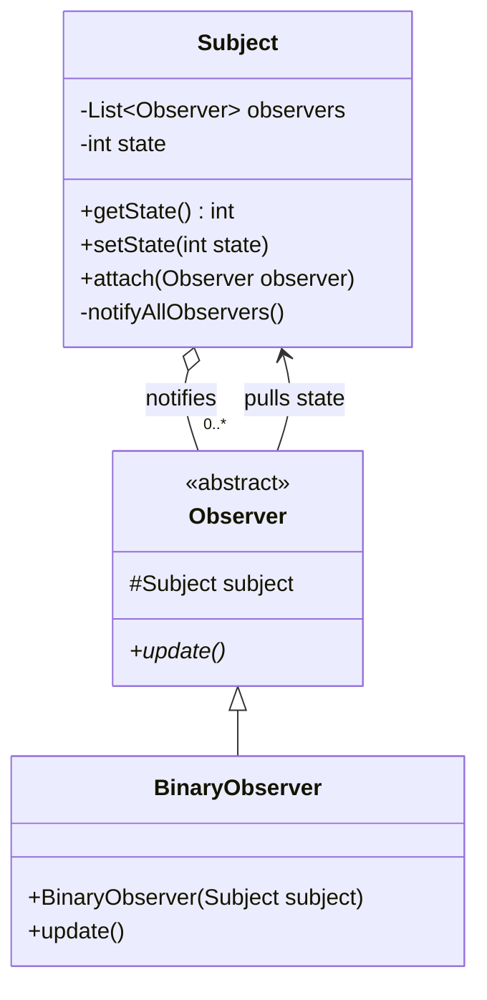
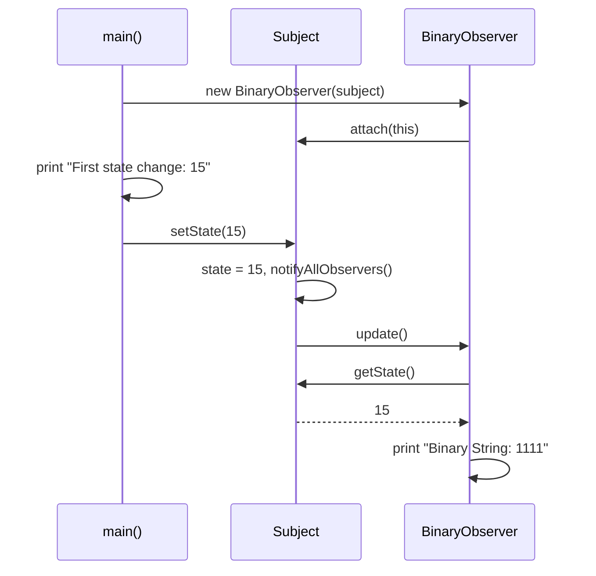
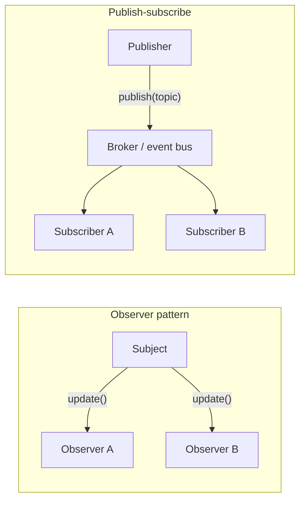

## In One Line
The Observer pattern lets one object (the **subject**) keep a list of dependents (**observers**) and **notify all of them automatically whenever its state changes**, so the subject never needs to know what the observers do with the news — a one-to-many, loosely coupled "tell everyone who subscribed" mechanism.

## Mental Model
Think of a **YouTube channel with a subscribe button and a notification bell**:
- The **channel** is the subject. It keeps a list of subscribers but knows nothing about them except "they can receive a notification".
- **Subscribing** adds you to the list (`attach`); **unsubscribing** removes you (`detach` — which the course example forgot).
- **Uploading a video** is the state change (`setState(15)`). The channel does not phone each viewer personally with custom logic; it just rings every bell (`notifyAllObservers()`).
- What each viewer does with the notification is **their** business: watch now, save for later, ignore it (`update()` in each concrete observer).
- The bell says only *"new video"*; you open the app to see what it is — that is the **pull** model (the course's `update()` has no parameters and calls `subject.getState()`). A notification that already contains the title and thumbnail is the **push** model.

In the code: the channel is `Subject`, a viewer is `BinaryObserver`, and "open the app and look" is `Integer.toBinaryString(subject.getState())`.

## Concept
### Intent and origin
Gang of Four, behavioural pattern:
> Define a one-to-many dependency between objects so that when one object changes state, all its dependents are notified and updated automatically.

GoF lists its other names as **Dependents** and **Publish-Subscribe**. Today "publish-subscribe" usually means something looser, with a broker in the middle (see the comparison below). Observer is the "O" behind MVC's model–view link ([MVC](lesson:a10-patterns/24-mvc)), GUI event listeners, JavaFX properties ([MVVM](lesson:a10-patterns/25-mvvm)) and reactive programming.

### The problem it solves
Without Observer, the object that changes must call everyone who cares:
```java
void setState(int s) {
    this.state = s;
    binaryDisplay.show(s);      // the subject now depends on every display class
    hexDisplay.show(s);         // adding a display = editing the subject
    auditLog.record(s);
}
```
That violates the Open/Closed Principle and couples the subject to every consumer. With Observer, the subject depends only on an **abstraction** (`Observer`), consumers register themselves at runtime, and adding a new one touches no existing code.

### Participants and how the example maps to them
| Participant | Role | In the example |
|---|---|---|
| **Subject** | Knows its observers, offers attach/detach, notifies them | `Subject` — `attach(Observer)`, private `notifyAllObservers()` |
| **ConcreteSubject** | Holds the interesting state; notifies when it changes | Also `Subject` (the example merges the two) — `state`, `getState()`, `setState(int)` |
| **Observer** | The update interface every observer implements | `abstract class Observer` with `update()` |
| **ConcreteObserver** | Reacts to notifications; may keep a reference to the subject to read its state | `BinaryObserver` — prints the state in binary |
| **Client** | Creates subject and observers, wires them up, triggers changes | `ObserverPatternExample.main` |

### Push vs pull
| | Pull (the course example) | Push |
|---|---|---|
| Notification | `update()` — "something changed" | `update(oldValue, newValue)` or `update(event)` |
| Observer gets data by | Calling back `subject.getState()` | Reading the arguments |
| Observer needs a subject reference? | **Yes** (`protected Subject subject`) | No |
| Pros | Simple interface; observers fetch only what they need | Observers are decoupled from the subject's API; old value available; works across threads/processes |
| Cons | Observers depend on the subject's getters; state may change again before they read it | Subject must guess what data observers need; interface may grow |

Real APIs are often a mix: `PropertyChangeEvent` pushes the property name, old and new value *and* the source; JavaFX `ChangeListener.changed(observable, oldValue, newValue)` does the same.

### Design decisions the GoF book lists (interview material)
- **Who triggers the notification?** The subject's setters (automatic, as here — but ten setter calls = ten notifications), or the client after a batch of changes (efficient, but easy to forget). `java.util.Observable` split it into `setChanged()` + `notifyObservers()`.
- **Notify only when the state is consistent** — after all fields are updated, never half-way through a method, and never from a superclass method that a subclass is still extending.
- **Notify only on real change** — `if (old == new) return;` avoids useless work and infinite ping-pong between two objects observing each other. `PropertyChangeSupport` and JavaFX properties already skip equal values.
- **Observing several subjects** — pass the subject (or an event with a source) to `update` so one observer can tell who is calling.
- **Interest in specific aspects** — let observers register for one event type or property (`addPropertyChangeListener("email", l)`), instead of receiving everything.
- **Dangling references** — when a subject is discarded, observers holding it should drop it; when an observer is discarded, it must be detached (next section).
- **ChangeManager** — for complex dependency graphs, a mediator object that maps subjects to observers and schedules updates (Observer combined with [Mediator](lesson:a10-patterns/16-mediator)).

### The lapsed listener problem (the classic Observer memory leak)
The subject's list holds **strong references**. An observer that is never detached stays reachable as long as the subject lives — along with everything it references (a closed window, a whole screen). The course example shows the root cause: `new BinaryObserver(subject);` discards the reference, and there is **no `detach` method**, so the observer can never be removed. Fixes:
- Always provide `detach`/`removeListener`, or return a **subscription handle** (`AutoCloseable`) from `subscribe` so the caller can close it (try-with-resources, a lifecycle hook, `onDestroy`).
- Tie subscriptions to a lifecycle (Android `LifecycleObserver`, Spring bean destruction).
- **Weak listeners** — the subject holds `WeakReference`s (JavaFX `WeakChangeListener`, a `WeakHashMap`-backed set). Convenient, but the listener then disappears as soon as nobody else references it (a lambda passed directly is collected almost immediately), and cleanup timing depends on the GC.

### Thread safety and re-entrancy
The course's `notifyAllObservers()` iterates an `ArrayList` with a for-each loop. If an observer **attaches or detaches** during `update()` (common: "notify me once, then unsubscribe"), the iterator throws **`ConcurrentModificationException`** (verified below). Multithreaded use is worse: `ArrayList` is not thread-safe, and `state` is not `volatile`.

Standard remedies (*Effective Java* Item 79 uses exactly this example):
- Keep observers in a **`CopyOnWriteArrayList`**: iteration works on a snapshot, so (un)subscribing during notification is safe and needs no locking. Ideal because observers change rarely and are iterated often.
- Or iterate over a copy: `for (Observer o : List.copyOf(observers))`.
- Make **open calls**: never call observers while holding the subject's lock — an observer that takes another lock or waits for another thread can deadlock with the subject.
- Decide **which thread** delivers notifications. Synchronous delivery on the caller's thread is simple and ordered; a slow observer then blocks `setState`. Asynchronous delivery (an `Executor`, `SubmissionPublisher`) isolates slow observers but loses the guarantee that everyone has reacted when `setState` returns.

### Failure isolation and ordering
- In the course's loop, an exception in one `update()` propagates out of `setState`: **later observers are never notified**, although the state has already changed (verified). Wrap each call in `try/catch` and log, if observers are independent.
- The GoF pattern does **not guarantee an order** of notification. Most list-based subjects notify in registration order; `java.util.Observable` notifies in **reverse** order (verified). Never let correctness depend on it.
- Observers that change the subject inside `update()` cause **nested notifications** — later observers may receive the newer state first. Avoid, or queue changes.

### Observer in the JDK and frameworks
| Where | Subject / register | Observer callback | Notes |
|---|---|---|---|
| `java.util.Observable` / `Observer` | `addObserver` | `update(Observable, Object)` | **Deprecated since Java 9** — see below |
| `java.beans.PropertyChangeSupport` | `addPropertyChangeListener` | `propertyChange(PropertyChangeEvent)` | Push model; skips equal values; demo in [MVC](lesson:a10-patterns/24-mvc) |
| AWT/Swing events | `button.addActionListener(l)` | `actionPerformed(ActionEvent)` | `java.util.EventListener` marker + `EventObject` convention; delivered on the event-dispatch thread |
| JavaFX properties | `property.addListener(...)` | `ChangeListener`, `InvalidationListener` | See [MVVM](lesson:a10-patterns/25-mvvm) |
| `java.util.concurrent.Flow` (Java 9) | `Publisher.subscribe` | `Subscriber.onNext/onError/onComplete` | Reactive Streams: asynchronous, with **backpressure** (`request(n)`); `SubmissionPublisher` is the JDK implementation |
| `CompletableFuture` | `thenAccept`, `whenComplete` | the lambda | An observer of a single future event |
| Servlet API | `web.xml` / `@WebListener` | `ServletContextListener`, `HttpSessionListener` | Container lifecycle events |
| Spring | `ApplicationEventPublisher.publishEvent(e)` | `@EventListener` methods | Synchronous by default; `@Async` for async, `@TransactionalEventListener` to run after commit |
| Libraries | Guava `EventBus`, RxJava `Observable`, Reactor `Flux` | `@Subscribe`, `subscribe(...)` | Event bus = pub-sub inside one JVM |

### Why `java.util.Observable` was deprecated (Java 9)
The Javadoc gives the reasons: the event model is *"quite limited"*, the **order of notifications is unspecified**, and **state changes are not in one-for-one correspondence with notifications**. In practice:
- `Observable` is a **class**, so your subject must *extend* it, using up its only superclass; and `setChanged()` is `protected`, so you cannot use it by composition either.
- `notifyObservers()` silently does nothing unless `setChanged()` was called first (verified below).
- `update(Observable o, Object arg)` is untyped — every observer casts `arg`.
- It is not serializable, and its thread-safety is half-done (it notifies outside the lock, so an observer may be called after it was removed).

Replacements named by the JDK: `java.beans` (`PropertyChangeSupport`) for a richer event model, `java.util.concurrent` queues for reliable messaging between threads, and the **`Flow` API** for reactive streams. For plain in-process observers, a small typed interface plus a `CopyOnWriteArrayList` (demo below) is usually best.

### Observer vs look-alikes
| Pattern | Difference |
|---|---|
| **Publish-subscribe (with a broker)** | Observer: the subject holds the observer list and calls them directly, usually synchronously, in one process — they know each other through an interface. Pub-sub: publishers send to a **topic** on a broker/event bus (Kafka, JMS, Guava EventBus); publishers and subscribers don't know each other, delivery is often asynchronous and can cross processes. |
| **[Mediator](lesson:a10-patterns/16-mediator)** | Observer is one-to-many and one-way, with no coordination logic. Mediator is many-to-many and centralises the interaction rules; colleagues often notify the mediator *via* Observer. |
| **[Chain of Responsibility](lesson:a10-patterns/12-chain-of-responsibility)** | A request goes to handlers **until one handles it**; an event goes to **all** observers. |
| **Callback** | A single listener passed for one operation (e.g. `CompletableFuture.thenAccept`) — Observer with exactly one observer. |
| **Reactive Streams** | Observer plus completion (`onComplete`), errors as values (`onError`), and **backpressure** (the subscriber controls the rate with `request(n)`). |
| **[MVC](lesson:a10-patterns/24-mvc)** | Uses Observer between model and views (classic MVC). |

### When to use it / when not
**Use** when a change in one object must trigger updates in others you don't want to hard-code; when the set of interested objects changes at runtime; for UI events, domain events, cache invalidation, plug-in hooks.

**Avoid or be careful** when there is exactly one consumer (a direct call is clearer), when ordering or transactional consistency between reactions matters, or when chains of notifications become hard to trace ("who changed this?" debugging). Heavy use can create hidden control flow and cascading updates.

## Diagram

The subject knows observers only through the abstract type; each observer holds the subject so it can pull the new state.


`setState` both stores the value and triggers the loop; the observer pulls the value back — the pull model.


In Observer the subject calls observers directly; in pub-sub a broker sits between publishers and subscribers, which never meet.

## Code
@example CoreJava/BehavioralPattern/ObserverPatternExample.java

**A modern, safer observer:** a typed functional interface (lambdas welcome), the push model with old and new values, `CopyOnWriteArrayList`, notification only on real change, failure isolation, and `subscribe` returning a handle for unsubscribing — even from inside a notification:
```java
import java.util.List;
import java.util.concurrent.CopyOnWriteArrayList;

public class ModernObserver {
    @FunctionalInterface
    interface StateListener { void stateChanged(int oldState, int newState); }   // push model: data in the call

    interface Subscription extends AutoCloseable { @Override void close(); }    // close() = unsubscribe

    static final class Subject {
        private final List<StateListener> listeners = new CopyOnWriteArrayList<>();
        private int state;

        int getState() { return state; }

        Subscription subscribe(StateListener listener) {
            listeners.add(listener);
            return () -> listeners.remove(listener);
        }

        void setState(int newState) {
            int old = state;
            if (old == newState) return;                        // notify only on a real change
            state = newState;
            for (StateListener l : listeners) {                 // iterates a snapshot: safe to (un)subscribe
                try {
                    l.stateChanged(old, newState);
                } catch (RuntimeException e) {                  // one bad listener must not stop the rest
                    System.out.println("  (listener failed: " + e.getMessage() + ")");
                }
            }
        }
    }

    public static void main(String[] args) {
        Subject subject = new Subject();
        Subscription binary = subject.subscribe((o, n) -> System.out.println("  Binary: " + Integer.toBinaryString(n)));
        subject.subscribe((o, n) -> System.out.println("  Hex: " + Integer.toHexString(n) + " (was " + o + ")"));
        subject.subscribe((o, n) -> { if (n > 12) throw new IllegalStateException("too big: " + n); });
        Subscription[] once = new Subscription[1];
        once[0] = subject.subscribe((o, n) -> { System.out.println("  Once: first change only"); once[0].close(); });

        System.out.println("setState(15)");
        subject.setState(15);
        System.out.println("setState(15) again");
        subject.setState(15);
        binary.close();
        System.out.println("setState(10) after Binary unsubscribed");
        subject.setState(10);
    }
}
```
```output
setState(15)
  Binary: 1111
  Hex: f (was 0)
  (listener failed: too big: 15)
  Once: first change only
setState(15) again
setState(10) after Binary unsubscribed
  Hex: a (was 15)
```
The failing listener did not stop `Once`; the repeated `15` notified nobody; `Once` removed itself during the loop without a `ConcurrentModificationException`.

**The course's classes break if an observer attaches another observer during `update()`** (the `Subject`, `Observer` and `BinaryObserver` classes are copied unchanged into the snippet as static nested classes):
```java
// Subject, Observer, BinaryObserver: exactly as in the course example
static class HexObserver extends Observer {
    private boolean addedFriend;
    HexObserver(Subject subject) { this.subject = subject; subject.attach(this); }
    @Override public void update() {
        System.out.println("Hex String: " + Integer.toHexString(subject.getState()));
        if (!addedFriend) { addedFriend = true; new BinaryObserver(subject); }   // attach during notification
    }
}

public static void main(String[] args) {
    Subject subject = new Subject();
    new HexObserver(subject);
    try {
        subject.setState(255);
    } catch (RuntimeException e) {
        System.out.println(e);
    }
}
```
```output
Hex String: ff
java.util.ConcurrentModificationException
```
The `ArrayList` iterator in `notifyAllObservers()` detects that the list changed under it. With `CopyOnWriteArrayList` the new observer would simply be notified from the next change on.

**And if one observer throws**, the rest are skipped — after the state has already changed:
```java
// Subject, Observer, BinaryObserver: exactly as in the course example
static class FailingObserver extends Observer {
    FailingObserver(Subject subject) { this.subject = subject; subject.attach(this); }
    @Override public void update() { throw new IllegalStateException("boom"); }
}

public static void main(String[] args) {
    Subject subject = new Subject();
    new FailingObserver(subject);
    new BinaryObserver(subject);
    try {
        subject.setState(15);
    } catch (IllegalStateException e) {
        System.out.println("caught " + e.getMessage() + ", state is now " + subject.getState());
    }
}
```
```output
caught boom, state is now 15
```
No `Binary String` line: `BinaryObserver` never heard about the change.

**The deprecated `java.util.Observable`** — you must extend it, `setChanged()` is required, duplicates are ignored, and the order is reversed:
```java
import java.util.Observable;
import java.util.Observer;

public class LegacyObservable {
    static class Temperature extends Observable {          // must EXTEND a class: uses up your one superclass
        private int celsius;
        void set(int celsius, boolean markChanged) {
            this.celsius = celsius;
            if (markChanged) setChanged();                   // protected: only a subclass can call it
            notifyObservers(celsius);                        // does nothing unless setChanged() was called
        }
    }

    public static void main(String[] args) {
        Temperature t = new Temperature();
        Observer first  = (o, arg) -> System.out.println("  first  got " + arg);
        Observer second = (o, arg) -> System.out.println("  second got " + arg);
        t.addObserver(first);
        t.addObserver(second);
        t.addObserver(first);                                // duplicates are ignored
        System.out.println("observers: " + t.countObservers());

        System.out.println("set(30) without setChanged():");
        t.set(30, false);
        System.out.println("set(31) with setChanged():");
        t.set(31, true);
    }
}
```
```output
observers: 2
set(30) without setChanged():
set(31) with setChanged():
  second got 31
  first  got 31
```
`javac` reports *"LegacyObservable.java uses or overrides a deprecated API"*; with `-Xlint:deprecation` it prints *"warning: [deprecation] Observable in java.util has been deprecated"*.

**The reactive successor: `java.util.concurrent.Flow` (Java 9)** — asynchronous delivery, completion signal, and backpressure through `request(n)`:
```java
import java.util.concurrent.CountDownLatch;
import java.util.concurrent.Flow;
import java.util.concurrent.SubmissionPublisher;

public class FlowDemo {
    static class BinarySubscriber implements Flow.Subscriber<Integer> {
        private final CountDownLatch done = new CountDownLatch(1);
        private Flow.Subscription subscription;

        @Override public void onSubscribe(Flow.Subscription s) {
            subscription = s;
            System.out.println("onSubscribe -> request(1)");
            s.request(1);                                   // backpressure: "send me one item"
        }
        @Override public void onNext(Integer state) {
            System.out.println("onNext " + state + " -> Binary String: " + Integer.toBinaryString(state));
            subscription.request(1);                        // ready for the next one
        }
        @Override public void onError(Throwable t) { System.out.println("onError " + t); done.countDown(); }
        @Override public void onComplete() { System.out.println("onComplete"); done.countDown(); }
    }

    public static void main(String[] args) throws InterruptedException {
        BinarySubscriber subscriber = new BinarySubscriber();
        try (SubmissionPublisher<Integer> publisher = new SubmissionPublisher<>()) {   // async, on a thread pool
            publisher.subscribe(subscriber);
            publisher.submit(15);
            publisher.submit(10);
        }                                                   // close() -> onComplete after pending items
        subscriber.done.await();
        System.out.println("main: done");
    }
}
```
```output
onSubscribe -> request(1)
onNext 15 -> Binary String: 1111
onNext 10 -> Binary String: 1010
onComplete
main: done
```
The subscriber runs on a pool thread (the common `ForkJoinPool`), but each subscriber's callbacks are delivered one at a time and in order, so the output is stable; `main` waits on the latch because delivery is asynchronous.

## Walkthrough
**`class Subject` (lines 7–29) — subject and concrete subject in one.**
- `private List<Observer> observers = new ArrayList<>();` — the registered observers. The subject depends only on the abstract `Observer` type.
- `private int state;` — the data observers care about; starts at `0`.
- `getState()` — lets observers **pull** the current value.
- `setState(int state)` — stores the new value, **then** calls `notifyAllObservers()`. Notifying after the assignment is the correct order: observers see a consistent state.
- `attach(Observer observer)` — adds to the list. There is no check for duplicates and no `detach`.
- `private void notifyAllObservers()` — a for-each loop calling `observer.update()` on each one, synchronously, in registration order. `private` means only the subject decides when to notify.

**`abstract class Observer` (lines 32–35).**
- The comment says "Observer interface", but it is an **abstract class** with state: `protected Subject subject` (the reference used to pull data) and `public abstract void update()` (the notification — no parameters, so this is the pull model).

**`class BinaryObserver extends Observer` (lines 38–48) — the concrete observer.**
- The constructor stores the subject and **registers itself**: `this.subject.attach(this)`. After `new BinaryObserver(subject)`, it is on the list.
- `update()` pulls `subject.getState()` and prints it with `Integer.toBinaryString(int)` — the unsigned base-2 representation without leading zeros (`15` → `1111`, `10` → `1010`; a negative number would print all 32 bits of its two's-complement form).

**`main` (lines 52–61) — the client.**
- `Subject subject = new Subject();` — state `0`, no observers.
- `new BinaryObserver(subject);` — the result is not stored in a variable; the observer stays alive only because the subject's list references it.
- `System.out.println("First state change: 15");` — printed by `main` itself, **before** the change.
- `subject.setState(15);` → `notifyAllObservers()` → `update()` → prints `Binary String: 1111`.
- `System.out.println("Second state change: 10");` then `subject.setState(10);` → `Binary String: 1010`.

The output is four deterministic lines, and every `// Output:` comment matches the recorded output. Note that the "state change" lines are printed by `main`, not by the pattern; only the `Binary String` lines come from notifications.

## Traps
> [!ERRATA] The comment `// Observer interface` labels an **abstract class** that also carries a `protected Subject subject` field. Making the observer a class forces every observer to extend it (using up its single superclass) and exposes mutable shared state to subclasses. Idiomatic Java uses an interface — ideally a `@FunctionalInterface` such as `interface Observer { void update(int newState); }` — so observers can be lambdas, and each observer keeps its own `private final` reference to the subject if it needs one.

> [!ERRATA] `BinaryObserver`'s constructor lets `this` escape (`subject.attach(this)`) before construction is finished. If a subclass added fields, or if another thread called `setState` at that moment, `update()` could run on a half-initialized object. JDK 21 has a lint for it: in a public, non-final class, `javac -Xlint:this-escape` reports *"possible 'this' escape before subclass is fully initialized"* (verified; the course class is package-private, so it stays silent). Register from outside instead: `subject.attach(new BinaryObserver(subject))`, or use a static factory method.

> [!ERRATA] The `Subject` is missing things every real subject needs, each verified in the snippets: there is **no `detach`**, so observers can never be removed (lapsed-listener leak); attaching an observer **during notification** throws `ConcurrentModificationException`; an **exception in one observer** stops all later ones although the state has changed; `attach` accepts **duplicates** (the same observer attached twice is notified twice per change); and `setState` notifies even when the **value did not change**. Use a `CopyOnWriteArrayList` (make the field `final`), add `detach` or return a subscription handle, skip unchanged values, and isolate observer failures.

- **Forgetting to unsubscribe** → memory leaks and "zombie" observers reacting after their screen was closed. Every `subscribe` needs a matching `unsubscribe` in a lifecycle method.
- **Weak listeners disappear.** A lambda registered only through a `WeakReference` can be garbage-collected immediately; keep a strong reference in the owner.
- **Relying on notification order** — unspecified; `java.util.Observable` even notifies in reverse order (verified).
- **Notifying inside a lock** can deadlock; notify after releasing it ("open call").
- **Observers that modify the subject** cause nested notifications and out-of-order updates.
- **Slow observers block the subject** in synchronous delivery; hand long work to an executor.
- **`notifyObservers()` without `setChanged()`** does nothing in `java.util.Observable` (verified).
- **Name clashes:** a class of your own called `Observer` conflicts with an explicit `import java.util.Observer;` in the same file — another reason to choose a specific name like `StateListener`.

## Tips & Tricks
- **Mnemonic — "Subscribe, ring, react, unsubscribe."** The four moments of every observer's life; the course example is missing the last one.
- **One-to-many, one-way:** the subject talks, observers listen; if objects talk back and forth, you want a Mediator.
- **Push or pull?** Pull = `update()` + getter; push = `update(old, new)`. Prefer push with an immutable event object — observers then don't need the subject at all.
- **Default toolkit in modern Java:** a `@FunctionalInterface` listener, `CopyOnWriteArrayList`, a `Subscription`/`AutoCloseable` handle, skip-if-unchanged, `try/catch` per listener.
- **Spot it in the wild:** any method named `addXxxListener`, `subscribe`, `on(...)`, `@EventListener`, `addObserver` is Observer.
- **Async needs?** `Flow`/`SubmissionPublisher` (JDK), Reactor/RxJava, or an event bus — and remember backpressure.
- **Interview line:** "Observer decouples the thing that changes from the things that react — the subject depends only on an interface, so new reactions are added without touching it."

## Interview Q&A
### [Basic] What is the Observer pattern? Map it to the course example.
It defines a one-to-many dependency: when the subject's state changes, all registered observers are notified automatically. The subject keeps a list of observers and knows them only through an interface, so observers can be added or removed at runtime without changing the subject. In the example, `Subject` holds `observers` and `state`; `attach` registers; `setState` updates the state and calls the private `notifyAllObservers()`, which calls `update()` on each `Observer`; `BinaryObserver` registers itself in its constructor and, on `update()`, pulls `subject.getState()` and prints it in binary — `1111` for 15 and `1010` for 10.

**Follow-up:** *What is missing for production use?* — A `detach` method (or subscription handle), protection against modification during notification and across threads, and isolation of failing observers.

### [Basic] What is the difference between the push and pull models? Which does the example use?
In the **pull** model the notification carries no data (`update()`), and observers call back into the subject to read what they need — the example does this with `subject.getState()`, which is why every observer keeps a `Subject` reference. In the **push** model the subject sends the data with the notification — `update(oldValue, newValue)` or an event object — so observers need no reference to the subject. Pull keeps the interface simple but couples observers to the subject's getters and may read a value that has already changed again; push decouples them and can carry the old value, but the subject must decide what to send. Java's `PropertyChangeEvent` and JavaFX's `ChangeListener` are push-style (with the source included for pulling extras).

**Follow-up:** *Which is better across threads or processes?* — Push with an immutable event, because a pull callback may run later and read a different state (or be impossible remotely).

### [Intermediate] Why was `java.util.Observable` deprecated, and what should you use instead?
Deprecated in Java 9 because its model is limited: `Observable` is a class you must extend (costing your only superclass) and `setChanged()` is protected, so it cannot be used by composition; `notifyObservers` silently does nothing without a prior `setChanged()`; the `update(Observable, Object)` callback is untyped; notification order is unspecified (it is actually reverse registration order); notifications don't correspond one-to-one with state changes; it is not serializable and only partly thread-safe. The JDK suggests `java.beans.PropertyChangeSupport` for a richer event model, `java.util.concurrent` for inter-thread messaging, and the `Flow` API for reactive streams. In application code a small typed listener interface with a `CopyOnWriteArrayList` is simplest.

**Follow-up:** *Is `java.util.Observer` removed?* — No, deprecated (not for removal) since 9; it still compiles with a deprecation warning.

### [Intermediate] What is the lapsed listener problem and how do you prevent it?
The subject holds strong references to its observers. If an observer is never removed — because the programmer forgot, or because there is no `detach`, as in the course example — it cannot be garbage-collected while the subject is alive, and neither can anything it references (UI components, whole screens). It also keeps reacting to events it should ignore. Prevention: always pair subscribe with unsubscribe in a lifecycle method; return an `AutoCloseable` subscription handle; bind subscriptions to a lifecycle (Android `Lifecycle`, Spring bean destruction); or hold observers weakly (`WeakReference`, JavaFX `WeakChangeListener`) — accepting that a listener referenced only by the subject may vanish.

**Follow-up:** *Why not always use weak references?* — A lambda or anonymous listener that nobody else references gets collected almost immediately, silently stopping notifications; the lifetime becomes GC-dependent and hard to test.

### [Intermediate] What is the difference between Observer and publish-subscribe?
In Observer the subject maintains the list and calls observers directly, usually synchronously and in one process; subject and observers are coupled through an interface. In publish-subscribe, publishers send messages to a **topic** on a broker or event bus, and subscribers receive them from the broker; neither side knows the other exists, delivery is often asynchronous, may be persistent, and can span processes (Kafka, JMS, Redis pub/sub; Guava EventBus or Spring events inside one JVM). GoF lists "Publish-Subscribe" as another name for Observer, but in modern usage the broker is the distinguishing element.

**Follow-up:** *When would you choose pub-sub?* — When producers and consumers must scale, deploy or fail independently, or when events must survive restarts; Observer is enough for in-process UI or domain notifications.

### [Intermediate] How do you make a subject safe when observers subscribe or unsubscribe during notification, or from other threads?
Iterating an `ArrayList` while an observer calls `attach`/`detach` from `update()` throws `ConcurrentModificationException` (verified), and concurrent access from threads corrupts the list. Use a `CopyOnWriteArrayList`: iteration works on a snapshot, writes copy the array, and no locking is needed — ideal because observers are added rarely and notified often. Alternatively iterate over a copy (`List.copyOf(observers)`). Never call observers while holding the subject's lock (open calls), because an observer could block or take other locks and deadlock. Make the subject's state `volatile` or guarded if it is read from other threads. *Effective Java* Item 79 builds this exact example.

**Follow-up:** *When is `CopyOnWriteArrayList` a bad fit?* — When the list is modified very often or is huge, because every write copies the whole array.

### [Advanced] What happens if an observer throws an exception or is very slow?
With naive synchronous notification the exception propagates out of the loop and out of `setState`, so observers after it are never notified, though the state has already changed (verified: `caught boom, state is now 15`, no binary output). The fix is to catch and log per observer, or collect failures and rethrow one aggregated exception after notifying everyone. A slow observer blocks the thread that changed the state and delays every later observer; hand long work off to an `Executor`, or use asynchronous delivery (`SubmissionPublisher`, an event bus, Spring `@Async` listeners) — at the price of ordering and of not knowing when all reactions have finished.

**Follow-up:** *How does Spring handle a failing `@EventListener`?* — Synchronous listeners run on the publisher's thread, so the exception propagates to `publishEvent` unless an `ErrorHandler` is configured on the multicaster; async listeners report to an `AsyncUncaughtExceptionHandler`.

### [Advanced] How does the Java `Flow` API relate to Observer?
`java.util.concurrent.Flow` (Java 9) holds the Reactive Streams interfaces: `Publisher`, `Subscriber`, `Subscription`, `Processor`. It is Observer extended for asynchronous streams: `onNext` is the update, plus `onComplete` and `onError` as terminal signals, and **backpressure** — the subscriber calls `subscription.request(n)` to say how many items it can take, so a fast publisher cannot overwhelm a slow subscriber. `SubmissionPublisher` is the JDK implementation; it delivers on an executor (the common pool by default), each subscriber in order. Libraries such as Reactor and RxJava implement the same contract with rich operators.

**Follow-up:** *What does `SubmissionPublisher.submit` do when a subscriber's buffer is full?* — It blocks until space is available; `offer` lets you drop items or time out instead.

### [Advanced] What is wrong with an observer registering itself in its constructor, as `BinaryObserver` does?
It publishes `this` before the constructor has finished — "this escape". If the subject (or another thread) calls `update()` immediately, the observer may see its own fields unset, especially in subclasses whose constructors have not yet run; and under the Java Memory Model another thread is not guaranteed to see even the final fields correctly. It also hides a side effect in `new` (`new BinaryObserver(subject);` with a discarded result looks like dead code). JDK 21's `-Xlint:this-escape` warns about this in public non-final classes. Better: construct first, then register (`subject.attach(observer)`), or use a static factory that does both.

**Follow-up:** *Where else does "this escape" bite?* — Starting a thread in a constructor, or calling an overridable method from a constructor.

### [Advanced] How is Observer used in Spring, and what are the common pitfalls?
Beans publish events with `ApplicationEventPublisher.publishEvent(event)` (any object since Spring 4.2), and listeners are methods annotated `@EventListener` (or `ApplicationListener` beans). Delivery is **synchronous** on the publisher's thread and inside its transaction by default; `@Async` makes a listener asynchronous, `@Order` controls order, and `@TransactionalEventListener(phase = AFTER_COMMIT)` runs a listener only if the transaction commits — important for side effects like sending e-mails. Pitfalls: assuming listeners are asynchronous; exceptions in a synchronous listener rolling back the publisher's transaction; side effects running before commit; hidden control flow that is hard to trace.

**Follow-up:** *Is Spring's event system Observer or pub-sub?* — Structurally Observer (the context multicasts to registered listeners in-process), used in a pub-sub style because publishers don't know the listeners.

## Quiz
### What does the course example print for `subject.setState(7);` added at the end of `main`?
- [ ] `Binary String: 7`
- [x] `Binary String: 111`
- [ ] `Binary String: 0111`
- [ ] Nothing, because only two changes are allowed
> The single `BinaryObserver` is notified and prints `Integer.toBinaryString(7)`, which has no leading zeros: `111`. The state is pulled from the subject by `getState()`.

### What does this print, using the course's classes?
```java
Subject subject = new Subject();
BinaryObserver b = new BinaryObserver(subject);
subject.attach(b);
subject.setState(5);
subject.setState(5);
```
- [ ] `Binary String: 101` once
- [ ] `Binary String: 101` twice
- [x] `Binary String: 101` four times
- [ ] Nothing, because the state did not change the second time
> The constructor already attached `b`, and `attach(b)` adds it again — `ArrayList` accepts duplicates — so each change notifies it twice. `setState` never compares old and new values, so the second `setState(5)` notifies again: 2 × 2 = 4 lines (verified).

### An observer's `update()` attaches a new `BinaryObserver` to the same subject the first time it runs. With the course's `Subject`, what happens on `setState(255)`?
- [ ] Both observers print, the new one second
- [ ] Only the first observer prints; the new one waits for the next change
- [x] The first observer prints, then `ConcurrentModificationException`
- [ ] Infinite loop
> `notifyAllObservers()` iterates the `ArrayList` with a for-each loop; adding to it during iteration makes the iterator's next `next()` throw `ConcurrentModificationException` (verified: `Hex String: ff`, then the exception). With `CopyOnWriteArrayList`, the second option would be right.

### Using the course's classes, the first attached observer throws `IllegalStateException("boom")` in `update()`, the second is a `BinaryObserver`. `main` catches the exception around `setState(15)` and prints the state. What is printed?
- [ ] `Binary String: 1111`, then `caught boom, state is now 15`
- [x] Only `caught boom, state is now 15`
- [ ] Only `caught boom, state is now 0`
- [ ] `Binary String: 1111` only; the exception is swallowed
> The exception leaves the notification loop immediately, so the `BinaryObserver` is never called, but `state` was assigned before notifying (verified). Isolate observers with a `try/catch` per call.

### With `java.util.Observable`, a subclass calls `notifyObservers(31)` without calling `setChanged()` first. What happens?
- [ ] All observers are notified
- [x] Nothing — no observer is notified
- [ ] `IllegalStateException`
- [ ] Only the first observer is notified
> `notifyObservers` returns immediately unless the changed flag is set, and `setChanged()` is `protected` — one of the reasons the class was deprecated in Java 9 (verified: nothing printed for `set(30, false)`). With the flag set, observers were even notified in reverse order.

### Which callback signature is an example of the **push** model?
- [ ] `void update()`
- [x] `void stateChanged(int oldState, int newState)`
- [ ] `int getState()`
- [ ] `void attach(Observer o)`
> Push sends the data in the notification itself; the observer does not need to call back. `update()` with a later `getState()` call is the pull model the course uses; `attach` and `getState` are subject methods, not callbacks.

### A dialog registers a listener on an application-wide `Subject` and is closed, but its memory is never reclaimed. What is the most likely cause and fix?
- [ ] The dialog forgot to call `System.gc()`
- [x] The subject still references the listener, which references the dialog; unsubscribe when the dialog closes
- [ ] `CopyOnWriteArrayList` leaks memory; switch to `ArrayList`
- [ ] Lambdas cannot be garbage-collected
> This is the lapsed listener problem: the long-lived subject's list keeps the listener — and everything it captures — reachable. Remove the listener in the close/destroy hook, or use a subscription handle or weak listener. `System.gc()` cannot collect reachable objects.

## Takeaways
- Observer = a subject keeps a list of observers and notifies all of them when its state changes; the subject depends only on the observer interface, so new reactions are added without changing it (one-to-many, one-way).
- Course mapping: `Subject` (`attach`, `setState` → private `notifyAllObservers`), abstract `Observer.update()`, `BinaryObserver` pulls `getState()` and prints `Integer.toBinaryString` — the pull model; push passes the data (or an event) in the call.
- Course-code issues: an abstract class labelled "interface", `this` escaping from the constructor, no `detach` (lapsed-listener leak), `ConcurrentModificationException` when attaching during notification, one throwing observer silencing the rest, duplicates and no-change notifications.
- Robust subject: `@FunctionalInterface` listener, `CopyOnWriteArrayList`, a subscription handle for unsubscribing, skip unchanged values, catch per observer, no locks held while notifying; never rely on notification order.
- `java.util.Observable`/`Observer` are deprecated since Java 9 (must extend a class, `setChanged()` required, untyped, unspecified order); use `PropertyChangeSupport`, your own typed listener, or the `Flow` API.
- Relatives: pub-sub adds a broker so publishers and subscribers never meet; Mediator centralises many-to-many rules; Reactive Streams (`Flow`, `SubmissionPublisher`) add completion, errors and backpressure; MVC uses Observer between model and views; Spring uses it for `@EventListener`.
