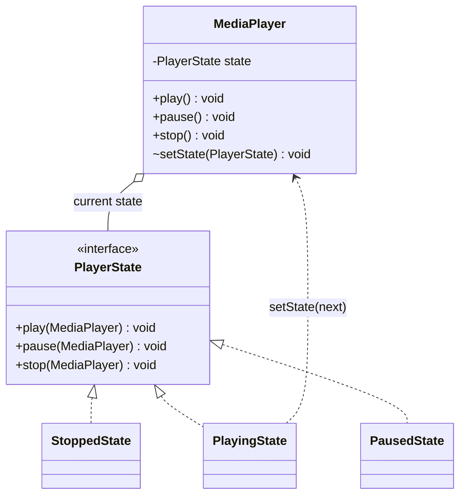
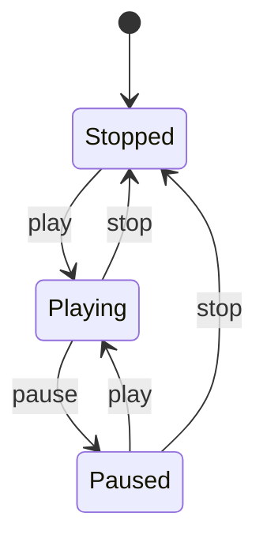
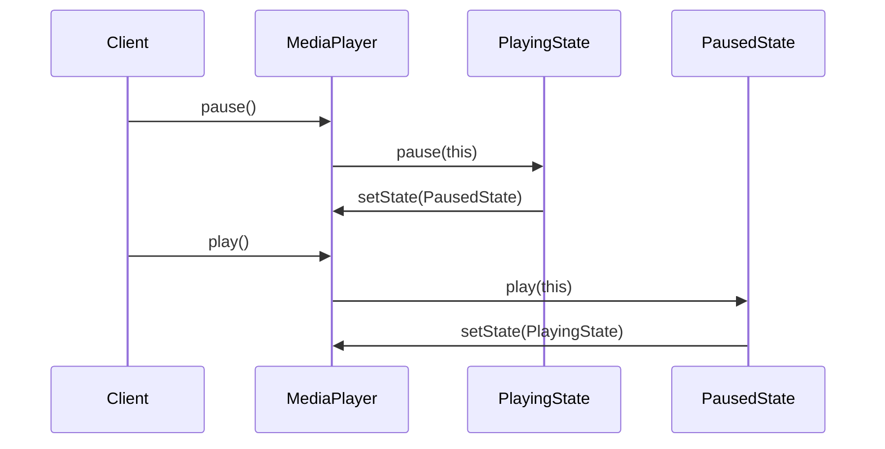

## In One Line
The State pattern lets an object **change its behaviour when its internal state changes** by delegating every request to a separate *state object* and swapping that object on each transition, so from the outside it looks as if the object changed its class.

## Mental Model
Think of a **music player with one Play/Pause button**. You press the *same button* every time, but what happens depends on the mode the player is in: when it is stopped, the button starts the track from the beginning; when it is playing, it pauses; when it is paused, it resumes. You never ask "which mode are you in?" before pressing. The player knows its mode, and the mode decides what the press means and which mode comes next.

How it maps to the code:
- **The player** is the **Context** (`Context` in the original, `MediaPlayer` in the full version below).
- **Each mode** (Stopped, Playing, Paused) is a **ConcreteState** class (`StartState`, `StopState`, `PlayingState`...).
- **"What a button press means in this mode"** is a method on the state interface (`doAction`, `play`, `pause`).
- **Switching modes** is the transition: the state tells the context `setState(next)`.
- **You, pressing the button**, are the client: you only talk to the player, never to the modes.

## Concept
### Intent (Gang of Four)
> "Allow an object to alter its behavior when its internal state changes. The object will appear to change its class."

Also known as **Objects for States**. Category: **behavioral**. It is the object-oriented way to implement a **finite state machine** (FSM): a fixed set of states, events that arrive, and rules for which event moves you to which state.

### The problem it solves
Without the pattern, an object keeps a status field and **every method switches on it**:

```java
class MediaPlayer {
    private String status = "STOPPED";

    void play() {
        switch (status) {
            case "STOPPED" -> { System.out.println("Starting"); status = "PLAYING"; }
            case "PLAYING" -> System.out.println("Already playing");
            case "PAUSED"  -> { System.out.println("Resuming"); status = "PLAYING"; }
        }
    }
    void pause() { switch (status) { /* the same three cases again */ } }
    void stop()  { switch (status) { /* ...and again */ } }
}
```

Problems with this:
- The logic of one state (say, "Paused") is **smeared across every method**.
- Adding a state ("Buffering") means editing **every** `switch` — it violates the Open/Closed Principle.
- Transitions (`status = "PLAYING"`) are hidden inside branches, so illegal transitions are easy to create and hard to see.

The State pattern turns each `case` into a **class**: all the behaviour for "Paused" lives in `PausedState`, and the context's methods shrink to one line each — `state.play(this)`. Polymorphism replaces the `switch` (see [Polymorphism](lesson:a01-oop/04-polymorphism)).

### Participants and how the example maps to them
| Participant | Role | In the original example | In the full version (Code section) |
|---|---|---|---|
| **Context** | The object clients use. Holds a reference to the *current* state and **delegates** state-dependent requests to it | `Context` (holds `private State state`) | `MediaPlayer` |
| **State** | Interface with one method per request/event the context can receive | `interface State { void doAction(Context); }` | `interface PlayerState { play; pause; stop }` |
| **ConcreteState** | Implements the behaviour for one state and decides the next state | `StartState`, `StopState` | `StoppedState`, `PlayingState`, `PausedState` |
| **Client** | Talks to the context only | `main` — but it talks to the states directly (see Traps) | `main` calls `player.play()` etc. |

### How a request flows
1. The client calls a method on the **context**: `player.pause()`.
2. The context **delegates** to its current state and passes itself: `state.pause(this)`.
3. The state does the work for *this* state ("Pausing") and, if needed, **transitions**: `p.setState(PausedState.INSTANCE)`.
4. The next request goes to the new state object — same call, different behaviour.

### What the course example shows, and what it leaves out
The original has the right *pieces* (a `State` interface, two concrete states, a `Context` that stores the current state) but not the **delegation**:
- The client calls `startState.doAction(context)` directly — the context never forwards anything to its state.
- `doAction` just prints a message and registers itself (`context.setState(this)`).
- So the context's behaviour never actually changes; it is only a holder for "the last state that ran".

That is why it looks identical to [Strategy](lesson:a10-patterns/21-strategy). The full version in the Code section adds the missing half: the context owns the entry points (`play/pause/stop`), the states own the transitions.

### Implementation choices (what interviewers probe)
| Decision | Options | Guidance |
|---|---|---|
| **Who defines transitions?** | (a) The **states** call `context.setState(next)`; (b) state methods **return** the next state and the context assigns it; (c) the **context** keeps a central transition table | (a)/(b) are the classic pattern — each state knows its successors. (c) is better when the rules change often or come from configuration. |
| **Who creates state objects?** | New object per transition, or one shared instance per state | Stateless states should be **shared** (a `static final INSTANCE`, or enum constants) — this is Flyweight + Singleton. Create per-context instances only if a state holds data (e.g. a retry counter). |
| **Where does data live?** | In the context, or in the state | Data that survives across states (track position, order total) belongs in the **context**; states read it through the context parameter. |
| **Initial state** | `null`, or a real state | Always start in a real state (e.g. `StoppedState`). A `null` state means an NPE on the first call — the original example has this risk. |
| **Invalid events** | Ignore, print, or throw | In business code, throw `IllegalStateException` ("cannot ship a cancelled order") so bugs surface early. |

### Enum-based State — the idiomatic Java shortcut
Java enums can have **constant-specific method bodies**: each constant is compiled as its own anonymous subclass of the enum, so each constant can override methods. That makes every constant a ready-made, shared, serializable-safe singleton ConcreteState ([Enums](lesson:a02-core/14-enums)). The Code section shows an `OrderState` enum where each constant returns the next state and the base methods throw for illegal events. Use enums when the set of states is closed and the states hold no per-object data.

### State machine vs State pattern
- A **state machine** is the *concept* (states + events + transitions).
- The **State pattern** is one *implementation* of it, with a class per state.
- Other implementations: an `enum` + `switch` (fine for 2–3 tiny states), a **transition table** such as `EnumMap<State, EnumMap<Event, State>>` (data-driven), or a library such as **Spring Statemachine**.
- `Thread.State` (NEW, RUNNABLE, BLOCKED, WAITING, TIMED_WAITING, TERMINATED) is a state *machine* in the JDK, but it is just an enum label, not the State pattern — the behaviour is in the JVM, not in state objects. See [Thread Lifecycle](lesson:a06-threads/03-thread-lifecycle).

### When to use it
- An object's behaviour depends on its state, and it must change behaviour **at runtime** as the state changes.
- Methods have **large conditionals on the same status field**, repeated across methods.
- The domain is naturally a workflow: orders (NEW → PAID → SHIPPED → DELIVERED), documents (DRAFT → REVIEW → PUBLISHED), connections (CLOSED → LISTEN → ESTABLISHED), game characters (idle, running, jumping), vending machines, media players.

### When not to use it
- Two or three states with trivial behaviour — a `boolean` or small `enum` + `switch` is clearer.
- The behaviour does not really differ per state; only a label changes.
- States × events explode (hundreds of combinations) — use a transition table or a hierarchical state-machine library instead of hundreds of classes.

### Real JDK, Spring and Android examples
- **JDK:** the JDK itself prefers compact `int`/`enum` state fields for speed (`FutureTask`'s private `state`, `Thread.State`), so the textbook State pattern is rare inside it. That is a good nuance to mention: a state *machine* is not always the State *pattern*.
- **GoF's own example:** `TCPConnection` delegating `open()/close()/acknowledge()` to `TCPEstablished`, `TCPListen`, `TCPClosed`.
- **Spring:** the **Spring Statemachine** project models states, events, transitions, guards and actions (`StateMachine<S, E>`), used for order and approval workflows.
- **Android:** the framework's internal `com.android.internal.util.StateMachine` (used by the Wi-Fi and Bluetooth stacks) has `State` objects with `enter()`, `exit()` and `processMessage(Message)` — the State pattern with hierarchy. The public `MediaPlayer` API documents a state diagram (Idle, Initialized, Prepared, Started, Paused, Stopped...), and calling a method in the wrong state is an error, often an `IllegalStateException`.

### Look-alike patterns
| Pattern | Same shape? | Real difference |
|---|---|---|
| [Strategy](lesson:a10-patterns/21-strategy) | Yes — identical class diagram (Context → interface ← implementations) | **Who switches and why.** Strategy: the *client* picks an algorithm, usually once; strategies do not know each other. State: the *object itself* switches as events arrive; states know their successors. |
| [Command](lesson:a10-patterns/13-command) | Objects with an `execute`-like method | A command is a *request* (do this, maybe undo it later); a state is a *mode* that decides how requests behave. |
| [Memento](lesson:a10-patterns/17-memento) | Both talk about "state" | Memento *snapshots* data to restore later; State *changes behaviour*. |
| [Flyweight](lesson:a10-patterns/10-flyweight) | — | Often combined: stateless state objects are shared flyweights. |
| [Null Object](lesson:a10-patterns/18-null-object) | — | A good *initial* state is a do-nothing state instead of `null`. |

> [!INTERVIEW] "State and Strategy have the same structure; the difference is intent. With Strategy the client chooses the behaviour; with State the object changes its own behaviour as its state changes, and the states know about each other."

## Diagram

The context holds one `PlayerState` and forwards every call to it; concrete states call back `setState(...)` to switch. In the original, `Context` plays the `MediaPlayer` role and `StartState`/`StopState` are the concrete states.


The same three buttons do different things in each state. Every arrow is one line of code inside a state class, such as `p.setState(PausedState.INSTANCE)`.


The client calls the same context both times; the context forwards to whichever state is current, and each state picks the next one. The original example skips the Client → Context arrow and calls the state directly.

## Code
@example CoreJava/BehavioralPattern/StatePatternExample.java

**The full pattern** — the context delegates, the states own the transitions, and stateless states are shared:
```java
public class PlayerDemo {
    public static void main(String[] args) {
        MediaPlayer player = new MediaPlayer();
        player.pause();
        player.play();
        player.play();
        player.pause();
        player.play();
        player.stop();
        System.out.println("Final state: " + player.getState());
    }
}

interface PlayerState {
    void play(MediaPlayer p);
    void pause(MediaPlayer p);
    void stop(MediaPlayer p);
}

class StoppedState implements PlayerState {
    static final StoppedState INSTANCE = new StoppedState();   // stateless -> share one
    public void play(MediaPlayer p)  { System.out.println("Starting from the beginning"); p.setState(PlayingState.INSTANCE); }
    public void pause(MediaPlayer p) { System.out.println("Nothing to pause"); }
    public void stop(MediaPlayer p)  { System.out.println("Already stopped"); }
    public String toString() { return "STOPPED"; }
}

class PlayingState implements PlayerState {
    static final PlayingState INSTANCE = new PlayingState();
    public void play(MediaPlayer p)  { System.out.println("Already playing"); }
    public void pause(MediaPlayer p) { System.out.println("Pausing");  p.setState(PausedState.INSTANCE); }
    public void stop(MediaPlayer p)  { System.out.println("Stopping"); p.setState(StoppedState.INSTANCE); }
    public String toString() { return "PLAYING"; }
}

class PausedState implements PlayerState {
    static final PausedState INSTANCE = new PausedState();
    public void play(MediaPlayer p)  { System.out.println("Resuming"); p.setState(PlayingState.INSTANCE); }
    public void pause(MediaPlayer p) { System.out.println("Already paused"); }
    public void stop(MediaPlayer p)  { System.out.println("Stopping"); p.setState(StoppedState.INSTANCE); }
    public String toString() { return "PAUSED"; }
}

class MediaPlayer {                                   // the Context
    private PlayerState state = StoppedState.INSTANCE; // never null
    void setState(PlayerState s) { state = s; }        // package-private: only states call it
    public void play()  { state.play(this); }          // delegate, no if/switch
    public void pause() { state.pause(this); }
    public void stop()  { state.stop(this); }
    public PlayerState getState() { return state; }
}
```
```output
Nothing to pause
Starting from the beginning
Already playing
Pausing
Resuming
Stopping
Final state: STOPPED
```
Notice that `main` calls `play()` three times and gets three different behaviours ("Starting from the beginning", "Already playing", "Resuming") without a single `if`.

**Enum-based State** — each constant is a state; methods return the next state; illegal events throw:
```java
public class OrderDemo {
    public static void main(String[] args) {
        Order order = new Order();
        order.pay();
        order.ship();
        try {
            order.cancel();
        } catch (IllegalStateException e) {
            System.out.println("Rejected: " + e.getMessage());
        }
        order.deliver();
    }
}

enum OrderState {
    NEW {
        @Override OrderState pay()    { return PAID; }
        @Override OrderState cancel() { return CANCELLED; }
    },
    PAID {
        @Override OrderState ship()   { return SHIPPED; }
        @Override OrderState cancel() { return CANCELLED; }   // refund, then cancel
    },
    SHIPPED {
        @Override OrderState deliver() { return DELIVERED; }
    },
    DELIVERED,
    CANCELLED;

    // Default behaviour: the event is illegal in this state.
    OrderState pay()     { throw illegal("pay"); }
    OrderState ship()    { throw illegal("ship"); }
    OrderState deliver() { throw illegal("deliver"); }
    OrderState cancel()  { throw illegal("cancel"); }

    private IllegalStateException illegal(String event) {
        return new IllegalStateException("cannot " + event + " when " + this);
    }
}

class Order {                                   // Context
    private OrderState state = OrderState.NEW;

    void pay()     { move(state.pay()); }
    void ship()    { move(state.ship()); }
    void deliver() { move(state.deliver()); }
    void cancel()  { move(state.cancel()); }

    private void move(OrderState next) {
        System.out.println(state + " -> " + next);
        state = next;
    }
}
```
```output
NEW -> PAID
PAID -> SHIPPED
Rejected: cannot cancel when SHIPPED
SHIPPED -> DELIVERED
```
`SHIPPED` does not override `cancel()`, so the inherited default throws — the illegal transition is rejected and the order stays `SHIPPED`, which is why the next line is `SHIPPED -> DELIVERED`. (`illegal(...)` *returns* the exception and the caller writes `throw`, so the compiler knows the method never falls off the end.)

## Walkthrough
**`interface State { void doAction(Context context); }`** — the State role. It has a single method and receives the context as a parameter so a state can act on it (here: register itself). In a full State pattern this interface has one method per event the context can receive (`play`, `pause`, `stop`...).

**`class StartState implements State`**
- `doAction(Context context)` prints `Player is in start state` and then calls `context.setState(this)` — the state object makes **itself** the context's current state.
- `toString()` returns `"Start State"`. It overrides `Object.toString()` (without `@Override`), and it is what gets printed on the second output line.

**`class StopState implements State`** — the same shape: prints `Player is in stop state`, sets itself as current state, `toString()` returns `"Stop State"`.

**`class Context`**
- `private State state;` — the reference to the current state. The whole pattern revolves around this one field being swapped.
- `public Context() { state = null; }` — explicitly sets the field to `null`. This is redundant (object fields already default to `null`) and it means a fresh context has **no** state: calling `getState().toString()` before any `doAction` throws `NullPointerException`.
- `setState(State)` / `getState()` — plain setter/getter. `setState` is `public`, so *anyone* can force the context into any state.
- Name note: this class is called `Context`, and the Strategy example in the same package (`CoreJava.BehavioralPattern`) therefore had to call its own context `Context1` — two top-level classes in one package cannot share a name.

**`main`**
1. `Context context = new Context();` — state is `null`.
2. `State startState = new StartState(); startState.doAction(context);` — the **client calls the state directly**. Prints `Player is in start state`; the context now holds the `StartState` object.
3. `System.out.println(context.getState().toString());` — prints `Start State` (the explicit `.toString()` is unnecessary; `println(Object)` calls it anyway via `String.valueOf`).
4. `State stopState = new StopState(); stopState.doAction(context);` — prints `Player is in stop state`; the context's state is replaced by the `StopState` object.
5. The last `println` prints `Stop State`.

**Output** — four lines, deterministic: two messages from `doAction` and two `toString()` values. It proves the context's stored state changed from `StartState` to `StopState`. What it does *not* show is the context behaving differently because of that state — the context has no behaviour of its own. The `PlayerDemo` in the Code section is the version where the context's behaviour actually changes.

## Traps
> [!ERRATA] Line 56 says `// Output: Start state` (lower-case "state"), but `StartState.toString()` returns `"Start State"`, so the real output is **`Start State`**. The line-60 comment `Stop State` is correct.

> [!ERRATA] The example is only half a State pattern. The context never delegates to its state: the client calls `startState.doAction(context)` directly and the state merely registers itself. As written it is structurally the same as Strategy, and the context's behaviour never changes. In the real pattern the client calls `context.request()`, the context calls `state.handle(this)`, and the states decide the transitions — see `PlayerDemo` in the Code section.

> [!ERRATA] `public Context() { state = null; }` leaves the context without a valid state, so `new Context().getState().toString()` throws `NullPointerException`. Start in a real initial state (or a [Null Object](lesson:a10-patterns/18-null-object) state). Also, `doAction` and `toString` are missing `@Override`, and `setState` is `public`, which lets any caller bypass the transition rules — make it package-private or private.

- **Forgetting the transition.** A state that handles an event but never calls `setState(...)` leaves the machine stuck (see the "spot the bug" quiz).
- **Creating a new state object on every transition** (`p.setState(new PlayingState())`) works but produces garbage and breaks `==` comparisons. Share stateless states (`INSTANCE` or enum constants).
- **Putting shared data in a shared state object.** If `PlayingState.INSTANCE` stores a track position, every player in the app shares it. Per-context data belongs in the context.
- **States reaching into the context's internals.** Give states a narrow API on the context (`setState`, a few getters), not every field.
- **Thread safety.** Swapping `state` from several threads without synchronization can lose transitions. Guard the context's methods (`synchronized`) or use `AtomicReference<State>.compareAndSet(expected, next)`.
- **State explosion.** 10 states × 8 events = 80 methods to think about. Use a default "illegal event" implementation (abstract base class or enum defaults, as in `OrderState`) so each state overrides only the events it accepts.

> [!WARNING] Do not confuse "has a status enum" with "uses the State pattern". A `switch (status)` in every method is exactly what the pattern replaces.

## Tips & Tricks
- **Mnemonic — "State: the object changes its *mind*. Strategy: the client changes the *method*."**
- **Spot the need:** the same `switch (status)` appearing in three or more methods is the textbook trigger for State.
- **"Context delegates, states decide."** If your context contains transition logic *and* your states contain behaviour, you have split the pattern — pick one place for transitions.
- **Draw the state diagram first** (`stateDiagram-v2`, a whiteboard): every arrow becomes one `setState` or `return NEXT` line; every missing arrow is an illegal event.
- **Enums are free singletons:** closed set of stateless states → enum with constant-specific bodies; open set or states with data → classes.
- **Default to "illegal"**: give the base type throwing defaults, override only valid events — the compiler-checked equivalent of a transition table.
- **Test by transition:** one unit test per arrow in the diagram, plus one per illegal event.

## Interview Q&A
### [Basic] What is the State pattern and what problem does it solve?
It is a behavioral pattern that lets an object change its behaviour when its internal state changes. Instead of a status field and a big `switch` in every method, the object (the **context**) holds a reference to a **state object** and delegates every state-dependent call to it. Each concrete state class contains the behaviour for one state and decides which state comes next. It removes duplicated conditionals, puts all the logic of one state in one class, makes transitions explicit, and lets you add states without editing existing ones. Example: a media player where `play()` means "start", "ignore" or "resume" depending on whether it is stopped, playing or paused.

**Follow-up:** *What does "the object will appear to change its class" mean?* — Calling the same method on the same context gives different behaviour over time, as if the object's class had been swapped; really only the state object behind it was swapped.

### [Basic] What is the difference between the State and Strategy patterns?
They share the same class diagram — a context holding an interface with several implementations — but the intent differs:

| | State | Strategy |
|---|---|---|
| Purpose | Behaviour follows the object's current **state** | Choose one of several interchangeable **algorithms** |
| Who switches | The context or the states themselves, automatically, many times | The client, usually once (constructor, setter, DI) |
| Do implementations know each other? | Yes — a state knows its successor states | No — strategies are independent |
| Client awareness | Client usually does not know the states exist | Client knows and picks the strategy |
| Example | Order: NEW → PAID → SHIPPED | Sort by name vs by price; add vs multiply |

**Follow-up:** *Can a class be both?* — Yes. A context can have a state (which mode it is in) and, separately, a pluggable strategy (e.g. a pricing strategy used while in the PAID state).

### [Intermediate] Who should perform state transitions — the context or the state objects?
Both are valid, with trade-offs. **States decide** (they call `context.setState(next)` or return the next state): each state knows its successors, the context stays tiny, and adding a state only touches its neighbours — but states become coupled to each other. **Context decides** (a central transition table, e.g. `EnumMap<State, EnumMap<Event, State>>`): all rules are in one place and can even come from configuration, and states stay independent — but the context grows and the table must be kept complete. Rule of thumb: stable, behaviour-rich states → states decide; frequently changing or data-driven rules → central table.

**Follow-up:** *Which does the course example use?* — Neither properly: the *client* triggers the change by calling `doAction` on the state it wants, and the state registers itself.

### [Intermediate] How would you implement the State pattern with a Java enum?
Declare the states as enum constants with **constant-specific bodies**. The enum declares the event methods with a default (often throwing `IllegalStateException`), and each constant overrides only the events it accepts, returning the next constant:
```java
enum Light {
    RED    { Light next() { return GREEN; } },
    GREEN  { Light next() { return YELLOW; } },
    YELLOW { Light next() { return RED; } };
    abstract Light next();
}
```
Each constant is compiled to its own anonymous subclass of the enum (`Light$1`...), so this is real polymorphism. You get singletons for free, thread-safe initialisation, safe serialization, `==` comparison, and `EnumMap`/`EnumSet` support. Limit: enum constants cannot hold per-context mutable data, and the set of states is closed at compile time.

**Follow-up:** *Why is `RED.getClass()` not `Light.class`?* — Because a constant with a body is an instance of an anonymous subclass; use `getDeclaringClass()` to get the enum type.

### [Intermediate] Is the course's StatePatternExample a correct State pattern?
Partly. It has a `State` interface, two concrete states and a `Context` that stores the current state, but the key mechanism is missing: the context never **delegates** to its state. The client calls `startState.doAction(context)` itself and the state just registers itself with `setState(this)`. So the context's behaviour never changes with its state, and the code is indistinguishable from Strategy. To fix it: give the context the public operations (`play()`, `stop()`), have them call `state.play(this)`, make each state perform its behaviour and choose the next state, start in a valid initial state instead of `null`, and hide `setState` from clients.

**Follow-up:** *What else would you point out in a review?* — The output comment says `Start state` but it prints `Start State`; `@Override` is missing; `state = null` in the constructor is redundant and risks an NPE.

### [Intermediate] What are the advantages and disadvantages of the State pattern?
**Advantages:** removes repeated conditionals; localises each state's behaviour in one class (Single Responsibility); new states without modifying the context (Open/Closed); transitions are explicit and testable; stateless state objects can be shared. **Disadvantages:** more classes (one per state); behaviour for one *event* is spread across many classes; states often depend on each other; overkill for two or three simple states; the full set of transitions is not visible in one place unless you draw or document it.

**Follow-up:** *How do you keep the transition overview visible?* — Keep a state diagram next to the code (or generate one), or use a central transition table / state-machine library when overview matters more than per-state encapsulation.

### [Advanced] Should state objects be shared between contexts? Where do you store data like a retry counter?
If a state has **no fields**, share one instance across all contexts (a `static final INSTANCE`, or an enum constant) — this is the Flyweight idea, and GoF lists sharing as a consequence of the pattern. Data that belongs to one context (the current track, the order total, a retry count) should live in the **context**, and states read or update it through the context parameter. If a state really needs its own data (a `RetryingState` with `attemptsLeft`), create a **new instance per transition** for that state only. Never put per-context data in a shared state, or all contexts will see each other's values.

**Follow-up:** *What goes wrong with a mutable shared state?* — It becomes global mutable state: data leaks between unrelated objects and becomes a race condition under concurrency.

### [Advanced] How do you make state transitions thread-safe?
The context's `state` field is shared mutable data. Options:
1. Make the context methods `synchronized`, so "read state → act → set next state" is atomic.
2. Keep the state in an `AtomicReference` and transition with compare-and-set, retrying if another thread won:
```java
private final AtomicReference<OrderState> state = new AtomicReference<>(OrderState.NEW);

void pay() {
    OrderState current, next;
    do {
        current = state.get();
        next = current.pay();              // throws if illegal
    } while (!state.compareAndSet(current, next));
}
```
This works well when transition methods are pure (return the next state without side effects), because they may run more than once.
3. Confine the machine to one thread (an actor or single-threaded event loop), as Android's `StateMachine` does with its own `Handler`/looper thread.

**Follow-up:** *Is `volatile State state` enough?* — No. `volatile` makes each read/write visible, but "check the state then set the next one" is a compound action; two threads can both see `NEW` and both move to `PAID`. See [Atomics and CAS](lesson:b03-concurrency/02-atomics-and-cas).

### [Advanced] State pattern, enum + switch, transition table, or Spring Statemachine — how do you choose?
- **`enum` + `switch`**: 2–4 states, trivial behaviour, one or two methods. A `switch` *expression* over an enum must cover every constant (Java 14+), and Java 21 extends exhaustiveness checks to pattern-matching switches over sealed types, so the compiler catches a missing case.
- **State pattern (classes or enum bodies)**: behaviour differs substantially per state and must be extensible; each state is worth a class.
- **Transition table**: many states and events, simple actions, rules that change or come from configuration.
- **Spring Statemachine / a workflow engine**: you also need persistence of the current state, guards, entry/exit actions, hierarchical or parallel regions, timers, and monitoring — typical for long-running order or approval workflows.

**Follow-up:** *Where is the current state stored in a web app with many requests?* — In the database (a `status` column); each request loads the entity, rebuilds the state object from the column (e.g. `OrderState.valueOf(row.status)`), applies the event, and saves the new status — usually with optimistic locking to stop two requests transitioning at once.

### [Basic] Give real-world examples of the State pattern.
GoF's `TCPConnection` (Established, Listen, Closed); order and payment workflows; document approval (Draft → Review → Published); vending machines (NoCoin, HasCoin, Sold, SoldOut); game characters (Idle, Running, Jumping); media players. In frameworks: **Spring Statemachine**; Android's internal `StateMachine` used by the Wi-Fi and Bluetooth stacks; Android's `MediaPlayer`, whose documentation is literally a state diagram. The JDK itself mostly uses compact `int`/`enum` state fields (`Thread.State`, `FutureTask`) rather than state classes.

**Follow-up:** *Is `Thread.State` the State pattern?* — No; it is an enum describing a state machine that the JVM implements. The State pattern needs state objects that carry the behaviour.

## Quiz
### In the original example, what is the second line of output?
- [ ] Start state
- [x] Start State
- [ ] CoreJava.BehavioralPattern.StartState@1b6d3586
- [ ] Player is in start state
> `context.getState()` returns the `StartState` object, and its overridden `toString()` returns `"Start State"` with a capital S. The comment in the file says `Start state`, which is wrong. You would only see the `ClassName@hash` form if `toString()` were not overridden.

### What does this print?
```java
enum Light {
    RED    { Light next() { return GREEN; } },
    GREEN  { Light next() { return YELLOW; } },
    YELLOW { Light next() { return RED; } };
    abstract Light next();
}

Light l = Light.RED;
for (int i = 0; i < 4; i++) l = l.next();
System.out.println(l);
```
- [ ] RED
- [x] GREEN
- [ ] YELLOW
- [ ] Compile error: enum constants cannot have bodies
> Four transitions: RED → GREEN → YELLOW → RED → GREEN. Enum constants *can* have bodies — each is an anonymous subclass overriding `next()`, which is exactly the enum-based State pattern. RED is the tempting answer if you count three steps as a full cycle and stop.

### What happens here, using the original `Context` class?
```java
Context context = new Context();
System.out.println(context.getState());
System.out.println(context.getState().toString());
```
- [ ] Prints `null` twice
- [x] Prints `null`, then throws `NullPointerException`
- [ ] Throws `NullPointerException` on the first `println`
- [ ] Does not compile
> The constructor sets `state = null`. `println(Object)` uses `String.valueOf`, which turns `null` into the text `null`. The second line calls `.toString()` on `null` itself: `NullPointerException: Cannot invoke "State.toString()" because the return value of "Context.getState()" is null`. Start the context in a real state to avoid this.

### Using `PlayerDemo`'s classes, what does this print?
```java
MediaPlayer player = new MediaPlayer();
player.play();
player.stop();
player.pause();
System.out.println(player.getState());
```
- [ ] Starting from the beginning / Stopping / Pausing / PAUSED
- [x] Starting from the beginning / Stopping / Nothing to pause / STOPPED
- [ ] Starting from the beginning / Stopping / Already stopped / STOPPED
- [ ] Already playing / Stopping / Nothing to pause / STOPPED
> The player starts in `StoppedState`. `play()` → "Starting from the beginning" and moves to Playing; `stop()` → "Stopping" and moves to Stopped; `pause()` in Stopped → "Nothing to pause", no transition. "Pausing" would need the player to be Playing at that moment.

### Spot the bug: after pausing and pressing play, the player says "Already paused" on the next pause.
```java
class PausedState implements PlayerState {
    public void play(MediaPlayer p)  { System.out.println("Resuming"); }
    public void pause(MediaPlayer p) { System.out.println("Already paused"); }
    public void stop(MediaPlayer p)  { System.out.println("Stopping"); p.setState(StoppedState.INSTANCE); }
}
// play(), pause(), play(), pause() prints:
// Starting from the beginning / Pausing / Resuming / Already paused
```
- [ ] `PausedState` should create a new `MediaPlayer`
- [x] `play()` prints "Resuming" but never calls `p.setState(PlayingState.INSTANCE)`, so the player stays paused
- [ ] `pause()` must call `super.pause(p)`
- [ ] States must be enums for transitions to work
> Behaviour and transition are two separate responsibilities of a state method. This one does the behaviour and forgets the transition, so the context is stuck in Paused and the next `pause()` hits `PausedState.pause`. Nothing requires enums; class-based states work once the transition line is added.

### Which statement best distinguishes State from Strategy?
- [ ] State uses interfaces, Strategy uses abstract classes
- [ ] Strategy objects hold data, State objects never do
- [x] In State the object switches its own behaviour as its state changes and states know their successors; in Strategy the client picks an algorithm and strategies are independent
- [ ] State is creational, Strategy is behavioral
> Both are behavioral and both usually use an interface; their class diagrams are identical. The difference is intent and who switches. Either kind of object may or may not hold data.

### Where should data like "current track position" live in a State-pattern media player whose states are shared singletons?
- [ ] In a field of `PlayingState.INSTANCE`
- [x] In the context (`MediaPlayer`), read by states through the context parameter
- [ ] In a `static` field of the `PlayerState` interface
- [ ] In a new `PlayingState` created for every method call
> Shared state objects are used by every player, so a field there (or a static field) would mix up all players' positions. Per-object data belongs in the context; states receive the context and read or update it.

## Takeaways
- State pattern: a context delegates each request to its current state object; states implement behaviour for one state and choose the next state, so the context appears to change its class.
- It replaces the same `switch (status)` repeated in many methods with one class per state (Open/Closed, Single Responsibility).
- The course example stores a state but never delegates to it and prints `Start State`, not the commented `Start state`; a correct version has `context.play()` → `state.play(this)`.
- Transitions can live in the states (call `setState` or return the next state) or in a central transition table; pick one place.
- Share stateless states (static `INSTANCE` or enum constants with bodies); keep per-object data in the context; never start with a `null` state.
- State vs Strategy: same structure, different intent — the object switches itself (State) versus the client choosing an algorithm (Strategy).
- A state machine is the concept; the State pattern is one implementation — `Thread.State` is an enum label, Spring Statemachine and Android's internal `StateMachine` are real state-object designs.
