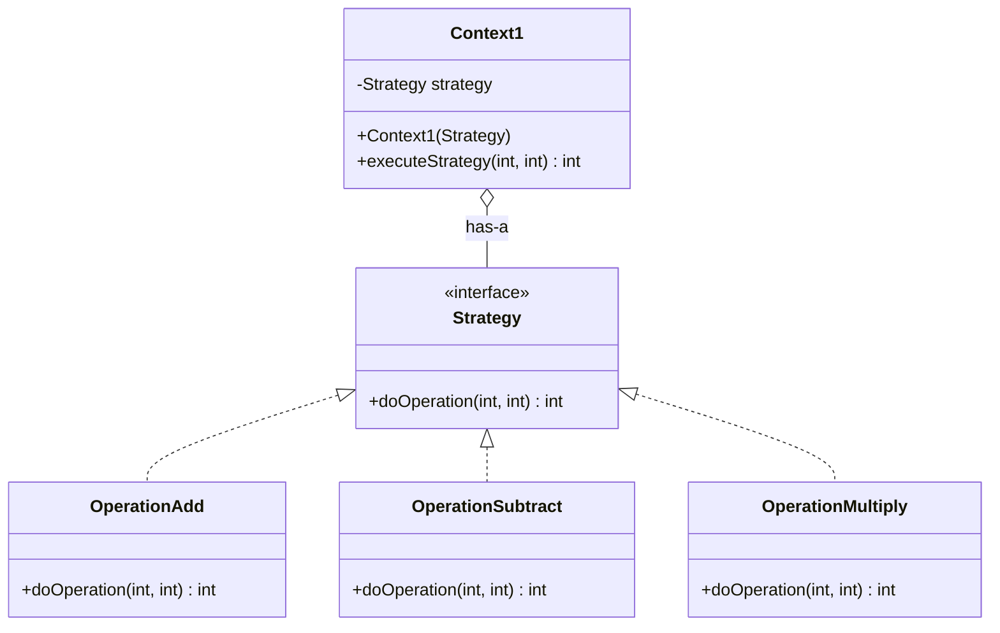
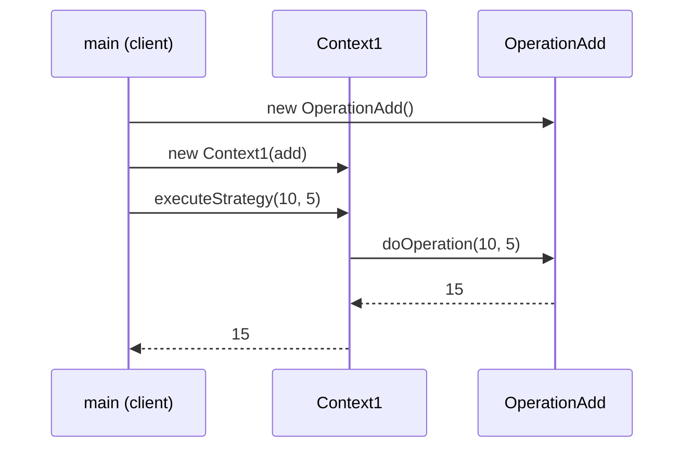

## In One Line
The Strategy pattern puts each variant of an algorithm (add, subtract, multiply; sort by name or by price) in its **own interchangeable object** behind one interface, so the client can plug the one it wants into a context at runtime without the context changing.

## Mental Model
Think of a **maps app choosing a route**. You ask the same question, "take me from A to B", and pick *Car*, *Bike*, *Walk* or *Transit*. The app (the context) does not care how each mode computes its route; it just asks the selected mode for one. Adding a *Scooter* mode tomorrow does not change the app's "show route" screen.

How it maps to the code:
- **"Take me from A to B"** is the single operation of the **Strategy** interface: `int doOperation(int num1, int num2)`.
- **Car / Bike / Walk** are the **ConcreteStrategies**: `OperationAdd`, `OperationSubtract`, `OperationMultiply`.
- **The app screen that shows the route** is the **Context**: `Context1`, which only calls `strategy.doOperation(...)`.
- **You tapping a mode** is the client choosing a strategy: `new Context1(new OperationAdd())`.

## Concept
### Intent (Gang of Four)
> "Define a family of algorithms, encapsulate each one, and make them interchangeable. Strategy lets the algorithm vary independently from clients that use it."

Also known as **Policy**. Category: **behavioral**.

### The problem it solves
Two bad ways to support several algorithms:

**1. A conditional inside the context**
```java
int calculate(String op, int a, int b) {
    switch (op) {
        case "+": return a + b;
        case "-": return a - b;
        case "*": return a * b;
        default: throw new IllegalArgumentException(op);
    }
}
```
Every new operation means editing this method (and retesting all branches). The algorithms cannot be reused elsewhere, and the class grows without limit.

**2. A subclass of the context per algorithm** (`AddCalculator extends Calculator`, `SubtractCalculator extends Calculator`...). The behaviour is frozen when the object is created, and if the context has *two* varying behaviours (say, operation and rounding), you need a subclass for every *combination*.

Strategy moves each algorithm into its own class behind an interface and lets the context **hold** one — "has-a" behaviour instead of "is-a". Three design principles in one pattern:
- **Encapsulate what varies** (the algorithm) and separate it from what stays the same (the context).
- **Favour composition over inheritance.**
- **Program to an interface**, not an implementation — the context knows only `Strategy`.

### Participants and how the example maps to them
| Participant | Role | In the example |
|---|---|---|
| **Strategy** | Common interface for all algorithms | `interface Strategy { int doOperation(int num1, int num2); }` |
| **ConcreteStrategy** | One algorithm | `OperationAdd`, `OperationSubtract`, `OperationMultiply` |
| **Context** | Holds a strategy reference and delegates the algorithm to it; knows nothing about which one it has | `Context1` with `executeStrategy(...)` → `strategy.doOperation(...)` |
| **Client** | Creates/chooses the concrete strategy and gives it to the context | `main` |

### How the context gets its strategy
| Way | Example | When |
|---|---|---|
| **Constructor** | `new Context1(new OperationAdd())` (the course example) | Required dependency, fixed for the object's life; allows `final` field |
| **Setter** | `calc.setStrategy(...)` | Behaviour must change on the same object at runtime |
| **Method parameter** | `list.sort(comparator)` | A different strategy per call; the context holds nothing |
| **DI container** | Spring injects a `PaymentStrategy` bean | Chosen by configuration, profile or bean name |

### Passing data to the strategy
- **As arguments** (the example: `doOperation(num1, num2)`) — strategies stay independent of the context. Preferred.
- **Pass the context itself** (`strategy.apply(this)`) — the strategy pulls what it needs. More flexible, but couples every strategy to the context's API.

### Strategy in modern Java (8+)
A strategy interface with a single abstract method is a **functional interface**, so each concrete strategy can be a **lambda** or **method reference** instead of a named class:
```java
Context1 add = new Context1((a, b) -> a + b);
Context1 mul = new Context1(Math::multiplyExact);
```
The JDK already ships ready-made strategy interfaces: `Comparator<T>`, `Predicate<T>`, `Function<T,R>`, `BinaryOperator<T>`, `IntBinaryOperator` (exactly the example's shape: `(int, int) -> int`). See [Functional Interfaces](lesson:a05-java8/01-functional-interfaces) and [Lambda Expressions](lesson:a05-java8/02-lambda-expressions).

Keep **named classes** when a strategy is large, has its own fields/configuration, needs its own tests, or has several methods. Use an **enum of strategies** when the set is closed and you want to select by key (the `Operation` enum in the Code section).

### Selecting a strategy without an if/else chain
The `switch` does not disappear entirely — *someone* must map "user chose +" to `OperationAdd`. Keep that mapping in **one** place: a `Map<String, Strategy>`, an enum lookup (`Operation.of("+")`), a factory, or dependency injection (Spring can inject a `Map<String, PaymentStrategy>` of all beans keyed by bean name). The rest of the code never branches on the type again.

### When to use it
- Several related classes differ only in behaviour, or one class has several variants of an algorithm (sorting orders, pricing/discount rules, tax rules per country, compression formats, payment methods, retry/backoff policies, validation rules).
- You need to **swap behaviour at runtime** or per call.
- An algorithm uses data or complexity the client should not see.
- A class is full of conditionals that pick a behaviour.

### When not to use it
- Only one algorithm exists and no second one is realistically coming — an interface plus one implementation is ceremony.
- Two tiny branches that never change — an `if` is clearer.
- Clients must understand the differences between strategies to choose one; if that knowledge is not available to them, the choice may belong inside the object (sometimes that means State instead).

### Real JDK, Spring and Android examples
- **`Comparator`** — the textbook JDK strategy: `Collections.sort(list, cmp)`, `List.sort(cmp)`, `Arrays.sort(arr, cmp)`, `new TreeMap<>(cmp)`, `new PriorityQueue<>(cmp)`. The sorting algorithm stays the same; the comparison strategy varies. See [Comparable vs Comparator](lesson:b01-fundamentals/09-comparable-vs-comparator).
- **`ThreadPoolExecutor` + `RejectedExecutionHandler`** — what to do when the pool is saturated: `AbortPolicy` (default, throws), `CallerRunsPolicy`, `DiscardPolicy`, `DiscardOldestPolicy`.
- **Streams** — `filter(Predicate)`, `map(Function)`, `sorted(Comparator)`, `Collectors.groupingBy(classifier)` all take strategy objects.
- **`File.listFiles(FileFilter)`**, AWT/Swing **`LayoutManager`** (`container.setLayout(new BorderLayout())`).
- **Spring** — `PasswordEncoder` (`BCryptPasswordEncoder`, `Argon2PasswordEncoder`; `DelegatingPasswordEncoder` picks one by the `{bcrypt}` prefix), `PlatformTransactionManager` implementations (`DataSourceTransactionManager`, `JpaTransactionManager`), `ResourceLoader`, `ViewResolver`/`HandlerMapping` implementations in Spring MVC.
- **Android** — `RecyclerView.setLayoutManager(...)` (`LinearLayoutManager`, `GridLayoutManager`, `StaggeredGridLayoutManager`), animation `Interpolator`s (`LinearInterpolator`, `AccelerateDecelerateInterpolator`), `TextView.setTransformationMethod(PasswordTransformationMethod.getInstance())`.

### Look-alike patterns
| Pattern | How it differs from Strategy |
|---|---|
| [State](lesson:a10-patterns/20-state) | Same class diagram. State objects switch *themselves* as the context's state changes and know their successors; strategies are chosen by the client and are independent. |
| [Template Method](lesson:a10-patterns/22-template-method) | Varies **parts** of an algorithm through **inheritance** (compile time, class level). Strategy varies the **whole** algorithm through **composition** (runtime, object level). |
| [Command](lesson:a10-patterns/13-command) | A command is a *request* ("turn the light on") that can be queued, logged or undone. A strategy is a *way of doing* something the context already has to do. |
| [Decorator](lesson:a10-patterns/08-decorator) | GoF: *"a decorator lets you change the skin of an object; a strategy lets you change the guts."* Decorators wrap and add; strategies replace. |
| [Bridge](lesson:a10-patterns/06-bridge) | Structural: separates two whole class hierarchies (abstraction and implementation) that evolve independently; Strategy is about one swappable algorithm. |

> [!INTERVIEW] "Strategy is composition over inheritance applied to algorithms: the context has-a strategy, programmed to an interface, so I can add a new algorithm without touching the context — that is the Open/Closed Principle. In Java 8+ the strategy is usually just a lambda, like a `Comparator`."

## Diagram

The context depends only on the interface. The three operations are siblings that never refer to each other, which is the structural hint that this is Strategy and not State.


The client chooses the strategy; the context just forwards the call and returns the result. Swapping strategies changes only the first two arrows.

## Code
@example CoreJava/BehavioralPattern/StrategyPatternExample.java

**Strategies as lambdas and method references**, swapped at runtime on one context:
```java
import java.util.Objects;

public class LambdaStrategy {
    public static void main(String[] args) {
        Calculator calc = new Calculator((a, b) -> a + b);       // lambda = a strategy
        System.out.println("10 + 5 = " + calc.execute(10, 5));

        calc.setStrategy((a, b) -> a - b);                        // swap at runtime
        System.out.println("10 - 5 = " + calc.execute(10, 5));

        calc.setStrategy(Math::multiplyExact);                    // method reference
        System.out.println("10 * 5 = " + calc.execute(10, 5));

        calc.setStrategy(Integer::max);                           // any (int,int)->int fits
        System.out.println("max(10, 5) = " + calc.execute(10, 5));
    }
}

@FunctionalInterface
interface Strategy {
    int doOperation(int num1, int num2);
}

class Calculator {                                   // the Context
    private Strategy strategy;

    Calculator(Strategy strategy) { setStrategy(strategy); }

    void setStrategy(Strategy strategy) {
        this.strategy = Objects.requireNonNull(strategy, "strategy");
    }

    int execute(int a, int b) { return strategy.doOperation(a, b); }
}
```
```output
10 + 5 = 15
10 - 5 = 5
10 * 5 = 50
max(10, 5) = 10
```
No concrete strategy classes at all: any lambda or method with the shape `(int, int) -> int` is a valid `Strategy`. `Math::multiplyExact` also throws on overflow instead of silently wrapping.

**Enum of strategies, selected by key** — the only "switch" left is a map lookup:
```java
import java.util.Arrays;
import java.util.List;
import java.util.Map;
import java.util.Optional;
import java.util.function.Function;
import java.util.function.IntBinaryOperator;
import java.util.stream.Collectors;

public class EnumStrategy {
    public static void main(String[] args) {
        for (String expr : List.of("10 + 5", "10 - 5", "10 * 5", "10 / 5", "10 % 5")) {
            String[] t = expr.split(" ");
            int a = Integer.parseInt(t[0]), b = Integer.parseInt(t[2]);
            String result = Operation.of(t[1])                    // pick strategy by key, no switch
                    .map(op -> op + " -> " + op.applyAsInt(a, b))
                    .orElse("unsupported operator " + t[1]);
            System.out.println(expr + " : " + result);
        }
    }
}

enum Operation implements IntBinaryOperator {
    ADD("+", (a, b) -> a + b),
    SUBTRACT("-", (a, b) -> a - b),
    MULTIPLY("*", (a, b) -> a * b),
    DIVIDE("/", (a, b) -> a / b);

    private static final Map<String, Operation> BY_SYMBOL =
            Arrays.stream(values()).collect(Collectors.toMap(o -> o.symbol, Function.identity()));

    private final String symbol;
    private final IntBinaryOperator impl;

    Operation(String symbol, IntBinaryOperator impl) {
        this.symbol = symbol;
        this.impl = impl;
    }

    @Override
    public int applyAsInt(int a, int b) { return impl.applyAsInt(a, b); }

    static Optional<Operation> of(String symbol) {
        return Optional.ofNullable(BY_SYMBOL.get(symbol));
    }
}
```
```output
10 + 5 : ADD -> 15
10 - 5 : SUBTRACT -> 5
10 * 5 : MULTIPLY -> 50
10 / 5 : DIVIDE -> 2
10 % 5 : unsupported operator %
```
The enum implements the JDK's own strategy interface `IntBinaryOperator`. Adding `%` later is one new constant; the loop in `main` never changes.

**The JDK's favourite strategy: `Comparator`** — one sort algorithm, different comparison strategies:
```java
import java.util.ArrayList;
import java.util.Comparator;
import java.util.List;

public class ComparatorStrategy {
    record Product(String name, int price) {}

    public static void main(String[] args) {
        List<Product> products = new ArrayList<>(List.of(
                new Product("Pen", 20), new Product("Book", 150), new Product("Bag", 80)));

        Comparator<Product> byPrice = Comparator.comparingInt(Product::price);
        Comparator<Product> byName  = Comparator.comparing(Product::name);

        products.sort(byPrice);                  // same sort algorithm...
        System.out.println(products.stream().map(Product::name).toList());

        products.sort(byName.reversed());        // ...different comparison strategy
        System.out.println(products.stream().map(Product::name).toList());
    }
}
```
```output
[Pen, Bag, Book]
[Pen, Book, Bag]
```
`List.sort` is the context; the `Comparator` is passed as a **method parameter**, so each call can use a different strategy. `reversed()` builds a new strategy from an existing one.

**Spring-style selection** (sketch, needs a Spring context to run): Spring injects every `PaymentStrategy` bean into a map keyed by bean name, so adding a payment method is just adding a new `@Component`.
```java
public interface PaymentStrategy { void pay(long amountInPaise); }

@Component("card") class CardPayment implements PaymentStrategy { public void pay(long a) { /* ... */ } }
@Component("upi")  class UpiPayment  implements PaymentStrategy { public void pay(long a) { /* ... */ } }

@Service
class CheckoutService {
    private final Map<String, PaymentStrategy> strategies;          // {"card"=CardPayment, "upi"=UpiPayment}
    CheckoutService(Map<String, PaymentStrategy> strategies) { this.strategies = strategies; }

    void checkout(String method, long amount) {
        PaymentStrategy s = strategies.get(method);
        if (s == null) throw new IllegalArgumentException("Unsupported payment method: " + method);
        s.pay(amount);
    }
}
```

## Walkthrough
**`interface Strategy { int doOperation(int num1, int num2); }`** — the Strategy role: one method that every algorithm implements. Because it has exactly one abstract method it is a functional interface (it could carry `@FunctionalInterface`), so lambdas can implement it.

**`OperationAdd`, `OperationSubtract`, `OperationMultiply`** — the ConcreteStrategies. Each overrides `doOperation` (the `@Override` annotation is missing but the methods do implement the interface) and contains nothing but its own algorithm: `num1 + num2`, `num1 - num2`, `num1 * num2`. They have no fields, so each is **stateless** — one instance could be shared by any number of contexts.

**`class Context1`**
- `private Strategy strategy;` — the context holds the strategy through the **interface type**, never a concrete class. This field is the "has-a" that makes it composition.
- `public Context1(Strategy strategy)` — constructor injection: the client decides which algorithm the context uses.
- `executeStrategy(int num1, int num2)` — delegates: `return strategy.doOperation(num1, num2);`. Dynamic dispatch picks the concrete class's method at runtime ([Polymorphism](lesson:a01-oop/04-polymorphism)). The context contains no `if` and no knowledge of addition or multiplication.
- Why "`Context1`"? The State example in the same package (`CoreJava.BehavioralPattern`) already declares a class named `Context`, and two top-level classes in one package cannot share a name. The `1` is a workaround, not part of the pattern.

**`main`**
1. `Context1 context = new Context1(new OperationAdd());` → `"10 + 5 = " + context.executeStrategy(10, 5)` prints `10 + 5 = 15`. (String concatenation evaluates the method call first, then appends the `int`.)
2. `context = new Context1(new OperationSubtract());` — the **variable** now points to a *new* context with a different strategy → `10 - 5 = 5`.
3. `context = new Context1(new OperationMultiply());` → `10 * 5 = 50`.

**Output** — three deterministic lines, and all three `// Output:` comments match. Note that the example switches behaviour by creating a **new context each time**; it never changes the strategy of an existing context. The `LambdaStrategy` version adds a setter to show a true runtime swap on the same object.

## Traps
> [!ERRATA] `Context1` is a meaningless name forced by a clash with the State example's `Context` class in the same package. In real code name the context after its job (`Calculator`, `CheckoutService`). Also, the constructor accepts `null` silently: `new Context1(null)` compiles and constructs fine, then fails later inside `executeStrategy` with `NullPointerException: Cannot invoke "Strategy.doOperation(int, int)" because "this.strategy" is null`. Fail fast with `Objects.requireNonNull(strategy)` in the constructor, and make the field `final` since it is never reassigned.

- **Integer overflow in a strategy.** `OperationMultiply` uses plain `*`, so `doOperation(100_000, 100_000)` returns `1410065408` (the true result wrapped around 32 bits). Use `Math.multiplyExact` / `addExact` (they throw `ArithmeticException: integer overflow`) or `long`/`BigInteger` when the range matters.
- **Moving the `switch` into the client.** If every caller now writes `if (op.equals("+")) new OperationAdd() ...`, nothing improved. Keep the choice in **one** factory, map or DI configuration.
- **Stateful strategies shared across threads.** A strategy with mutable fields (a running total, a cache) used by several contexts or threads is a race condition. Keep strategies stateless or create one per context.
- **Too many tiny strategy classes.** Three one-line classes is exactly what a lambda replaces; do not create a class hierarchy for `a + b`.
- **The strategy needs everything from the context.** If every strategy method takes eight parameters or the whole context, the boundary is wrong — rethink what the algorithm really needs.
- **Serializing a lambda strategy.** Lambdas are not `Serializable` unless the target type is; storing a lambda in a serializable field fails at runtime (`NotSerializableException`). Use an enum strategy when it must be persisted.

## Tips & Tricks
- **Mnemonic — "Strategy = Swap the How".** Same *what* (compute, sort, pay), swappable *how*.
- **GoF one-liner to quote:** "Decorator changes the skin, Strategy changes the guts."
- **Recognise it in code:** a field or parameter of an interface type + a method that just calls through it = Strategy. `list.sort(cmp)` is Strategy by method parameter.
- **Lambda first:** if your strategy interface has one method, try a lambda, method reference, or a JDK type (`IntBinaryOperator`, `BiFunction`, `Comparator`) before writing a class.
- **Enum strategy for closed sets** (operators, shipping speeds): free singletons, easy lookup by key, serializable.
- **One place to choose:** a `Map<String, Strategy>`, an enum `of(...)`, or DI — never scattered `if` chains.
- **Test each strategy alone**, and test the context with a fake strategy — both are trivial because they only meet at the interface.

## Interview Q&A
### [Basic] What is the Strategy pattern and what problem does it solve?
Strategy defines a family of algorithms, puts each one in its own class behind a common interface, and lets the client choose which one a context uses — even at runtime. It replaces a growing `if/else` or `switch` over "which algorithm", or a subclass per algorithm, with composition: the context has-a `Strategy` and delegates to it. Benefits: new algorithms without editing the context (Open/Closed), each algorithm testable in isolation, and behaviour swappable at runtime. The course example is a calculator: `Context1` delegates `executeStrategy(10, 5)` to `OperationAdd`, `OperationSubtract` or `OperationMultiply`, printing 15, 5 and 50.

**Follow-up:** *What is the downside?* — More types, and clients must know the strategies to choose one; for one or two trivial variants it is over-engineering.

### [Basic] Give examples of the Strategy pattern in the JDK.
`Comparator` is the classic one: `Collections.sort(list, comparator)`, `List.sort`, `Arrays.sort`, `TreeMap`/`TreeSet`/`PriorityQueue` constructors all keep their algorithm fixed and take the comparison as a strategy. Others: `ThreadPoolExecutor`'s `RejectedExecutionHandler` (`AbortPolicy`, `CallerRunsPolicy`, `DiscardPolicy`, `DiscardOldestPolicy`), `File.listFiles(FileFilter)`, AWT/Swing `LayoutManager`, and every stream operation that takes a `Predicate`, `Function` or `Comparator`.

**Follow-up:** *In `TreeMap(Comparator)`, which is the context?* — The `TreeMap`: its red-black tree algorithm is fixed, and it asks the comparator strategy "which key is smaller?" at every step.

### [Intermediate] How did Java 8 change the way we implement Strategy?
Because a strategy interface usually has a single abstract method, it is a **functional interface**, so concrete strategies can be lambdas or method references — `new Context1((a, b) -> a + b)`, `new Context1(Math::multiplyExact)` — with no named classes. Java also ships generic strategy types (`Function`, `BiFunction`, `Predicate`, `Comparator`, `IntBinaryOperator`), so often you do not even declare the interface. Comparator gained factory and combinator methods (`comparing`, `thenComparing`, `reversed`) to build strategies from other strategies. Named classes are still better when a strategy is large, configurable, has several methods, or deserves its own unit tests; an enum is better for a closed, keyed set.

**Follow-up:** *Is a lambda-based strategy still the Strategy pattern?* — Yes; the pattern is the intent and the roles (context delegating to an interchangeable algorithm), not the syntax used to create the algorithm object.

### [Intermediate] How do you choose a strategy at runtime without an if/else chain?
Put the mapping from "key" to strategy in exactly one place:
- A `Map<String, Strategy>` registry (`Map.of("+", Integer::sum, "*", Math::multiplyExact)`).
- An enum with a static lookup (`Operation.of("+")` returning `Optional<Operation>`).
- A factory method.
- Dependency injection: in Spring, inject `Map<String, PaymentStrategy>` (all beans keyed by bean name) or `List<PaymentStrategy>` and let each strategy say whether it `supports(type)`; choose per environment with `@Profile` or `@ConditionalOnProperty`.

Unknown keys should fail clearly (exception or `Optional.empty()`), not fall through silently.

**Follow-up:** *Does the switch disappear completely?* — No, the mapping still exists, but it lives in one place, often as data rather than code, and the business logic never branches on type.

### [Intermediate] What is the difference between Strategy and State?
The class diagrams are identical; the intent is not. In **Strategy** the client chooses an algorithm, usually once, and the strategies are independent of each other. In **State** the context changes its own state object as events happen, many times during its life, and each state knows which state comes next; the client usually does not even know the states exist. Test question: "who calls `setX(...)`?" — the client (Strategy) or the states/context themselves (State).

**Follow-up:** *Is the course's State example really different from this Strategy example?* — Not much: its client also picks the state object directly. A proper State example has the context delegate and the states perform the transitions.

### [Intermediate] Strategy vs Template Method?
Both let you vary an algorithm. **Template Method** uses **inheritance**: a base class fixes the skeleton in a `final` method and subclasses override some **steps**; the choice is made when you pick the subclass (compile time) and cannot change for that object. **Strategy** uses **composition**: the **whole** algorithm sits behind an interface and can be swapped at runtime, even per call. Template Method avoids duplicating the invariant steps; Strategy avoids a class explosion when several independent behaviours vary. You can turn a Template Method into Strategy by passing the varying steps as lambdas.

**Follow-up:** *Which does `HttpServlet.service()` use?* — Template Method: `service` dispatches to the `doGet`/`doPost` methods you override.

### [Advanced] How does Strategy relate to SOLID and "composition over inheritance"?
- **Single Responsibility:** each algorithm lives in its own class; the context only coordinates.
- **Open/Closed:** add a new strategy class or lambda without modifying the context.
- **Liskov Substitution:** any strategy must honour the interface contract (e.g. a `Comparator` must be consistent and transitive) so contexts keep working.
- **Interface Segregation:** strategy interfaces are small, often one method.
- **Dependency Inversion:** the high-level context depends on the `Strategy` abstraction, and the concrete choice is injected from outside.
Composition over inheritance: behaviour is a *part* the object holds, not a *type* it is, so it can change at runtime and combine freely with other parts. See [SOLID Principles](lesson:b01-fundamentals/13-solid-principles).

**Follow-up:** *Which SOLID principle does a `switch` on operation type break?* — Open/Closed: each new operation modifies the existing method.

### [Advanced] Design a discount system for an e-commerce checkout. New discount types will keep coming.
Define `interface DiscountStrategy { Money apply(Cart cart); }` with implementations such as `NoDiscount` (a Null Object default), `PercentageOff(int percent)`, `FlatOff(Money amount)`, `BuyXGetY(...)`. The `CheckoutService` holds or receives a `DiscountStrategy` and calls `apply(cart)`; it never knows which rule is active. The choice comes from one place — a coupon code looked up in a `Map<String, DiscountStrategy>` or a Spring bean registry. Stateless strategies are shared singletons; parameterised ones (`PercentageOff(10)`) are small immutable objects. To stack discounts, add a `CompositeDiscount(List<DiscountStrategy>)` that applies each in order (Composite + Strategy). Each rule gets its own unit test, and the checkout is tested with a fake strategy.

**Follow-up:** *Where do you validate that a coupon can be used by this customer?* — Not inside the arithmetic strategy; add a `boolean isApplicable(Cart, Customer)` method or keep eligibility in a separate policy, so each object has one reason to change.

### [Advanced] Are strategies thread-safe? Should they be singletons?
A **stateless** strategy (all the example's operations, most comparators) is automatically thread-safe and can be shared as a singleton or enum constant. A strategy with **mutable** fields (a counter, a cache, a `SimpleDateFormat`) must not be shared across threads unless it synchronises internally; create one per context or per thread, or make it immutable. The context's `strategy` field also matters: if another thread calls `setStrategy` while calls are in progress, make the field `volatile` (or use an `AtomicReference`) so the new strategy is visible, and accept that in-flight calls may still use the old one.

**Follow-up:** *Why was `SimpleDateFormat` a classic trap here?* — It keeps parse state in fields, so sharing one "formatting strategy" across threads corrupts results; the immutable `DateTimeFormatter` fixed that.

### [Intermediate] How is Strategy different from Command and Decorator?
**Command** encapsulates a *request* — "what to do", with its receiver and arguments — so it can be queued, logged, retried or undone; the invoker does not know what the command does. **Strategy** encapsulates *how* the context does a job it already has to do; it returns a result to the context and is not queued or undone. **Decorator** wraps an object with the same interface to *add* behaviour around it and can be stacked; a strategy *replaces* one internal algorithm. GoF's phrasing: a decorator changes an object's skin, a strategy changes its guts.

**Follow-up:** *Is `Runnable` passed to an `ExecutorService` a command or a strategy?* — A command: it is a unit of work handed to an invoker to execute later.

## Quiz
### What does this print (original `Strategy` and `Context1` classes)?
```java
Strategy s = (a, b) -> a * b;
Context1 context = new Context1(s);
s = (a, b) -> a - b;
System.out.println(context.executeStrategy(10, 5));
```
- [ ] 5
- [x] 50
- [ ] 15
- [ ] Compile error: `s` is not effectively final
> The context stored a copy of the *reference* to the multiply lambda. Reassigning the local variable `s` afterwards points `s` somewhere else but does not touch the context's field, so it still multiplies: 50. There is no compile error because `s` is never captured by a lambda — effectively-final rules apply only to captured variables.

### What does `new OperationMultiply().doOperation(100_000, 100_000)` return?
- [ ] 10000000000
- [x] 1410065408
- [ ] It throws `ArithmeticException`
- [ ] Compile error: the literal is too large
> The true product, 10,000,000,000, does not fit in an `int`, so `*` silently wraps around modulo 2^32 and yields 1410065408. Only `Math.multiplyExact` throws `ArithmeticException: integer overflow`. `100_000` itself is a perfectly valid `int` literal.

### Spot the bug: when does this code fail?
```java
Context1 context = new Context1(null);
System.out.println("constructed fine");
System.out.println(context.executeStrategy(1, 2));
```
- [ ] It does not compile: `null` is not a `Strategy`
- [ ] The constructor throws `NullPointerException`
- [x] It prints `constructed fine`, then `executeStrategy` throws `NullPointerException`
- [ ] It prints `constructed fine` and then `0`
> `null` is assignable to any reference type, and the constructor just stores it. The failure is delayed until `strategy.doOperation(...)` is called on `null`. Fix: `this.strategy = Objects.requireNonNull(strategy)` so the error appears at the line that caused it.

### What does this print?
```java
record Product(String name, int price) {}
List<Product> products = new ArrayList<>(List.of(
        new Product("Pen", 20), new Product("Book", 150), new Product("Bag", 80)));
products.sort(Comparator.comparingInt(Product::price));
System.out.println(products.stream().map(Product::name).toList());
```
- [ ] [Bag, Book, Pen]
- [x] [Pen, Bag, Book]
- [ ] [Book, Bag, Pen]
- [ ] [Pen, Book, Bag]
> The comparator strategy orders by price: 20 (Pen), 80 (Bag), 150 (Book). `[Bag, Book, Pen]` would be alphabetical order — a different strategy (`Comparator.comparing(Product::name)`).

### Which of these is NOT an example of passing a strategy?
- [ ] `Collections.sort(list, Comparator.reverseOrder())`
- [ ] `new ThreadPoolExecutor(2, 4, 60, SECONDS, queue, new ThreadPoolExecutor.CallerRunsPolicy())`
- [ ] `recyclerView.setLayoutManager(new GridLayoutManager(context, 2))`
- [x] `Integer.valueOf(42)`
> The first three hand an interchangeable algorithm to a context (comparison, rejection policy, layout policy). `Integer.valueOf` is a static factory that returns cached instances for -128..127 — a factory/flyweight idea, with nothing to plug in.

### Why can `Math::multiplyExact` be passed where a `Strategy` is expected?
- [ ] Because `Math` implements `Strategy`
- [x] Because `Strategy` is a functional interface and `multiplyExact(int, int)` matches its method shape `(int, int) -> int`
- [ ] Because all static methods can be converted to any interface
- [ ] It cannot; it is a compile error
> A method reference can target any functional interface whose single abstract method is compatible with the referenced method's parameters and return type. `Math` knows nothing about `Strategy`. A method with a different shape, such as `Math::abs`, would not compile here.

### Which statement correctly contrasts Strategy with Template Method?
- [ ] Strategy uses inheritance; Template Method uses composition
- [x] Strategy swaps a whole algorithm by composition at runtime; Template Method varies steps of a fixed skeleton through subclassing
- [ ] Both require abstract classes
- [ ] Template Method can change behaviour at runtime; Strategy cannot
> It is the other way round from the first option: Template Method relies on subclasses overriding steps, chosen when the object is created; Strategy holds an interchangeable object and can even replace it per call. Strategy needs only an interface (or a lambda).

## Takeaways
- Strategy: put each variant of an algorithm behind one interface and let the context hold and delegate to one of them; the client chooses which.
- It replaces `switch`/`if` chains and subclass-per-algorithm designs with composition — Open/Closed, "encapsulate what varies", "program to an interface".
- A strategy can be given by constructor (the course example), setter (runtime swap) or method parameter (`list.sort(comparator)`).
- In Java 8+ a one-method strategy is a functional interface, so lambdas, method references (`Math::multiplyExact`) or JDK types (`IntBinaryOperator`, `Comparator`) replace concrete classes; enums suit closed, keyed sets.
- Keep the "which strategy?" decision in one place (map, enum lookup, factory, Spring `Map<String, Bean>` injection).
- JDK/framework examples: `Comparator`, `RejectedExecutionHandler`, `LayoutManager`, Spring `PasswordEncoder`, Android `RecyclerView.LayoutManager`.
- Strategy vs State: client chooses vs object switches itself. Strategy vs Template Method: composition of the whole algorithm vs inheritance of steps.
- Course-example issues: `Context1` is a name-clash workaround, a `null` strategy fails late (use `requireNonNull`), and `int` multiplication overflows silently.
