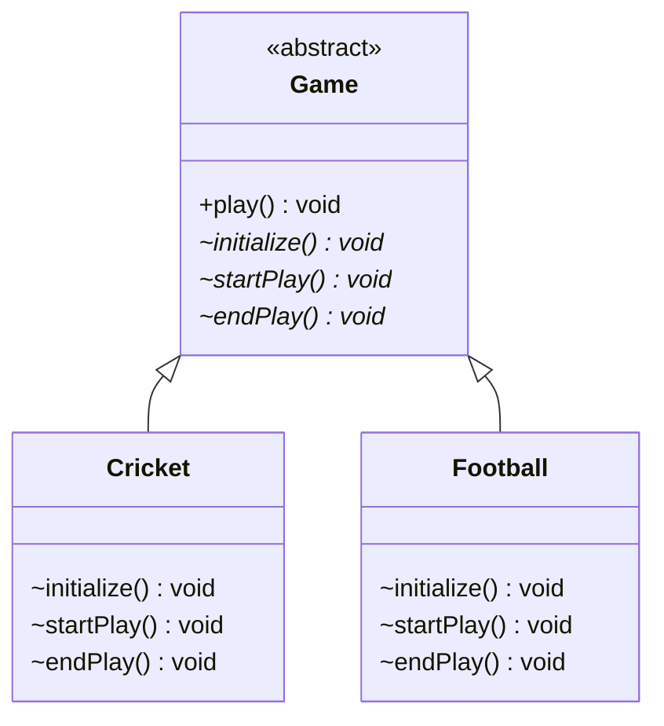
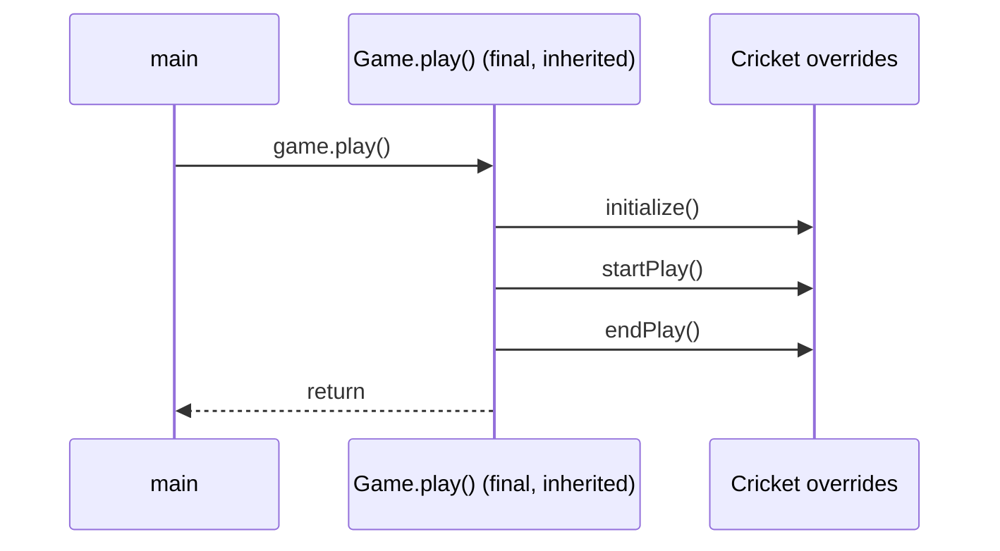
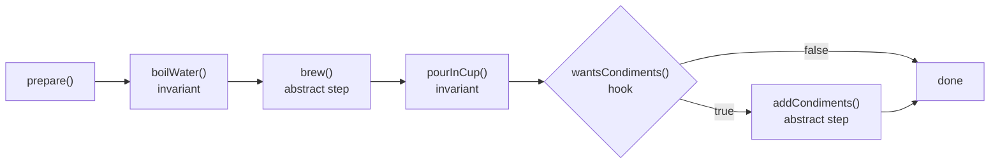

## In One Line
Template Method puts the **fixed order of steps** of an algorithm in one `final` method of a base class and lets subclasses **fill in some of the steps**, so every variant follows the same skeleton without copying it.

## Mental Model
Think of a **sports league's match-day rulebook**. The league fixes the order for every match: *set up the ground → play → finish and record the result*. Cricket and football fill in each step in their own way (pitch and toss vs. kick-off), but neither sport may reorder the day or skip the result.

How it maps to the code:
- **The league rulebook** is the abstract class `Game`.
- **The fixed match-day order** is the template method `public final void play()` — `final` means no sport can change the order.
- **"Set up / play / finish"** are the steps `initialize()`, `startPlay()`, `endPlay()`, declared `abstract` so every sport must supply them.
- **Cricket and football** are the concrete subclasses `Cricket` and `Football`.
- **The league calling each sport when it is time** is the "Hollywood Principle": the base class calls the subclass, not the other way round.

## Concept
### Intent (Gang of Four)
> "Define the skeleton of an algorithm in an operation, deferring some steps to subclasses. Template Method lets subclasses redefine certain steps of an algorithm without changing the algorithm's structure."

Category: **behavioral** — but unlike most behavioral patterns it is a **class** pattern: it works through **inheritance**, not object composition.

### The problem it solves
Without it, each variant writes the whole algorithm:
```java
class Cricket  { void play() { /* init cricket */ /* start cricket */ /* end cricket */ } }
class Football { void play() { /* init football */ /* start football */ /* end football */ } }
```
The **order** (init → start → end) is duplicated in every class. If the league adds a step ("log the result") or fixes a bug in the sequence, every class must be changed, and one of them will be forgotten. Template Method moves the invariant part (the order, plus any shared steps) into one place and leaves only the varying parts to subclasses.

### Participants and how the example maps to them
| Participant | Role | In the example |
|---|---|---|
| **AbstractClass** | Defines the template method and declares the steps | `abstract class Game` |
| **Template method** | Calls the steps in a fixed order; normally `final` | `public final void play()` |
| **Primitive operations** | Abstract steps each subclass must implement | `initialize()`, `startPlay()`, `endPlay()` |
| **ConcreteClass** | Implements the primitive operations | `Cricket`, `Football` |
| **Client** | Calls the template method through the base type | `main`: `Game game = new Cricket(); game.play();` |

### The four kinds of methods in a template base class
| Kind | Purpose | Recommended modifiers | Example |
|---|---|---|---|
| **Template method** | The algorithm skeleton | `public final` | `play()`, `prepare()` |
| **Primitive operation** | A step subclasses **must** supply | `protected abstract` | `brew()`, `startPlay()` |
| **Hook** | An **optional** step or decision with a default (often empty or `true`) that subclasses **may** override | `protected` (non-final) | `wantsCondiments()`, `beforeStart() {}` |
| **Invariant (concrete) step** | Shared work that is the same for everyone | `private` (or `final`) | `boilWater()` |

Why these modifiers:
- **`final` template** — a subclass cannot override `play()` and break the order (`play() in Cricket cannot override play() in Game; overridden method is final`).
- **`protected` steps** — visible to subclasses in *any* package, hidden from ordinary clients. The course uses package-private steps, which has two problems (see Traps): other classes in the package can call a step out of order, and a subclass in a **different** package cannot implement them at all.
- **`private` invariants** — subclasses cannot tamper with them.

### Hooks: the flexible part
A hook is a step with a sensible default that subclasses may override:
- **Empty hook** — `protected void beforeStart() {}`: an extension point that does nothing unless overridden.
- **Decision hook** — `protected boolean wantsCondiments() { return true; }`: lets a subclass switch an optional step on or off (the `Coffee` example in the Code section).
- **Default-behaviour hook** — a real default implementation that most subclasses keep.

Hooks keep the number of `abstract` methods small: subclasses implement what they must and override only what they want.

### The Hollywood Principle and inversion of control
*"Don't call us, we'll call you."* The subclass never calls `play()`'s steps itself; the base class calls the subclass's methods at the right time. This is the essence of **frameworks**: Servlet containers call `doGet`, Android calls `onCreate`, JUnit calls `setUp`. You plug code into a skeleton you do not control.

### Template Method with lambdas: "template + callback"
You can get the same effect without inheritance by passing the varying step as a function:
```java
static <T> T inTransaction(String name, Supplier<T> work) { /* BEGIN, work.get(), COMMIT or ROLLBACK */ }
```
The fixed skeleton is a method and the variable step is a lambda (see Code). Spring's `JdbcTemplate`, `TransactionTemplate` and `RestTemplate` work this way: despite the name they are **not** classic Template Method subclasses — they are concrete classes that run a fixed skeleton (get connection, run, map, handle exceptions, release) and call **your callback** (`RowMapper`, `TransactionCallback`) for the varying part. Many developers call this the *template-callback* pattern; it is really Template Method's idea implemented with Strategy-style composition.

### When to use it
- Several classes run the **same sequence** of steps and differ only in some steps.
- You want to **enforce** an order or invariant (always close the connection, always call `tearDown`).
- You are building a **framework** or base class with controlled extension points.
- You want to remove duplicated code by pulling the common algorithm up into a base class.

### When not to use it
- The variants differ in the **whole** algorithm, or you must switch behaviour at **runtime** → use [Strategy](lesson:a10-patterns/21-strategy).
- The subclass already extends another class (Java has single inheritance) → pass the steps in as objects or lambdas instead.
- The skeleton has many steps and each subclass overrides a different subset → the base class becomes hard to understand ("fragile base class"). Prefer composition.
- Only one implementation exists.

### Real JDK, Spring and Android examples
- **`java.io.InputStream`** — `read(byte[], int, int)` is implemented once and calls the abstract `read()` for each byte; a subclass implements only `read()` (and usually overrides the array version for speed).
- **`java.util.AbstractList`**, `AbstractCollection`, `AbstractMap`, `AbstractSet` — implement `get(int)` and `size()` and you get `iterator()`, `contains`, `indexOf`, `subList`, `equals`, `hashCode`, `toString` for free (see `Range` in the Code section).
- **`ClassLoader.loadClass(name, resolve)`** — fixed algorithm (already loaded? → ask the parent → otherwise `findClass`); custom class loaders override only the `findClass` hook.
- **`AbstractQueuedSynchronizer`** — `public final void acquire(int)` runs the queueing algorithm and calls your `protected boolean tryAcquire(int)`; `ReentrantLock`, `Semaphore` and `CountDownLatch` are built this way.
- **`HttpServlet.service(...)`** — dispatches to `doGet`, `doPost`, `doPut`... which you override.
- **JUnit 3 `TestCase.runBare()`** — calls `setUp()`, `runTest()`, `tearDown()` (in a `finally`). The course project's `AppTest` extends this very `TestCase` (JUnit 3.8.1 in the pom).
- **Spring** — `OncePerRequestFilter.doFilter(...)` is `final` and calls your `doFilterInternal(...)`; `AbstractApplicationContext.refresh()` is a long template with hooks such as `postProcessBeanFactory()` and `onRefresh()`; `JdbcTemplate` & co. use template + callback.
- **Android** — `View.measure()` is `final` and calls your `onMeasure()`; `View.draw()` calls `onDraw()`; the `Activity` lifecycle (`onCreate`, `onStart`, `onResume`...) is a framework-driven skeleton with hooks; the old `AsyncTask` (deprecated in API 30) called `onPreExecute` → `doInBackground` → `onPostExecute`.

### Look-alike patterns
| Pattern | How it differs |
|---|---|
| [Strategy](lesson:a10-patterns/21-strategy) | Composition vs inheritance: Strategy swaps the **whole** algorithm as an object, even at runtime; Template Method varies **steps** of a fixed skeleton, chosen by which subclass you instantiate. |
| [Factory](lesson:a10-patterns/02-factory) (Factory Method) | A Factory Method is often **one step** of a template method — the step that decides which object to create. GoF: factory methods are often called by template methods. |
| [State](lesson:a10-patterns/20-state) | State swaps behaviour objects at runtime as state changes; Template Method has no runtime switching. |
| [Abstract class vs interface](lesson:a01-oop/06-abstract-vs-interface) | A template method needs an abstract class: interface `default` methods cannot be `final` (`modifier final not allowed here`) and all interface abstract methods are `public`, so an interface cannot lock the order or hide the steps. |

> [!INTERVIEW] "Template Method is inheritance-based reuse of an algorithm's structure: a final method in an abstract class defines the order, abstract methods are the mandatory steps, hooks are optional steps. The base class calls the subclass — the Hollywood Principle — which is how most frameworks work."

## Diagram

`play()` is the `final` template method; the three `*` methods are abstract steps (the `~` marks them package-private in the original — they should be `protected`). Subclasses override steps only, never `play()`.


The client calls the inherited template; the template calls down into the subclass's overrides through dynamic dispatch. Control flows from the base class to the subclass — "don't call us, we'll call you".


The full recipe from the `HotDrink` example: private invariant steps, abstract steps every drink must supply, and a hook that lets a subclass skip an optional step.

## Code
@example CoreJava/BehavioralPattern/TemplatePatternExample.java

**A complete template with invariant steps, abstract steps and a hook:**
```java
public class HotDrinkDemo {
    public static void main(String[] args) {
        new Tea().prepare();
        System.out.println();
        new Coffee(false).prepare();
    }
}

abstract class HotDrink {
    // Template method: public (clients call it) and final (subclasses cannot reorder it)
    public final void prepare() {
        boilWater();
        brew();
        pourInCup();
        if (wantsCondiments()) {          // hook decides whether an optional step runs
            addCondiments();
        }
    }

    private void boilWater() { System.out.println("Boiling water"); }       // invariant step
    private void pourInCup() { System.out.println("Pouring into cup"); }    // invariant step

    protected abstract void brew();              // primitive operation: must override
    protected abstract void addCondiments();     // primitive operation: must override

    protected boolean wantsCondiments() {        // hook: may override, has a default
        return true;
    }
}

class Tea extends HotDrink {
    @Override protected void brew()          { System.out.println("Steeping the tea"); }
    @Override protected void addCondiments() { System.out.println("Adding lemon"); }
}

class Coffee extends HotDrink {
    private final boolean withMilk;
    Coffee(boolean withMilk) { this.withMilk = withMilk; }

    @Override protected void brew()             { System.out.println("Dripping coffee through filter"); }
    @Override protected void addCondiments()    { System.out.println("Adding milk and sugar"); }
    @Override protected boolean wantsCondiments() { return withMilk; }
}
```
```output
Boiling water
Steeping the tea
Pouring into cup
Adding lemon

Boiling water
Dripping coffee through filter
Pouring into cup
```
`Tea` keeps the hook's default (`true`), so lemon is added. `Coffee(false)` overrides the hook to return `false`, so the template skips `addCondiments()` — the subclass influenced the algorithm without being able to reorder it.

**The JDK does it for you: `AbstractList`** — implement two primitive operations, inherit a dozen template methods:
```java
import java.util.AbstractList;
import java.util.List;
import java.util.Objects;

public class RangeDemo {
    public static void main(String[] args) {
        List<Integer> r = new Range(3, 8);               // 3, 4, 5, 6, 7
        System.out.println(r);                           // toString() comes from AbstractCollection
        System.out.println(r.contains(5) + " " + r.indexOf(7));
        System.out.println(r.subList(1, 3));
        int sum = 0;
        for (int x : r) sum += x;                        // iterator() comes from AbstractList
        System.out.println("sum = " + sum);
        try {
            r.add(9);                                    // default add() throws
        } catch (UnsupportedOperationException e) {
            System.out.println("add -> " + e);
        }
    }
}

// Implement only the two primitive operations; AbstractList's template methods do the rest.
class Range extends AbstractList<Integer> {
    private final int start, end;                        // [start, end)
    Range(int start, int end) { this.start = start; this.end = end; }

    @Override public Integer get(int index) {
        Objects.checkIndex(index, size());
        return start + index;
    }
    @Override public int size() { return end - start; }
}
```
```output
[3, 4, 5, 6, 7]
true 4
[4, 5]
sum = 25
add -> java.lang.UnsupportedOperationException
```
`toString`, `contains`, `indexOf`, `subList` and the iterator are all template methods that call our `get(int)` and `size()`. `add` is a hook whose default throws `UnsupportedOperationException` — override it (and `set`, `remove`) to make the list modifiable.

**Template + callback (no inheritance)** — the style of Spring's `TransactionTemplate`/`JdbcTemplate`:
```java
import java.util.function.Supplier;

public class CallbackTemplate {
    // Template + callback: the fixed skeleton is a method, the varying step is a lambda.
    static <T> T inTransaction(String name, Supplier<T> work) {
        System.out.println("BEGIN " + name);
        try {
            T result = work.get();                      // the only step that varies
            System.out.println("COMMIT " + name);
            return result;
        } catch (RuntimeException e) {
            System.out.println("ROLLBACK " + name + " (" + e.getMessage() + ")");
            throw e;
        }
    }

    public static void main(String[] args) {
        int id = inTransaction("createUser", () -> 42);
        System.out.println("created id " + id);
        try {
            inTransaction("transfer", () -> { throw new IllegalStateException("insufficient funds"); });
        } catch (IllegalStateException e) {
            System.out.println("caller saw: " + e.getMessage());
        }
    }
}
```
```output
BEGIN createUser
COMMIT createUser
created id 42
BEGIN transfer
ROLLBACK transfer (insufficient funds)
caller saw: insufficient funds
```
The begin/commit/rollback skeleton can never be forgotten or reordered by callers, yet no subclass was needed — the varying step is a `Supplier`.

## Walkthrough
**`abstract class Game`** — the AbstractClass. It is `abstract`, so `new Game()` is impossible; it exists only to be extended.
- `abstract void initialize(); abstract void startPlay(); abstract void endPlay();` — the three **primitive operations**. They have no body, so every concrete subclass *must* implement them. They have **no access modifier**, i.e. they are package-private (see Traps).
- `public final void play()` — the **template method**, commented `// Template method`. It calls the three steps in a fixed order. `public` so clients can call it; `final` so no subclass can override it and change the order.

**`class Cricket extends Game`** — a ConcreteClass. It implements the three steps, each printing one line: `Cricket Game Initialized! Start playing.`, `Cricket Game Started. Enjoy the game!`, `Cricket Game Finished!`. It does **not** declare `play()` — it inherits it. (The overrides have no `@Override`; they still work, but the annotation would catch typos.)

**`class Football extends Game`** — the same three steps with football messages.

**`main`**
1. `Game game = new Cricket();` — the variable is typed as the **abstract** class; the object is a `Cricket`.
2. `game.play();` — runs `Game.play()` (inherited, final). Inside it, `initialize()` is a virtual call, so dynamic dispatch runs `Cricket.initialize()`, then `Cricket.startPlay()`, then `Cricket.endPlay()` → the first three output lines.
3. `System.out.println();` — prints an **empty line**; that is the blank line in the middle of the output. The three `// Output:` comments below it describe the lines printed by the `play()` call *above* it.
4. `game = new Football(); game.play();` — the same template method, now dispatching into `Football` → the last three lines.

**Output** — seven lines (3 + blank + 3), deterministic, and all the `// Output:` comments are correct. The key observation: the order *initialize → start → end* is identical for both games because it lives in one `final` method; only the text of each step differs.

## Traps
> [!ERRATA] The steps `initialize()`, `startPlay()` and `endPlay()` are declared **package-private** (`abstract void initialize();`). That has two bad effects. (1) Any class in the package `CoreJava.BehavioralPattern` can call `game.initialize()` directly, bypassing the template's order. (2) A subclass in **another package** cannot implement them: compiling `package sports; public class Chess extends Game { void initialize() {...} ... }` fails with `Chess is not abstract and does not override abstract method endPlay() in Game`, because package-private methods are invisible outside the package. The idiomatic declaration is `protected abstract void initialize();`, and the overrides should carry `@Override`.

- **Forgetting `final` on the template method.** Then a subclass can override `play()` and reorder or skip steps — the whole point of the pattern is lost. With `final`, `public void play()` in `Cricket` fails with `play() in Cricket cannot override play() in Game; overridden method is final`.
- **Calling the template method from the base constructor.** The subclass's steps run before the subclass's fields are initialised, so they see `null`/`0` (see the quiz: it prints `null | 42 units`). Call the template after construction.
- **Making clients call steps.** If callers must remember to call `init()` then `run()` then `close()`, you do not have a template method yet — wrap the sequence in one method.
- **"Call super" anti-pattern.** If subclasses must remember to call `super.step()` inside an override for things to work, turn the mandatory part into an invariant step and give subclasses an empty hook instead.
- **Too many abstract steps.** Ten abstract methods make every subclass heavy; convert optional ones to hooks with defaults.
- **Fragile base class.** Changing the order or adding a step in the base class silently changes every subclass's behaviour. Document the contract of each step.
- **Interfaces cannot enforce it.** A `default` method in an interface cannot be `final` (`modifier final not allowed here`), so implementers can override the "template". Use an abstract class when the order must be enforced.

## Tips & Tricks
- **Mnemonic — "Template = Fixed Recipe, Flexible Ingredients."** The recipe (order) is `final`; ingredients (steps) are `abstract`; optional garnish is a hook.
- **Modifier checklist:** template `public final`, steps `protected abstract`, hooks `protected` with a default, shared steps `private`. Say this in interviews.
- **Hollywood Principle:** "Don't call us, we'll call you" — the base class calls the subclass. If you see a framework calling your `onXxx()` / `doXxx()` methods, that is Template Method.
- **Naming conventions** make the roles obvious: `doXxx` (`doGet`, `doFilterInternal`), `onXxx` (`onCreate`, `onMeasure`), `tryXxx` (`tryAcquire`), `findXxx` (`findClass`).
- **Inheritance or lambdas?** Skeleton reused by a family of subclasses → Template Method. One-off variation or runtime choice → pass a lambda (template + callback) or use Strategy.
- **Always `@Override`** on step implementations — a typo otherwise creates a new method and leaves the class abstract (or silently keeps a hook's default).

## Interview Q&A
### [Basic] What is the Template Method pattern?
It is a behavioral pattern where a base class defines the **skeleton of an algorithm** in one method — the template method — and leaves some steps to subclasses. The template method calls the steps in a fixed order; the steps are `abstract` (must be implemented) or hooks (may be overridden). Subclasses change *how* a step is done but not *which* steps run or in what order. In the course example `Game.play()` calls `initialize()`, `startPlay()`, `endPlay()`, and `Cricket` and `Football` implement those steps.

**Follow-up:** *Is it creational, structural or behavioral?* — Behavioral, and it is one of the few GoF *class* patterns: it is based on inheritance rather than object composition.

### [Basic] Why is the template method usually declared `final`?
Because its job is to guarantee the algorithm's structure. If it were overridable, a subclass could reorder or skip steps (for example, skip `tearDown` or `close`), breaking invariants every caller relies on. `final` makes the compiler enforce the order: overriding it fails with "overridden method is final". Subclasses are still free to customise the individual steps.

**Follow-up:** *Can a template method ever be non-final?* — Yes, if you deliberately want subclasses to replace the whole algorithm, but then you lose the guarantee; frameworks usually keep the entry point `final` (`OncePerRequestFilter.doFilter`, `AQS.acquire`, `View.measure`).

### [Basic] What is a hook method and how does it differ from an abstract step?
An **abstract step** has no body — every concrete subclass must implement it. A **hook** has a default implementation (often empty, or returning `true`), and subclasses override it only if they want to. Hooks let subclasses add optional behaviour (`beforeStart() {}`) or influence decisions in the template (`boolean wantsCondiments()`), without forcing every subclass to write code. In the `HotDrink` example, `Coffee(false)` overrides the `wantsCondiments()` hook and the template skips adding condiments.

**Follow-up:** *Which is `AbstractList.add` — a step or a hook?* — A hook: it has a default body that throws `UnsupportedOperationException`, and modifiable lists override it.

### [Intermediate] What is the Hollywood Principle and how does Template Method apply it?
"Don't call us, we'll call you." High-level components (the base class, the framework) decide *when* low-level components (the subclass) run; the low-level code never calls the high-level algorithm's steps itself. In Template Method, `Game.play()` calls `Cricket.initialize()`, not the other way round. This inversion of control is how frameworks work: the Servlet container calls `doGet`, Android calls `onCreate`, JUnit calls `setUp`/`tearDown`. It keeps dependencies pointing one way and prevents subclasses from breaking the sequence.

**Follow-up:** *How is this related to dependency injection?* — Both are forms of inversion of control: Template Method inverts *who drives the flow*; DI inverts *who creates the dependencies*.

### [Intermediate] Template Method vs Strategy?
| | Template Method | Strategy |
|---|---|---|
| Mechanism | Inheritance (subclass overrides steps) | Composition (context holds an interface) |
| Varies | **Parts** of an algorithm | The **whole** algorithm |
| Chosen | When you pick the subclass (fixed for the object's life) | At runtime; can be swapped or passed per call |
| Code reuse | Invariant steps shared in the base class | Context is shared; strategies are separate |
| Java limits | Uses up the single superclass | Any class can hold a strategy |

A useful bridge: a Template Method whose steps are passed as lambdas becomes Strategy/template-callback.

**Follow-up:** *Which would you prefer by default?* — Composition (Strategy) when behaviour must change at runtime or classes already have a superclass; Template Method when you control a base class and want to enforce a sequence across a family of subclasses.

### [Intermediate] Where do you see Template Method in the JDK, Spring and Android?
JDK: `InputStream.read(byte[], int, int)` calls abstract `read()`; `AbstractList`/`AbstractMap` need only a few primitive methods; `ClassLoader.loadClass` calls `findClass`; `AbstractQueuedSynchronizer.acquire` (final) calls `tryAcquire`; `HttpServlet.service` dispatches to `doGet`/`doPost`; JUnit 3's `TestCase.runBare` calls `setUp`, `runTest`, `tearDown`. Spring: `OncePerRequestFilter.doFilter` → `doFilterInternal`; `AbstractApplicationContext.refresh()` with hooks like `onRefresh()`. Android: `View.measure()` (final) → `onMeasure()`, `draw()` → `onDraw()`, and the `Activity` lifecycle callbacks.

**Follow-up:** *Is `JdbcTemplate` a Template Method?* — Only in spirit: it is a concrete class that runs a fixed skeleton and calls your callbacks (`RowMapper`, `PreparedStatementSetter`), i.e. template + callback via composition, not subclassing.

### [Intermediate] Why should the steps be `protected` instead of package-private or public?
`protected` makes the steps visible to subclasses in any package while hiding them from ordinary client code. **Public** steps let clients call them out of order. **Package-private** steps (as in the course example) are callable by any class in the same package, and — worse — a subclass in another package cannot implement them: the compiler reports that the subclass "is not abstract and does not override abstract method" because the inherited abstract methods are invisible to it. So a framework with package-private abstract steps cannot be extended by its users.

**Follow-up:** *Can an override widen `protected` to `public`?* — Yes (access may be widened), but it exposes the step to clients, so keep it `protected` unless there is a reason.

### [Advanced] Can you implement Template Method with an interface and default methods?
Partly. A `default` method can call abstract interface methods in a fixed order, and Java 9+ `private` interface methods can hold invariant steps. But two guarantees are missing: a `default` method **cannot be `final`** (`modifier final not allowed here`), so any implementer can override the template; and all abstract interface methods are implicitly **public**, so clients can call the steps directly. Interfaces also cannot hold instance state for the steps to share. Use an abstract class when you need to enforce the skeleton; use an interface default when a convenient default algorithm is enough.

**Follow-up:** *Give a JDK interface with a template-like default method.* — `Iterator.forEachRemaining` calls `hasNext()`/`next()`; `Collection.removeIf` uses `iterator()` and `remove()`. Implementations may override them for efficiency.

### [Advanced] What happens if a template method is called from the base class constructor?
The steps are dispatched to the subclass, but the subclass's constructor and field initialisers have not run yet. Fields are still `null`/`0`/`false`, so the steps misbehave:
```java
abstract class Report {
    Report() { print(); }
    final void print() { System.out.println(header() + " | " + body()); }
    abstract String header();
    abstract String body();
}
class SalesReport extends Report {
    private String title = "Sales";
    String header() { return title; }
    String body()   { return "42 units"; }
}
// new SalesReport() prints: null | 42 units
```
Rule: never call overridable methods (including templates that call them) from a constructor. Use a factory method or an explicit `init()`/`start()` after construction.

**Follow-up:** *Why does `body()` work but `header()` does not?* — `body()` returns a literal, while `header()` reads an instance field that is assigned only after the `Report` constructor returns.

### [Advanced] What are the drawbacks of Template Method, and what would you use instead?
- It **consumes the single superclass**; a class that already extends something cannot use your template.
- **Tight coupling** between base and subclasses (fragile base class): changes in the base order affect every subclass.
- Behaviour is fixed at **instantiation**; no runtime swapping.
- Understanding a subclass requires reading the base class's flow ("yo-yo problem" through deep hierarchies).
- Liskov risks: subclasses that implement a step by throwing break callers.

Alternatives: pass the steps as **objects or lambdas** (Strategy, template + callback), use **composition with a pipeline** (a list of step objects), or use **Decorator** to add behaviour around a core operation.

**Follow-up:** *When is Template Method still the best choice?* — When you own a framework-like base class, the order must be enforced, and subclasses naturally form one family (`HttpServlet`, `AbstractList`, JUnit 3 `TestCase`).

### [Intermediate] How are Template Method and Factory Method related?
A Factory Method is a method a subclass overrides to decide **which object to create**. GoF notes that factory methods are usually called by template methods: the template algorithm needs an object at some step and delegates its creation to a subclass hook — for example, an abstract `Document createDocument()` called inside a final `newDocument()` template that also registers and opens the document. So Factory Method is often a specialised step of a Template Method. See [Factory](lesson:a10-patterns/02-factory).

**Follow-up:** *Which category is each in?* — Factory Method is creational; Template Method is behavioral.

## Quiz
### Where does the empty line in the middle of the original output come from?
- [ ] `Game.play()` prints a separator after `endPlay()`
- [x] The explicit `System.out.println();` in `main` between the two `play()` calls
- [ ] `Football.initialize()` starts with `\n`
- [ ] The `// Output:` comments are printed
> `println()` with no argument prints just a line separator. `play()` only calls the three steps, and comments are never printed. If `play()` printed the separator, there would also be a blank line after the football game.

### Using the `HotDrink` classes, what does `new Coffee(false).prepare();` print?
- [ ] Boiling water / Dripping coffee through filter / Pouring into cup / Adding milk and sugar
- [x] Boiling water / Dripping coffee through filter / Pouring into cup
- [ ] Dripping coffee through filter / Adding milk and sugar
- [ ] Compile error: `Coffee` does not override `boilWater()`
> The template always runs the private invariant steps and `brew()`. `Coffee(false)` overrides the `wantsCondiments()` hook to return `false`, so `addCondiments()` is skipped. `boilWater()` is private in the base class — subclasses neither can nor need to override it.

### What does `new SalesReport();` print?
```java
abstract class Report {
    Report() { print(); }
    final void print() { System.out.println(header() + " | " + body()); }
    abstract String header();
    abstract String body();
}
class SalesReport extends Report {
    private String title = "Sales";
    String header() { return title; }
    String body()   { return "42 units"; }
}
```
- [ ] Sales | 42 units
- [x] null | 42 units
- [ ] Nothing — the constructor does not print
- [ ] NullPointerException
> The `Report` constructor runs before `SalesReport`'s field initialiser, and `header()` is dispatched to `SalesReport`, where `title` is still `null`. String concatenation turns `null` into the text `null`, so there is no exception. "Sales | 42 units" is what you would get if `print()` were called after construction.

### Spot the bug: why does this not compile?
```java
abstract class Game {
    abstract void initialize();
    public final void play() { initialize(); }
}
class Cricket extends Game {
    void initialize() { }
    public void play() { System.out.println("my own order"); }
}
```
- [ ] `initialize()` must be `public`
- [x] `play()` is `final` in `Game`, so `Cricket` cannot override it
- [ ] An abstract class cannot contain a `final` method
- [ ] `Cricket` must also be declared `abstract`
> javac reports `play() in Cricket cannot override play() in Game; overridden method is final`. That is exactly the protection the pattern wants — subclasses customise steps, never the order. Abstract classes may freely contain final methods, and `Cricket` implements the only abstract step, so it does not need to be abstract.

### A developer copies the course's `Game` class into package `game` (unchanged) and writes `package sports; public class Chess extends Game { void initialize(){} void startPlay(){} void endPlay(){} }`. What happens?
- [ ] It compiles and `new Chess().play()` works
- [ ] It compiles, but `play()` calls `Game`'s empty steps
- [x] Compile error: `Chess is not abstract and does not override abstract method endPlay() in Game`
- [ ] Runtime `AbstractMethodError`
> The abstract steps are package-private, so they are invisible from package `sports`; `Chess`'s methods are new, unrelated methods and the inherited abstract ones remain unimplemented. Declaring the steps `protected abstract` fixes it.

### With `Range(3, 8)` extending `AbstractList<Integer>` (only `get` and `size` implemented), what does `System.out.println(r.contains(5) + " " + r.indexOf(7));` print?
- [ ] true 7
- [x] true 4
- [ ] false -1
- [ ] UnsupportedOperationException
> The range holds 3, 4, 5, 6, 7. `contains` and `indexOf` are template methods inherited from `AbstractCollection`/`AbstractList` that walk the list using our `get`/`size`; 7 is at index 4. Only mutators such as `add` throw `UnsupportedOperationException` by default.

### Which statement about Template Method is correct?
- [ ] It relies on composition, so behaviour can be swapped at runtime
- [ ] The template method should be `abstract` so every subclass writes its own order
- [x] The base class calls the subclass's steps (Hollywood Principle), and the order is fixed by a `final` method
- [ ] It can be fully enforced with an interface `default` method
> Template Method uses inheritance, so the variant is fixed when you choose the subclass. An abstract template would defeat its purpose. Interface `default` methods cannot be `final`, so an interface cannot enforce the order.

## Takeaways
- Template Method: a `final` method in an abstract class fixes the order of an algorithm's steps; subclasses implement some steps but cannot change the order.
- Four kinds of methods: template (`public final`), primitive operations (`protected abstract`), hooks (`protected` with a default), invariant steps (`private`).
- It follows the Hollywood Principle — "don't call us, we'll call you" — the base class calls the subclass; this is how frameworks (Servlets, JUnit, Android lifecycle) work.
- The course example's steps are package-private: callable out of order within the package and impossible to implement from another package — declare them `protected abstract` and use `@Override`.
- JDK/framework examples: `InputStream.read`, `AbstractList`, `ClassLoader.loadClass` → `findClass`, `AQS.acquire` → `tryAcquire`, `HttpServlet.service`, JUnit 3 `runBare`, Spring `OncePerRequestFilter`, Android `View.measure` → `onMeasure`.
- Template Method = inheritance, varies steps, fixed at instantiation; Strategy = composition, varies the whole algorithm, swappable at runtime. `JdbcTemplate` is template + callback.
- Never call a template method from a constructor, and prefer abstract classes over interface defaults when the order must be enforced (defaults cannot be `final`).
