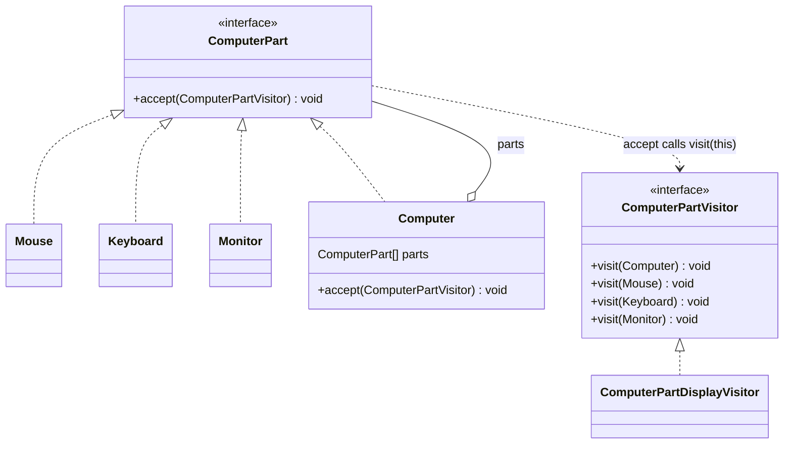
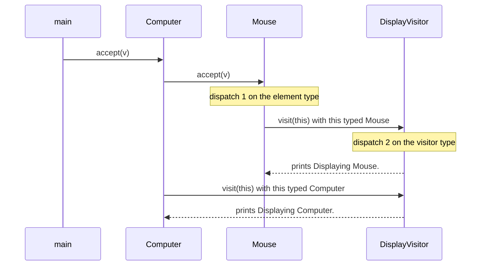
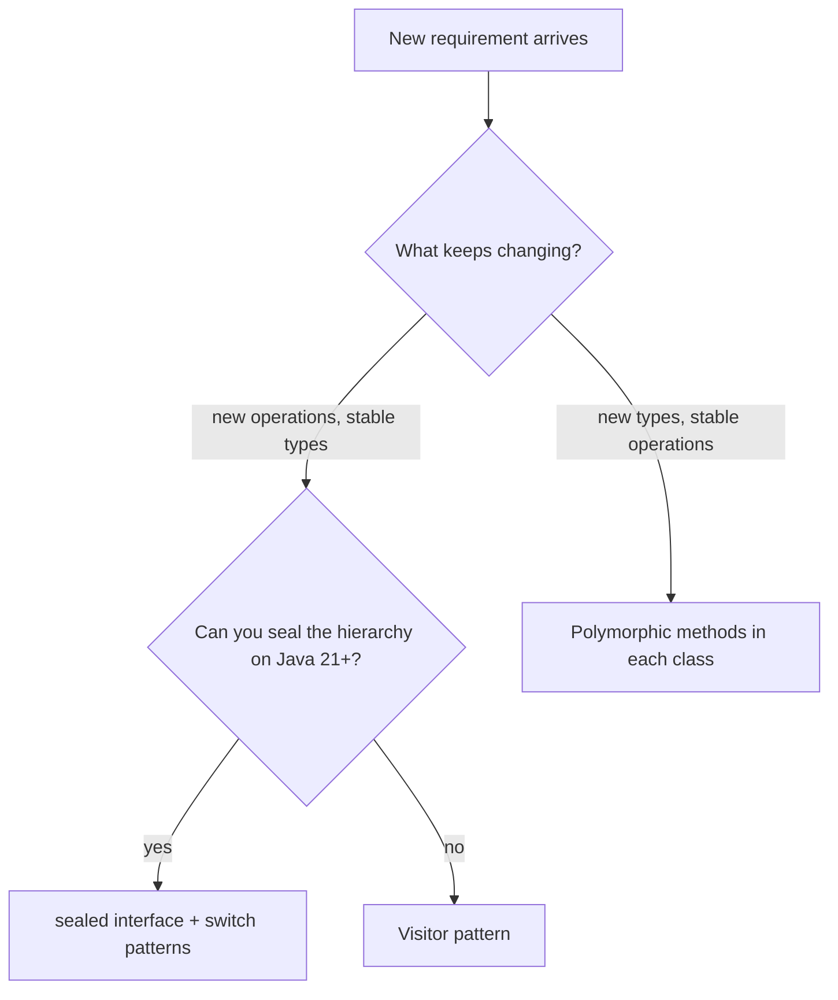

## In One Line
Visitor lets you **add new operations** (display, price, export, validate) to a **fixed set of classes without editing them**, by putting each operation in a visitor object that has one `visit` method per class — and it picks the right method through **double dispatch** (`element.accept(visitor)` → `visitor.visit(this)`).

## Mental Model
Think of **inspectors visiting a row of shops** — a bakery, a pharmacy and a hardware store. On Monday a *tax inspector* comes, on Tuesday a *fire-safety inspector*, next month a *health inspector*. The shops never change their building to support a new kind of inspection. Each shop just opens the door and says **"I am a bakery — inspect me as a bakery"**, and each inspector carries a checklist with one page per kind of shop.

How it maps to the code:
- **The shops** are the element classes: `Mouse`, `Keyboard`, `Monitor`, `Computer`.
- **"Open the door"** is `accept(ComputerPartVisitor visitor)`, which every element has.
- **"I am a bakery — inspect me as a bakery"** is `visitor.visit(this)`: `this` tells the visitor the exact type.
- **Each inspector** is a concrete visitor (`ComputerPartDisplayVisitor`); **its checklist pages** are its `visit(Mouse)`, `visit(Keyboard)`... methods.
- **A new kind of inspection** is a new visitor class — no shop (element) changes.
- **The shopping street that lets inspectors walk from shop to shop** is the object structure, `Computer`, which passes the visitor to each of its parts.

## Concept
### Intent (Gang of Four)
> "Represent an operation to be performed on the elements of an object structure. Visitor lets you define a new operation without changing the classes of the elements on which it operates."

Category: **behavioral**. It is the most complex GoF behavioral pattern and the one interviewers use to test whether you understand **overloading vs overriding**.

### The problem it solves
You have a **stable** set of classes (parts of a computer, nodes of a syntax tree, files and directories) and a **growing** list of operations on them: display, compute price, export to JSON, validate, count. Two naive options:

1. **Add a method per operation to every class** (`display()`, `price()`, `toJson()`...). Every new operation edits every class; unrelated concerns (pricing, rendering, serialisation) pile up in the domain classes.
2. **An `instanceof` chain** in one place:
```java
if (part instanceof Mouse) ... else if (part instanceof Keyboard) ... else if ...
```
The compiler cannot tell you when you forgot a type, and the chain is copied into every operation.

Visitor collects **one operation for all classes into one class**, and the compiler checks that the visitor handles every element type (the interface forces one `visit` per type).

### Participants and how the example maps to them
| Participant | Role | In the example |
|---|---|---|
| **Visitor** | Declares one `visit` method per ConcreteElement type | `interface ComputerPartVisitor` with `visit(Computer)`, `visit(Mouse)`, `visit(Keyboard)`, `visit(Monitor)` |
| **ConcreteVisitor** | One operation, implemented for every element type | `ComputerPartDisplayVisitor` (prints "Displaying X.") |
| **Element** | Declares `accept(Visitor)` | `interface ComputerPart` |
| **ConcreteElement** | Implements `accept` by calling `visitor.visit(this)` | `Keyboard`, `Monitor`, `Mouse`, `Computer` |
| **ObjectStructure** | Holds the elements and lets a visitor reach all of them | `Computer` (its `parts` array); it is also an element itself — a small [Composite](lesson:a10-patterns/07-composite) |
| **Client** | Builds the structure and passes a visitor in | `main`: `computer.accept(new ComputerPartDisplayVisitor())` |

### Double dispatch — the heart of the pattern
Java method calls are **single dispatch**:
- **Overriding** is chosen at **runtime** by the type of the object *before the dot* (the receiver).
- **Overloading** is chosen at **compile time** by the **declared (static) types of the arguments** ([Method Overloading](lesson:a01-oop/07-method-overloading)).

So if you hold a `ComputerPart part` and call `visitor.visit(part)`, the compiler looks for `visit(ComputerPart)` — it does **not** look at whether the object is really a `Mouse` (see `StaticOverload` in the Code section: it prints `generic part`). With the example's visitor interface, there is no `visit(ComputerPart)` at all, so it would not even compile.

Visitor fixes this with **two single dispatches in a row**:
1. `part.accept(visitor)` — a virtual call, dispatched on the **element's** runtime type → runs `Mouse.accept`.
2. Inside `Mouse.accept`, `visitor.visit(this)` — here `this` has the static type **`Mouse`**, so the compiler binds the overload `visit(Mouse)`; and it is a virtual call, dispatched on the **visitor's** runtime type → runs `ComputerPartDisplayVisitor.visit(Mouse)`.

Result: the method that runs depends on **both** the element type and the visitor type. That is double dispatch.

> [!INTERVIEW] "Java picks overloads at compile time from the static argument type, so `visitor.visit(part)` cannot find the right overload. `accept` does the first dispatch on the element; inside it `this` has the concrete static type, so `visit(this)` binds the right overload and dispatches on the visitor — double dispatch built from two single dispatches."

### Why every element repeats the same-looking `accept`
`Keyboard`, `Monitor` and `Mouse` all contain the identical text `computerPartVisitor.visit(this);`. It looks like duplication, but it is **not the same call**: in each class `this` has a different static type, so each line binds a different overload. If you move it into a shared base class, `this` becomes the base type and compilation fails (`no suitable method found for visit(AbstractPart)`) — see the quiz.

### Who traverses the structure?
| Option | How | Trade-off |
|---|---|---|
| **The object structure** (the course example) | `Computer.accept` loops over `parts` and then visits itself | Traversal written once; every visitor gets the same order |
| **The visitor** | `visitComputer` loops and calls `part.accept(this)` (the `PriceVisitor` in the Code section) | Each visitor controls order and can skip subtrees or combine child results |
| **An external iterator** | Client iterates, calls `accept` on each | Keeps elements and visitors simpler; the structure must be iterable |

The course example visits the parts **first** and the computer **last** — a post-order traversal, which is why `Displaying Computer.` is the last line.

### Returning results: generic visitors
A `void visit(...)` visitor must collect results in its own fields (like `FileVisitor` counting bytes). A cleaner Java design makes the visitor generic:
```java
interface ComputerPartVisitor<R> { R visitMouse(Mouse m); R visitKeyboard(Keyboard k); /* ... */ }
interface ComputerPart { <R> R accept(ComputerPartVisitor<R> v); }
```
Now `pc.accept(new PriceVisitor())` returns an `Integer` and `pc.accept(new SpecVisitor())` returns a `String`. Many real APIs (javac's `TreeVisitor<R,P>`, `javax.lang.model`'s `ElementVisitor<R,P>`) add a second type parameter `P` for an extra argument. Using **distinct method names** (`visitMouse`, `visitKeyboard`) instead of overloaded `visit(...)` avoids confusion about which overload is chosen.

### The trade-off: easy operations, hard types
This is the **expression problem**:
| Change | Plain OO (methods in classes) | Visitor |
|---|---|---|
| Add a new **operation** | Edit every class | Add one visitor class — nothing else changes |
| Add a new **element type** | Add one class | Add `visit(NewType)` to the Visitor interface **and every concrete visitor** |

So Visitor pays off only when the set of element types is **stable** and operations keep coming (compilers, document models, file trees). A mitigation is a **default visitor base class** (`SimpleFileVisitor`, `javax.lang.model.util.SimpleElementVisitor14`) that gives every `visit` a default, so adding a type does not break visitors that do not care about it — at the cost of losing the "you forgot a type" compile error.

### Modern Java alternative: sealed types + pattern matching (Java 21)
With a `sealed interface Part permits Mouse, Keyboard, Monitor, Computer` and records, an operation can be one **exhaustive `switch`** with type patterns — no `accept`, no visitor interface, and the compiler still reports a missing case (`the switch expression does not cover all possible input values`). This is **data-oriented programming**: the same "operations outside the data" goal as Visitor with far less boilerplate. See [Sealed Classes](lesson:b05-modern-java/04-sealed-classes) and [Switch & Pattern Matching](lesson:b05-modern-java/05-switch-expressions-and-pattern-matching). Classic Visitor is still useful when you cannot seal the hierarchy (it spans modules or libraries), on Java versions before 21, or when a library already exposes a visitor API.

### When to use it
- The element classes are **stable**, but you keep adding **operations** on them.
- Operations are **unrelated to each other** and would clutter the element classes (render, export, statistics, validation).
- You need to run an operation over a **heterogeneous structure** (a tree of different node types) — compilers, interpreters, document models, file systems.
- You want the compiler to force every operation to handle every type.

### When not to use it
- Element types change often — each new type breaks every visitor.
- Only one or two operations exist — plain polymorphic methods are simpler.
- The hierarchy is sealed and you are on Java 21+ — a pattern-matching `switch` usually reads better.
- Visitors would need private data of the elements — you would have to weaken encapsulation.

### Real JDK and framework examples
- **`java.nio.file.Files.walkFileTree(Path, FileVisitor)`** with `FileVisitor`/`SimpleFileVisitor`: `preVisitDirectory`, `visitFile`, `visitFileFailed`, `postVisitDirectory`, each returning a `FileVisitResult` (`CONTINUE`, `SKIP_SUBTREE`, `SKIP_SIBLINGS`, `TERMINATE`). A looser, event-style visitor over a file tree.
- **Annotation processing (`javax.lang.model`)** — `ElementVisitor`, `TypeVisitor`, `AnnotationValueVisitor`, with `SimpleElementVisitorN`/`ElementScanner` base classes. This is how compile-time code generators inspect your classes.
- **javac's Tree API** (`com.sun.source.tree.TreeVisitor`, `TreeScanner`) — every syntax-tree node has `accept(TreeVisitor<R,P>, P)`.
- **ASM bytecode library** — `ClassVisitor`, `MethodVisitor`, `FieldVisitor`; used (repackaged) inside Spring and many frameworks to read and generate bytecode.
- **Spring** — `BeanDefinitionVisitor` walks bean definitions to resolve `${...}` placeholders.
- **ANTLR** generates a `...BaseVisitor<T>` for every grammar; **Android Lint** checks walk source code with UAST visitors (`AbstractUastVisitor`).

### Look-alike patterns
| Pattern | Relationship |
|---|---|
| [Iterator](lesson:a10-patterns/15-iterator) | Iterator *walks* a collection of (usually same-typed) elements; Visitor *performs a type-specific operation* on heterogeneous elements. They combine: iterate, then `accept`. |
| [Composite](lesson:a10-patterns/07-composite) | Visitor often runs over a Composite (the `Computer` holds parts). Composite defines the structure; Visitor defines operations on it. |
| [Interpreter](lesson:a10-patterns/14-interpreter) | Interpreter puts `interpret()` in each AST node; Visitor moves evaluate/print/type-check out of the nodes into visitors. |
| [Strategy](lesson:a10-patterns/21-strategy) | A strategy is one algorithm for one context; a visitor is one operation *spread over many element types*, selected by double dispatch. |

## Diagram

Two parallel hierarchies: elements on the left, operations on the right. A new operation is a new class under `ComputerPartVisitor`; a new element type forces a new method in `ComputerPartVisitor` and all its implementations.


The same happens for `Keyboard` and `Monitor` before the computer visits itself. Two virtual calls in a row select the method by both the element and the visitor type.


Visitor is the right tool only on the "operations change, types are stable" branch.

## Code
@example CoreJava/BehavioralPattern/VisitorPatternExample.java

**Why `accept` is needed: overloads are chosen from the static type**
```java
public class StaticOverload {
    interface Part {}
    static class Mouse implements Part {}
    static class Keyboard implements Part {}

    static class Printer {
        void visit(Part p)     { System.out.println("generic part"); }
        void visit(Mouse m)    { System.out.println("mouse"); }
        void visit(Keyboard k) { System.out.println("keyboard"); }
    }

    public static void main(String[] args) {
        Printer printer = new Printer();
        Part part = new Mouse();
        printer.visit(part);            // static type Part  -> visit(Part) chosen at compile time
        printer.visit(new Mouse());     // static type Mouse -> visit(Mouse)
        printer.visit((Mouse) part);    // cast changes the static type -> visit(Mouse)
    }
}
```
```output
generic part
mouse
mouse
```
The object is a `Mouse` every time, yet the first call runs `visit(Part)`. Overload selection never looks at the runtime type — that is exactly the gap `accept` → `visit(this)` closes.

**A generic visitor that returns values — two operations, zero element changes**
```java
import java.util.List;

public class GenericVisitor {
    public static void main(String[] args) {
        ComputerPart pc = new Computer(List.of(new Mouse(3), new Keyboard(104), new Monitor(27)));

        int total = pc.accept(new PriceVisitor());          // operation 1
        System.out.println("Total price: " + total);

        String spec = pc.accept(new SpecVisitor());         // operation 2, no element changed
        System.out.println(spec);
    }
}

// Elements: accept is generic, so each visitor chooses its own result type R
interface ComputerPart {
    <R> R accept(ComputerPartVisitor<R> visitor);
}

record Mouse(int buttons) implements ComputerPart {
    public <R> R accept(ComputerPartVisitor<R> v) { return v.visitMouse(this); }
}
record Keyboard(int keys) implements ComputerPart {
    public <R> R accept(ComputerPartVisitor<R> v) { return v.visitKeyboard(this); }
}
record Monitor(int inches) implements ComputerPart {
    public <R> R accept(ComputerPartVisitor<R> v) { return v.visitMonitor(this); }
}
record Computer(List<ComputerPart> parts) implements ComputerPart {
    public <R> R accept(ComputerPartVisitor<R> v) { return v.visitComputer(this); }
}

// Visitor: one method per element type; distinct names avoid overload confusion
interface ComputerPartVisitor<R> {
    R visitMouse(Mouse m);
    R visitKeyboard(Keyboard k);
    R visitMonitor(Monitor m);
    R visitComputer(Computer c);
}

class PriceVisitor implements ComputerPartVisitor<Integer> {
    public Integer visitMouse(Mouse m)       { return 500 + 100 * m.buttons(); }
    public Integer visitKeyboard(Keyboard k) { return 10 * k.keys(); }
    public Integer visitMonitor(Monitor m)   { return 600 * m.inches(); }
    public Integer visitComputer(Computer c) {                 // the visitor drives traversal here
        int sum = 2_000;                                       // assembly fee
        for (ComputerPart p : c.parts()) sum += p.accept(this);
        return sum;
    }
}

class SpecVisitor implements ComputerPartVisitor<String> {
    public String visitMouse(Mouse m)       { return m.buttons() + "-button mouse"; }
    public String visitKeyboard(Keyboard k) { return k.keys() + "-key keyboard"; }
    public String visitMonitor(Monitor m)   { return m.inches() + "\" monitor"; }
    public String visitComputer(Computer c) {
        StringBuilder sb = new StringBuilder("Computer with:");
        for (ComputerPart p : c.parts()) sb.append("\n  - ").append(p.accept(this));
        return sb.toString();
    }
}
```
```output
Total price: 20040
Computer with:
  - 3-button mouse
  - 104-key keyboard
  - 27" monitor
```
Price: mouse 500 + 300 = 800, keyboard 1040, monitor 16200, plus the 2000 fee = 20040. Here the **visitor** traverses (inside `visitComputer`), so each visitor can combine child results its own way.

**Java 21 alternative: sealed interface + exhaustive pattern-matching `switch`**
```java
import java.util.List;

public class SealedSwitch {
    sealed interface Part permits Mouse, Keyboard, Monitor, Computer {}
    record Mouse() implements Part {}
    record Keyboard() implements Part {}
    record Monitor() implements Part {}
    record Computer(List<Part> parts) implements Part {}

    // Operation 1: the course's "display" visitor as one exhaustive switch
    static void display(Part part) {
        switch (part) {
            case Mouse m    -> System.out.println("Displaying Mouse.");
            case Keyboard k -> System.out.println("Displaying Keyboard.");
            case Monitor m  -> System.out.println("Displaying Monitor.");
            case Computer(List<Part> parts) -> {          // record pattern (Java 21)
                parts.forEach(SealedSwitch::display);
                System.out.println("Displaying Computer.");
            }
        }
    }

    // Operation 2: added without touching Mouse, Keyboard, Monitor or Computer
    static int count(Part part) {
        return switch (part) {
            case Computer c -> 1 + c.parts().stream().mapToInt(SealedSwitch::count).sum();
            case Mouse m    -> 1;
            case Keyboard k -> 1;
            case Monitor m  -> 1;
        };
    }

    public static void main(String[] args) {
        Part computer = new Computer(List.of(new Mouse(), new Keyboard(), new Monitor()));
        display(computer);
        System.out.println("Parts counted: " + count(computer));
    }
}
```
```output
Displaying Mouse.
Displaying Keyboard.
Displaying Monitor.
Displaying Computer.
Parts counted: 4
```
Same output as the course's visitor, with no `accept` methods and no visitor interface. Delete the `Monitor` case from `count` and javac refuses: `the switch expression does not cover all possible input values` — the same safety net a visitor interface gives. (In Java 21 you cannot merge `case Mouse m, Keyboard k ->` — javac says `illegal fall-through from a pattern`; Java 22's unnamed patterns allow `case Mouse _, Keyboard _ ->`.)

**The JDK's visitor: `Files.walkFileTree`**
```java
import java.io.IOException;
import java.nio.file.FileVisitResult;
import java.nio.file.Files;
import java.nio.file.Path;
import java.nio.file.SimpleFileVisitor;
import java.nio.file.attribute.BasicFileAttributes;

public class FileVisitorDemo {
    public static void main(String[] args) throws IOException {
        Path root = Files.createTempDirectory("demo");
        Files.writeString(root.resolve("a.txt"), "hello");            // 5 bytes
        Path sub = Files.createDirectory(root.resolve("sub"));
        Files.writeString(sub.resolve("b.txt"), "hi");                // 2 bytes

        class SizeVisitor extends SimpleFileVisitor<Path> {           // the Visitor
            int dirs, files; long bytes;
            @Override public FileVisitResult preVisitDirectory(Path d, BasicFileAttributes a) {
                dirs++;
                return FileVisitResult.CONTINUE;
            }
            @Override public FileVisitResult visitFile(Path f, BasicFileAttributes a) {
                files++;
                bytes += a.size();
                return FileVisitResult.CONTINUE;
            }
        }
        SizeVisitor v = new SizeVisitor();
        Files.walkFileTree(root, v);                                  // the structure drives the walk
        System.out.println("dirs=" + v.dirs + " files=" + v.files + " bytes=" + v.bytes);
    }
}
```
```output
dirs=2 files=2 bytes=7
```
`walkFileTree` is the object structure: it walks the tree and calls back the right visitor method for each kind of node. `SimpleFileVisitor` is a default-visitor base class, so we override only the two callbacks we need. (The order in which files are visited depends on the file system, which is why the demo prints only totals.)

## Walkthrough
**`interface ComputerPart { void accept(ComputerPartVisitor computerPartVisitor); }`** — the Element role. Every part must be able to "let a visitor in".

**`Keyboard`, `Monitor`, `Mouse`** — ConcreteElements. Each `accept` is the one-liner `computerPartVisitor.visit(this);`. Identical text, different meaning: inside `Keyboard`, `this` is statically a `Keyboard`, so the compiler binds `visit(Keyboard)`; inside `Mouse` it binds `visit(Mouse)`. These classes hold no data — they exist only to show dispatch.

**`class Computer implements ComputerPart`** — both an element and the ObjectStructure.
- `ComputerPart[] parts;` — a package-private, mutable array field holding the children.
- The constructor hard-codes the structure: `new ComputerPart[]{new Mouse(), new Keyboard(), new Monitor()}` — this order (Mouse, Keyboard, Monitor) is the order of the first three output lines.
- `accept(...)` first loops over `parts` and calls `part.accept(computerPartVisitor)` on each (the first dispatch, on each part's runtime type), then calls `computerPartVisitor.visit(this)` for itself — children first, parent last (post-order).

**`interface ComputerPartVisitor`** — the Visitor role: four **overloaded** `visit` methods, one per ConcreteElement type. This interface is the "checklist" that forces every visitor to handle every type.

**`class ComputerPartDisplayVisitor`** — the ConcreteVisitor: the "display" operation. Each `visit` prints `Displaying <Type>.`. Any new operation (price, export) would be another class implementing `ComputerPartVisitor`; no part class would change.

**`main`**
- `ComputerPart computer = new Computer();` — the reference type is the interface.
- `computer.accept(new ComputerPartDisplayVisitor());` — starts the walk: `Computer.accept` → `Mouse.accept` → `visit(Mouse)` prints `Displaying Mouse.`; then Keyboard, Monitor; finally `visit(Computer)` prints `Displaying Computer.`.
- The commented `// Output:` block lists the four expected lines.

**Output** — four deterministic lines: `Displaying Mouse.`, `Displaying Keyboard.`, `Displaying Monitor.`, `Displaying Computer.`. The order comes from the array order plus the post-order traversal in `Computer.accept`.

## Traps
> [!ERRATA] The expected-output comment in `main` says `Displaying Mouse` without the full stop, but `visit(Mouse)` prints **`Displaying Mouse.`** — every line of the real output ends with a period, as the other three comment lines correctly show.

> [!ERRATA] `ComputerPart[] parts;` in `Computer` is package-private and mutable, so any class in the package can replace or modify the parts. Prefer `private final List<ComputerPart> parts = List.of(new Mouse(), new Keyboard(), new Monitor());` (or pass the parts into the constructor). The `accept` and `visit` implementations also lack `@Override`.

- **Calling `visitor.visit(part)` with a `ComputerPart` variable** does not compile here (no `visit(ComputerPart)` overload) — and if such an overload existed, it would be chosen instead of the specific one, because overloads use the static type. Always go through `part.accept(visitor)`.
- **"Refactoring" `accept` into a base class** breaks double dispatch: `this` is then typed as the base class and javac reports `no suitable method found for visit(AbstractPart)`.
- **Adding a new element type** (say `Speaker`) means adding `visit(Speaker)` to the interface and implementing it in *every* visitor. Choose Visitor only when types are stable.
- **Visitors need data**, so elements often expose getters they would otherwise keep private — Visitor weakens encapsulation somewhat.
- **Deep structures + recursion**: a visitor that recurses (`visitComputer` calling `accept` on children) can overflow the stack on very deep trees; use an explicit stack for untrusted depths.
- **Stateful visitors are single-use.** A visitor that accumulates (like `SizeVisitor`) must be recreated or reset for each walk, and it is not thread-safe.
- **Java 21 multi-pattern cases** — `case Mouse m, Keyboard k ->` is an error (`illegal fall-through from a pattern`); use separate cases, or Java 22's `case Mouse _, Keyboard _ ->`.

## Tips & Tricks
- **Mnemonic — "Accept then Visit(this): the element says WHO, the visitor says WHAT."** First dispatch = who is being visited; second dispatch = what operation runs.
- **"Visitor: new operations are cheap, new types are expensive."** Say this trade-off in every Visitor answer.
- **Overload vs override in one line:** "Overloads are chosen by the compiler from static types; overrides are chosen by the JVM from runtime types." Visitor is built from exactly this fact.
- **Prefer `visitMouse`/`visitKeyboard` names** over overloaded `visit(...)` — no surprises from overload resolution, and stack traces are clearer.
- **Make visitors generic** (`Visitor<R>`) so operations return values instead of mutating fields.
- **On Java 21+ with a sealed hierarchy**, reach for an exhaustive `switch` with type/record patterns first; use Visitor when the hierarchy cannot be sealed or an API already exposes visitors.
- **Recognise it in APIs:** any `accept(XxxVisitor)` method or `walk(..., visitor)` — `Files.walkFileTree`, annotation-processing `ElementVisitor`, ASM `ClassVisitor`.

## Interview Q&A
### [Basic] What is the Visitor pattern and what problem does it solve?
Visitor separates an operation from the classes it operates on. Each operation becomes a visitor class with one `visit` method per element type; each element class has an `accept(Visitor)` method that calls `visitor.visit(this)`. You can then add new operations — display, pricing, export, validation — by writing new visitors, without modifying the element classes, and the visitor interface forces every operation to handle every type. It fits stable class hierarchies with many operations, like syntax trees in compilers, document models or file trees. In the course example, `ComputerPartDisplayVisitor` displays every part of a `Computer`.

**Follow-up:** *What is its main weakness?* — Adding a new element type forces a change to the visitor interface and every concrete visitor.

### [Intermediate] What is double dispatch and why does Java need `accept()` for it?
Double dispatch means the method that runs depends on the runtime types of **two** objects — here, the element and the visitor. Java only has single dispatch: overriding is resolved at runtime on the receiver, but overloading is resolved at compile time on the **static** argument types. So `visitor.visit(part)` with `ComputerPart part` would pick `visit(ComputerPart)` (or fail to compile), never `visit(Mouse)`. Visitor chains two single dispatches: `part.accept(visitor)` dispatches on the element's runtime type; inside `Mouse.accept`, `this` has static type `Mouse`, so `visitor.visit(this)` binds `visit(Mouse)` at compile time and dispatches on the visitor's runtime type.

**Follow-up:** *Would `instanceof` checks achieve the same?* — Functionally yes, but without compiler help: a missing type silently falls through. The Visitor interface (or a Java 21 exhaustive switch over a sealed type) makes the compiler check coverage.

### [Intermediate] Every element's `accept` has the same code `visitor.visit(this)`. Why not write it once in a base class?
Because the text is the same but the **compiled call is different** in each class. Overload resolution uses the static type of `this`, which is `Keyboard` in `Keyboard`, `Mouse` in `Mouse`, and so on. In a shared base class, `this` would have the base type, so the compiler would look for `visit(AbstractPart)`: with the example's interface that is a compile error (`no suitable method found for visit(AbstractPart)`); with a `visit(AbstractPart)` fallback it would compile but always call the fallback. The boilerplate is the price of double dispatch in Java.

**Follow-up:** *Can reflection remove the boilerplate?* — Yes (look up `visit` by `getClass()` at runtime), but you lose compile-time checking and performance; pattern-matching `switch` over a sealed type is the modern way to remove it.

### [Intermediate] What are the advantages and disadvantages of Visitor?
**Advantages:** new operations without touching element classes (Open/Closed for operations); related behaviour for one operation lives in one class (Single Responsibility); compiler forces each visitor to handle every type; visitors can accumulate state across the whole structure (totals, statistics). **Disadvantages:** adding an element type touches every visitor; elements must expose data to visitors (weaker encapsulation); boilerplate `accept` methods; double dispatch is hard for newcomers to read; cyclic dependency between the visitor interface and all element classes.

**Follow-up:** *What is the "expression problem"?* — The observation that OO makes adding types easy but operations hard, and functional/Visitor style makes operations easy but types hard; no simple design makes both easy.

### [Intermediate] Who is responsible for traversing the object structure?
Three choices. (1) The **object structure** traverses inside its `accept` — the course's `Computer.accept` visits each part and then itself (post-order); traversal is written once. (2) The **visitor** traverses — e.g. `visitComputer` loops over children and calls `child.accept(this)`, so each visitor can choose order, skip subtrees or combine children's results. (3) An **external iterator** walks the structure and calls `accept` on each element. JDK's `Files.walkFileTree` is option (1): the walker drives and calls `preVisitDirectory`, `visitFile`, `postVisitDirectory`, and the visitor can steer it with `FileVisitResult.SKIP_SUBTREE` or `TERMINATE`.

**Follow-up:** *What order does the course example use and how would you change it?* — Children first, then `visit(Computer)`; moving `visit(this)` before the loop makes `Displaying Computer.` print first (pre-order).

### [Advanced] How do you make a visitor return a result instead of printing?
Make the visitor generic: `interface Visitor<R> { R visitMouse(Mouse m); ... }` and the element method generic: `<R> R accept(Visitor<R> v) { return v.visitMouse(this); }`. Then `Integer total = pc.accept(new PriceVisitor())` and `String spec = pc.accept(new SpecVisitor())` use the same elements with different result types. JDK APIs add a second parameter for context: javac's `TreeVisitor<R, P>` and `javax.lang.model.element.ElementVisitor<R, P>` have methods like `R visitMethod(MethodTree node, P p)`. For operations that produce nothing, use `Void` and return `null`.

**Follow-up:** *Why do such APIs use names like `visitMethod` instead of overloaded `visit`?* — Distinct names avoid overload-resolution surprises and make the intent and stack traces clearer.

### [Advanced] How do Java 17/21 features change the Visitor pattern?
Java 17 finalised **sealed classes**, and Java 21 finalised **pattern matching for `switch`** and **record patterns**. With `sealed interface Part permits Mouse, Keyboard, Monitor, Computer` and records, each operation can be a single `switch (part) { case Mouse m -> ...; case Computer(List<Part> parts) -> ...; }`. The compiler knows the permitted subtypes, so a `switch` expression that misses one does not compile (`the switch expression does not cover all possible input values`) — the same guarantee a Visitor interface provides — without `accept` methods or double dispatch. Classic Visitor remains useful when the hierarchy is open (types in other modules or libraries), when you are below Java 21, or when you consume an existing visitor API.

**Follow-up:** *What happens when a new permitted type is added?* — Every exhaustive `switch` over the sealed type stops compiling until it handles the new case — the same trade-off as adding a `visit` method, but reported by the compiler automatically. (A `default` branch would hide this, so avoid it.)

### [Intermediate] Where is Visitor used in the JDK and frameworks?
`Files.walkFileTree` with `FileVisitor`/`SimpleFileVisitor` in NIO.2; the annotation-processing API `javax.lang.model` (`ElementVisitor`, `TypeVisitor`, `AnnotationValueVisitor`, plus `SimpleElementVisitorN` and `ElementScanner` helpers); javac's Tree API (`TreeVisitor`, `TreeScanner`); the ASM bytecode library (`ClassVisitor`, `MethodVisitor`), which Spring and many frameworks embed; Spring's `BeanDefinitionVisitor` for resolving `${...}` placeholders; ANTLR's generated parse-tree visitors; Android Lint's UAST visitors.

**Follow-up:** *Why do compilers love Visitor?* — The AST node types are fixed by the language grammar, while passes (type checking, optimisation, code generation, pretty printing) keep being added — exactly the "stable types, growing operations" case.

### [Advanced] Visitor vs Iterator vs Composite vs Interpreter?
- **Iterator** gives sequential *access* to elements, usually of one type; it says nothing about what you do with them.
- **Composite** defines a *tree structure* of objects treated uniformly (the `Computer` holding parts).
- **Interpreter** gives each grammar node an `interpret()` method — the operation lives *in* the nodes.
- **Visitor** defines *type-specific operations outside* the elements.
They combine naturally: a Composite AST (Composite) built for a language (Interpreter), walked by an iterator or by the structure itself (Iterator), with evaluate/print/type-check implemented as visitors (Visitor).

**Follow-up:** *When would you move an Interpreter's `interpret()` into a visitor?* — When you need several operations on the same AST (evaluate, pretty-print, optimise), so the node classes do not grow a method per operation.

### [Advanced] Does Visitor break encapsulation? How do you limit the damage?
To do its job, a visitor often needs element data, so elements expose getters (or even fields) they would otherwise hide — GoF lists this as a consequence. Limit it by exposing **read-only** accessors (records are ideal), keeping mutation methods package-private, passing only what is needed as `visit` arguments, and putting visitors in the same package/module as the elements when they need more access. Also keep visitors **stateless or single-use**, and prefer default-visitor base classes (`SimpleFileVisitor` style) so visitors override only what they need.

**Follow-up:** *What is an "acyclic visitor"?* — A variant (Robert Martin) where each element type has its own small visitor interface and `accept` checks `if (v instanceof MouseVisitor mv) mv.visit(this)`; it removes the dependency cycle and makes adding types cheaper, at the cost of a runtime type check.

## Quiz
### In the original example, which line is printed last, and why?
- [ ] `Displaying Mouse` — the comment lists it first, so it is printed last
- [ ] `Displaying Monitor.` — it is the last part in the array
- [x] `Displaying Computer.` — `Computer.accept` visits all parts first and itself last
- [ ] The order is random because arrays are unordered
> `Computer.accept` loops over `parts` (Mouse, Keyboard, Monitor, in array order) and only then calls `visit(this)`. Arrays keep insertion order, so the output is deterministic. Note also the comment's `Displaying Mouse` lacks the period that the real output has.

### If `Computer.accept` called `computerPartVisitor.visit(this);` *before* the loop, what would be the first line?
- [x] Displaying Computer.
- [ ] Displaying Mouse.
- [ ] Displaying Monitor.
- [ ] Nothing — a visitor cannot visit its own structure
> The computer would visit itself first (pre-order) and then its parts: `Displaying Computer.`, `Displaying Mouse.`, `Displaying Keyboard.`, `Displaying Monitor.`. Traversal order is decided by whoever traverses — here `Computer.accept`.

### What does this print?
```java
class Printer {
    void visit(Part p)     { System.out.println("generic part"); }
    void visit(Mouse m)    { System.out.println("mouse"); }
}
// Mouse implements Part
Part part = new Mouse();
new Printer().visit(part);
```
- [ ] mouse
- [x] generic part
- [ ] Compile error: ambiguous call
- [ ] ClassCastException
> Overloads are selected at compile time from the static type of the argument, which is `Part`. The runtime type (`Mouse`) is ignored for overload selection — the very reason Visitor needs `accept` → `visit(this)`. There is no ambiguity: only `visit(Part)` accepts a `Part`.

### Spot the bug: a developer removes the "duplicated" `accept` methods like this. What happens?
```java
interface ComputerPartVisitor { void visit(Mouse m); void visit(Keyboard k); }
abstract class AbstractPart {
    public void accept(ComputerPartVisitor v) { v.visit(this); }   // "write accept once"
}
class Mouse extends AbstractPart {}
class Keyboard extends AbstractPart {}
```
- [ ] It works: `this` is a `Mouse` at runtime, so `visit(Mouse)` runs
- [x] Compile error: `no suitable method found for visit(AbstractPart)`
- [ ] It compiles but always calls `visit(Mouse)`
- [ ] Runtime `AbstractMethodError`
> Inside `AbstractPart`, `this` has the static type `AbstractPart`, and neither `visit(Mouse)` nor `visit(Keyboard)` accepts that. The runtime type does not matter for overload resolution. Each concrete element must have its own `accept` so that `this` has the concrete static type.

### In the `SealedSwitch` example, you delete `case Monitor m -> 1;` from the `count` switch expression. What happens?
- [ ] It compiles, and monitors count as 0
- [ ] It compiles, and a `MatchException` is thrown at runtime for monitors
- [x] It does not compile: `the switch expression does not cover all possible input values`
- [ ] It compiles because `Computer` already covers all parts
> `Part` is sealed, so the compiler knows the four permitted types and requires a `switch` expression over it to be exhaustive. This is the compile-time safety that a Visitor interface also gives. A runtime `MatchException` only occurs for things like a new subtype added after separate compilation.

### Which change is cheap with the Visitor pattern and which is expensive?
- [ ] Both new operations and new element types are cheap
- [x] A new operation is cheap (one new visitor class); a new element type is expensive (a new `visit` method in the interface and every visitor)
- [ ] A new element type is cheap; a new operation requires editing every element
- [ ] Both require editing every element class
> Visitor deliberately trades one for the other. Option three describes the plain OO approach (methods inside element classes), which Visitor inverts.

### Which JDK API is a Visitor?
- [ ] `Iterator.next()`
- [ ] `Comparator.compare(a, b)`
- [x] `Files.walkFileTree(path, fileVisitor)`
- [ ] `Collections.unmodifiableList(list)`
> `walkFileTree` walks a structure of directories and files and calls type-specific callbacks (`preVisitDirectory`, `visitFile`, `postVisitDirectory`) on the visitor you pass. `Iterator` only gives access, `Comparator` is a strategy, and `unmodifiableList` is a protection proxy/decorator.

## Takeaways
- Visitor moves operations out of a stable set of element classes into visitor classes with one `visit` method per element type; each element's `accept(v)` calls `v.visit(this)`.
- Double dispatch: `accept` dispatches on the element's runtime type, then `visit(this)` binds the overload for the concrete static type of `this` and dispatches on the visitor — needed because Java chooses overloads at compile time from static types.
- Every element must implement its own `accept`; moving it into a base class breaks overload selection (`no suitable method found`).
- Trade-off: new operations are cheap, new element types are expensive; use Visitor only when types are stable (compilers, file trees, document models).
- Traversal can be done by the structure (the course's post-order `Computer.accept`), by the visitor, or by an iterator; generic visitors (`Visitor<R>`) return results.
- Java 21 alternative: sealed interfaces + records + exhaustive pattern-matching `switch` give the same compile-time coverage without `accept` boilerplate.
- Real APIs: `Files.walkFileTree`/`FileVisitor`, `javax.lang.model` `ElementVisitor`, javac `TreeVisitor`, ASM `ClassVisitor`, Spring `BeanDefinitionVisitor`.
- Course-example erratum: the output comment `Displaying Mouse` lacks the period; the real line is `Displaying Mouse.`.
