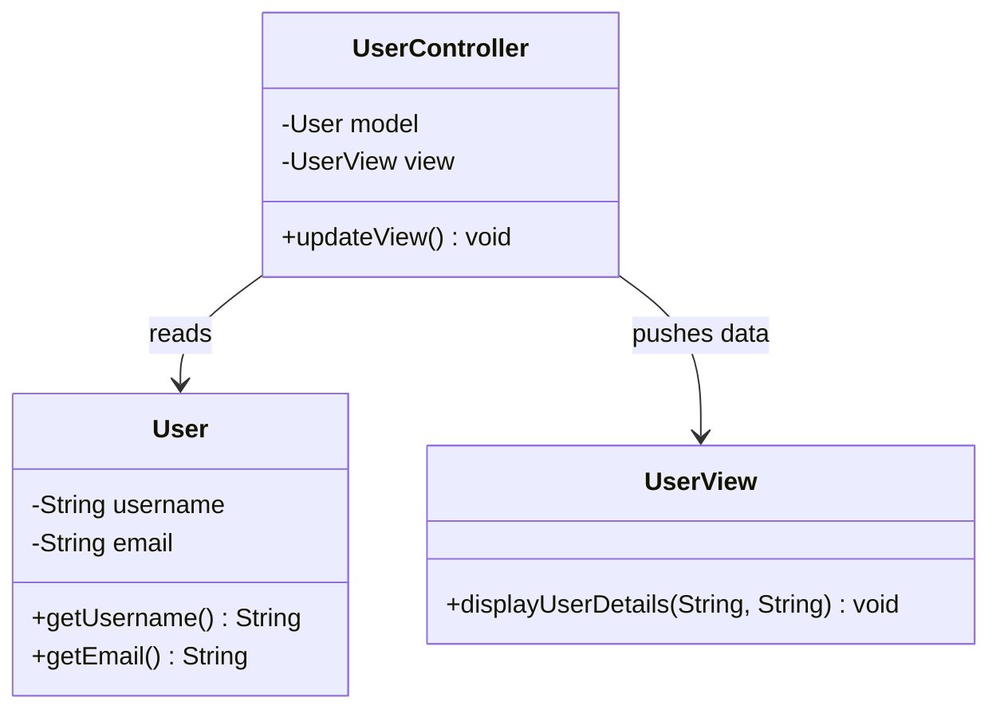
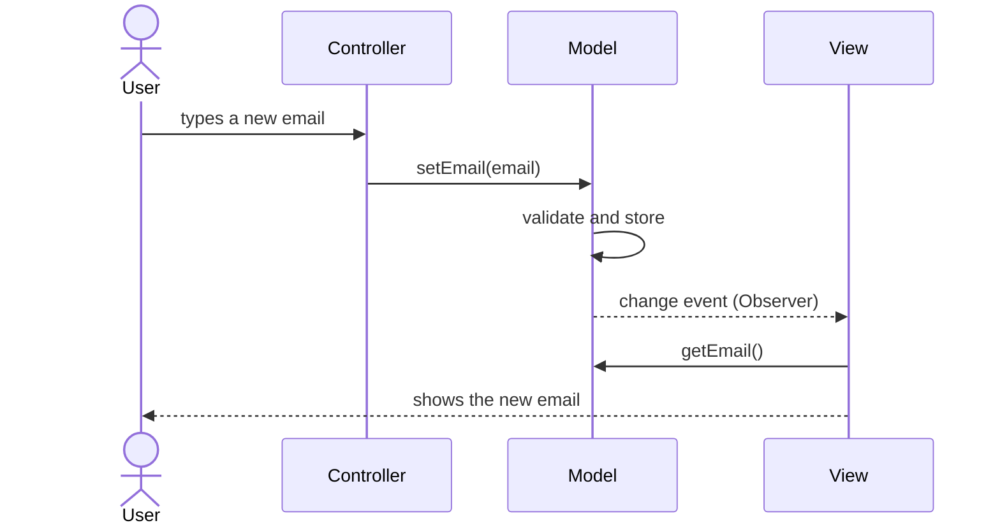
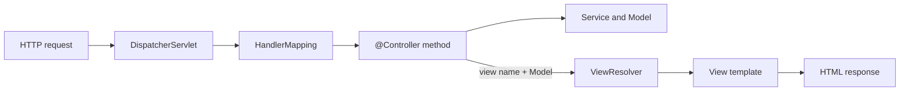

## In One Line
MVC splits an interactive application into three parts — the **Model** (data and business rules), the **View** (what the user sees) and the **Controller** (takes user input, updates the model, picks what to show) — so each part can change and be tested without dragging the others along.

## Mental Model
Think of a **restaurant**:
- The **kitchen and pantry** are the **Model**: the ingredients (data) and the recipes and rules ("we are out of fish", "no more than two specials per table"). The kitchen does not care how the table is laid.
- The **plate and the table setting** are the **View**: how the result is presented to you. The same dish can be served on a plate or in a takeaway box — two views of one model.
- The **waiter** is the **Controller**: takes your order (user input), checks it makes sense, passes it to the kitchen (updates the model), and brings back the result to show you (chooses and refreshes the view).
- **You never walk into the kitchen.** The user talks to the controller, never to the model directly.

In the course example, `User` is the kitchen, `UserView` is the table setting, and `UserController` is the waiter who fetches `username` and `email` from the model and hands them to the view.

## Concept
### What MVC is (and is not)
MVC is an **architectural pattern** — it organises a whole application or UI layer, not just a few classes — so it is not one of the 23 GoF patterns. It was created by **Trygve Reenskaug** at Xerox PARC in 1978–79 for Smalltalk-79/80, and it is the ancestor of MVP, MVVM and every web "MVC framework". The GoF book's introduction uses Smalltalk MVC to show several GoF patterns working together (see Interview Q&A).

### The three roles
| Role | Responsible for | Knows about | Must NOT |
|---|---|---|---|
| **Model** | Application data, business rules and validation, state changes; notifies interested parties when it changes | Nothing of the UI | Import UI classes, format data for display, read user input |
| **View** | Presenting model data to the user; forwarding raw user actions | The model (reads it) — or nothing, if the controller pushes data into it | Contain business rules, change the model directly, talk to the database |
| **Controller** | Receiving user input, interpreting it, calling the model, choosing which view to show | Model and view | Contain business rules that belong in the model/services, or render output itself |

The central rule is **the Model does not depend on the View or Controller**. You can replace a console UI with a web page or an Android screen and reuse the same model.

### How a user action flows
1. The user does something (clicks, types, sends an HTTP request).
2. The **controller** receives the input, validates/interprets it, and calls the model (`model.setEmail(...)`).
3. The **model** updates its state (enforcing its rules).
4. The **view** is refreshed with the new state — either because the model **notifies** it (Observer) or because the controller **tells** it to refresh.

### Three flavours you will meet
| Flavour | How the view gets new data | Where you see it |
|---|---|---|
| **Classic MVC (active model)** | Views **subscribe** to the model; the model fires change events (Observer), so every view refreshes itself | Smalltalk, desktop toolkits (Swing's `TableModel` + `fireTableDataChanged()`), the `ObserverMvc` demo below |
| **Passive model / controller push** | The controller reads the model and **pushes** values into the view | The **course example**: `updateView()` calls `view.displayUserDetails(model.getUsername(), model.getEmail())` |
| **Web MVC ("Model 2")** | Request/response. A **front controller** routes the request to a controller method, which fills a model map and returns a view name; a template engine renders HTML. No long-lived observer | Spring MVC, Jakarta Servlets + JSP, Struts, Jakarta MVC |

### Web MVC in Spring
```text
HTTP request
  -> DispatcherServlet          (Front Controller: one entry point for all requests)
  -> HandlerMapping             (which @Controller method handles this URL?)
  -> @Controller method         (calls services, puts data into Model, returns a view name)
  -> ViewResolver               ("user-details" -> templates/user-details.html)
  -> View (Thymeleaf/JSP)       (renders the model into HTML)
HTTP response
```
With `@RestController` (= `@Controller` + `@ResponseBody`) there is no HTML view: the return value is serialised to JSON by an `HttpMessageConverter` — the JSON *is* the view.

### What the course example shows, and what it leaves out
- **Model:** `User` — two private fields, a constructor, getters. It is immutable (no setters) and has no rules.
- **View:** `UserView.displayUserDetails(String, String)` — prints two lines. Notice it receives **plain strings**, not the `User` object: the view does not even know the model exists. That is the **Passive View** style (the view is as dumb as possible), which is really a hallmark of MVP.
- **Controller:** `UserController` holds both and `updateView()` copies data from model to view.
- **Missing:** user input. The controller's main job in MVC — reacting to input and changing the model — never happens, and the comment "Update and display user details" is misleading because nothing is updated. The `MvcInputDemo` in the Code section adds that half.

### MVC vs MVP vs MVVM (short version)
| | MVC | MVP | MVVM |
|---|---|---|---|
| Input first reaches | Controller | View, which forwards to the Presenter | View, bound to ViewModel commands/properties |
| View knows the model? | Classic: yes (reads/observes it) | No — Presenter pushes data through a view interface | No — it binds to the ViewModel |
| Who updates the view | Model notifications or the controller | The Presenter calls `view.showX(...)` | Data binding, automatically |
| Middle part knows the view? | Yes | Yes, through an interface (`UserContract.View`) | **No** — ViewModel has no reference to the view |
| Typical platforms | Web frameworks (Spring MVC), Swing, early Android | Classic Android, WinForms, GWT | WPF, JavaFX, Android Jetpack, SwiftUI/Compose style |

The full comparison, with binding details, is in [MVVM](lesson:a10-patterns/25-mvvm).

### Benefits
- **Separation of concerns:** UI, input handling and business rules can change independently.
- **Multiple views of one model:** a table and a chart of the same data; a web page and a JSON API.
- **Testability:** the model is plain Java, testable without a UI; controllers can be tested with fake views/services.
- **Parallel work:** designers on views, developers on models and controllers.

### Costs and pitfalls
- More classes and wiring for small programs.
- **Fat controllers** ("Massive View Controller"): business logic creeps into controllers. Keep rules in the model or a service layer; controllers should be thin coordinators.
- View and controller are often tightly paired (one controller per view), and in many UI toolkits they merge into one class (Android `Activity`, Swing's UI delegates).
- Classic MVC's observer notifications can cascade and be hard to debug.

### When to use it / not
Use it for any application with a user interface or HTTP endpoints that will grow: web apps (Spring MVC is the default), desktop tools, anything with several views of the same data. Skip the ceremony for a tiny script or a one-screen prototype — but even then, keeping business logic out of UI code is worth it.

### Real Java, Spring and Android examples
- **Spring MVC** — `DispatcherServlet` (front controller), `@Controller`/`@RestController`, `Model`/`ModelAndView`, `ViewResolver`, Thymeleaf/JSP views.
- **Jakarta EE** — Servlet as controller, JSP as view, beans as model ("JSP Model 2"); Jakarta MVC; historically Struts and JSF.
- **Swing** — `JTable` with a `TableModel` (`AbstractTableModel.fireTableDataChanged()` notifies the view), `JButton` with `ButtonModel`. Swing uses a *separable model architecture*: each component's view and controller are merged into one UI delegate (`ComponentUI`).
- **JavaFX** — FXML file (view) + controller class with `@FXML` fields and handlers + model classes.
- **Android** — XML layouts are the view; an `Activity`/`Fragment` often acts as controller *and* view, which led to bloated activities and to Android's move towards MVP and then MVVM (Jetpack `ViewModel`).

> [!INTERVIEW] "MVC separates data and rules (Model), presentation (View) and input handling (Controller). The model never depends on the UI. In classic MVC the view observes the model; in web MVC like Spring, the DispatcherServlet routes a request to a controller, which fills a Model and returns a view name that a ViewResolver renders."

## Diagram

The controller depends on both; the model and the view depend on nothing — the view does not even know `User` exists (Passive View style).


Classic MVC: input goes to the controller, the controller changes the model, and the model's change notification makes the view refresh itself. In the course example the dashed notification is replaced by the controller calling `updateView()`.


Web MVC in Spring: one front controller, a controller method per URL, and a view chosen by name. There is no long-lived observer — each request builds the model and renders once.

## Code
@example CoreJava/ArchitecturalPatterns/MVCExample.java

**Adding the missing half: user input goes to the controller, the model enforces its rules**
```java
public class MvcInputDemo {
    public static void main(String[] args) {
        User model = new User("john_doe", "john.doe@example.com");
        UserView view = new UserView();
        UserController controller = new UserController(model, view);

        controller.updateView();
        controller.onEmailEntered("john@new-mail.com");    // user input goes to the controller
        controller.onEmailEntered("not-an-email");
        System.out.println("Model still holds: " + model.getEmail());
    }
}

class User {                                       // Model: data + business rules
    private final String username;
    private String email;

    User(String username, String email) { this.username = username; setEmail(email); }

    String getUsername() { return username; }
    String getEmail()    { return email; }

    void setEmail(String email) {                  // the model protects its own invariants
        if (email == null || !email.contains("@"))
            throw new IllegalArgumentException("Invalid email: " + email);
        this.email = email;
    }
}

class UserView {                                   // View: output only, no decisions
    void displayUserDetails(String username, String email) {
        System.out.println("Username: " + username);
        System.out.println("Email: " + email);
    }
    void showError(String message) { System.out.println("Error: " + message); }
}

class UserController {                             // Controller: input -> model -> view
    private final User model;
    private final UserView view;

    UserController(User model, UserView view) { this.model = model; this.view = view; }

    void onEmailEntered(String email) {
        try {
            model.setEmail(email);
            updateView();
        } catch (IllegalArgumentException e) {
            view.showError(e.getMessage());
        }
    }

    void updateView() { view.displayUserDetails(model.getUsername(), model.getEmail()); }
}
```
```output
Username: john_doe
Email: john.doe@example.com
Username: john_doe
Email: john@new-mail.com
Error: Invalid email: not-an-email
Model still holds: john@new-mail.com
```
The validation rule lives in the **model**, so it holds no matter which controller or UI calls it. The controller only translates input into model calls and picks what to show (details or an error). The invalid email never reaches the model's state.

**Classic MVC: views observe the model** (`java.beans.PropertyChangeSupport` is the JDK's built-in observer helper)
```java
import java.beans.PropertyChangeEvent;
import java.beans.PropertyChangeListener;
import java.beans.PropertyChangeSupport;

public class ObserverMvc {
    public static void main(String[] args) {
        UserModel model = new UserModel("john_doe", "john.doe@example.com");
        model.addListener(new DetailView());               // views subscribe to the model
        model.addListener(new TitleBarView(model));

        UserController controller = new UserController(model);
        controller.onEmailEntered("john@new-mail.com");     // controller only touches the model
        controller.onEmailEntered("john@new-mail.com");     // same value again
    }
}

class UserModel {                                          // Model: knows nothing about views
    private final PropertyChangeSupport changes = new PropertyChangeSupport(this);
    private final String username;
    private String email;

    UserModel(String username, String email) { this.username = username; this.email = email; }

    void addListener(PropertyChangeListener l) { changes.addPropertyChangeListener(l); }
    String getUsername() { return username; }
    String getEmail()    { return email; }

    void setEmail(String newEmail) {
        String old = email;
        email = newEmail;
        changes.firePropertyChange("email", old, newEmail);   // notify every subscribed view
    }
}

class DetailView implements PropertyChangeListener {
    public void propertyChange(PropertyChangeEvent e) {
        System.out.println("DetailView: " + e.getPropertyName() + " " + e.getOldValue() + " -> " + e.getNewValue());
    }
}

class TitleBarView implements PropertyChangeListener {
    private final UserModel model;
    TitleBarView(UserModel model) { this.model = model; }
    public void propertyChange(PropertyChangeEvent e) {
        System.out.println("TitleBar: " + model.getUsername() + " <" + model.getEmail() + ">");
    }
}

class UserController {
    private final UserModel model;
    UserController(UserModel model) { this.model = model; }
    void onEmailEntered(String email) { model.setEmail(email.trim()); }
}
```
```output
DetailView: email john.doe@example.com -> john@new-mail.com
TitleBar: john_doe <john@new-mail.com>
```
The controller never calls a view; two independent views refresh themselves because they observe the model. The second, identical `onEmailEntered` prints nothing: `firePropertyChange` does not fire when the old and new values are equal and non-null. (See [Observer](lesson:a10-patterns/19-observer).)

**Web MVC with Spring** (sketch — needs a Spring Boot app to run):
```java
@Controller
public class UserController {
    private final UserService service;                        // business logic lives here, not in the controller
    public UserController(UserService service) { this.service = service; }

    @GetMapping("/users/{id}")
    public String show(@PathVariable long id, Model model) {
        model.addAttribute("user", service.find(id));        // fill the Model
        return "user-details";                                // logical view name -> templates/user-details.html
    }

    @PostMapping("/users/{id}/email")
    public String changeEmail(@PathVariable long id, @RequestParam String email) {
        service.changeEmail(id, email);                       // update the model
        return "redirect:/users/" + id;                       // Post/Redirect/Get
    }
}
```

## Walkthrough
**`class User`** — the **Model**. Two `private` fields (`username`, `email`) — encapsulated state; a constructor that sets both; two getters. There are no setters, so a `User` never changes after construction, and there are no business rules. The comment calls it "a simple User entity".

**`class UserView`** — the **View**. `displayUserDetails(String username, String email)` prints `Username: ...` and `Email: ...`. It takes two strings rather than a `User`, so it has zero dependency on the model — it could display any username/email pair. It makes no decisions; it only formats output.

**`class UserController`** — the **Controller**, "an intermediary between Model and View".
- `private User model; private UserView view;` — it holds references to both (they could be `final`).
- The constructor receives both from outside — the wiring is done by `main`, a simple form of dependency injection.
- `updateView()` — **pulls** data from the model (`model.getUsername()`, `model.getEmail()`) and **pushes** it into the view (`view.displayUserDetails(...)`). This is the controller-push flavour of MVC: the view is refreshed only when the controller says so.

**`main`** — the composition root:
1. `new User("john_doe", "john.doe@example.com")` — creates the model.
2. `new UserView()` — creates the view.
3. `new UserController(user, view)` — "associate it with the User model and UserView".
4. `controller.updateView()` — renders the model through the view.

**Output** — two deterministic lines, `Username: john_doe` and `Email: john.doe@example.com`, exactly as the `// Output:` comments say. Remove the `updateView()` call and the program prints nothing at all: without an observer, the view only shows what the controller pushes.

## Traps
> [!ERRATA] The comment `// Update and display user details` is misleading: `updateView()` does not update anything — it only reads the model and renders it. The example also has no user input at all, which is the controller's main responsibility in MVC (receive input → change the model → refresh the view). `MvcInputDemo` in the Code section shows the complete loop.

> [!NOTE] The model class is named `User`, and because all three architectural examples share the package `CoreJava.ArchitecturalPatterns`, the DAO example had to name its entity `User1` and the MVVM example `UserModel`. The fields of `User` and `UserController` are never reassigned and could be `final`.

- **Business logic in the controller.** Validation, calculations and persistence calls pile up in controllers ("fat controller"). Put rules in the model or a service; the controller should only translate input and choose the view.
- **The view changing the model directly** (a `UserView` calling `model.setEmail(...)`) bypasses the controller and its validation; the view should forward user actions, not decide.
- **The model importing UI classes** (`javax.swing.*`, Android `View`, Spring `Model`) ties it to one front end and makes it untestable without that UI.
- **Stale views in controller-push MVC.** If someone changes the model without going through the controller, nobody calls `updateView()` and the view shows old data. Classic MVC solves it with observers.
- **Observer leaks.** Views that subscribe to a long-lived model must unsubscribe when closed, or the model keeps them alive (a memory leak).
- **Confusing Spring's `Model` with the M in MVC.** Spring's `org.springframework.ui.Model` is just a map of attributes handed to the view; the real model is your domain objects and services.
- **`@Controller` returning data.** Without `@ResponseBody` (or `@RestController`), a returned `String` is treated as a **view name**, not as the response body.

## Tips & Tricks
- **Mnemonic — "Model = Memory & rules, View = Visuals, Controller = Commands."**
- **Dependency arrow rule:** arrows point *towards* the model, never away from it. If your model imports a UI class, something is wrong.
- **Restaurant check:** the customer (user) talks to the waiter (controller), never to the kitchen (model); the kitchen never lays the table (view).
- **Thin controllers:** a controller method should read like "parse input → call service → pick view". If it has loops and business `if`s, move them to the model/service.
- **Remember the GoF trio inside MVC:** View–Model = **Observer**, nested views = **Composite**, View–Controller = **Strategy**.
- **Spring shortcut:** `@Controller` + view name = server-side HTML MVC; `@RestController` = the "view" is JSON.

## Interview Q&A
### [Basic] What is MVC? Explain each component.
MVC is an architectural pattern that separates an interactive application into three roles. The **Model** holds the data and business rules and knows nothing about the UI. The **View** presents model data to the user and contains no business logic. The **Controller** receives user input, interprets it, updates the model, and decides which view to show. The goal is separation of concerns: you can change the UI without touching business rules, reuse one model in several views, and test the model without a UI. In the course example, `User` is the model, `UserView` prints the details, and `UserController.updateView()` moves data from the model to the view.

**Follow-up:** *Which part should validation live in?* — The model (or a domain service), so the rule holds for every controller and UI; the controller may do input-format checks and translate errors into messages.

### [Basic] What are the advantages of MVC?
Separation of concerns (each part has one job), independent development and replacement of UI and business logic, multiple views of the same model (table and chart, web page and JSON API), easier unit testing (the model is plain Java; controllers can use fake views/services), and a familiar structure that frameworks such as Spring MVC build on. The costs are more classes, the risk of fat controllers, and more wiring for small apps.

**Follow-up:** *What is a "fat controller" and how do you avoid it?* — A controller full of business logic; fix it by moving logic into the model or a service layer and keeping controllers as thin translators between HTTP/UI and the domain.

### [Intermediate] How does data flow in MVC, and which component knows about which?
User input reaches the **controller**; the controller calls the **model**; the model changes state; the **view** is refreshed with the new state. Dependencies: the controller knows the model and the view; the view (in classic MVC) knows the model so it can read or observe it; the **model knows neither** — it only publishes change events. There are two ways the view learns about changes: the model **notifies** observers (classic, "active model"), or the controller **pushes** data into the view (as in the course example, where the view does not even see the model).

**Follow-up:** *What happens in the course example if the model changes without the controller?* — Nothing is re-rendered: the view shows stale data until someone calls `updateView()` again, because there is no observer.

### [Intermediate] What is the difference between classic (desktop) MVC and web MVC?
Classic MVC is long-lived and event-driven: views subscribe to the model and refresh when it fires change events, and controllers handle mouse and keyboard events. Web MVC ("Model 2") is request/response and mostly stateless: each HTTP request goes to a **front controller** (`DispatcherServlet`), is routed to a controller method, which calls services, fills a model map and returns a view name; a template renders the whole response, and the model is discarded after the request. There is no observer between model and view — the "update" is simply the next request (often via Post/Redirect/Get).

**Follow-up:** *What is the Front Controller pattern?* — A single handler that receives every request and dispatches it (routing, security, locale, error handling) to specific controllers; `DispatcherServlet` is Spring's front controller.

### [Intermediate] Walk through how Spring MVC handles a request.
1. The request reaches the `DispatcherServlet`.
2. A `HandlerMapping` finds the `@Controller` method matching the URL and HTTP method (`@GetMapping("/users/{id}")`), and a `HandlerAdapter` invokes it — binding `@PathVariable`, `@RequestParam` and `@RequestBody` arguments and running validation.
3. The method calls services, puts attributes into the `Model`, and returns a logical view name (`"user-details"`) or `redirect:...`.
4. A `ViewResolver` maps the name to a `View` (e.g. `templates/user-details.html` for Thymeleaf).
5. The view renders the model into HTML, which becomes the response.
Interceptors and exception handlers (`@ControllerAdvice`) wrap this flow. With `@RestController`, step 4–5 are replaced by an `HttpMessageConverter` writing JSON.

**Follow-up:** *Difference between `@Controller` and `@RestController`?* — `@RestController` = `@Controller` + `@ResponseBody` on every method, so return values are serialised into the response body instead of being treated as view names.

### [Intermediate] Compare MVC, MVP and MVVM.
In **MVC** input goes to the controller, and the view may read/observe the model directly. In **MVP** the view is passive and implements an interface; it forwards every user action to the **Presenter**, which talks to the model and calls `view.showX(...)`; the presenter knows the view through its interface, and the view never touches the model — very testable with a fake view. In **MVVM** the **ViewModel** exposes observable properties and commands and knows **nothing** about the view; the view **binds** to them, so updates flow automatically in one or both directions. MVC dominates web frameworks; MVP was popular in early Android and WinForms; MVVM is used with binding frameworks (WPF, JavaFX, Android Jetpack).

**Follow-up:** *Which one is the course's MVC example closest to?* — Its view receives plain strings and never sees the model, which is the Passive View style — closer to MVP than to classic MVC.

### [Advanced] Which GoF design patterns can you find inside MVC?
The GoF book's introduction explains Smalltalk MVC with three patterns: **Observer** — views subscribe to the model and are notified of changes, decoupling the model from any number of views; **Composite** — views can be nested (a window containing panels containing buttons) and treated uniformly; **Strategy** — a view delegates its response to input to a controller object, and you can swap controllers (e.g. a read-only controller) without changing the view. Around MVC you also meet **Front Controller** (`DispatcherServlet`), **Command** (actions), **Factory Method** (creating controllers), and **Decorator** (adding scrolling or borders to views).

**Follow-up:** *Why Observer between model and view rather than direct calls?* — So the model does not depend on concrete views; any number of views can be added or removed at runtime without changing the model.

### [Advanced] Where should business logic go in an MVC application, and how do you test each part?
Business rules go in the **model** — domain objects and a **service layer** behind the controllers (plus a data-access layer such as a [DAO](lesson:a10-patterns/26-dao) or repository). Controllers stay thin: map input to calls, map results/exceptions to views or status codes. Testing: the model and services with plain JUnit (no framework); controllers with fake services — in Spring with `@WebMvcTest` + `MockMvc` to assert status, view name and model attributes without starting a server; views with template/snapshot tests or end-to-end UI tests. Keeping logic out of views and controllers is what makes most of the code testable with fast unit tests.

**Follow-up:** *Should a controller call the DAO/repository directly?* — For trivial CRUD it happens, but once rules or transactions appear, put a service in between so transactions (`@Transactional`) and rules live in one reusable place.

### [Basic] Is the course's MVCExample a complete MVC implementation?
It demonstrates the separation — a model (`User`), a view (`UserView`) and a controller that connects them — but only the **output** half. There is no user input, so the controller never interprets an action or changes the model, and the model has no setters or rules. The comment "Update and display user details" is misleading because `updateView()` only renders. The view is refreshed only when the controller pushes data (no observer). A complete example adds an input handler such as `onEmailEntered(String)` that calls a validating `model.setEmail(...)` and then refreshes the view or shows an error.

**Follow-up:** *What is good about its design?* — The view is fully decoupled (it takes strings, not a `User`), and the controller receives its dependencies through the constructor, which makes each piece easy to replace in tests.

## Quiz
### What does the original MVCExample print?
- [ ] `john_doe` and `john.doe@example.com` on one line
- [x] `Username: john_doe` then `Email: john.doe@example.com`
- [ ] Nothing, because the model is never updated
- [ ] `User@1b6d3586`
> `updateView()` reads both getters and calls `displayUserDetails`, which prints two labelled lines. "Update" in the comment is misleading, but the call still renders the model. `User@...` would only appear if the object itself were printed without a `toString()`.

### In the original example, what is printed if `main` creates the model, view and controller but never calls `controller.updateView()`?
- [x] Nothing
- [ ] The two user lines, because creating a controller renders the view
- [ ] `null` twice
- [ ] A `NullPointerException`
> In this controller-push style the view renders only when the controller tells it to. Constructors just store references. There is no observer that could trigger rendering automatically.

### Using the `ObserverMvc` classes, how many lines does `main` print?
- [ ] 0
- [x] 2
- [ ] 4
- [ ] 1
> The first `onEmailEntered` changes the email, so both views (`DetailView` and `TitleBarView`) are notified — 2 lines. The second call sets the same value; `PropertyChangeSupport.firePropertyChange` skips events whose old and new values are equal and non-null, so no more lines. "4" is the tempting answer if you assume every setter call notifies.

### In `MvcInputDemo`, what happens on `controller.onEmailEntered("not-an-email")`?
- [ ] The model stores the invalid email and the view shows it
- [x] The model rejects it, the controller catches the exception and the view prints `Error: Invalid email: not-an-email`; the model keeps the old email
- [ ] The program crashes with `IllegalArgumentException`
- [ ] The view validates the email and refuses to display it
> The rule lives in the model's `setEmail`, which throws before changing state. The controller translates that exception into a view action (`showError`). The view makes no decisions, which is why the last option is wrong.

### In MVC, which component should first receive and interpret the user's input?
- [ ] Model
- [ ] View
- [x] Controller
- [ ] Whichever component the user clicks
> The controller maps input to model operations and chooses what to show. In MVP and MVVM, input first reaches the view, which forwards it to the presenter or binds it to the view model — a common interview contrast.

### In a Spring `@Controller` class (no `@ResponseBody`), a method returns the `String` `"user-details"`. What does Spring do?
- [ ] Sends the text `user-details` as the response body
- [x] Treats it as a logical view name and asks a `ViewResolver` to render the matching template with the model
- [ ] Redirects the browser to `/user-details`
- [ ] Throws an exception because controllers must return `ModelAndView`
> In a `@Controller`, a returned `String` is a view name. It would be written as the body only with `@ResponseBody`/`@RestController`, and it would redirect only with the `redirect:` prefix.

### Spot the design bug.
```java
class UserView {
    void onSaveClicked(User model, String email) {
        if (email.contains("@")) model.setEmail(email);      // view decides and updates the model
        System.out.println("Email: " + model.getEmail());
    }
}
```
- [ ] Views must never print anything
- [x] The view contains a business rule and changes the model directly; input should go to the controller and validation should live in the model
- [ ] `model` should be a static field
- [ ] Nothing — MVC allows views to update models
> This mixes all three roles into the view: it validates (model's job), handles the input and updates state (controller's job), and renders. Printing is the one thing a view should do.

## Takeaways
- MVC separates Model (data + business rules, no UI dependencies), View (presentation only) and Controller (input → model → view choice).
- Data flow: user input → controller → model changes → view refreshes, either via model notifications (classic, Observer) or because the controller pushes data (the course example).
- Web MVC (Spring): `DispatcherServlet` front controller → `@Controller` method fills a `Model` and returns a view name → `ViewResolver` → template; `@RestController` returns JSON instead.
- The course example shows only the output half: `updateView()` renders but updates nothing, and there is no input handling; its view takes plain strings (Passive View style).
- Keep controllers thin and put rules in the model/service layer; the model must never import UI classes.
- GoF inside MVC: Observer (view–model), Composite (nested views), Strategy (view–controller).
- MVC vs MVP vs MVVM: controller handles input vs presenter drives a passive view interface vs view binds to a view-agnostic ViewModel.
