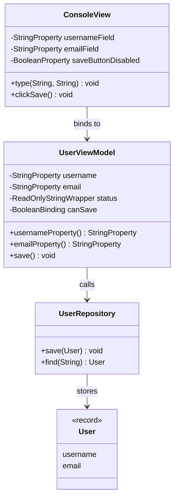
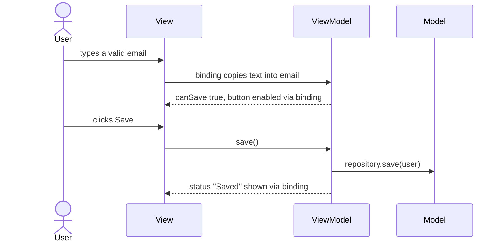
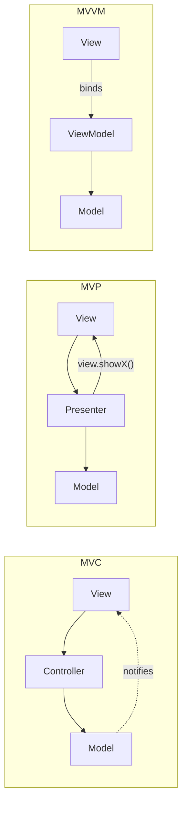

## In One Line
MVVM splits a UI into the **Model** (data and business logic), the **View** (widgets only) and the **ViewModel** (the screen's state and actions as *observable properties*); the View **binds** to the ViewModel's properties, so changes flow automatically, and the ViewModel never knows which View is showing it.

## Mental Model
Think of a **car dashboard**:
- The **engine and sensors** are the **Model**: raw facts — wheel rotations per second, litres of fuel left.
- The **car's computer (ECU)** is the **ViewModel**: it turns raw facts into display-ready values — "speed = 72 km/h", "fuel warning = ON" — and accepts commands like "reset trip meter". It does not know whether the display is an analogue dial, a digital screen, or a phone app.
- The **dashboard gauges** are the **View**: each needle or lamp is **wired** to one value from the computer and moves by itself when that value changes. The gauges contain no logic.
- **The wiring** is **data binding**: nobody writes "now move the needle"; connect it once and it stays in sync.

In the code: `UserModel` (or the `User` record and repository in the full version) is the engine, `UserViewModel` is the ECU, and the JavaFX `StringProperty` objects are the wires the View would connect to.

## Concept
### Where MVVM comes from
MVVM was introduced by **John Gossman at Microsoft in 2005** for WPF/Silverlight, whose XAML views can bind declaratively to object properties. It is a specialisation of Martin Fowler's **Presentation Model** (2004). It later became the standard for JavaFX, Android Jetpack, Angular/Knockout-style web frameworks and SwiftUI/Compose-style declarative UIs. Like MVC, it is an **architectural** pattern, not a GoF pattern.

### The three roles
| Role | Responsible for | Knows about | Must NOT |
|---|---|---|---|
| **Model** | Domain data, business rules, persistence/network access (entities, services, repositories) | Nothing of the UI | Import UI toolkit classes |
| **View** | Layout and widgets; binds widget properties to ViewModel properties; forwards user gestures to ViewModel commands | The ViewModel | Contain logic, talk to the Model |
| **ViewModel** | The screen's **state** (as observable properties), **derived state** (is the Save button enabled?), formatting, input validation, **commands** (`save()`), calling the Model | The Model | Reference the View or any widget class |

The dependency arrows all point one way: **View → ViewModel → Model**. The ViewModel exposes data; it does not push it into a view. That is the key difference from MVP, where the Presenter calls `view.showX(...)`.

### Data binding — the engine of MVVM
A **binding** keeps two properties in sync automatically.
| Kind | Direction | Typical use | JavaFX |
|---|---|---|---|
| **One-way** | source → target | Labels, enabled/disabled state, lists | `target.bind(source)` |
| **Two-way** | both ways | Text fields, checkboxes, sliders | `a.bindBidirectional(b)` |
| **Derived / computed** | several sources → one value | `canSave = username not empty AND email contains @` | `Bindings.createBooleanBinding(...)`, `a.isNotEmpty().and(...)` |
| **Listener** | source → your code | Side effects, logging | `property.addListener((obs, oldV, newV) -> ...)` |

Without a binding mechanism you must write the synchronisation code by hand, and MVVM degenerates into MVP.

### JavaFX properties in 60 seconds (what the course example uses)
- **`StringProperty`** is an abstract observable, writable `String` holder; **`SimpleStringProperty`** is the ordinary concrete implementation. There are equivalents for every type: `IntegerProperty`/`SimpleIntegerProperty`, `BooleanProperty`, `ObjectProperty<T>`, `ListProperty<T>`...
- **The JavaFX Beans convention** for a property `username`: `String getUsername()`, `void setUsername(String)`, and **`StringProperty usernameProperty()`** that returns the property object itself so others can bind or listen. The course's `UserModel` follows it exactly.
- `get()`/`set(v)` read and write the value. `set` notifies listeners only if the value really changed (`equals`).
- `b.bind(a)` makes `b` follow `a` (one-way). A bound property **cannot be set**: `b.set(...)` throws `RuntimeException: A bound value cannot be set.` Call `unbind()` first.
- `a.bindBidirectional(b)` keeps both in sync; at the moment of binding, `a` **takes `b`'s value**.
- `ReadOnlyStringWrapper` lets a ViewModel keep a writable property privately and expose `getReadOnlyProperty()` publicly — the View can observe but not change it.
- Bindings are **lazy**: a derived value is recomputed only when someone reads it or when an attached `ChangeListener` forces it.
- Packaging: these classes live in the **`javafx.base`** module (packages `javafx.beans.*`). JavaFX was bundled with Oracle JDK 8 but has been a separate project (OpenJFX) since JDK 11, so the course's pom declares `org.openjfx:javafx-base:17` (and `javafx-controls:17`). No graphics or display is needed to use properties. See [Course Project Setup](lesson:a01-oop/00-course-project-setup).

### How a user action flows in MVVM
1. The user types into a text field → the field's `textProperty()` changes.
2. The two-way binding copies the text into the ViewModel's `email` property.
3. Derived bindings recompute (`canSave` becomes `true`), and the button's `disableProperty()`, bound to `canSave.not()`, updates itself.
4. The user clicks Save → the View calls the ViewModel command `vm.save()`.
5. The ViewModel validates, calls the Model (`repository.save(user)`), and sets a `status` property → the bound label shows "Saved jane_smith".
No line of ViewModel code mentions a text field, a button or a label.

### What the course example shows, and what it leaves out
| MVVM ingredient | In `MVVMExample` |
|---|---|
| Model | `UserModel` — holds `username` and `email` as JavaFX `StringProperty` objects, with getters, setters and `xxxProperty()` accessors |
| ViewModel | `UserViewModel` — wraps a `UserModel` and forwards `getUsername/setUsername/getEmail/setEmail` to it |
| View | **None.** `main` sets values through the ViewModel and then prints **directly from the model** |
| Observable properties on the ViewModel | **None** — it exposes only plain `String` getters/setters, so nothing could bind to it |
| Data binding | **None** — no `bind`, no listener |
| Commands / UI logic | **None** |

So the example demonstrates the *layering* (someone talks to a ViewModel that talks to a Model) and the *JavaFX property* API, but not MVVM's defining feature, data binding. The observability is on the Model instead of the ViewModel. The `MvvmDemo` in the Code section adds everything that is missing.

### MVC vs MVP vs MVVM — the full comparison
| | MVC | MVP | MVVM |
|---|---|---|---|
| Middle component | Controller | Presenter | ViewModel |
| User input first reaches | Controller | View → forwards to Presenter | View → bound properties / commands of the ViewModel |
| How the view gets updated | View observes Model, or Controller pushes | Presenter calls methods on a **view interface** (`view.showName(...)`) | **Data binding**: View observes ViewModel properties |
| Middle component references the view? | Yes | Yes, through an interface | **No** |
| View references the model? | Often (classic MVC) | No | No |
| View ↔ middle relationship | Often many views per controller or 1:1 | 1:1 | Many views can bind to one ViewModel |
| Unit testing the middle | Needs view/model fakes | Mock the view interface and verify calls | Assert property values — no view needed |
| Needs a binding framework? | No | No | **Yes** (WPF, JavaFX properties, Android LiveData/StateFlow/Data Binding, Compose state) |
| Typical platforms | Spring MVC, Rails, Swing | Early Android, WinForms, GWT | WPF, JavaFX, Android Jetpack, Angular |

Memory hook: **Controller *handles*, Presenter *pushes*, ViewModel *exposes*.**

### MVVM on Android (Jetpack)
- `androidx.lifecycle.ViewModel` holds UI state and **survives configuration changes** such as screen rotation; it is cleared (`onCleared()`) when its owner (Activity/Fragment/navigation graph) is finished for good. Obtain it with `ViewModelProvider(this).get(...)` or Kotlin's `by viewModels()`.
- It exposes observable state as **`LiveData`** or **`StateFlow`**; the Activity/Fragment (or Jetpack Compose UI) observes it in a lifecycle-aware way. The Data Binding library allows two-way XML binding (`android:text="@={viewModel.email}"`).
- Recommended layering: **View → ViewModel → Repository → data sources** (a Room [DAO](lesson:a10-patterns/26-dao), a Retrofit API).
- Rule: a ViewModel must **never** hold a reference to an `Activity`, `Fragment`, `View` or activity `Context` — it outlives them, so it would leak them. Use `AndroidViewModel` if you need the `Application` context.
- Modern Compose apps use MVVM with **unidirectional data flow**: state flows down from the ViewModel, events flow up as function calls.

### Benefits
- **Testability:** the ViewModel is plain Java with properties — test it with JUnit, no UI toolkit, no emulator.
- **Less glue code:** no manual "copy field to label" code; bindings keep everything in sync.
- **Designer/developer split:** views (XAML, FXML, XML layouts) can change without touching logic.
- **Reuse:** the same ViewModel can back a phone layout and a tablet layout.

### Costs and pitfalls
- Binding is "magic": data changes without an explicit call, which can be harder to debug.
- Two-way bindings plus listeners can create **update loops** if a listener writes back to the property it observes.
- **Memory leaks:** a long-lived ViewModel or model that holds listeners registered by short-lived views keeps those views alive; remove listeners or use weak listeners.
- **Massive ViewModels:** one ViewModel per huge screen grows like a fat controller; split by feature and push business rules into the Model/use-case layer.
- Overkill for simple screens or when there is no binding framework.

### When to use it / not
Use MVVM when your UI toolkit supports binding (JavaFX, WPF, Android Jetpack, Compose), screens have non-trivial state and validation, and you want UI logic unit-tested. Prefer MVC/MVP, or plain code, for server-side web apps (which render once per request), for tiny screens, or when there is no binding mechanism.

> [!INTERVIEW] "In MVVM the ViewModel exposes observable state and commands but has no reference to the View; the View binds to that state. That is the difference from MVP, where the Presenter holds a view interface and pushes data into it. It makes the ViewModel testable as plain code — on Android the Jetpack ViewModel also survives rotation."

## Diagram

All arrows point one way: View → ViewModel → Model. The ViewModel has no field of type `ConsoleView` — it only exposes properties. In the course example the View is missing and `UserViewModel` exposes no properties at all.


Solid arrows are real method calls or writes; dashed arrows happen automatically through bindings. The ViewModel never calls the View.


Only MVP has an arrow from the middle component back to the view; only MVVM relies on binding instead of calls.

## Code
@example CoreJava/ArchitecturalPatterns/MVVMExample.java

**A complete MVVM screen** — plain-Java model, ViewModel with observable and derived properties plus a command, and a console "view" whose widgets are properties bound to the ViewModel (run with `javafx-base` on the classpath):
```java
import java.util.HashMap;
import java.util.Map;
import javafx.beans.binding.Bindings;
import javafx.beans.binding.BooleanBinding;
import javafx.beans.property.BooleanProperty;
import javafx.beans.property.ReadOnlyStringProperty;
import javafx.beans.property.ReadOnlyStringWrapper;
import javafx.beans.property.SimpleBooleanProperty;
import javafx.beans.property.SimpleStringProperty;
import javafx.beans.property.StringProperty;

public class MvvmDemo {
    public static void main(String[] args) {
        UserRepository repo = new UserRepository();
        UserViewModel vm = new UserViewModel(repo);
        ConsoleView view = new ConsoleView(vm);            // the view binds itself to the ViewModel

        view.type("username", "jane_smith");
        view.type("email", "jane.smith");
        view.clickSave();
        view.type("email", "jane.smith@example.com");
        view.clickSave();
        System.out.println("Stored in model: " + repo.find("jane_smith"));
    }
}

// ---------- Model: plain Java, no UI types ----------
record User(String username, String email) {}

class UserRepository {
    private final Map<String, User> users = new HashMap<>();
    void save(User u)          { users.put(u.username(), u); }
    User find(String username) { return users.get(username); }
}

// ---------- ViewModel: observable UI state + commands, no reference to any view ----------
class UserViewModel {
    private final StringProperty username = new SimpleStringProperty("");
    private final StringProperty email = new SimpleStringProperty("");
    private final ReadOnlyStringWrapper status = new ReadOnlyStringWrapper("");
    private final BooleanBinding canSave;                   // derived state, recomputed automatically
    private final UserRepository repo;

    UserViewModel(UserRepository repo) {
        this.repo = repo;
        canSave = username.isNotEmpty()
                .and(Bindings.createBooleanBinding(() -> email.get().contains("@"), email));
    }

    StringProperty usernameProperty()      { return username; }
    StringProperty emailProperty()         { return email; }
    ReadOnlyStringProperty statusProperty() { return status.getReadOnlyProperty(); }
    BooleanBinding canSaveProperty()       { return canSave; }

    void save() {                                           // a "command"
        if (!canSave.get()) {
            status.set("Fix the form first");
            return;
        }
        repo.save(new User(username.get(), email.get()));
        status.set("Saved " + username.get());
    }
}

// ---------- View: a console stand-in for JavaFX controls; it only binds and forwards ----------
class ConsoleView {
    private final StringProperty usernameField = new SimpleStringProperty();       // like TextField.textProperty()
    private final StringProperty emailField = new SimpleStringProperty();
    private final BooleanProperty saveButtonDisabled = new SimpleBooleanProperty(); // like Button.disableProperty()
    private final UserViewModel vm;

    ConsoleView(UserViewModel vm) {
        this.vm = vm;
        usernameField.bindBidirectional(vm.usernameProperty());      // two-way binding
        emailField.bindBidirectional(vm.emailProperty());
        saveButtonDisabled.bind(vm.canSaveProperty().not());         // one-way binding
        saveButtonDisabled.addListener((obs, was, now) ->
                System.out.println("  [Save button " + (now ? "disabled" : "enabled") + "]"));
        vm.statusProperty().addListener((obs, old, msg) -> System.out.println("  status label: " + msg));
    }

    void type(String field, String text) {
        System.out.println("user types " + field + " = " + text);
        (field.equals("username") ? usernameField : emailField).set(text);
    }

    void clickSave() {
        System.out.println("user clicks Save");
        vm.save();
    }
}
```
```output
user types username = jane_smith
user types email = jane.smith
user clicks Save
  status label: Fix the form first
user types email = jane.smith@example.com
  [Save button enabled]
user clicks Save
  status label: Saved jane_smith
Stored in model: User[username=jane_smith, email=jane.smith@example.com]
```
Notice what *nobody* wrote: no code copies the text field into the ViewModel, and no code enables the button — the bindings did both. The button stays disabled after the username alone (so no line is printed) and flips to enabled the moment the email contains `@`. The ViewModel still guards `save()` itself, so it is safe even if a view forgets to disable the button. In a real JavaFX view the three wiring lines would be `nameField.textProperty().bindBidirectional(vm.usernameProperty())`, `saveButton.disableProperty().bind(vm.canSaveProperty().not())` and `statusLabel.textProperty().bind(vm.statusProperty())`.

**Binding rules you must know** (verified behaviour of `javafx.beans`):
```java
StringProperty a = new SimpleStringProperty("x");
StringProperty b = new SimpleStringProperty("y");
b.bind(a);                                   // one-way: b follows a
a.set("z");
System.out.println(b.get());
try { b.set("w"); } catch (RuntimeException e) { System.out.println(e.getClass().getName() + ": " + e.getMessage()); }

StringProperty name = new SimpleStringProperty("jane");
name.addListener((obs, old, now) -> System.out.println(old + " -> " + now));
name.set("jane");                            // same value: no event
name.set("john");
name.set("john");                            // same value: no event

StringProperty field = new SimpleStringProperty("typed");
StringProperty vmProp = new SimpleStringProperty("from VM");
field.bindBidirectional(vmProp);             // field takes vmProp's value at bind time
System.out.println(field.get() + " | " + vmProp.get());
field.set("edited");
System.out.println(field.get() + " | " + vmProp.get());
```
```output
z
java.lang.RuntimeException: A bound value cannot be set.
jane -> john
from VM | from VM
edited | edited
```

## Walkthrough
**Line 3: `import javafx.beans.property.SimpleStringProperty;;`** — note the doubled semicolon. Up to JDK 20, javac silently accepted a stray `;` between imports. **JDK 21 makes it a compile error** (`error: extraneous semicolon`) when compiling at source level 21; with `--release 17` it is only a warning. The recorded output was produced with `--release 17`. Delete one `;` and it compiles everywhere.

**Imports** — `SimpleStringProperty` (concrete class) and `StringProperty` (abstract type) come from `javafx.beans.property` in the `javafx.base` module, which is why the course's pom has the `javafx-base` dependency. Without it the file does not compile (`package javafx.beans.property does not exist`).

**`class UserModel`** — the **Model**.
- `private StringProperty username = new SimpleStringProperty();` and the same for `email` — observable holders whose initial value is `null` (the no-arg constructor).
- For each property the three JavaFX Beans accessors: `getUsername()` returns `username.get()`, `setUsername(String)` calls `this.username.set(...)`, and `usernameProperty()` returns the property object so others can bind or listen. `email` has the same trio.
- Because the model's properties are observable, anything could already listen to them: adding `model.usernameProperty().addListener(...)` and then calling `viewModel.setUsername("jane_smith")` prints `model changed: null -> jane_smith`.

**`class UserViewModel`** — the intended **ViewModel**.
- `private UserModel model;` plus a constructor that receives the model (constructor injection).
- `getUsername()/setUsername()/getEmail()/setEmail()` simply delegate to the model. There is no `usernameProperty()` here, no derived state, no validation and no command — so a View would have nothing to bind to. As written it is a pass-through wrapper.

**`main`**
1. `new UserModel()` — both properties hold `null`.
2. `new UserViewModel(model)` — "associate it with the UserModel".
3. `viewModel.setUsername("jane_smith"); viewModel.setEmail("jane.smith@example.com");` — writes go *through* the ViewModel into the model's properties.
4. `System.out.println("Username: " + model.getUsername());` and the `Email` line — the comment says it honestly: "Display user details **directly from the model**". Here `main` plays the View, and it bypasses the ViewModel.

**Output** — `Username: jane_smith` and `Email: jane.smith@example.com`, deterministic, and both `// Output:` comments are correct. It proves that writes through the ViewModel reached the model; it does not show any binding.

## Traps
> [!ERRATA] Line 3 has a stray `;;` after `import javafx.beans.property.SimpleStringProperty`. JDK 21's javac rejects it with `error: extraneous semicolon` (older compilers, or `--release 17`, only accept or warn). The recorded output was compiled with `--release 17`. Remove the extra semicolon.

> [!ERRATA] The example is MVVM in name only. `UserViewModel` exposes no observable properties, so no View could bind to it; the observable `StringProperty` objects live in the Model instead; there is no View; and `main` reads the result "directly from the model", bypassing the ViewModel — the opposite of MVVM's View → ViewModel → Model rule. A real ViewModel exposes `usernameProperty()`-style properties (plus derived state and commands) and the View binds to them, as in `MvvmDemo`.

- **Replacing a property object.** The fields are not `final`; if code ever did `username = new SimpleStringProperty()`, every existing binding would stay attached to the *old* object and silently stop updating. Declare property fields `private final`.
- **UI-toolkit types in the domain model.** `UserModel` depends on JavaFX. That is common in small JavaFX apps, but it ties the model to one UI library. Keeping the model plain Java (a record, a POJO) and putting properties in the ViewModel makes the model reusable in a REST service or batch job.
- **Setting a bound property** throws `RuntimeException: A bound value cannot be set.` — unbind first, or bind the other way, or use a bidirectional binding.
- **`bindBidirectional` copies in the "wrong" direction for newcomers:** `a.bindBidirectional(b)` first sets `a` to `b`'s value, so text already typed into `a` is overwritten.
- **Listener leaks:** `addListener` keeps a strong reference from the property to your listener. A view that registers listeners on a long-lived ViewModel and is then discarded stays in memory unless it removes them (or uses `WeakChangeListener`).
- **Update loops:** a listener that writes back to the property it listens to (or two listeners writing to each other) can recurse; prefer bindings and derived properties over listeners that set values.
- **Android: holding a `View`/`Activity`/`Context` in a ViewModel** leaks the whole screen after rotation, because the ViewModel outlives it.

## Tips & Tricks
- **Mnemonic — "Controller *handles*, Presenter *pushes*, ViewModel *exposes*."**
- **The one-question test:** "Does the middle component hold a reference to the view?" Yes → MVC/MVP. No, the view binds to it → MVVM.
- **JavaFX property trio:** `getX()`, `setX(v)`, `xProperty()` — remember "get, set, property".
- **Expose read-only state** with `ReadOnlyXxxWrapper` + `getReadOnlyProperty()` so views can observe but not modify.
- **Put derived state in bindings, not listeners:** `saveButton.disableProperty().bind(vm.canSaveProperty().not())` beats manually toggling the button in three places.
- **Test the ViewModel like plain Java:** set properties, call the command, assert properties — no UI thread, no emulator.
- **On JDK 21+ watch for `;;` after imports** in old code — it is now a compile error.

## Interview Q&A
### [Basic] What is MVVM? Describe each component.
MVVM is an architectural pattern for UIs with three parts. The **Model** is the domain: data, business rules, repositories, services — no UI code. The **View** is only layout and widgets; it binds its widgets to the ViewModel and forwards gestures as command calls. The **ViewModel** holds the screen's state as **observable properties** (text values, flags like `canSave`, status messages), performs UI logic and validation, and exposes **commands** such as `save()` that call the Model. The ViewModel has **no reference to the View**; data binding keeps the View and ViewModel in sync. It came from Microsoft's WPF (2005) and is used today in JavaFX, Android Jetpack and declarative UIs.

**Follow-up:** *What makes MVVM impossible without framework support?* — Data binding. Without observable properties and a binding mechanism, someone must push data into the view by hand, which turns the design into MVP.

### [Basic] What is data binding? One-way vs two-way?
Data binding is a mechanism that automatically keeps a target property in sync with a source property. **One-way** binding copies source → target whenever the source changes — for labels, enabled flags, lists (`label.textProperty().bind(vm.statusProperty())`). **Two-way** binding syncs both directions — for editable inputs (`textField.textProperty().bindBidirectional(vm.emailProperty())`). There are also **derived** bindings that compute a value from several sources (`canSave = username.isNotEmpty().and(emailValid)`). In JavaFX, a one-way-bound property cannot be set directly (`A bound value cannot be set.`).

**Follow-up:** *What happens to the target's existing value on `a.bindBidirectional(b)`?* — `a` is immediately overwritten with `b`'s value; afterwards changes flow both ways.

### [Intermediate] Compare MVC, MVP and MVVM.
All three separate UI from domain logic; they differ in the middle component and in how the view is updated. **MVC:** input goes to the Controller, which updates the Model; the View observes the Model or is refreshed by the Controller. **MVP:** the View is passive and implements an interface; it forwards all events to the Presenter, which reads the Model and calls `view.showX()` — the Presenter holds the view interface, so it is tested by mocking that interface. **MVVM:** the ViewModel exposes observable state and commands and does not know the View; the View binds to it, so updates are automatic, and the ViewModel is tested by asserting property values. MVC dominates server-side web frameworks; MVP suited toolkits without binding (early Android, WinForms); MVVM suits toolkits with binding (WPF, JavaFX, Jetpack, Compose).

**Follow-up:** *Can one ViewModel serve two views?* — Yes; since it does not reference any view, a phone layout and a tablet layout can bind to the same ViewModel. A Presenter is usually 1:1 with its view.

### [Intermediate] Why must the ViewModel not reference the View?
Four reasons. **Testability:** a ViewModel with no UI types runs in a plain JUnit test, with no UI thread or emulator. **Reuse:** multiple or different views can bind to the same ViewModel. **Lifecycle safety:** on Android the ViewModel survives configuration changes while the Activity is destroyed and recreated; a reference to the old Activity or its views would leak them and point at a dead screen. **Separation:** the ViewModel describes *what* the screen state is; the View decides *how* to show it. Communication towards the view happens only through observable properties (or one-off event streams for things like navigation or toasts).

**Follow-up:** *How does a ViewModel ask the view to show a one-time message?* — It exposes an event (e.g. a `SharedFlow`/"single live event" on Android, or a status property the view observes), never a direct call like `activity.showToast()`.

### [Intermediate] Explain the JavaFX property API used in the course example.
`StringProperty` is an abstract, observable, writable wrapper for a `String`; `SimpleStringProperty` is its standard implementation (the no-arg constructor starts with `null`). The JavaFX Beans convention gives each property three methods: `getUsername()` → `username.get()`, `setUsername(v)` → `username.set(v)`, and `usernameProperty()` returning the property object so others can call `bind`, `bindBidirectional` or `addListener`. Listeners (`ChangeListener` receives old and new values; `InvalidationListener` is told only that the value may have changed) fire when the value actually changes. The `Bindings` class and fluent methods (`isNotEmpty()`, `and()`, `concat()`) build derived values lazily. These live in the `javafx.base` module, which is why the pom depends on `org.openjfx:javafx-base`.

**Follow-up:** *Why return the property object instead of just the value?* — Because binding needs the observable object itself; a plain `String` getter gives a snapshot that cannot notify anyone.

### [Intermediate] Is the course's MVVMExample a correct MVVM implementation?
Only structurally. It has a Model and a class named ViewModel that sits in front of it, and it shows JavaFX properties. But the defining parts of MVVM are missing: the ViewModel exposes no observable properties (only plain getters/setters), so nothing can bind to it; there is no View; there is no binding, derived state or command; and `main` reads directly from the Model, bypassing the ViewModel. The observable properties are on the Model instead. It also has a stray `;;` after an import that JDK 21 rejects. A fixed version keeps the Model plain, gives the ViewModel `usernameProperty()`/`emailProperty()`, a derived `canSave` binding, a read-only `status` and a `save()` command, and lets the View bind to them.

**Follow-up:** *What would you name the example's `UserViewModel` as written?* — A pass-through wrapper or facade; it adds no state or behaviour of its own.

### [Advanced] How is MVVM implemented on Android with Jetpack?
A class extends `androidx.lifecycle.ViewModel` and holds UI state as `StateFlow`/`LiveData` (usually one immutable UI-state object), plus functions for user events. The Activity/Fragment gets it via `ViewModelProvider` or `by viewModels()` and observes the state lifecycle-aware (`collectAsStateWithLifecycle` in Compose, `observe(viewLifecycleOwner)` for LiveData), updating widgets or recomposing. The ViewModel survives configuration changes (rotation) because it is stored in the owner's `ViewModelStore`, and `onCleared()` runs when the owner is permanently gone; `viewModelScope` cancels its coroutines then. It talks to a **Repository**, which combines Room DAOs and network APIs. It must not hold Activity/View/Context references (use `AndroidViewModel` for the Application context), and `SavedStateHandle` restores small state after process death.

**Follow-up:** *Does the ViewModel survive process death?* — No. It survives configuration changes only; for process death, persist small state with `SavedStateHandle` and reload data from the repository.

### [Advanced] How do you unit test a ViewModel?
Because it has no UI dependencies, you instantiate it with a fake Model/repository, set its input properties, call its commands, and assert its output properties:
```java
var repo = new UserRepository();                 // or a fake/mock
var vm = new UserViewModel(repo);
vm.usernameProperty().set("jane_smith");
vm.emailProperty().set("jane.smith");
assertFalse(vm.canSaveProperty().get());
vm.save();
assertEquals("Fix the form first", vm.statusProperty().get());
vm.emailProperty().set("jane.smith@example.com");
assertTrue(vm.canSaveProperty().get());
vm.save();
assertNotNull(repo.find("jane_smith"));
```
No window, FX thread or emulator is needed for pure property logic. On Android you replace the main dispatcher in tests and collect `StateFlow` values.

**Follow-up:** *What is still hard to test in MVVM?* — The bindings in the View itself (a mistyped binding) — covered by a few UI tests, while the bulk of the logic is covered by fast ViewModel tests.

### [Advanced] What are common MVVM pitfalls?
**Massive ViewModels** that contain business rules — push rules into the Model/use cases. **Listener and observer leaks** — a long-lived ViewModel referencing short-lived views, or views registering listeners they never remove. **Update loops** from listeners that write back to observed properties. **Too much two-way binding**, which makes data flow hard to follow — many teams prefer unidirectional flow (state down, events up). **Leaking UI types** (widgets, Android `Context`) into the ViewModel. **Mutable property fields** that get replaced and silently break bindings. **Business state duplicated** in the ViewModel and the Model without a single source of truth.

**Follow-up:** *What is "unidirectional data flow" and how does it relate to MVVM?* — The ViewModel exposes one immutable UI state that the view renders, and the view sends events back as function calls; it is MVVM without two-way binding (closely related to MVI), and it is the recommended style for Jetpack Compose.

### [Basic] Why did the original MVVMExample compile for the course author but fails on JDK 21?
Because of the extra semicolon in `import javafx.beans.property.SimpleStringProperty;;`. The Java grammar does not allow an empty declaration between import declarations, but older javac versions accepted it. JDK 21 fixed javac to follow the specification, so at source level 21 it reports `error: extraneous semicolon`; with `--release 17` it is still accepted with a warning. The fix is to delete one `;`.

**Follow-up:** *Would it compile without the JavaFX dependency?* — No; `javafx.beans.property` is not part of the JDK since 11, so `org.openjfx:javafx-base` must be on the classpath or module path.

## Quiz
### Why does the original MVVMExample fail to compile with JDK 21's default settings?
- [ ] JavaFX was removed from JDK 21
- [x] Line 3 has a stray `;;` after an import, which JDK 21 reports as `error: extraneous semicolon`
- [ ] `StringProperty` is abstract and cannot be assigned a `SimpleStringProperty`
- [ ] `UserViewModel` does not expose properties
> Older compilers tolerated the stray semicolon; JDK 21 enforces the grammar (only a warning with `--release 17`). JavaFX has not been part of the JDK since 11 — that is a *dependency* issue, not the cause of this error. Assigning a subclass instance to its abstract type is ordinary polymorphism.

### What does this print?
```java
StringProperty a = new SimpleStringProperty("x");
StringProperty b = new SimpleStringProperty("y");
b.bind(a);
a.set("z");
System.out.println(b.get());
b.set("w");
```
- [ ] `y`, then `b` becomes `w`
- [ ] `z`, then `b` becomes `w` and `a` stays `z`
- [x] `z`, then `b.set("w")` throws `RuntimeException: A bound value cannot be set.`
- [ ] `x`, then a `RuntimeException`
> After `b.bind(a)`, `b` follows `a`, so it reads `z`. A one-way-bound property cannot be written directly; JavaFX throws `RuntimeException` with that message. Use `bindBidirectional` if both sides must be writable.

### How many lines does this print?
```java
StringProperty name = new SimpleStringProperty("jane");
name.addListener((obs, old, now) -> System.out.println(old + " -> " + now));
name.set("jane");
name.set("john");
name.set("john");
```
- [ ] 3
- [ ] 2
- [x] 1 — `jane -> john`
- [ ] 0
> `set` notifies change listeners only when the new value differs from the current one (by `equals`). Only the first `set("john")` is a change. Expecting 3 lines is the common mistake of treating every `set` as an event.

### What does this print first?
```java
StringProperty field = new SimpleStringProperty("typed");
StringProperty vmProp = new SimpleStringProperty("from VM");
field.bindBidirectional(vmProp);
System.out.println(field.get() + " | " + vmProp.get());
```
- [ ] typed | typed
- [x] from VM | from VM
- [ ] typed | from VM
- [ ] It throws: both properties already have values
> `a.bindBidirectional(b)` first copies `b`'s value into `a`, then keeps them in sync. After `field.set("edited")` both read `edited`. Order of arguments matters when both already hold data.

### Using the original `UserModel`/`UserViewModel`, what does this print?
```java
UserModel model = new UserModel();
UserViewModel viewModel = new UserViewModel(model);
model.usernameProperty().addListener((obs, old, now) -> System.out.println("model changed: " + old + " -> " + now));
viewModel.setUsername("jane_smith");
```
- [ ] Nothing — the ViewModel has no properties, so no events fire
- [x] model changed: null -> jane_smith
- [ ] model changed: "" -> jane_smith
- [ ] A `NullPointerException`, because the initial value is `null`
> `UserViewModel.setUsername` delegates to `model.setUsername`, which calls `set` on the model's observable property, so the listener fires. `new SimpleStringProperty()` starts at `null`, not `""`. The observability exists — it just sits in the Model instead of the ViewModel.

### In MVVM, which statement about references is correct?
- [ ] The ViewModel holds a reference to the View so it can update widgets
- [x] The View references the ViewModel and binds to its properties; the ViewModel does not reference the View
- [ ] The View references the Model directly for speed
- [ ] The Model holds a reference to the ViewModel to push changes
> That one-way dependency is what distinguishes MVVM from MVP (where the Presenter holds a view interface). The Model knows neither the ViewModel nor the View; the ViewModel observes or calls the Model.

### In `MvvmDemo`, when is the line `[Save button enabled]` printed?
- [ ] After the username is typed
- [ ] After the first click on Save
- [x] Right after the email `jane.smith@example.com` is typed
- [ ] Never — the view never calls a method on the button
> `saveButtonDisabled` is bound to `canSave.not()`; `canSave` needs a non-empty username **and** an email containing `@`. It first becomes true when the valid email is typed, the bound property flips to `false`, and its listener prints the line. No explicit call is needed — that is binding at work.

## Takeaways
- MVVM = Model (domain, no UI types) + View (widgets that bind) + ViewModel (observable state, derived state, commands, no reference to the View); dependencies point View → ViewModel → Model.
- Data binding is the defining mechanism: one-way (`bind`), two-way (`bindBidirectional`), derived bindings, and listeners; without it MVVM collapses into MVP.
- JavaFX properties: `StringProperty`/`SimpleStringProperty`, the `getX`/`setX`/`xProperty()` convention; a bound property cannot be set, `bindBidirectional` copies the argument's value first, and listeners fire only on real changes. They live in `javafx.base`, an external dependency since JDK 11.
- The course example is MVVM in name only: its ViewModel exposes no properties, there is no View or binding, and `main` reads the Model directly; it also has a `;;` that JDK 21 rejects (`extraneous semicolon`).
- Controller *handles*, Presenter *pushes*, ViewModel *exposes*: only MVP's middle component references the view; only MVVM relies on binding.
- Android Jetpack: `ViewModel` survives rotation, exposes `StateFlow`/`LiveData`, talks to a Repository (Room DAO, API) and must never hold an Activity/View/Context.
- ViewModels are unit-tested as plain Java: set properties, call commands, assert properties.
