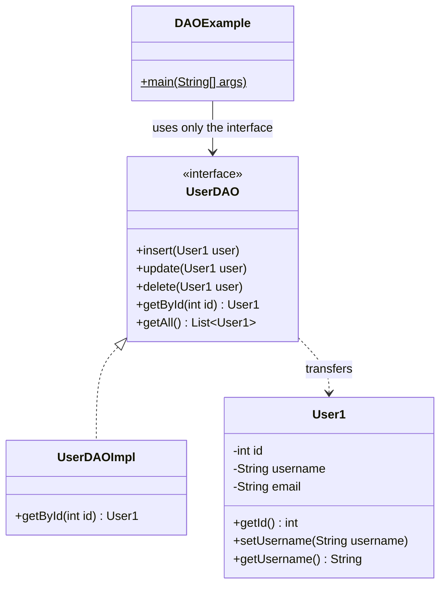
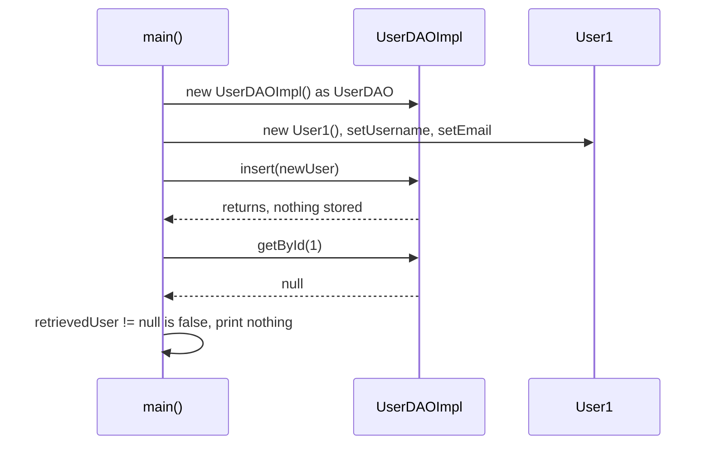
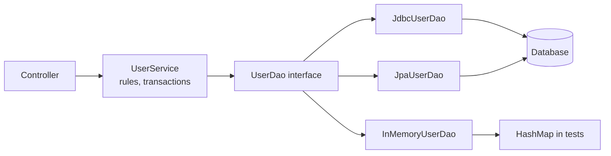

## In One Line
The DAO pattern puts **all access to a data store behind an interface of CRUD methods in domain terms** — `insert(user)`, `getById(1)`, `getAll()` — so business code never sees SQL, JDBC, files or HTTP calls, and the storage can be swapped (JDBC, JPA, in-memory for tests) without changing a line of the callers. The course example also uses **Lombok** (`@Getter`/`@Setter`) to generate the entity's accessors, and it **prints nothing**, because its `getById` is a stub that returns `null`.

## Mental Model
Think of a **library's circulation desk**:
- You ask the desk for *"book number 1"* (`getById(1)`) or hand in a book (`insert`). You never walk into the stacks.
- Whether the book is on an open shelf, in a basement archive, or ordered from another branch is **the desk's business** (a MySQL table, a file, a `HashMap`, a web service).
- If the library moves its archive to a new building (MySQL → PostgreSQL, JDBC → JPA), readers still use **the same desk, the same form** (the `UserDAO` interface).
- The **book** you receive is a plain object (`User1`), not a pointer into the archive's filing system (`ResultSet`).

The course's desk exists and has the right forms — but the librarian quietly **throws away every book you hand in** (`insert` does nothing) and answers **"nothing here"** to every request (`getById` returns `null`). That is why the program prints nothing.

## Concept
### Origin and intent
DAO is **not** a Gang of Four pattern. It comes from Sun's *Core J2EE Patterns* catalogue (Alur, Crupi, Malks, 2001), in the **integration tier**:
> Use a Data Access Object to abstract and encapsulate all access to the data source. The DAO manages the connection with the data source to obtain and store data.

It is an application of older ideas: program to an interface, separation of concerns, and the Single Responsibility Principle ([SOLID](lesson:b01-fundamentals/13-solid-principles)) — business logic changes for business reasons, persistence code changes for storage reasons.

### Participants and how the example maps to them
| Participant | Role | In the example |
|---|---|---|
| **BusinessObject** (client) | Needs data; knows only the DAO interface | `DAOExample.main` (in real code: a service class) |
| **DataAccessObject** — interface | The contract: CRUD operations in domain terms | `interface UserDAO` — `insert`, `update`, `delete`, `getById`, `getAll` |
| **DataAccessObject** — implementation | Talks to the actual store; the only place with SQL/JDBC/file code | `UserDAOImpl` (all methods are empty stubs) |
| **DataSource** | The store itself | None yet — "e.g., database" in a comment |
| **TransferObject / entity** | Plain data carrier passed in and out | `User1` (`id`, `username`, `email`, Lombok getters/setters) |

### What problems it solves
- **Separation of concerns** — SQL, connection handling, row mapping and vendor quirks live in one class, not scattered through business logic.
- **Swappable storage** — `UserDAO dao = new JdbcUserDAO(ds)` today, `new JpaUserDAO(em)` tomorrow; callers are unchanged (demo below runs the same scenario on two implementations with identical output).
- **Testability** — business code can be unit-tested with an in-memory DAO or a mock, with no database.
- **One place for cross-cutting data concerns** — exception translation, logging, caching, auditing.

### Designing a good DAO interface
The course's interface has the right *shape* but several signatures that hurt callers:
| Course signature | Problem | Better |
|---|---|---|
| `User1 getById(int id)` returning `null` | Absence is invisible; callers must remember null checks | `Optional<User> findById(int id)` ([Optional](lesson:a05-java8/20-optional)) |
| `List<User1> getAll()` returning `null` | A `for` loop over it throws `NullPointerException` | Return an **empty list**, never `null` |
| `void insert(User1 user)` | Caller never learns the generated id or whether it worked | Return the saved entity or its id |
| `void update(User1 user)` | Silent when the row does not exist | Return `boolean`/row count, or throw a not-found exception |
| `void delete(User1 user)` | Needs a whole object just to delete by key | `boolean deleteById(int id)` |
| (not declared) | Which exceptions can happen? | Unchecked `DataAccessException` family, plus meaningful ones like `DuplicateUserException` |

Keep **storage types out of the interface**: no `ResultSet`, `Connection`, `SQLException`, JPA `Query` or file paths in method signatures — otherwise the abstraction leaks and callers become tied to one technology again.

### Inside a JDBC implementation
- Get connections from a **`DataSource`** (in production a pool such as HikariCP), not `DriverManager` per call.
- **try-with-resources** for `Connection`, `PreparedStatement` and `ResultSet` — leaked connections exhaust the pool.
- **`PreparedStatement` with `?` placeholders**, always. String concatenation invites SQL injection (demo below). Placeholders cannot stand for table or column names; whitelist those.
- **Generated keys**: `prepareStatement(sql, Statement.RETURN_GENERATED_KEYS)` + `getGeneratedKeys()`.
- **Row mapping** in one private method (`ResultSet` → `User`).
- **Exception translation**: `SQLException` is checked and vendor-specific. Wrap it in an unchecked exception, and translate known cases by **SQLState** (e.g. `23505` = unique-constraint violation → `DuplicateUserException`). Spring does this automatically for `@Repository` beans, mapping to its `DataAccessException` hierarchy (`DuplicateKeyException`, `EmptyResultDataAccessException`, ...).

### Transactions belong to the service layer
A DAO method is usually one statement. A business operation ("transfer money": debit A, credit B, write an audit row) spans several DAO calls — possibly several DAOs — and must commit or roll back **as a unit**. So the **service** defines the transaction boundary, and the DAOs join it by using the same connection (Spring binds it to the thread for `@Transactional` methods). A DAO that commits inside each method makes multi-step operations impossible to roll back.

### DAO vs Repository
| | DAO | Repository (Domain-Driven Design, Evans 2003) |
|---|---|---|
| Thinks in | **Tables / data sources** — one DAO per table is common | **Aggregates** — a collection-like view of domain objects |
| Vocabulary | Persistence: `insert`, `update`, `delete`, `getById` | Domain: `add`, `remove`, `findActiveCustomers()`, `nextOrderNumber()` |
| Layer | Data-access layer, close to the database | Domain layer (interface), with the implementation in infrastructure |
| Returns | Entities or transfer objects, sometimes partial rows | Fully consistent aggregates |
| Typical implementation | Hand-written JDBC, `JdbcTemplate`, MyBatis | Often built **on top of** DAOs or an ORM (JPA) |

In everyday Spring code the terms are blurred: Spring Data's interfaces are called `...Repository` but many are just DAOs with generated implementations, and the `@Repository` annotation marks DAO classes for exception translation. In an interview, say both are persistence abstractions; a repository speaks the domain's language and deals in aggregates, a DAO speaks the storage's language.

### Generic DAO
```java
interface Dao<T, ID> {
    T save(T entity);
    Optional<T> findById(ID id);
    List<T> findAll();
    boolean deleteById(ID id);
}
interface UserDao extends Dao<User, Integer> {
    Optional<User> findByUsername(String username);   // entity-specific queries go here
}
```
It removes copy-paste CRUD code, but beware: not every entity should support every operation (should audit records be deletable?), and a generic base encourages exposing more than the domain needs. Spring Data's `CrudRepository<T, ID>` / `JpaRepository<T, ID>` is the industrial version — you declare an interface and Spring generates the implementation at runtime, including derived queries such as `findByUsername`.

### DAO across the Java ecosystem
| Technology | What plays the DAO role |
|---|---|
| Plain JDBC | Hand-written classes like `JdbcUserDao` below |
| Spring `JdbcTemplate` / `JdbcClient` (6.1) | The DAO body shrinks to SQL + a `RowMapper`; resource handling is a [Template Method](lesson:a10-patterns/22-template-method) inside Spring |
| JPA / Hibernate | `EntityManager` is a generic DAO; a class wrapping it per entity is a JPA DAO |
| Spring Data JPA | `interface UserRepository extends JpaRepository<User, Long>` — implementation generated as a proxy |
| MyBatis | Mapper interfaces bound to SQL in XML or annotations |
| Android Room | `@Dao` interfaces with `@Query` methods — used below the Repository in [MVVM](lesson:a10-patterns/25-mvvm) |

Typical layering: **Controller → Service (business rules, transactions) → DAO/Repository → database**, often with separate DTOs at the controller boundary ([MVC](lesson:a10-patterns/24-mvc)).

### Lombok: where `getUsername()` and `setEmail()` come from
`User1` declares three private fields and **no methods**, yet `main` calls `setUsername`, `setEmail` and `getUsername`. They are generated by **Project Lombok** (dependency `org.projectlombok:lombok:1.18.32`, scope `provided`, in the course's `pom.xml` — see [Course Project Setup](lesson:a01-oop/00-course-project-setup)):
- Lombok is an **annotation processor**. While `javac` compiles, Lombok modifies the compiler's syntax tree and **adds real methods to the class**. The `.class` file contains them (verified with `javap` below); at runtime Lombok is not involved at all.
- Its annotations have `@Retention(SOURCE)` (verified) — they vanish after compilation. That is why the Maven scope is **`provided`** (Gradle: `compileOnly` + `annotationProcessor`): needed to compile, not shipped or needed at runtime.
- `@Getter`/`@Setter` **on the class** generate a `public` getter and setter for every non-static field (`final` fields get no setter). On a single field they apply to that field only. `@Setter(AccessLevel.PROTECTED)` changes the access; `boolean active` gets `isActive()`.
- They do **not** generate constructors, `toString`, `equals` or `hashCode`. Related annotations do:

| Annotation | Generates |
|---|---|
| `@Getter`, `@Setter` | Accessors |
| `@ToString`, `@EqualsAndHashCode` | `toString()`; `equals()`/`hashCode()` from the fields |
| `@NoArgsConstructor`, `@AllArgsConstructor`, `@RequiredArgsConstructor` | Constructors (required = `final` and `@NonNull` fields) |
| `@Data` | `@Getter` + `@Setter` + `@ToString` + `@EqualsAndHashCode` + `@RequiredArgsConstructor` |
| `@Value` | Immutable version: all fields `private final`, getters, no setters, class `final` |
| `@Builder` | A builder ([Builder](lesson:a10-patterns/03-builder)) |
| `@Slf4j` | `private static final Logger log` |

- **Tooling:** IDEs need the Lombok plugin/annotation processing enabled, or they show red "cannot find symbol" errors although Maven builds fine. `delombok` prints the generated source.
- **JDK coupling:** Lombok uses internal `javac` APIs, so each new JDK usually needs a newer Lombok release (1.18.32 supports JDK 21; JDK 23 support arrived in 1.18.34). JDK 21's `javac` prints a note that annotation processing was enabled implicitly (verified below); since **JDK 23** `javac` no longer runs processors found on the class path unless you configure them (`-proc:full`, `--processor-path`, or Maven's `<annotationProcessorPaths>`).
- **Modern alternative:** for immutable data carriers, **records** (Java 16, [Records](lesson:b05-modern-java/03-records)) give constructor, accessors, `equals`, `hashCode` and `toString` with no library — the demo below uses a record as the transfer object.
- **Pitfall with JPA entities:** `@Data`/`@EqualsAndHashCode` over all fields breaks with lazy relations and generated ids, and `@ToString` can recurse through bidirectional relations. Use `@Getter`/`@Setter` and write `equals`/`hashCode` deliberately ([equals and hashCode](lesson:b01-fundamentals/06-object-class-equals-hashcode)).

### When to use it / when not
**Use** a DAO (or repository) whenever business code would otherwise contain SQL or storage calls — i.e. in almost every application with a database, especially when you want unit tests without the database.

**Don't over-do it:** a throwaway script does not need an interface per table; with Spring Data the "DAO" is often just an interface declaration; and a DAO that returns ORM entities with lazy-loaded associations can leak persistence concerns anyway (`LazyInitializationException` in the view layer).

## Diagram

The client depends on the `UserDAO` interface; `User1`'s accessors exist only after Lombok has run (some are omitted here).


Every call succeeds, but the stubs store nothing and return `null`, so the `if` skips the only `println`.


The service sees only the interface; each implementation can be swapped without touching it.

## Code
@example CoreJava/ArchitecturalPatterns/DAOExample.java

**How the example is built** — Lombok must run inside `javac`. Compiling with Lombok on the class path (JDK 21) prints a note and produces these members in `User1.class`:
```text
$ javac -cp lombok-1.18.32.jar -d out DAOExample.java
Note: Annotation processing is enabled because one or more processors were found
  on the class path. A future release of javac may disable annotation processing
  unless at least one processor is specified by name (-processor), or a search
  path is specified (--processor-path, --processor-module-path), or annotation
  processing is enabled explicitly (-proc:only, -proc:full).
  Use -Xlint:-options to suppress this message.
  Use -proc:none to disable annotation processing.

$ javap -p -cp out CoreJava.ArchitecturalPatterns.User1
class CoreJava.ArchitecturalPatterns.User1 {
  private int id;
  private java.lang.String username;
  private java.lang.String email;
  CoreJava.ArchitecturalPatterns.User1();
  public void setId(int);
  public void setUsername(java.lang.String);
  public void setEmail(java.lang.String);
  public int getId();
  public java.lang.String getUsername();
  public java.lang.String getEmail();
}
```
The constructor `User1()` is the compiler's default constructor (package-private, like the class), not Lombok's. Running the compiled class prints nothing and exits with status 0.

Without Lombok, or with the single-file launcher (which never runs annotation processors), it does not compile:
```text
$ javac -d out DAOExample.java
DAOExample.java:3: error: package lombok does not exist
DAOExample.java:9: error: cannot find symbol  @Setter
DAOExample.java:68: error: cannot find symbol  newUser.setUsername("new_user");
... 7 errors

$ java -cp lombok-1.18.32.jar DAOExample.java
DAOExample.java:68: error: cannot find symbol
  symbol:   method setUsername(String)
... 3 errors
error: compilation failed
```
With the launcher, the `lombok` package is found (so the imports compile), but the processor does not run, so the methods never appear.

**A real DAO, twice.** One interface, an in-memory implementation and a JDBC implementation (H2 in-memory database, `com.h2database:h2:2.2.224`), and a service that knows only the interface. The same scenario runs on both:
```java
import java.sql.*;
import java.util.*;
import java.util.concurrent.ConcurrentHashMap;
import java.util.concurrent.atomic.AtomicInteger;
import javax.sql.DataSource;
import org.h2.jdbcx.JdbcDataSource;

public class DaoDemo {
    // ---- Transfer object: what the DAO hands back and forth ----
    record User(Integer id, String username, String email) {
        User withId(int newId) { return new User(newId, username, email); }
    }

    // ---- The DAO contract: CRUD in domain terms, no SQL, no JDBC types ----
    interface UserDao {
        User insert(User user);                       // returns the user with its generated id
        Optional<User> findById(int id);              // absence is visible, never null
        Optional<User> findByUsername(String username);
        List<User> findAll();                         // empty list, never null
        boolean update(User user);                    // false if no such id
        boolean delete(int id);
    }

    static class DuplicateUserException extends RuntimeException {    // part of the contract
        DuplicateUserException(String username, Throwable cause) { super("username taken: " + username, cause); }
    }
    static class DataAccessException extends RuntimeException {       // unchecked wrapper for SQLException
        DataAccessException(String msg, Throwable cause) { super(msg, cause); }
    }

    // ---- Implementation 1: in memory (tests, prototypes) ----
    static class InMemoryUserDao implements UserDao {
        private final Map<Integer, User> rows = new ConcurrentHashMap<>();
        private final AtomicInteger nextId = new AtomicInteger(1);

        public synchronized User insert(User user) {
            if (findByUsername(user.username()).isPresent()) throw new DuplicateUserException(user.username(), null);
            User saved = user.withId(nextId.getAndIncrement());
            rows.put(saved.id(), saved);
            return saved;
        }
        public Optional<User> findById(int id) { return Optional.ofNullable(rows.get(id)); }
        public Optional<User> findByUsername(String name) {
            return rows.values().stream().filter(u -> u.username().equals(name)).findFirst();
        }
        public List<User> findAll() {
            return rows.values().stream().sorted(Comparator.comparing(User::id)).toList();
        }
        public boolean update(User user) { return rows.replace(user.id(), user) != null; }
        public boolean delete(int id) { return rows.remove(id) != null; }
    }

    // ---- Implementation 2: JDBC (H2 in-memory database) ----
    static class JdbcUserDao implements UserDao {
        private final DataSource ds;
        JdbcUserDao(DataSource ds) { this.ds = ds; }

        public User insert(User user) {
            String sql = "INSERT INTO users(username, email) VALUES (?, ?)";
            try (Connection c = ds.getConnection();
                 PreparedStatement ps = c.prepareStatement(sql, Statement.RETURN_GENERATED_KEYS)) {
                ps.setString(1, user.username());
                ps.setString(2, user.email());
                ps.executeUpdate();
                try (ResultSet keys = ps.getGeneratedKeys()) {
                    keys.next();
                    return user.withId(keys.getInt(1));
                }
            } catch (SQLException e) {
                if ("23505".equals(e.getSQLState())) throw new DuplicateUserException(user.username(), e);
                throw new DataAccessException("insert failed", e);
            }
        }
        public Optional<User> findById(int id) {
            return queryOne("SELECT id, username, email FROM users WHERE id = ?", id);
        }
        public Optional<User> findByUsername(String name) {
            return queryOne("SELECT id, username, email FROM users WHERE username = ?", name);
        }
        public List<User> findAll() {
            try (Connection c = ds.getConnection();
                 PreparedStatement ps = c.prepareStatement("SELECT id, username, email FROM users ORDER BY id");
                 ResultSet rs = ps.executeQuery()) {
                List<User> result = new ArrayList<>();
                while (rs.next()) result.add(map(rs));
                return result;
            } catch (SQLException e) { throw new DataAccessException("findAll failed", e); }
        }
        public boolean update(User user) {
            return execute("UPDATE users SET username = ?, email = ? WHERE id = ?", user.username(), user.email(), user.id()) == 1;
        }
        public boolean delete(int id) { return execute("DELETE FROM users WHERE id = ?", id) == 1; }

        private Optional<User> queryOne(String sql, Object param) {
            try (Connection c = ds.getConnection(); PreparedStatement ps = c.prepareStatement(sql)) {
                ps.setObject(1, param);
                try (ResultSet rs = ps.executeQuery()) {
                    return rs.next() ? Optional.of(map(rs)) : Optional.empty();
                }
            } catch (SQLException e) { throw new DataAccessException("query failed: " + sql, e); }
        }
        private int execute(String sql, Object... params) {
            try (Connection c = ds.getConnection(); PreparedStatement ps = c.prepareStatement(sql)) {
                for (int i = 0; i < params.length; i++) ps.setObject(i + 1, params[i]);
                return ps.executeUpdate();
            } catch (SQLException e) { throw new DataAccessException("update failed: " + sql, e); }
        }
        private static User map(ResultSet rs) throws SQLException {       // row -> object mapping lives here
            return new User(rs.getInt("id"), rs.getString("username"), rs.getString("email"));
        }
    }

    // ---- Business logic: knows only the UserDao interface ----
    static class UserService {
        private final UserDao dao;
        UserService(UserDao dao) { this.dao = dao; }

        User register(String username, String email) {
            if (!email.contains("@")) throw new IllegalArgumentException("bad email: " + email);
            return dao.insert(new User(null, username, email));
        }
        String describe(int id) {
            return dao.findById(id).map(u -> u.username() + " <" + u.email() + ">").orElse("no user " + id);
        }
    }

    static void scenario(String label, UserDao dao) {
        System.out.println("== " + label);
        UserService service = new UserService(dao);
        User first = service.register("new_user", "new.user@example.com");
        service.register("bob", "bob@example.com");
        System.out.println("inserted id " + first.id());
        System.out.println("getById(1): " + service.describe(1));
        try {
            service.register("bob", "other@example.com");
        } catch (DuplicateUserException e) {
            System.out.println("duplicate: " + e.getMessage());
        }
        dao.update(new User(2, "bob", "robert@example.com"));
        dao.delete(1);
        System.out.println("getById(1): " + service.describe(1));
        System.out.println("all: " + dao.findAll());
    }

    public static void main(String[] args) throws SQLException {
        scenario("in-memory", new InMemoryUserDao());

        JdbcDataSource ds = new JdbcDataSource();
        ds.setURL("jdbc:h2:mem:demo;DB_CLOSE_DELAY=-1");   // keep the in-memory DB alive between connections
        try (Connection c = ds.getConnection(); Statement st = c.createStatement()) {
            st.execute("CREATE TABLE users(id INT AUTO_INCREMENT PRIMARY KEY, username VARCHAR(50) UNIQUE NOT NULL, email VARCHAR(100))");
        }
        scenario("JDBC + H2", new JdbcUserDao(ds));
    }
}
```
Run with `java -cp h2-2.2.224.jar DaoDemo.java`:
```output
== in-memory
inserted id 1
getById(1): new_user <new.user@example.com>
duplicate: username taken: bob
getById(1): no user 1
all: [User[id=2, username=bob, email=robert@example.com]]
== JDBC + H2
inserted id 1
getById(1): new_user <new.user@example.com>
duplicate: username taken: bob
getById(1): no user 1
all: [User[id=2, username=bob, email=robert@example.com]]
```
Identical behaviour from two completely different stores — the whole point of the pattern. Note that the duplicate-username rule is part of the **contract**: the JDBC version gets it from a `UNIQUE` constraint (SQLState `23505`), the in-memory version checks it by hand, and callers see the same `DuplicateUserException` either way.

**Why DAOs use `PreparedStatement`: SQL injection:**
```java
import java.sql.*;

public class Injection {
    public static void main(String[] args) throws SQLException {
        try (Connection c = DriverManager.getConnection("jdbc:h2:mem:inj")) {
            try (Statement st = c.createStatement()) {
                st.execute("CREATE TABLE users(id INT PRIMARY KEY, username VARCHAR(50), email VARCHAR(100))");
                st.execute("INSERT INTO users VALUES (1, 'new_user', 'new.user@example.com'), (2, 'bob', 'bob@example.com')");
            }
            String input = "nobody' OR '1'='1";                   // typed into a login form

            String sql = "SELECT username FROM users WHERE username = '" + input + "'";   // string concatenation
            System.out.println("concatenated SQL: " + sql);
            try (Statement st = c.createStatement(); ResultSet rs = st.executeQuery(sql)) {
                while (rs.next()) System.out.println("  unsafe found: " + rs.getString(1));
            }

            try (PreparedStatement ps = c.prepareStatement("SELECT username FROM users WHERE username = ?")) {
                ps.setString(1, input);                           // sent as a value, never parsed as SQL
                try (ResultSet rs = ps.executeQuery()) {
                    System.out.println("  prepared found anything? " + rs.next());
                }
            }
        }
    }
}
```
```output
concatenated SQL: SELECT username FROM users WHERE username = 'nobody' OR '1'='1'
  unsafe found: new_user
  unsafe found: bob
  prepared found anything? false
```

**Lombok's `@Data` fills the gaps of `@Getter`/`@Setter`** (compiled with `javac -proc:full -cp lombok-1.18.32.jar`):
```java
import lombok.AllArgsConstructor;
import lombok.Data;
import lombok.NoArgsConstructor;

public class LombokData {
    @Data                   // @Getter + @Setter + @ToString + @EqualsAndHashCode + @RequiredArgsConstructor
    @NoArgsConstructor
    @AllArgsConstructor
    static class User1 {
        private int id;
        private String username;
        private String email;
    }

    public static void main(String[] args) {
        User1 a = new User1(1, "new_user", "new.user@example.com");
        User1 b = new User1();
        b.setId(1); b.setUsername("new_user"); b.setEmail("new.user@example.com");
        System.out.println(a);
        System.out.println("equals: " + a.equals(b) + ", same hashCode: " + (a.hashCode() == b.hashCode()));
    }
}
```
```output
LombokData.User1(id=1, username=new_user, email=new.user@example.com)
equals: true, same hashCode: true
```
`javap` shows the extra generated members: `equals`, `hashCode`, `toString`, a protected `canEqual` (for safe `equals` in subclasses) and both constructors.

## Walkthrough
**Imports (lines 3–6).** `lombok.Getter` and `lombok.Setter` are the annotations; they only resolve when the Lombok jar is on the compile class path. `java.util.List` is for `getAll()`.

**`class User1` (lines 9–17) — the transfer object / entity.**
- `@Setter @Getter` on the class — Lombok generates `public` `getId()`, `getUsername()`, `getEmail()` and `setId(int)`, `setUsername(String)`, `setEmail(String)` at compile time. The order of the two annotations does not matter.
- `private int id; private String username; private String email;` — the data; encapsulated, accessed only through the generated methods.
- `// Constructor, getters, setters...` — a leftover placeholder: getters and setters are generated by Lombok, and there is **no** constructor besides the compiler's default one.
- The odd name `User1`: `MVCExample.java` in the **same package** already declares a package-private top-level class `User`, and two top-level classes with the same name in one package cannot coexist (`duplicate class: CoreJava.ArchitecturalPatterns.User`, verified by renaming).

**`interface UserDAO` (lines 20–26) — the contract.** Five CRUD operations expressed with `User1` and `int` only — no SQL types — which is exactly what makes implementations swappable.

**`class UserDAOImpl implements UserDAO` (lines 29–58) — the implementation.** Every method is a stub with a comment describing what a real one would do. `insert`, `update` and `delete` do nothing; `getById` and `getAll` `return null`. `@Override` on each makes the compiler check the signatures against the interface.

**`main` (lines 62–77) — the client.**
- `UserDAO userDao = new UserDAOImpl();` — the variable's type is the **interface**; this line is the only place that names the implementation (in a real application a DI container or factory would supply it).
- `User1 newUser = new User1();` then `setUsername("new_user")` and `setEmail("new.user@example.com")` — the Lombok setters. `id` is never set, so it stays `0`.
- `userDao.insert(newUser);` — returns immediately; nothing is stored anywhere.
- `User1 retrievedUser = userDao.getById(1);` — the stub returns `null` (and even a real DAO would find nothing: no user with id 1 was ever stored).
- `if (retrievedUser != null)` is `false`, so `System.out.println("Retrieved User: " + ...)` never runs.

**Output: nothing.** The recorded output is empty and the program exits normally. If `insert` stored the user and `getById` returned it, the program would print `Retrieved User: new_user` (verified with a two-line change).

## Traps
> [!ERRATA] The example **prints nothing**, and nothing tells you why: `insert` silently discards the user, `getById` returns `null`, and the `if (retrievedUser != null)` guard swallows the result. It only shows the *structure* of the pattern. A stub should fail loudly (`throw new UnsupportedOperationException("not implemented")`) or, better for a demo, be a working in-memory implementation — the version with `Optional` and a `HashMap` in *Code* prints real results. Also note that `newUser` never gets an id, while `main` asks for id `1`: an `insert` that returns the generated id is what the caller would need.

> [!ERRATA] Interface design issues: `getAll()` returns `null` instead of an empty list (a `for` loop over it throws `NullPointerException`); `getById` returns `null` instead of `Optional<User1>`; `insert`/`update` return `void`, so callers cannot learn the generated id or whether a row was affected; `delete(User1)` needs a whole object where an id suffices. See the *Designing a good DAO interface* table.

> [!ERRATA] The comment `// Constructor, getters, setters...` suggests code was omitted, but there is no constructor at all (only the compiler's default one) and the accessors come from Lombok. And the name `User1` exists only to dodge a clash with `class User` in `MVCExample.java` in the same package (verified: renaming it gives `duplicate class`). Give each example its own package, or nest the classes, instead of numbering names.

> [!WARNING] The example cannot be run with `java DAOExample.java`, even with `-cp lombok-1.18.32.jar`: the single-file launcher never runs annotation processors, so the Lombok methods are missing (`cannot find symbol ... setUsername(String)`, verified). Compile with `javac` (or Maven) with Lombok as an annotation processor. On JDK 23+ configure it explicitly (`-proc:full` or `<annotationProcessorPaths>`), and use a Lombok version that supports your JDK.

- **Leaking storage types** (`ResultSet`, `SQLException`, JPA entities with lazy associations) through the DAO interface defeats the abstraction.
- **Committing inside DAO methods** makes multi-step business operations impossible to roll back; transactions belong to the service.
- **Concatenating SQL** with user input → SQL injection (verified: `' OR '1'='1` returned every user). Always `PreparedStatement` and `?`.
- **Leaking connections** — every `Connection`, `Statement`, `ResultSet` in try-with-resources.
- **`@Data` on JPA entities** — `equals`/`hashCode` over mutable and lazy fields, `toString` recursion. Prefer `@Getter`/`@Setter` plus hand-written identity logic.
- **IDE errors but Maven builds** (or the reverse) — the IDE's Lombok plugin/annotation processing is not enabled.
- **A DAO per table by reflex** — business operations that span tables then live nowhere; put them in services (or model aggregates with repositories).

## Tips & Tricks
- **Mnemonic — "The desk, not the stacks."** Callers ask the DAO; only the DAO walks into the storage.
- **Interface checklist:** `Optional` for single results, empty lists for many, generated id back from insert, `boolean`/count from update/delete, unchecked exceptions, no storage types.
- **Test trick:** write an `InMemoryUserDao` first — it lets you build and test the service before the database exists, and becomes your test double later.
- **Layer rule:** controller → service (rules + transactions) → DAO (one data source, no business rules).
- **Spring shortcut:** `interface UserRepository extends JpaRepository<User, Long> { Optional<User> findByUsername(String name); }` — the implementation is generated.
- **Lombok cheat sheet:** `@Getter/@Setter` = accessors only; `@Data` = mutable bean with everything; `@Value` = immutable; `@Builder` = builder; `provided` scope because annotations are `SOURCE`-retention. For new immutable carriers, prefer records.
- **Interview line:** "A DAO isolates persistence behind an interface, so business logic is storage-agnostic and testable; a repository is the domain-oriented cousin."

## Interview Q&A
### [Basic] What is the DAO pattern and why would you use it?
DAO (Data Access Object) is a pattern from the Core J2EE catalogue that separates data-access code from business logic. You define an interface with operations in domain terms — `insert`, `findById`, `findAll`, `update`, `delete` — and one or more implementations that talk to the actual store (JDBC, JPA, files, a web service, an in-memory map). Business code depends only on the interface. Benefits: separation of concerns, one place for SQL and connection handling, storage can be swapped without touching callers, and business logic can be unit-tested with an in-memory or mock DAO. In the course example, `UserDAO` is the interface, `UserDAOImpl` the implementation, `User1` the transfer object, and `main` the client.

**Follow-up:** *Is DAO a GoF pattern?* — No; it comes from Sun's *Core J2EE Patterns* (integration tier). It builds on GoF ideas such as programming to an interface, and a JDBC DAO often uses Template Method (`JdbcTemplate`) internally.

### [Basic] Why does the course's `DAOExample` print nothing, and where do `setUsername`/`getUsername` come from?
`UserDAOImpl` is a skeleton: `insert` has an empty body, and `getById` returns `null`. So `retrievedUser` is `null`, the `if (retrievedUser != null)` check fails, and the only `println` never runs — the program ends silently with exit code 0. The accessor methods are generated by Lombok: `@Getter` and `@Setter` on `User1` make the Lombok annotation processor add public getters and setters for all three fields during compilation, which `javap` confirms. Without Lombok on the compile path the file does not compile (`package lombok does not exist`, `cannot find symbol setUsername`).

**Follow-up:** *What minimal change makes it print something?* — Store the user in `insert` and return it from `getById` (e.g. a `Map<Integer, User1>`); then it prints `Retrieved User: new_user` (verified).

### [Intermediate] What is the difference between a DAO and a Repository?
Both hide persistence behind an interface. A DAO is **data-centric**: it mirrors a table or data source and speaks the storage's vocabulary (`insert`, `update`, `getById`), and it lives in the data-access layer. A Repository (Domain-Driven Design) is **domain-centric**: it acts like an in-memory collection of **aggregates**, speaks the domain's language (`add`, `findOverdueInvoices()`), and its interface belongs to the domain layer; its implementation may use one or several DAOs or an ORM. In Spring the words blur — Spring Data "repositories" are frequently used as DAOs, and `@Repository` marks DAO classes for exception translation.

**Follow-up:** *Can a repository use several DAOs?* — Yes, e.g. an `OrderRepository` saving an order aggregate may use an `OrderDao` and an `OrderLineDao` inside one transaction.

### [Intermediate] How would you improve the course's `UserDAO` interface?
Return `Optional<User> findById(int id)` so absence is explicit; return an empty `List` from `findAll()` rather than `null`; let `insert` return the saved entity or generated id; let `update` and `delete` return a `boolean` or row count (or throw a not-found exception); delete by id rather than by whole object; add the finder methods callers actually need (`findByUsername`); document the exceptions, using unchecked ones (`DataAccessException`, `DuplicateUserException`) instead of leaking `SQLException`; and consider a generic `Dao<T, ID>` base for shared CRUD. Keep all storage types out of the signatures.

**Follow-up:** *Why unchecked exceptions?* — Callers usually cannot recover from a broken connection or bad SQL, and checked `SQLException` would tie every caller to JDBC; recoverable cases (duplicate key) get their own specific exception types.

### [Intermediate] Where do transactions belong — in the DAO or in the service layer?
In the service layer. A business operation typically spans several DAO calls (and sometimes several DAOs) that must succeed or fail together — for example, debit one account, credit another, write an audit record. If each DAO method committed on its own, a failure half-way would leave inconsistent data. The service starts the transaction, all DAO calls use the same connection (Spring binds it to the thread for `@Transactional` methods), and the service commits or rolls back. DAOs contain no business rules and no transaction boundaries.

**Follow-up:** *What happens with `@Transactional` on a private method or a self-call?* — Nothing: Spring's proxy is bypassed, so no transaction starts — the classic Spring AOP self-invocation trap ([Proxy](lesson:a10-patterns/11-proxy)).

### [Intermediate] How does the DAO pattern help testing?
The service depends on the `UserDao` interface, so a test can pass an in-memory implementation or a Mockito mock instead of a real database: tests become fast, deterministic and independent of infrastructure. In the demo, `UserService` runs unchanged against `InMemoryUserDao` and `JdbcUserDao` with identical output. The DAO implementations themselves are tested separately against a real database — an embedded one (H2) or, more faithfully, the production engine in a container (Testcontainers), or Spring's `@DataJpaTest`/`@JdbcTest` slices.

**Follow-up:** *Mock or fake?* — Fakes (in-memory DAOs) test behaviour and survive refactoring; mocks verify interactions (e.g. "`delete` was called once") but couple tests to implementation details.

### [Advanced] How should a DAO handle `SQLException`?
Never let it escape the DAO: it is checked, vendor-specific and technology-specific. Catch it, translate known cases into meaningful exceptions — typically by SQLState or vendor error code, e.g. `23505` (unique violation) → `DuplicateUserException` as in the demo — and wrap everything else in an unchecked `DataAccessException` with the original as the cause. Spring does this for you: `JdbcTemplate` and beans annotated with `@Repository` (via `PersistenceExceptionTranslationPostProcessor`) convert `SQLException` and JPA/Hibernate exceptions into Spring's `DataAccessException` hierarchy (`DuplicateKeyException`, `DataIntegrityViolationException`, `EmptyResultDataAccessException`, `CannotAcquireLockException`, ...), which is the same whatever database you use.

**Follow-up:** *Why keep the cause?* — For diagnosis: the original SQL error, SQLState and vendor code are in the stack trace.

### [Advanced] How do you prevent SQL injection in a JDBC DAO?
Use `PreparedStatement` with `?` placeholders for every value; the driver sends parameters separately from the SQL text, so input is never parsed as SQL. In the demo, concatenating `nobody' OR '1'='1` into the query returned every user, while the same input bound with `setString` matched nothing. Placeholders work only for values, not identifiers — for dynamic column or table names (e.g. a sort column), validate against a whitelist. Also: least-privilege database accounts, no string-built SQL in ORMs either (JPQL/HQL injection exists), and never log raw SQL with secrets.

**Follow-up:** *Does `PreparedStatement` bring anything else?* — Statement caching/precompilation on many drivers, correct type conversion and escaping (dates, quotes), and batching with `addBatch()`.

### [Advanced] How does Lombok work, and what are its trade-offs?
Lombok is an annotation processor that runs inside `javac` and modifies the abstract syntax tree using internal compiler APIs, adding real methods (getters, setters, constructors, `equals`, `builder()`...) to the class; the `.class` file contains them and the annotations themselves have `SOURCE` retention, so Lombok is a compile-time-only (`provided`) dependency. Pros: removes boilerplate, keeps entities short and consistent. Cons: generated code is invisible in the source (harder to read and debug; `delombok` helps); IDEs need a plugin; it depends on javac internals, so new JDKs require new Lombok releases, and JDK 23+ needs explicit annotation-processor configuration; tools such as the single-file `java` launcher do not run it; and `@Data` on JPA entities causes subtle `equals`/`hashCode`/`toString` bugs. Records (Java 16) now cover the immutable-data case natively.

**Follow-up:** *Why is Lombok's scope `provided` in the course pom?* — It is needed only to compile; nothing from Lombok is referenced at runtime, so it should not be packaged.

### [Advanced] With Spring Data JPA, do you still write DAOs?
Mostly you declare them: `interface UserRepository extends JpaRepository<User, Long> { Optional<User> findByUsername(String username); }`. At startup Spring creates a proxy implementing the interface — CRUD methods come from `SimpleJpaRepository`, derived queries are generated from method names, and `@Query` covers custom JPQL/SQL. It is still the DAO idea (interface + hidden implementation), just generated. You write custom implementations only for complex queries (custom repository fragments, `JdbcTemplate`, Criteria API, Querydsl). Services still own transactions and business rules.

**Follow-up:** *What pitfalls come with generated repositories?* — N+1 queries from lazy associations, `LazyInitializationException` when entities leave the transaction, huge `findAll()` results (use paging), and derived method names that grow unreadable (switch to `@Query`).

## Quiz
### What does the original `DAOExample` print?
- [ ] `Retrieved User: new_user`
- [ ] `Retrieved User: null`
- [x] Nothing
- [ ] A `NullPointerException` stack trace
> `getById(1)` is a stub that returns `null`, so the `if (retrievedUser != null)` guard skips the only `println` (the recorded output is empty). There is no NPE because the guard prevents calling `getUsername()` on `null`.

### `UserDAOImpl.insert` is changed to remember the user in a field, and `getById` to return that field. What does `main` print now?
- [x] `Retrieved User: new_user`
- [ ] `Retrieved User: null`
- [ ] Nothing, because the user's id is 0, not 1
- [ ] `Retrieved User: new.user@example.com`
> `getById` ignores the id and returns the stored object, whose username was set to `new_user` (verified). A real DAO keyed by id would indeed find nothing for id 1 unless `insert` assigned one — which is why `insert` should return the generated id.

### Which methods does Lombok generate for `User1` with `@Getter` and `@Setter` on the class?
- [ ] Getters, setters, `toString`, `equals`, `hashCode`
- [x] A public getter and setter for each of `id`, `username`, `email` — nothing else
- [ ] Getters, setters and an all-arguments constructor
- [ ] Only getters; setters need `@Data`
> `javap` shows exactly `getId/getUsername/getEmail` and `setId/setUsername/setEmail`, plus the compiler's default constructor. `toString`/`equals`/`hashCode` need `@ToString`/`@EqualsAndHashCode` or `@Data`; constructors need `@NoArgsConstructor`/`@AllArgsConstructor`.

### What happens with `java -cp lombok-1.18.32.jar DAOExample.java` on JDK 21?
- [ ] It runs and prints nothing
- [ ] It runs and prints `Retrieved User: new_user`
- [x] Compilation fails: `cannot find symbol ... setUsername(String)`
- [ ] Compilation fails: `package lombok does not exist`
> The source launcher compiles in memory without running annotation processors. The `lombok` package is on the class path (so the imports resolve), but no accessors are generated (verified). Compile with `javac`/Maven instead.

### `input = "nobody' OR '1'='1"` is concatenated into `"SELECT username FROM users WHERE username = '" + input + "'"`. The table has `new_user` and `bob`. What does the query return?
- [ ] Nothing — there is no user called `nobody`
- [ ] A syntax error
- [x] Both users
- [ ] Only `new_user`
> The input closes the string literal and adds `OR '1'='1'`, which is true for every row (verified: both names printed). With `PreparedStatement` and `setString`, the same input is treated as a plain value and matches nothing.

### Which return type is the best choice for a DAO method that looks up one user by id?
- [ ] `User` (return `null` if missing)
- [x] `Optional<User>`
- [ ] `List<User>`
- [ ] `ResultSet`
> `Optional` makes "may be absent" part of the type and forces the caller to decide what to do. `null` is easy to forget (the course's `if` guard silently hides it), a `List` misrepresents a single result, and `ResultSet` leaks JDBC into the caller.

### Why is Lombok declared with `<scope>provided</scope>` in the course's `pom.xml`?
- [ ] So that it is downloaded only once
- [x] It is needed only at compile time: its annotations have `SOURCE` retention and the generated methods are plain bytecode
- [ ] Because Lombok is part of the JDK
- [ ] So that it runs at application startup
> Lombok works inside `javac`; after compilation nothing references it (`@Retention(SOURCE)`, verified). `provided` puts it on the compile class path without packaging it.

### Where should the transaction for "register user and write an audit record" be started?
- [ ] In `UserDao.insert`
- [ ] In `AuditDao.insert`
- [x] In the service method that calls both DAOs
- [ ] In the controller, around the HTTP request parsing
> The two inserts must commit or roll back together, so the boundary belongs to the business operation — the service. DAO-level commits would leave a user without an audit row if the second insert failed.

## Takeaways
- DAO hides all access to a data store behind an interface of CRUD methods in domain terms; business code depends only on the interface, so storage can be swapped (JDBC, JPA, in-memory) and logic can be unit-tested without a database.
- Course mapping: `UserDAO` = contract, `UserDAOImpl` = implementation (all stubs), `User1` = transfer object, `main` = client; it prints nothing because `insert` discards the user and `getById` returns `null`.
- Good DAO interfaces return `Optional` for single results, empty lists (never `null`), the generated id from insert, a result from update/delete, and unchecked, storage-neutral exceptions — no `ResultSet` or `SQLException` in signatures.
- JDBC DAOs: `DataSource`, try-with-resources, `PreparedStatement` (SQL injection otherwise), generated keys, one row mapper, SQLState-based exception translation; transactions belong to the service layer.
- DAO is data/table-oriented; Repository (DDD) is domain/aggregate-oriented. Spring Data generates repository implementations; `@Repository` adds exception translation.
- Lombok generates the getters/setters at compile time (annotation processor, `SOURCE` retention, `provided` scope); `@Getter/@Setter` give only accessors, `@Data` adds `toString`/`equals`/`hashCode`/constructor; it does not run under `java File.java`, needs explicit setup on JDK 23+, and records are the native alternative.
- `User1` is named that way only to avoid a `duplicate class` clash with `User` in `MVCExample.java` in the same package.
