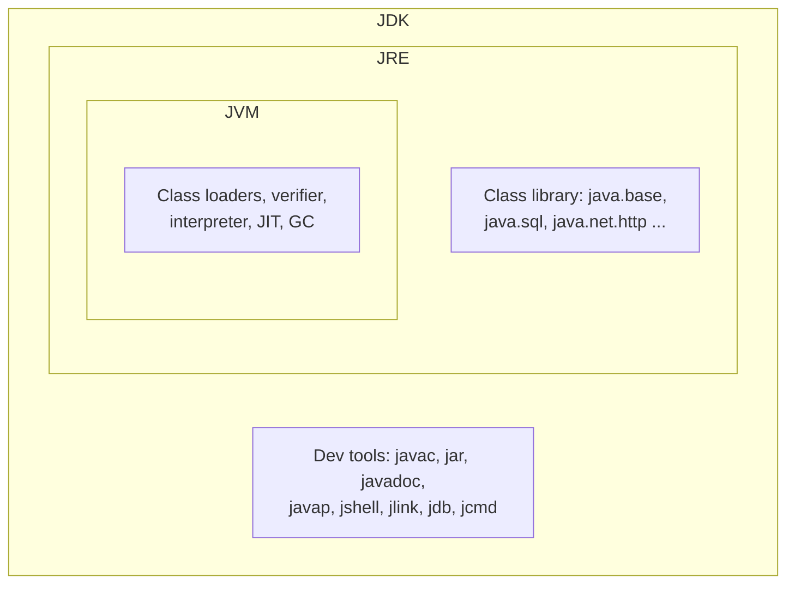
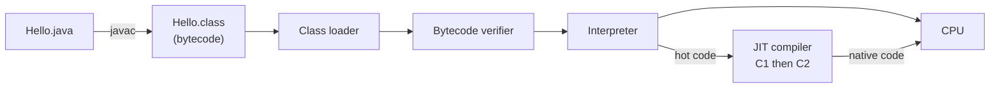
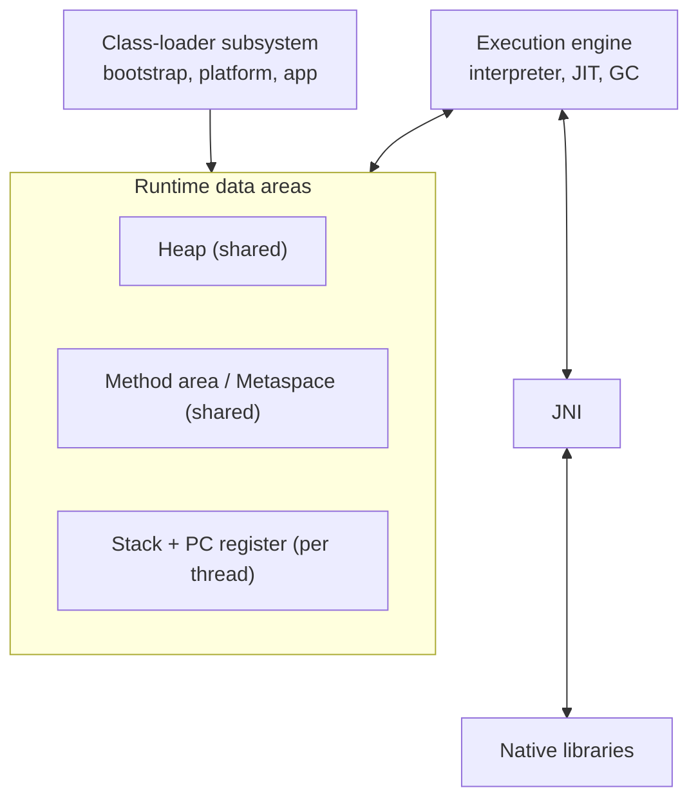

## In One Line
The **JVM** runs bytecode, the **JRE** is the JVM plus the standard class library needed to *run* Java programs, and the **JDK** is the JRE plus the developer tools (`javac`, `jar`, `jshell`, `javap`, ...) needed to *build* them: **JDK ⊃ JRE ⊃ JVM**.

## Mental Model
Think of **films on Blu-ray discs**.

- A film studio edits raw footage and **encodes** it onto a disc in one standard format.
- Sony, LG and Samsung all build **players** with completely different electronics, yet every player plays the same disc.
- A player alone is not enough to watch a film: you also need its codecs, subtitle fonts and remote. Player + everything it needs = the **home-theatre kit**.
- The **studio** has the editing suite and the encoder, and it also keeps a player around to test its own discs.

Mapping to Java:

| Analogy | Java |
|---|---|
| Raw footage / script | Your source code, `Hello.java` |
| The encoder | `javac`, the compiler |
| The disc (one standard format) | `Hello.class` — **bytecode** |
| The player (different hardware per brand) | The **JVM** — a different native build for Linux x64, Windows, macOS ARM... |
| Player + codecs + fonts | The **JRE** — JVM + class library (`java.lang`, `java.util`, ...) |
| The whole studio | The **JDK** — JRE + tools (`javac`, `jar`, `javadoc`, `jshell`, `javap`, `jlink`...) |

"Write once, run anywhere" = *burn the disc once, play it on any brand of player*. The **disc** is platform independent; the **player** is not.

## Concept
### The three layers
| | JVM | JRE | JDK |
|---|---|---|---|
| Full name | Java Virtual Machine | Java Runtime Environment | Java Development Kit |
| What it is | An abstract machine that loads, verifies and executes bytecode, and manages memory (GC) and threads | Everything needed to **run** a compiled Java program | Everything needed to **write, compile, package, debug and monitor** Java programs |
| Contains | Class loader, bytecode verifier, interpreter, JIT compilers, garbage collectors, runtime data areas (heap, stacks, metaspace) | JVM + Java SE class library (`java.base`, `java.sql`, `java.net.http`, ...) + config files (security, time-zone data) | JRE + tools: `javac`, `java`, `jar`, `javadoc`, `javap`, `jdb`, `jshell`, `jlink`, `jpackage`, `jdeps`, `jcmd`, `jstack`, `jmap`, `jstat`, `jconsole`, `jfr`, `keytool` |
| Who needs it | Nobody installs it on its own — it always comes inside a JRE/JDK | End users who only run apps (historically) | Developers, build servers, CI |
| Platform specific? | **Yes** — native code for each OS/CPU | Yes | Yes |

> [!INTERVIEW] "JDK = JRE + development tools. JRE = JVM + class libraries. The JVM is the part that actually executes bytecode. Bytecode is platform independent; the JVM is not."

### From source file to running program
1. **Write** `Hello.java` — human-readable source.
2. **Compile** — `javac Hello.java` produces `Hello.class`. A class file holds **bytecode** (instructions for the JVM, not for any real CPU), a **constant pool** (names, literals, method references) and metadata. Every class — including nested ones — gets its own file: `Outer.class`, `Outer$Inner.class`, `Outer$1.class` for an anonymous class.
3. **Launch** — `java Hello` starts a JVM process, which:
   - **Loads** `Hello.class` through the class-loader subsystem.
   - **Links** it: *verifies* the bytecode (type-safe, no stack overflow tricks, no jumping into the middle of an instruction), *prepares* static fields with default values, and *resolves* symbolic references lazily.
   - **Initializes** it: runs static initializers.
   - Calls `public static void main(String[] args)` on a thread named `main`.
4. **Execute** — the **interpreter** runs bytecode instruction by instruction while a profiler counts calls and loop iterations. **Hot** code is handed to the **JIT (Just-In-Time) compiler**, which turns it into optimized native machine code. The **garbage collector** reclaims unreachable objects in the background.
5. **Exit** — the JVM shuts down when the last non-daemon thread ends or someone calls `System.exit(status)`.

### Compiled or interpreted? Both.
- **Ahead of time:** `javac` compiles source to bytecode. It does very little optimization (constant folding, string-constant concatenation).
- **At run time:** the JVM interprets bytecode and JIT-compiles the hot parts.

HotSpot (the JVM inside OpenJDK) uses **tiered compilation** (default since Java 8):

| Tier | Who runs the code | Notes |
|---|---|---|
| 0 | Interpreter | Starts instantly, slow, collects profile data |
| 1–3 | **C1** ("client") compiler | Compiles quickly, light optimizations; tier 3 adds profiling |
| 4 | **C2** ("server") compiler | Slow to compile, aggressive optimizations using the profile: inlining, escape analysis, loop unrolling, dead-code elimination |

On this JDK 21 a method is queued for tier 3 after about 200 calls (`Tier3InvocationThreshold`) and for tier 4 after about 5000 (`Tier4InvocationThreshold`). If an optimistic assumption later turns out wrong (for example, a second subclass gets loaded and a call site is no longer monomorphic), the JVM **deoptimizes** the compiled code back to the interpreter. **OSR (On-Stack Replacement)** swaps a long-running loop to compiled code while it is still running.

Why not compile straight to machine code like C? Because bytecode + JIT gives **portability** (one artifact for every platform), **safety** (the verifier checks code before it runs) and often **better peak performance** — the JIT optimizes for the *actual* runtime behaviour and the *actual* CPU it finds, which an ahead-of-time compiler cannot know.

### Inside the JVM (overview)
- **Class-loader subsystem** — three built-in loaders with **parent delegation** (a loader asks its parent first):
  - *Bootstrap* — native code, loads core modules such as `java.base`; shows up as `null` in Java.
  - *Platform* (Java 9+, replaced the old *Extension* loader) — loads other Java SE modules such as `java.sql`.
  - *Application* (a.k.a. system) — loads your classes from the class path / module path.
- **Runtime data areas**
  - *Heap* — all objects and arrays; shared by all threads; managed by the GC. The string pool lives here (since Java 7).
  - *Method area* — per-class metadata (bytecode, constant pool, static fields). HotSpot implements it as **Metaspace** in native memory (since Java 8; before that it was *PermGen*).
  - *JVM stack* — one per thread; one **frame** per method call holding local variables and an operand stack.
  - *PC register* — one per thread; address of the current bytecode instruction.
  - *Native method stack* — one per thread, for native (C/C++) code.
- **Execution engine** — interpreter, JIT compilers (C1/C2), garbage collectors (G1 is the default since Java 9; also Serial, Parallel, ZGC, Shenandoah).
- **JNI (Java Native Interface)** and native libraries — the bridge to C/C++ code; the newer alternative is the Foreign Function & Memory API (final in Java 22).

Each of these gets its own lesson: [class loading](lesson:b02-jvm/01-class-loading), [memory areas](lesson:b02-jvm/02-memory-areas), [garbage collection](lesson:b02-jvm/03-garbage-collection).

### What exactly is platform independent?
- **Bytecode is.** The same `Hello.class` runs on every JVM of the same or newer version.
- **The JVM is not.** You install the JDK/JRE build for your OS and CPU.
- The *Java language* and *class-file format* are fixed by specifications, which is what makes this work.

Portability leaks you should know about: native code via JNI, hard-coded path separators (`\` vs `/`), line endings, and the default charset (UTF-8 by default only since Java 18, JEP 400 — before that it depended on the OS locale).

### The JVM is a specification, not one product
The **Java Virtual Machine Specification** defines the class-file format, the instruction set, and what each instruction must do. It does *not* dictate how GC or JIT work. Implementations:

| Implementation | Notes |
|---|---|
| **HotSpot** | The JVM in OpenJDK and Oracle JDK; by far the most common |
| **Eclipse OpenJ9** | IBM-originated; lower memory footprint |
| **GraalVM** | HotSpot with the Graal JIT (written in Java) plus `native-image`, which compiles an app ahead of time into a standalone native executable |
| **Azul Zing / Prime** | Commercial, pauseless C4 collector |

Android's ART is *not* a JVM: it runs DEX bytecode converted from class files. On the other side, Kotlin, Scala, Groovy and Clojure all compile to ordinary JVM bytecode, which is why they can use Java libraries.

### Class-file versions
Every class file records a **major version**: `major = Java feature version + 44`.

| Java | 8 | 11 | 17 | 21 | 25 |
|---|---|---|---|---|---|
| Major version | 52 | 55 | 61 | 65 | 69 |

A JVM runs class files of its own version **or older**. Running a newer class file on an older JVM fails at load time with `UnsupportedClassVersionError` ("compiled by a more recent version of the Java Runtime (class file version 65.0), this version of the Java Runtime only recognizes class file versions up to 61.0"). Fix: upgrade the runtime, or compile with `javac --release 17`. `--release` (Java 9+) is better than the old `-source`/`-target` pair because it also checks that you only use **APIs** that exist in that release.

### How the JDK distribution changed
| Version | Change |
|---|---|
| Java 8 and earlier | The JDK folder contained a `jre/` sub-folder; a separate JRE download existed; the class library was one big `rt.jar`; an *Extension* class loader read `jre/lib/ext` |
| Java 9 | **Module system (JPMS)**. `rt.jar` and `tools.jar` removed; the class library is stored in `lib/modules`. Extension mechanism removed (Platform loader instead). New tools: `jshell` (REPL), `jlink` (build a trimmed custom runtime with only the modules your app needs) |
| Java 10 | Six-month release cadence begins |
| Java 11 | No standalone JRE from Oracle/most vendors any more — ship a full JDK or a `jlink` image. Java Web Start and the browser plug-in removed. `java Hello.java` runs a single source file directly (JEP 330) |
| Java 16 | `jpackage` builds native installers (`.msi`, `.deb`, `.dmg`) |
| Java 22 | The source launcher can run multi-file programs (JEP 458) |
| Java 25 | *Compact source files and instance main methods* final (JEP 512): `void main() { ... }` with no class declaration. Preview in Java 21–24 |

**LTS (long-term support) releases:** 8, 11, 17, 21, 25 — every two years since 17. Many vendors ship free OpenJDK builds: Eclipse Temurin (Adoptium), Amazon Corretto, Azul Zulu, Microsoft Build of OpenJDK, Red Hat, Oracle's own OpenJDK builds. They are built from the same OpenJDK source; they differ in support, patches and licensing.

### The `main` method — the JVM's front door
```java
public static void main(String[] args)
```
| Keyword | Why |
|---|---|
| `public` | The launcher calls it from outside the class |
| `static` | No object exists yet, so the JVM must be able to call it without `new` |
| `void` | The exit status is reported with `System.exit(int)`, not a return value |
| `String[] args` | Command-line arguments. Never `null` — an empty array when there are none |

Legal variations: `String... args`, `String args[]`, `final String[] args`, modifier order `static public`, and even `final` on the method. You can **overload** `main`, but the launcher only calls the `String[]` version. Without `--enable-preview`, Java 17–24 launchers reject a non-static or non-void `main` with a clear error (shown in Traps).

### Environment variables
- `JAVA_HOME` — the JDK root folder; Maven, Gradle and IDEs read it.
- `PATH` — must contain `$JAVA_HOME/bin` so that `java` and `javac` are found.
- `CLASSPATH` — where the application loader looks for classes; defaults to the current directory. Prefer the `-cp` / `--class-path` option per command over a global variable.

### Everyday JDK tools
| Tool | Use |
|---|---|
| `javac` | Compile `.java` → `.class` |
| `java` | Launch the JVM (class, `-jar app.jar`, or a `.java` source file) |
| `jar` | Package classes into a JAR (a ZIP with a manifest) |
| `javadoc` | Generate HTML API docs from `/** */` comments |
| `javap` | Disassemble a class file (`-c` bytecode, `-v` everything, `-p` private members) |
| `jshell` | Interactive REPL (Java 9+) |
| `jdb` | Command-line debugger |
| `jlink` / `jpackage` | Custom runtime image / native installer |
| `jdeps` | Show package and module dependencies |
| `jcmd`, `jstack`, `jmap`, `jstat` | Inspect a running JVM: thread dumps, heap dumps, GC statistics |
| `jconsole`, `jfr` (Flight Recorder) | Monitoring and low-overhead profiling |
| `keytool` | Manage keys and certificates |

On Windows there is also `javaw`: the same launcher as `java` but without a console window (for GUI apps).

## Diagram

Each layer contains the one inside it: JDK ⊃ JRE ⊃ JVM.


`javac` runs once on your machine; everything to the right of the class file happens inside the JVM every time the program runs, on whatever platform it runs on.


The JVM's three big parts: loaders bring classes in, the data areas hold them and their objects, the execution engine runs the code.

## Code
**1. Ask the running JVM about itself.** Save as `PlatformInfo.java`, then `javac PlatformInfo.java` and `java PlatformInfo`.
```java
public class PlatformInfo {
    public static void main(String[] args) {
        // 1. Which Java is running this program?
        System.out.println("java.version       = " + System.getProperty("java.version"));
        System.out.println("java.vm.name       = " + System.getProperty("java.vm.name"));
        System.out.println("java.vendor        = " + System.getProperty("java.vendor"));
        System.out.println("feature release    = " + Runtime.version().feature());
        System.out.println("class file version = " + System.getProperty("java.class.version"));
        System.out.println("os / arch          = " + System.getProperty("os.name")
                + " / " + System.getProperty("os.arch"));

        // 2. Which class loader loaded which class?
        System.out.println("String        -> " + String.class.getClassLoader());
        System.out.println("java.sql.Date -> " + java.sql.Date.class.getClassLoader().getName());
        ClassLoader app = PlatformInfo.class.getClassLoader();
        System.out.println("PlatformInfo  -> " + app.getName()
                + ", parent = " + app.getParent().getName()
                + ", grandparent = " + app.getParent().getParent());

        // 3. What the JVM gives this program
        Runtime rt = Runtime.getRuntime();
        System.out.println("CPUs seen by JVM   = " + rt.availableProcessors());
        System.out.println("max heap (MB)      = " + rt.maxMemory() / (1024 * 1024));
    }
}
```
```output
java.version       = 21.0.10
java.vm.name       = OpenJDK 64-Bit Server VM
java.vendor        = Ubuntu
feature release    = 21
class file version = 65.0
os / arch          = Linux / amd64
String        -> null
java.sql.Date -> platform
PlatformInfo  -> app, parent = platform, grandparent = null
CPUs seen by JVM   = 4
max heap (MB)      = 3422
```
The version, vendor, OS, CPU count and heap lines depend on the machine and JDK you run it on. The class-loader lines are the same on every Java 9+ JVM (when compiled and launched as shown).

**2. Look at the bytecode `javac` produced.**
```java
public class Add {
    static int add(int a, int b) {
        return a + b;
    }

    public static void main(String[] args) {
        System.out.println(add(2, 3));
    }
}
```
```output
5
```
Now disassemble it with `javap -c Add`:
```output
Compiled from "Add.java"
public class Add {
  public Add();
    Code:
       0: aload_0
       1: invokespecial #1                  // Method java/lang/Object."<init>":()V
       4: return

  static int add(int, int);
    Code:
       0: iload_0
       1: iload_1
       2: iadd
       3: ireturn

  public static void main(java.lang.String[]);
    Code:
       0: getstatic     #7                  // Field java/lang/System.out:Ljava/io/PrintStream;
       3: iconst_2
       4: iconst_3
       5: invokestatic  #13                 // Method add:(II)I
       8: invokevirtual #19                 // Method java/io/PrintStream.println:(I)V
      11: return
}
```
And check the class-file version for different targets:
```text
$ javap -v Add.class | grep major                    (javac with no options, JDK 21)
  major version: 65
$ javac --release 17 -d r17 Add.java && javap -v r17/Add.class | grep major
  major version: 61
$ javac --release 8 -d r8 Add.java && javap -v r8/Add.class | grep major
  major version: 52
```
(`--release 8` also prints warnings that source/target 8 is obsolete and will be removed in a future release.)

**3. Watch the JIT compile a hot method.**
```java
public class Hot {
    static int square(int x) {
        return x * x;
    }

    public static void main(String[] args) {
        long sum = 0;
        for (int i = 0; i < 100_000; i++) {
            sum += square(i);          // called 100,000 times -> "hot"
        }
        System.out.println(sum);
    }
}
```
```output
18103503627376
```
Run it as `java -XX:+PrintCompilation Hot | grep Hot::` to see the JIT at work (the first column is milliseconds since start and differs on every run):
```text
 63    8       3       Hot::square (4 bytes)
 64    9       4       Hot::square (4 bytes)
 64    8       3       Hot::square (4 bytes)   made not entrant
 67   10 %     3       Hot::main @ 4 (32 bytes)
 68   11       3       Hot::main (32 bytes)
```

## Walkthrough
**PlatformInfo**
- `System.getProperty("java.version")` and friends read **system properties** the JVM sets at start-up. `java.vm.name` shows this is HotSpot ("OpenJDK 64-Bit Server VM"); `java.vendor` shows who *built* this OpenJDK (here Ubuntu's package; on Temurin it would say "Eclipse Adoptium").
- `Runtime.version().feature()` (Java 10+) returns the feature release number, `21`. It is the clean way to check the version in code instead of parsing strings.
- `java.class.version` = `65.0` — the newest class-file version this JVM understands: 21 + 44 = 65.
- `String.class.getClassLoader()` prints **`null`**: `String` is in `java.base`, loaded by the **bootstrap** loader, which is native code and has no Java object to return.
- `java.sql.Date` lives in the `java.sql` module, loaded by the **platform** loader; `getName()` (Java 9+) returns `"platform"`.
- `PlatformInfo` itself is loaded by the **application** loader (`"app"`). Walking `getParent()` shows the delegation chain: app → platform → bootstrap (`null`).
- `availableProcessors()` and `maxMemory()` show what the JVM will use. The default max heap is **¼ of physical RAM** (container-aware since Java 10); change it with `-Xmx`.

**Add + javap**
- `public Add();` — you never wrote a constructor, yet the bytecode has one. The compiler adds the **default constructor**, whose body calls `super()` — the `invokespecial Object."<init>"` instruction (`<init>` is the JVM's name for a constructor).
- The JVM is a **stack machine**: `iload_0` and `iload_1` push the two `int` parameters (local-variable slots 0 and 1 of a static method) onto the operand stack, `iadd` pops both and pushes the sum, `ireturn` returns it. The `i` prefix means *int*; there are `l`, `f`, `d`, `a` (reference) versions too.
- In `main`: `getstatic` pushes `System.out`, `iconst_2`/`iconst_3` push the constants, `invokestatic` calls `add` (static call — no object), `invokevirtual` calls `println(int)` on the `PrintStream` (virtual call — dynamic dispatch). `#7`, `#13`, `#19` are indexes into the **constant pool**. `(II)I` is the method **descriptor**: two ints in, int out.
- The `major version` lines show `--release` in action: the same source becomes a Java 21 (65), 17 (61) or 8 (52) class file.

**Hot + PrintCompilation**
- Columns: time (ms), compile id, flags (`%` = OSR compilation), **tier**, method, bytecode size.
- `square` is first compiled at **tier 3** (C1 with profiling), then at **tier 4** (C2). The old tier-3 code is then marked **"made not entrant"** — new calls go to the better C2 version.
- `Hot::main @ 4` with `%` is an **on-stack replacement**: `main` is only called once, but its loop is hot, so the JVM compiles the loop and jumps into the compiled version *while `main` is still running*.
- The sum is deterministic: Σ i² for i < 100 000 = 18 103 503 627 376 (fits in `long`; the loop uses a `long` accumulator, while `square` returns `int`, which is fine because 99 999² < 2³¹ − 1).

## Traps
- **"The JVM is platform independent."** Wrong. *Bytecode* is platform independent; the JVM is native software built separately for each OS/CPU.
- **`java Hello.class`** — the launcher wants a **class name**, not a file name:
  ```output
  Error: Could not find or load main class Add.class
  Caused by: java.lang.ClassNotFoundException: Add.class
  ```
- **Running a packaged class from inside its folder.** For `package com.example;` you must run `java -cp out com.example.Hello` from the class-path root. `cd out/com/example && java Hello` fails:
  ```output
  Error: Could not find or load main class Hello
  Caused by: java.lang.NoClassDefFoundError: Hello (wrong name: com/example/Hello)
  ```
- **Wrong `main` signature compiles fine but fails at launch** (Java 17–24 without preview features):
  ```output
  Error: Main method not found in class NoMain, please define the main method as:
     public static void main(String[] args)
  or a JavaFX application class must extend javafx.application.Application
  ```
  A non-static `main` gives "Main method is not static in class NoStatic"; an `int main` gives "Main method must return a value of type void".
- **`UnsupportedClassVersionError`** is a *runtime* error, not a compile error — the class was built by a newer JDK than the one running it. Compile with `--release` for the oldest Java you must support.
- **`-source 8 -target 8` is not enough** on a newer JDK: it still lets you call methods that do not exist in Java 8 (for example `String.isBlank()`), and the program then fails at run time with `NoSuchMethodError`. `--release 8` rejects them at compile time.
- **The source launcher uses its own class loader.** Run `PlatformInfo` as `java PlatformInfo.java` and the `PlatformInfo ->` line changes to `null, parent = app, ...` because the class is compiled in memory and loaded by an unnamed in-memory loader whose parent is the app loader. Code that inspects class loaders behaves differently in source-launch mode.
- **`-Xmx` is not the process memory limit.** The JVM also uses Metaspace, thread stacks, the JIT code cache, GC structures and direct buffers — the process can be noticeably bigger than the heap. This matters in containers.
- **Micro-benchmarks lie during warm-up.** The first iterations are interpreted; timing a loop with `System.nanoTime()` mostly measures JIT warm-up. Use JMH (Java Microbenchmark Harness).

> [!WARNING] "Java is slow because it is interpreted" is outdated: hot code runs as JIT-compiled native code, and C2 can beat static compilers because it optimizes for the observed runtime profile. Java's real costs are start-up time and warm-up, which is what CDS, `jlink` and GraalVM `native-image` attack.

## Tips & Tricks
- **Nesting mnemonic — "Kit ⊃ Runtime ⊃ Machine":** Development **K**it contains the **R**untime, which contains the virtual **M**achine. Develop needs everything; Run needs the middle; Machine is the core.
- **Version trick:** class-file major version = Java version + 44 (52 → 8, 61 → 17, 65 → 21).
- **Settle bytecode arguments with `javap -c`.** Whether it is `i++` vs `++i`, string concatenation, or autoboxing, the disassembly shows what really happens.
- **Quick experiments:** `jshell` for one-liners; `java Snippet.java` to run a single file without a separate `javac` step (Java 11+).
- **Check your setup:** `java -version`, `javac -version`, `echo $JAVA_HOME`. Add `-XshowSettings:properties -version` to print every system property.
- **Bootstrap = `null`:** if `getClassLoader()` returns `null`, the class came from the bootstrap loader (core JDK classes).
- **Compile for the oldest target you support:** `javac --release 17` (Maven: `<maven.compiler.release>17</maven.compiler.release>`).

## Interview Q&A
### [Basic] What is the difference between JDK, JRE and JVM?
The **JVM** is the virtual machine that loads, verifies and executes bytecode and manages memory and threads. The **JRE** is the JVM plus the Java SE class library and supporting files — everything you need to *run* a Java program. The **JDK** is the JRE plus development tools such as `javac`, `jar`, `javadoc`, `javap`, `jshell` and the monitoring tools — everything you need to *develop* one. So JDK ⊃ JRE ⊃ JVM. Since Java 11 vendors no longer ship a separate JRE; you install a JDK, or bundle a trimmed runtime built with `jlink`.

**Follow-up:** *Can you compile Java with only a JRE?* — No. The JRE has no `javac` (the compiler lives in the JDK's `jdk.compiler` module).

### [Basic] Is Java platform independent? Is the JVM?
Java *programs* are platform independent at the **bytecode** level: `javac` produces `.class` files that run unchanged on any JVM of the same or a newer version, on any OS or CPU. The **JVM itself is platform dependent** — it is native software with a separate build for Windows x64, Linux ARM, macOS and so on. The JVM is the adapter that makes one bytecode format run everywhere.

**Follow-up:** *Can a Java program still be non-portable?* — Yes: JNI/native libraries, hard-coded file separators, OS-specific commands via `ProcessBuilder`, or relying on the default charset before Java 18.

### [Basic] What is bytecode, and why does Java use it instead of compiling to machine code?
Bytecode is the instruction set of the JVM — compact, stack-based instructions (`iload`, `iadd`, `invokevirtual`...) stored in `.class` files together with a constant pool. Java uses it because (1) one compiled artifact runs on every platform; (2) the verifier can check it for type safety before running it, which is a security boundary; and (3) the JIT can compile it to machine code *at run time* using real profiling data and the exact CPU features available, often reaching better peak performance than static compilation.

**Follow-up:** *How do you see bytecode?* — `javap -c ClassName` (add `-v` for the constant pool and version, `-p` for private members).

### [Basic] Why is `main` declared `public static void main(String[] args)`?
`public` so the launcher, which is outside the class, can call it. `static` because no instance exists when the program starts, so the JVM must call it without creating an object. `void` because the process exit code is set with `System.exit(int)`, not by returning a value. `String[] args` receives the command-line arguments; it is an empty array — never `null` — when there are none. `String... args`, `String args[]` and a `final` parameter are all accepted.

**Follow-up:** *Can you overload `main`?* — Yes, but the launcher only calls `main(String[])`; the others are ordinary static methods. (From Java 25, the launcher also accepts an instance `void main()` — a preview feature in 21–24.)

### [Intermediate] Is Java compiled or interpreted? Explain the JIT.
Both. `javac` compiles source to bytecode ahead of time. At run time the JVM starts by **interpreting** bytecode and profiling it. Methods and loops that run often become **hot** and are compiled to native code by the **JIT compiler**. HotSpot uses tiered compilation: tier 0 is the interpreter, tiers 1–3 use the fast **C1** compiler (tier 3 with profiling), and tier 4 uses the optimizing **C2** compiler, which inlines, removes bounds checks, does escape analysis and more, based on the profile. If an assumption breaks — say a new subclass makes a call site polymorphic — the JVM **deoptimizes** back to the interpreter and may recompile later.

**Follow-up:** *What is OSR?* — On-Stack Replacement: compiling a hot loop inside a method that is still executing (like `main`) and switching to the compiled code mid-loop. `-XX:+PrintCompilation` marks it with `%`.

### [Intermediate] What happens, step by step, when you run `java Hello`?
1. The launcher starts a JVM process, reads options (`-cp`, `-Xmx`...) and creates the runtime (heap, bootstrap loader, system threads such as GC and JIT compiler threads).
2. Core classes from `java.base` are loaded by the bootstrap loader (much of this comes from the CDS archive for fast start-up).
3. The application class loader finds `Hello.class` on the class path (delegating to platform and bootstrap loaders first).
4. The class is **linked** — verified, prepared (static fields get default values) — and **initialized** (static initializers run).
5. The launcher checks for `public static void main(String[])` and calls it on the `main` thread.
6. Bytecode is interpreted; hot code is JIT-compiled; GC runs as needed.
7. When the last non-daemon thread ends (or `System.exit` is called), shutdown hooks run and the JVM exits.

**Follow-up:** *When is a class initialized?* — Lazily, on first active use: `new`, a static method call, or access to a non-constant static field — not merely because it is referenced.

### [Intermediate] What class loaders does Java have, and what is parent delegation?
Three built-in loaders: **bootstrap** (native, loads core modules like `java.base`, appears as `null`), **platform** (other Java SE/JDK modules such as `java.sql`; called the *extension* loader before Java 9), and **application/system** (your class path and module path). With **parent delegation**, a loader first asks its parent to load a class and only searches itself if the parent cannot. This guarantees that core classes like `java.lang.String` always come from the bootstrap loader, so an application cannot replace them with a fake `String`.

**Follow-up:** *Can the same class be loaded twice?* — Yes, by two different loaders. A class's runtime identity is (class name + defining loader), so the two copies are different types — the classic cause of "`ClassCastException`: X cannot be cast to X" in app servers.

### [Intermediate] What is `UnsupportedClassVersionError` and how do you fix it?
It is thrown when a JVM tries to load a class file whose major version is newer than it supports — for example, a class compiled by JDK 21 (major 65) running on Java 17 (max 61). Fix it by running on a newer JVM, or by compiling for the older target with `javac --release 17` (in Maven, `maven.compiler.release`). `--release` is preferred over `-source`/`-target` because it also restricts you to the APIs that exist in that version.

**Follow-up:** *How do you check which version a class file targets?* — `javap -v MyClass.class | grep major` (major = Java version + 44).

### [Advanced] What changed in the JDK's structure in Java 9 and Java 11?
Java 9 introduced the **module system**: the monolithic `rt.jar` and `tools.jar` were replaced by modules (`java.base`, `java.sql`, `jdk.compiler`...) stored in the `lib/modules` image, the extension mechanism was replaced by the platform class loader, and new tools arrived — `jshell` and `jlink`, which builds a **custom runtime image** containing only the modules an application needs. Java 11 stopped the separate JRE download from Oracle and most vendors, removed Java Web Start and the browser plug-in, and added single-file source launch (`java Hello.java`). Today you either install a full JDK or ship your app with a `jlink`-generated runtime.

**Follow-up:** *What is the benefit of a `jlink` image?* — A smaller, self-contained runtime (tens of MB instead of hundreds), no dependency on a system-wide Java, and a smaller attack surface.

### [Advanced] Is the JVM one product? Name some implementations and what GraalVM native image does.
No — the JVM is a **specification** (class-file format, instruction set, semantics). HotSpot is the reference implementation used by OpenJDK and Oracle JDK; alternatives include Eclipse OpenJ9, Azul Prime and GraalVM. GraalVM can run as a normal JVM with the Graal JIT, and its `native-image` tool compiles an application **ahead of time** into a standalone native executable with a small embedded runtime (SubstrateVM): millisecond start-up and a small memory footprint, at the cost of a closed-world assumption (reflection, dynamic class loading and proxies must be declared at build time) and usually lower peak throughput than a warmed-up JIT.

**Follow-up:** *Why would you still pick a regular JVM?* — Long-running services benefit from JIT profile-guided optimization, full dynamic features, and simpler builds.

## Quiz
### Which component contains the `javac` compiler?
- [ ] JVM
- [ ] JRE
- [x] JDK
- [ ] The class library in `java.base`
> `javac` is a development tool, so it ships only in the JDK (module `jdk.compiler`). A JRE can run class files but cannot compile source. The JVM only executes bytecode.

### What does this print?
```java
public class Q {
    public static void main(String[] args) {
        System.out.println(String.class.getClassLoader());
    }
}
```
- [ ] `app`
- [ ] `jdk.internal.loader.ClassLoaders$AppClassLoader@...`
- [x] `null`
- [ ] It throws `NullPointerException`
> `String` is loaded by the bootstrap loader, which is implemented in native code and is represented by `null`. It would only throw if you called a method on the result (for example `.getName()`); printing `null` is fine.

### Which statement is TRUE?
- [ ] The JVM is platform independent, so one JVM binary runs on every OS
- [x] Bytecode is platform independent; each OS/CPU needs its own JVM build
- [ ] `javac` produces native machine code for the current CPU
- [ ] The JRE contains `javac` but not the JVM
> Portability comes from the standard bytecode format. The JVM is the platform-specific part that executes that bytecode. `javac` produces bytecode, not machine code.

### A JAR built with JDK 21 is run on a Java 17 runtime. What happens?
- [ ] It runs, because Java is backward compatible
- [ ] `javac` reports a compile error
- [x] `UnsupportedClassVersionError` when the class is loaded
- [ ] It runs, but the JIT is disabled
> Java 17 understands class files up to major version 61; JDK 21 writes 65 by default. Backward compatibility means *old* class files run on *new* JVMs, not the other way round. Compiling with `--release 17` fixes it.

### Which `main` declaration is NOT accepted by a Java 17 launcher as the program entry point?
- [ ] `static public void main(String... args)`
- [ ] `public static final void main(final String[] args)`
- [x] `public static int main(String[] args)`
- [ ] `public static void main(String args[])`
> Modifier order, varargs, C-style array brackets and `final` are all legal. The return type must be `void`; the launcher reports "Main method must return a value of type void". It still *compiles* — the check happens at launch.

### Why does HotSpot interpret code first instead of JIT-compiling everything at start-up?
- [ ] Because the JIT can only compile code after the garbage collector has run
- [x] Compiling everything would slow start-up, and profiling first lets the JIT optimize only hot code based on real behaviour
- [ ] Because bytecode cannot be compiled until the class is unloaded
- [ ] Interpreted code is faster than compiled code
> Most code runs only a few times, so compiling it would waste time. Interpreting and profiling first lets C1/C2 spend effort only on hot methods and use the observed types and branches for optimizations. Interpreted code is slower, not faster.

### You run `java Hello.class` in the folder containing `Hello.class`. What happens?
- [ ] The program runs normally
- [x] Error: Could not find or load main class Hello.class
- [ ] Compile error
- [ ] `UnsupportedClassVersionError`
> The launcher expects a class name (`java Hello`) and treats `Hello.class` as a class named `class` in package `Hello`, which does not exist — `ClassNotFoundException: Hello.class`.

## Takeaways
- JDK ⊃ JRE ⊃ JVM: the JVM executes bytecode, the JRE adds the class library needed to run programs, the JDK adds the tools (`javac`, `jar`, `javap`, `jshell`, `jlink`...) needed to build them.
- Bytecode is platform independent; the JVM is platform specific — that pairing is "write once, run anywhere".
- Java is compiled (source → bytecode by `javac`) *and* interpreted/JIT-compiled (bytecode → native code at run time); HotSpot uses tiered C1/C2 compilation with deoptimization and OSR.
- Class loading uses bootstrap (`null`), platform and application loaders with parent delegation, so core classes cannot be replaced.
- Class-file major version = Java version + 44; running newer bytecode on an older JVM throws `UnsupportedClassVersionError` — compile with `--release N`.
- Since Java 9 the JDK is modular (no `rt.jar`, `jlink` custom runtimes); since Java 11 there is no separate JRE download and `java File.java` runs source directly.
- `main` must be `public static void main(String[] args)` (until instance main methods, final in Java 25); a wrong signature compiles but fails at launch.
