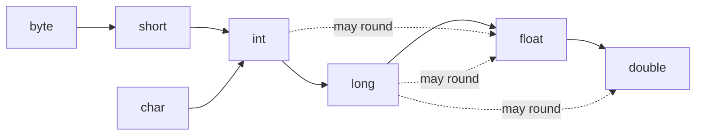
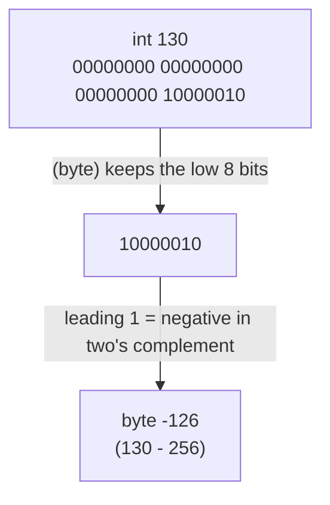
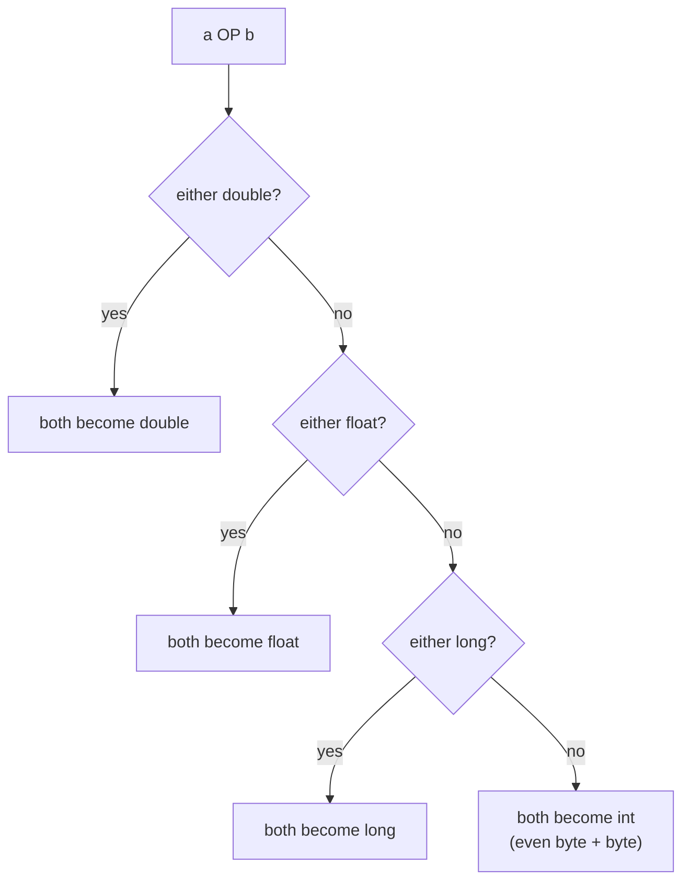

## In One Line
Java has **8 primitive types** that hold raw values of a fixed size and **reference types** that point to objects; converting between types is automatic when nothing can be lost (**widening**) and needs an explicit **cast** when something might be (**narrowing**) — and a cast never checks for overflow, it just keeps the bits that fit.

## Mental Model
Picture a row of **measuring cups** of fixed sizes: a 1-unit cup (`byte`), 2-unit (`short`, `char`), 4-unit (`int`, `float`) and 8-unit (`long`, `double`).

- Pouring a small cup into a bigger cup (**widening**) never spills, so Java does it for you silently: `long l = someInt;`.
- Pouring a big cup into a smaller one (**narrowing**) may spill. Java refuses unless you say "I know what I'm doing" with a cast: `byte b = (byte) someInt;`. Whatever does not fit is simply **thrown away** — Java keeps the low bits and drops the high bits, no error.
- `float` and `double` are **jugs with printed scale marks**: they can hold enormous volumes, but only read to a limited number of marks. Pour a precise `int` into a `float` jug and you get the nearest mark, not the exact amount — that is why `int → float` is "widening" yet can lose precision.
- A **reference** is not a cup at all; it is a **ticket with an address** of a box stored elsewhere (on the heap). Casting a reference never changes the box — it only changes which label you are allowed to read it through.

## Concept
### Two families of types
| | Primitive types | Reference types |
|---|---|---|
| Which | `byte`, `short`, `int`, `long`, `float`, `double`, `char`, `boolean` | Classes, interfaces, arrays, enums, records (`String`, `Integer`, `int[]`, `List<String>`...) |
| Variable holds | The value itself | A reference (pointer) to an object on the heap, or `null` |
| Default (fields/array elements) | `0`, `0.0`, `'\u0000'`, `false` | `null` |
| `==` compares | Values | Identity (same object?) |
| Can be `null`? | No | Yes |
| In generics / collections | Not allowed (`List<int>` is illegal) | Yes — use the wrapper (`List<Integer>`) |
| Methods | None | Yes |

Primitives exist for **speed and memory**: an `int` is 4 bytes stored directly in the variable, while an `Integer` object is a header plus the value (16 bytes on a typical 64-bit JVM) plus a reference to it. This is also why Java is not a "pure" object-oriented language. Wrappers and autoboxing are covered in [Wrapper Classes](lesson:a02-core/15-wrapper-classes).

### The 8 primitive types
| Type | Size | Range / precision | Default | Wrapper | Literal |
|---|---|---|---|---|---|
| `byte` | 8 bits | −128 to 127 | `0` | `Byte` | `(byte) 10`, or a constant that fits: `byte b = 10;` |
| `short` | 16 bits | −32 768 to 32 767 | `0` | `Short` | `short s = 1000;` |
| `int` | 32 bits | −2³¹ to 2³¹−1 (about ±2.1 billion) | `0` | `Integer` | `42`, `0x2A`, `052`, `0b101010`, `1_000_000` |
| `long` | 64 bits | −2⁶³ to 2⁶³−1 (about ±9.2 × 10¹⁸) | `0L` | `Long` | `42L` (always capital `L`) |
| `float` | 32 bits | IEEE 754, ~6–7 significant decimal digits, max ≈ 3.4 × 10³⁸ | `0.0f` | `Float` | `3.14f` |
| `double` | 64 bits | IEEE 754, ~15–16 significant digits, max ≈ 1.8 × 10³⁰⁸ | `0.0d` | `Double` | `3.14`, `3.14d`, `1e-9` |
| `char` | 16 bits | **unsigned** 0 to 65 535 — one UTF-16 code unit | `'\u0000'` | `Character` | `'A'`, `'\u0041'`, `'\n'`, `65` |
| `boolean` | not specified | `true` / `false` | `false` | `Boolean` | `true` |

Things interviewers probe:
- **All integer types are signed except `char`.** Java has no `unsigned int`; use `long`, or the helpers `Integer.toUnsignedString`, `Integer.divideUnsigned`, `Byte.toUnsignedInt`.
- **Sizes are fixed on every platform** (unlike C, where `int` can be 16 or 32 bits). This is part of what makes bytecode portable.
- **`boolean`'s size is not defined by the language.** It carries one bit of information. The JVM has no boolean instructions: in HotSpot a `boolean` field or array element takes 1 byte, and a local `boolean` uses a 32-bit `int` slot.
- **`char` is a UTF-16 code unit, not a "character".** Characters outside the Basic Multilingual Plane (most emoji) need two `char`s — a *surrogate pair*: `"😀".length()` is `2`, `codePointCount` is `1`.
- **Integer literals are `int` by default**, floating-point literals are `double` by default. Hence `long big = 9000000000;` fails ("integer number too large") and `float price = 9.99;` fails ("possible lossy conversion from double to float").
- **Literal syntax:** hex `0x`, **octal leading `0`** (`010` is 8!), binary `0b` (Java 7), underscores between digits (Java 7) — not at the start/end, not next to `.`, `L`, `f` or `0x`.

### Default values and definite assignment
Fields and array elements are always initialized to their default (`0`, `false`, `'\u0000'`, `null`). **Local variables are not** — the compiler refuses to read one that might not have been assigned: `error: variable local might not have been initialized`. This rule is called *definite assignment*.

### The seven kinds of conversion
| Conversion | Example | Needs a cast? | Can fail? |
|---|---|---|---|
| Widening primitive | `long l = 5;` | No | Never throws; `int/long → float`, `long → double` can round |
| Narrowing primitive | `byte b = (byte) 300;` | Yes (except small constants) | Never throws; silently loses bits |
| Widening reference (upcast) | `Animal a = new Dog();` | No | Never |
| Narrowing reference (downcast) | `Dog d = (Dog) a;` | Yes | `ClassCastException` at run time |
| Boxing | `Integer i = 5;` | No | Never |
| Unboxing | `int x = i;` | No | `NullPointerException` if `i` is `null` |
| String conversion | `"n=" + 5` | No | Never |

### Widening primitive conversions
```text
byte → short → int → long → float → double
               ↑
             char
```
Any path along the arrows is implicit. Note what is **missing**: `char ↔ byte/short` is never implicit in either direction, because `char` is unsigned (0..65 535) and `short` is signed (−32 768..32 767) — neither fits in the other.

"Widening" is about **range**, not exactness. `float` has only 24 bits of precision and `double` 53, so `int → float`, `long → float` and `long → double` may round: `float f = 123_456_789;` stores `1.23456792E8`.

### Narrowing primitive conversions
**Between integer types — keep the low bits.** `(byte) 130`: 130 is `0000…1000_0010` in binary. A `byte` keeps only the last 8 bits, `1000_0010`. In two's complement, a leading 1 means negative: that pattern is 130 − 256 = **−126**. Same rule: `(byte) 300` = 300 − 256 = 44; `(short) 40000` = 40000 − 65536 = −25536; `(char) -1` = 65 535.

**Floating point → integer type** (JLS 5.1.3):
1. `NaN` becomes `0`.
2. Otherwise the value is **rounded toward zero** (truncated): `(int) 3.99 = 3`, `(int) -3.99 = -3`.
3. If it does not fit in `int`/`long`, it is **clamped** to `MIN_VALUE`/`MAX_VALUE` — no wrap-around: `(int) 1e20 = 2147483647`.
4. For `byte`, `short`, `char`: first convert to `int` as above, then narrow the `int` by keeping low bits: `(byte) 300.7` → `300` → `44`.

To round instead of truncate use `Math.round` (half-up: `round(-3.5) = -3`, `round(3.5) = 4`), `Math.floor`, `Math.ceil`, or `Math.rint` (half-even).

**Compile-time constant exception.** An assignment may narrow **without** a cast if the right side is a *constant expression* of type `byte`, `short`, `char` or `int`, the target is `byte`, `short` or `char`, and the value fits: `byte b = 100;`, `char c = 65;`, `final int K = 50; byte x = K;` all compile. `int n = 50; byte y = n;` does not — `n` is not a constant. (This exception applies to assignments only, not to method arguments: `takesByte(10)` does not compile.)

### Numeric promotion — why `byte + byte` is an `int`
Before arithmetic, Java promotes operands (JLS 5.6):
- **Unary promotion** (`+x`, `-x`, `~x`, array index, shift operands): `byte`, `short`, `char` → `int`.
- **Binary promotion** (`+ - * / % < <= == & | ^ ?:`...): if either operand is `double` → both `double`; else if either is `float` → `float`; else if either is `long` → `long`; **else both become `int`**.

So `byte a = 10, b = 20; byte sum = a + b;` fails: `a + b` is an `int`. But **compound assignment and `++`/`--` hide a cast**: `a += 5` means `a = (byte) (a + 5)`, so it compiles — and can silently overflow (`byte x = 127; x += 1;` gives −128).

Promotion also explains `'a' + 'b'` = `195` (two chars → int addition) while `"" + 'a' + 'b'` = `"ab"` (string concatenation, left to right).

### Integer overflow is silent
`int` and `long` arithmetic wraps around in two's complement without any error: `Integer.MAX_VALUE + 1 == Integer.MIN_VALUE`. Classic traps:
- `long ms = 1_000_000 * 1_000_000;` — both operands are `int`, so the multiplication overflows **before** the result is widened to `long`. Write `1_000_000L * 1_000_000`.
- `Math.abs(Integer.MIN_VALUE)` is still negative — +2³¹ does not exist in `int`. (Also `Integer.MIN_VALUE / -1 == Integer.MIN_VALUE`.)
- `(low + high) / 2` in binary search can overflow; use `low + (high - low) / 2` or `(low + high) >>> 1`.

When overflow must be detected, use `Math.addExact`, `subtractExact`, `multiplyExact`, `toIntExact`, `incrementExact` (Java 8) and `absExact` (Java 15): they throw `ArithmeticException("integer overflow")`. For arbitrary size use `BigInteger`.

### Floating point is binary
`float` and `double` follow IEEE 754: sign, exponent, and a binary fraction. Most decimal fractions (0.1, 0.2, 0.3) have **no exact binary representation**, just as 1/3 has none in decimal. Consequences:
- `0.1 + 0.2` prints `0.30000000000000004`, and `0.1 + 0.2 == 0.3` is `false`. Compare with a tolerance: `Math.abs(a - b) < 1e-9`.
- **Never use `double` for money.** Use `BigDecimal` built from a **String** (`new BigDecimal("0.1")`) or `BigDecimal.valueOf(0.1)`. `new BigDecimal(0.1)` captures the binary error exactly: `0.1000000000000000055511151231257827021181583404541015625`. Or store amounts as `long` cents.
- Division by zero does **not** throw for floating point: `1 / 0.0 = Infinity`, `-1 / 0.0 = -Infinity`, `0.0 / 0.0 = NaN`. Integer division by zero throws `ArithmeticException: / by zero`.
- `NaN` is not equal to anything, **including itself**: `nan == nan` is `false`; use `Double.isNaN(x)`. `0.0 == -0.0` is `true`, but `Double.valueOf(0.0).equals(-0.0)` is `false` (`equals` and `Double.compare` compare bit patterns).
- Integer arithmetic is exact within range; floating-point arithmetic is not associative: `(0.1 + 0.2) + 0.3 != 0.1 + (0.2 + 0.3)`.

Version notes: since **Java 17** all floating-point arithmetic is strict IEEE 754 (JEP 306), so the `strictfp` keyword is obsolete. Since **Java 19**, `Double.toString`/`Float.toString` print the *shortest* decimal that uniquely identifies the value (for example `2e23` now prints `2.0E23`; older JDKs printed `2.0000000000000002E23`).

### Reference casting
- **Upcasting** (child → parent type) is implicit and always safe: `Animal a = new Dog();`. The object is unchanged; you just see it through a narrower "label". Overridden methods still run the `Dog` versions (see [Polymorphism](lesson:a01-oop/04-polymorphism)).
- **Downcasting** (parent → child type) needs an explicit cast and is **checked at run time**: `Dog d = (Dog) a;` throws `ClassCastException` if the object is not really a `Dog`.
- **Unrelated class types do not compile:** `(String) someInteger` → "incompatible types: Integer cannot be converted to String".
- **Casting to an interface** compiles for any non-`final` class (a subclass *might* implement the interface) and is checked at run time. For a `final` class that does not implement it, it is a compile error.
- Guard downcasts with `instanceof`. Since Java 16 the *type pattern* declares the variable in one step: `if (a instanceof Dog d) d.bark();` Since Java 21 you can also `switch` on types (see [switch & pattern matching](lesson:b05-modern-java/05-switch-expressions-and-pattern-matching)).

### Boxing, unboxing and overload resolution
- `Integer i = 5;` compiles to `Integer.valueOf(5)`; `int x = i;` compiles to `i.intValue()` — and throws `NullPointerException` if `i` is `null`.
- Boxing only goes to the **matching** wrapper: `Long l = 42;` fails ("int cannot be converted to Long") because `int` boxes to `Integer`, and `Integer` is not a `Long`. `Long l = 42L;` works. Unboxing *then* widening is allowed: `long w = someInteger;`.
- When choosing between overloads the compiler tries three phases in order: **(1) exact match or widening, (2) boxing/unboxing, (3) varargs**. So with `pick(long)`, `pick(Integer)` and `pick(int...)`, the call `pick(5)` chooses `pick(long)`.

### `var` (Java 10)
`var` lets the compiler infer a local variable's type from its initializer; the type is still static and fixed: `var x = 10;` is `int`, `var y = 10L;` is `long`, `var z = 'c' + 1;` is `int`. Details in [var & immutable collections](lesson:b05-modern-java/02-var-and-immutable-collections).

## Diagram

Solid arrows are implicit widening conversions; any path through them is allowed. Dotted arrows mark the widening conversions that can lose precision. There is no arrow between `char` and `byte`/`short` in either direction.


An integer narrowing cast is just "cut off the high bits and reinterpret what is left".


Binary numeric promotion: the smallest result type of arithmetic is `int`.

## Code
**1. The eight primitives: ranges, defaults, literals**
```java
import java.util.Arrays;

public class PrimitiveTour {
    // Fields get default values; local variables do not.
    static byte b; static short s; static int i; static long l;
    static float f; static double d; static char c; static boolean flag;
    static String ref;

    public static void main(String[] args) {
        // 1. Size and range of each numeric type (the wrapper classes know them)
        System.out.println("byte   " + Byte.SIZE    + " bits  " + Byte.MIN_VALUE    + " .. " + Byte.MAX_VALUE);
        System.out.println("short  " + Short.SIZE   + " bits  " + Short.MIN_VALUE   + " .. " + Short.MAX_VALUE);
        System.out.println("int    " + Integer.SIZE + " bits  " + Integer.MIN_VALUE + " .. " + Integer.MAX_VALUE);
        System.out.println("long   " + Long.SIZE    + " bits  " + Long.MIN_VALUE    + " .. " + Long.MAX_VALUE);
        System.out.println("char   " + Character.SIZE + " bits  " + (int) Character.MIN_VALUE + " .. " + (int) Character.MAX_VALUE);
        System.out.println("float  " + Float.SIZE   + " bits  max " + Float.MAX_VALUE  + ", smallest > 0 " + Float.MIN_VALUE);
        System.out.println("double " + Double.SIZE  + " bits  max " + Double.MAX_VALUE + ", smallest > 0 " + Double.MIN_VALUE);

        // 2. Default values of fields and array elements
        System.out.println("defaults: " + b + " " + s + " " + i + " " + l + " " + f + " " + d
                + " " + (int) c + " " + flag + " " + ref);   // char default is the NUL char, code 0
        System.out.println("new int[3]     = " + Arrays.toString(new int[3]));
        System.out.println("new boolean[2] = " + Arrays.toString(new boolean[2]));

        // 3. Literals
        int hex = 0xFF, oct = 010, bin = 0b1010, million = 1_000_000;
        long big = 9_000_000_000L;          // without L: "integer number too large"
        float price = 9.99f;                // without f: "possible lossy conversion from double to float"
        char letter = 'A', unicode = '\u0042', fromInt = 67;
        System.out.println(hex + " " + oct + " " + bin + " " + million + " " + big + " " + price);
        System.out.println(letter + " " + unicode + " " + fromInt);
    }
}
```
```output
byte   8 bits  -128 .. 127
short  16 bits  -32768 .. 32767
int    32 bits  -2147483648 .. 2147483647
long   64 bits  -9223372036854775808 .. 9223372036854775807
char   16 bits  0 .. 65535
float  32 bits  max 3.4028235E38, smallest > 0 1.4E-45
double 64 bits  max 1.7976931348623157E308, smallest > 0 4.9E-324
defaults: 0 0 0 0 0.0 0.0 0 false null
new int[3]     = [0, 0, 0]
new boolean[2] = [false, false]
255 8 10 1000000 9000000000 9.99
A B C
```

**2. Widening and narrowing casts**
```java
public class CastingDemo {
    public static void main(String[] args) {
        // 1. Widening (implicit) - always allowed, but int/long -> float/double can lose precision
        int count = 123_456_789;
        long asLong = count;                 // exact
        float asFloat = count;               // compiles, but float has only 24 bits of precision
        double asDouble = count;             // exact (double has 53 bits of precision)
        System.out.println(asLong + " " + asFloat + " " + (int) asFloat + " " + asDouble);

        char ch = 'A';
        int code = ch;                       // char -> int is widening
        System.out.println("code of 'A' = " + code);

        // 2. Narrowing (explicit cast) between integer types keeps only the low bits
        System.out.println("(byte) 130   = " + (byte) 130);
        System.out.println("(byte) 300   = " + (byte) 300);
        System.out.println("(short) 40000 = " + (short) 40000);
        System.out.println("(char) 65    = " + (char) 65);
        System.out.println("(int)(char) -1 = " + (int) (char) -1);

        // 3. Floating point -> integer: truncate toward zero, clamp, NaN -> 0
        System.out.println("(int) 3.99   = " + (int) 3.99);
        System.out.println("(int) -3.99  = " + (int) -3.99);
        System.out.println("Math.round(-3.5) = " + Math.round(-3.5) + ", Math.round(3.5) = " + Math.round(3.5));
        System.out.println("(int) 1e20   = " + (int) 1e20);
        System.out.println("(long) 1e20  = " + (long) 1e20);
        System.out.println("(int) NaN    = " + (int) Double.NaN);
        System.out.println("(byte) 300.7 = " + (byte) 300.7);   // double -> int (300) -> byte (44)

        // 4. Compile-time constants may be narrowed implicitly if the value fits
        byte small = 100;                    // OK: constant 100 fits in byte
        final int K = 50;
        byte fromConstant = K;               // OK: K is a compile-time constant
        // int notConstant = 50; byte bad = notConstant;   // error: possible lossy conversion
        System.out.println(small + " " + fromConstant);
    }
}
```
```output
123456789 1.2345679E8 123456792 1.23456789E8
code of 'A' = 65
(byte) 130   = -126
(byte) 300   = 44
(short) 40000 = -25536
(char) 65    = A
(int)(char) -1 = 65535
(int) 3.99   = 3
(int) -3.99  = -3
Math.round(-3.5) = -3, Math.round(3.5) = 4
(int) 1e20   = 2147483647
(long) 1e20  = 9223372036854775807
(int) NaN    = 0
(byte) 300.7 = 44
100 50
```

**3. Arithmetic traps: promotion, overflow, floating point**
```java
import java.math.BigDecimal;

public class ArithmeticTraps {
    public static void main(String[] args) {
        // 1. Binary numeric promotion: byte/short/char operands become int
        byte a = 10, b = 20;
        // byte sum = a + b;               // error: possible lossy conversion from int to byte
        byte sum = (byte) (a + b);         // explicit cast needed
        a += 5;                            // compound assignment hides a cast: a = (byte)(a + 5)
        a++;                               // same for ++
        System.out.println("sum = " + sum + ", a = " + a);

        byte x = 127;
        x += 1;                            // silently wraps around
        System.out.println("127 += 1 as byte -> " + x);

        // 2. char arithmetic
        char c = 'a';
        System.out.println('a' + 'b');         // int addition: 97 + 98
        System.out.println("" + 'a' + 'b');    // string concatenation
        System.out.println((char) (c + 1));    // back to char
        c++;                                   // ++ keeps the type char
        System.out.println(c);

        // 3. Integer overflow wraps silently
        int max = Integer.MAX_VALUE;
        System.out.println("MAX + 1        = " + (max + 1));
        System.out.println("abs(MIN_VALUE) = " + Math.abs(Integer.MIN_VALUE));
        long wrong = 1_000_000 * 1_000_000;    // int * int overflows BEFORE widening
        long right = 1_000_000L * 1_000_000;
        System.out.println("wrong = " + wrong + ", right = " + right);
        try {
            Math.addExact(max, 1);
        } catch (ArithmeticException e) {
            System.out.println("addExact: " + e.getMessage());
        }

        // 4. Floating point is binary, not decimal
        System.out.println(0.1 + 0.2);
        System.out.println(0.1 + 0.2 == 0.3);
        System.out.println(0.1f + 0.2f);
        System.out.println(new BigDecimal("0.1").add(new BigDecimal("0.2")));
        System.out.println(new BigDecimal(0.1));

        // 5. Division: int vs floating point
        System.out.println(7 / 2 + " " + 7 / 2.0 + " " + -7 / 2 + " " + -7 % 2);
        System.out.println(1 / 0.0 + " " + -1 / 0.0 + " " + 0.0 / 0.0);
        double nan = Double.NaN;
        System.out.println("NaN == NaN: " + (nan == nan) + ", isNaN: " + Double.isNaN(nan));
        System.out.println("0.0 == -0.0: " + (0.0 == -0.0)
                + ", Double.equals: " + Double.valueOf(0.0).equals(-0.0));
        try {
            System.out.println(1 / 0);
        } catch (ArithmeticException e) {
            System.out.println("1 / 0 -> " + e);
        }
    }
}
```
```output
sum = 30, a = 16
127 += 1 as byte -> -128
195
ab
b
b
MAX + 1        = -2147483648
abs(MIN_VALUE) = -2147483648
wrong = -727379968, right = 1000000000000
addExact: integer overflow
0.30000000000000004
false
0.3
0.3
0.1000000000000000055511151231257827021181583404541015625
3 3.5 -3 -1
Infinity -Infinity NaN
NaN == NaN: false, isNaN: true
0.0 == -0.0: true, Double.equals: false
1 / 0 -> java.lang.ArithmeticException: / by zero
```

**4. Reference casting, boxing and overload resolution**
```java
public class ReferenceCasting {
    static class Animal { String name() { return "animal"; } }
    static class Dog extends Animal {
        String name() { return "dog"; }
        void bark() { System.out.println("Woof"); }
    }
    static class Cat extends Animal { }

    static void pick(long x)    { System.out.println("long"); }
    static void pick(Integer x) { System.out.println("Integer"); }
    static void pick(int... x)  { System.out.println("varargs"); }

    public static void main(String[] args) {
        // 1. Upcasting: implicit and always safe
        Animal a = new Dog();
        System.out.println(a.name());          // overridden method still runs

        // 2. Downcasting: explicit, checked at run time
        Dog d = (Dog) a;
        d.bark();

        Animal c = new Cat();
        try {
            Dog wrong = (Dog) c;               // compiles, fails at run time
        } catch (ClassCastException e) {
            System.out.println(e.getMessage().split(" \\(")[0]);
        }

        // 3. Safe downcast with a type pattern (Java 16+)
        if (c instanceof Dog dog) {
            dog.bark();
        } else {
            System.out.println("c is not a Dog");
        }
        // String s = (String) a;              // compile error: incompatible types

        // 4. Boxing / unboxing conversions
        Integer boxed = 42;                    // autoboxing  (Integer.valueOf(42))
        long widened = boxed;                  // unboxing, then widening int -> long
        // Long notAllowed = 42;               // error: int cannot be converted to Long
        Long ok = 42L;
        Object o = 42;                         // boxes to Integer
        System.out.println(widened + " " + ok + " " + o.getClass().getSimpleName());

        // 5. Overload resolution: widening beats boxing beats varargs
        pick(5);
    }
}
```
```output
dog
Woof
class ReferenceCasting$Cat cannot be cast to class ReferenceCasting$Dog
c is not a Dog
42 42 Integer
long
```

## Walkthrough
**PrimitiveTour**
- `Byte.SIZE`, `Integer.MIN_VALUE`, `Long.MAX_VALUE`... — every wrapper class exposes its primitive's size in bits and its range as constants. Use them instead of memorizing digits.
- `(int) Character.MIN_VALUE` — `char` values are printed as characters, so the code casts to `int` to show the numeric range 0..65535: `char` is the only **unsigned** primitive.
- `Float.MIN_VALUE` is **not** the most negative float — it is the **smallest positive** value (`1.4E-45`). The most negative float is `-Float.MAX_VALUE`. Same for `Double`.
- The static fields `b, s, i, l, f, d, c, flag, ref` are never assigned, yet they print `0 0 0 0 0.0 0.0 0 false null`: **fields get default values**. The `char` default is the NUL character `'\u0000'`, so the code prints its code (`0`) instead of an invisible character.
- `new int[3]` and `new boolean[2]` show that **array elements** also get defaults. `Arrays.toString` formats an array as `[a, b, c]` (printing the array directly would show something like `[I@1b6d3586`).
- `0xFF` = 255 (hex), `010` = **8** (a leading zero means octal!), `0b1010` = 10 (binary), `1_000_000` — underscores are only for readability.
- `9_000_000_000L` needs `L` because the value exceeds `int`; `9.99f` needs `f` because `9.99` is a `double` literal.
- `'\u0042'` is a Unicode escape for `B`; `fromInt = 67` compiles because 67 is a constant that fits in `char` (it is `C`).

**CastingDemo**
- `float asFloat = 123_456_789;` compiles (widening) but prints `1.2345679E8`; casting back gives `123456792` — **not** the original. A `float` holds only ~7 significant digits. `double` holds it exactly.
- `(byte) 130 = -126`, `(byte) 300 = 44`, `(short) 40000 = -25536`: integer narrowing keeps the low bits (subtract 256 or 65 536 until it fits).
- `(int) (char) -1 = 65535`: `-1` is all 1-bits; as a 16-bit unsigned `char` that is 65 535.
- `(int) 3.99 = 3` and `(int) -3.99 = -3`: truncation **toward zero**, not flooring. `Math.round` rounds half up: `-3.5` → `-3`, `3.5` → `4`.
- `(int) 1e20` clamps to `Integer.MAX_VALUE` and `(long) 1e20` to `Long.MAX_VALUE`: float-to-integer conversion **saturates** instead of wrapping. `(int) NaN` is `0`.
- `(byte) 300.7` is a two-step conversion: `double → int` (300) then `int → byte` (44).
- `byte small = 100;` and `byte fromConstant = K;` compile without a cast thanks to the **constant-expression rule**; the commented line with a non-final variable would not.

**ArithmeticTraps**
- `a + b` of two `byte`s is an `int`, so assigning to `byte` needs a cast. `a += 5` and `a++` compile because they contain a hidden cast; `a` goes 10 → 15 → 16.
- `x += 1` on `byte 127` wraps to `-128` — the hidden cast gives no warning.
- `'a' + 'b'` prints `195`: both `char`s are promoted to `int` (97 + 98). `"" + 'a' + 'b'` starts with a `String`, so `+` means concatenation from left to right. `(char) (c + 1)` converts the `int` 98 back to `'b'`; `c++` keeps the type `char` and also gives `b`.
- `max + 1` wraps to `MIN_VALUE`; `Math.abs(MIN_VALUE)` stays negative; `1_000_000 * 1_000_000` overflows in `int` arithmetic (`-727379968`) before being assigned to the `long`. Making one operand `long` (`1_000_000L`) fixes it. `Math.addExact` throws instead of wrapping.
- `0.1 + 0.2` is `0.30000000000000004` because neither number is exact in binary. `0.1f + 0.2f` happens to print `0.3` — the float result rounds to the float nearest to 0.3; it is not "more accurate". `new BigDecimal("0.1")` is exact; `new BigDecimal(0.1)` reveals the true binary value of the `double` 0.1.
- `7 / 2 = 3` (integer division truncates), `7 / 2.0 = 3.5` (one `double` operand makes it floating point), `-7 / 2 = -3` (toward zero), `-7 % 2 = -1` (the remainder takes the sign of the **dividend**).
- Floating-point division by zero gives `Infinity`, `-Infinity`, `NaN`; `NaN == NaN` is `false`; `0.0 == -0.0` is `true` but `Double.equals` distinguishes them. Integer `1 / 0` throws `ArithmeticException: / by zero`.

**ReferenceCasting**
- `Animal a = new Dog();` is an implicit upcast; `a.name()` still prints `dog` because overridden methods are chosen by the object.
- `(Dog) a` succeeds because the object really is a `Dog`. `(Dog) c` compiles (a `Cat` is an `Animal`, which *might* be a `Dog`) but fails at run time: `class ReferenceCasting$Cat cannot be cast to class ReferenceCasting$Dog`. (The full message also names the modules and class loader; the code prints only the first part. `$` separates a nested class from its outer class.)
- `c instanceof Dog dog` is `false`, so the `else` branch runs — no exception.
- `Integer boxed = 42` boxes; `long widened = boxed` unboxes then widens; `Object o = 42` boxes to `Integer`, as `getClass().getSimpleName()` confirms.
- `pick(5)` has three candidates. Phase 1 (no boxing, no varargs) already finds `pick(long)` through widening, so `pick(Integer)` and `pick(int...)` are never considered.

## Traps
- **Octal literals:** `int x = 010;` is **8**, not 10. `09` does not even compile.
- **`Float.MIN_VALUE` / `Double.MIN_VALUE` are positive** (the smallest positive values). For the most negative, use `-Float.MAX_VALUE`.
- **`long total = a * b;` with two `int`s** overflows before widening. Make one operand `long` first.
- **Compound assignment hides a cast:** `short s = 1; s = s + 1;` does not compile, but `s += 1;` does — and `s += 100000` would compile too, silently wrapping.
- **Casting is not rounding:** `(int) 2.99 == 2`. Use `Math.round`.
- **Comparing `int` with `float` promotes the `int`:** `int big = 16_777_217; float f = big;` then `big == f` is `true` (both sides become the same rounded `float`) even though `(int) f` is `16777216`.
- **`0.1 + 0.2 != 0.3`.** Never compare doubles with `==` after arithmetic; never store money in `double`; never create `BigDecimal` from a `double` literal.
- **Unboxing `null` throws `NullPointerException`:** `Integer n = null; int v = n;`. Common with `Map<String, Integer>.get(...)` on a missing key.
- **`Long l = 42;` does not compile.** Boxing needs the exact wrapper: `42L`.
- **`char` is not a full Unicode character.** `"😀".length()` is `2`. Use `codePoints()` / `codePointCount` for user-visible characters.
- **A cast to a class type compiles when the classes are related and still fails at run time** (`ClassCastException`). Check with `instanceof` (pattern matching) first.

> [!WARNING] `Math.abs` can return a negative number: `Math.abs(Integer.MIN_VALUE) == Integer.MIN_VALUE`. This bites in hash-bucket code like `Math.abs(key.hashCode()) % n`. Use `Math.floorMod(key.hashCode(), n)` instead.

## Tips & Tricks
- **Sizes in bytes — "1-2-4-8, 4-8, 2":** `byte` 1, `short` 2, `int` 4, `long` 8; `float` 4, `double` 8; `char` 2.
- **Widening order mnemonic — "Big Sharks In Large Fast Drones"** (byte → short → int → long → float → double), with `char` joining at `int`.
- **Narrowing integer trick:** for `(byte) n`, subtract 256 until the value is in −128..127 (or add 256 for negatives). For `short`, use 65 536.
- **"Arithmetic starts at `int`."** Any arithmetic on `byte`/`short`/`char` produces at least an `int`.
- **Float → int: "NaN to zero, toward zero, clamp at the edges."**
- **Money:** `BigDecimal` from `String`, or `long` cents. Compare `BigDecimal`s with `compareTo`, not `equals` (`1.0` vs `1.00` differ in scale).
- **Doubles:** compare with a tolerance; test `NaN` with `Double.isNaN`; use `Double.compare(a, b)` in comparators, never `(int) (a - b)`.
- **Overflow-sensitive code** (money, IDs, sizes): use `Math.xxxExact` or `long`.
- **Capital `L` for longs:** `10l` looks like `101`.

## Interview Q&A
### [Basic] What are the primitive data types in Java and their sizes?
There are eight: four integer types — `byte` (8 bits), `short` (16), `int` (32), `long` (64) — two floating-point types — `float` (32) and `double` (64), both IEEE 754 — `char` (16-bit unsigned UTF-16 code unit) and `boolean` (`true`/`false`, size not specified by the language). The sizes are the same on every platform. Integer types are signed two's complement except `char`. Integer literals default to `int` and decimal literals to `double`, so `long` needs `L` and `float` needs `f` for large or fractional values.

**Follow-up:** *Why is `char` 2 bytes in Java but 1 in C?* — Java was designed for Unicode from the start; `char` holds a UTF-16 code unit. Characters beyond U+FFFF (e.g. emoji) take two `char`s (a surrogate pair).

### [Basic] What is the difference between implicit and explicit casting?
Implicit casting (**widening**) happens automatically when the target type can represent every value of the source type — `int → long`, `int → double`, `char → int`, or child → parent reference. Explicit casting (**narrowing**) is required when information might be lost — `double → int`, `int → byte`, parent → child reference — and is written `(type) value`. A primitive narrowing cast never throws: it truncates bits or decimals. A reference downcast is checked at run time and can throw `ClassCastException`.

**Follow-up:** *Can widening lose information?* — Yes, precision: `int → float`, `long → float`, `long → double` can round, e.g. `123456789` becomes `1.23456792E8` as a `float`.

### [Basic] Why does `byte b = 10; b = b + 1;` fail but `b += 1;` compiles?
In `b + 1`, binary numeric promotion turns the `byte` into an `int`, so the result is an `int`, and assigning `int` to `byte` without a cast is a lossy conversion — a compile error. A compound assignment `E1 op= E2` is defined as `E1 = (T) ((E1) op (E2))`, where `T` is the type of `E1`, so `b += 1` contains an implicit cast. The same applies to `b++`. The catch: the hidden cast also hides overflow (`byte b = 127; b += 1;` gives −128).

**Follow-up:** *Why does `byte b = 10;` compile if 10 is an `int`?* — Because 10 is a compile-time constant that fits in `byte`; the constant-narrowing rule allows it in assignments.

### [Basic] What is the default value of a local variable?
None. Local variables have no default; the compiler enforces *definite assignment* and rejects any read of a variable that might not have been assigned ("variable x might not have been initialized"). Fields and array elements, on the other hand, are always initialized to `0`, `0.0`, `false`, `'\u0000'` or `null`.

**Follow-up:** *Why the difference?* — Fields live in heap objects that the JVM zeroes on allocation anyway; for locals, reading an unassigned value is almost always a bug, so the compiler catches it cheaply.

### [Intermediate] What is the result of `(byte) 130`, `(int) 3.99` and `(int) -3.99`? Explain.
`(byte) 130` is **−126**: integer narrowing keeps the low 8 bits, `1000_0010`, which in two's complement is 130 − 256. `(int) 3.99` is **3** and `(int) -3.99` is **−3**: floating-point to integer conversion rounds **toward zero**. If the value is too large it clamps to `Integer.MAX_VALUE`/`MIN_VALUE`, and `NaN` becomes `0`. For `byte`, `short` and `char` targets the double is first converted to `int`, then narrowed by bits, so `(byte) 300.7` is 44.

**Follow-up:** *How do you round properly?* — `Math.round` (half up, returns `long` for `double`), `Math.floor`/`Math.ceil`, or `BigDecimal.setScale(n, RoundingMode.HALF_EVEN)`.

### [Intermediate] Why is `0.1 + 0.2 != 0.3` in Java, and how do you handle money?
`double` stores numbers as binary fractions (IEEE 754). 0.1, 0.2 and 0.3 cannot be represented exactly in binary, so each is stored as the nearest representable value and their sum is `0.30000000000000004`. This is not a Java bug — every language using IEEE 754 does the same. For money use `BigDecimal` created from a `String` (`new BigDecimal("0.10")`) or `BigDecimal.valueOf(double)`, with an explicit `RoundingMode`, or store amounts as `long` minor units (cents/paise). To compare doubles, use a tolerance.

**Follow-up:** *What is wrong with `new BigDecimal(0.1)`?* — It captures the exact binary value of the `double`, `0.1000000000000000055511151231257827021181583404541015625`, so the error is carried into your "exact" arithmetic.

### [Intermediate] What happens on integer overflow in Java? How do you detect it?
It wraps around silently using two's complement: `Integer.MAX_VALUE + 1 == Integer.MIN_VALUE`. No exception is thrown. To detect it use `Math.addExact`, `subtractExact`, `multiplyExact`, `negateExact`, `toIntExact` (Java 8) or `absExact` (Java 15), which throw `ArithmeticException`. For unbounded values use `BigInteger`. Watch out for overflow that happens *before* widening: `long x = 1_000_000 * 1_000_000;` overflows in `int` arithmetic.

**Follow-up:** *What is `Math.abs(Integer.MIN_VALUE)`?* — `Integer.MIN_VALUE` itself (negative), because +2 147 483 648 does not fit in an `int`.

### [Intermediate] What is the difference between a primitive and its wrapper class?
A primitive (`int`) holds the raw value, cannot be `null`, has no methods, and `==` compares values. A wrapper (`Integer`) is an immutable object on the heap: it can be `null`, can be used in generics and collections, has utility methods (`parseInt`, `compare`, `MAX_VALUE`), and `==` compares **references**. Java converts automatically (autoboxing via `Integer.valueOf`, unboxing via `intValue()`); unboxing `null` throws `NullPointerException`. `Integer.valueOf` caches −128..127, which is why `Integer a = 127, b = 127; a == b` is `true` but with 128 it is `false`.

**Follow-up:** *Which should you prefer?* — Primitives for local arithmetic and fields that always have a value (faster, no `null`); wrappers when you need `null`, generics, or collections.

### [Advanced] Which method is called: `m(long)`, `m(Integer)` or `m(int...)` for `m(5)`?
`m(long)`. Overload resolution runs in three phases: (1) applicable by *strict/loose invocation without boxing or varargs* — identity and widening primitive conversions are allowed, so `int → long` matches; (2) only if nothing matched, allow boxing/unboxing — `m(Integer)`; (3) only then varargs — `m(int...)`. The phases exist for backward compatibility: code written before Java 5 (no boxing, no varargs) must keep calling the same methods.

**Follow-up:** *And `m(Object)` vs `m(long)` for `m(5)`?* — Still `m(long)`: `Object` would need boxing, which is only phase 2.

### [Advanced] When does a reference cast fail at compile time and when at run time?
The compiler rejects a cast when it can prove it can never succeed: casting between two unrelated **classes** (`(String) anInteger`), or casting a `final` class to an interface it does not implement. If the cast *might* succeed — a downcast within one hierarchy (`(Dog) animal`), or a cast from a non-final class to any interface (a subclass might implement it) — it compiles and the JVM checks it at run time with `checkcast`, throwing `ClassCastException` on failure. Upcasts are always safe and need no check.

**Follow-up:** *How do you avoid `ClassCastException`?* — Check with `instanceof` first, ideally with a type pattern (`if (a instanceof Dog d)`, Java 16+), or restructure to use polymorphism so no downcast is needed.

## Quiz
### What does this print?
```java
byte b = (byte) 200;
System.out.println(b);
```
- [ ] 200
- [ ] 127
- [x] -56
- [ ] Compile error
> 200 does not fit in a `byte` (max 127). The cast keeps the low 8 bits, which as a signed byte is 200 − 256 = −56. A cast never clamps integer values to 127 — only floating-point-to-integer conversions clamp.

### Which line does NOT compile?
```java
byte a = 10;          // line 1
byte b = a + 1;       // line 2
a += 1;               // line 3
char c = 65;          // line 4
```
- [ ] line 1
- [x] line 2
- [ ] line 3
- [ ] line 4
> `a + 1` is promoted to `int`, so line 2 is a lossy conversion. Lines 1 and 4 use constants that fit in the target type. Line 3 is a compound assignment with a hidden `(byte)` cast.

### What does this print?
```java
System.out.println((int) 2.9 + (int) -2.9);
```
- [ ] -1
- [x] 0
- [ ] 1
- [ ] 6
> Casting to `int` truncates toward zero: `2.9 → 2` and `-2.9 → -2`, so the sum is 0. Flooring would give `2 + (-3) = -1`, which is the tempting wrong answer.

### What does this print?
```java
long l = Integer.MAX_VALUE + 1;
System.out.println(l);
```
- [ ] 2147483648
- [x] -2147483648
- [ ] Compile error: int too large
- [ ] ArithmeticException
> The addition is done in `int` arithmetic (both operands are `int`) and wraps to `Integer.MIN_VALUE` *before* the result is widened to `long`. Writing `Integer.MAX_VALUE + 1L` would give 2147483648.

### What does this print?
```java
double d = 10 / 4;
System.out.println(d);
```
- [ ] 2.5
- [x] 2.0
- [ ] 2
- [ ] Compile error
> `10 / 4` is integer division (both operands `int`) = 2; only then is 2 widened to `double`, printed as `2.0`. Use `10 / 4.0` or `(double) 10 / 4` to get 2.5.

### What does this print?
```java
char c = 'a';
c += 1;
System.out.println(c);
System.out.println('a' + 1);
```
- [ ] b then b
- [x] b then 98
- [ ] 98 then 98
- [ ] Compile error on `c += 1`
> `c += 1` includes a hidden cast back to `char`, so `c` is `'b'`. `'a' + 1` is an `int` expression (promotion), so `println(int)` prints 98.

### Which statement about `0.1 + 0.2 == 0.3` is correct?
- [ ] It is `true` because Java uses decimal arithmetic for literals
- [x] It is `false` because 0.1, 0.2 and 0.3 have no exact binary representation
- [ ] It does not compile because `==` cannot compare doubles
- [ ] It throws `ArithmeticException`
> IEEE 754 stores binary fractions, so the sum is `0.30000000000000004`, which differs from the stored 0.3. `==` on doubles is legal but should not be used after arithmetic; compare with a tolerance or use `BigDecimal`.

### What does this print?
```java
static void m(long x)    { System.out.println("long"); }
static void m(Integer x) { System.out.println("Integer"); }
// ...
m(5);
```
- [x] long
- [ ] Integer
- [ ] Compile error: ambiguous
- [ ] 5
> Overload resolution first tries matches without boxing: `int → long` widening works, so `m(long)` wins. Boxing to `Integer` is only tried if phase 1 finds nothing — it is not ambiguous.

## Takeaways
- Java has 8 primitives with fixed sizes on every platform: `byte` 8, `short` 16, `int` 32, `long` 64, `float` 32, `double` 64, `char` 16 (unsigned), `boolean` (size unspecified); everything else is a reference type.
- Integer literals are `int` and decimal literals are `double` by default — use `L` and `f`; a leading `0` means octal.
- Widening (`byte → short → int → long → float → double`, `char → int`) is implicit; `int/long → float` and `long → double` may lose precision.
- Narrowing needs a cast and never throws: integer casts keep the low bits (`(byte) 130 == -126`); float-to-int truncates toward zero, clamps at the limits and turns `NaN` into 0.
- Arithmetic on `byte`/`short`/`char` produces `int`; compound assignments (`+=`, `++`) hide a cast back to the variable's type.
- Integer overflow wraps silently (use `Math.addExact` etc.); floating point is binary (`0.1 + 0.2 != 0.3`) — use `BigDecimal` from a `String` for money.
- Reference upcasts are implicit; downcasts are checked at run time (`ClassCastException`) — guard with `instanceof` patterns.
- Overload resolution prefers widening over boxing over varargs; unboxing `null` throws `NullPointerException`.
