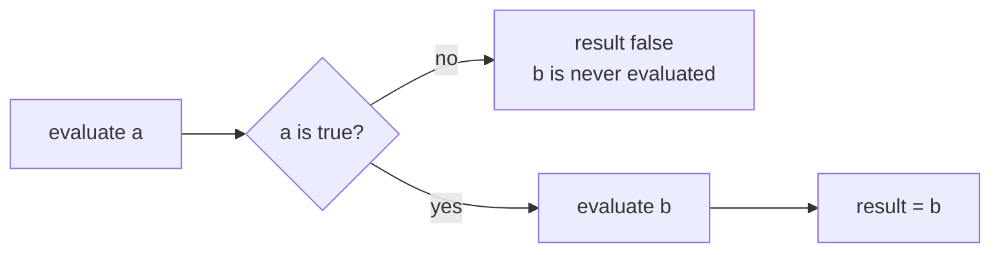
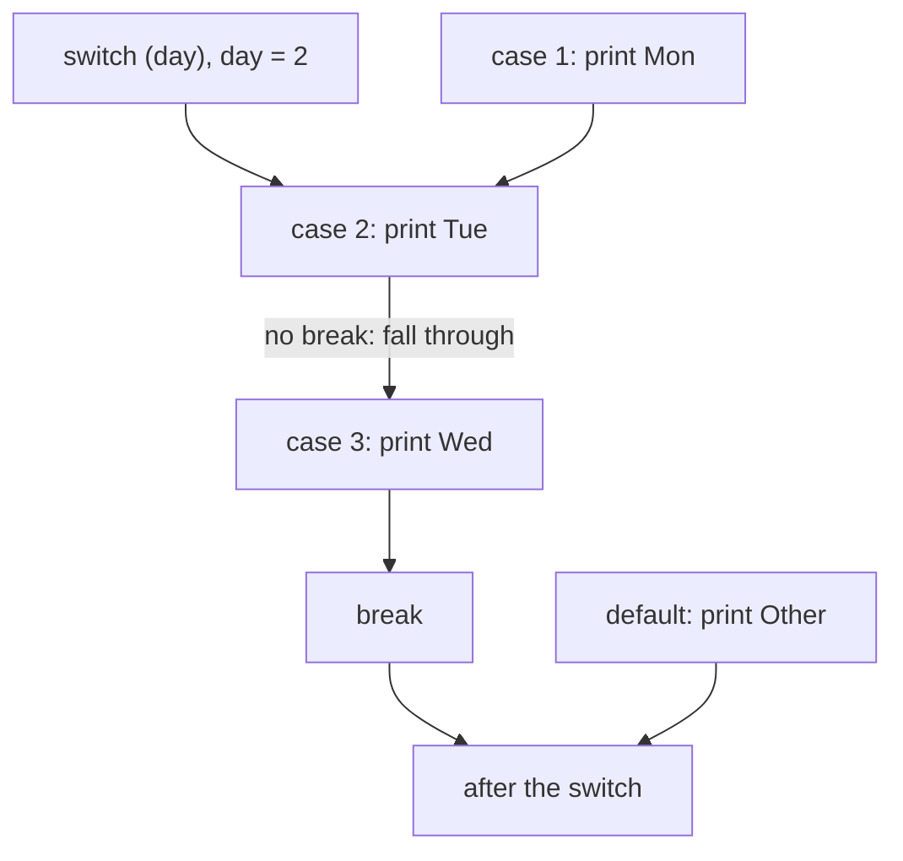
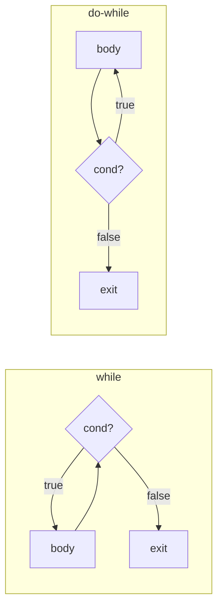

## In One Line
**Operators** compute values under strict precedence, associativity and left-to-right evaluation rules (with a few famous traps: `i++`, `&` vs `&&`, `>>` vs `>>>`, string `+`), and **control-flow statements** — `if`, `switch`, `for`, `while`, `do-while`, `break`, `continue`, `return` — decide which statements run and how often.

## Mental Model
Think of a **railway network**.

- The train is the **thread of execution**, moving one statement at a time from top to bottom.
- An `if` is a **set of points** (a track switch): the signal (a `boolean`) sends the train left or right.
- A classic `switch` is a **station with several platforms and no walls between them**: the train enters at the matching platform and keeps rolling through the next ones until it hits a **buffer stop** (`break`). That is fall-through. The arrow form (`case X ->`) builds walls between platforms.
- A loop is a **circular track**: `while` checks the signal *before* each lap (maybe zero laps), `do-while` checks it *after* (at least one lap).
- `continue` = skip the rest of this lap; `break` = leave the loop; **labeled `break`** = leave the whole junction, not just the inner loop; `return` = leave the network (the method).
- `&&` and `||` are a **lazy ticket inspector**: once the answer is known (first check fails for `&&`, first check passes for `||`), the remaining checks are never done. `&` and `|` are a pedantic inspector who always checks everything.

## Concept
### Operator families
| Family | Operators | Notes |
|---|---|---|
| Arithmetic | `+ - * / %` | Integer `/` truncates toward zero; `%` takes the sign of the **left** operand; `+` also concatenates strings |
| Unary | `+ - ++ -- ! ~` and casts | `++`/`--` have prefix and postfix forms |
| Assignment | `= += -= *= /= %= &= \|= ^= <<= >>= >>>=` | Compound forms contain a hidden cast to the left-hand type |
| Relational | `< > <= >= instanceof` | `instanceof` can declare a pattern variable (Java 16+) |
| Equality | `== !=` | Values for primitives, **identity** for references |
| Logical | `&& \|\| !` | `&&` and `\|\|` short-circuit |
| Bitwise / boolean | `& \| ^ ~` | On `boolean` operands, `&` and `\|` do **not** short-circuit; `^` is XOR |
| Shift | `<< >> >>>` | `>>` keeps the sign, `>>>` fills with zeros |
| Ternary | `cond ? a : b` | The only operator with three operands |
| Lambda | `->` | Lowest precedence (lambdas: [a05-java8](lesson:a05-java8/02-lambda-expressions)) |

### Precedence and associativity (high → low)
| Level | Operators | Associativity |
|---|---|---|
| 1 | Postfix `x++ x--` | left |
| 2 | Unary `++x --x +x -x ~ !`, cast `(type)` | right |
| 3 | Multiplicative `* / %` | left |
| 4 | Additive `+ -` | left |
| 5 | Shift `<< >> >>>` | left |
| 6 | Relational `< > <= >= instanceof` | left |
| 7 | Equality `== !=` | left |
| 8 | `&` | left |
| 9 | `^` | left |
| 10 | `\|` | left |
| 11 | `&&` | left |
| 12 | `\|\|` | left |
| 13 | Ternary `? :` | right |
| 14 | Assignment `= += -=` ... and lambda `->` | right |

Consequences worth memorizing:
- `2 + 3 * 4` is 14; `20 - 5 - 3` is 12 (left-associative); `a = b = 7` assigns right to left.
- **`&`, `^`, `|` bind more loosely than `==`**: `x & 1 == 0` parses as `x & (1 == 0)` — a compile error ("bad operand types for binary operator '&'"). Write `(x & 1) == 0`.
- `1 + 2 + "3" + 4 + 5` is `"3345"`: `+` is evaluated left to right; once one operand is a `String`, every following `+` concatenates.
- `"total: " + 10 - 2` does not compile: it is `("total: " + 10) - 2`, a `String` minus an `int`.
- When in doubt, **add parentheses** — they cost nothing and help readers.

### Evaluation order is left to right — guaranteed
Precedence decides how an expression is *grouped*; **evaluation order** decides when each operand runs. Java guarantees (JLS 15.7): the left operand is fully evaluated before the right; method arguments are evaluated left to right; every operand is evaluated before the operator is applied. C and C++ leave much of this undefined; Java does not, so these puzzles have exactly one answer:

```java
int k = 1;
int r = k++ + ++k;   // left: k++ gives 1 (k=2); right: ++k gives 3 (k=3); r = 4
```

### Increment and decrement
- **Postfix `i++`**: the expression's value is the **old** value; `i` is incremented as a side effect.
- **Prefix `++i`**: `i` is incremented first; the value is the **new** value.
- **`i = i++;` leaves `i` unchanged**: `i++` evaluates to the old value (5) and increments `i` to 6, then the assignment writes the old value 5 back.
- On their own as a statement (`i++;` vs `++i;`) they are identical; modern JITs generate the same code.
- They work on every numeric type including `char` and `double`, and include a hidden cast (`byte b = 127; b++;` wraps to −128).

### Short-circuit logic
| Expression | Right side evaluated when... |
|---|---|
| `a && b` | only if `a` is `true` |
| `a \|\| b` | only if `a` is `false` |
| `a & b`, `a \| b` (booleans) | **always** |

Short-circuiting is what makes null guards safe: `s != null && s.length() > 3` never calls `length()` on `null`. Use the non-short-circuit forms only when the right side has a side effect that must always happen — which is usually a sign the code should be restructured.

### Bitwise and shift operators
- `&` AND, `|` OR, `^` XOR, `~` NOT (`~x == -x - 1`). `0b1100 & 0b1010 = 8`, `| = 14`, `^ = 6`, `~12 = -13`.
- `<<` shifts left, filling with zeros: `x << n` = `x * 2ⁿ` (until overflow).
- `>>` is the **arithmetic** (signed) right shift: it copies the sign bit, so `-16 >> 2 = -4`. `x >> 1` rounds toward negative infinity (`-5 >> 1 = -3`), unlike `-5 / 2 = -2`.
- `>>>` is the **logical** (unsigned) right shift: it fills with zeros, so negative numbers become large positives (`-16 >>> 28 = 15`). There is no `<<<`, because a left shift already fills with zeros.
- **The shift distance is masked**: for `int` only the low 5 bits count (`n & 31`), for `long` the low 6 (`n & 63`). So `1 << 32 == 1` and `1 << 33 == 2`. Shift a `long` (`1L << 40`) for bigger values.
- `byte` and `short` are promoted to `int` before shifting: `(byte) 0xFF >>> 4` is `268435455`, not `15`, because the byte −1 becomes the `int` −1 (32 one-bits) first. Mask first: `(b & 0xFF) >>> 4 == 15`.

Handy idioms: `(n & 1) == 0` even; `n > 0 && (n & (n - 1)) == 0` power of two; `Integer.bitCount`, `Integer.highestOneBit`, `Integer.toBinaryString`, `Integer.toHexString`.

### The ternary operator and its typing rules
`cond ? a : b` is an **expression**: it has one static type, worked out from both branches.
- If both branches are numeric, **binary numeric promotion** applies: `Object o = true ? 1 : 2.0;` stores `1.0` (a `Double`), even though the `int` branch was chosen.
- If one branch is `char` and the other an `int` **constant** that fits in `char`, the type is `char`: `false ? 'a' : 98` prints `b`. With a non-constant `int` variable it is `int` and prints `98`.
- If one branch is a wrapper and the other a primitive, the wrapper is **unboxed**: `Integer n = null; Integer r = flag ? n : 0;` throws `NullPointerException`. Make both branches the same wrapper type (`Integer.valueOf(0)`) to avoid it.

### `==` for references
For objects, `==` asks "same object?", not "same content?". `new String("a") == new String("a")` is `false`; use `equals`. Wrapper caching makes this especially confusing (`Integer` values −128..127 are cached) — see [Object, equals & hashCode](lesson:b01-fundamentals/06-object-class-equals-hashcode) and [String Pool](lesson:b01-fundamentals/07-string-pool-and-immutability).

### `if` / `else`
- The condition must be a `boolean` — `if (x = 5)` does not compile ("int cannot be converted to boolean"), which prevents C's classic bug. **But** `if (flag = true)` compiles (it assigns `true` and tests it): compare booleans directly, `if (flag)`.
- `else` binds to the **nearest** `if` (the "dangling else"). Always use braces.
- `if (false) { ... }` is allowed even though the body is unreachable — the JLS permits it on purpose for conditional compilation with constants (`if (DEBUG)`).

### `switch`
**Allowed selector types:** `char`, `byte`, `short`, `int`, their wrappers, `String` (Java 7), and enums. Since Java 21, any reference type with *pattern labels*. **Not** allowed: `long`, `float`, `double`, `boolean` ("selector type long is not allowed"). Case labels must be compile-time constants and unique.

**Classic form — `case X:`** falls through: execution enters at the matching label and continues into the following cases until `break`, `return`, `throw`, or the end of the switch. `default` can appear anywhere and runs when nothing matches.

**Arrow form — `case X ->`** (Java 14): no fall-through, several labels per case (`case "start", "run" ->`), the right side is an expression, a block, or a `throw`. Works in switch statements and switch expressions.

**Switch expressions** (Java 14) produce a value:
```java
String type = switch (day) {
    case 6, 7 -> "weekend";
    case 1, 2, 3, 4, 5 -> { String t = "week"; yield t + "day"; }
    default -> throw new IllegalArgumentException("bad day " + day);
};
```
- `yield` returns a value from a block (inside a switch expression, `return` would try to leave the method and is not allowed).
- They must be **exhaustive**: cover every value (a `default`, or all constants of an enum, or all permitted subtypes of a sealed type), otherwise "the switch expression does not cover all possible input values".

**Pattern matching for switch** (Java 21) — type patterns, guards with `when`, and `case null`:
```java
String desc = switch (obj) {
    case Integer i when i > 10 -> "big int";
    case Integer i             -> "int";
    case String s when s.length() > 3 -> "long string " + s;
    default -> "something else";
};
```
Without a `case null`, switching on a `null` reference throws `NullPointerException`. Deep dive: [switch expressions & pattern matching](lesson:b05-modern-java/05-switch-expressions-and-pattern-matching).

A switch on `String` compiles to a switch on `hashCode()` followed by `equals()` checks; a switch on an enum uses its `ordinal()`. Dense `int` cases become a `tableswitch` (jump table, O(1)); sparse ones a `lookupswitch` (binary search).

### Loops
| Loop | Condition checked | Typical use |
|---|---|---|
| `for (init; cond; update)` | Before each iteration | Counting, index needed; every part optional (`for (;;)` is infinite); multiple variables: `for (int i = 0, j = 5; i < j; i++, j--)` |
| Enhanced `for (T x : source)` | — | Every element of an array or `Iterable`; no index; read-only view of elements |
| `while (cond)` | Before — may run **zero** times | Unknown number of iterations |
| `do { } while (cond);` | After — runs **at least once** | Menus, retry-until-valid input (note the `;`) |

Enhanced-for details:
- For arrays it compiles to an index loop; for an `Iterable` it uses `iterator()`, `hasNext()`, `next()`.
- The loop variable is a **copy** of each element: assigning to it (`v = v * 10`) does not change the array.
- Looping over a `null` collection throws `NullPointerException`.
- Removing from a collection inside a for-each throws `ConcurrentModificationException`; use `Iterator.remove()` or `removeIf` (see [fail-fast iterators](lesson:a03-collections/22-fail-fast-iterators)).

### Jump statements
- `break` — leaves the innermost `switch` or loop.
- `continue` — skips to the next iteration of the innermost loop (in a `for`, the update part still runs).
- **Labeled `break label;`** — leaves the statement with that label (any labeled block, not only loops). **Labeled `continue label;`** — next iteration of the labeled loop. They replace the `goto` that Java does not have (`goto` and `const` are reserved but unused keywords).
- `return` — leaves the method (a `finally` block still runs first).

### Unreachable code is a compile error
The compiler rejects statements it can prove will never run: code after `return`, `break`, `continue` or `throw`; the body of `while (false)`; and code after an infinite `for (;;)` or `while (true)` without a `break` — all reported as "unreachable statement". (`if (false)` is the deliberate exception described above.)

## Diagram

`a && b` evaluates `b` only when `a` is true — the basis of null guards like `s != null && s.isEmpty()`. `a & b` always evaluates both.


A classic `switch` jumps to the matching label and keeps running the following cases until a `break` — output `Tue Wed`.


`while` tests first, so its body may never run; `do-while` runs the body first, so it always runs at least once.

## Code
**1. Operators**
```java
public class OperatorsDemo {
    static boolean check(String name, boolean result) {
        System.out.print(name + " ");          // shows whether this operand was evaluated
        return result;
    }

    public static void main(String[] args) {
        // 1. Arithmetic: integer division truncates, % takes the sign of the left operand
        System.out.println(17 / 5 + " " + 17 % 5 + " " + -17 % 5 + " " + 17 % -5 + " " + 5.5 % 2);

        // 2. Increment / decrement
        int i = 5;
        int a = i++;          // a gets the OLD value, then i becomes 6
        int b = ++i;          // i becomes 7 first, b gets the NEW value
        System.out.println("a=" + a + " b=" + b + " i=" + i);
        int j = 5;
        j = j++;              // j++ returns 5, then the assignment overwrites j with 5
        System.out.println("j = j++ -> " + j);
        int k = 1;
        int r = k++ + ++k;    // 1 + 3 : operands are evaluated left to right
        System.out.println("k++ + ++k = " + r + ", k = " + k);

        // 3. Short-circuit (&&, ||) vs non-short-circuit (&, |)
        System.out.println("-> " + (check("A", false) && check("B", true)));
        System.out.println("-> " + (check("A", false) & check("B", true)));
        System.out.println("-> " + (check("A", true) || check("B", true)));
        String s = null;
        System.out.println(s != null && s.length() > 3);   // safe: right side never runs

        // 4. Bitwise and shift operators
        int x = 0b1100, y = 0b1010;
        System.out.println((x & y) + " " + (x | y) + " " + (x ^ y) + " " + (~x));
        System.out.println((8 << 2) + " " + (-16 >> 2) + " " + (-16 >>> 28) + " " + (1 << 33));

        // 5. Precedence and associativity
        System.out.println(2 + 3 * 4 + " " + (2 + 3) * 4 + " " + (20 - 5 - 3) + " " + 64 / 4 / 2);
        System.out.println(1 + 2 + "3" + 4 + 5);             // left to right: "33" + 4 + 5
        int p, q;
        p = q = 7;                                           // assignment is right-associative
        System.out.println(p + q);

        // 6. Ternary: the result type is promoted, even for the branch not taken
        Object o = true ? 1 : 2.0;
        System.out.println(o);
        System.out.println(x > y ? "x is bigger" : "y is bigger");
    }
}
```
```output
3 2 -2 2 1.5
a=5 b=7 i=7
j = j++ -> 5
k++ + ++k = 4, k = 3
A -> false
A B -> false
A -> true
false
8 14 6 -13
32 -4 15 2
14 20 12 8
3345
14
1.0
x is bigger
```

**2. Control flow**
```java
public class ControlFlowDemo {
    public static void main(String[] args) {
        // 1. if / else if / else - first true branch wins
        int marks = 72;
        if (marks >= 90) System.out.println("A");
        else if (marks >= 70) System.out.println("B");
        else System.out.println("C");

        // 2. Classic switch statement: falls through until a break
        int day = 2;
        switch (day) {
            case 1:
                System.out.print("Mon ");
            case 2:
                System.out.print("Tue ");      // entry point for day == 2
            case 3:
                System.out.print("Wed ");      // no break above: falls through
                break;
            default:
                System.out.print("Other ");
        }
        System.out.println();

        // 3. switch on a String, several labels per case
        String cmd = "stop";
        switch (cmd) {
            case "start", "run" -> System.out.println("starting");
            case "stop" -> System.out.println("stopping");
            default -> System.out.println("unknown");
        }

        // 4. switch expression (Java 14): returns a value, no fall-through, must be exhaustive
        String type = switch (day) {
            case 6, 7 -> "weekend";
            case 1, 2, 3, 4, 5 -> {
                String t = "week";
                yield t + "day";               // yield returns a value from a block
            }
            default -> throw new IllegalArgumentException("bad day " + day);
        };
        System.out.println(type);

        // 5. Loops
        for (int i = 0; i < 3; i++) System.out.print(i + " ");
        System.out.println("| for");
        for (String s : new String[] {"x", "y"}) System.out.print(s + " ");
        System.out.println("| for-each");
        int n = 3;
        while (n > 0) System.out.print(n-- + " ");
        System.out.println("| while");
        int m = 10;
        do {
            System.out.print(m + " ");          // runs once even though m < 5 is false
        } while (m < 5);
        System.out.println("| do-while");

        // 6. break, continue and labels
        for (int i = 1; i <= 6; i++) {
            if (i % 2 == 0) continue;           // skip even numbers
            if (i == 5) break;                  // leave the loop
            System.out.print(i + " ");
        }
        System.out.println("| break/continue");

        outer:
        for (int r = 1; r <= 3; r++) {
            for (int c = 1; c <= 3; c++) {
                if (c == 2) continue outer;     // next iteration of the OUTER loop
                if (r == 3) break outer;        // exit both loops
                System.out.print(r + "," + c + " ");
            }
        }
        System.out.println("| labeled");
    }
}
```
```output
B
Tue Wed 
stopping
weekday
0 1 2 | for
x y | for-each
3 2 1 | while
10 | do-while
1 3 | break/continue
1,1 2,1 | labeled
```

**3. Bit tricks interviewers like**
```java
public class BitTricks {
    public static void main(String[] args) {
        // Even / odd without %
        for (int n : new int[] {6, 7, -3}) {
            System.out.print(n + ((n & 1) == 0 ? " even  " : " odd  "));
        }
        System.out.println();

        // Power of two: exactly one bit set
        for (int n : new int[] {1, 12, 16, 0}) {
            boolean pow2 = n > 0 && (n & (n - 1)) == 0;
            System.out.print(n + "->" + pow2 + "  ");
        }
        System.out.println();

        // Swap without a temporary (XOR) - a classic, but a temp variable is clearer
        int a = 3, b = 9;
        a ^= b;
        b ^= a;
        a ^= b;
        System.out.println("a=" + a + " b=" + b);

        // Shifts: << multiplies, >> divides (rounding toward negative infinity)
        System.out.println((5 << 3) + " " + (-5 >> 1) + " " + (-5 / 2));
        System.out.println(Integer.toBinaryString(-8) + " >>> 1 = " + (-8 >>> 1));

        // Library helpers
        System.out.println(Integer.bitCount(255) + " " + Integer.highestOneBit(100)
                + " " + Integer.toBinaryString(42) + " " + Integer.toHexString(255));
    }
}
```
```output
6 even  7 odd  -3 odd  
1->true  12->false  16->true  0->false  
a=9 b=3
40 -3 -2
11111111111111111111111111111000 >>> 1 = 2147483644
8 64 101010 ff
```

## Walkthrough
**OperatorsDemo**
- `17 / 5 = 3` (integer division truncates), `17 % 5 = 2`, `-17 % 5 = -2` and `17 % -5 = 2`: the remainder always has the sign of the **left** operand, because Java defines `a % b == a - (a / b) * b` with `/` truncating toward zero. `%` also works on doubles: `5.5 % 2 = 1.5`. (For a always-positive modulo use `Math.floorMod(-17, 5)`, which is 3.)
- `a = i++` stores the old value 5; `b = ++i` increments first (i: 6 → 7) and stores 7.
- `j = j++` prints 5: the right side evaluates to the old value 5 and bumps `j` to 6, then the assignment writes 5 back. The increment is lost.
- `k++ + ++k`: the left operand runs first (value 1, `k` = 2), then the right (`k` = 3, value 3), so `r = 4`.
- The `check` helper prints its name when it runs. With `&&`, the first operand is `false`, so `B` is never printed. With `&`, both run (`A B`). With `||`, `A` is `true`, so `B` is skipped. `s != null && s.length() > 3` prints `false` without a `NullPointerException`.
- `12 & 10 = 8` (`1000`), `12 | 10 = 14` (`1110`), `12 ^ 10 = 6` (`0110`), `~12 = -13` (flip every bit; `~x == -x - 1`).
- `8 << 2 = 32` (× 4); `-16 >> 2 = -4` (sign preserved); `-16 >>> 28 = 15` (zeros shifted in, the top four 1-bits end up at the bottom); `1 << 33 = 2` because the distance is masked to `33 & 31 = 1`.
- `2 + 3 * 4 = 14`, `(2 + 3) * 4 = 20`, `20 - 5 - 3 = 12` and `64 / 4 / 2 = 8` show left associativity. `1 + 2 + "3" + 4 + 5` is `"3345"`: `1 + 2` is numeric (3), then everything is concatenation. `p = q = 7` assigns 7 to `q`, then the value of that assignment (7) to `p`.
- `true ? 1 : 2.0` picks the `1`, but the whole expression has type `double`, so `o` holds `1.0`.

**ControlFlowDemo**
- `marks = 72`: the first condition (`>= 90`) fails, the second (`>= 70`) matches, and the chain stops — `B`.
- `day = 2` enters at `case 2`, prints `Tue`, **falls through** into `case 3` (prints `Wed`) and stops at `break`. `Mon` and `Other` never run. (The printed line ends with a trailing space.)
- The `String` switch uses arrow labels: no `break` needed, and `case "start", "run"` groups labels.
- The switch expression assigns a value to `type`. Day 2 matches the block case, which uses `yield` to produce `"weekday"`. `default -> throw ...` makes it exhaustive for all other `int` values.
- `for` prints `0 1 2`; for-each walks the array; `while (n > 0) print(n--)` prints the value *before* decrementing: `3 2 1`; the `do-while` body runs once and prints `10` even though `m < 5` was false from the start.
- In the break/continue loop: 1 prints, 2 is skipped by `continue`, 3 prints, 4 is skipped, at 5 `break` ends the loop — `1 3`.
- The labeled loops: for `r = 1`, `c = 1` prints `1,1`; at `c = 2`, `continue outer` jumps to the next `r`. The same for `r = 2`. For `r = 3`, `c = 1` hits `break outer`, which leaves both loops — `1,1 2,1`.

**BitTricks**
- `(n & 1) == 0` tests the lowest bit; it works for negatives too (`-3` is odd), unlike `n % 2 == 1`, which is `false` for −3 because `-3 % 2 == -1`.
- A power of two has exactly one 1-bit; `n - 1` flips that bit and sets all bits below it, so `n & (n - 1)` is 0. `n > 0` excludes 0 and negatives.
- The XOR swap uses `x ^ x == 0` and `x ^ 0 == x`. It works but is slower to read and breaks if both "variables" alias the same array slot — use a temporary in real code.
- `5 << 3 = 40` (× 8). `-5 >> 1 = -3` rounds toward negative infinity, while `-5 / 2 = -2` rounds toward zero — so `>> 1` is not always the same as `/ 2`.
- `-8` in binary is twenty-nine 1s followed by `000`; `>>> 1` shifts in a zero, giving the large positive 2147483644.
- `bitCount(255) = 8` set bits, `highestOneBit(100) = 64`, `toBinaryString(42) = 101010`, `toHexString(255) = ff`.

## Traps
- **`i = i++` does nothing.** The postfix value (old) is assigned back.
- **`x & 1 == 0` does not compile** — `==` binds tighter than `&`. Parenthesize: `(x & 1) == 0`.
- **`if (flag = true)` compiles and is always true** (assignment, not comparison). Write `if (flag)`.
- **`n % 2 == 1` fails for negative odd numbers** (`-3 % 2 == -1`). Use `n % 2 != 0` or `(n & 1) != 0`.
- **Forgotten `break`** in a classic switch silently runs the next case. Prefer arrow labels; if fall-through is intentional, comment it (`// fall through`).
- **Switching on a `null` `String`/wrapper/enum throws `NullPointerException`** unless the switch has `case null` (Java 21 pattern switch).
- **`switch` on `long`, `float`, `double` or `boolean` does not compile.**
- **Ternary unboxing NPE:** `Integer n = null; Integer r = cond ? n : 0;` throws, because the mixed `Integer`/`int` type is `int`.
- **`1 << 32` is 1, not 0** (shift distance masked). Use `1L << 32`.
- **`>>` on a negative `byte`/`short`** acts on the promoted `int`; `(byte) 0xFF >>> 4` is 268435455. Mask with `& 0xFF` first.
- **`"Total: " + a + b`** concatenates both numbers (`"Total: 12"` for 1 and 2). Write `"Total: " + (a + b)`.
- **Assigning to the for-each variable** does not modify the array or list.
- **`while (x < 10);`** — the stray semicolon is an empty body: an infinite loop (or a loop that does nothing).
- **Floating-point loop counters** (`for (double d = 0; d != 1.0; d += 0.1)`) may never hit the exact end value — this loop never ends. Use an `int` counter.

> [!WARNING] Code like `x = x++ + ++x` is legal and deterministic in Java, but never write it in real code. It appears in interviews only to test whether you know that operands are evaluated left to right and what each form of `++` returns.

## Tips & Tricks
- **Precedence mnemonic — "PUMA SREBL TA":** **P**ostfix, **U**nary, **M**ultiplicative, **A**dditive, **S**hift, **R**elational, **E**quality, **B**itwise (`& ^ |`), **L**ogical (`&& ||`), **T**ernary, **A**ssignment.
- **"Post gives the past, pre gives the present":** `i++` returns the old value, `++i` the new one.
- **`>>>` has three arrows because it adds one more idea: "ignore the sign".**
- **Short-circuit guard order:** put the cheap/null check first — `obj != null && obj.isValid()`.
- **Prefer arrow switches and switch expressions** (Java 14+): no fall-through bugs, exhaustiveness checked by the compiler.
- **Label names:** use a meaningful label like `search:` or `outer:`; a labeled break is often a hint to extract the loops into a method and `return`.
- **Mid-point without overflow:** `lo + (hi - lo) / 2` or `(lo + hi) >>> 1`.
- **Solving "what does it print?" puzzles:** (1) group by precedence, (2) evaluate operands left to right, writing each intermediate value and side effect down, (3) apply implicit promotions and casts.

## Interview Q&A
### [Basic] What is the difference between `&` and `&&` (and `|` and `||`)?
`&&` and `||` are **logical short-circuit** operators: `&&` evaluates its right operand only if the left is `true`; `||` only if the left is `false`. `&` and `|` applied to booleans evaluate **both** operands every time. `&` and `|` are also **bitwise** operators on integers (`12 & 10 == 8`), which `&&`/`||` are not. Short-circuiting is why `s != null && s.length() > 0` is safe while `s != null & s.length() > 0` throws `NullPointerException` for `null`.

**Follow-up:** *When would you use `&` on booleans?* — Rarely: only if the right-hand side has a side effect that must always run (e.g. validating two fields and reporting both errors). Clearer code evaluates both into variables first.

### [Basic] What is the difference between `i++` and `++i`? What does `i = i++` do?
Both add 1 to `i`. Postfix `i++` is an expression whose value is the **old** value; prefix `++i` increments first and yields the **new** value. So with `i = 5`, `a = i++` gives `a = 5, i = 6`, while `b = ++i` gives `b = 6, i = 6`. `i = i++` leaves `i` unchanged: the right side evaluates to 5 and increments `i` to 6, then the assignment stores 5 back. As standalone statements the two forms are equivalent.

**Follow-up:** *What is `x` after `int x = 10; x = x++ + ++x;`?* — 22: `x++` yields 10 (x becomes 11), `++x` makes it 12 and yields 12, then 10 + 12 = 22 is assigned.

### [Basic] What is the difference between `>>` and `>>>`?
Both shift bits to the right. `>>` is the **signed (arithmetic)** shift: it copies the sign bit into the vacated positions, so negative numbers stay negative (`-16 >> 2 == -4`). `>>>` is the **unsigned (logical)** shift: it fills with zeros, so a negative number becomes a large positive (`-1 >>> 28 == 15`). For non-negative numbers they give the same result. There is no `<<<` because `<<` always fills with zeros.

**Follow-up:** *What is `1 << 32` for an `int`?* — 1, because only the low 5 bits of the shift distance are used (32 & 31 = 0). Use `1L << 32` for a `long`.

### [Basic] What is the difference between `while` and `do-while`? Between `for` and for-each?
`while` checks its condition **before** each iteration, so the body can run zero times; `do-while` checks **after**, so the body always runs at least once (useful for menus and "try until valid"). A classic `for` gives you an index and full control over initialization, condition and update; the enhanced for-each iterates over every element of an array or `Iterable` without an index — cleaner, but you cannot modify the array through the loop variable, cannot iterate backwards, and cannot remove elements (use an `Iterator` or `removeIf`).

**Follow-up:** *How does for-each work internally for a `List`?* — It compiles to `Iterator<T> it = list.iterator(); while (it.hasNext()) { T x = it.next(); ... }`; for arrays it becomes an index loop.

### [Intermediate] Which types can be used in a `switch`? How does a `String` switch work?
`byte`, `short`, `char`, `int` and their wrappers, `String` (Java 7+), and enums; since Java 21, any reference type when using pattern labels (`case Integer i ->`). `long`, `float`, `double` and `boolean` are not allowed. Case constants must be compile-time constants and unique. A `String` switch compiles to a switch on `s.hashCode()` followed by `equals()` checks to rule out hash collisions — so a `null` string throws `NullPointerException` (unless there is a `case null` in a Java 21 pattern switch). Enum switches use the constant's ordinal.

**Follow-up:** *Why not `long`?* — Historically the JVM's `tableswitch`/`lookupswitch` instructions take `int` keys. Primitive patterns that lift this restriction are a preview feature in recent JDKs (23+).

### [Intermediate] What is fall-through, and how do switch expressions differ from switch statements?
In a classic `case X:` switch, execution jumps to the matching label and continues through the following cases until `break`, `return` or `throw`: that is **fall-through** — useful for grouping labels, but a common bug when a `break` is forgotten. Java 14's arrow form (`case X ->`) never falls through and allows several labels per case. A **switch expression** yields a value (`String t = switch (d) { ... };`), uses `yield` inside a block, and must be **exhaustive** — the compiler checks that every possible value is covered (with `default`, all enum constants, or all subtypes of a sealed type).

**Follow-up:** *What happens at run time if an enum gains a new constant after compilation of an exhaustive switch expression without `default`?* — The compiler-generated default throws an error (`MatchException` since Java 21; `IncompatibleClassChangeError` before).

### [Intermediate] Explain `break`, `continue`, `return` and labeled `break`.
`break` exits the innermost loop or `switch`. `continue` skips the rest of the current iteration and moves to the next one (in a `for` loop, the update expression still runs). `return` leaves the whole method, optionally with a value (after running any `finally` blocks). A **labeled** `break outer;` exits the statement labeled `outer` — typically an outer loop — so you can leave nested loops in one step; `continue outer;` jumps to the next iteration of the outer loop. Java has no `goto`; labels cover its legitimate uses.

**Follow-up:** *Can you `break` out of a block that is not a loop?* — Yes: any labeled statement can be exited with `break label;` (e.g. `check: { ... break check; ... }`), though it is rarely good style.

### [Intermediate] What type does the ternary operator produce? Give a trap.
The conditional expression has one static type computed from **both** branches. With two numeric branches, binary numeric promotion applies: `true ? 1 : 2.0` has type `double`, so `Object o = true ? 1 : 2.0;` stores `1.0`. If one branch is a wrapper and the other a primitive, the result is the primitive type, so the wrapper is unboxed: `Integer n = null; Integer r = flag ? n : 0;` throws `NullPointerException` even though you "just return `n`". Keep both branches the same reference type (`flag ? n : Integer.valueOf(0)`) to avoid unboxing.

**Follow-up:** *What does `System.out.println(false ? 'a' : 98);` print?* — `b`: a `char` and an `int` constant that fits in `char` give type `char`, and 98 is `'b'`.

### [Advanced] Precedence vs evaluation order — what is the difference?
**Precedence and associativity** decide how an expression is *parsed*: `a + b * c` is `a + (b * c)`. **Evaluation order** decides *when* each operand is computed: Java always evaluates the left operand of a binary operator completely before the right one, evaluates method arguments left to right, and evaluates all operands before applying the operator. So in `f() + g() * h()`, the calls happen in the order `f`, `g`, `h`, even though the multiplication is performed first. This is why expressions with side effects, such as `k++ + ++k`, have one well-defined answer in Java (unlike C, where they are undefined behaviour).

**Follow-up:** *Does `&&` change evaluation order?* — It keeps left-to-right order but may skip the right operand entirely (short-circuit).

### [Advanced] Write bit-manipulation checks for "power of two", "even", and count set bits.
```java
boolean isPowerOfTwo(int n) { return n > 0 && (n & (n - 1)) == 0; } // one bit set
boolean isEven(int n)       { return (n & 1) == 0; }                 // works for negatives
int setBits(int n)          { return Integer.bitCount(n); }          // or Kernighan's loop:
int kernighan(int n) { int c = 0; while (n != 0) { n &= n - 1; c++; } return c; }
```
`n & (n - 1)` clears the lowest set bit — for a power of two that leaves 0. Kernighan's loop runs once per set bit. `Integer.bitCount` is usually compiled to a single CPU instruction (`popcnt`) by the JIT.

**Follow-up:** *How do you swap two ints without a temporary?* — `a ^= b; b ^= a; a ^= b;` (or `a = a + b; b = a - b; a = a - b;`, which relies on wrap-around). Both are party tricks; a temporary variable is clearer and just as fast.

## Quiz
### What does this print?
```java
int x = 10;
x = x++ + ++x;
System.out.println(x);
```
- [ ] 21
- [x] 22
- [ ] 11
- [ ] 12
> Left operand `x++` yields 10 and makes `x` 11; right operand `++x` makes `x` 12 and yields 12; 10 + 12 = 22 is assigned. 21 would require the left operand to see 11 — but postfix returns the *old* value.

### What does this print?
```java
System.out.println(1 + 2 + "3" + 4 + 5);
```
- [ ] 15
- [ ] 12345
- [x] 3345
- [ ] 339
> `+` is evaluated left to right: `1 + 2` is numeric (3), then `3 + "3"` is `"33"`, and from then on every `+` concatenates: `"334"`, `"3345"`. `339` would need `4 + 5` to be added first, which only happens with parentheses.

### What does this print?
```java
int s = 0;
for (int k = 1; k <= 3; k++) {
    switch (k) {
        case 1: s += 1;
        case 2: s += 10; break;
        default: s += 100;
    }
}
System.out.println(s);
```
- [ ] 111
- [x] 121
- [ ] 21
- [ ] 120
> k = 1 enters `case 1` (+1) and falls through into `case 2` (+10) → 11. k = 2 adds 10 → 21. k = 3 hits `default` (+100) → 121. Forgetting the fall-through gives 111.

### What does this print?
```java
Object o = true ? 1 : 2.0;
System.out.println(o);
```
- [ ] 1
- [x] 1.0
- [ ] 2.0
- [ ] Compile error
> The conditional expression's type is determined by both branches: `int` and `double` promote to `double`. The chosen value 1 therefore becomes `1.0` (boxed as a `Double`).

### Spot the bug: why does this always print "admin"?
```java
boolean isAdmin = false;
if (isAdmin = true) {
    System.out.println("admin");
}
```
- [ ] `if` cannot take a boolean variable
- [x] `=` assigns `true` to `isAdmin`; the condition is the assigned value
- [ ] `isAdmin` must be declared `final`
- [ ] It does not compile
> `isAdmin = true` is an assignment expression whose value is `true`, so the branch always runs (and the variable is overwritten). With `int` variables the same mistake would not compile, but with `boolean` it does. Write `if (isAdmin)`.

### What does `(byte) 0xFF >>> 4` evaluate to?
- [ ] 15
- [x] 268435455
- [ ] -1
- [ ] 240
> `(byte) 0xFF` is −1. Before shifting, the byte is promoted to the `int` −1 (thirty-two 1-bits); `>>> 4` shifts in four zeros, giving `0x0FFFFFFF` = 268435455. To get 15, mask first: `((byte) 0xFF & 0xFF) >>> 4`.

### Which selector type is NOT allowed in a `switch`?
- [ ] `String`
- [ ] `char`
- [x] `long`
- [ ] An enum type
> `switch` accepts `byte`, `short`, `char`, `int`, their wrappers, `String` and enums (and, since Java 21, any reference type with pattern labels). `long`, `float`, `double` and `boolean` are rejected: "selector type long is not allowed".

### What does this print?
```java
for (int r = 1; r <= 2; r++) {
    for (int c = 1; c <= 3; c++) {
        if (c == 2) break;
        System.out.print(r + "" + c + " ");
    }
}
```
- [ ] 11
- [x] 11 21
- [ ] 11 12 13 21 22 23
- [ ] 11 13 21 23
> An unlabeled `break` leaves only the **inner** loop. For each `r`, only `c = 1` prints before the break, so the output is `11 21`. To leave both loops you would need a labeled `break outer;`.

## Takeaways
- Precedence decides grouping (postfix, unary, `* / %`, `+ -`, shifts, relational, equality, `&`, `^`, `|`, `&&`, `||`, ternary, assignment); evaluation order is always left to right.
- `i++` yields the old value and `++i` the new one; `i = i++` leaves `i` unchanged.
- `&&`/`||` short-circuit, `&`/`|` always evaluate both sides — null guards rely on `&&`.
- `>>` keeps the sign, `>>>` fills with zeros; shift distances are masked (`1 << 32 == 1`); bytes are promoted to `int` before shifting.
- `%` takes the sign of the left operand; integer `/` truncates toward zero; use `Math.floorMod` for a non-negative modulo.
- The ternary operator has one type computed from both branches — it can promote (`1` → `1.0`) or unbox (`NullPointerException`).
- Classic `switch` falls through without `break`; arrow cases and switch expressions (Java 14) do not, and switch expressions must be exhaustive; `switch` rejects `long`, `float`, `double`, `boolean`.
- `while` may run zero times, `do-while` at least once; `continue` skips an iteration, `break` exits the innermost loop, labeled `break`/`continue` target an outer loop.
