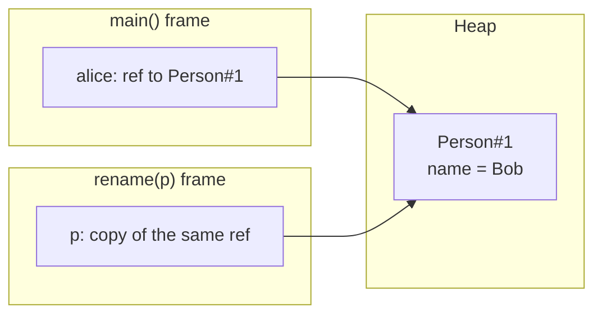
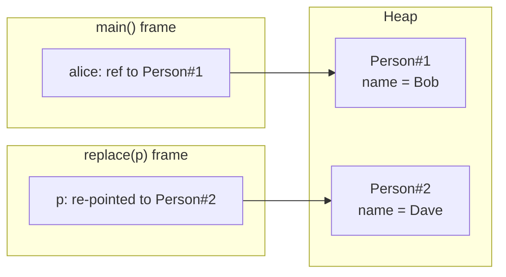
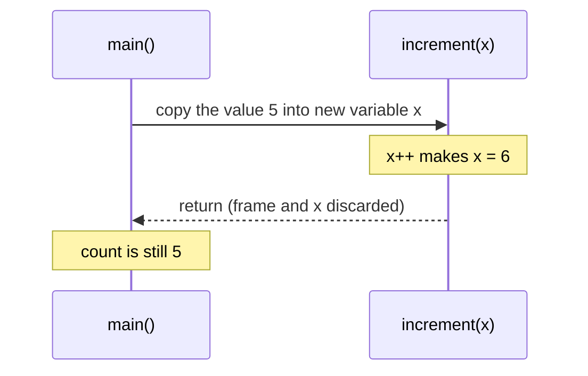

## In One Line
Java is **always pass-by-value**: a method receives a **copy of each argument's value** — for a primitive that is the number itself, for an object variable it is the **reference** (the object's address) — so a method can change the *object* a reference points to, but can never make the caller's *variable* point somewhere else.

## Mental Model
Think of a **house and a slip of paper with its address**.

- Your variable `alice` is a slip of paper with the address of a house (the `Person` object on the heap).
- Calling `rename(alice)` **photocopies the slip** and hands the copy to the method. There is still only **one house**.
- If the method walks to that address and **repaints the house** (`p.name = "Bob"`), you see the new paint when you visit, because it is the same house.
- If the method **scribbles a new address** on its photocopy (`p = new Person("Carol")`), your slip is untouched. The method is now visiting a different house; your slip still points to the old one.
- For a primitive (`int count = 5`), the slip contains the **value itself**, not an address. The method gets a photocopy of the number; changing the copy changes nothing for you.

Pass-by-reference (which Java does *not* have) would be handing over **your original slip** — then the method could rewrite your address.

## Concept
### What "pass-by-value" and "pass-by-reference" really mean
| | Pass-by-value | Pass-by-reference |
|---|---|---|
| The parameter is... | a **new variable** initialized with a copy of the argument's value | an **alias** for the caller's variable |
| Assigning to the parameter (`p = ...`) | affects only the method's copy | changes the caller's variable |
| Languages | Java (always), C, Python/JavaScript (for object references, called "pass by sharing"), C# by default | C++ `T&`, C# `ref`/`out`, Pascal `var` |

The JLS says it directly: when a method is invoked, "the values of the actual argument expressions initialize newly created parameter variables" (JLS 15.12.4.2). The parameter is a brand-new local variable in the callee's stack frame.

### Primitives: the value is copied
```java
static void increment(int x) { x++; }
int count = 5;
increment(count);      // count is still 5
```
`x` is a separate variable holding a copy of 5. Incrementing it cannot touch `count`.

### Objects: the reference is copied ("a reference passed by value")
An object variable never holds the object; it holds a **reference** to an object on the heap. Passing it copies that reference, so caller and callee now have **two variables pointing to the same object**:

| What the method does | Caller sees it? | Why |
|---|---|---|
| Changes the object's state: `p.name = "Bob"`, `list.add(x)`, `arr[0] = 99`, `sb.append(...)` | **Yes** | Both references lead to the same object |
| Reassigns the parameter: `p = new Person(...)`, `p = null`, `arr = new int[3]` | **No** | Only the method's copy of the reference changes |
| Calls a method that returns a new object and assigns it: `s = s + "!"`, `n++` on an `Integer` | **No** | Immutable types cannot change; these create a *new* object and re-point the local copy |

This is why the common phrase "Java passes objects by reference" is **wrong**: if it did, `p = new Person(...)` or a `swap` method would affect the caller. Say instead: *"Java passes object references by value."*

### Why a `swap` method is impossible
```java
static void swap(Object a, Object b) { Object t = a; a = b; b = t; }
```
`a` and `b` are copies. Swapping the copies leaves the caller's two variables exactly where they were. In C++ you could write `void swap(T& a, T& b)`; Java has no equivalent. Workarounds:
- swap **inside** a shared container (`swap(int[] arr, int i, int j)`, `Collections.swap(list, i, j)`);
- **return** the new values (a record `Pair(second, first)`);
- use a **mutable holder** (an array of size 1, `AtomicInteger`, `AtomicReference`, or your own class).

### Immutable arguments look like pass-by-value "for objects too"
`String`, `Integer` and the other wrappers, `BigDecimal`, `LocalDate` and records with immutable fields have **no methods that change their state**. Everything that "modifies" them (`s + "!"`, `n++`, `bd.add(x)`) returns a **new** object. Inside a method, assigning that new object to the parameter only re-points the local copy — so to the caller it looks as if the object was "copied". It was not: the reference was copied, and the object simply cannot change.

`Integer n; n++;` is compiled as `n = Integer.valueOf(n.intValue() + 1);` — a reassignment, which is why `addOne(boxed)` has no effect on the caller.

### Arrays and varargs
Arrays are objects: element writes (`arr[0] = 99`) are visible to the caller; `arr = new int[...]` is not. Varargs parameters (`int... xs`) are arrays too: calling `m(a)` with an existing array passes a reference to *that* array (so `xs[0] = 100` changes it), while `m(1, 2)` creates a fresh array for the call.

### `final` parameters
`final` on a parameter forbids **reassigning** it ("final parameter sb may not be assigned"), but does not make the object immutable — `sb.append(...)` still works. It is a readability and safety choice, not a copying mechanism.

### What happens in memory
Each method call gets a **stack frame** with its own local variables and parameters. Arguments are copied into the new frame's parameter slots (for primitives, the value; for references, the pointer). Objects themselves always live on the **heap** (unless the JIT's escape analysis removes the allocation altogether) and are never copied implicitly. When the method returns, its frame — including the parameter copies — disappears.

Related ideas that rest on the same rule:
- **Lambdas and anonymous classes** also receive *copies* of captured local variables; that is why the captured variables must be **effectively final** — changing the original after the copy was taken would make the copy silently stale.
- **Defensive copying**: because callers and callees share objects, a class that stores a mutable argument (a `Date`, a `List`, an array) should copy it, or outside code can change its internals later. See [Immutable Classes](lesson:b01-fundamentals/08-immutable-classes).
- **Returning internal mutable objects** leaks them the same way: return a copy or an unmodifiable view (`List.copyOf`, `Collections.unmodifiableList`).

### How to "return" several values
| Technique | Example | Notes |
|---|---|---|
| Return a record / small class | `record MinMax(int min, int max)` | Cleanest and type-safe (Java 16+) |
| Mutate an object passed in | `void fill(List<String> out)` | Common for collections; document it |
| Holder object | `AtomicInteger`, `AtomicReference<T>`, `int[1]` | "Out parameter" style; fine in small scopes |
| Return an array or `Map.Entry` | `new int[] {min, max}` | Loses meaning of each position |

## Diagram

During `rename(alice)` there are two references but only one object, so `p.name = "Bob"` is visible through `alice`.


`p = new Person("Carol")` changes only the callee's copy of the reference. `alice` still points to Person#1, and Person#2 becomes garbage when `replace` returns.


For primitives the copy is the value itself; nothing the callee does can reach the caller's variable.

## Code
**1. What a method can and cannot change**
```java
import java.util.Arrays;

public class PassByValueDemo {
    static class Person {
        String name;
        Person(String name) { this.name = name; }
    }

    static void increment(int x) {
        x++;                                  // changes the copy only
    }

    static void rename(Person p) {
        p.name = "Bob";                       // follows the copied reference to the SAME object
    }

    static void replace(Person p) {
        p = new Person("Carol");              // re-points the copy; the caller's variable is untouched
        p.name = "Dave";                      // changes the NEW object, which nobody else sees
    }

    static void fillAndReplace(int[] arr) {
        arr[0] = 99;                          // visible to the caller (same array object)
        arr = new int[] {7, 7, 7};            // invisible to the caller
    }

    static void shout(String s) {
        s = s + "!";                          // Strings are immutable: + builds a new String
    }

    static void addOne(Integer n) {
        n++;                                  // n = Integer.valueOf(n + 1): a new object, local only
    }

    static void grow(StringBuilder sb) {
        sb.append(" world");                  // mutates the shared object
        sb = new StringBuilder("ignored");    // local re-pointing only
    }

    public static void main(String[] args) {
        int count = 5;
        increment(count);
        System.out.println("int after increment:   " + count);

        Person alice = new Person("Alice");
        rename(alice);
        System.out.println("after rename:          " + alice.name);

        replace(alice);
        System.out.println("after replace:         " + alice.name);

        int[] numbers = {1, 2, 3};
        fillAndReplace(numbers);
        System.out.println("array after call:      " + Arrays.toString(numbers));

        String greeting = "hi";
        shout(greeting);
        System.out.println("String after shout:    " + greeting);

        Integer boxed = 10;
        addOne(boxed);
        System.out.println("Integer after addOne:  " + boxed);

        StringBuilder sb = new StringBuilder("hello");
        grow(sb);
        System.out.println("StringBuilder after:   " + sb);
    }
}
```
```output
int after increment:   5
after rename:          Bob
after replace:         Bob
array after call:      [99, 2, 3]
String after shout:    hi
Integer after addOne:  10
StringBuilder after:   hello world
```

**2. Swapping, and the ways around it**
```java
import java.util.concurrent.atomic.AtomicInteger;

public class SwapAttempts {
    // 1. The classic "swap" - cannot work in Java
    static void swap(Object a, Object b) {
        Object tmp = a;
        a = b;
        b = tmp;                               // only the local copies are swapped
    }

    // 2. Swap two elements INSIDE a shared container - works
    static void swap(int[] arr, int i, int j) {
        int tmp = arr[i];
        arr[i] = arr[j];
        arr[j] = tmp;
    }

    // 3. Return the new values instead of trying to modify the caller's variables
    record Pair(String first, String second) {
        Pair swapped() { return new Pair(second, first); }
    }

    // 4. A mutable holder as an "out parameter"
    static void countWords(String text, AtomicInteger out) {
        out.set(text.split("\\s+").length);
    }

    // 5. final parameter: no reassignment, but the object can still change
    static void finalParam(final StringBuilder sb) {
        sb.append("+changed");
        // sb = new StringBuilder();          // error: final parameter sb may not be assigned
    }

    public static void main(String[] args) {
        String x = "left", y = "right";
        swap(x, y);
        System.out.println("after swap(x, y): x=" + x + ", y=" + y);

        int[] arr = {1, 2};
        swap(arr, 0, 1);
        System.out.println("after swap(arr):  " + arr[0] + ", " + arr[1]);

        Pair p = new Pair("left", "right").swapped();
        System.out.println("swapped pair:     " + p);

        AtomicInteger words = new AtomicInteger();
        countWords("pass by value always", words);
        System.out.println("word count:       " + words.get());

        StringBuilder sb = new StringBuilder("orig");
        finalParam(sb);
        System.out.println("after finalParam: " + sb);
    }
}
```
```output
after swap(x, y): x=left, y=right
after swap(arr):  2, 1
swapped pair:     Pair[first=right, second=left]
word count:       4
after finalParam: orig+changed
```

## Walkthrough
**PassByValueDemo**
- `increment(count)` — `x` is a new `int` variable initialized with 5. `x++` changes only `x`; `count` stays **5**.
- `rename(alice)` — `p` receives a copy of the reference in `alice`. Both point to the same `Person`, so `p.name = "Bob"` changes the object the caller sees: **Bob**.
- `replace(alice)` — `p = new Person("Carol")` points the *copy* at a new object; `p.name = "Dave"` then modifies that new object. The caller's `alice` still points to the original, which still says **Bob**. The Carol/Dave object becomes unreachable when the method returns.
- `fillAndReplace(numbers)` — `arr[0] = 99` writes into the shared array (visible); `arr = new int[] {7, 7, 7}` re-points the local copy (invisible). Result: **[99, 2, 3]**.
- `shout(greeting)` — `s + "!"` builds a new `String` and assigns it to the local `s`. The original `"hi"` object is immutable and the caller's variable was never touched: **hi**.
- `addOne(boxed)` — `n++` on an `Integer` is `n = Integer.valueOf(n + 1)`: a new object assigned to the local copy. The caller still has **10**. Wrappers are immutable, so a method can never change a caller's `Integer`.
- `grow(sb)` — `append` mutates the shared `StringBuilder` (visible), and the later `sb = new StringBuilder("ignored")` only re-points the local copy: **hello world**.

**SwapAttempts**
- `swap(x, y)` swaps the method's two local copies and then discards them; `x` and `y` in `main` are unchanged: `x=left, y=right`.
- `swap(arr, 0, 1)` works because it does not try to change the caller's variable `arr`; it changes the **contents** of the one array both sides share: `2, 1`.
- The `Pair` record (Java 16) has an auto-generated constructor, accessors and `toString` (`Pair[first=right, second=left]`). `swapped()` returns a **new** pair — the functional, immutable way to "change" two values.
- `countWords` stores its result in an `AtomicInteger` supplied by the caller — a mutable holder acting as an out-parameter. `"pass by value always".split("\\s+")` splits on runs of whitespace, giving 4 words.
- `finalParam` shows that `final` blocks reassignment of the parameter (the commented line would not compile), but `sb.append("+changed")` still changes the caller's object: `orig+changed`.

## Traps
- **"Objects are passed by reference."** No — references are passed by value. The test: can the method make the caller's variable point to a different object? In Java, never.
- **Expecting `p = null` or `p = new ...` inside a method to affect the caller.** It only changes the local copy. Return the new object instead: `alice = replace(alice);`.
- **Expecting a method to change a `String` or `Integer` argument.** They are immutable; "modifying" them creates a new object bound to the local variable only.
- **Unexpected mutation.** The flip side: a method you call *can* change your mutable objects (lists, arrays, `Date`s, builders). Pass copies (`List.copyOf(list)`) or unmodifiable views to code you do not trust, and copy mutable arguments you store in fields.
- **Varargs aliasing.** `m(existingArray)` passes that same array; writes to `xs[i]` inside `m` change it.
- **`final` parameter does not mean immutable object.** It only stops reassignment of the parameter.
- **Same trap in collections:** `List<Person> copy = new ArrayList<>(original);` copies the *references* (a shallow copy); changing a `Person` through `copy` also changes it in `original`.

> [!INTERVIEW] "Java is strictly pass-by-value. For objects, the value that gets copied is the reference, so the method and the caller share the same object: the method can mutate it, but it can't re-point the caller's variable. That's why a swap method can't work in Java."

## Tips & Tricks
- **Two-question test** for any "does the caller see it?" puzzle:
  1. Does the method change the **object** (field write, `add`, `append`, `arr[i] =`)? → caller sees it.
  2. Does the method change the **parameter variable** (`param = ...`, `param++` on a wrapper, `s += ...` on a String)? → caller does **not** see it.
- **"Copy of the remote, same TV."** Two remotes (references) control one TV (object). Reprogramming your copy of the remote to another TV does not affect the other remote.
- **Want the caller's variable updated? Return the new value** and let the caller assign it: `count = increment(count);`, `s = shout(s);`.
- **Prefer immutable arguments** (records, `List.of`, `String`): they make pass-by-value behave exactly as people expect, and are thread-safe.
- **Mark parameters `final` (or treat them as final)** to avoid confusing reassignments; many style guides forbid assigning to parameters.

## Interview Q&A
### [Basic] Is Java pass-by-value or pass-by-reference?
Always pass-by-value. When you call a method, each parameter is a new local variable initialized with a copy of the argument's value. For primitives the value is the number itself. For objects the value is the **reference** to the object, so the method gets a copy of the reference, pointing to the same object. That lets the method change the object's state, but it can never change which object the caller's variable refers to. Pass-by-reference would allow the latter, and Java does not.

**Follow-up:** *Then why do changes to an object inside a method show up in the caller?* — Because both references point to the same heap object; the method changed the object, not the caller's variable.

### [Basic] Why does a `swap(a, b)` method not work in Java?
Inside `swap`, `a` and `b` are copies of the caller's references (or values). Swapping them exchanges only the local copies, which are discarded when the method returns; the caller's variables still point to the original objects. To swap you must either swap elements inside a shared container (`Collections.swap(list, i, j)` or an array), return the swapped values (e.g. a record), or use mutable holders.

**Follow-up:** *Can you swap two `Integer`s via a method?* — No. Besides pass-by-value, `Integer` is immutable, so you cannot even swap their contents. Return them or use a holder like `AtomicInteger`/`int[]`.

### [Basic] A method receives a `String` and does `s = s + "x"`. Why doesn't the caller see the change?
`String` is immutable, so `s + "x"` creates a new `String` object and assigns its reference to the local parameter `s`. The caller's variable still refers to the original, unchanged string. Both facts matter: pass-by-value means the caller's variable cannot be re-pointed, and immutability means the original object cannot be modified. To get the new value, return it: `name = addSuffix(name);`.

**Follow-up:** *What if you pass a `StringBuilder` and call `append`?* — The caller sees the change, because `append` mutates the shared object.

### [Intermediate] What is the difference between "passing a reference by value" and "passing by reference"?
In **pass-by-reference** (C++ `T&`, C# `ref`), the parameter is an alias for the caller's variable itself: assigning to the parameter changes the caller's variable. In **passing a reference by value** (Java), the parameter is a separate variable holding a copy of the address: you can use it to reach and modify the same object, but assigning a new object to the parameter only changes the copy. The quick test is whether `param = new X()` or `swap` can affect the caller — in Java they cannot.

**Follow-up:** *What is "call by sharing"?* — The term used for Python, JavaScript, Ruby and Java objects: arguments share the object with the caller, but rebinding the parameter is local. It is pass-by-value where the values are references.

### [Intermediate] What happens to an array passed to a method?
The method gets a copy of the reference to the same array object. Writing elements (`arr[0] = 99`), sorting it (`Arrays.sort(arr)`), or filling it changes the caller's array. Assigning a new array to the parameter (`arr = new int[5]`) does not affect the caller. Varargs work the same way: if the caller passes an existing array to `int... xs`, the method can modify that array; if it passes individual values, the compiler creates a new array just for that call.

**Follow-up:** *How do you protect an array from being modified by a method you call?* — Pass a copy (`arr.clone()`, `Arrays.copyOf`), or an unmodifiable `List` view such as `List.of(...)` / `Collections.unmodifiableList(Arrays.asList(...))`.

### [Intermediate] Does making a parameter `final` prevent the method from changing the object?
No. `final` only prevents the parameter variable from being reassigned inside the method ("final parameter sb may not be assigned"). The object it refers to can still be mutated through it (`sb.append(...)`, `list.add(...)`). To prevent mutation you need an immutable object or an unmodifiable view. `final` parameters are mainly for readability, and before Java 8 they were required for use inside anonymous classes.

**Follow-up:** *What is "effectively final"?* — A local variable or parameter that is never reassigned after initialization. Since Java 8, lambdas and anonymous classes may capture effectively final variables without the `final` keyword.

### [Advanced] Why must local variables captured by a lambda be effectively final? How does it relate to pass-by-value?
A lambda or anonymous class receives a **copy** of each captured local variable's value at creation time (the lambda may run later, even after the method's stack frame is gone). If Java allowed the original variable to change afterwards, the lambda's copy would silently disagree with it — a confusing, thread-unsafe design. Requiring effectively final variables guarantees the copy and the original are always equal. It is the same copy-the-value rule as method parameters. To share mutable state, capture a reference to a mutable object instead (an `AtomicInteger`, a one-element array) — the reference is final, the object is not.

**Follow-up:** *Can a lambda modify a field?* — Yes: fields are accessed through `this` (or the class), which is what is captured, not a copy of the field.

### [Advanced] How do you "return" multiple values from a Java method, given pass-by-value?
Prefer returning a small immutable type: a **record** (`record Stats(int min, int max, double avg)`) is concise and self-documenting. Alternatives: fill a mutable object passed in by the caller (common with collections: `void collectErrors(List<String> out)`), use holders such as `AtomicReference`/`AtomicInteger` or a one-element array for out-parameters, or return an array/`Map.Entry` for quick internal code. Output parameters make methods harder to read and test, so records are the modern default.

**Follow-up:** *Why not just use a `Map<String, Object>`?* — You lose type safety and compile-time checking of names; a record gives both for one line of code.

### [Advanced] How does pass-by-value relate to defensive copying in immutable or encapsulated classes?
Because callers and callees share objects through copied references, a class that stores a mutable argument in a field (`this.dates = dates;`) shares that object with the caller, who can change it later and break the class's invariants. The fix is to copy on the way in (`this.dates = List.copyOf(dates);` or `new Date(d.getTime())`) and to copy or wrap on the way out (return `List.copyOf(...)` or an unmodifiable view). This is essential for immutable classes and for security-sensitive code — see [Immutable Classes](lesson:b01-fundamentals/08-immutable-classes).

**Follow-up:** *Should you copy before or after validating the argument?* — Copy first, then validate the copy; otherwise another thread could change the original between validation and copy (a time-of-check/time-of-use bug).

## Quiz
### What does this print?
```java
static void change(int[] a) {
    a = new int[] {9};
    a[0] = 5;
}
// ...
int[] arr = {1};
change(arr);
System.out.println(arr[0]);
```
- [x] 1
- [ ] 5
- [ ] 9
- [ ] Compile error
> The first line re-points the *local* copy `a` to a new array; `a[0] = 5` then writes into that new array. The caller's `arr` was never touched, so it prints 1. It would print 5 only if the reassignment line were removed.

### What does this print?
```java
static void modify(StringBuilder sb) {
    sb.append("B");
    sb = new StringBuilder("C");
    sb.append("D");
}
// ...
StringBuilder sb = new StringBuilder("A");
modify(sb);
System.out.println(sb);
```
- [ ] A
- [x] AB
- [ ] CD
- [ ] ABCD
> `append("B")` mutates the shared object → `"AB"`. Then the parameter is re-pointed to a new builder, so `"C"` and `"D"` go into an object the caller never sees. `CD` would require pass-by-reference.

### What does this print?
```java
static void reset(Person p) {
    p.name = "Zed";
    p = null;
}
// ...
Person p = new Person("Amy");
reset(p);
System.out.println(p.name);
```
- [ ] Amy
- [x] Zed
- [ ] null
- [ ] NullPointerException
> The field write goes through the shared reference, so the object's name becomes `Zed`. `p = null` only clears the method's copy — the caller's `p` still points to the object, so there is no `NullPointerException`.

### What does this print?
```java
static void swap(Integer a, Integer b) { Integer t = a; a = b; b = t; }
// ...
Integer i = 1, j = 2;
swap(i, j);
System.out.println(i + " " + j);
```
- [x] 1 2
- [ ] 2 1
- [ ] Compile error
- [ ] 1 1
> The method swaps its own copies of the references, then discards them. The caller's `i` and `j` are unchanged. Wrappers being objects does not help — Java has no pass-by-reference.

### What does this print?
```java
static void add(List<String> l) {
    l.add("x");
    l = new ArrayList<>();
    l.add("y");
}
// ...
List<String> list = new ArrayList<>();
add(list);
System.out.println(list);
```
- [ ] []
- [x] [x]
- [ ] [y]
- [ ] [x, y]
> `"x"` is added to the caller's list through the shared reference. After `l` is re-pointed to a new list, `"y"` goes into that new list, which is discarded. `[x, y]` would mean the reassignment had no effect on where `add("y")` went, which is not the case.

### Which statement about Java argument passing is correct?
- [ ] Primitives are passed by value, objects by reference
- [x] Everything is passed by value; for objects the value is a reference
- [ ] Everything is passed by reference, but Strings are copied
- [ ] Objects are deep-copied when passed to a method
> Java copies the value of every argument. For object types that value is a reference, so the object is shared but the caller's variable can never be re-pointed. No object is ever copied implicitly — neither shallow nor deep.

### Spot the bug: why does `total` stay 0?
```java
static void addTo(int total, int amount) {
    total += amount;
}
// ...
int total = 0;
addTo(total, 50);
System.out.println(total);
```
- [ ] `+=` does not work on parameters
- [x] `total` inside the method is a copy; the method should return the new value
- [ ] `total` must be declared `static`
- [ ] It prints 50
> The parameter `total` is a separate variable. Fix: `static int addTo(int total, int amount) { return total + amount; }` and call `total = addTo(total, 50);`. Making a field `static` would "work" but introduces shared mutable state — not the fix an interviewer wants.

## Takeaways
- Java is always pass-by-value: every parameter is a new variable initialized with a copy of the argument's value.
- For objects the copied value is a reference: the method can mutate the shared object, but reassigning the parameter never affects the caller's variable.
- A `swap(a, b)` method cannot work in Java; swap inside a container, return the values (e.g. a record), or use a mutable holder.
- Immutable arguments (`String`, `Integer`, `BigDecimal`) can never be changed by a method — "modifying" them creates a new object bound only to the local parameter.
- Arrays and varargs arrays are shared objects: element writes are visible, `arr = new ...` is not.
- `final` parameters prevent reassignment, not mutation; captured lambda variables must be effectively final because lambdas also receive copies.
- Shared references are why classes should defensively copy mutable arguments they store and return.
