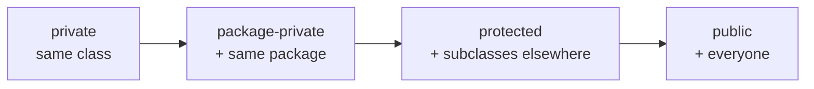
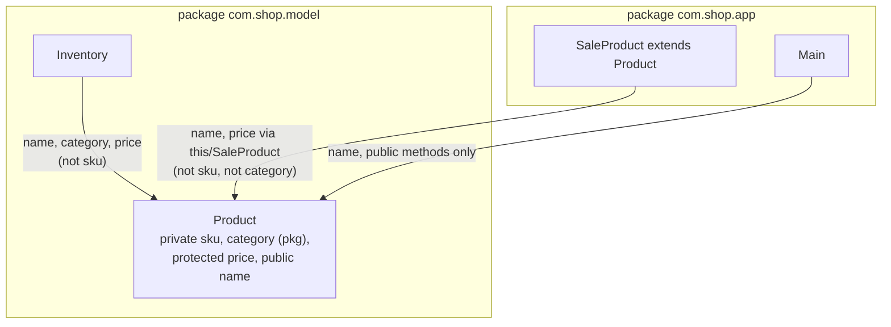
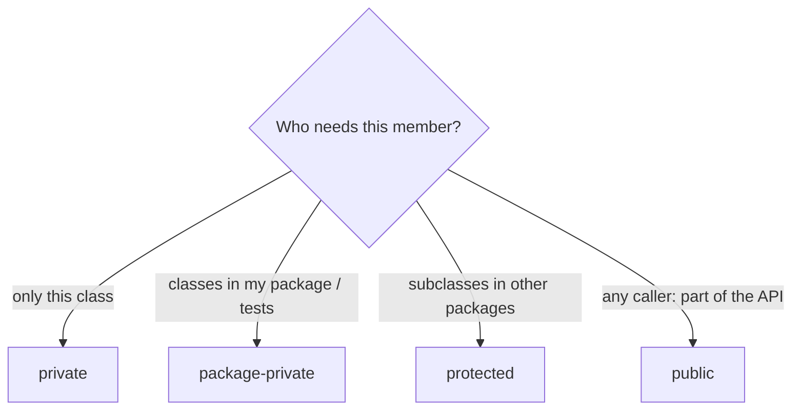

## In One Line
**Packages** group related classes into named folders and namespaces, and the four **access levels** — `private`, package-private (no keyword), `protected`, `public` — decide which code, in which class and package, may use each class, field, method and constructor.

## Mental Model
Think of a **company office building**.

- Each **package** is a **department floor** with a name plate (`com.shop.model`). Two departments can each have someone called "Date" — you tell them apart by the full name (`java.util.Date` vs `java.sql.Date`).
- **`private`** = **your own locked desk drawer**: only you (the class) open it.
- **Package-private** (no keyword) = **the department's shared cupboard**: anyone working on the same floor (same package) can open it; nobody from other floors.
- **`protected`** = the cupboard, **plus a family pass**: people on your floor, and your "children" (subclasses) wherever they work — but a child can only use the pass for *its own* things, not to open some other relative's cupboard.
- **`public`** = **the lobby**: anyone who enters the building.
- **`import`** is just **speed-dial**: it lets you say "Date" instead of the full name. It grants no extra access.
- **Modules** (Java 9+) are the **building's front desk**: even the lobby of a department is only open to visitors if the building *exports* that floor.

## Concept
### The four access levels
| Modifier | Same class | Same package | Subclass in another package | Any other class |
|---|---|---|---|---|
| `private` | Yes | No | No | No |
| *(none)* package-private | Yes | Yes | No | No |
| `protected` | Yes | Yes | Yes — through inheritance only (rule below) | No |
| `public` | Yes | Yes | Yes | Yes |

Order from most to least restrictive: **private < package-private < protected < public**. Note that `protected` is **wider** than package-private: it includes the whole package *and* subclasses.

### Where each modifier may appear
| Element | Allowed access modifiers |
|---|---|
| Top-level class / interface / enum / record | `public` or none — `private` and `protected` give "modifier private not allowed here" |
| Nested (member) class | All four |
| Fields, methods, constructors | All four |
| Local variables and parameters | None (their scope is the block) |
| Interface members | Methods are implicitly `public` (Java 9+ allows `private` methods); fields are implicitly `public static final` |
| Enum constructors | Implicitly `private` (you cannot call `new` on an enum) |

A source file may contain **at most one `public` top-level type**, and the file must be named after it: `class Right is public, should be declared in a file named Right.java`.

### `private` is per class, not per object
`private` restricts access to **code inside the same class body**, not to "the same object". A method can read the private fields of **another instance** of its own class — which is exactly what `equals`, `compareTo` and copy constructors do:
```java
boolean richerThan(Priv other) { return this.balance > other.balance; }  // legal
```
Private members are also shared across a **nest**: a top-level class and all its nested classes can access each other's private members. Before Java 11 the compiler generated hidden `access$000` bridge methods for this; Java 11 (JEP 181, *nestmates*) made it a JVM-level concept (`Class.isNestmateOf`).

Private members are **not inherited** in the sense of being accessible: a subclass object *contains* the parent's private fields, but subclass code cannot name them — it uses the parent's public/protected methods.

### Package-private (default access)
No keyword at all. The member is visible to every class in the **same package** — and to no one else, not even subclasses in other packages. Typical uses:
- helper classes and methods that are implementation details of a package;
- constructor or method visibility for **unit tests**, which live in the same package name under `src/test/java`.

The keyword `default` is **not** this modifier — `default` is used for `switch` labels and interface default methods.

### `protected` — the subtle one
`protected` = package access **plus** access from subclasses in other packages. The subclass rule (JLS 6.6.2) has a catch: outside the package, subclass code can access a protected instance member **only through a reference of its own type (or a subtype)** — `this.price`, `super.priceTag()`, or `otherSale.price` where `otherSale` is a `SaleProduct`. It may **not** use a reference typed as the parent: `Product other; other.price` fails with "price has protected access in Product". The idea: you may touch the protected parts of *your own kind* of object, not of arbitrary relatives (a `Product` could be some unrelated sibling subclass).

Protected **constructors** follow the same logic: from another package a subclass may call `super(...)` or create an anonymous subclass (`new Base() { }`), but not `new Base()` directly ("Base() has protected access in Base").

### Access and overriding
- An override may keep or **widen** access (`protected` → `public`) but never **narrow** it: "attempting to assign weaker access privileges; was public". Reason: code that works with the parent type must be able to call the method on any subclass (Liskov substitution).
- Implementing an interface method therefore requires `public` — the interface method is implicitly public.
- `private` methods are not overridden; a same-named method in a subclass is a new, unrelated method. Static methods are hidden, not overridden (see [Polymorphism](lesson:a01-oop/04-polymorphism)).

### Why restrict access at all?
- **Encapsulation**: hiding fields behind methods lets a class protect its **invariants** (a balance cannot go negative) — see [Encapsulation](lesson:a01-oop/02-encapsulation).
- **Freedom to change**: anything `public` is a promise to every caller; anything `private` can be renamed or removed freely.
- **Security and correctness**: fewer entry points, fewer ways to misuse.

Rule of thumb — **principle of least privilege**: make everything as private as possible, open it up only when a real caller needs it. Fields: almost always `private`. Classes: package-private unless they are part of the package's API.

Common patterns: a **private constructor** for utility classes (`Math`, `Collections`) and singletons; **private static factory** helpers; **package-private** implementation classes behind a public interface.

### Packages
A package is (1) a **namespace** — full class name = package + simple name, e.g. `com.shop.model.Product`; (2) an **access boundary** for package-private and protected; (3) a **folder** — `com/shop/model/Product.class` under a class-path root.

Rules:
- `package com.shop.model;` must be the **first statement** in the file (only comments and annotations may precede it); at most one per file.
- The folder structure must match the package when compiling with `-d` and when the class loader looks classes up.
- Naming convention: all lowercase, **reverse internet domain** (`com.google.common.collect`, `org.apache.commons`), to make names globally unique.
- A file without `package` is in the **unnamed (default) package**. Classes there **cannot be imported** by classes in named packages — fine for quick experiments, never for real code.
- Packages are **not hierarchical** for access: `com.shop` and `com.shop.model` are two unrelated packages; package-private members of one are invisible to the other.
- `package-info.java` holds package-level Javadoc and annotations (e.g. `@NullMarked`).

### `import`
| Form | Example | Notes |
|---|---|---|
| Single-type import | `import java.util.List;` | Wins over on-demand imports |
| On-demand (wildcard) import | `import java.util.*;` | All **public types of that one package** — **not** its sub-packages |
| Static single import | `import static java.lang.Math.max;` | Use `max(3, 7)` directly |
| Static on-demand import | `import static java.lang.Math.*;` | All static members |

- `java.lang` (`String`, `Math`, `System`, `Integer`...) is imported automatically, as is the current package.
- Imports are purely a **compile-time naming convenience**: no runtime cost, no class loading, no access granted. Wildcard imports are not slower.
- **Name clashes**: `import java.util.*;` + `import java.sql.*;` then `Date d;` → "reference to Date is ambiguous". Fix: add a single-type import (`import java.util.Date;`, which takes precedence) or write the fully qualified name `java.sql.Date` at the use site.
- `import com.shop.*;` does not bring in `com.shop.model.Product`; if `com.shop` itself has no classes, javac even reports "package com.shop does not exist".

### Compiling and running packaged code
```text
javac -d out $(find src -name "*.java")     # -d creates out/com/shop/... folders
java -cp out com.shop.app.Main               # fully qualified class name, from the class-path root
```
Running from inside the package folder fails with `NoClassDefFoundError: ... (wrong name: com/shop/app/Main)` — see [JDK vs JRE vs JVM](lesson:b01-fundamentals/01-jdk-jre-jvm).

### Modules (Java 9+): `public` is no longer "everyone"
With the Java Platform Module System, a `module-info.java` declares which packages a module **exports**:
```java
module com.shop {
    requires java.sql;            // modules this one depends on
    exports com.shop.api;         // public types here are usable by other modules
    opens com.shop.model;         // allow deep reflection (e.g. for JSON/JPA frameworks)
}
```
A `public` class in a **non-exported** package is invisible to other modules. So there are effectively five levels: private, package, protected, public-within-module, public-and-exported. The JDK itself uses this to hide internals such as `sun.misc` and `jdk.internal`: since Java 16 (JEP 396) illegal reflective access is denied by default, and since Java 17 (JEP 403) the `--illegal-access` escape hatch is gone — you need `--add-opens java.base/java.lang=ALL-UNNAMED` explicitly. Code on the plain class path lives in the *unnamed module*, which reads every module but only sees their exported packages.

### Reflection and access
`Field.setAccessible(true)` can bypass `private` **within your own code** (frameworks such as Spring, Hibernate and Jackson rely on it). For JDK internals it throws `InaccessibleObjectException` since Java 16/17 unless the package is opened. Access modifiers are a design and safety tool; in the same JVM they are not a hard security boundary against your own reflective code.

### Non-access modifiers (quick reference)
| Modifier | Applies to | Meaning |
|---|---|---|
| `static` | Fields, methods, nested classes, initializer blocks | Belongs to the class, not to instances |
| `final` | Classes, methods, variables | Cannot be extended / overridden / reassigned |
| `abstract` | Classes, methods | Must be subclassed / implemented |
| `synchronized` | Methods, blocks | Acquires the object's (or class's) monitor lock |
| `volatile` | Fields | Visibility and ordering guarantees across threads |
| `transient` | Fields | Skipped by Java serialization |
| `native` | Methods | Implemented in native code (JNI) |
| `sealed` / `non-sealed` | Classes, interfaces | Restrict which types may extend (Java 17) |
| `strictfp` | Classes, methods | Obsolete since Java 17 — all floating point is strict |

Illegal combinations the compiler rejects: `abstract` with `final`, `private`, `static` or `synchronized` on a method, and `final volatile` on a field.

## Diagram

Each level includes everything to its left: access only ever widens from `private` to `public`.


What each class of the example can see in `Product`, depending on its package and whether it is a subclass.


Pick the most restrictive answer that works — the principle of least privilege.

## Code
A small two-package project. Layout (compile with `javac -d out $(find src -name "*.java")`, run with `java -cp out com.shop.app.Main`):
```text
src/com/shop/model/Product.java
src/com/shop/model/Inventory.java
src/com/shop/app/SaleProduct.java
src/com/shop/app/Main.java
```
```java
package com.shop.model;

public class Product {
    private   String sku;          // only code inside Product
              String category;     // package-private: only com.shop.model
    protected double price;        // com.shop.model + subclasses anywhere
    public    String name;         // everyone

    public Product(String sku, String category, double price, String name) {
        this.sku = sku;
        this.category = category;
        this.price = price;
        this.name = name;
    }

    private String skuCode()     { return "SKU-" + sku; }
    String internalLabel()       { return category + "/" + skuCode(); }
    protected String priceTag()  { return String.format("%.2f", price); }
    public String describe()     { return name + " [" + internalLabel() + "] " + priceTag(); }
}
```
```java
package com.shop.model;

public class Inventory {
    // Same package: every member except private ones is visible
    public static String audit(Product p) {
        return p.name + " | " + p.category + " | " + p.price + " | " + p.internalLabel();
        // p.sku or p.skuCode() -> error: has private access in Product
    }
}
```
```java
package com.shop.app;

import com.shop.model.Product;

public class SaleProduct extends Product {
    public SaleProduct(String sku, String category, double price, String name) {
        super(sku, category, price * 0.9, name);   // public constructor of the parent
    }

    @Override
    public String priceTag() {                     // protected -> public: widening is allowed
        return "SALE " + super.priceTag();         // inherited protected method: OK
    }

    public boolean cheaperThan(SaleProduct other) {
        return this.price < other.price;           // protected field through OUR type: OK
    }
    // boolean cheaperThan(Product other) { return price < other.price; }
    //   -> error: price has protected access in Product
}
```
```java
package com.shop.app;

import com.shop.model.*;                  // on-demand import: every public type in the package
import static java.lang.Math.max;         // static import: use max(...) without "Math."

public class Main {
    public static void main(String[] args) {
        Product pen = new Product("P1", "stationery", 2.5, "Pen");
        SaleProduct lamp = new SaleProduct("L7", "home", 40.0, "Lamp");

        System.out.println(pen.describe());
        System.out.println(lamp.describe());          // describe() calls the overriding priceTag()
        System.out.println(Inventory.audit(lamp));
        System.out.println(pen.name + " / " + lamp.priceTag());   // only public members here
        System.out.println(lamp.cheaperThan(new SaleProduct("L8", "home", 50.0, "Big lamp")));
        System.out.println(max(3, 7));

        // Two classes named Date: use the fully qualified name for (at least) one of them
        java.sql.Date launch = java.sql.Date.valueOf("2024-01-15");
        System.out.println(launch + " is a " + launch.getClass().getName());
        System.out.println(Main.class.getPackageName() + " / " + Product.class.getName());
    }
}
```
```output
Pen [stationery/SKU-P1] 2.50
Lamp [home/SKU-L7] SALE 36.00
Lamp | home | 36.0 | home/SKU-L7
Pen / SALE 36.00
true
7
2024-01-15 is a java.sql.Date
com.shop.app / com.shop.model.Product
```

What the compiler says when code in `com.shop.app` breaks the rules (`Broken extends Product`):
```java
package com.shop.app;

import com.shop.model.Product;

class Broken extends Product {
    Broken() { super("x", "y", 1, "z"); }

    void test(Product other) {
        System.out.println(sku);            // private member of the parent
        System.out.println(category);       // package-private, different package
        System.out.println(other.price);    // protected, but through a Product reference
        System.out.println(price);          // OK: inherited protected field via this
        Product p = new Product("a", "b", 1, "c");
        System.out.println(p.internalLabel());
    }

    @Override
    String describe() { return "weaker"; }  // public -> package-private
}
```
```output
Broken.java:9: error: sku has private access in Product
Broken.java:10: error: category is not public in Product; cannot be accessed from outside package
Broken.java:11: error: price has protected access in Product
Broken.java:14: error: internalLabel() is not public in Product; cannot be accessed from outside package
Broken.java:18: error: describe() in Broken cannot override describe() in Product
  attempting to assign weaker access privileges; was public
5 errors
```

## Walkthrough
**Product** (`com.shop.model`)
- The four fields show all four levels side by side. `sku` is `private`, `category` has no modifier (package-private), `price` is `protected`, `name` is `public`. (Public fields are used here only to demonstrate access; real classes keep fields private.)
- The `public` constructor lets code in any package create a `Product`.
- `skuCode()` is `private`, yet `internalLabel()` — inside the same class — calls it freely. `describe()` is the public entry point that combines everything, so outside code gets the information without touching internals: that is encapsulation.
- `String.format("%.2f", price)` formats the price with two decimals (`2.50`).

**Inventory** (same package)
- Reads `name`, `category`, `price` and calls `internalLabel()` — everything except private members. The commented line explains that `p.sku` would fail.

**SaleProduct** (`com.shop.app`, a subclass in another package)
- `super(sku, category, price * 0.9, name)` calls the parent's public constructor; the stored price is 36.0 for a 40.0 lamp.
- `priceTag()` overrides a `protected` method and **widens** it to `public` — allowed. Inside it, `super.priceTag()` uses the inherited protected method.
- `cheaperThan(SaleProduct other)` reads `other.price` — legal because `other` is a `SaleProduct` (our own type). The commented `Product` version would fail: protected access from another package must go through the subclass's own type.
- The subclass can **not** see `category` or `internalLabel()` (package-private, wrong package) nor `sku` (private).

**Main** (`com.shop.app`)
- `import com.shop.model.*;` imports every public type of that package (`Product`, `Inventory`). `import static java.lang.Math.max;` allows `max(3, 7)` → `7`.
- `pen.describe()` → `Pen [stationery/SKU-P1] 2.50`. `lamp.describe()` runs the parent's `describe()`, which calls `priceTag()` — dynamically dispatched to `SaleProduct.priceTag()` → `SALE 36.00`. Access modifiers do not change how overriding works.
- `Inventory.audit(lamp)` shows the package-private and protected values from inside `com.shop.model`: `36.0` (raw `double`) and `home/SKU-L7`.
- `lamp.priceTag()` is callable from `Main` only because `SaleProduct` made it `public`; `pen.priceTag()` would not compile here (protected, different package, and `Main` is not a subclass).
- `cheaperThan` compares 36.0 with 45.0 → `true`.
- `java.sql.Date` is written with its **fully qualified name** because `java.util.Date` also exists — no import needed at all. `getPackageName()` (Java 9+) and `getName()` show the package and fully qualified class name.

**Broken** — each error message maps to one rule: private (`sku has private access`), package-private across packages (`is not public in Product; cannot be accessed from outside package` — the message says "not public" even though the real issue is the missing package access), protected through a parent-typed reference (`price has protected access`), and narrowing an override (`attempting to assign weaker access privileges; was public`). The line `System.out.println(price);` produces no error. (javac prints the full path `broken/com/shop/app/Broken.java` and the offending source line; they are shortened here.)

## Traps
- **"`protected` is more restrictive than default."** It is the opposite: `protected` = package access **plus** subclasses.
- **Protected access through a parent reference** in another package does not compile (`other.price` where `other` is a `Product`). Only `this`, `super`, or references of the subclass's own type work.
- **`new Parent()` with a protected constructor** from another package fails even inside a subclass; only `super(...)` or an anonymous subclass works.
- **Top-level classes cannot be `private` or `protected`.** Only `public` or package-private.
- **One public top-level class per file**, and the file name must match it exactly (case-sensitive).
- **Narrowing access in an override** — including implementing an interface method without `public` — is a compile error.
- **`import com.shop.*` does not import sub-packages.** `com.shop` and `com.shop.model` are unrelated packages for both imports and access.
- **Ambiguous wildcard imports** (`java.util.*` + `java.sql.*` → `Date`) are only reported when you *use* the ambiguous name; fix with a single-type import or a fully qualified name.
- **Classes in the default package cannot be imported** from a named package.
- **`public` does not mean accessible across modules** unless the package is exported.
- **`private` is per class, not per object**: another instance's private fields are accessible in the same class. Sometimes surprising in `equals`, but correct.

> [!WARNING] Making fields `protected` "so subclasses can use them" couples every subclass — in any package — to your internal representation. Prefer `private` fields with `protected` (or public) accessor methods.

## Tips & Tricks
- **Order mnemonic — "Please Don't Put Pickles":** **P**rivate < **D**efault (package) < **P**rotected < **P**ublic.
- **Visibility table in one line:** *Class → Package → Kids → World*. `private` stops at Class, default at Package, `protected` at Kids, `public` reaches the World.
- **Protected rule of thumb:** "outside the package, a child may only use its *own* inherited protected stuff" — `this.x` yes, `someParent.x` no.
- **Overriding:** "access may **grow**, never **shrink**" (same rule for checked exceptions in the other direction: may shrink, never grow).
- **Start private.** Promote to package-private for tests, to protected for designed extension points, to public only for real API.
- **Test the package-private way:** put tests in the same package (`src/test/java/com/shop/model/ProductTest.java`) instead of making things public just for tests.
- **Prefer single-type imports** (IDEs manage them) — they make dependencies obvious and avoid clashes.

## Interview Q&A
### [Basic] What are the access modifiers in Java and what do they allow?
There are four levels. `private`: accessible only inside the declaring class (and its nestmates). Package-private (no keyword, often called "default"): accessible to all code in the same package. `protected`: package access plus access from subclasses in other packages, through inheritance. `public`: accessible from everywhere (subject to module exports since Java 9). From most to least restrictive: private, package-private, protected, public.

**Follow-up:** *Which modifiers can a top-level class have?* — Only `public` or none (package-private). Nested classes can use all four.

### [Basic] What is the difference between default (package-private) and protected access?
Package-private members are visible only within the same package. `protected` includes everything package-private allows **plus** access from subclasses in other packages. So `protected` is *less* restrictive. Within the same package they behave identically; the difference only shows for subclasses outside the package.

**Follow-up:** *Can a non-subclass in another package access a protected member?* — No, only subclasses (and only through their own type).

### [Basic] Can we override a method with a more restrictive access modifier?
No. An overriding method must have the same or **wider** access: `protected` → `public` is fine, `public` → `protected` or package-private is a compile error ("attempting to assign weaker access privileges"). Otherwise code using the parent type could call a method that the actual subclass object hides, breaking substitutability. This is also why methods implementing an interface must be `public`.

**Follow-up:** *Can you override a private method?* — No. Private methods are not visible to subclasses; a method with the same signature in the subclass is a new method, and `@Override` on it is a compile error.

### [Basic] What is a package and why use packages?
A package is a namespace that groups related types, e.g. `java.util` or `com.shop.model`. It (1) avoids name clashes — `java.util.Date` and `java.sql.Date` coexist; (2) forms an access boundary for package-private and protected members; (3) organizes code into folders matching the package name. The `package` declaration must be the first statement, names are lowercase reverse domain names, and the class's fully qualified name includes the package.

**Follow-up:** *Does `import java.util.*` import `java.util.concurrent`?* — No. Wildcard imports cover only the types of that exact package, never sub-packages; `java.util` and `java.util.concurrent` are separate packages.

### [Intermediate] Explain the tricky rule for `protected` access from a subclass in a different package.
Outside the declaring package, a subclass may access a protected **instance** member only via an expression whose type is the subclass itself (or its subclass) — `this.price`, `super.price()`, or `otherSale.price` where `otherSale` is a `SaleProduct`. Through a reference of the parent type (`Product p; p.price`) it is a compile error, because `p` might be a completely different subclass whose internals are none of our business. For protected constructors the analogue is: `super(...)` or an anonymous subclass is allowed, `new Parent()` is not. Within the same package none of these restrictions apply.

**Follow-up:** *Do static protected members follow the same rule?* — No, the object-type restriction applies to instance members; a subclass can access a protected static member through the class name.

### [Intermediate] Why can one object access another object's private fields in `equals`?
Because Java's access control is **class-based**, not object-based: `private` means "accessible from code in this class body", regardless of which instance the code runs on. So `this.balance > other.balance` compiles when `other` is of the same class. This is what makes `equals`, `compareTo`, copy constructors and builders possible without exposing getters.

**Follow-up:** *Can a nested class access its outer class's private members?* — Yes, both ways: all classes in the same top-level class form a *nest* (formalized in Java 11 as nestmates).

### [Intermediate] What is a static import, and when should you use it?
`import static java.lang.Math.max;` (or `Math.*`) lets you use static members without the class prefix: `max(a, b)`. It is useful for heavily used constants and DSL-style APIs — `import static org.junit.jupiter.api.Assertions.*;`, `import static java.util.stream.Collectors.toList;`. Overuse hurts readability because readers cannot see where a name comes from, and names from different classes can clash.

**Follow-up:** *Do imports affect performance or class loading?* — No. They are resolved at compile time; the bytecode contains fully qualified names either way.

### [Intermediate] Why would you make a constructor private?
To control instance creation: (1) **utility classes** with only static methods (`Math`, `Collections`) should not be instantiated; (2) **singletons** expose one instance through a static method or field; (3) **static factory methods** (`List.of`, `Integer.valueOf`) can cache, return subtypes, or have descriptive names; (4) **builders**, where only the nested builder calls the constructor. A private constructor also prevents subclassing from outside the class, since a subclass constructor must call a parent constructor.

**Follow-up:** *Can reflection still call a private constructor?* — For your own classes, yes via `setAccessible(true)` (which is why enum singletons are safest); for JDK internals it is blocked since Java 16/17 unless the package is opened.

### [Advanced] How do Java modules change the meaning of `public`?
With JPMS (Java 9), a module's `module-info.java` lists which packages it `exports`. A `public` type in a non-exported package is **not accessible** to other modules — at compile time or run time. `opens` separately controls deep reflection (needed by frameworks that read private fields). This added a new level of encapsulation between package and world: "public inside my module". The JDK uses it to hide internal packages; since Java 16 illegal reflective access to them is denied by default and since 17 it can only be enabled with explicit `--add-opens`/`--add-exports` flags.

**Follow-up:** *Does this affect code on the class path?* — Class-path code lives in the unnamed module: it can read all modules but only their exported packages, which is why old libraries using `sun.misc.*` or reflective hacks into `java.lang` broke on Java 16/17.

### [Advanced] How would you choose access levels when designing a library class?
Apply least privilege: fields `private` (use `final` where possible); constructors often `private` or package-private behind static factories; helper classes package-private; methods `public` only if they are part of the documented API, because every public member is a compatibility promise. Use `protected` only for deliberate extension points (template-method hooks), and document them — or make the class `final` (or `sealed`) if it is not designed for inheritance. For modular libraries, export only API packages and keep implementation packages unexported.

**Follow-up:** *Why is `protected` considered part of the public API?* — Any subclass anywhere can call and depend on it, so changing it breaks clients just like changing a public method.

## Quiz
### Which access level is the LEAST restrictive, apart from `public`?
- [ ] private
- [ ] package-private (no modifier)
- [x] protected
- [ ] They are all equal
> `protected` allows everything package-private does *plus* subclasses in other packages. Many people guess package-private because "protected sounds stricter", but it is the other way around.

### Which top-level class declaration compiles?
- [ ] `private class Helper { }`
- [ ] `protected class Helper { }`
- [x] `class Helper { }`
- [ ] `static class Helper { }`
> Top-level types may only be `public` or package-private (no modifier). `private`/`protected` give "modifier private not allowed here", and `static` is only for nested classes.

### `SaleProduct` (package `com.shop.app`) extends `Product` (package `com.shop.model`), which declares `protected double price;`. Which line inside `SaleProduct` does NOT compile?
- [ ] `double a = this.price;`
- [ ] `double b = price;`
- [x] `double c = new Product("s", "c", 1, "n").price;`
- [ ] `double d = new SaleProduct("s", "c", 1, "n").price;`
> Outside the package, a subclass may access protected instance members only through its own type (or a subtype). A `Product` reference is not a `SaleProduct`, so the compiler reports "price has protected access in Product".

### A parent class declares `public void save()`. Which override compiles?
- [ ] `protected void save()`
- [ ] `void save()`
- [ ] `private void save()`
- [x] `public void save()`
> An override may keep or widen access, never narrow it. `public` can only stay `public`; the other three are "attempting to assign weaker access privileges".

### Which statement about `import java.util.*;` is TRUE?
- [ ] It also imports `java.util.concurrent.ConcurrentHashMap`
- [ ] It makes the program slower because all classes are loaded
- [x] It lets you use every public type of `java.util` by its simple name
- [ ] It is required to use `String`
> Wildcard imports cover one package only, not sub-packages, and are resolved at compile time with no run-time cost. `String` is in `java.lang`, which is always imported automatically.

### What does this print?
```java
public class Priv {
    private int balance;
    Priv(int b) { balance = b; }
    boolean richerThan(Priv other) { return this.balance > other.balance; }
    public static void main(String[] a) {
        System.out.println(new Priv(10).richerThan(new Priv(5)));
    }
}
```
- [x] true
- [ ] false
- [ ] Compile error: balance has private access
- [ ] Runtime IllegalAccessError
> `private` is checked per class, not per object: code inside `Priv` may read the private field of any `Priv` instance. 10 > 5, so it prints `true`.

### Spot the bug: why does this not compile?
```java
import java.util.*;
import java.sql.*;

public class Report {
    Date created;
}
```
- [ ] `java.sql` cannot be imported
- [ ] Wildcard imports are not allowed together
- [x] `Date` exists in both packages, so the simple name is ambiguous
- [ ] `Date` is deprecated
> Both `java.util.Date` and `java.sql.Date` are imported on demand, so `Date` is ambiguous ("reference to Date is ambiguous"). Add `import java.util.Date;` (single-type imports win) or write the fully qualified name.

## Takeaways
- Four access levels, most to least restrictive: `private` (class) < package-private (package) < `protected` (package + subclasses) < `public` (everyone).
- Top-level types can only be `public` or package-private; one public top-level type per file, named like the file.
- `private` is per class, not per object, and is shared by nested classes (nestmates).
- Outside its package, a subclass can use protected members only through its own type (`this`, `super`, or a subclass-typed reference).
- Overrides may widen access but never narrow it; interface implementations must be `public`.
- A package is a namespace + access boundary + folder; `package` comes first, names are reverse domain, sub-packages are unrelated packages.
- Imports are compile-time shortcuts only: wildcards do not include sub-packages, single-type imports resolve clashes, `java.lang` is automatic.
- Since Java 9, `public` types are visible to other modules only if their package is exported; JDK internals are strongly encapsulated since Java 16/17.
