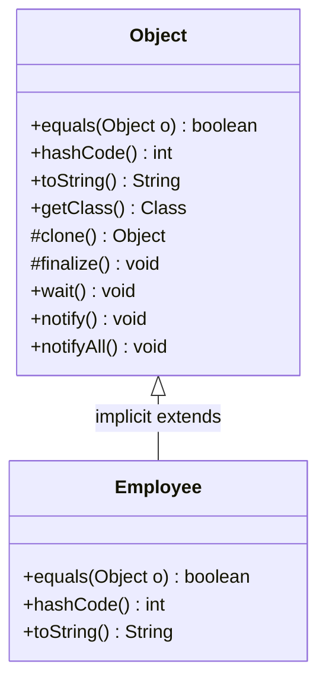
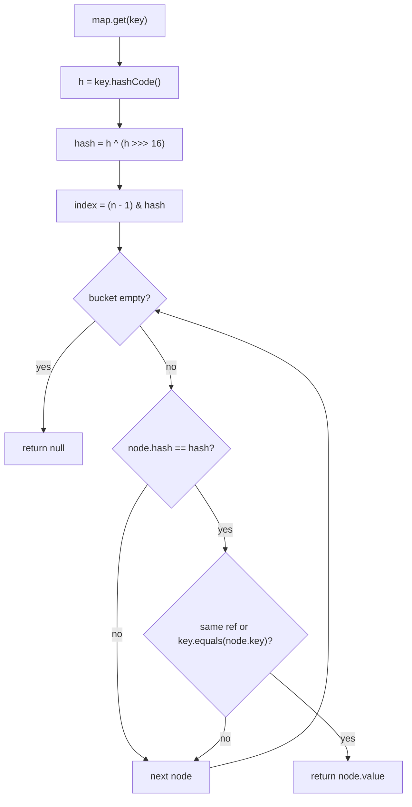
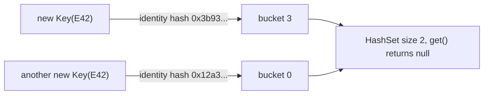

## In One Line
Every Java class silently extends `java.lang.Object` and inherits its 11 methods; the two that matter most, `equals` (are these two objects *logically the same*?) and `hashCode` (a number that picks a *bucket*), form one contract: **equal objects must have equal hash codes**, so you always override them together or hash-based collections quietly break.

## Mental Model
Think of a **library with numbered shelves**.

- `hashCode()` is the **shelf number** the librarian computes from a book, for example from its title. It tells you *where to look*.
- `equals()` is the librarian **reading the full title and edition** to confirm "yes, this is the book you asked for".
- **Rule 1 — equal books go on the same shelf.** Two copies of the same book must get the same shelf number, or the second copy is shelved somewhere else and a search never finds it (equal objects → equal hash codes).
- **Rule 2 — a shelf may hold different books.** Many titles can share a shelf; the librarian then checks each one with `equals` (collisions are allowed, they only slow the search).
- **The broken library.** If the librarian picks shelves with a *random number per physical copy* (`Object`'s identity hash) but confirms matches by *title* (your overridden `equals`), a second copy of the same book lands on a different shelf and every search misses it. That is exactly what happens when you override `equals` but not `hashCode`.

`HashMap`, `HashSet`, `Hashtable` and `ConcurrentHashMap` are that library: `hashCode` to find the shelf, `equals` to confirm the book.

## Concept
### `java.lang.Object` — the root of every class
- Every class without an `extends` clause implicitly extends `Object`, so every object — including **arrays** (`int[]` has superclass `Object` and implements `Cloneable` and `Serializable`) — has Object's methods.
- Interfaces do not extend `Object`, but an interface type still "has" Object's public methods (JLS §9.2), which is why `list.toString()` compiles when `list` is a `List`. An interface may **not** provide a `default` implementation of `equals`, `hashCode` or `toString` — *"default method toString in interface Shape overrides a member of java.lang.Object"*.
- Primitives are not objects and have no methods; their wrappers (`Integer`, `Double`, ...) do.

### The 11 methods of `Object` (JDK 21)
| Method | Modifiers | What the default does | Override? |
|---|---|---|---|
| `boolean equals(Object o)` | `public` | `this == o` (identity) | Yes, for value classes |
| `int hashCode()` | `public native` | Identity hash code (not the address, see below) | Yes, **whenever** you override `equals` |
| `String toString()` | `public` | `getClass().getName() + "@" + Integer.toHexString(hashCode())` | Almost always |
| `Class<?> getClass()` | `public final native` | The runtime class of the object | Cannot (final) |
| `Object clone()` | `protected native` | Field-by-field **shallow** copy, only if the class implements `Cloneable`; otherwise throws `CloneNotSupportedException` | Rarely; prefer copy constructors |
| `void finalize()` | `protected` | Nothing. **Deprecated** (Java 9), **for removal** (Java 18, JEP 421) | Never |
| `void wait()`, `wait(long)`, `wait(long, int)` | `public final` | Release the monitor and sleep until notified / timed out | Cannot |
| `void notify()`, `notifyAll()` | `public final native` | Wake one / all threads waiting on this object's monitor | Cannot |

Handy split: **final** = `getClass`, `wait` ×3, `notify`, `notifyAll` (the JVM's business); **overridable** = `equals`, `hashCode`, `toString`, `clone`, `finalize`. Reflection on JDK 21 also shows a `private final native wait0(long)` helper that the public `wait(long)` delegates to — not part of the API.

> [!INTERVIEW] "`wait`/`notify` live in `Object`, not `Thread`, because **every object can be a lock** (monitor); you wait on and notify *the lock*, not a thread."

### `==` versus `equals()`
| | `a == b` | `a.equals(b)` |
|---|---|---|
| Primitives | Compares values | Not applicable |
| References | **Same object?** (identity) | **Same meaning?** (logical equality) — only if the class overrides it |
| Default in `Object` | — | Identical to `==` |
| `null` | `null == null` is `true` | `null.equals(x)` throws NPE; `x.equals(null)` must return `false` |

Classes that override `equals` for value semantics: `String`, all wrappers, `BigDecimal`, `LocalDate` and all `java.time` types, `List`/`Set`/`Map` implementations, records. Classes that do **not**: arrays, `StringBuilder`, `Thread`, most service/entity classes.

> [!WARNING] Wrapper caching makes `==` look like it works: `Integer a = 127, b = 127; a == b` is `true` (both come from the `Integer.valueOf` cache of −128..127), but with `128` it is `false`. Always compare wrappers and strings with `equals`. See [String Pool](lesson:b01-fundamentals/07-string-pool-and-immutability) for the string version.

### The `equals` contract (from the `Object.equals` Javadoc)
For non-null references `x`, `y`, `z`:
1. **Reflexive** — `x.equals(x)` is `true`.
2. **Symmetric** — `x.equals(y)` is `true` if and only if `y.equals(x)` is `true`.
3. **Transitive** — if `x.equals(y)` and `y.equals(z)`, then `x.equals(z)`.
4. **Consistent** — repeated calls return the same result as long as the fields used by `equals` do not change.
5. **Non-nullity** — `x.equals(null)` is `false` (never an exception).

Collections *assume* these rules. `ArrayList.contains(o)` calls `o.equals(element)`; `HashMap` calls `key.equals(existingKey)`. If your `equals` is asymmetric, the result depends on which side the library happens to call — see `ContractBreakers` below, where `list.contains("polish")` is `false` although `polish.equals("polish")` is `true`.

### The `hashCode` contract
1. **Consistent** — during one execution, `hashCode()` returns the same value as long as the fields used by `equals` do not change. (It may differ between runs — never persist identity hash codes.)
2. **Equal objects → equal hash codes.** If `x.equals(y)`, then `x.hashCode() == y.hashCode()`. *This is the rule people break.*
3. **Unequal objects may share a hash code** (a *collision*). Allowed, but a good hash spreads values out, because collisions make hash tables slower.

The logic only goes one way: **same hash does not mean equal** (`"Aa"` and `"BB"` both hash to `2112`), but **different hash does mean not equal**.

### Why they must be overridden together — how `HashMap` uses them
`map.get(key)` in `java.util.HashMap` (JDK 8+):
1. `h = key.hashCode()`, then **spread** it: `hash = h ^ (h >>> 16)` (mixes high bits into the low bits).
2. **Bucket index** = `(table.length - 1) & hash` (the table length is a power of two).
3. Walk that bucket: for each node, first compare the **stored hash** (`node.hash == hash`), then `node.key == key || key.equals(node.key)`.

So `equals` is only ever called on keys whose hash codes already match. Consequences:
- **Override `equals` but not `hashCode`:** two equal keys get different identity hashes → different buckets (or at least different stored hashes) → `equals` is never called → `HashSet` stores "duplicates", `map.get(equalKey)` returns `null`.
- **Override `hashCode` but not `equals`:** equal keys reach the same bucket, but `Object.equals` (identity) says "different" → duplicates again.
- **Constant `hashCode` (`return 42;`):** legal and correct, but every key lands in one bucket → lookups degrade from O(1) to O(n) (O(log n) once Java 8 turns a crowded bucket into a red-black tree, which happens at 8 entries in a bucket when the table has at least 64 slots).

The internals (resize, treeification, `null` key) are in [HashMap Internals](lesson:b04-collections-internals/01-hashmap-internals).

### Writing `equals` correctly — the recipe
```java
@Override
public boolean equals(Object o) {                // parameter type MUST be Object
    if (this == o) return true;                  // 1. same reference: cheap fast path
    if (!(o instanceof Employee other)) return false;  // 2. type check; false for null too
    return id == other.id                        // 3. compare significant fields
        && Double.compare(rating, other.rating) == 0
        && Objects.equals(name, other.name)
        && Arrays.equals(scores, other.scores);
}
```
| Field type | Compare with | Why |
|---|---|---|
| `int`, `long`, `char`, `boolean`, `byte`, `short` | `==` | Plain value comparison |
| `float` / `double` | `Float.compare` / `Double.compare` (`== 0`) | `NaN == NaN` is `false` and `0.0 == -0.0` is `true`; `compare` treats `NaN` as equal to itself and `-0.0` as different from `0.0`, matching `Double.equals` |
| Reference, maybe `null` | `Objects.equals(a, b)` | Null-safe |
| Array | `Arrays.equals` / `Arrays.deepEquals` (nested) | Arrays inherit identity `equals` |
| Collection | `a.equals(b)` | Lists/sets/maps already compare by content |

Order the comparisons **cheapest and most-likely-to-differ first** (an `int` id before a long string). Use only the fields that define the object's *logical identity*; skip derived or cached fields (like a lazily computed hash).

### Writing `hashCode` correctly
```java
@Override
public int hashCode() {                          // the SAME fields as equals
    int result = Integer.hashCode(id);
    result = 31 * result + Double.hashCode(rating);
    result = 31 * result + Objects.hashCode(name);    // null -> 0
    result = 31 * result + Arrays.hashCode(scores);
    return result;
}
```
- **Use exactly the fields `equals` uses** (or a subset — a subset is legal but spreads worse). Never use a field that `equals` ignores: two equal objects could then get different hashes.
- **Why 31?** It is an odd prime (an even multiplier would lose information on overflow, like shifting left), and `31 * i == (i << 5) - i`, a multiplication the JIT can do with a shift and a subtraction. `String.hashCode` uses the same formula: `s[0]*31^(n-1) + s[1]*31^(n-2) + ... + s[n-1]`.
- **`Objects.hash(a, b, c)`** is a one-liner that computes the same 31-based formula (it calls `Arrays.hashCode` on the varargs array). It is fine for most code, but it allocates an array and boxes primitives on every call, so hot paths (keys in huge maps) use the manual form.
- Wrapper hash codes to know: `Integer.hashCode(v) = v`, `Long.hashCode(v) = (int)(v ^ (v >>> 32))`, `Boolean`: `true` → 1231, `false` → 1237, `Double.hashCode(d)` = hash of `doubleToLongBits(d)`, `"".hashCode()` = 0.
- Immutable classes may **cache** the hash in a field (as `String` does) because it can never change.

### `instanceof` or `getClass()` in `equals`?
| | `o instanceof Point p` | `getClass() == o.getClass()` |
|---|---|---|
| Subclass instance can be equal to parent | Yes | No |
| Symmetric when a subclass **adds** state to `equals` | No (it breaks) | Yes |
| Liskov-friendly (a subclass with no new state still works in sets/maps) | Yes | No |
| Works with proxies (Hibernate, Mockito subclasses) | Yes | No |
| Handles `null` | Automatically (`null instanceof X` is `false`) | Needs an explicit `o == null` check |

*Effective Java* (Item 10) shows there is **no way to extend an instantiable class, add a value field, and keep the `equals` contract**. The practical answers:
- Make value classes **`final`** (or records) and use `instanceof` — the most common choice.
- If a class is designed for extension and subclasses must never equal the parent, use `getClass()`.
- Prefer **composition**: `ColorPoint` *has a* `Point` plus a colour, instead of *being* a `Point`.

### `toString()` — for humans and logs
- Default: `ClassName@hexIdentityHash`, e.g. `DefaultsDemo$Point@3b938003` — nearly useless. Override it to show the fields that matter (never passwords).
- `println(obj)`, string concatenation and loggers call `String.valueOf(obj)`, which calls `toString()` and prints `"null"` for `null`.
- Arrays do not override it: `int[]` prints like `[I@1b6d3586`. Use `Arrays.toString` / `Arrays.deepToString`.
- `Objects.toString(o, "n/a")` gives a default for `null`. Records generate `Point[x=1, y=2]`.

### `getClass()` — the runtime class
Returns the **runtime** class of the object, whatever the reference type: `Object o = "text"; o.getClass()` is `String.class`. It is `final`, so nobody can lie about it. Compare with `.class` (a compile-time literal: `String.class`) and `instanceof` (true for the class **and its subclasses**).

### `clone()` — why it is considered broken
- `Object.clone()` is `protected`; to make it usable you implement the **marker interface** `Cloneable` (no methods!) and override `clone()` as `public`, usually with a covariant return type.
- Without `Cloneable`, `super.clone()` throws the **checked** `CloneNotSupportedException`.
- The copy is **shallow**: fields are copied bit by bit, so both objects share the same referenced `List`, array, etc. Deep copying is manual, and `final` fields cannot be reassigned after `super.clone()`.
- No constructor runs, so invariants set up in constructors are skipped.
- Arrays are the exception that works well: `arr.clone()` is public, needs no cast and gives a new array (still shallow for arrays of objects).

Prefer a **copy constructor** or **static copy factory** (`new ArrayList<>(other)`, `List.copyOf`) — see [Copy Constructor](lesson:a02-core/04-copy-constructor) and [Prototype](lesson:a10-patterns/04-prototype).

### `finalize()` — deprecated for removal
It was meant to run before garbage collection, but there is no guarantee *when* or *whether* it runs, it slows GC, and it can resurrect objects. Deprecated in Java 9 and marked for removal in Java 18 (JEP 421); overriding it gives a `[removal]` compiler warning. Use `try`-with-resources for resources and `java.lang.ref.Cleaner` as a safety net (see [Advanced Exceptions](lesson:b01-fundamentals/11-exceptions-advanced) and [Reference Types](lesson:b02-jvm/04-reference-types)).

### `wait()` / `notify()` / `notifyAll()`
Every object has a monitor. These methods may only be called by a thread that **owns** that monitor (inside `synchronized (obj)`), otherwise they throw `IllegalMonitorStateException` ("current thread is not owner"). `wait()` releases the lock and suspends; `notify()` wakes one waiter, `notifyAll()` all; always call `wait()` in a `while (!condition)` loop because of spurious wake-ups. Full treatment: [wait and notify](lesson:a06-threads/06-wait-notify).

### The identity hash code (the default `hashCode`)
- It is **not the memory address.** Garbage collectors move objects, but the hash must never change. HotSpot generates a number (by default a thread-local xor-shift random generator) the first time `hashCode()`/`System.identityHashCode()` is called, and stores it in the object's **header** (the mark word), so later calls return the same value.
- It is **not unique**: on 64-bit HotSpot it has 31 bits, so collisions appear after roughly a hundred thousand objects (birthday paradox). Never use it as an ID.
- `System.identityHashCode(o)` always returns the identity hash, even if the class overrides `hashCode()`; `IdentityHashMap` uses it together with `==` (see [IdentityHashMap](lesson:a03-collections/18-identityhashmap)).

### `equals` / `hashCode` in the JDK types you use every day
| Type | `equals` means | Notes |
|---|---|---|
| `String` | Same characters | `hashCode` cached; `"Aa"`/`"BB"` collide |
| Wrappers | Same type **and** value | `Long.valueOf(42).equals(42)` is `false` (an `Integer` is not a `Long`) |
| `Double` | Same bits | `NaN` equals `NaN`; `0.0` does not equal `-0.0` |
| `BigDecimal` | Same value **and scale** | `1.0` vs `1.00`: `equals` false, `compareTo` 0 |
| `List` | Same elements in same order, **any** `List` implementation | `ArrayList` equals `List.of` with the same elements |
| `Set` / `Map` | Same elements / same mappings, any implementation | A `List` never equals a `Set` |
| Arrays | **Identity** | Use `Arrays.equals`/`deepEquals`/`hashCode` |
| `StringBuilder` | **Identity** | Compare `sb.toString()` or use `sb.compareTo(other) == 0` (Java 11+) |
| Enums | Identity (`equals` and `hashCode` are `final` in `Enum`) | Safe to compare with `==`; identity hash varies between runs |
| Records | All components, via their own `equals` | Array components compare by identity |

### Consistency with `compareTo`
`Comparable` recommends (but does not require) that `compareTo` returns 0 exactly when `equals` is `true`. `BigDecimal` breaks this, so a `HashSet` (uses `equals`) keeps both `1.0` and `1.00`, while a `TreeSet` (uses `compareTo`) keeps one. More in [Comparable vs Comparator](lesson:b01-fundamentals/09-comparable-vs-comparator).

### Records: the modern shortcut (Java 16+)
`record Point(int x, int y) {}` generates `equals` (all components, `Double.compare`-style semantics for floating-point components), `hashCode` and `toString`. You can still override them — for example to compare an array component with `Arrays.equals`. See [Records](lesson:b05-modern-java/03-records). IDEs (Generate → equals() and hashCode()) and Lombok's `@EqualsAndHashCode` generate the same recipe for normal classes.

## Diagram

Every class extends `Object`. A value class overrides the three "identity" methods together; `getClass`, `wait` and `notify*` are final and cannot be overridden (`wait` also has two timed overloads, omitted here).


`hashCode` chooses the bucket and filters candidates; `equals` is only called on keys with the same hash. If equal keys have different hashes, `equals` never gets a chance.


What goes wrong when only `equals` is overridden: two logically equal keys take different paths and are never compared.

## Code
**1. What every class inherits from `Object`** (no overrides):
```java
public class DefaultsDemo {
    static class Point {                       // no equals/hashCode/toString overrides
        final int x, y;
        Point(int x, int y) { this.x = x; this.y = y; }
    }

    public static void main(String[] args) {
        Point a = new Point(1, 2);
        Point b = new Point(1, 2);
        Point c = a;

        System.out.println("a == b      : " + (a == b));
        System.out.println("a.equals(b) : " + a.equals(b));      // Object.equals is ==
        System.out.println("a.equals(c) : " + a.equals(c));
        System.out.println("a.toString(): " + a);                // ClassName@hexHash
        System.out.println("hex hash    : " + Integer.toHexString(a.hashCode()));
        System.out.println("stable hash : " + (a.hashCode() == a.hashCode()));
        System.out.println("identity    : " + (a.hashCode() == System.identityHashCode(a)));
        System.out.println("getClass()  : " + a.getClass().getName());
        Object o = "text";
        System.out.println("runtime type: " + o.getClass().getSimpleName());
    }
}
```
```output
a == b      : false
a.equals(b) : false
a.equals(c) : true
a.toString(): DefaultsDemo$Point@3b938003
hex hash    : 3b938003
stable hash : true
identity    : true
getClass()  : DefaultsDemo$Point
runtime type: String
```

**2. Overriding only one of the pair breaks hash collections:**
```java
import java.util.HashMap;
import java.util.HashSet;
import java.util.Map;
import java.util.Objects;
import java.util.Set;

public class BrokenKeys {
    // 1. equals WITHOUT hashCode
    static class EqualsOnly {
        final String id;
        EqualsOnly(String id) { this.id = id; }
        @Override public boolean equals(Object o) {
            return o instanceof EqualsOnly other && id.equals(other.id);
        }
    }

    // 2. hashCode WITHOUT equals
    static class HashOnly {
        final String id;
        HashOnly(String id) { this.id = id; }
        @Override public int hashCode() { return id.hashCode(); }
    }

    // 3. both, consistent with each other
    static class Both {
        final String id;
        Both(String id) { this.id = id; }
        @Override public boolean equals(Object o) {
            return o instanceof Both other && id.equals(other.id);
        }
        @Override public int hashCode() { return Objects.hashCode(id); }
    }

    public static void main(String[] args) {
        Set<EqualsOnly> s1 = new HashSet<>();
        s1.add(new EqualsOnly("E42"));
        s1.add(new EqualsOnly("E42"));
        System.out.println("equals only   -> size " + s1.size()
                + ", contains " + s1.contains(new EqualsOnly("E42"))
                + ", equal? " + new EqualsOnly("E42").equals(new EqualsOnly("E42")));

        Set<HashOnly> s2 = new HashSet<>();
        s2.add(new HashOnly("E42"));
        s2.add(new HashOnly("E42"));
        System.out.println("hashCode only -> size " + s2.size()
                + ", contains " + s2.contains(new HashOnly("E42")));

        Set<Both> s3 = new HashSet<>();
        s3.add(new Both("E42"));
        s3.add(new Both("E42"));
        System.out.println("both          -> size " + s3.size()
                + ", contains " + s3.contains(new Both("E42")));

        Map<EqualsOnly, String> salaries = new HashMap<>();
        salaries.put(new EqualsOnly("E42"), "50,000");
        System.out.println("map.get with an equal key -> " + salaries.get(new EqualsOnly("E42")));
    }
}
```
```output
equals only   -> size 2, contains false, equal? true
hashCode only -> size 2, contains false
both          -> size 1, contains true
map.get with an equal key -> null
```

**3. The correct recipe** (a `final` class with every kind of field) **and the record shortcut:**
```java
import java.util.Arrays;
import java.util.HashMap;
import java.util.Map;
import java.util.Objects;

public class GoodEquals {
    static final class Employee {                         // final: no subclass can break symmetry
        private final int id;
        private final String name;                        // may be null
        private final double rating;
        private final int[] scores;                       // array field

        Employee(int id, String name, double rating, int[] scores) {
            this.id = id; this.name = name; this.rating = rating; this.scores = scores.clone();
        }

        @Override
        public boolean equals(Object o) {
            if (this == o) return true;                           // 1. same reference: fast path
            if (!(o instanceof Employee other)) return false;     // 2. type check (also handles null)
            return id == other.id                                  // 3. primitives with ==
                && Double.compare(rating, other.rating) == 0       //    double/float with compare
                && Objects.equals(name, other.name)                //    nullable references
                && Arrays.equals(scores, other.scores);            //    arrays by content
        }

        @Override
        public int hashCode() {                                    // SAME fields as equals
            int result = Integer.hashCode(id);
            result = 31 * result + Double.hashCode(rating);
            result = 31 * result + Objects.hashCode(name);
            result = 31 * result + Arrays.hashCode(scores);
            return result;
        }

        @Override
        public String toString() {
            return "Employee[id=" + id + ", name=" + name + ", rating=" + rating
                    + ", scores=" + Arrays.toString(scores) + "]";
        }
    }

    record EmployeeRecord(int id, String name, double rating) { }   // equals/hashCode/toString generated

    public static void main(String[] args) {
        Employee a = new Employee(7, "Asha", 4.5, new int[]{90, 85});
        Employee b = new Employee(7, "Asha", 4.5, new int[]{90, 85});
        Employee n = new Employee(8, null, 4.0, new int[]{});

        System.out.println(a);
        System.out.println("a.equals(b)        : " + a.equals(b));
        System.out.println("same hashCode      : " + (a.hashCode() == b.hashCode()));
        System.out.println("a.equals(null)     : " + a.equals(null));
        System.out.println("n.equals(n copy)   : " + n.equals(new Employee(8, null, 4.0, new int[]{})));

        Map<Employee, String> desk = new HashMap<>();
        desk.put(a, "Desk 12");
        System.out.println("lookup with b      : " + desk.get(b));

        EmployeeRecord r1 = new EmployeeRecord(7, "Asha", 4.5);
        EmployeeRecord r2 = new EmployeeRecord(7, "Asha", 4.5);
        System.out.println(r1);
        System.out.println("record equals      : " + r1.equals(r2) + ", same hash: " + (r1.hashCode() == r2.hashCode()));
        System.out.println("Objects.hash(1,2)  : " + Objects.hash(1, 2) + " = 31*(31*1+1)+2 = " + (31 * (31 * 1 + 1) + 2));
    }
}
```
```output
Employee[id=7, name=Asha, rating=4.5, scores=[90, 85]]
a.equals(b)        : true
same hashCode      : true
a.equals(null)     : false
n.equals(n copy)   : true
lookup with b      : Desk 12
EmployeeRecord[id=7, name=Asha, rating=4.5]
record equals      : true, same hash: true
Objects.hash(1,2)  : 994 = 31*(31*1+1)+2 = 994
```

**4. Three ways to break the contract** — asymmetry, intransitivity, and overloading instead of overriding:
```java
import java.util.ArrayList;
import java.util.List;

public class ContractBreakers {
    // Symmetry broken: tries to be "equal" to plain Strings too
    static final class CaseInsensitive {
        final String s;
        CaseInsensitive(String s) { this.s = s; }
        @Override public boolean equals(Object o) {
            if (o instanceof CaseInsensitive ci) return s.equalsIgnoreCase(ci.s);
            if (o instanceof String str)         return s.equalsIgnoreCase(str);   // one-way!
            return false;
        }
        @Override public int hashCode() { return s.toLowerCase().hashCode(); }
    }

    // Transitivity broken: subclass adds a field and "ignores colour" for plain Points
    static class Point {
        final int x, y;
        Point(int x, int y) { this.x = x; this.y = y; }
        @Override public boolean equals(Object o) {
            return o instanceof Point p && x == p.x && y == p.y;
        }
        @Override public int hashCode() { return 31 * x + y; }
    }
    static class ColorPoint extends Point {
        final String color;
        ColorPoint(int x, int y, String color) { super(x, y); this.color = color; }
        @Override public boolean equals(Object o) {
            if (!(o instanceof Point)) return false;
            if (!(o instanceof ColorPoint cp)) return o.equals(this);   // plain Point: ignore colour
            return super.equals(cp) && color.equals(cp.color);
        }
    }

    // Overloading instead of overriding
    static class Money {
        final long cents;
        Money(long cents) { this.cents = cents; }
        public boolean equals(Money m) { return m != null && cents == m.cents; }  // NOT an override
        @Override public int hashCode() { return Long.hashCode(cents); }
    }

    public static void main(String[] args) {
        CaseInsensitive polish = new CaseInsensitive("Polish");
        String s = "polish";
        System.out.println("ci.equals(s) = " + polish.equals(s));
        System.out.println("s.equals(ci) = " + s.equals(polish));
        List<CaseInsensitive> list = new ArrayList<>(List.of(polish));
        System.out.println("list.contains(\"polish\") = " + list.contains(s));

        ColorPoint red  = new ColorPoint(1, 2, "RED");
        Point      p    = new Point(1, 2);
        ColorPoint blue = new ColorPoint(1, 2, "BLUE");
        System.out.println("red.equals(p)    = " + red.equals(p));
        System.out.println("p.equals(blue)   = " + p.equals(blue));
        System.out.println("red.equals(blue) = " + red.equals(blue));

        Money a = new Money(500), b = new Money(500);
        Object bAsObject = b;
        System.out.println("a.equals(b)          = " + a.equals(b));
        System.out.println("a.equals((Object) b) = " + a.equals(bAsObject));
        System.out.println("List.contains        = " + List.of(a).contains(b));
    }
}
```
```output
ci.equals(s) = true
s.equals(ci) = false
list.contains("polish") = false
red.equals(p)    = true
p.equals(blue)   = true
red.equals(blue) = false
a.equals(b)          = true
a.equals((Object) b) = false
List.contains        = false
```

**5. `getClass()` vs `instanceof`** — a subclass that adds **no** state:
```java
import java.util.Set;

public class GetClassVsInstanceof {
    static class PointG {                                     // uses getClass()
        final int x, y;
        PointG(int x, int y) { this.x = x; this.y = y; }
        @Override public boolean equals(Object o) {
            if (o == null || getClass() != o.getClass()) return false;
            PointG p = (PointG) o;
            return x == p.x && y == p.y;
        }
        @Override public int hashCode() { return 31 * x + y; }
    }
    static class PointI {                                     // uses instanceof
        final int x, y;
        PointI(int x, int y) { this.x = x; this.y = y; }
        @Override public boolean equals(Object o) {
            return o instanceof PointI p && x == p.x && y == p.y;
        }
        @Override public int hashCode() { return 31 * x + y; }
    }
    // Subclasses that add NO state - just behaviour
    static class LoggedPointG extends PointG { LoggedPointG(int x, int y) { super(x, y); } }
    static class LoggedPointI extends PointI { LoggedPointI(int x, int y) { super(x, y); } }

    public static void main(String[] args) {
        Set<PointG> g = Set.of(new PointG(1, 2));
        Set<PointI> i = Set.of(new PointI(1, 2));
        System.out.println("getClass  : " + g.contains(new LoggedPointG(1, 2)));
        System.out.println("instanceof: " + i.contains(new LoggedPointI(1, 2)));
    }
}
```
```output
getClass  : false
instanceof: true
```

**6. How JDK types define equality:**
```java
import java.math.BigDecimal;
import java.util.*;

public class HashFacts {
    record Scores(int[] values) { }

    public static void main(String[] args) {
        // 1. Built-in hash codes
        System.out.println("\"Aa\" vs \"BB\"        : " + "Aa".hashCode() + " " + "BB".hashCode());
        System.out.println("Integer 42 / Boolean : " + Integer.valueOf(42).hashCode() + " "
                + Boolean.TRUE.hashCode() + " " + Boolean.FALSE.hashCode());
        System.out.println("\"\".hashCode()        : " + "".hashCode());

        // 2. Floating point: == vs equals
        double nan = Double.NaN;
        System.out.println("NaN == NaN           : " + (nan == nan)
                + ", Double.equals: " + Double.valueOf(nan).equals(nan));
        System.out.println("0.0 == -0.0          : " + (0.0 == -0.0)
                + ", Double.equals: " + Double.valueOf(0.0).equals(-0.0));

        // 3. Arrays do NOT override equals
        int[] x = {1, 2}, y = {1, 2};
        System.out.println("array equals         : " + x.equals(y) + ", Arrays.equals: " + Arrays.equals(x, y));
        System.out.println("record with array    : " + new Scores(x).equals(new Scores(y)));

        // 4. Collections compare by content, across implementations
        System.out.println("ArrayList vs List.of : " + new ArrayList<>(List.of(1, 2)).equals(List.of(1, 2)));
        System.out.println("List vs Set          : " + List.of(1, 2).equals(Set.of(1, 2)));
        System.out.println("HashSet vs TreeSet   : " + new HashSet<>(List.of(1, 2)).equals(new TreeSet<>(List.of(2, 1))));

        // 5. BigDecimal: equals looks at scale, compareTo does not
        BigDecimal one = new BigDecimal("1.0"), oneOO = new BigDecimal("1.00");
        System.out.println("1.0 equals 1.00      : " + one.equals(oneOO) + ", compareTo: " + one.compareTo(oneOO));
        System.out.println("HashSet size         : " + new HashSet<>(List.of(one, oneOO)).size());
        System.out.println("TreeSet size         : " + new TreeSet<>(List.of(one, oneOO)).size());

        // 6. Wrapper cache and ==
        Integer i1 = 127, i2 = 127, i3 = 128, i4 = 128;
        System.out.println("127 == 127           : " + (i1 == i2));
        System.out.println("128 == 128           : " + (i3 == i4) + ", equals: " + i3.equals(i4));

        // 7. equals across wrapper types
        Long big = 42L;
        System.out.println("Long(42).equals(42)  : " + big.equals(42) + ", equals(42L): " + big.equals(42L));
    }
}
```
```output
"Aa" vs "BB"        : 2112 2112
Integer 42 / Boolean : 42 1231 1237
"".hashCode()        : 0
NaN == NaN           : false, Double.equals: true
0.0 == -0.0          : true, Double.equals: false
array equals         : false, Arrays.equals: true
record with array    : false
ArrayList vs List.of : true
List vs Set          : false
HashSet vs TreeSet   : true
1.0 equals 1.00      : false, compareTo: 0
HashSet size         : 2
TreeSet size         : 1
127 == 127           : true
128 == 128           : false, equals: true
Long(42).equals(42)  : false, equals(42L): true
```

**7. The rest of `Object`: `clone`, array copies, `wait`:**
```java
import java.util.ArrayList;
import java.util.Arrays;
import java.util.List;

public class OtherMethods {
    static class Team implements Cloneable {
        String name;
        List<String> members = new ArrayList<>();
        Team(String name) { this.name = name; }

        @Override
        public Team clone() {                                  // public + covariant return
            try {
                return (Team) super.clone();                   // field-by-field SHALLOW copy
            } catch (CloneNotSupportedException e) {
                throw new AssertionError(e);                   // cannot happen: we implement Cloneable
            }
        }
    }
    static class NotCloneable {
        Object tryClone() throws CloneNotSupportedException { return super.clone(); }
    }

    public static void main(String[] args) throws Exception {
        Team a = new Team("Core");
        a.members.add("Ravi");
        Team b = a.clone();
        b.name = "Copy";
        b.members.add("Meena");                                 // shared list!
        System.out.println(a.name + " " + a.members + " | " + b.name + " " + b.members);
        System.out.println("same list object: " + (a.members == b.members));

        try {
            new NotCloneable().tryClone();
        } catch (CloneNotSupportedException e) {
            System.out.println("CloneNotSupportedException: " + e.getMessage());
        }

        int[] arr = {3, 1, 2};
        int[] copy = arr.clone();                              // arrays: public clone, no cast
        copy[0] = 99;
        System.out.println(Arrays.toString(arr) + " " + Arrays.toString(copy));
        System.out.println("array toString starts with: " + arr.toString().substring(0, 3));

        Object lock = new Object();
        try {
            lock.wait(10);                                     // without holding the monitor
        } catch (IllegalMonitorStateException e) {
            System.out.println("wait without lock -> " + e.getClass().getSimpleName() + ": " + e.getMessage());
        }
        synchronized (lock) {
            lock.wait(10);                                     // fine: we own the monitor
            System.out.println("wait inside synchronized: ok");
        }
    }
}
```
```output
Core [Ravi, Meena] | Copy [Ravi, Meena]
same list object: true
CloneNotSupportedException: OtherMethods$NotCloneable
[3, 1, 2] [99, 1, 2]
array toString starts with: [I@
wait without lock -> IllegalMonitorStateException: current thread is not owner
wait inside synchronized: ok
```

## Walkthrough
### 1. `DefaultsDemo`
- `Point` declares no `equals`, `hashCode` or `toString`, so it uses `Object`'s versions.
- `a == b` is `false`: two `new` expressions, two objects. `a.equals(b)` is **also** `false`, because `Object.equals` is literally `return (this == obj);`. `a.equals(c)` is `true` since `c` holds the same reference as `a`.
- Printing `a` calls `toString()`: `getClass().getName()` gives `DefaultsDemo$Point` (the `$` marks a nested class in its binary name), then `@`, then the identity hash in hex.
- **The hex digits vary.** The identity hash is generated by the JVM on first use; the same program launched another way (compiled with `javac` and run with `java -cp`) printed `@12a3a380` instead. HotSpot's generator happens to be repeatable for an identical launch, which is why two runs of `java DefaultsDemo.java` gave the same value — do not rely on that.
- `stable hash : true` — contract rule 1: the value is stored in the object header and never changes. `identity : true` — without an override, `hashCode()` and `System.identityHashCode()` agree.
- `o.getClass()` returns the **runtime** class `String`, even though the variable is declared `Object`.

### 2. `BrokenKeys`
- **`EqualsOnly`** — `equals` says two `E42` keys are equal (`equal? true`), but each has a different identity hash. `HashSet.add` computes the hash, finds no node with that hash, and stores the second object: **size 2**. `contains` looks with a third object's hash: **false**. The `HashMap` lookup returns **null** for the same reason — the salary is "lost" behind a key nobody can reproduce.
- Why not even a lucky match? `HashMap` compares the stored hash **before** calling `equals`, so even if two keys land in the same bucket, different hash values mean `equals` is never called.
- **`HashOnly`** — both keys go to the same bucket with the same hash, but `Object.equals` (identity) says they differ: **size 2** again.
- **`Both`** — same hash and `equals` true: the second `add` is rejected (**size 1**), and `contains` with a fresh key works. `Objects.hashCode(id)` returns `0` for a `null` id instead of throwing.

### 3. `GoodEquals`
- `final class Employee` — no subclass can add state and break symmetry, so `instanceof` is safe.
- The constructor clones the array (`scores.clone()`) so the caller cannot change the key's state later (see [Immutable Classes](lesson:b01-fundamentals/08-immutable-classes)).
- `equals` follows the recipe: `this == o` fast path; `o instanceof Employee other` (type check, `null` check and cast in one — Java 16 pattern matching); then field comparisons chosen per type: `==` for the `int`, `Double.compare` for the `double`, `Objects.equals` for the nullable `String`, `Arrays.equals` for the `int[]`.
- `hashCode` combines **the same four fields** with the 31-multiplier formula, using the matching helpers (`Integer.hashCode`, `Double.hashCode`, `Objects.hashCode`, `Arrays.hashCode`).
- Output: `toString` shows real data (with `Arrays.toString` for the array); `a.equals(b)` and equal hashes → the `HashMap` lookup with `b` finds `Desk 12` although the entry was stored with `a`. `a.equals(null)` is `false` (non-nullity). `n` with a `null` name equals its copy because `Objects.equals(null, null)` is `true`.
- `EmployeeRecord` gets all three methods generated; its `toString` is `EmployeeRecord[id=7, name=Asha, rating=4.5]`.
- `Objects.hash(1, 2)` = `31 * (31 * 1 + 1) + 2` = 994: it starts from 1, and for each element does `31 * result + hash(element)` — the same formula as `Arrays.hashCode` and `List.hashCode`.

### 4. `ContractBreakers`
- **Asymmetry.** `CaseInsensitive.equals` accepts a plain `String`, but `String.equals` knows nothing about `CaseInsensitive`: `ci.equals(s)` is `true`, `s.equals(ci)` is `false`. `ArrayList.contains(s)` internally calls `s.equals(element)`, so it returns `false`. The fix: only ever be equal to your own type.
- **Intransitivity.** `ColorPoint.equals` ignores colour when compared with a plain `Point`. So `red = p` and `p = blue`, but `red != blue`. (If two different subclasses both used this "delegate to the other side" trick, they would call each other forever and throw `StackOverflowError`.)
- **Overloading.** `Money.equals(Money)` does **not** override `equals(Object)`; it is a new overload. `a.equals(b)` with a `Money`-typed argument picks the overload (`true`), but `a.equals((Object) b)` — which is how every collection calls it — runs `Object.equals` (`false`), so `List.contains` returns `false`. Putting `@Override` on `equals(Money)` would have been a compile error: *"method does not override or implement a method from a supertype"*.

### 5. `GetClassVsInstanceof`
- `LoggedPointG`/`LoggedPointI` add no fields, only a different class. With `getClass()`, a `LoggedPointG(1, 2)` is never equal to a `PointG(1, 2)`, so the set lookup is `false` — a Liskov violation (a subclass cannot be used where the parent is expected). With `instanceof` it is `true`.
- `Set.of(...)` is an immutable hash-based set; it uses `hashCode` and `equals` just like `HashSet`.

### 6. `HashFacts`
- `"Aa"` and `"BB"` both hash to 2112: `'A'*31 + 'a' = 65*31 + 97 = 2112` and `'B'*31 + 'B' = 66*31 + 66 = 2112`. Same hash, not equal — a collision, which is legal.
- `Integer`'s hash is its value; `Boolean` uses the primes 1231/1237; the empty string hashes to 0.
- `NaN == NaN` is `false` (IEEE 754), but `Double.equals` compares bits, so it is `true` — otherwise a `NaN` key could never be found in a map. `0.0 == -0.0` is `true`, but their bits differ, so `Double.equals` is `false`.
- `int[].equals` is identity → `false`; `Arrays.equals` compares contents → `true`. A record with an array component inherits the identity comparison → `false`.
- `List` equality is defined by the `List` interface (same elements, same order), so an `ArrayList` equals a `List.of` list. A `List` never equals a `Set`. Any two `Set`s with the same elements are equal, regardless of implementation or order.
- `BigDecimal("1.0").equals(BigDecimal("1.00"))` is `false` (different scale) while `compareTo` is 0; therefore `HashSet` keeps 2 and `TreeSet` keeps 1.
- `127 == 127` is `true` because autoboxing calls `Integer.valueOf`, which returns cached instances for −128..127; 128 creates two objects → `false`.
- `Long.equals(42)` autoboxes `42` to an **`Integer`**, and `Long.equals` requires a `Long` → `false`. `equals(42L)` → `true`.

### 7. `OtherMethods`
- `Team implements Cloneable` and overrides `clone()` as `public` with the covariant return type `Team`. `super.clone()` is `Object.clone()`: it allocates a new `Team` **without calling a constructor** and copies each field. The `catch` is required because `CloneNotSupportedException` is checked; it can never happen here, so it becomes an `AssertionError`.
- `b.name = "Copy"` only changes `b` (it reassigns `b`'s own field), but `b.members.add("Meena")` changes the **one shared** `ArrayList` — the shallow copy problem: `same list object: true`.
- `NotCloneable` does not implement `Cloneable`, so `Object.clone()` throws `CloneNotSupportedException` with the class name as its message.
- `arr.clone()` gives an independent `int[]`: changing `copy[0]` does not touch `arr`. Printing an array directly gives `[I@...` (`[I` is the JVM name for `int[]`).
- `lock.wait(10)` without owning `lock`'s monitor throws `IllegalMonitorStateException: current thread is not owner`. Inside `synchronized (lock)` the same call simply waits up to 10 ms and returns.

## Traps
- **Overriding `equals` without `hashCode`** — compiles, runs, and silently breaks every `HashMap`/`HashSet` that uses the class. IDE inspections and tools like SpotBugs flag it; interviewers love it.
- **Writing `equals(MyType o)` instead of `equals(Object o)`** — an overload, not an override. Always add `@Override`.
- **Using mutable fields in `hashCode` for objects stored in hash collections** — change the field after `add`/`put` and the object is stranded in the wrong bucket (`contains` → `false`, `remove` fails). Demo in [Immutable Classes](lesson:b01-fundamentals/08-immutable-classes).
- **Including a field in `hashCode` that `equals` ignores** (a timestamp, a counter, a cached value) — equal objects get different hashes.
- **`Objects.hash(arrayField)`** — the array is passed as *one* element and hashed by identity. Use `Arrays.hashCode(arrayField)`. Also, `Objects.hash(x)` is not `Objects.hashCode(x)`: for `null` they give 31 and 0.
- **Comparing `double` fields with `==` in `equals`** — `NaN` is then not equal to itself, breaking reflexivity. Use `Double.compare`.
- **`getClass()` in a class that frameworks subclass** (JPA/Hibernate proxies, Mockito spies) — the proxy is a subclass, so it is never equal to the real object. Use `instanceof` (and for entities, compare by ID carefully).
- **Asymmetric "helpful" equality** with another type (`String`, a different class) — results then depend on which object the library calls `equals` on.
- **Assuming `hashCode` is a memory address, or unique** — it is neither; identity hashes collide after about 100,000 objects.
- **Persisting or sending hash codes** — `Object.hashCode` (and enum hash codes) differ between runs. `String.hashCode` is specified and stable, but still not unique.
- **`==` on wrappers or strings** — works by accident inside the cache range or the string pool, fails outside it.
- **`clone()` on a class with mutable fields** gives shared state; `final` fields cannot be deep-copied after `super.clone()`.

> [!WARNING] A `hashCode` that returns a constant is *correct* (it never violates the contract) but turns every `HashMap` into a linked list or tree. "Correct" and "good" are different requirements.

## Tips & Tricks
- **Mnemonic for the `equals` contract — "RST-CN":** **R**eflexive, **S**ymmetric, **T**ransitive, **C**onsistent, **N**ull → false.
- **Hash rule in one breath:** "Equal objects → equal hashes. Equal hashes → *maybe* equal objects."
- **"Shelf, then title":** `hashCode` finds the shelf, `equals` checks the title. If two copies of a book get different shelves, you will never find the second one.
- **Recipe order for `equals`: "Same? Type? Fields."** — `this == o`, `instanceof`, then fields (cheap first).
- **Field helpers:** `==` for integral primitives, `Double.compare`/`Float.compare` for floating point, `Objects.equals` for nullable references, `Arrays.equals` for arrays. The hash helpers mirror them: `Integer.hashCode`, `Double.hashCode`, `Objects.hashCode`, `Arrays.hashCode`.
- **Prefer records** for data carriers; otherwise let the IDE generate the pair and review it. Never hand-edit one method without the other.
- **Make value classes `final`** (or records) and use `instanceof` — the simplest way to stay symmetric.
- **Keep hash keys immutable.** `String`, wrappers, enums, records of immutable parts and `java.time` types are ideal keys.
- **Always override `toString`** on domain classes — it pays off in every log line and debugger view. Leave secrets out.
- **Use `Objects.equals(a, b)`** anywhere either side may be `null`, and `"literal".equals(x)` to avoid NPEs.

## Interview Q&A
### [Basic] Which methods does `java.lang.Object` provide, and which can you override?
Object has 11 methods: `equals`, `hashCode`, `toString`, `getClass`, `clone`, `finalize`, `wait()` / `wait(long)` / `wait(long, int)`, `notify`, and `notifyAll`. `getClass`, all `wait` overloads, `notify` and `notifyAll` are `final` — they are tied to the JVM's type system and monitors. You can override `equals`, `hashCode`, `toString`, and the two `protected` ones, `clone` and `finalize`. In practice you override `equals`/`hashCode` for value classes, `toString` for almost every class, rarely `clone`, and never `finalize` (deprecated for removal since Java 18).

**Follow-up:** *Why are `wait`/`notify` in `Object` and not in `Thread`?* — Because every object can be used as a monitor lock; a thread waits on and notifies a particular lock object, so the methods belong to the lock.

### [Basic] What is the difference between `==` and `equals()`?
`==` on references checks **identity** — whether both references point to the same object. `equals()` checks **logical equality** as defined by the class. The default `Object.equals` is identity (`this == obj`), so the two only differ when a class overrides `equals` — as `String`, the wrappers, `BigDecimal`, collections and records do. For primitives `==` compares values. Use `equals` for strings and wrappers; `==` "working" on them is an accident of the string pool and the `Integer` cache (−128..127).

**Follow-up:** *When is `==` the right choice for objects?* — For enums (one instance per constant), for identity checks like `this == o` in `equals`, and for sentinel objects.

### [Basic] What is the contract between `equals` and `hashCode`, and why must you override both?
`equals` must be reflexive, symmetric, transitive, consistent and return `false` for `null`. `hashCode` must be consistent during one execution, and **equal objects must return equal hash codes**; unequal objects may collide. Hash-based collections rely on this: `HashMap` uses the hash to choose a bucket and only then calls `equals` on keys with the same hash. If you override only `equals`, equal objects have different identity hashes, so they land in different buckets and are never compared — a `HashSet` holds duplicates and `map.get(equalKey)` returns `null`. If you override only `hashCode`, equal keys meet in the same bucket but identity `equals` says they differ — duplicates again.

**Follow-up:** *Is it legal for two unequal objects to have the same hash code?* — Yes, that is a collision. It is legal and unavoidable (there are only 2^32 ints), it only costs performance.

### [Intermediate] How do you write a correct `equals` and `hashCode`?
`equals(Object o)`: (1) `if (this == o) return true;` (2) `if (!(o instanceof Employee other)) return false;` — this also handles `null`; (3) compare every significant field: `==` for integral primitives, `Double.compare`/`Float.compare` for floating point, `Objects.equals` for nullable references, `Arrays.equals` for arrays. `hashCode()`: combine **the same fields**, e.g. `result = 31 * result + Objects.hashCode(field)`, or `Objects.hash(f1, f2, f3)` for brevity. Make the class `final` (or a record), keep the fields immutable, add `@Override` to both, and override `toString` while you are there.
```java
@Override public boolean equals(Object o) {
    return this == o || (o instanceof Point p && x == p.x && y == p.y);
}
@Override public int hashCode() { return 31 * x + y; }
```
**Follow-up:** *What does a record generate?* — `equals`, `hashCode` and `toString` over all components; you only write them yourself when a component needs special handling, such as an array.

### [Intermediate] Should `equals` use `instanceof` or `getClass()`?
`instanceof` lets subclass instances be equal to parent instances. It is Liskov-friendly (a subclass that only adds behaviour still works as a map key) and works with framework proxies, but it breaks symmetry or transitivity if a subclass adds a field to `equals`. `getClass()` requires the exact same runtime class: symmetric even with subclasses, but a subclass can never equal its parent, which violates Liskov and breaks with Hibernate/Mockito proxies. *Effective Java* shows no approach lets you extend an instantiable class, add a value component and keep the contract. So: make value classes `final` (or records) and use `instanceof`; prefer composition over inheritance when you need "a Point plus a colour".

**Follow-up:** *Which does the JDK use?* — Mostly `instanceof` (e.g. `String`, `AbstractList`, `AbstractSet`); records' generated `equals` checks the exact record class, which is fine because records are final.

### [Intermediate] What happens inside `HashMap.get()`, and where do `hashCode` and `equals` come in?
`get(key)` calls `key.hashCode()`, spreads it with `h ^ (h >>> 16)` so high bits influence the index, computes the bucket index `(n - 1) & hash`, and walks that bucket. For each node it first compares the stored hash, and only if the hashes match does it check `node.key == key || key.equals(node.key)`. So `hashCode` decides *where to look* and filters candidates cheaply; `equals` decides *which* entry it is. A `null` key gets hash 0 and is found with `==`. In Java 8+, a bucket with 8 or more nodes (in a table of at least 64 slots) becomes a red-black tree, turning worst-case lookups from O(n) into O(log n).

**Follow-up:** *What if every key returns the same hashCode?* — The map still works correctly, but all entries share one bucket: O(n) per lookup, or O(log n) if the bucket is treeified and the keys are `Comparable`.

### [Intermediate] Why is 31 used in `hashCode` implementations?
31 is an odd prime. An odd multiplier does not throw away information when the multiplication overflows (multiplying by an even number is partly a left shift, which drops high bits), and primes tend to spread combined values well. It is also cheap: `31 * i == (i << 5) - i`, which the JIT can compute with a shift and a subtraction. `String.hashCode` (`s[0]*31^(n-1) + ... + s[n-1]`), `Arrays.hashCode`, `List.hashCode` and `Objects.hash` all use it.

**Follow-up:** *Give two strings with the same hash.* — `"Aa"` and `"BB"`, both 2112; therefore also `"AaAa"`, `"AaBB"`, `"BBAa"` and `"BBBB"` all collide.

### [Intermediate] What goes wrong if a key's fields change after it was put in a `HashMap`?
The entry was placed in a bucket chosen from the *old* hash code. After the field changes, `get`/`contains`/`remove` compute the *new* hash, look in a different bucket (or fail the stored-hash check) and return `null`/`false`, even though the entry is still inside — iteration still finds it and `size()` still counts it. That is a memory leak and a logic bug. The cure is immutable keys, or at least never mutating fields used by `hashCode` while the object is in a hash collection.

**Follow-up:** *Does the same happen in a `TreeMap`?* — Yes, analogously: mutating a field used by `compareTo` breaks the tree's ordering, so lookups can take the wrong branch.

### [Advanced] Is the default `hashCode()` the memory address of the object?
No. Early JVMs derived it from the address, but modern collectors move objects, and the hash must never change. HotSpot generates the identity hash lazily — by default with a thread-local xor-shift pseudo-random generator — the first time `Object.hashCode()` or `System.identityHashCode()` is called, and stores it in the object header's mark word; later calls read it from there. It is not unique either: it has 31 bits on 64-bit HotSpot, so collisions appear after about a hundred thousand objects. The `toString` default shows this hash in hex, which is why `Point@3b938003` is not an address.

**Follow-up:** *How do you get the identity hash of an object whose class overrides `hashCode`?* — `System.identityHashCode(obj)`; it is also what `IdentityHashMap` uses.

### [Advanced] How do `String`, wrappers, `BigDecimal`, arrays, enums and records implement `equals`/`hashCode`?
`String` compares characters and caches its hash (`31`-polynomial). Wrappers compare type and value (`Long.valueOf(42).equals(42)` is `false` because `42` boxes to `Integer`); `Integer.hashCode` is the value, `Boolean` uses 1231/1237. `Double.equals` compares bits, so `NaN` equals `NaN` but `0.0` does not equal `-0.0`. `BigDecimal.equals` also compares the **scale** (`1.0` ≠ `1.00`) although `compareTo` returns 0, so a `HashSet` and a `TreeSet` of them differ in size. Arrays use identity — use `Arrays.equals`/`deepEquals`/`hashCode`. Enums have `final` identity-based `equals`/`hashCode` (the hash varies between runs). Records compare all components and generate a matching `hashCode`, but array components are compared by identity.

**Follow-up:** *Can a `List` equal a `Set` with the same elements?* — No. `List.equals` requires the other object to be a `List`; `Set.equals` requires a `Set`.

### [Advanced] Why is `clone()` considered broken, and what should you use instead?
`clone()` is `protected` in `Object`, and `Cloneable` is a marker interface with no `clone` method, so you cannot call `clone()` through the interface type. `Object.clone()` creates the copy without running a constructor (skipping invariants), makes a **shallow** copy (referenced lists and arrays are shared), throws a checked `CloneNotSupportedException` if the class forgets `Cloneable`, and conflicts with `final` fields that would need deep copies. Every subclass must also get it right. Prefer a copy constructor (`new Team(other)`) or a static factory (`Team.copyOf(other)`); for collections, `new ArrayList<>(list)` or `List.copyOf`. The one place `clone()` is good is arrays: `arr.clone()`.

**Follow-up:** *How would you deep-copy a `Team` with a `List<String>`?* — In the copy constructor: `this.members = new ArrayList<>(other.members);` (strings are immutable, so copying the list is enough).

### [Advanced] Should `compareTo` be consistent with `equals`, and what happens if it is not?
It is strongly recommended: `x.compareTo(y) == 0` should hold exactly when `x.equals(y)`. Sorted collections (`TreeSet`, `TreeMap`) use only `compareTo`, while hash collections and `List.contains` use `equals`. If they disagree, the same elements behave differently depending on the collection: `new BigDecimal("1.0")` and `"1.00"` give a `HashSet` of size 2 but a `TreeSet` of size 1, violating the general `Set` contract (which is defined in terms of `equals`). Document it when you must be inconsistent, as `BigDecimal` does.

**Follow-up:** *How do you compare `BigDecimal` values for equality ignoring scale?* — `a.compareTo(b) == 0`, or normalise with `stripTrailingZeros()` before using `equals`/hashing.

## Quiz
### What does this print?
```java
class Key {
    final String id;
    Key(String id) { this.id = id; }
    @Override public boolean equals(Object o) {
        return o instanceof Key k && id.equals(k.id);
    }
}
Set<Key> set = new HashSet<>();
set.add(new Key("A"));
set.add(new Key("A"));
System.out.println(set.size());
```
- [ ] 1
- [x] 2
- [ ] Compile error: `hashCode` must be overridden
- [ ] Runtime exception
> `hashCode` is not overridden, so each `Key` has its own identity hash. `HashSet` compares the hash first, never calls `equals`, and keeps both objects. It compiles fine — the compiler does not enforce the contract (IDEs and static analysers only warn).

### What does this print?
```java
System.out.println("Aa".hashCode() == "BB".hashCode());
System.out.println("Aa".equals("BB"));
```
- [ ] true, true
- [x] true, false
- [ ] false, false
- [ ] false, true
> Both strings hash to 2112 (`65*31 + 97` and `66*31 + 66`) — a legal collision. Equal hash codes never imply equal objects; only the reverse direction is guaranteed.

### Spot the bug: why does `list.contains(new Money(500))` return `false`?
```java
class Money {
    final long cents;
    Money(long cents) { this.cents = cents; }
    public boolean equals(Money m) { return m != null && cents == m.cents; }
    @Override public int hashCode() { return Long.hashCode(cents); }
}
List<Money> list = List.of(new Money(500));
```
- [ ] `hashCode` must use `31 * cents`
- [x] `equals(Money)` overloads instead of overriding `equals(Object)`, so collections use identity
- [ ] `List.of` does not support `contains`
- [ ] `cents` must not be `final`
> Collections call `equals(Object)`. Because the parameter type is `Money`, this is a new overload and `Object.equals` (identity) is still used. `@Override` would have turned the mistake into a compile error. The hash is fine — lists do not even use it.

### What does this print?
```java
double d = Double.NaN;
System.out.println((d == d) + " " + Double.valueOf(d).equals(d));
```
- [ ] true true
- [ ] false false
- [x] false true
- [ ] true false
> `NaN` is never `==` to anything, itself included (IEEE 754). `Double.equals` compares the bit patterns (`doubleToLongBits`), so `NaN` equals `NaN` — that keeps reflexivity, which collections need. The same reason is why `equals` implementations use `Double.compare` rather than `==`.

### What does this print?
```java
Set<BigDecimal> hash = new HashSet<>(List.of(new BigDecimal("1.0"), new BigDecimal("1.00")));
Set<BigDecimal> tree = new TreeSet<>(List.of(new BigDecimal("1.0"), new BigDecimal("1.00")));
System.out.println(hash.size() + " " + tree.size());
```
- [ ] 1 1
- [ ] 2 2
- [x] 2 1
- [ ] 1 2
> `BigDecimal.equals` compares value **and** scale, so `1.0` and `1.00` are different for `HashSet` (2). `TreeSet` uses `compareTo`, which ignores scale and returns 0, so the second is treated as a duplicate (1). This is the classic "compareTo inconsistent with equals" example.

### Which statement about `hashCode` is TRUE?
- [ ] Two objects with the same hash code must be equal
- [ ] The default `hashCode` is the object's memory address
- [x] Two unequal objects are allowed to have the same hash code
- [ ] `hashCode` must return the same value across different JVM runs
> Collisions are legal; the contract only requires *equal → same hash*. The default is an identity hash stored in the object header, not an address (objects move during GC). Consistency is only required within one execution — `Object` and enum hash codes do change between runs.

### What does this print?
```java
int[] a = {1, 2}, b = {1, 2};
System.out.println(a.equals(b) + " " + Arrays.equals(a, b) + " " + List.of(1, 2).equals(new ArrayList<>(List.of(1, 2))));
```
- [ ] true true true
- [x] false true true
- [ ] false true false
- [ ] false false true
> Arrays inherit identity `equals` from `Object`, so `a.equals(b)` is `false`; `Arrays.equals` compares contents. `List.equals` is defined by the `List` interface (same elements in the same order), so an immutable `List.of` equals an `ArrayList` with the same elements.

### What does this print?
```java
Long big = 42L;
Integer i1 = 128, i2 = 128;
System.out.println(big.equals(42) + " " + (i1 == i2) + " " + i1.equals(i2));
```
- [ ] true false true
- [x] false false true
- [ ] true true true
- [ ] false true true
> `big.equals(42)` boxes `42` to an `Integer`; `Long.equals` requires a `Long`, so `false`. `128` is outside the `Integer` cache (−128..127), so `i1` and `i2` are different objects: `==` is `false`, while `equals` compares values: `true`.

## Takeaways
- Every class extends `Object` and inherits `equals`, `hashCode`, `toString`, `getClass`, `clone`, `finalize` and `wait`/`notify`/`notifyAll`; `getClass`, `wait` and `notify*` are final.
- `==` compares references; `Object.equals` does the same until a class overrides it for logical equality (`String`, wrappers, collections, records).
- `equals` must be reflexive, symmetric, transitive, consistent and `false` for `null`; `hashCode` must be consistent, and equal objects must have equal hash codes (collisions are allowed).
- Always override `equals` and `hashCode` together, over the same fields; otherwise `HashMap`/`HashSet` store duplicates and lose lookups, because the hash is checked before `equals` is ever called.
- Recipe: `this == o`, `instanceof` check, compare fields (`==`, `Double.compare`, `Objects.equals`, `Arrays.equals`); hash with `31 * result + ...` or `Objects.hash`; make the class `final` or use a record.
- The default `hashCode` is an identity hash stored in the object header — not a memory address and not unique; the default `toString` prints it in hex.
- Watch the JDK quirks: arrays use identity `equals`, `BigDecimal.equals` compares scale, `Double.equals` treats `NaN` as equal, `Long.equals(42)` is `false`, and wrappers are only cached in −128..127.
- Prefer copy constructors over `clone()` (shallow, constructor-less, checked exception), never use `finalize()`, and keep hash keys immutable.
