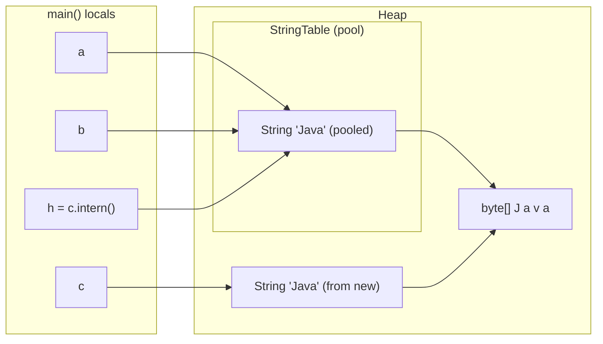
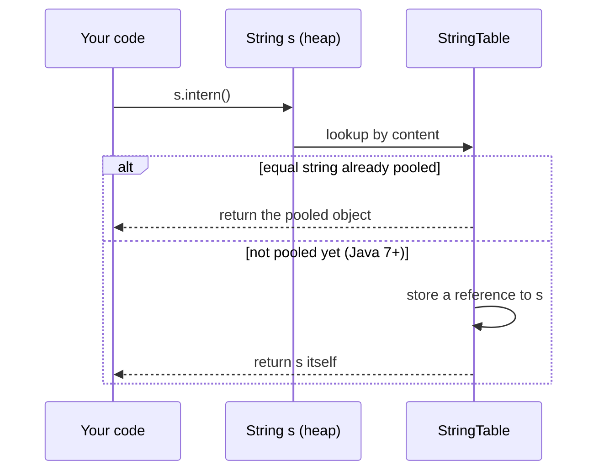
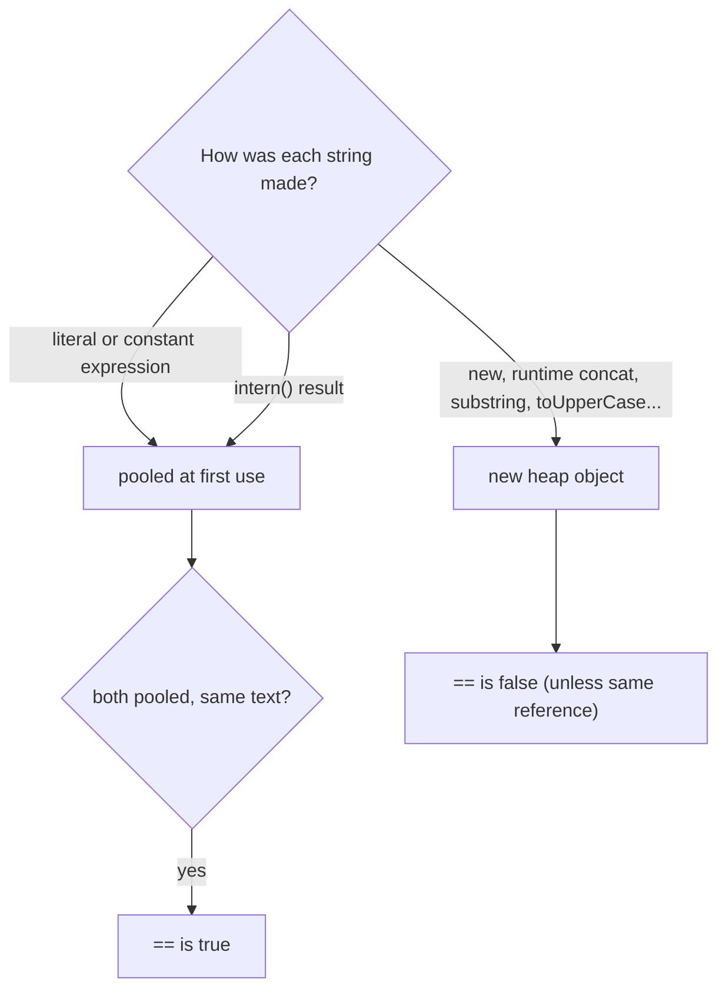

## In One Line
The **string pool** is a JVM-wide table (HotSpot's `StringTable`, on the heap since Java 7) that keeps **one shared `String` object per distinct literal or interned text**; sharing is only safe because `String` is **immutable** — a `final` class over a private, never-written array — so `==` can be `true` for pooled strings, but you must still compare content with `equals`.

## Mental Model
Think of a company's **shared template library** of read-only documents.

- Every exact wording is stored **once** as a read-only master file. When someone's document needs the sentence "Terms and conditions apply", it **links** to the master instead of storing its own copy — a **string literal** pointing at the pooled object.
- Two documents that use the same wording hold **the same link** (`"Java" == "Java"` is `true`).
- Templates the **build tool** assembled before shipping are masters too: `"Ja" + "va"` is glued together by `javac`, so it links to the same master "Java" (compile-time constants).
- Text you **type at runtime** (user input, `a + b` with variables, `new String(...)`) is a private file on your desk — same words, **different file** (`==` is `false`).
- `intern()` is walking to the library and asking "is this wording registered? If yes, give me the master link; if not, register **my** file as the master".
- The library only works because masters are **read-only**. If anyone could edit the master "Java", every document linking to it would silently change. That is why pooling *requires* immutability — and why `String` is `final` and has no setters.
- Masters are uploaded **when first opened**, not when the building opens: HotSpot resolves a literal the first time the code that uses it runs.

## Concept
### Two ideas that depend on each other
| Idea | What it gives | Why it needs the other |
|---|---|---|
| **String pool** (interning) | One object per distinct literal → less memory, `==` shortcut for pooled strings | Sharing one object among thousands of users is only safe if nobody can change it |
| **Immutability** | Thread safety, safe hash keys, cached hash, security | Immutability makes sharing free, and the pool turns that into memory savings |

### What ends up in the pool automatically
The JLS (§3.10.5) guarantees that **string literals** and **compile-time constant expressions** of type `String` are *interned*: identical text → the very same object, across methods, classes and packages.

A **constant expression** (JLS §15.29) is built only from literals, operators and **constant variables** — `final` variables of primitive or `String` type **initialised with a constant expression**:
| Code | Constant? | `== "Java"` |
|---|---|---|
| `"Java"` | Yes, a literal | `true` |
| `"Ja" + "va"` | Yes, `javac` folds it into `"Java"` | `true` |
| `static final String CONST = "Ja"; CONST + "va"` | Yes | `true` |
| `final String f = "Ja"; f + "va"` (local) | Yes — a final local initialised with a literal | `true` |
| `String part = "Ja"; part + "va"` | No — `part` is not final | `false` |
| `static final String X = String.valueOf("Ja"); X + "va"` | No — a method call is never a constant | `false` |
| `new String("Java")` | No — `new` always creates a new object | `false` |
| A text block `"""` with the same content | Yes, text blocks are literals | `true` |

Anything computed at runtime — concatenation with non-constant variables, `substring`, `toUpperCase`, `StringBuilder.toString()`, `String.valueOf(1)`, reading a file, user input — produces an ordinary heap `String` that is **not** pooled unless you call `intern()`.

### How a literal gets into the pool
1. `javac` stores every literal once in the class file's **constant pool** as a `CONSTANT_String` entry (see the `javap` listing below — three uses of `"Java"`, one entry `#7`).
2. When the class is loaded, that entry becomes part of the class's **runtime constant pool** — still just a symbol, not a `String` object.
3. The first time an `ldc` instruction for that entry executes, HotSpot **resolves** it: it looks the text up in the `StringTable`; if found, it uses the pooled object; if not, it creates a `String`, adds it, and uses that. The result is cached in the constant pool, so later executions are instant.

This resolution is **lazy** in HotSpot (the JLS only guarantees *same literal → same object*, not *when*). The `LazyLiteral` demo below proves it: a runtime string interned **before** the literal's first use *becomes* the object the literal refers to.

### `intern()` — explicit pooling
`s.intern()` returns the canonical pooled `String` with the same content:
- If the pool already contains an equal string, that pooled object is returned (and `s` is left alone).
- Otherwise — **Java 7+** — the pool stores a reference to **`s` itself** and returns `s`. In **Java 6** and earlier, the pool lived in PermGen, so `intern()` **copied** the text into PermGen and returned the copy.

That is why this classic question has a version-dependent answer:
```java
String s = new StringBuilder("Sree").append("Ram2026").toString();
System.out.println(s.intern() == s);   // Java 7+: true   (Java 6: false)
```
And why `"java"` gives `false` even on Java 21: the JVM and the JDK classes that run during startup (plus the CDS archive of pre-interned strings) have already pooled many common strings, so `intern()` returns *that* object, not yours.

### Where the pool lives — the history interviewers ask about
| Version | Location | Consequence |
|---|---|---|
| Java ≤ 6 | **PermGen** (a small, fixed-size non-heap area) | Heavy `intern()` caused `OutOfMemoryError: PermGen space`; `intern()` copied strings |
| Java 7 | Moved to the **main heap** | Pool limited only by heap size; `intern()` stores a reference; unreferenced pooled strings are garbage-collected |
| Java 8 | PermGen **removed**, class metadata moved to **Metaspace** | The pool stays on the heap (it never moved to Metaspace — a common wrong answer) |
| Java 11 | `StringTable` rewritten as a concurrent hash table that can resize itself | Rarely any need to tune it |

### The `StringTable` itself
- A **native (C++) hash table inside HotSpot**; the entries are (weak) references to ordinary `String` objects on the heap. The strings are normal heap objects: when nothing but the table refers to one, the GC can remove it.
- **Buckets:** `-XX:StringTableSize` — 65,536 by default on JDK 11+ (it was 60,013 in JDK 7u40–10, and only 1,009 in Java 6, when it could not grow).
- **Inspect it:** `-XX:+PrintStringTableStatistics` prints bucket/entry counts at exit (sample below); `jcmd <pid> VM.stringtable` on a running JVM.
- A *shared* string table comes from the **CDS archive** (class data sharing): strings the JDK pre-interned at build time are mapped in at startup. The sample shows 7,706 of them — the reason common words are already pooled before `main` runs.

### String deduplication — interning's automatic cousin
`-XX:+UseStringDeduplication` (JEP 192, Java 8u20 for G1; Shenandoah added it later, and JDK 18 extended it to Serial, Parallel and ZGC) makes the GC find `String` objects that have lived through a few collections (`StringDeduplicationAgeThreshold`, default 3) and have equal content, and makes them **share one backing `byte[]`**.
| | `intern()` | String deduplication |
|---|---|---|
| Who does it | Your code, explicitly | The GC, in the background |
| What is shared | The **whole `String` object** | Only the internal `byte[]` |
| `==` afterwards | `true` between interned strings | Unchanged — still different `String` objects |
| Cost | A hash-table lookup on every call | Background GC work; off by default |
| Typical use | Canonicalising a *bounded* set of values | Large heaps with many duplicate strings (JEP 192 measured roughly 10% of live heap as savable duplicates in typical applications) |

### How many objects? (the favourite interview puzzle)
| Code | New `String` objects at runtime | Why |
|---|---|---|
| `String s = "Hello";` | 0 or 1 | The pooled literal is created on first resolution if not already there; afterwards 0 |
| `String s = new String("Hello");` | 1 (+ the literal if it was not pooled yet) | `new` always allocates. The new object **shares the literal's `byte[]`** (the constructor copies the reference, safe because it is never written) |
| `String s = "Hel" + "lo";` | Same as `"Hello"` | Folded at compile time — there is no concatenation at runtime |
| `String s = a + b;` (variables) | 1 | Built at runtime by `invokedynamic`/`StringConcatFactory` (Java 9+) or `StringBuilder` (Java 5–8) |
| `s.intern()` | 0 | Returns an existing object; at most adds a reference to the table |

Say "**up to two**" for `new String("Hello")`: the pooled literal (usually already there, created when the literal is first resolved) and the new heap object.

### How `String` achieves immutability
```java
public final class String implements Serializable, Comparable<String>, CharSequence, ... {
    @Stable private final byte[] value;   // the characters (char[] before Java 9)
    private final byte coder;             // LATIN1 or UTF16 (Compact Strings, Java 9)
    private int hash;                     // cached hashCode, 0 until first computed
    private boolean hashIsZero;           // Java 13+: "the hash really is 0"
    ...
}
```
It follows the [immutable class recipe](lesson:b01-fundamentals/08-immutable-classes) exactly:
- **`final` class** — no subclass can override `equals`, `hashCode` or `length` to lie, or add mutable state.
- **`private final byte[] value`**, and **no method writes into it** after construction. Every "modifying" method (`concat`, `replace`, `toUpperCase`, `substring`, `strip`, ...) returns a **new** `String` — or **the same object** when nothing would change (`"HELLO".toUpperCase() == "HELLO"` is `true`).
- **Defensive copies:** `new String(char[])`/`new String(byte[], charset)` copy the input; `toCharArray()`/`getBytes()` return copies. Nobody outside ever holds a reference to `value`.
- **Sharing internally is safe:** `new String(original)` reuses `original.value` because neither will ever write to it.
- **`hash` is not final**, yet `String` is still immutable: it is a lazily computed cache of a value that can never change (a benign race if two threads compute it at once).
- **Reflection** can no longer break it: since JDK 16/17 strong encapsulation makes `String.class.getDeclaredField("value").setAccessible(true)` throw `InaccessibleObjectException` unless you start the JVM with `--add-opens java.base/java.lang=ALL-UNNAMED`.

### Why `String` is immutable — five reasons with the "what if" story
1. **The pool.** `String a = "admin"; String b = "admin";` share one object. If `b` could be changed in place, `a` would change too — and so would every other literal `"admin"` in the whole JVM.
2. **Security.** File paths, URLs, host names, class names, SQL and user names are passed around as strings. With a mutable string, code could pass a security check (`if (path.startsWith("/public"))`) and then another thread could change the text before it is used — a time-of-check/time-of-use attack.
3. **Hash keys and caching.** `String` is the most common `HashMap` key. Its `hashCode` is computed once and cached; a key whose content changed after `put` would be stranded in the wrong bucket (see [equals and hashCode](lesson:b01-fundamentals/06-object-class-equals-hashcode)). `switch` on strings also relies on it: it compiles to `hashCode()` + `lookupswitch` + `equals`.
4. **Thread safety.** Immutable objects can be shared across threads with no locks; the `final` field `value` gets the JMM's final-field visibility guarantee.
5. **Class loading.** Class names are strings; `Class.forName("com.bank.Account")` must not be tricked into loading another class because the name changed midway.

The cost: every change creates a new object. Building strings in a loop creates garbage — use [StringBuilder](lesson:a02-core/11-stringbuilder). And a password in a `String` cannot be wiped: it stays in memory (possibly in the pool) until the GC reclaims it, which is why APIs like `Console.readPassword()` and `JPasswordField.getPassword()` return `char[]` that you can clear with `Arrays.fill(pw, '\0')`.

### `==` on strings — the cheat sheet
| Expression | Result | Reason |
|---|---|---|
| `"a" == "a"` | `true` | Same literal, one pooled object |
| `"a" + "b" == "ab"` | `true` | Folded at compile time (and `+` binds tighter than `==`) |
| `s1 + "b" == "ab"` (non-final `s1`) | `false` | Built at runtime |
| `new String("ab") == "ab"` | `false` | `new` always creates a new object |
| `new String("ab").intern() == "ab"` | `true` | `intern()` returns the pooled literal |
| `"s1 == s2 : " + s1 == s2` | prints `false` | Concatenation happens first, then `==` compares the long string to `s2` |

> [!INTERVIEW] "`==` on strings tells you whether two references share an object — which depends on pooling, compile-time folding and `intern()`. Content comparison is always `equals()`."

### When (not) to call `intern()` yourself
- **Reasonable:** canonicalising a *bounded*, highly repetitive set of values read at runtime (country codes, status names, XML tag names while parsing a huge file) to save memory.
- **Not reasonable:** interning unbounded input (user IDs, request bodies) — the table grows, every call costs a native hash lookup, and an attacker can flood it. Using `==` after interning to "speed up" comparisons is fragile: one non-interned string and the logic silently breaks.
- **Alternatives:** a `HashMap<String, String>`/`ConcurrentHashMap` canonicaliser under your control, enums for fixed sets, or `-XX:+UseStringDeduplication` for heap savings without code changes.

## Diagram

`a`, `b` and `h` all hold the pooled object; `c` holds a separate `String` object created by `new` — yet both `String` objects point at the same internal `byte[]`, which is safe only because nobody can ever write to it.


`intern()` either hands back the existing canonical object or registers yours. Java 6 would have copied the string into PermGen instead of storing `s`.


Predicting `==` on strings: only pooled-vs-pooled with the same text is reliably `true`. When in doubt, it is `false` — and you should be using `equals` anyway.

## Code
**1. Which strings share an object?**
```java
public class PoolBasics {
    static final String CONST = "Ja";                 // compile-time constant

    public static void main(String[] args) {
        String a = "Java";                           // literal -> pool
        String b = "Java";                           // same pooled object
        String c = new String("Java");               // new heap object
        String d = "Ja" + "va";                      // folded by javac -> "Java"
        String e = CONST + "va";                     // constant + literal -> folded
        String part = "Ja";                          // NOT final -> not a constant
        String f = part + "va";                      // built at runtime
        final String fin = "Ja";                     // final local with literal -> constant
        String g = fin + "va";                       // folded
        String h = c.intern();                       // pooled copy of c's text

        System.out.println("a == b          : " + (a == b));
        System.out.println("a == c          : " + (a == c));
        System.out.println("a.equals(c)     : " + a.equals(c));
        System.out.println("a == d (folded) : " + (a == d));
        System.out.println("a == e (const)  : " + (a == e));
        System.out.println("a == f (runtime): " + (a == f));
        System.out.println("a == g (final)  : " + (a == g));
        System.out.println("a == h (intern) : " + (a == h));
        System.out.println("a == f.intern() : " + (a == f.intern()));
        System.out.println("c == c.intern() : " + (c == c.intern()));
    }
}
```
```output
a == b          : true
a == c          : false
a.equals(c)     : true
a == d (folded) : true
a == e (const)  : true
a == f (runtime): false
a == g (final)  : true
a == h (intern) : true
a == f.intern() : true
c == c.intern() : false
```

**2. What `intern()` returns (Java 7+ semantics):**
```java
public class InternDemo {
    public static void main(String[] args) {
        // 1. Text that is NOT yet in the pool: intern() adds THIS heap object and returns it
        String s1 = new StringBuilder("Sree").append("Ram2026").toString();
        System.out.println("s1.intern() == s1 : " + (s1.intern() == s1));

        // 2. Text that the JVM already pooled while starting up
        String s2 = new StringBuilder("ja").append("va").toString();
        System.out.println("s2.intern() == s2 : " + (s2.intern() == s2));

        // 3. new String("...") - the literal is pooled first, so intern() returns the literal
        String s3 = new String("Hello");
        System.out.println("s3.intern() == s3 : " + (s3.intern() == s3));
        System.out.println("s3.intern() == \"Hello\" : " + (s3.intern() == "Hello"));
    }
}
```
```output
s1.intern() == s1 : true
s2.intern() == s2 : false
s3.intern() == s3 : false
s3.intern() == "Hello" : true
```

**3. Literals are resolved lazily** (HotSpot behaviour, not a language guarantee):
```java
public class LazyLiteral {
    public static void main(String[] args) {
        String built = new StringBuilder("zq").append("x9").toString();  // "zqx9" made at runtime
        String pooled = built.intern();          // pool has no "zqx9" yet -> built itself is pooled
        String literal = "zqx9";                 // first execution of this literal: looks up the pool
        System.out.println("pooled == built  : " + (pooled == built));
        System.out.println("literal == built : " + (literal == built));
    }
}
```
```output
pooled == built  : true
literal == built : true
```

**4. Proof from the bytecode** — `javap -c` on this class:
```java
public class Bytecode {
    public static void main(String[] args) {
        String a = "Java";
        String b = "Ja" + "va";
        String c = new String("Java");
        String d = a + b;
    }
}
```
```text
  public static void main(java.lang.String[]);
    Code:
       0: ldc           #7                  // String Java
       2: astore_1
       3: ldc           #7                  // String Java
       5: astore_2
       6: new           #9                  // class java/lang/String
       9: dup
      10: ldc           #7                  // String Java
      12: invokespecial #11                 // Method java/lang/String."<init>":(Ljava/lang/String;)V
      15: astore_3
      16: aload_1
      17: aload_2
      18: invokedynamic #14,  0             // InvokeDynamic #0:makeConcatWithConstants:(Ljava/lang/String;Ljava/lang/String;)Ljava/lang/String;
      23: astore        4
      25: return
}
```

**5. Immutability in action:**
```java
public class ImmutableString {
    public static void main(String[] args) {
        // 1. "Modifying" methods return a NEW string; the original never changes
        String s = "java";
        s.toUpperCase();                               // result thrown away
        s.concat(" rocks");                            // result thrown away
        System.out.println("s after ignored calls : " + s);
        String t = s.toUpperCase();
        System.out.println("s = " + s + ", t = " + t);

        // 2. Reassignment moves the variable, not the object
        String first = s;
        s = s + "!";
        System.out.println("first = " + first + ", s = " + s);

        // 3. Constructors and getters copy arrays, so nobody can reach the internals
        char[] letters = {'c', 'a', 't'};
        String pet = new String(letters);
        letters[0] = 'b';                              // change the caller's array
        char[] out = pet.toCharArray();
        out[0] = 'r';                                  // change the returned array
        System.out.println("pet = " + pet + ", letters = " + new String(letters) + ", out = " + new String(out));

        // 4. When nothing changes, many methods return the SAME object
        String word = "HELLO";
        System.out.println("toUpperCase() same object? " + (word.toUpperCase() == word));
        System.out.println("replace('x','y') same?     " + (word.replace('x', 'y') == word));
        System.out.println("concat(\"\") same?         " + (word.concat("") == word));
        System.out.println("substring(0) same?        " + (word.substring(0) == word));
    }
}
```
```output
s after ignored calls : java
s = java, t = JAVA
first = java, s = java!
pet = cat, letters = bat, out = rat
toUpperCase() same object? true
replace('x','y') same?     true
concat("") same?         true
substring(0) same?        true
```

**6. Looking inside** (advanced: needs `java --add-opens java.base/java.lang=ALL-UNNAMED ValueShare.java`, because JDK internals are strongly encapsulated):
```java
import java.lang.reflect.Field;

public class ValueShare {
    public static void main(String[] args) throws Exception {
        Field v = String.class.getDeclaredField("value");
        v.setAccessible(true);
        String lit = "Hello";
        String copy = new String(lit);
        System.out.println("new String(lit) shares byte[]: " + (v.get(lit) == v.get(copy)));
        String built = new StringBuilder("Hel").append("lo").toString();
        System.out.println("builder result shares byte[]: " + (v.get(lit) == v.get(built)));
        Field h = String.class.getDeclaredField("hash");
        h.setAccessible(true);
        String t = new StringBuilder("abc").append("def").toString();
        System.out.println("hash before: " + h.get(t));
        t.hashCode();
        System.out.println("hash after : " + h.get(t) + " = " + "abcdef".hashCode());
    }
}
```
```output
new String(lit) shares byte[]: true
builder result shares byte[]: false
hash before: 0
hash after : -1424385949 = -1424385949
```

**7. The pool's statistics** — `java -XX:+PrintStringTableStatistics Hello` for a one-line "hello" program (JDK 21, string part of the output):
```text
StringTable statistics:
Number of buckets       :     65536 =    524288 bytes, each 8
Number of entries       :         8 =       128 bytes, each 16
Number of literals      :         8 =       504 bytes, avg  63.000
Total footprint         :           =    524920 bytes
Average bucket size     :     0.000
Variance of bucket size :     0.000
Std. dev. of bucket size:     0.011
Maximum bucket size     :         1
Shared String Table statistics:
Number of buckets       :      1984
Number of entries       :      7706
Maximum bucket size     :        12
```

## Walkthrough
### 1. `PoolBasics`
- `a` and `b` are the same literal → one pooled object → `true`.
- `c = new String("Java")` — `new` always allocates, so `a == c` is `false` while `a.equals(c)` is `true` (same characters).
- `d = "Ja" + "va"` — both operands are literals, so `javac` folds the expression into the single literal `"Java"`: `true`.
- `e = CONST + "va"` — `CONST` is a `static final String` initialised with a literal, i.e. a **constant variable**; the expression is folded: `true`.
- `f = part + "va"` — `part` is an ordinary variable, so the concatenation runs at runtime and creates a new, unpooled object: `false`.
- `g = fin + "va"` — `fin` is a `final` **local** initialised with a literal; that also makes it a constant variable, so it is folded: `true`. Only the `final` keyword differs between `f` and `g`.
- `h = c.intern()` — the pool already contains the literal `"Java"`, so `intern()` returns it: `a == h` is `true`. Likewise `f.intern()` returns the literal.
- `c == c.intern()` is `false`: `intern()` returned the *pooled* object, not `c`.

### 2. `InternDemo`
- `s1` is built at runtime from two pieces, so the exact text `"SreeRam2026"` exists nowhere in the pool. `s1.intern()` stores a reference to `s1` itself and returns it → `true`. On Java 6 this printed `false`, because `intern()` copied the text into PermGen.
- `s2` is `"java"`. The JVM had already pooled `"java"` during startup (JDK code and the CDS archive use it), so `intern()` returns that older object → `false`. The same program with a rarer word would print `true`.
- `s3 = new String("Hello")` — executing the literal pooled `"Hello"` first, then `new` made a second object. `s3.intern()` returns the pooled literal, which is not `s3` → `false`, but it is `== "Hello"` → `true`.

### 3. `LazyLiteral`
- The literal `"zqx9"` appears only on the third line. When the first two lines run, HotSpot has not resolved it yet, so the pool has no `"zqx9"`.
- `built.intern()` therefore registers `built` itself: `pooled == built` → `true`.
- When the `ldc` for `"zqx9"` finally executes, the JVM looks up the pool, finds `built`, and uses it: `literal == built` → `true`. The literal now refers to an object that was created by a `StringBuilder`! This shows that literals are pooled on **first use**, and that the pool simply holds references to ordinary heap strings. (The JLS only promises that equal literals are the same object; the timing is a HotSpot implementation detail.)

### 4. `Bytecode` (`javap -c`)
- `a = "Java"` → `ldc #7`: load constant-pool entry #7, the `String` "Java".
- `b = "Ja" + "va"` → **also** `ldc #7`. There is no concatenation in the bytecode at all — `javac` folded it. One constant-pool entry serves both lines.
- `c = new String("Java")` → `new` (allocate a fresh `String`), `dup`, `ldc #7` (the pooled literal is the constructor argument), `invokespecial <init>`. That is the "up to two objects" answer made visible: the literal (#7) and the new object.
- `d = a + b` → `invokedynamic ... makeConcatWithConstants` (Java 9+, JEP 280): the concatenation strategy is chosen at runtime by `StringConcatFactory`; the result is a new, unpooled `String`. On Java 8 you would see `new StringBuilder`, `append`, `append`, `toString`.

### 5. `ImmutableString`
- `s.toUpperCase();` and `s.concat(" rocks");` on their own lines compute new strings and throw them away; `s` is still `java`. Only `t = s.toUpperCase()` keeps the result.
- `first = s; s = s + "!";` — the variable `s` now points to a new object `java!`; `first` still points to the old, unchanged `java`. Variables move; string objects never change.
- `new String(letters)` copied the array, so changing `letters[0]` to `'b'` does not affect `pet`; `toCharArray()` returned a copy, so setting `out[0] = 'r'` does not either. Output: `pet = cat, letters = bat, out = rat`.
- When a method would not change anything, the JDK returns `this`: `"HELLO".toUpperCase()`, `replace('x', 'y')` (no `x`), `concat("")` and `substring(0)` all return the same object. It is an optimisation that immutability allows — never write code that depends on it.

### 6. `ValueShare`
- `new String(lit)` creates a new `String` object, but its `value` field references **the same `byte[]`** as the literal — the constructor just copies the reference (and the cached hash). Two objects, one character array.
- A `StringBuilder` result gets its own array (`false`): the builder's buffer is mutable, so `toString()` must copy it.
- `hash` is `0` until `hashCode()` is first called; afterwards it holds `-1424385949`, the same value `"abcdef".hashCode()` computes. This lazy cache is why `String` keys are so cheap to re-hash.
- Without `--add-opens`, `setAccessible(true)` would throw `InaccessibleObjectException` (JDK 16+), which is exactly what protects `String`'s immutability from ordinary code today.

### 7. `PrintStringTableStatistics`
- `Number of buckets: 65536` — the default `StringTableSize` on JDK 21.
- `Number of entries: 8` — strings interned at runtime by this tiny program and the startup code (literals resolved while running).
- `Shared String Table ... 7706 entries` — strings pre-interned into the JDK's CDS archive and mapped in at startup; this is where words like `"java"` come from before your code runs. Your numbers will differ slightly between JDK builds.

## Traps
- **`==` instead of `equals`.** It "works" for literals and fails for anything read from input, built at runtime, or created with `new`. The bug hides in tests that use literals and shows up in production.
- **`"x == y: " + x == y`** — `+` binds tighter than `==`, so this compares the whole concatenated string with `y` and prints just `false`. Parenthesise: `"x == y: " + (x == y)`.
- **Assuming `static final` means constant.** `static final String X = String.valueOf("Ja")` or `= loadFromConfig()` is **not** a compile-time constant; `X + "va"` is built at runtime.
- **The Java 6 vs 7 `intern()` answer.** `s.intern() == s` for a runtime-built, never-seen string is `true` on Java 7+ and `false` on Java 6. Also, `"java"`-like common strings may already be pooled, making it `false` even on Java 21.
- **"The pool is in Metaspace/PermGen."** Since Java 7 it is on the heap; Java 8 moved *class metadata* to Metaspace, not the pool.
- **Ignoring return values.** `s.trim();`, `s.replace("a", "b");`, `s.toUpperCase();` do nothing to `s`. Assign the result.
- **Interning unbounded input** — memory growth, native-table contention and a possible denial-of-service vector. Canonicalise only bounded sets, or use deduplication.
- **Relying on `intern()` for `==` comparisons** — one path that forgets to intern and the comparison silently fails.
- **Passwords in `String`s** — they cannot be wiped and may linger (even in the pool if they were literals). Use `char[]` and clear it.
- **Confusing deduplication with interning** — dedup shares only the backing array; `==` results do not change.

> [!WARNING] Text-identical does not mean identical: `new String("a") == "a"` is `false`, and so is `String.valueOf(1) == "1"`. Every runtime-created string is a new object unless you `intern()` it.

## Tips & Tricks
- **"Literal or constant → pool. Runtime → new. `new` → always new."** Three rules predict almost every `==` puzzle.
- **Constant check:** "Is every piece a literal or a `final` variable initialised with a literal?" If yes, `javac` folds it and it is pooled.
- **Mnemonic for why String is immutable — "P-S-H-T-C":** **P**ool, **S**ecurity, **H**ash caching, **T**hread safety, **C**lass loading ("Please Secure Hash Tables Carefully").
- **`intern()` in one line:** "Give me the canonical copy — register mine if there is none (Java 7+)."
- **Java 7 moved the pool to the heap; Java 8 killed PermGen** — two separate facts; keep them apart.
- **Always compare with `equals`**, and write `"literal".equals(variable)` or `Objects.equals(a, b)` to be null-safe.
- **Use `javap -c`** to settle any "is this folded?" argument: `ldc` means constant; `invokedynamic makeConcatWithConstants` (or `StringBuilder`) means runtime.
- **Need heap savings from duplicate strings?** Try `-XX:+UseStringDeduplication` before sprinkling `intern()` through your code.

## Interview Q&A
### [Basic] What is the String pool and why does Java have it?
The string pool (String Constant Pool, `StringTable` in HotSpot) is a JVM-wide table that holds one canonical `String` object for each distinct string literal, compile-time constant and explicitly interned string. When code uses the literal `"Java"` in many places — across classes and packages — they all refer to the same object. It saves memory (applications repeat the same strings heavily) and lets the JVM reuse objects instead of allocating. Pooling is only safe because `String` is immutable: sharing one object is harmless if no one can change it.

**Follow-up:** *Does `==` between two literals always return `true`?* — Yes for identical literals and constant expressions (JLS §3.10.5). It is still the wrong way to compare strings; use `equals`.

### [Basic] How many objects does `String s = new String("Hello");` create?
Up to two. The literal `"Hello"` is a pooled object; it is created when the literal is first resolved, and only if an equal string is not already pooled — so usually it already exists. Then `new` **always** allocates a fresh `String` on the heap, which `s` refers to. So: one new object if the literal was already pooled, two otherwise. A detail that impresses interviewers: the new object does not copy the characters — the `String(String)` constructor reuses the original's internal `byte[]`, which is safe because neither will ever modify it.

**Follow-up:** *And `String s = "Hel" + "lo";`?* — No concatenation happens at runtime; `javac` folds it into the literal `"Hello"`, so it is exactly the same as `String s = "Hello";`.

### [Basic] Why is `String` immutable in Java?
Five reasons. (1) **Pooling** — literals are shared across the whole JVM; if one user could change `"admin"`, every user of that literal would see it. (2) **Security** — file paths, URLs, class names, credentials and SQL are strings; a mutable string could be changed after a security check. (3) **Hashing** — `String` is the most common map key; its hash code is cached, and immutability guarantees the key never moves to another bucket; `switch` on strings relies on this too. (4) **Thread safety** — immutable objects can be shared without synchronization. (5) **Class loading** — the JVM loads classes by name; the name must not change mid-way. The downside is that every modification creates a new object, which is why `StringBuilder` exists.

**Follow-up:** *How is the immutability enforced?* — `final` class, `private final byte[] value` that no method writes to, defensive copies in constructors and in `toCharArray`/`getBytes`, and (since JDK 16/17) strong encapsulation blocks reflective access to `value`.

### [Intermediate] What does `intern()` do, and how did its behaviour change in Java 7?
`intern()` returns the canonical pooled string with the same content. If an equal string is already in the pool, it returns that object. If not, Java 7+ adds a **reference to the calling object** to the pool and returns it. In Java 6 the pool was in PermGen, so `intern()` **copied** the string into PermGen and returned the copy. Consequence:
```java
String s = new StringBuilder("Sree").append("Ram2026").toString();
System.out.println(s.intern() == s);   // Java 7+: true, Java 6: false
```
With `"ja" + "va"` built at runtime the answer is `false` even on Java 21, because the JVM had already pooled `"java"` during startup.

**Follow-up:** *Can interned strings be garbage-collected?* — Yes, since Java 7 they are normal heap objects; the table holds them weakly, so once nothing else references a pooled string, the GC can remove it.

### [Intermediate] Which strings are pooled automatically, and why is `final` important?
String literals and **compile-time constant expressions** are pooled. A constant expression consists only of literals, operators and constant variables — `final` variables of primitive/`String` type initialised with a constant expression. So `final String a = "Ja"; a + "va"` is folded by `javac` into `"Java"` and pooled, while the same code without `final` concatenates at runtime and creates a new unpooled object. `static final String X = compute();` is not constant (method call). Text blocks are literals, so they are pooled too. Everything built at runtime — `substring`, `toUpperCase`, `StringBuilder.toString()`, `String.valueOf`, user input — is not pooled unless interned.

**Follow-up:** *Is there a side effect of constant folding across classes?* — Yes: a `public static final String` constant is inlined into other classes at compile time, so changing its value requires recompiling the classes that use it.

### [Intermediate] Where is the String pool located, and why was it moved?
Up to Java 6 it lived in **PermGen**, a small fixed-size area outside the main heap; heavy interning caused `OutOfMemoryError: PermGen space`, and `StringTableSize` was a fixed 1,009 buckets. **Java 7** moved the pool into the **main heap**: it is limited only by the heap, pooled strings are garbage-collected like other objects, and `intern()` stores references instead of copies. **Java 8** removed PermGen entirely and put class metadata into Metaspace — the pool stayed on the heap. Since Java 11 the `StringTable` is a concurrent hash table (65,536 buckets by default) that can resize itself.

**Follow-up:** *How can you inspect it?* — `-XX:+PrintStringTableStatistics` at exit, or `jcmd <pid> VM.stringtable` on a running JVM.

### [Intermediate] Is `String` truly immutable if its `hash` field is not final?
Yes. Immutability is about **observable** state. `hash` is a lazily computed cache of a value fully determined by the characters, which never change. It starts at 0, is computed on the first `hashCode()` call and stored; if two threads race, both compute and write the same value (a benign data race). JDK 13 added `hashIsZero` so strings whose hash genuinely is 0 are cached too. From the outside, every call to any method of a given `String` always returns the same result.

**Follow-up:** *Why not compute the hash in the constructor?* — Most strings are never hashed; computing it eagerly would slow down every string creation.

### [Advanced] Are string literals added to the pool when the class is loaded or when they are first used?
In HotSpot, lazily on first use. `javac` puts each literal in the class file's constant pool as `CONSTANT_String`. Loading the class creates only symbolic entries; the `String` object is looked up in, or added to, the `StringTable` the first time an `ldc` instruction for it executes, and the result is cached in the constant pool. You can observe it: build `"zqx9"` at runtime, `intern()` it, *then* execute the literal `"zqx9"` — the literal resolves to your runtime object (`literal == built` is `true`). The JLS only guarantees that equal literals denote the same instance; timing is an implementation detail.

**Follow-up:** *Then why is `"java"` already pooled before my code runs?* — JDK classes executed during startup resolved it, and the default CDS archive maps in thousands of pre-interned strings ("Shared String Table").

### [Advanced] Should you call `intern()` in application code? What are the alternatives?
Rarely. It can save a lot of memory when a *bounded* set of values repeats millions of times (e.g. parsing a large file where a "country" column has 200 distinct values). But each call is a native hash-table lookup, the table is shared by the whole JVM, and interning unbounded or attacker-controlled input grows it without limit. Using `==` after interning is fragile. Alternatives: a `ConcurrentHashMap<String, String>` canonicaliser whose lifetime you control, enums for fixed sets, or `-XX:+UseStringDeduplication`, which lets the GC share the backing arrays of duplicate long-lived strings with no code changes. If you do intern heavily, check `-XX:+PrintStringTableStatistics` and consider raising `-XX:StringTableSize`.

**Follow-up:** *What does `StringTableSize` change?* — The number of buckets. Too few buckets makes chains long and `intern()` slow; since Java 11 the table can grow on its own, so tuning is rarely needed.

### [Advanced] What is the difference between string interning and string deduplication?
Interning (`intern()`, literals) makes equal strings the **same `String` object**, so `==` becomes `true`; it is explicit and happens immediately. String deduplication (`-XX:+UseStringDeduplication`, JEP 192; G1 since 8u20, Serial, Parallel and ZGC since JDK 18, Shenandoah as well) is done by the GC in the background: for strings that survived a few collections (`StringDeduplicationAgeThreshold`, default 3), it makes equal strings **share one backing `byte[]`**. The `String` objects stay distinct, so `==` does not change and program behaviour is unaffected — it only reduces heap usage. It is off by default.

**Follow-up:** *Why is sharing the array safe?* — Because `String` never writes to its `value` array after construction; the JDK itself already shares it in `new String(String)`.

### [Advanced] What does `"s1 == s2 : " + s1 == s2` print, and what other `==` traps exist?
It prints just `false`: `+` has higher precedence than `==`, so the expression is `("s1 == s2 : " + s1) == s2`, comparing a new runtime string with `s2`. Other traps: `"a" + "b" == "ab"` is `true` (folded); `s + "b" == "ab"` is `false` for non-final `s`; `new String("ab") == "ab"` is `false` but `new String("ab").intern() == "ab"` is `true`; `String.valueOf(1) == "1"` is `false`; methods that change nothing return the same object (`"HELLO".toUpperCase() == "HELLO"` is `true`) — an implementation detail you must not rely on. The fix for all of them is `equals`.

**Follow-up:** *How does `switch` compare strings?* — Not with `==`: it computes `hashCode()`, jumps with a `lookupswitch` on the hash, then confirms with `equals` — which works because a `String`'s hash never changes.

## Quiz
### What does this print?
```java
String s1 = "Java";
String s2 = "Ja";
String s3 = s2 + "va";
System.out.println(s1 == s3);
System.out.println(s1 == s3.intern());
```
- [ ] true, true
- [x] false, true
- [ ] false, false
- [ ] true, false
> `s2` is not `final`, so `s2 + "va"` is built at runtime: a new object, `false`. `intern()` returns the pooled `"Java"` — the same object as the literal `s1`: `true`.

### What does this print?
```java
final String f = "Ja";
String g = f + "va";
System.out.println(g == "Java");
```
- [x] true
- [ ] false
- [ ] Compile error: cannot concatenate a final variable
- [ ] Depends on the JVM
> `f` is a `final` local initialised with a literal, so it is a constant variable, and `f + "va"` is a constant expression that `javac` folds into the literal `"Java"`. Without `final` the result would be `false`.

### What does this print?
```java
static final String X = String.valueOf("Ja");
// in main:
System.out.println((X + "va") == "Java");
```
- [ ] true, because `X` is `static final`
- [x] false
- [ ] Compile error
- [ ] NullPointerException
> `static final` is not enough: a constant variable must be initialised with a *constant expression*, and a method call never is. `X + "va"` is therefore concatenated at runtime into a new, unpooled object.

### What does this print?
```java
String s1 = "Java";
String s2 = "Java";
System.out.println("s1 == s2 : " + s1 == s2);
```
- [ ] s1 == s2 : true
- [ ] s1 == s2 : false
- [x] false
- [ ] true
> `+` binds tighter than `==`: the code compares `"s1 == s2 : Java"` (built at runtime) with `s2`, which is `false`, and `println(boolean)` prints just `false`. With parentheses, `"s1 == s2 : " + (s1 == s2)` prints `s1 == s2 : true`.

### What does this print on Java 17 or 21?
```java
String s = new StringBuilder("Sree").append("Ram2026").toString();
System.out.println(s.intern() == s);
```
- [x] true
- [ ] false
- [ ] It depends on whether `s` was garbage-collected
- [ ] Compile error
> The text `SreeRam2026` is not in the pool yet, so since Java 7 `intern()` stores a reference to `s` itself and returns it. On Java 6, `intern()` copied the text into PermGen and returned the copy, so it printed `false`. (Use a common word like `"java"` and it prints `false` even today, because the JVM pooled it at startup.)

### Where is the String pool stored in Java 8 and later?
- [ ] PermGen
- [ ] Metaspace
- [x] The main heap
- [ ] The thread stack
> The pool moved from PermGen to the heap in Java 7. Java 8 removed PermGen and moved *class metadata* to Metaspace, but the string pool stayed on the heap, where pooled strings are garbage-collected like any other object.

### Spot the bug: why does the admin never get in?
```java
Scanner in = new Scanner(System.in);
String role = in.nextLine();          // user types: admin
if (role == "admin") {
    grantAccess();
}
```
- [ ] `nextLine()` includes the newline character
- [x] `role` is a new runtime string, so `==` compares it to the pooled literal by reference and is `false`
- [ ] `"admin"` must be declared as a constant first
- [ ] Strings typed by users are interned only after a GC
> Input read at runtime is a fresh `String` object, never the pooled literal. `==` checks identity, so it is `false` even though the text matches. Use `"admin".equals(role)` (null-safe). `nextLine()` strips the line terminator, so that is not the problem.

### Which is NOT a reason why `String` is immutable?
- [ ] Literals are shared through the string pool
- [ ] Its hash code can be cached, making it a reliable `HashMap` key
- [ ] Strings passed to security checks cannot be changed afterwards
- [x] It makes repeated concatenation in loops faster
> Immutability makes repeated concatenation *slower*: every `+=` creates a new object and copies the characters, which is why `StringBuilder` exists. The other three (plus thread safety and class loading) are the real reasons.

## Takeaways
- The string pool (`StringTable`) keeps one shared `String` per distinct literal, compile-time constant or interned text; `new`, runtime concatenation and methods like `substring` create new, unpooled objects.
- A compile-time constant uses only literals and `final` variables initialised with constants; `javac` folds it (`"Ja" + "va"` → `ldc "Java"`), while a non-final variable or a method call forces runtime concatenation.
- `intern()` returns the canonical pooled string; since Java 7 it stores a reference to your object if none exists (Java 6 copied into PermGen) — so `s.intern() == s` is `true` for new text, `false` for text already pooled.
- The pool lives on the heap since Java 7 (not PermGen, not Metaspace); pooled strings can be garbage-collected; HotSpot resolves literals lazily on first use; `-XX:StringTableSize` (65,536 buckets on JDK 11+) and `-XX:+PrintStringTableStatistics` tune and inspect it.
- `new String("Hello")` creates up to two objects (the pooled literal and a new one), and the new object even shares the literal's internal `byte[]`.
- `String` is immutable — `final` class, `private final byte[]` never written, defensive copies in and out, reflection blocked since JDK 16/17 — for pooling, security, hash caching, thread safety and class loading.
- String deduplication (`-XX:+UseStringDeduplication`) shares only the backing arrays of duplicate strings and never changes `==`; interning shares whole objects.
- Always compare strings with `equals`; `==` depends on pooling, folding and `intern()`, and `+` binds tighter than `==`.
