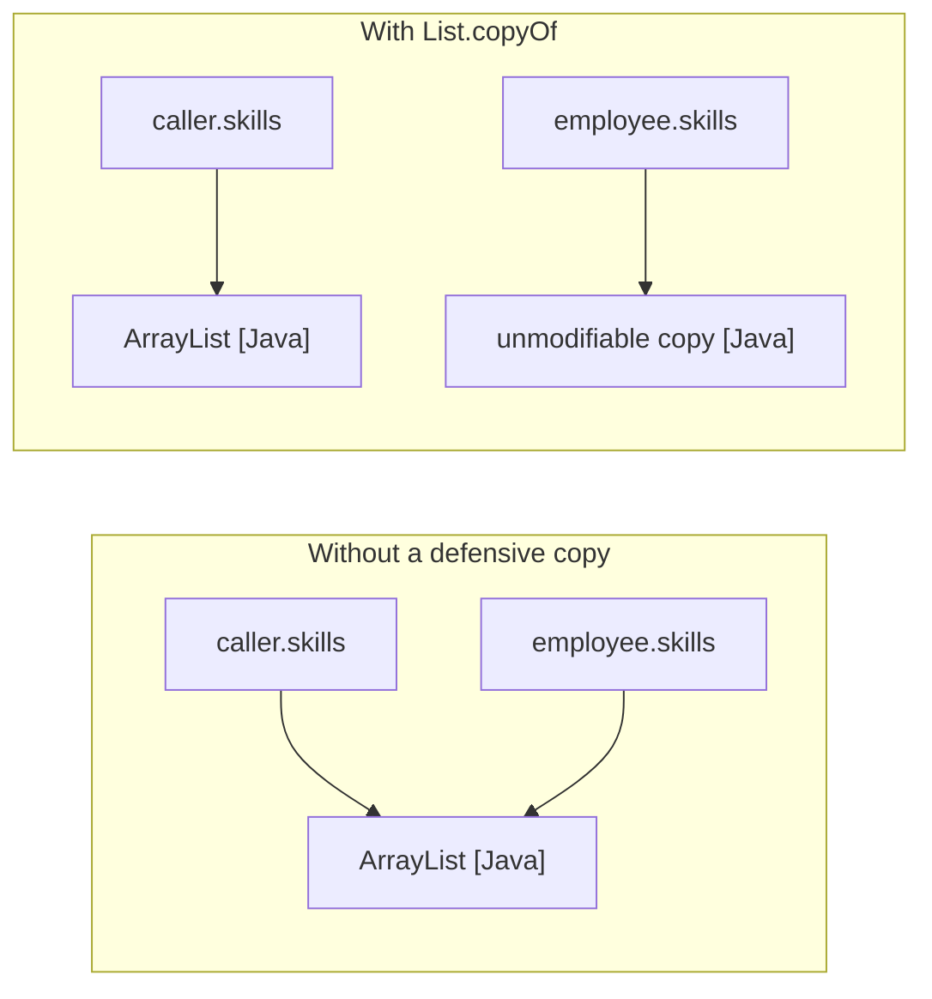
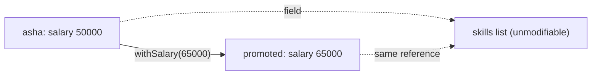
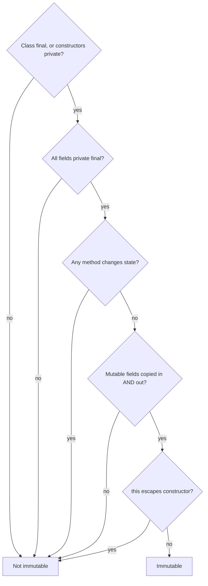

## In One Line
An immutable object can never change after its constructor finishes: you get one by making the class `final`, every field `private final`, adding no setters, copying mutable inputs on the way **in** and never handing out mutable internals on the way **out**; any "change" returns a **new** object.

## Mental Model
Think of a **laminated ID card**.

- When the card is issued, the office **photocopies** the documents you bring (defensive copy in). If you later scribble on your own documents, the card does not change.
- Nobody can write on the laminated card (no setters, `final` fields).
- If someone asks to see the details, they get a **photocopy**, never the card itself (defensive copy out, or a read-only view).
- To change your address, you do not edit the card — the office **issues a new card** (a "wither" such as `withSalary(...)` returns a new object). The old card is still exactly what it was.
- The office only issues cards through its own counter; nobody can open a "fake branch" that prints look-alike cards with erasable ink (the class is `final`, so no mutable subclass can pretend to be it).

Because a laminated card never changes, anyone can hold it, copy the reference, keep it in a drawer (a `HashMap` key) or show it to many people at once (threads) with zero coordination.

## Concept
### What "immutable" really means
An object is **immutable** when its *observable state* cannot change after construction — not by its own methods, not by the caller who created it, not by anyone holding a reference to it or to anything it contains.

Three words that interviewers love to mix up:

| Term | Meaning | Example |
|---|---|---|
| `final` variable | The **reference** cannot be reassigned. Says nothing about the object. | `final List<String> l = new ArrayList<>(); l.add("x");` compiles and works |
| **Unmodifiable** | *This reference* offers no way to change the object, but someone else may still change it underneath. | `Collections.unmodifiableList(list)` — a read-only *view* |
| **Immutable** | *Nobody* can change the state, ever. | `String`, `Integer`, `LocalDate`, `List.of(...)` |

> [!INTERVIEW] "`final` protects the variable, immutability protects the object."

### Why bother? The benefits
1. **Thread-safe for free.** No state changes means no race conditions, no locks, no `volatile`. An immutable object can be shared freely between threads.
2. **Safe hash keys and set elements.** `hashCode()` never changes, so the object never gets "lost" in the wrong `HashMap` bucket (see the `MutableKey` example below).
3. **Can be shared and cached.** The JDK caches `Integer.valueOf(-128..127)`, interns `String` literals, and `List.copyOf` returns the same instance when given an already-immutable list — all only possible because nobody can change them.
4. **No defensive copies needed by users.** You can hand an immutable object to any method without fearing what it does to it.
5. **Failure atomicity.** An operation either produces a new valid object or throws; the original is never left half-updated.
6. **Easy to reason about.** An object's state is fixed at construction and checked once by the constructor — its *invariants* hold forever.

The cost: every "modification" allocates a new object. For a few objects this is nothing (the young-generation GC is very good at short-lived objects). For heavy step-by-step building, pair the immutable class with a **mutable companion** — exactly what `StringBuilder` is to `String`, or what a *Builder* is to a class with many fields.

### The recipe (Effective Java, Item 17 "Minimize mutability" + Item 50 "Make defensive copies")
1. **Don't provide mutators** — no setters, no method that changes a field.
2. **Make the class `final`** (or make all constructors `private` and expose static factories) so no subclass can add mutable state or override methods.
3. **Make all fields `final`** — the compiler then guarantees each is assigned exactly once, and the Java Memory Model gives the special *final-field* visibility guarantee.
4. **Make all fields `private`** — even a `public final List` lets anyone call `add` on it.
5. **Ensure exclusive access to mutable components:**
   - **Copy in:** defensively copy every mutable argument in the constructor (`List.copyOf(list)`, `array.clone()`, `new Date(d.getTime())`).
   - **Copy out:** never return a reference to a mutable field — return a copy or an unmodifiable view, or store an already-unmodifiable copy so returning it is safe.
6. **Don't let `this` escape** during construction (no registering listeners, starting threads, or storing `this` in a static field from the constructor).
7. **"Change" by creating:** methods like `withSalary(int)`, `plusDays(long)`, `toUpperCase()` return a *new* instance.

### Which fields need defensive copies?
| Field type | Mutable? | What to do |
|---|---|---|
| Primitives, `String`, wrappers, `BigDecimal`/`BigInteger`\*, `LocalDate`/`Instant`/`Duration`, enums, records of immutable parts | No | Store and return directly |
| `List` / `Set` / `Map` | Yes | In: `List.copyOf(x)` / `Set.copyOf` / `Map.copyOf`. Out: return that stored copy directly |
| Arrays | Always mutable | In: `arr.clone()`. Out: `arr.clone()` (or expose a `List` instead) |
| `java.util.Date`, `Calendar`, `StringBuilder`, any class with setters | Yes | In: `new Date(d.getTime())`. Out: `new Date(joined.getTime())`. Better: switch to `java.time` |
| Your own mutable classes | Yes | Copy constructor / static copy factory in and out |

\* `BigInteger` and `BigDecimal` are immutable but **not `final`** (a historical mistake). A malicious subclass could be mutable, so security-sensitive code that accepts them from untrusted callers copies them: `new BigInteger(untrusted.toByteArray())`.

> [!WARNING] Do not use `clone()` to copy an **argument** whose class can be subclassed (like `Date`): an attacker can pass a subclass whose `clone()` returns an object they still control. Use a constructor (`new Date(d.getTime())`). Using `clone()` in a **getter** is fine, because you know your own field is exactly a `Date`.

### Copy first, then validate
```java
Period(Date start, Date end) {
    this.start = new Date(start.getTime());   // 1. copy
    this.end   = new Date(end.getTime());
    if (this.start.after(this.end))            // 2. validate the COPIES
        throw new IllegalArgumentException(start + " after " + end);
}
```
If you validated the originals first and copied afterwards, another thread could change the argument **between** the check and the copy (a *time-of-check / time-of-use* attack), and your object would hold invalid state.

### Unmodifiable view vs unmodifiable copy
| | `Collections.unmodifiableList(src)` | `List.copyOf(src)` (Java 10) | `List.of(a, b)` (Java 9) |
|---|---|---|---|
| What it is | Read-only **view** (wrapper) | Independent **snapshot** | New immutable list |
| Sees later changes to `src`? | **Yes** | No | — |
| Nulls | Allowed (whatever `src` has) | **NPE** | **NPE** |
| Copy cost | O(1) wrapper | O(n), but returns the **same instance** if `src` is already a `List.of`/`copyOf` list | O(n) |
| `add` / `set` / `remove` | `UnsupportedOperationException` | `UnsupportedOperationException` | `UnsupportedOperationException` |

Related: `Collectors.toUnmodifiableList()` (Java 10) and `Stream.toList()` (Java 16) also produce unmodifiable lists — note that `Stream.toList()` **allows nulls** while `toUnmodifiableList()` does not. More in [immutable collections](lesson:b05-modern-java/02-var-and-immutable-collections).

### Shallow vs deep immutability
`List.copyOf` freezes the **list** (no add/remove/set), not the **elements**. `List.of(new StringBuilder("hi"))` is an unmodifiable list containing a perfectly mutable `StringBuilder`. A class is only deeply immutable if every object reachable from it is immutable too. Rule: make the element types immutable (`String`, records of immutable fields), or deep-copy the elements.

### Why the class must be `final`
If `Money` is not final, someone can write:
```java
class EvilMoney extends Money {
    long cents = 100;
    EvilMoney() { super(100); }
    @Override long cents() { return cents; }   // returns a MUTABLE field
}
```
Any method that accepts `Money` "knowing" it is immutable (caching it, using it as a map key, sharing it across threads) is now broken. Two ways to prevent subclassing:
- `final class Money` — simplest.
- `private` constructors + `public static Money of(long cents)` — a subclass cannot call a private constructor. Bonus: a static factory can **cache** instances (like `Integer.valueOf`) and can return a different implementation later.

### Immutability and threads: the final-field guarantee
The Java Memory Model (JLS §17.5) gives `final` fields a special rule: once the constructor finishes, **any** thread that obtains a reference to the object is guaranteed to see the correct values of its `final` fields — even if the reference was published through a data race, without `synchronized` or `volatile`. This guarantee is lost if `this` escapes from the constructor (another thread could see the object before its fields are assigned). That is the technical reason immutable objects are thread-safe, and why rule 6 exists.

### Immutable objects with cached, lazily-computed fields
"Immutable" is about **observable** state. `String` has a non-final `hash` field (plus `hashIsZero` since JDK 13) that is computed on the first `hashCode()` call and cached. Two threads may both compute it — a harmless ("benign") race, because they compute the same value. From the outside, a `String` never changes.

### Records: immutability with almost no code (Java 16+)
`record Point(int x, int y) {}` gives a `final` class, `private final` fields, a canonical constructor, accessors `x()`/`y()`, and `equals`/`hashCode`/`toString`. But records are **shallowly** immutable: `record Team(String name, List<String> members)` stores whatever list you pass. Fix it with a *compact constructor*:
```java
record Team(String name, List<String> members) {
    Team { members = List.copyOf(members); }
}
```
Record fields are also protected from reflection: `Field.set` on a record's field throws `IllegalAccessException`, whereas a normal class's `private final` field can still be changed with `setAccessible(true)`. See [records](lesson:b05-modern-java/03-records).

### Immutable classes in the JDK
`String`, all wrapper classes (`Integer`, `Long`, `Boolean`, ...), `BigInteger`, `BigDecimal`, every `java.time` type (`LocalDate`, `LocalDateTime`, `Instant`, `Duration`, `ZonedDateTime`...), `Optional`, `UUID`, `Locale`, `Pattern`, `List.of/Set.of/Map.of` results, and enums (as long as you don't give them mutable fields). Classic **mutable** mistakes: `java.util.Date`, `Calendar`, `SimpleDateFormat` (not even thread-safe), `java.awt.Point`.

### Ways immutability can still be broken
| Attack | Defence |
|---|---|
| Caller keeps a reference to a mutable argument | Defensive copy in |
| Getter returns internal mutable object | Defensive copy out / unmodifiable |
| Subclass adds mutable state | `final` class or private constructors |
| `this` escapes the constructor | Do not publish `this` before construction ends |
| Reflection (`setAccessible(true)` + `Field.set`) | Can't fully stop it in normal classes; records and hidden classes reject it; JDK internals are closed by strong encapsulation (JDK 16+) |
| Deserialization of a crafted byte stream bypasses the constructor | Validate and copy in `readObject`, or use the serialization-proxy pattern (Effective Java Items 88, 90) |

## Diagram

Aliasing: without a copy, the caller and the "immutable" object share one list, so the caller can change the object's state. With a copy, they point to different objects.


A "change" creates a new object; the original is untouched. Unchanged immutable parts can be **shared** safely between the old and new object (structural sharing).


The checklist to run in your head when an interviewer shows you a class and asks "is this immutable?".

## Code
**1. Looks immutable, isn't.** `final` class, `private final` fields, no setters — and yet its state changes three times:
```java
import java.util.ArrayList;
import java.util.Date;
import java.util.List;

public class LeakyDemo {
    public static void main(String[] args) {
        List<String> skills = new ArrayList<>(List.of("Java"));
        Date joined = new Date(0);                       // 1970-01-01T00:00:00Z

        LeakyEmployee e = new LeakyEmployee("Asha", skills, joined);
        System.out.println("created:          " + e);

        skills.add("Hacking");                           // 1. change the list we passed in
        System.out.println("caller's list:    " + e);

        joined.setTime(365L * 24 * 60 * 60 * 1000);      // 2. change the Date we passed in
        System.out.println("caller's Date:    " + e);

        e.getSkills().clear();                           // 3. change it through the getter
        e.getJoined().setTime(0);
        System.out.println("through getters:  " + e);
    }
}

// Looks immutable (final class, private final fields, no setters) - but is not.
final class LeakyEmployee {
    private final String name;
    private final List<String> skills;
    private final Date joined;

    LeakyEmployee(String name, List<String> skills, Date joined) {
        this.name = name;
        this.skills = skills;          // stores the caller's list (aliasing)
        this.joined = joined;          // stores the caller's Date (aliasing)
    }

    List<String> getSkills() { return skills; }   // hands out the internal list
    Date getJoined()         { return joined; }   // hands out the internal Date

    @Override
    public String toString() {
        return name + " " + skills + " joined " + joined.toInstant();
    }
}
```
```output
created:          Asha [Java] joined 1970-01-01T00:00:00Z
caller's list:    Asha [Java, Hacking] joined 1970-01-01T00:00:00Z
caller's Date:    Asha [Java, Hacking] joined 1971-01-01T00:00:00Z
through getters:  Asha [] joined 1970-01-01T00:00:00Z
```

**2. A correct immutable class**, following every rule:
```java
import java.time.LocalDate;
import java.util.ArrayList;
import java.util.List;
import java.util.Objects;

public class ImmutableDemo {
    public static void main(String[] args) {
        List<String> skills = new ArrayList<>(List.of("Java", "SQL"));
        Employee asha = new Employee("Asha", 50_000, skills, LocalDate.of(2020, 1, 15));

        skills.add("Hacking");                         // caller changes ITS list
        System.out.println(asha);                      // asha is unaffected

        try {
            asha.skills().add("Hacking");              // try to change through the getter
        } catch (UnsupportedOperationException e) {
            System.out.println("skills().add -> " + e);
        }

        Employee promoted = asha.withSalary(65_000);   // "change" = a NEW object
        System.out.println(asha);
        System.out.println(promoted);
        System.out.println("same object?        " + (asha == promoted));
        System.out.println("same skills list?   " + (asha.skills() == promoted.skills()));
        System.out.println("equal to a twin?    "
                + asha.equals(new Employee("Asha", 50_000, List.of("Java", "SQL"), LocalDate.of(2020, 1, 15))));
    }
}

final class Employee {                                 // rule 1: final - no subclass can add mutability
    private final String name;                         // rule 2: private final fields
    private final int salary;
    private final List<String> skills;                 // List is a MUTABLE type - needs care
    private final LocalDate joined;                    // LocalDate is immutable - safe to share

    Employee(String name, int salary, List<String> skills, LocalDate joined) {
        this.skills = List.copyOf(skills);             // rule 4: defensive copy IN (copy first, then validate)
        this.name = Objects.requireNonNull(name, "name");
        if (salary < 0) throw new IllegalArgumentException("salary < 0: " + salary);
        this.salary = salary;
        this.joined = Objects.requireNonNull(joined, "joined");
    }

    // rule 3: no setters - only accessors
    String name()         { return name; }
    int salary()          { return salary; }
    List<String> skills() { return skills; }           // rule 5: safe - List.copyOf gave an unmodifiable list
    LocalDate joined()    { return joined; }

    Employee withSalary(int newSalary) {               // "wither": copy with one field changed
        return new Employee(name, newSalary, skills, joined);
    }

    @Override
    public boolean equals(Object o) {
        return o instanceof Employee e && salary == e.salary && name.equals(e.name)
                && skills.equals(e.skills) && joined.equals(e.joined);
    }

    @Override
    public int hashCode() { return Objects.hash(name, salary, skills, joined); }

    @Override
    public String toString() {
        return "Employee[" + name + ", " + salary + ", " + skills + ", " + joined + "]";
    }
}
```
```output
Employee[Asha, 50000, [Java, SQL], 2020-01-15]
skills().add -> java.lang.UnsupportedOperationException
Employee[Asha, 50000, [Java, SQL], 2020-01-15]
Employee[Asha, 65000, [Java, SQL], 2020-01-15]
same object?        false
same skills list?   true
equal to a twin?    true
```

**3. View vs copy, shallow vs deep, arrays, nulls:**
```java
import java.util.ArrayList;
import java.util.Arrays;
import java.util.Collections;
import java.util.List;

public class ViewVsCopy {
    public static void main(String[] args) {
        List<String> source = new ArrayList<>(List.of("a", "b"));

        List<String> view = Collections.unmodifiableList(source);  // read-only WINDOW onto source
        List<String> copy = List.copyOf(source);                   // independent unmodifiable SNAPSHOT

        source.add("c");
        System.out.println("view = " + view);
        System.out.println("copy = " + copy);

        try {
            view.add("x");
        } catch (UnsupportedOperationException e) {
            System.out.println("view.add -> UnsupportedOperationException");
        }

        // Shallow: the list is frozen, its elements are not
        List<StringBuilder> frozen = List.of(new StringBuilder("hi"));
        frozen.get(0).append(" there");
        System.out.println("frozen = " + frozen);

        // Arrays can never be frozen - clone them
        int[] data = {1, 2, 3};
        int[] snapshot = data.clone();
        data[0] = 99;
        System.out.println("snapshot = " + Arrays.toString(snapshot));

        // List.of / List.copyOf reject nulls
        try {
            List.copyOf(Arrays.asList("x", null));
        } catch (NullPointerException e) {
            System.out.println("List.copyOf(null element) -> NullPointerException");
        }
    }
}
```
```output
view = [a, b, c]
copy = [a, b]
view.add -> UnsupportedOperationException
frozen = [hi there]
snapshot = [1, 2, 3]
List.copyOf(null element) -> NullPointerException
```

**4. Why mutable hash keys are dangerous:**
```java
import java.util.HashSet;
import java.util.Objects;
import java.util.Set;

public class MutableKey {
    static class Point {                                   // MUTABLE: has a setter
        int x, y;
        Point(int x, int y) { this.x = x; this.y = y; }
        void setX(int x) { this.x = x; }
        @Override public boolean equals(Object o) { return o instanceof Point p && x == p.x && y == p.y; }
        @Override public int hashCode() { return Objects.hash(x, y); }
    }

    public static void main(String[] args) {
        Set<Point> set = new HashSet<>();
        Point p = new Point(1, 2);
        set.add(p);
        System.out.println("contains before: " + set.contains(p));

        p.setX(10);                                        // hashCode changes, but p sits in the old bucket
        System.out.println("contains after:  " + set.contains(p));
        System.out.println("size:            " + set.size());
        System.out.println("iterating finds it: " + set.iterator().next().x);
    }
}
```
```output
contains before: true
contains after:  false
size:            1
iterating finds it: 10
```

**5. Records are only shallowly immutable** — fix them with a compact constructor:
```java
import java.util.ArrayList;
import java.util.List;

public class RecordDemo {
    record LeakyTeam(String name, List<String> members) { }

    record Team(String name, List<String> members) {
        Team {                                   // compact canonical constructor
            members = List.copyOf(members);      // defensive copy (also rejects null elements)
        }
    }

    public static void main(String[] args) {
        List<String> people = new ArrayList<>(List.of("Ravi"));
        LeakyTeam leaky = new LeakyTeam("A", people);
        Team safe = new Team("B", people);

        people.add("Mallory");                   // caller mutates its list
        leaky.members().add("Eve");              // mutate through the accessor

        System.out.println(leaky);
        System.out.println(safe);
        try {
            safe.members().add("Eve");
        } catch (UnsupportedOperationException e) {
            System.out.println("safe.members().add -> UnsupportedOperationException");
        }
    }
}
```
```output
LeakyTeam[name=A, members=[Ravi, Mallory, Eve]]
Team[name=B, members=[Ravi]]
safe.members().add -> UnsupportedOperationException
```

**6. Can reflection break it?** (Advanced — JDK 21 behaviour)
```java
import java.lang.reflect.Field;

public class ReflectionDemo {
    static final class Money {
        private final long cents;
        Money(long cents) { this.cents = cents; }
        long cents() { return cents; }
    }

    record Point(int x, int y) { }

    public static void main(String[] args) throws Exception {
        // 1. A normal class: a private final instance field CAN be changed via reflection
        Money m = new Money(100);
        Field cents = Money.class.getDeclaredField("cents");
        cents.setAccessible(true);
        cents.setLong(m, 1_000_000);
        System.out.println("Money after reflection: " + m.cents());

        // 2. A record: final fields are truly final, even for reflection (JDK 16+)
        Point p = new Point(1, 2);
        Field x = Point.class.getDeclaredField("x");
        x.setAccessible(true);
        try {
            x.setInt(p, 99);
        } catch (IllegalAccessException e) {
            System.out.println("record -> IllegalAccessException: " + e.getMessage());
        }

        // 3. JDK internals: strong encapsulation (JDK 16+) blocks setAccessible
        Field value = String.class.getDeclaredField("value");
        try {
            value.setAccessible(true);
        } catch (RuntimeException e) {
            System.out.println("String.value -> " + e.getClass().getName());
        }
    }
}
```
```output
Money after reflection: 1000000
record -> IllegalAccessException: Can not set final int field ReflectionDemo$Point.x to (int)99
String.value -> java.lang.reflect.InaccessibleObjectException
```

## Walkthrough
### 1. `LeakyDemo` — the three leaks
- `LeakyEmployee` passes the "obvious" checks: the class is `final`, all fields are `private final`, there are no setters. That is exactly why it is a favourite interview trap.
- `this.skills = skills;` and `this.joined = joined;` store the **caller's** objects. `final` only stops the fields from being *reassigned*; it does nothing to stop the *objects they point to* from changing.
- **Leak 1** — `skills.add("Hacking")` in `main` changes the one and only `ArrayList`, which the employee also points to, so the second line prints `[Java, Hacking]`.
- **Leak 2** — `joined.setTime(365L * 24 * 60 * 60 * 1000)` moves the shared `Date` forward one year (1970 was not a leap year), so the third line shows `1971-01-01T00:00:00Z`. `java.util.Date` is mutable — one of the JDK's most famous design mistakes.
- **Leak 3** — `e.getSkills().clear()` and `e.getJoined().setTime(0)` modify the object through its own getters, because they return the internal references. The last line shows `[]` and the date back at 1970.
- `toString()` uses `joined.toInstant()` so the output is printed in UTC and does not depend on your time zone (`Date.toString()` would).

### 2. `ImmutableDemo` — every rule applied
- `final class Employee` — rule "no subclasses".
- The four fields are `private final`. `name` (`String`), `salary` (`int`) and `joined` (`LocalDate`) are themselves immutable, so they can be stored and returned directly. `skills` is a `List` — a mutable *type* — so it is the one field that needs care.
- `this.skills = List.copyOf(skills);` — the **copy in**. `List.copyOf` creates an unmodifiable snapshot, rejects `null` elements, and is done **before** any validation, so no one can change the data between the check and the copy.
- `Objects.requireNonNull(name, "name")` — fail fast with a clear message instead of a mysterious NPE later. `if (salary < 0) throw new IllegalArgumentException(...)` — an immutable object validates its invariants **once**, in the constructor, and they then hold forever.
- Accessors `name()`, `salary()`, `skills()`, `joined()` follow the record naming style. `skills()` returns the field directly, which is safe because the stored list is already unmodifiable — no need to copy on every call.
- `withSalary(int)` — a "wither": builds a new `Employee` with one field changed. This is the immutable way to express change (compare `LocalDate.plusDays`, `String.replace`, `BigDecimal.add`).
- `equals`/`hashCode`/`toString` — immutable classes are usually **value objects**, so equality is by content. `equals` uses the Java 16 pattern `o instanceof Employee e`.
- **Output line 1:** `skills.add("Hacking")` changed only the caller's `ArrayList`; the employee still shows `[Java, SQL]`.
- **Line 2:** `asha.skills().add(...)` throws `UnsupportedOperationException`. Printing the exception shows only its class name because the JDK's immutable lists throw it without a message.
- **Lines 3–4:** `asha` still earns 50000; `promoted` is a separate object with 65000.
- **`same object? false`** — `withSalary` created a new instance.
- **`same skills list? true`** — the constructor of `promoted` called `List.copyOf` on a list that was *already* a `List.copyOf` list; the JDK documents that it will generally not copy again, and returns the same instance. Sharing is safe precisely because nobody can modify it.
- **`equal to a twin? true`** — value equality: a separately constructed employee with the same data is `equals`, even though `List.of(...)` and `List.copyOf(...)` are different list objects (List equality is element-by-element).

### 3. `ViewVsCopy`
- `Collections.unmodifiableList(source)` returns a **wrapper** whose mutator methods throw. It reads through to `source`, so after `source.add("c")` the view prints `[a, b, c]`. The **copy** made by `List.copyOf` still prints `[a, b]`.
- `view.add("x")` throws `UnsupportedOperationException` — "unmodifiable" means "not through this reference".
- `List.of(new StringBuilder("hi"))` — the list is frozen, but `frozen.get(0).append(" there")` changes the element: **shallow** immutability. Prints `[hi there]`.
- `data.clone()` copies the array; changing `data[0]` afterwards leaves `snapshot` as `[1, 2, 3]`. Arrays are always mutable, so the only defence is copying.
- `List.copyOf(Arrays.asList("x", null))` throws `NullPointerException`: the `List.of`/`copyOf` family never contains nulls (`Arrays.asList` does allow them, which is why it was used to build the input).

### 4. `MutableKey`
- `Point` has `equals`/`hashCode` based on `x` and `y` **and** a setter — a dangerous combination.
- `set.add(p)` puts `p` in the bucket for `hash(1, 2)`. After `p.setX(10)` its hash changes, so `set.contains(p)` looks in the bucket for `hash(10, 2)`, finds nothing, and prints `false` — even though the set still holds the object (`size: 1`, and iteration finds `x = 10`). The element is "lost": you cannot find or remove it by lookup. Immutable keys make this impossible. Details of hashing are in [equals and hashCode](lesson:b01-fundamentals/06-object-class-equals-hashcode).

### 5. `RecordDemo`
- `LeakyTeam` has no custom constructor, so its generated constructor just assigns `members = people`. Both `people.add("Mallory")` and `leaky.members().add("Eve")` go into the same `ArrayList`, printing `[Ravi, Mallory, Eve]`.
- `Team { members = List.copyOf(members); }` is a **compact canonical constructor**: you reassign the *parameter* `members`, and the compiler assigns the fields from the parameters at the end. `safe` keeps `[Ravi]`, and `safe.members().add(...)` throws.

### 6. `ReflectionDemo`
- `setAccessible(true)` + `setLong` changes a `private final` instance field of an ordinary class; the output shows `1000000`. Immutability in Java is a **design contract**, not an unbreakable guarantee against reflection. (Static finals cannot be set this way, and the JIT may have constant-folded finals, so such code is also unreliable.)
- For a **record**, `Field.set` on a component field throws `IllegalAccessException` with the message `Can not set final int field ReflectionDemo$Point.x to (int)99` — records are protected since JDK 16 (the same applies to hidden classes).
- `String.class.getDeclaredField("value").setAccessible(true)` throws `InaccessibleObjectException`: since JDK 16 (JEP 396) and JDK 17 (JEP 403), `java.base` internals are strongly encapsulated, so the famous "change a String via reflection" trick no longer works without `--add-opens java.base/java.lang=ALL-UNNAMED`.

## Traps
- **"It's `final`, so it's immutable."** No — `final List<String> list` can still be `add`-ed to. `final` is about the variable, not the object.
- **Forgetting the getter.** Copying in the constructor but returning the internal `List`/`Date`/array from a getter is the most common half-fix.
- **Returning `Collections.unmodifiableList(internalList)` while keeping a mutable internal list is fine for the getter — but if you did not copy in the constructor, the caller who passed the list can still change it.** You need both directions.
- **Shallow collections.** `List.copyOf(listOfDates)` still lets anyone change each `Date`. Use immutable element types or deep-copy.
- **Arrays in records.** `record Data(int[] values)` is mutable through `values()[0] = 9`, and its generated `equals` compares arrays by reference, so two records with equal arrays are **not** equal. Clone in a compact constructor and in the accessor, or use `List<Integer>`.
- **`List.of`/`List.copyOf` throw on `null`** elements (and `contains(null)` throws too). `Stream.toList()` allows nulls; `Collectors.toUnmodifiableList()` does not.
- **Ignoring the return value of an immutable method.** `date.plusDays(1);` or `s.toUpperCase();` on its own line does nothing — the new object is thrown away. Write `date = date.plusDays(1);`.
- **Defensive-copying with `clone()` on untrusted, non-final types** (like `Date`) — a hostile subclass can override `clone()`. Use a constructor copy.
- **Letting `this` escape** (e.g. `EventBus.register(this)` inside the constructor) removes the final-field visibility guarantee; another thread might see default values.
- **`BigInteger`/`BigDecimal` are not final.** If an untrusted caller passes one, it could be a mutable subclass; copy it if it matters.

> [!WARNING] `Collections.unmodifiableList` is a **view**. If you wrap a list you still hold elsewhere and later modify it, every "unmodifiable" view of it changes too.

## Tips & Tricks
- **Mnemonic "FP-NCC":** **F**inal class, **P**rivate final fields, **N**o setters, **C**opy in, **C**opy out. Add "and don't leak `this`".
- **"Copy first, then check."** Validate the copies, never the originals.
- **Prefer immutable building blocks** — `String`, `LocalDate`, `List.copyOf`, records — then you have nothing to copy.
- **Store an unmodifiable copy once, return it freely.** Cheaper than copying on every getter call.
- **Use a record** for simple value types; add a compact constructor whenever a component is a collection or array.
- **Many fields?** Pair the immutable class with a Builder (see [Builder pattern](lesson:a10-patterns/03-builder)); `StringBuilder`/`String` is the JDK's version of this pair.
- **Name "modifiers" as `withX`, `plusX`, `minusX`** so readers know a new object comes back — and never ignore the result.
- Rule of thumb from *Effective Java*: "Classes should be immutable unless there's a very good reason to make them mutable" — and if a class must be mutable, limit its mutability as much as possible.

## Interview Q&A
### [Basic] What is an immutable class and how do you create one in Java?
An immutable class is one whose instances cannot change state after construction — `String`, `Integer` and `LocalDate` are examples. To create one:
1. Declare the class `final` (or give it only private constructors with static factories) so it can't be subclassed.
2. Make all fields `private final`.
3. Provide no setters or other methods that modify state.
4. Defensively copy any mutable object passed into the constructor.
5. Never return a reference to a mutable field — return a copy or an unmodifiable view.
6. Don't let `this` escape during construction.
Any operation that "modifies" it returns a new instance, like `withSalary(...)` or `LocalDate.plusDays(...)`.

**Follow-up:** *Is a class with only `final` fields automatically immutable?* — No. If a final field refers to a mutable object (a `List`, `Date`, array) that is shared with the caller or returned by a getter, the state can still change.

### [Basic] What are the advantages and disadvantages of immutable objects?
**Advantages:** inherently thread-safe (no synchronization needed), safe to share and cache (string pool, `Integer` cache), safe as `HashMap` keys and `HashSet` elements because `hashCode` never changes, no defensive copies needed when passing them around, failure atomicity, and invariants are checked once in the constructor and hold forever. **Disadvantage:** every change creates a new object, which can be costly when building something in many steps. The fix is a mutable companion (`StringBuilder` for `String`, a Builder) used during construction, then frozen.

**Follow-up:** *Doesn't creating many objects hurt GC?* — Short-lived objects are cheap: they die in the young generation and generational collectors reclaim them almost for free. Measure before worrying.

### [Intermediate] What is the difference between `final`, unmodifiable and immutable?
`final` on a variable means the reference can't be reassigned — the object may still change. **Unmodifiable** means this particular reference offers no mutators (e.g. `Collections.unmodifiableList(list)` throws on `add`), but the underlying object can still be changed by whoever holds the original. **Immutable** means nobody can change the object at all (`List.of`, `String`). Example: `Collections.unmodifiableList(src)` shows new elements after `src.add("c")`; `List.copyOf(src)` does not.

**Follow-up:** *Is `List.of(new StringBuilder())` immutable?* — The list is, the element is not — it is only shallowly immutable.

### [Intermediate] Why should an immutable class be `final`? What are the alternatives?
If the class can be extended, a subclass can add mutable fields or override accessors to return changing values, and code that received it as the parent type (believing it immutable) can be broken — for example a cached value or a map key that changes. Making the class `final` prevents that. The alternative is making all constructors `private` (or package-private) and exposing `static` factory methods; this also lets you cache instances and change the returned implementation later. `BigInteger` and `BigDecimal` are immutable but not final — a known mistake that forces defensive copies when they come from untrusted code.

**Follow-up:** *Are records final?* — Yes, records are implicitly final and cannot extend other classes (they implicitly extend `java.lang.Record`).

### [Intermediate] How do you handle a mutable field, like a `List`, `Date` or array, in an immutable class?
Defensive copying in both directions:
```java
private final List<String> skills;
private final Date joined;
private final int[] scores;

Employee(List<String> skills, Date joined, int[] scores) {
    this.skills = List.copyOf(skills);           // unmodifiable snapshot
    this.joined = new Date(joined.getTime());    // copy, NOT joined.clone()
    this.scores = scores.clone();                // arrays: clone
}
List<String> skills() { return skills; }         // already unmodifiable
Date joined()         { return new Date(joined.getTime()); }
int[] scores()        { return scores.clone(); }
```
Copy before validating, so the value can't change between the check and the copy. For `Date`, prefer migrating to the immutable `java.time.Instant`/`LocalDate`, which removes the problem entirely.

**Follow-up:** *Why not use `clone()` on the `Date` argument?* — `Date` is not final; an attacker can pass a subclass whose `clone()` returns an object they still reference. A copy constructor always gives a genuine `Date`.

### [Intermediate] What is the difference between `Collections.unmodifiableList()` and `List.copyOf()`?
`unmodifiableList` is an O(1) read-only **view** that reflects later changes to the backing list and allows nulls. `List.copyOf` (Java 10) creates an independent unmodifiable **snapshot**, rejects null elements with an NPE, and returns the same instance if its argument is already an unmodifiable `List.of`/`copyOf` list. For immutable classes, `List.copyOf` in the constructor is the right tool; `unmodifiableList` is fine only if nobody else holds the backing list.

**Follow-up:** *What does `Stream.toList()` return?* — An unmodifiable list (Java 16) that, unlike `Collectors.toUnmodifiableList()`, permits null elements.

### [Advanced] Why are immutable objects thread-safe? Is `final` just documentation?
Two reasons. First, there is no state change, so there are no race conditions or lost updates to protect against. Second, the Java Memory Model gives `final` fields a real guarantee (JLS §17.5): once a constructor completes, any thread that sees a reference to the object sees the correctly initialised values of its `final` fields, even if the reference was published without synchronization. Non-final fields don't have this guarantee — another thread could see a half-constructed object with default values. The guarantee requires that `this` doesn't escape during construction.

**Follow-up:** *Does that make the reference to it thread-safe?* — No. Reassigning a shared (non-final, non-volatile) variable that *points to* an immutable object still needs `volatile`, an `AtomicReference`, or locking for other threads to see the new reference.

### [Advanced] Are records immutable?
Shallowly. A record is a `final` class with `private final` fields and no setters, so its component *references* can never change. But if a component is mutable — `List`, array, `Date` — the record just stores the caller's object and its accessor returns it, so the contents can change. Fix it in a compact constructor:
```java
record Team(String name, List<String> members) {
    Team { members = List.copyOf(members); }
}
```
For arrays you must also override the accessor to return a clone, and remember the generated `equals` compares arrays by reference. On the plus side, record fields cannot be modified by reflection (`Field.set` throws `IllegalAccessException`).

**Follow-up:** *Can a record have extra instance fields?* — No, only the components; it may have static fields and extra methods.

### [Advanced] Can immutability be broken? How?
Yes, in several ways: (1) the class isn't final and a subclass adds mutable state; (2) a mutable argument isn't copied, so the caller keeps a handle; (3) a getter leaks an internal mutable object; (4) `this` escapes the constructor; (5) reflection — `setAccessible(true)` plus `Field.set` can change a `private final` instance field of a normal class (not records or hidden classes, and since JDK 16/17 not JDK internals like `String.value` because of strong encapsulation); (6) deserialization of a crafted byte stream bypasses the constructor, so a serializable immutable class must validate and copy in `readObject` or use the serialization proxy pattern.

**Follow-up:** *Could you change a `String` via reflection?* — Before JDK 16 you could (by setting `value` accessible); on JDK 17+ `setAccessible` throws `InaccessibleObjectException` unless the JVM is started with `--add-opens java.base/java.lang=ALL-UNNAMED`.

### [Advanced] `String` caches its hash code in a non-final field. Is it still immutable?
Yes. Immutability is about **observable** state. `String.hashCode()` computes the hash on first call and stores it in the non-final `hash` field (JDK 13 added a `hashIsZero` flag so strings whose hash is really 0 are cached too). If two threads race, both compute the same value and write the same thing — a benign data race. Every caller always sees the same `hashCode()`, so from outside nothing ever changes. You can use the same trick for expensive derived values in your own immutable classes.

**Follow-up:** *Why is the hash computed lazily and not in the constructor?* — Most strings are never hashed; computing it eagerly would slow down every string creation.

## Quiz
### What does this print?
```java
final List<String> list = new ArrayList<>();
list.add("a");
list.add("b");
System.out.println(list);
```
- [ ] Compile error: cannot modify a final variable
- [x] [a, b]
- [ ] []
- [ ] UnsupportedOperationException
> `final` only forbids reassigning `list` (`list = new ArrayList<>()` would not compile). The `ArrayList` object itself is mutable, so `add` works. `final` ≠ immutable.

### What does this print?
```java
LocalDate d = LocalDate.of(2024, 1, 31);
d.plusDays(1);
System.out.println(d);
```
- [ ] 2024-02-01
- [x] 2024-01-31
- [ ] 2024-01-32
- [ ] DateTimeException
> `LocalDate` is immutable: `plusDays` returns a **new** date (2024-02-01), which is thrown away here. `d` is unchanged. You must write `d = d.plusDays(1);`.

### What does this print?
```java
List<String> src = new ArrayList<>(List.of("x"));
List<String> ro = Collections.unmodifiableList(src);
src.add("y");
System.out.println(ro.size());
```
- [ ] 1
- [x] 2
- [ ] UnsupportedOperationException
- [ ] Compile error
> `unmodifiableList` returns a read-only **view** of `src`, not a copy. Changes made through `src` are visible through `ro`. Only calls on `ro` itself (`ro.add`) throw. `List.copyOf(src)` would have printed 1.

### Spot the bug: why is `Period` not immutable?
```java
public final class Period {
    private final Date start;
    public Period(Date start) { this.start = new Date(start.getTime()); }
    public Date getStart() { return start; }
}
```
- [ ] The constructor should use `start.clone()`
- [x] `getStart()` returns the internal `Date`, so callers can call `setTime` on it
- [ ] The class must implement `Cloneable`
- [ ] `start` must be `static`
> The constructor copies in correctly, but the getter leaks the internal mutable `Date`: `p.getStart().setTime(0)` changes the period. Fix: `return new Date(start.getTime());` (or use `Instant`). `clone()` on the constructor argument would be *worse*, because the argument could be a malicious `Date` subclass.

### What does this print?
```java
record Data(int[] values) { }

int[] a = {1, 2};
Data data = new Data(a);
a[0] = 9;
System.out.println(data.values()[0]);
```
- [ ] 1
- [x] 9
- [ ] Compile error: records cannot have array components
- [ ] UnsupportedOperationException
> A record stores the reference it is given. The caller still holds `a`, so `a[0] = 9` changes the record's array too. Records are only shallowly immutable — clone arrays in a compact constructor (and in the accessor).

### Which of these is NOT a requirement for an immutable class?
- [ ] No methods that modify state
- [ ] Prevent subclassing (final class or private constructors)
- [ ] Defensive copies of mutable fields, in and out
- [x] Implement `Cloneable` and override `clone()`
> Immutable objects never need cloning — you can simply share them. The other three are core rules of Effective Java Item 17. (Also required: all fields private and final.)

### Why should the constructor copy a mutable argument **before** validating it?
- [ ] Because `final` fields must be assigned before any `if` statement
- [x] So another thread cannot change the argument between the check and the copy
- [ ] Because validation methods only work on copies
- [ ] It doesn't matter; the order is purely stylistic
> Validating the original and copying afterwards leaves a window (time-of-check/time-of-use) in which another thread holding the argument can change it, so the stored copy might be invalid. Validate the copy you actually keep. `final` fields can be assigned anywhere in the constructor, in any order, as long as each is assigned exactly once.

## Takeaways
- An immutable object's observable state never changes after construction; "modifying" methods return new objects (`withSalary`, `plusDays`, `toUpperCase`).
- Recipe: final class (or private constructors), private final fields, no setters, defensive copies of mutable data in and out, and never leak `this` from the constructor.
- `final` protects the variable, not the object; `Collections.unmodifiableList` is a view that still reflects changes; `List.copyOf` is an independent unmodifiable snapshot that rejects nulls.
- Copy mutable arguments first, then validate the copies; copy `Date`-like arguments with a constructor, never `clone()`, and clone arrays.
- Immutable objects are thread-safe and safe hash keys thanks to no state change plus the JMM final-field guarantee (JLS §17.5).
- Records and `List.of` give shallow immutability only — add a compact constructor with `List.copyOf`/`clone()` for mutable components.
- Immutability can be broken by subclassing, aliasing, reflection on normal classes, and deserialization; records and JDK internals resist reflection in JDK 17+.
